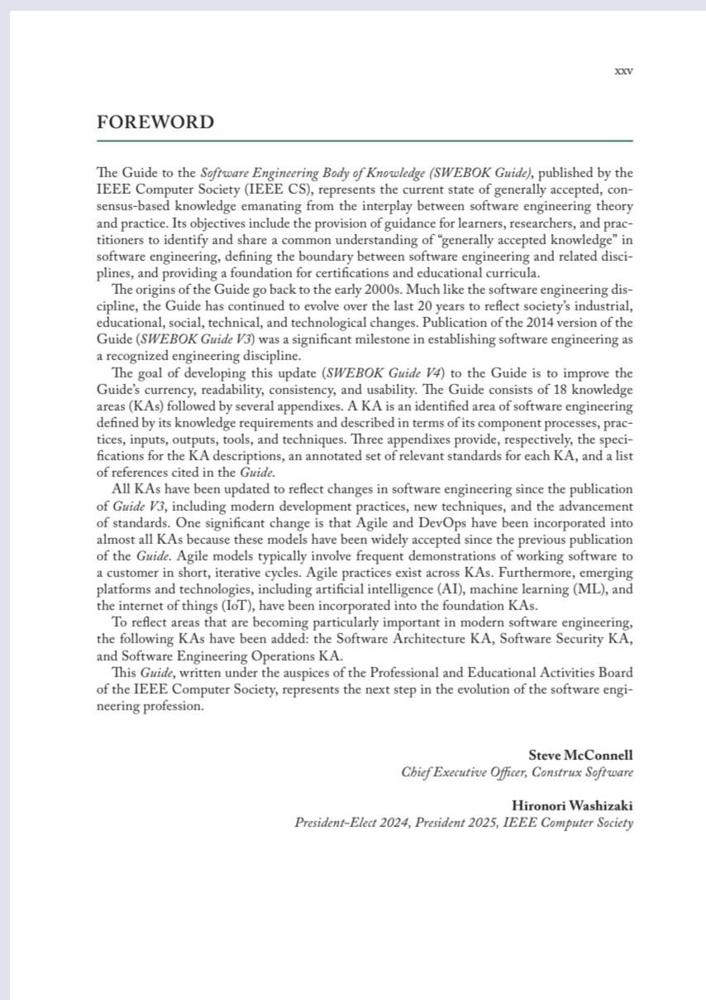
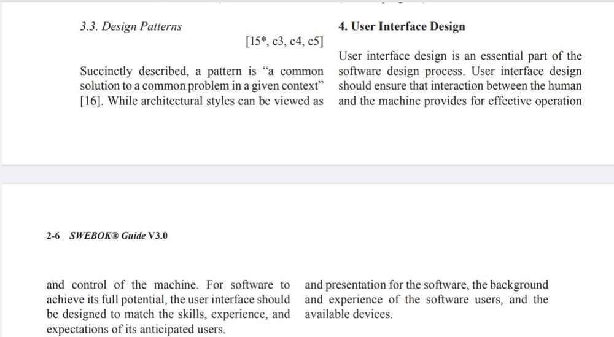
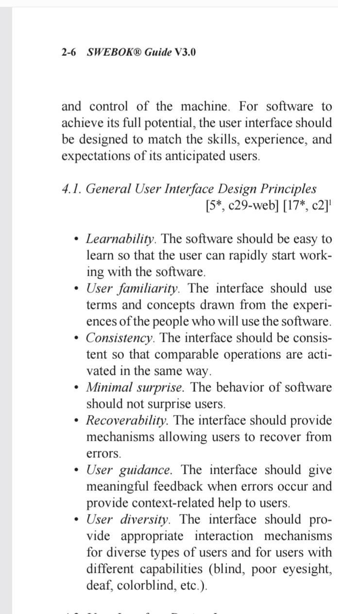
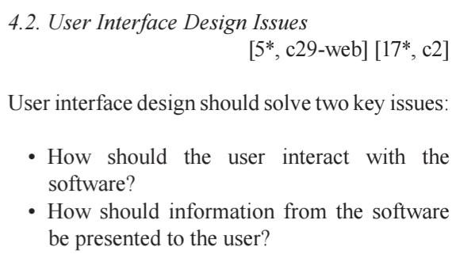
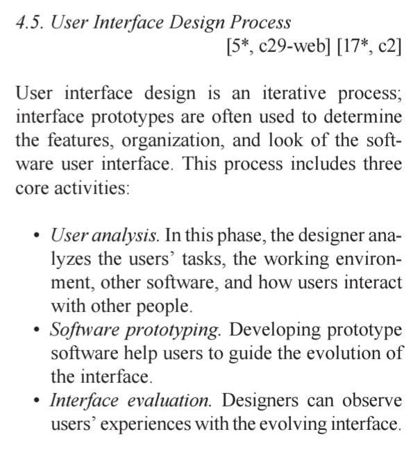
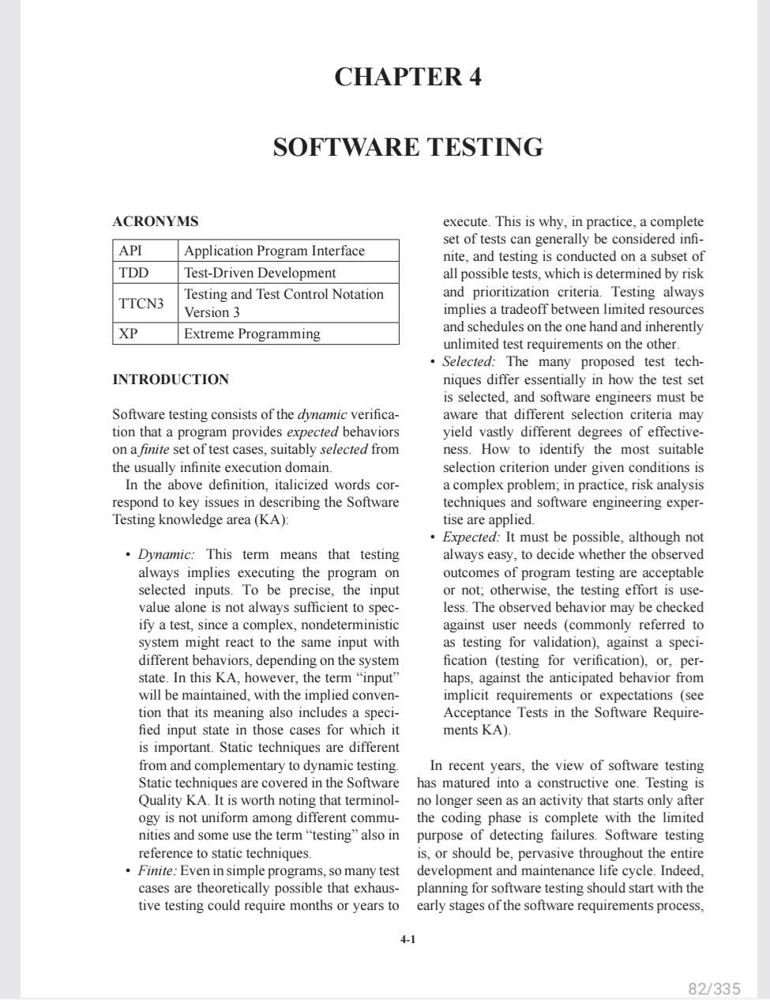
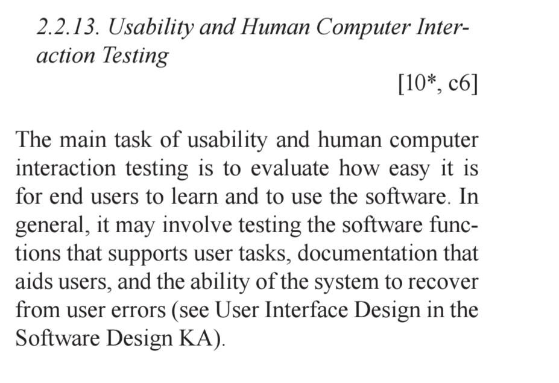
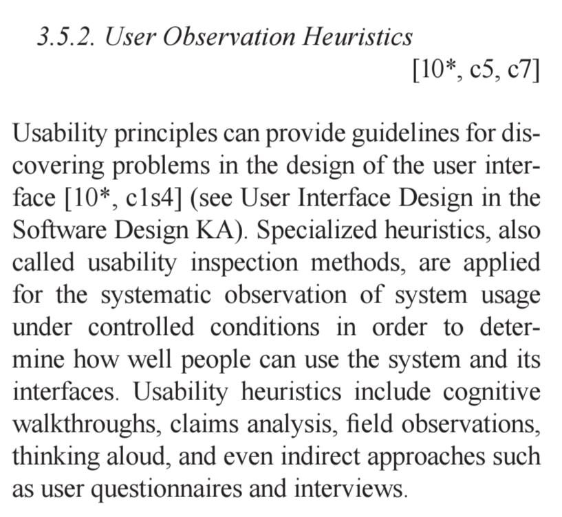

# Lista de Exercícios – Fundamentos de IHC: SWEBOK

**Autoria:** Alexandre Vilar Valadares Fonsêca · **Entrega 1**

## Tabela de contribuição

**Tabela 1 – Contribuições no trabalho "Lista de Exercícios – Fundamentos de IHC: SWEBOK"**

| Integrante | Contribuição | Atividade (link) | Gravação (link) |
| --- | --- | --- | --- |
| Alexandre Vilar Valadares Fonsêca | Autoria do trabalho (atividade individual) | Esta página | — |
| Gabriel Robson Nunes Neiva da Silva | Não se aplica (atividade individual) | — | — |
| Henrique Schneider Fernandes da Rosa | Não se aplica (atividade individual) | — | — |
| João Vitor Tavares de Sá Lima | Não se aplica (atividade individual) | — | — |

Fonte: elaborado pelos autores (2026).

## Histórico de versões

**Tabela 2 – Histórico de versões do trabalho "Lista de Exercícios – Fundamentos de IHC: SWEBOK"**

| Data | Versão | Descrição | Autor(es) | Revisor(es) |
| --- | --- | --- | --- | --- |
| 08/2026 | 1.0 | Elaboração do trabalho, entregue no Moodle (mês de entrega; dia não registrado no arquivo) | Alexandre Vilar | — |
| 17/10/2026 | 1.1 | Publicação no site: transcrição, fotos das fontes, citações e referências no padrão da disciplina | Henrique Schneider | — |

Fonte: elaborado pelos autores (2026).

## 1. Introdução

Lista de exercícios individual sobre o SWEBOK. O enunciado pede que as perguntas 1 e 2 sejam feitas a uma ferramenta de inteligência artificial e que as demais sejam respondidas diretamente do SWEBOK, com o item do capítulo, a página, a versão do guia e a foto do trecho.

Cada resposta traz a fonte (página, minuto do vídeo ou slide) e a foto do trecho correspondente. Clique no título de cada figura para abrir a foto.

## 2. Perguntas e respostas

### Pergunta 1

**Pergunta:** O que é o SWEBok?

**Resposta:** O SWEBOK (sigla em inglês para Guide to the Software Engineering Body of Knowledge, ou "Guia do Corpo de Conhecimento de Engenharia de Software") é um guia de referência internacionalmente reconhecido, desenvolvido pelo IEEE Computer Society. O principal objetivo da iniciativa é definir, estruturar e padronizar o conhecimento essencial que se espera que um profissional de engenharia de software competente possua.

**Fonte:** resposta obtida de uma ferramenta de inteligência artificial generativa, como pede o enunciado das perguntas 1 e 2.

### Pergunta 2

**Pergunta:** O que significa SWEBOK? Por que ele foi escrito? Por quem ele foi escrito?

**Resposta:** 1. O que significa SWEBOK? SWEBOK é o acrônimo para Software Engineering Body of Knowledge (em português, Guia do Corpo de Conhecimento de Engenharia de Software). Ele representa a soma de conhecimentos, habilidades, técnicas, melhores práticas e experiências acumuladas e validadas dentro da disciplina de engenharia de software. 2. Por que ele foi escrito? O SWEBOK foi criado para resolver problemas fundamentais de uma profissão que cresceu de forma rápida e desorganizada. Os principais motivos foram: Padronizar a profissão: Estabelecer uma visão global, unificada e consistente sobre o que é a engenharia de software, diferenciando-a de outras áreas (como Ciência da Computação ou Gestão de Projetos). Definir o "conhecimento aceito": Delimitar o subconjunto de conhecimentos que se espera que um engenheiro de software competente domine após alguns anos de prática. Apoiar a educação e certificações: Fornecer uma base sólida para universidades criarem grades curriculares de cursos de engenharia de software e fundamentar exames de certificação profissional. Servir de referência industrial: Auxiliar empresas a estruturarem planos de carreira, treinamentos e processos de desenvolvimento de forma alinhada ao mercado global. 3. Por quem ele foi escrito? O guia não é obra de uma única pessoa, mas sim o resultado de um esforço colaborativo internacional coordenado pela IEEE Computer Society (uma das maiores sociedades de profissionais de computação do mundo, ligada ao Institute of Electrical and Electronics Engineers - IEEE). Sua criação e suas contínuas revisões ao longo dos anos (como a versão mais recente, o SWEBOK v4) envolvem a participação ativa de centenas de especialistas da indústria, pesquisadores acadêmicos e comitês técnicos de vários países. Esse processo rigoroso garante que o conteúdo reflita um verdadeiro consenso global entre a teoria acadêmica e a prática corporativa.

**Fonte:** resposta obtida de uma ferramenta de inteligência artificial generativa, como pede o enunciado das perguntas 1 e 2.

### Pergunta 3

**Pergunta:** O que é o SWEBOK? Para que ele foi escrito? Por quem ele foi escrito?

**Resposta:** O Guia para o Corpo de Conhecimento de Engenharia de Software (Guia SWEBOK), publicado pela IEEE Computer Society (IEEE CS), representa o estado atual do conhecimento geralmente aceito e baseado em consenso, emanado da interação entre a teoria e a prática da engenharia de software. Seus objetivos incluem o fornecimento de diretrizes para estudantes, pesquisadores e profissionais para identificar e compartilhar uma compreensão comum do "conhecimento geralmente aceito" em engenharia de software, definindo a fronteira entre a engenharia de software e disciplinas relacionadas, e fornecendo uma base para certificações e currículos educacionais.

**Fonte:** Washizaki (2024, Foreword, p. 26 do arquivo PDF).

??? quote "Figura 1 – Evidência da resposta à pergunta 3"

    

    Fonte: Washizaki (2024, Foreword, p. 26 do arquivo PDF).

### Pergunta 4

**Pergunta:** Qual a definição de Projeto de Interface do Usuário (User Interface Design) apresentada no Capítulo 2 "Design Software" do SWEBok?

**Resposta:** O projeto de interface de usuário é uma parte essencial do processo de design de software. O projeto de interface de usuário deve garantir que a interação entre o ser humano e a máquina proporcione uma operação e um controle eficazes da máquina. Para que o software alcance todo o seu potencial, a interface de usuário deve ser projetada para corresponder às habilidades, à experiência e às expectativas de seus usuários previstos.

**Fonte:** Bourque e Fairley (2014, cap. 2, item 4, p. 54 do arquivo PDF).

??? quote "Figura 2 – Evidência da resposta à pergunta 4"

    

    Fonte: Bourque e Fairley (2014, cap. 2, item 4, p. 54 do arquivo PDF).

### Pergunta 5

**Pergunta:** Quais são os Princípios Gerais Projeto de Interface do Usuário (General User Interface Design Principles)? Descreva cada um deles.

**Resposta:** Capacidade de aprendizado (Learnability): O software deve ser fácil de aprender para que o usuário possa começar a trabalhar com ele rapidamente. Familiaridade do usuário: A interface deve usar termos e conceitos extraídos das experiências das pessoas que usarão o software. Consistência: A interface deve ser consistente para que operações comparáveis sejam acionadas da mesma forma. Mínima surpresa: O comportamento do software não deve surpreender os usuários. Capacidade de recuperação (Recoverability): A interface deve fornecer mecanismos que permitam aos usuários se recuperarem de erros. Orientação ao usuário: A interface deve fornecer feedback significativo quando ocorrerem erros e disponibilizar ajuda relacionada ao contexto para os usuários. Diversidade de usuários: A interface deve fornecer mecanismos de interação adequados para diversos tipos de usuários e para usuários com diferentes capacidades (cegos, com visão reduzida, surtos, daltônicos, etc. — nota: "poor eyesight" traduz-se melhor como visão reduzida/baixa visão).

**Fonte:** Bourque e Fairley (2014, cap. 2, item 4.1, p. 55 do arquivo PDF).

??? quote "Figura 3 – Evidência da resposta à pergunta 5"

    

    Fonte: Bourque e Fairley (2014, cap. 2, item 4.1, p. 55 do arquivo PDF).

### Pergunta 6

**Pergunta:** Quais são as duas questões chaves que o projeto de interface deve resolver?

**Resposta:** Como o usuário deve interagir com o software? Como as informações do software devem ser apresentadas ao usuário?

**Fonte:** Bourque e Fairley (2014, cap. 2, item 4.2, p. 55 do arquivo PDF).

??? quote "Figura 4 – Evidência da resposta à pergunta 6"

    

    Fonte: Bourque e Fairley (2014, cap. 2, item 4.2, p. 55 do arquivo PDF).

### Pergunta 7

**Pergunta:** Fale sobre o Processo de Design de Interface do Usuário e apresente as três atividades principais desse processo?

**Resposta:** O projeto de interface de usuário é um processo iterativo; protótipos de interface são frequentemente usados para determinar as funcionalidades, a organização e a aparência da interface de usuário do software. Esse processo inclui três atividades principais: Análise de usuários: Nesta fase, o designer analisa as tarefas dos usuários, o ambiente de trabalho, outros softwares e como os usuários interagem com outras pessoas. Prototipagem de software: O desenvolvimento de software protótipo ajuda os usuários a orientar a evolução da interface. Avaliação de interface: Os designers podem observar as experiências dos usuários com a interface em evolução.

**Fonte:** Bourque e Fairley (2014, cap. 2, item 4.5, p. 56 do arquivo PDF).

??? quote "Figura 5 – Evidência da resposta à pergunta 7"

    

    Fonte: Bourque e Fairley (2014, cap. 2, item 4.5, p. 56 do arquivo PDF).

### Pergunta 8

**Pergunta:** O que é Teste de Software (Software testing)?

**Resposta:** O teste de software consiste na verificação dinâmica de que um programa fornece os comportamentos esperados em um conjunto finito de casos de teste, adequadamente selecionados a partir do domínio de execução, que geralmente é infinito.

**Fonte:** Bourque e Fairley (2014, cap. 4, introdução, p. 82 do arquivo PDF).

??? quote "Figura 6 – Evidência da resposta à pergunta 8"

    

    Fonte: Bourque e Fairley (2014, cap. 4, introdução, p. 82 do arquivo PDF).

### Pergunta 9

**Pergunta:** O que é teste de usabilidade e de interação Humana Computador (Usability and Human Computer Interaction Testing)? O que esse teste pode envolver?

**Resposta:** A principal tarefa dos testes de usabilidade e de interação humano-computador é avaliar quão fácil é para os usuários finais aprenderem e usarem o software. Em geral, isso pode envolver testar as funções do software que dão suporte às tarefas do usuário, a documentação que auxilia os usuários e a capacidade do sistema de se recuperar de erros do usuário (consulte Projeto de Interface de Usuário na Área de Conhecimento de Projeto de Software).

**Fonte:** Bourque e Fairley (2014, cap. 4, item 2.2.13, p. 88 do arquivo PDF).

??? quote "Figura 7 – Evidência da resposta à pergunta 9"

    

    Fonte: Bourque e Fairley (2014, cap. 4, item 2.2.13, p. 88 do arquivo PDF).

### Pergunta 10

**Pergunta:** O que é Heurísticas de Observação de Usuário (User Observation Heuristics)?

**Resposta:** Os princípios de usabilidade podem fornecer diretrizes para descobrir problemas no projeto da interface de usuário. Heurísticas especializadas, também chamadas de métodos de inspeção de usabilidade, são aplicadas para a observação sistemática do uso do sistema sob condições controladas, a fim de determinar quão bem as pessoas conseguem usar o sistema e suas interfaces. As heurísticas de usabilidade incluem walkthroughs cognitivos (análises passo a passo), análise de reivindicações (claims analysis), observações de campo, pensamento em voz alta (thinking aloud) e até abordagens indiretas, como questionários e entrevistas com usuários.

**Fonte:** Bourque e Fairley (2014, cap. 4, item 3.5.2, p. 91 do arquivo PDF).

??? quote "Figura 8 – Evidência da resposta à pergunta 10"

    

    Fonte: Bourque e Fairley (2014, cap. 4, item 3.5.2, p. 91 do arquivo PDF).

## Referências

BOURQUE, Pierre; FAIRLEY, Richard E. (ed.). *Guide to the Software Engineering Body of Knowledge (SWEBOK)*: version 3.0. Los Alamitos: IEEE Computer Society, 2014.

SALES, André Barros de. *Plano de Ensino*: Interação Humano Computador (FGA0173), 02/2026, Turma 01, v1. Brasília: Universidade de Brasília, 2026.

WASHIZAKI, Hironori (ed.). *Guide to the Software Engineering Body of Knowledge (SWEBOK Guide)*: version 4.0. [*S. l.*]: IEEE Computer Society, 2024.

## Agradecimentos e uso de IA generativa

**Uso de IA generativa nesta página.** O Claude (Anthropic) foi utilizado na transcrição do documento original para o site e na padronização da formatação, das legendas, das citações e das referências às normas da disciplina. O conteúdo do trabalho é de Alexandre Vilar, indicado(a) na tabela de contribuição. A ferramenta não é autora do artefato e seu uso não exime os autores da responsabilidade sobre o conteúdo (SALES, 2026, p. 3).
