# Lista de Exercícios – Qualidade de Software: Verificação

**Autoria:** Alexandre Vilar Valadares Fonsêca · **Entrega 1**

## Tabela de contribuição

**Tabela 1 – Contribuições no trabalho "Lista de Exercícios – Qualidade de Software: Verificação"**

| Integrante | Contribuição | Atividade (link) | Gravação (link) |
| --- | --- | --- | --- |
| Alexandre Vilar Valadares Fonsêca | Autoria do trabalho (atividade individual) | Esta página | — |
| Gabriel Robson Nunes Neiva da Silva | Não se aplica (atividade individual) | — | — |
| Henrique Schneider Fernandes da Rosa | Não se aplica (atividade individual) | — | — |
| João Vitor Tavares de Sá Lima | Não se aplica (atividade individual) | — | — |

Fonte: elaborado pelos autores (2026).

## Histórico de versões

**Tabela 2 – Histórico de versões do trabalho "Lista de Exercícios – Qualidade de Software: Verificação"**

| Data | Versão | Descrição | Autor(es) | Revisor(es) |
| --- | --- | --- | --- | --- |
| 08/2026 | 1.0 | Elaboração do trabalho, entregue no Moodle | Alexandre Vilar | — |
| 17/10/2026 | 1.1 | Publicação no site: transcrição, fotos das fontes, citações e referências no padrão da disciplina | Henrique Schneider | — |

Fonte: elaborado pelos autores (2026).

## 1. Introdução

Lista de exercícios individual sobre verificação e validação, respondida a partir de duas videoaulas da Univesp e dos slides da aula 23 de Requisitos. O enunciado pede, em cada resposta, a fonte com a página ou o minuto do vídeo e a foto do momento da resposta.

Cada resposta traz a fonte (página, minuto do vídeo ou slide) e a foto do trecho correspondente. Clique no título de cada figura para abrir a foto.

## 2. Perguntas e respostas

### Pergunta 1

**Pergunta:** Quais são os produtos que podem ser analisados pela Verificação e Validação?

**Resposta:** Além do próprio software, podem ser analisados manuais, modelos criados durante o desenvolvimento e outros artefatos de software.

**Fonte:** Univesp ([20--]a, 1:11).

??? quote "Figura 1 – Evidência da resposta à pergunta 1"

    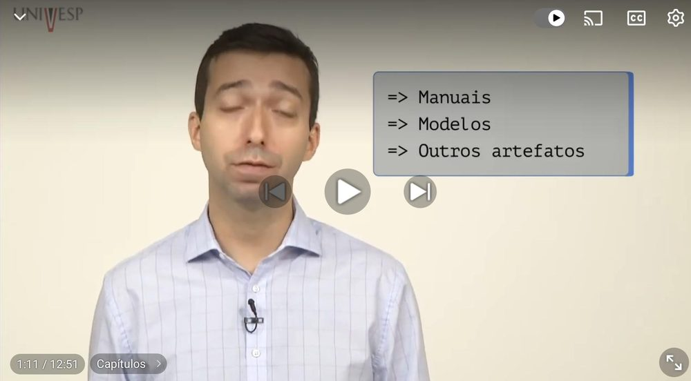

    Fonte: Univesp ([20--]a, 1:11).

### Pergunta 2

**Pergunta:** O que é uma análise estática e análise dinâmica?

**Resposta:** Análise estática: Não executa o software. A partir dela, determinam-se propriedades válidas para qualquer execução do produto (ex: revisões). Análise dinâmica: Executa o produto ou sua especificação. Os testes são a forma mais comum de análise dinâmica.

**Fonte:** Univesp ([20--]a, 1:21).

??? quote "Figura 2 – Evidência da resposta à pergunta 2"

    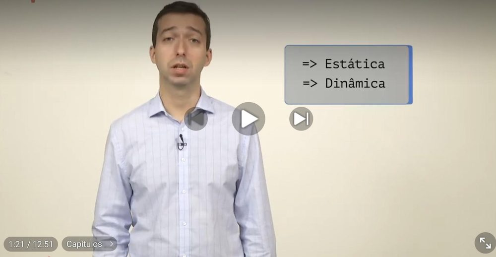

    Fonte: Univesp ([20--]a, 1:21).

### Pergunta 3

**Pergunta:** O que é verificação?

**Resposta:** A verificação busca garantir que os produtos e trabalhos selecionados cumpram seus requisitos especificados. Em resumo, verifica se o software construído "está certo".

**Fonte:** Univesp ([20--]a, 2:02).

??? quote "Figura 3 – Evidência da resposta à pergunta 3"

    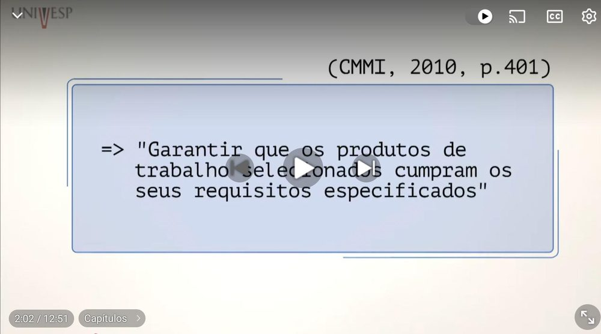

    Fonte: Univesp ([20--]a, 2:02).

### Pergunta 4

**Pergunta:** Cite alguns exemplos de verificação.

**Resposta:** Revisões e auditorias, model checking (em requisitos), avaliação arquitetural (ex: método ATAM), integração contínua, programação em pares, ferramentas de análise estática de código e testes (verificação da correção dos próprios testes e cobertura).

**Fonte:** Univesp ([20--]a, 2:31).

??? quote "Figura 4 – Evidência da resposta à pergunta 4"

    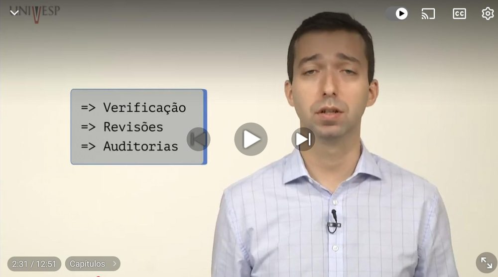

    Fonte: Univesp ([20--]a, 2:31).

### Pergunta 5

**Pergunta:** O que pode ser verificado?

**Resposta:** Praticamente qualquer artefato de software, como requisitos, documentos de projeto, código, manuais e os próprios testes.

**Fonte:** Univesp ([20--]a, 2:15).

??? quote "Figura 5 – Evidência da resposta à pergunta 5"

    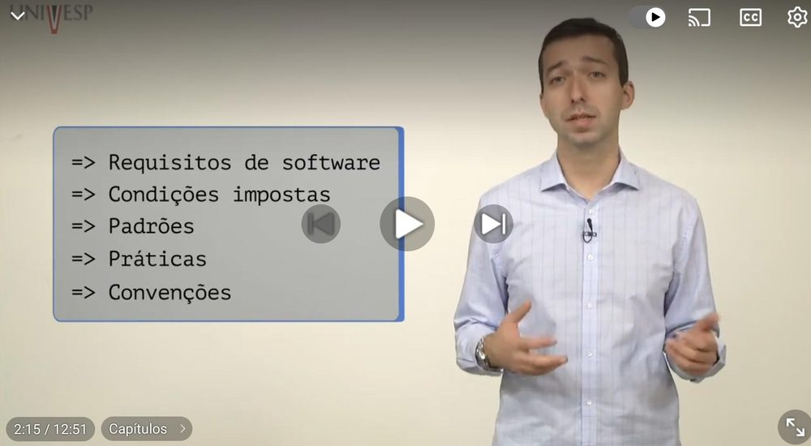

    Fonte: Univesp ([20--]a, 2:15).

### Pergunta 6

**Pergunta:** O que é validação?

**Resposta:** É o processo de demonstrar o produto ou componente com o uso pretendido, no seu ambiente desejado, analisando se ele atende às necessidades dos stakeholders (usuários/clientes). Em resumo, valida se "está sendo construído o software certo"

**Fonte:** Univesp ([20--]a, 3:50).

??? quote "Figura 6 – Evidência da resposta à pergunta 6"

    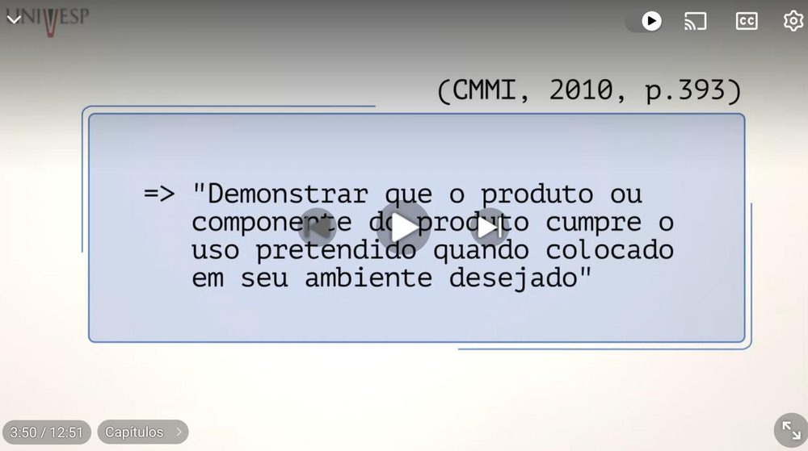

    Fonte: Univesp ([20--]a, 3:50).

### Pergunta 7

**Pergunta:** O que é revisão?

**Resposta:** É um método utilizado para avaliar produtos ou artefatos de software com o objetivo de identificar defeitos. Ela serve tanto para garantir a qualidade (atendimento a padrões) quanto para processos de verificação e validação (detecção de problemas ou omissões frente ao que foi especificado).

**Fonte:** Univesp ([20--]b, 0:30).

??? quote "Figura 7 – Evidência da resposta à pergunta 7"

    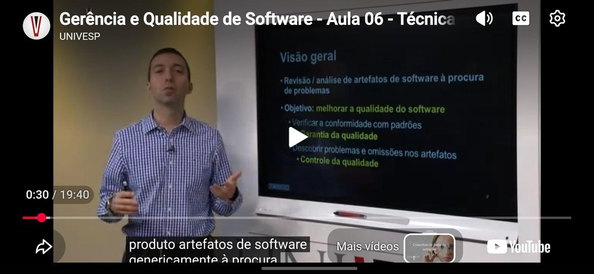

    Fonte: Univesp ([20--]b, 0:30).

### Pergunta 8

**Pergunta:** Cite exemplos de revisão estática e revisão dinâmica?

**Resposta:** Revisão Estática: É a forma tradicional, onde o produto é analisado sem ser executado (ex: revisão de documentos ou código-fonte por meio de leitura). Revisão Dinâmica: Ocorre quando o produto precisa ser executado para ser revisado (ex: inspeção de usabilidade, onde é necessário interagir com a interface para verificar se ela é adequada).

**Fonte:** Univesp ([20--]b, 1:31).

??? quote "Figura 8 – Evidência da resposta à pergunta 8"

    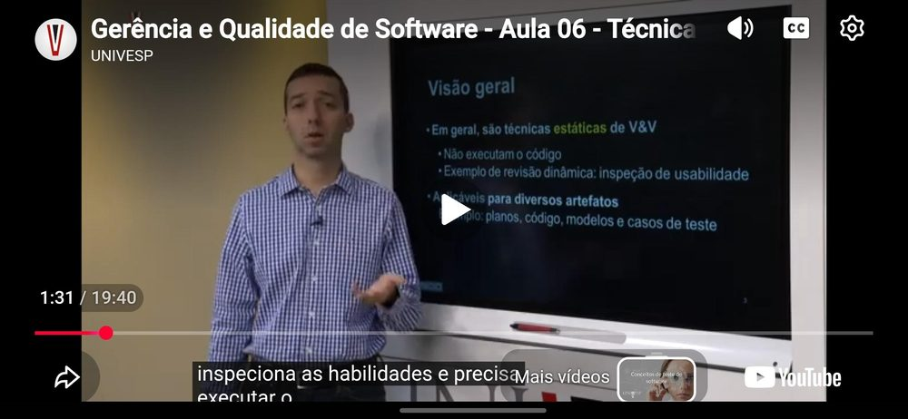

    Fonte: Univesp ([20--]b, 1:31).

### Pergunta 9

**Pergunta:** Quais são os tipos de revisão formais?

**Resposta:** De acordo com as normas da IEEE, os tipos principais são: revisão gerencial, revisão técnica, inspeção e walkthrough (que entra na categoria de revisão técnica) e auditoria.

**Fonte:** Univesp ([20--]b, 13:55).

??? quote "Figura 9 – Evidência da resposta à pergunta 9"

    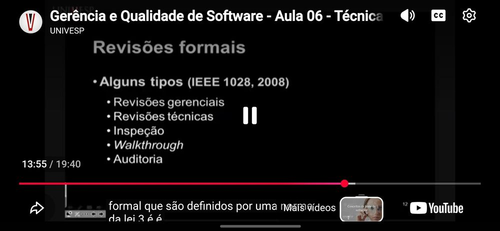

    Fonte: Univesp ([20--]b, 13:55).

### Pergunta 10

**Pergunta:** Explique o processo de Inspeção.

**Resposta:** A inspeção é um processo rigoroso e formal que segue três etapas: Antes da revisão (Planejamento/Preparação): Leitura do artefato, marcação de data e preparação do ambiente. Reunião de Inspeção: Encontro com o grupo para avaliar o artefato. Depois da revisão (Acompanhamento): Verificação se os defeitos identificados foram corrigidos ou se é necessária uma nova reunião.

**Fonte:** Univesp ([20--]b, 14:15).

??? quote "Figura 10 – Evidência da resposta à pergunta 10"

    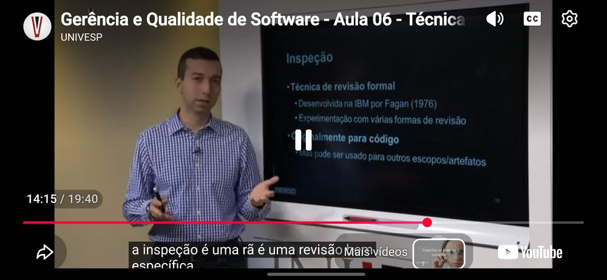

    Fonte: Univesp ([20--]b, 14:15).

### Pergunta 11

**Pergunta:** Quais são as características principais da Inspeção?

**Resposta:** Uso de Checklist: Lista de defeitos comuns que devem ser verificados. Classificação de defeitos: Registra-se o tipo de defeito para criar um histórico. Preparação individual: Os participantes devem estudar o artefato antes da reunião. Leitor dedicado: Durante a reunião, a leitura do artefato não é feita pelo autor, mas por outra pessoa designada, para garantir uma análise imparcial.

**Fonte:** Univesp ([20--]b, 15:26).

??? quote "Figura 11 – Evidência da resposta à pergunta 11"

    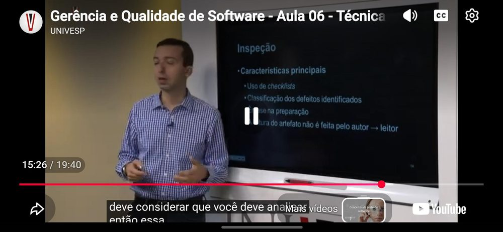

    Fonte: Univesp ([20--]b, 15:26).

### Pergunta 12

**Pergunta:** Quais são os seis passos do método de inspeção proposto por Fagan?

**Resposta:** Os passos são: 1Planejamento; 2Visão Geral; 3Preparação; 4Inspeção; 5Correção; e 6Acompanhamento.

**Fonte:** Serrano e Serrano ([20--], slide 21).

??? quote "Figura 12 – Evidência da resposta à pergunta 12"

    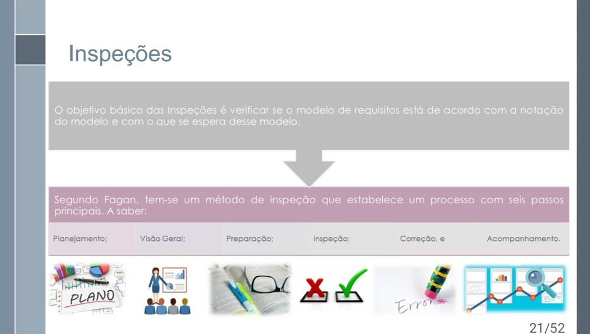

    Fonte: Serrano e Serrano ([20--], slide 21).

### Pergunta 13

**Pergunta:** Cite algumas estratégias de validação de software?

**Resposta:** Comprovação informal; Prototipação; e Baseada em Ponto de Vista.

**Fonte:** Serrano e Serrano ([20--], slide 29).

??? quote "Figura 13 – Evidência da resposta à pergunta 13"

    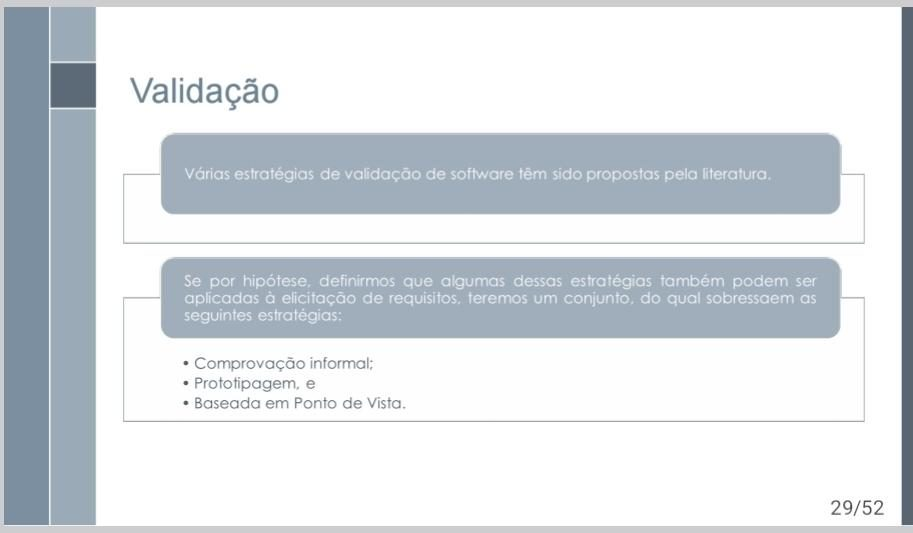

    Fonte: Serrano e Serrano ([20--], slide 29).

### Pergunta 14

**Pergunta:** Escolha uma estratégia de verificação e explique como utilizar essa estratégia para verificar um artefato do seu projeto de IHC.

**Resposta:** A estratégia de Inspeção será escolhida por permitir a identificação de falhas antes da fase de testes. Em um projeto de IHC, como na avaliação de um protótipo de aplicativo, conseguimos efetuar os 6 passos. 1. Planejamento: definir o escopo, a equipe e os critérios da avaliação. 2. Visão Geral: apresentar o protótipo e seus objetivos aos participantes. 3. Preparação: análise individual prévia para buscar possíveis problemas. 4. Inspeção: reunião para discutir e registrar as falhas encontradas. 5. Correção: ajuste dos erros apontados. 6. Acompanhamento: verificação para garantir que os problemas foram resolvidos. Esse processo facilita na hora de encontrar erros práticos, como informações ausentes ou telas inconsistentes. Assim, conseguimos fazer com que tudo seja corrigido e acompanhado de forma organizada. Como o Slide 21 possui os 6 passos principais, está aqui a evidência.

**Fonte:** Serrano e Serrano ([20--], slide 21).

??? quote "Figura 14 – Evidência da resposta à pergunta 14"

    

    Fonte: Serrano e Serrano ([20--], slide 21).

## Referências

SALES, André Barros de. *Plano de Ensino*: Interação Humano Computador (FGA0173), 02/2026, Turma 01, v1. Brasília: Universidade de Brasília, 2026.

SERRANO, Milene; SERRANO, Maurício. *Requisitos*: aula 23: análise, verificação e validação. Brasília: Universidade de Brasília, [20--]. 52 slides.

UNIVESP. *Gerência e qualidade de software*: aula 05: verificação e validação. São Paulo: Univesp, [20--]a. 1 vídeo (12 min 51 s). Disponível em: https://www.youtube.com/watch?v=1Y-1zz6rZxo.

UNIVESP. *Gerência e qualidade de software*: aula 06: técnica de revisão. São Paulo: Univesp, [20--]b. 1 vídeo (19 min 40 s).

## Agradecimentos e uso de IA generativa

**Uso de IA generativa nesta página.** O Claude (Anthropic) foi utilizado na transcrição do documento original para o site e na padronização da formatação, das legendas, das citações e das referências às normas da disciplina. O conteúdo do trabalho é de Alexandre Vilar, indicado(a) na tabela de contribuição. A ferramenta não é autora do artefato e seu uso não exime os autores da responsabilidade sobre o conteúdo (SALES, 2026, p. 3).
