# Lista de Verificação – Planejamento da Avaliação com o Framework DECIDE

**Autoria:** Alexandre Vilar Valadares Fonsêca · **Entrega 1**

## Tabela de contribuição

**Tabela 1 – Contribuições no trabalho "Lista de Verificação – Planejamento da Avaliação com o Framework DECIDE"**

| Integrante | Contribuição | Atividade (link) | Gravação (link) |
| --- | --- | --- | --- |
| Alexandre Vilar Valadares Fonsêca | Autoria do trabalho (atividade individual) | Esta página | — |
| Gabriel Robson Nunes Neiva da Silva | Não se aplica (atividade individual) | — | — |
| Henrique Schneider Fernandes da Rosa | Não se aplica (atividade individual) | — | — |
| João Vitor Tavares de Sá Lima | Não se aplica (atividade individual) | — | — |

Fonte: elaborado pelos autores (2026).

## Histórico de versões

**Tabela 2 – Histórico de versões do trabalho "Lista de Verificação – Planejamento da Avaliação com o Framework DECIDE"**

| Data | Versão | Descrição | Autor(es) | Revisor(es) |
| --- | --- | --- | --- | --- |
| 28/08/2026 | 1.0 | Elaboração do trabalho, entregue no Moodle (prazo da atividade no Moodle) | Alexandre Vilar | — |
| 17/10/2026 | 1.1 | Publicação no site: transcrição, fotos das fontes, citações e referências no padrão da disciplina | Henrique Schneider | — |

Fonte: elaborado pelos autores (2026).

## 1. Introdução

Atividade individual do Moodle "Lista de verificação – DECIDE": elaborar itens de uma lista de verificação para inspecionar o planejamento de uma avaliação de IHC feito com o framework DECIDE.

Cada item é uma pergunta autocontida, respondida com **Conforme**, **Não conforme** ou **Não se aplica**. Abaixo de cada item estão a fonte, com capítulo, seção e página, e a foto do trecho que o fundamenta, como pede a atividade de elaboração de listas de verificação (SALES, [2026], p. 1). Clique no título de cada figura para abrir a foto.

As fotos do trecho são da edição de 2021 do livro de Barbosa e colaboradores (*Interação Humano-Computador e Experiência do Usuário*), cuja numeração de capítulos e páginas é a usada nas citações.

## 2. Itens da lista

### D – Determinar os objetivos da avaliação

#### Item 1

Os objetivos da avaliação de IHC foram definidos e estão relacionados a pelo menos um dos seguintes aspectos: identificar problemas na interação e na interface, verificar conformidade com padrões, avaliar a apropriação da tecnologia pelos usuários ou comparar alternativas de design?

**Fonte:** Barbosa et al. (2021, cap. 11, seç. 11.2, p. 264).

??? quote "Figura 1 – Trecho que fundamenta o item 1"

    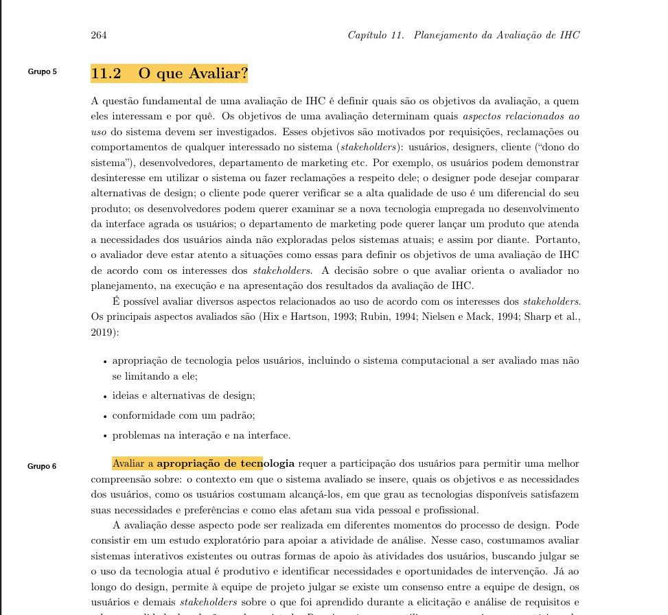

    Fonte: Barbosa et al. (2021, cap. 11, seç. 11.2, p. 264).

#### Item 2

A avaliação possui um escopo claramente definido, especificando quais partes do sistema, tarefas, perfis de usuários ou aspectos da interação serão efetivamente avaliados?

**Fonte:** Barbosa et al. (2021, cap. 11, seç. 11.2, p. 264, e seç. 11.7.2, p. 274).

??? quote "Figura 2 – Trecho que fundamenta o item 2"

    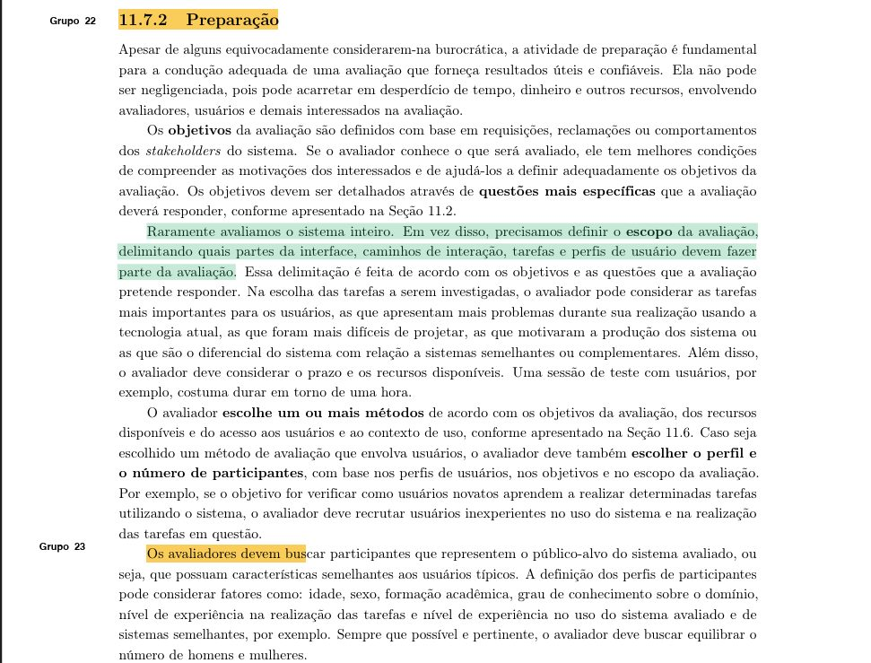

    Fonte: Barbosa et al. (2021, cap. 11, seç. 11.2, p. 264, e seç. 11.7.2, p. 274).

#### Item 3

O planejamento identifica o momento em que a avaliação será realizada no processo de design (formativa ou somativa/conclusiva) e considera quais representações do sistema (protótipos de baixa, média ou alta fidelidade) estarão disponíveis nesse momento?

**Fonte:** Barbosa et al. (2021, cap. 11, seç. 11.3, p. 267).

??? quote "Figura 3 – Trecho que fundamenta o item 3"

    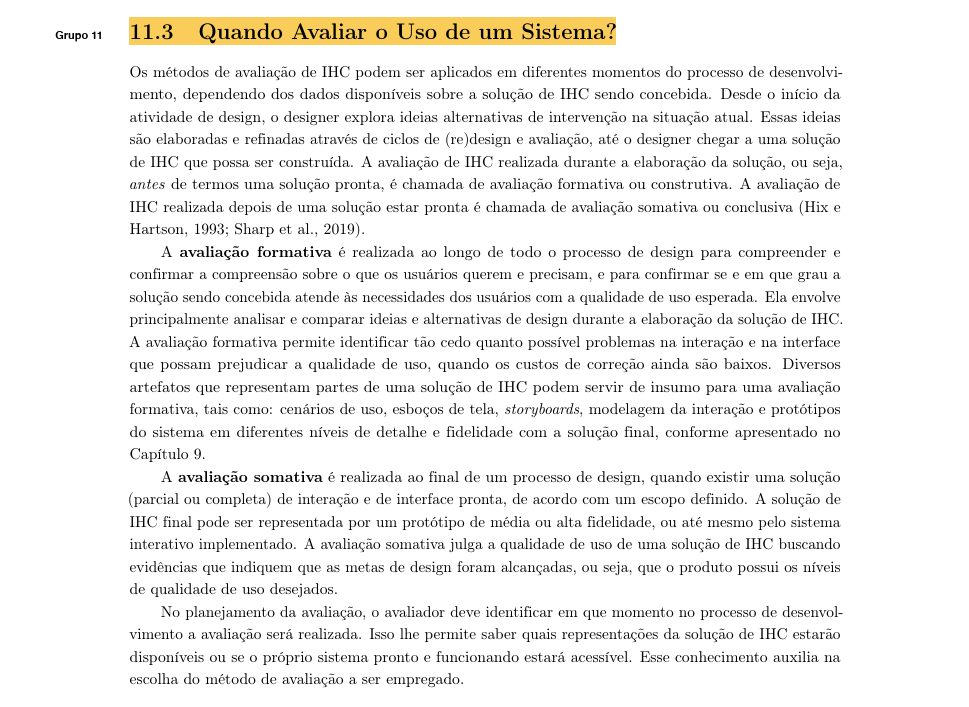

    Fonte: Barbosa et al. (2021, cap. 11, seç. 11.3, p. 267).

### E – Explorar as perguntas a serem respondidas

#### Item 4

Foram formuladas perguntas específicas de avaliação alinhadas aos objetivos declarados (seja para identificar dificuldades/problemas, verificar diretrizes/normas, averiguar necessidades dos usuários ou comparar alternativas de solução)?

**Fonte:** Barbosa et al. (2021, cap. 11, seç. 11.2, p. 265–266).

??? quote "Figura 4 – Trecho que fundamenta o item 4"

    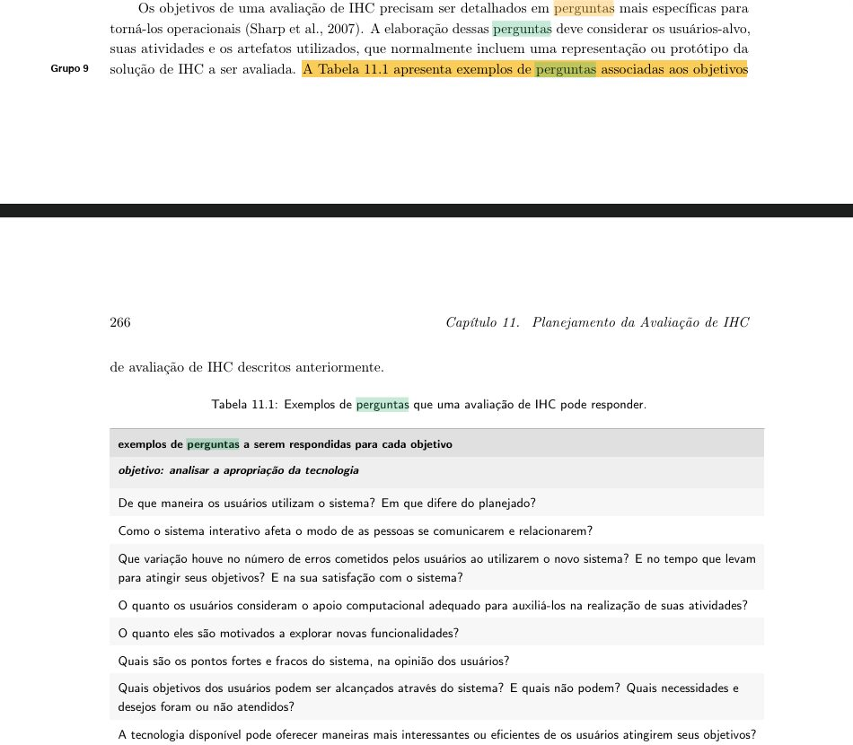

    Fonte: Barbosa et al. (2021, cap. 11, seç. 11.2, p. 265–266).

### C – Escolher os métodos de avaliação

#### Item 5

Foi escolhido pelo menos um método de avaliação (investigação, inspeção ou observação) adequado às perguntas e aos objetivos da avaliação, considerando limitações de prazo, orçamento, equipamentos e experiência dos avaliadores?

**Fonte:** Barbosa et al. (2021, cap. 12, p. 281).

??? quote "Figura 5 – Trecho que fundamenta o item 5"

    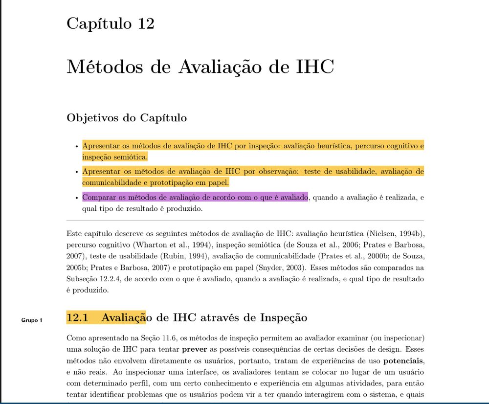

    Fonte: Barbosa et al. (2021, cap. 12, p. 281).

### I – Identificar e administrar as questões práticas

#### Item 6

Foram identificadas e planejadas as questões práticas necessárias para a execução da avaliação, incluindo recrutamento, equipe envolvida, equipamentos, ambiente, cronograma e orçamento?

**Fonte:** Barbosa et al. (2021, cap. 11, seç. 11.7.2, p. 275).

**Trecho de origem:** “O planejamento de uma avaliação envolve questões práticas, que incluem alocar pessoal, recursos e equipamentos e preparar o material de apoio. Uma avaliação com usuários requer também a preparação do ambiente de teste, a realização de um teste-piloto e o recrutamento dos participantes.”

??? quote "Figura 6 – Trecho que fundamenta o item 6"

    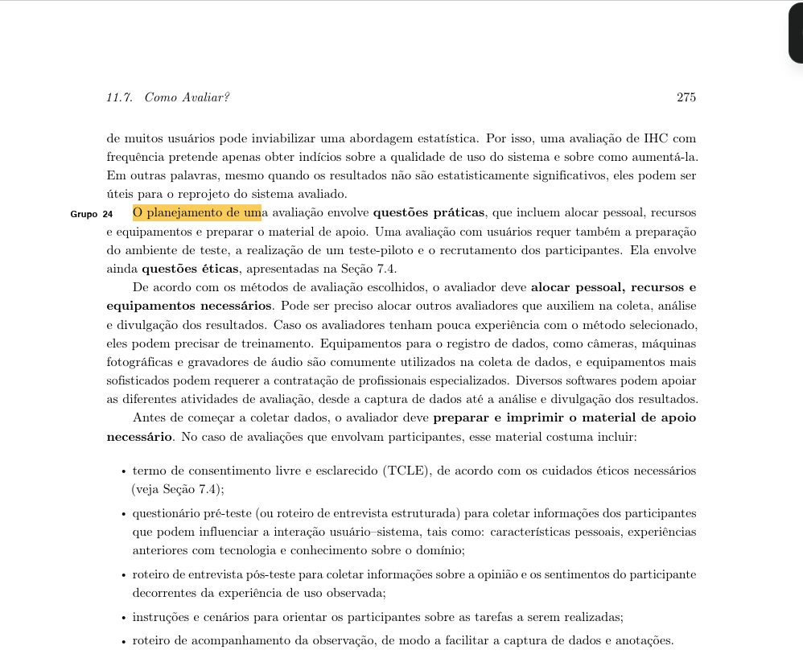

    Fonte: Barbosa et al. (2021, cap. 11, seç. 11.7.2, p. 275).

#### Item 7

O planejamento define quem são os usuários ou participantes da avaliação, detalhando características relevantes como conhecimento do domínio, experiência nas tarefas e vivência com sistemas semelhantes?

**Fonte:** Barbosa et al. (2021, cap. 11, seç. 11.7.2, p. 274).

**Trecho de origem:** “A definição dos perfis de participantes pode considerar fatores como: idade, sexo, formação acadêmica, grau de conhecimento sobre o domínio, nível de experiência na realização das tarefas e nível de experiência no uso do sistema avaliado e de sistemas semelhantes, por exemplo.”

??? quote "Figura 7 – Trecho que fundamenta o item 7"

    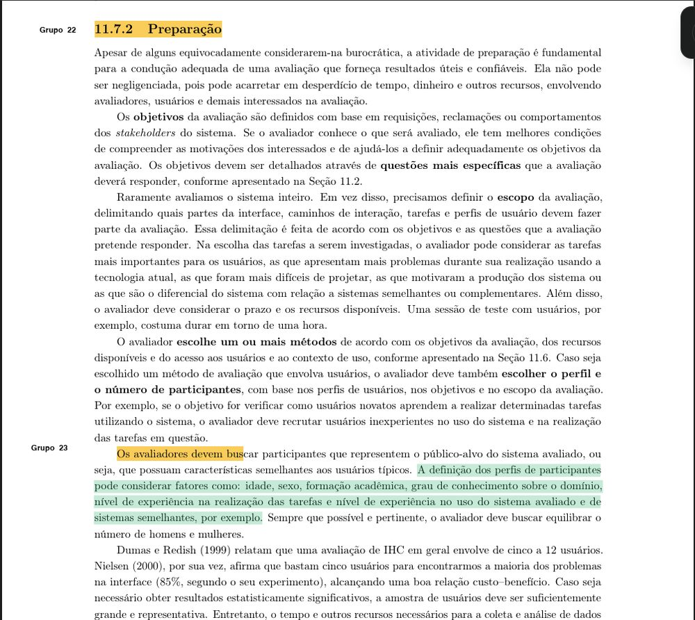

    Fonte: Barbosa et al. (2021, cap. 11, seç. 11.7.2, p. 274).

#### Item 8

Quando a avaliação envolver participantes, foram preparados os materiais necessários, como Termo de Consentimento Livre e Esclarecido (TCLE), questionários pré/pós-teste, roteiros de entrevista, instruções e cenários de tarefas?

**Fonte:** Barbosa et al. (2021, cap. 11, seç. 11.7.2, p. 275).

**Trecho de origem:** “Antes de começar a coletar dados, o avaliador deve preparar e imprimir o material de apoio necessário.”

??? quote "Figura 8 – Trecho que fundamenta o item 8"

    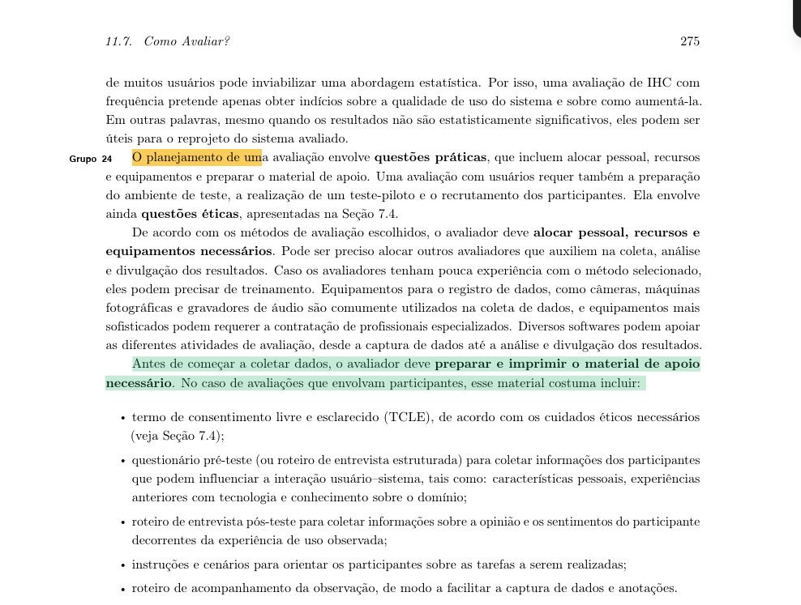

    Fonte: Barbosa et al. (2021, cap. 11, seç. 11.7.2, p. 275).

#### Item 9

Quando houver tarefas executadas por participantes, cada tarefa foi planejada com tempo estimado de até 20 minutos ou, caso ultrapasse, foram previstas pausas estruturadas para mitigar o impacto da fadiga nos resultados?

**Fonte:** Barbosa et al. (2021, cap. 11, seç. 11.7.2, p. 275).

**Trecho de origem:** “Quando for elaborar os cenários de tarefa, o avaliador deve estar atento ao tempo necessário para os participantes realizarem as tarefas descritas. O tempo estimado para um participante realizar cada tarefa não deveria ultrapassar 20 minutos. Se for necessário mais tempo, o participante deve poder fazer uma pausa rápida para evitar que sua fadiga física ou mental interfira no resultado da avaliação. " D – DECIDIR COMO LIDAR COM AS QUESTÕES ÉTICAS”

??? quote "Figura 9 – Trecho que fundamenta o item 9"

    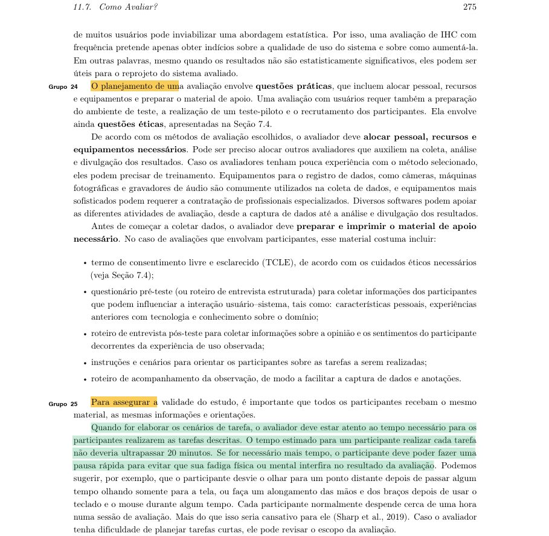

    Fonte: Barbosa et al. (2021, cap. 11, seç. 11.7.2, p. 275).

### D – Decidir como lidar com as questões éticas

#### Item 10

Quando a avaliação envolver seres humanos, foram garantidos os cuidados éticos de respeito, privacidade, voluntariedade e proteção contra prejuízos diretos ou indiretos antes, durante e após a realização e divulgação do estudo?

**Fonte:** Barbosa et al. (2021, cap. 11, seç. 11.7.3, p. 277).

**Trecho de origem:** “Depois dessa conversa inicial, o avaliador deve explicar ao participante os objetivos do estudo, o sistema de interesse, o procedimento da avaliação (por exemplo, apresentar uma visão geral das atividades que o participante é convidado a realizar) e os cuidados éticos sendo tomados (veja Seção 7.4). Se surgir alguma dúvida, ela deve ser sanada imediatamente pelo avaliador. Depois, o avaliador entrega o termo de consentimento em duas vias, já assinadas por ele próprio, e aguarda enquanto o participante lê e assina o termo, caso aceite participar da avaliação. Uma via do termo de consentimento fica com o avaliador e a outra com o participante." E – AVALIAR, INTERPRETAR E APRESENTAR OS DADOS”

??? quote "Figura 10 – Trecho que fundamenta o item 10"

    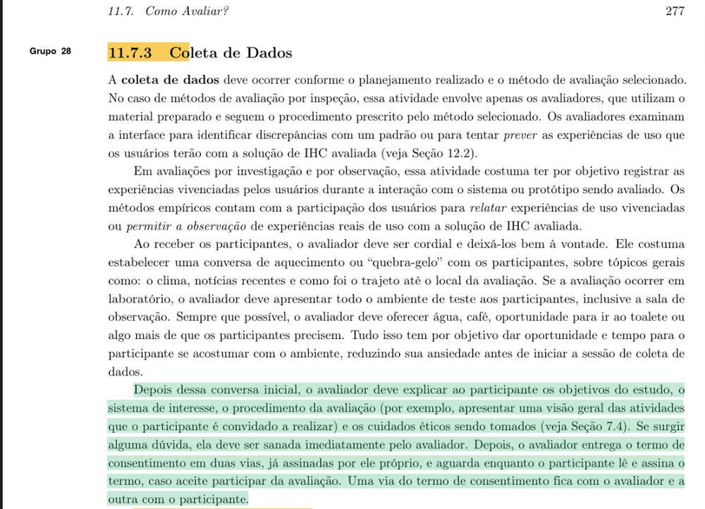

    Fonte: Barbosa et al. (2021, cap. 11, seç. 11.7.3, p. 277).

### E – Avaliar, interpretar e apresentar os dados

#### Item 11

O planejamento estabelece que os dados coletados sejam analisados considerando a confiabilidade, a validade interna, a validade externa e a validade ecológica antes do estabelecimento de conclusões?

**Fonte:** Barbosa et al. (2021, cap. 11, seç. 11.8, p. 280).

**Trecho de origem:** “O avaliador precisa estar atento a alguns aspectos da avaliação realizada antes de tirar conclusões e divulgar resultados. Ele deve considerar: o grau de confiabilidade dos dados”

??? quote "Figura 11 – Trecho que fundamenta o item 11"

    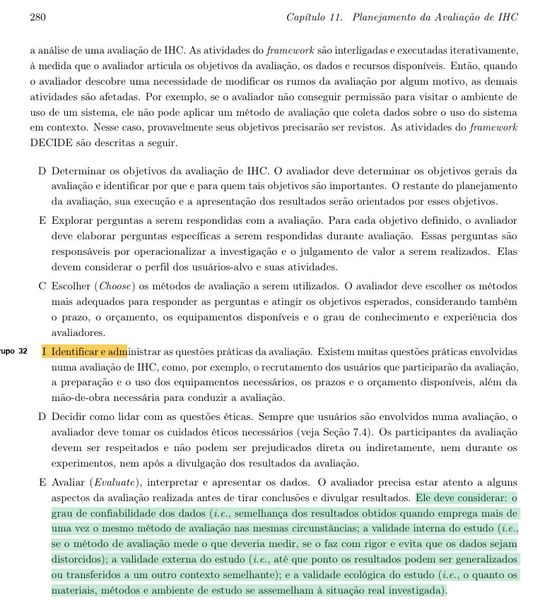

    Fonte: Barbosa et al. (2021, cap. 11, seç. 11.8, p. 280).

#### Item 12

O planejamento prevê a elaboração de um relatório final que documente os objetivos, escopo, método, perfil dos participantes, dados coletados e analisados, problemas encontrados e propostas de reprojeto do sistema?

**Fonte:** Barbosa et al. (2021, cap. 11, seç. 11.7.5, p. 279).

**Trecho de origem:** “Finalmente, os avaliadores devem relatar os resultados consolidados, que costumam incluir:”

??? quote "Figura 12 – Trecho que fundamenta o item 12"

    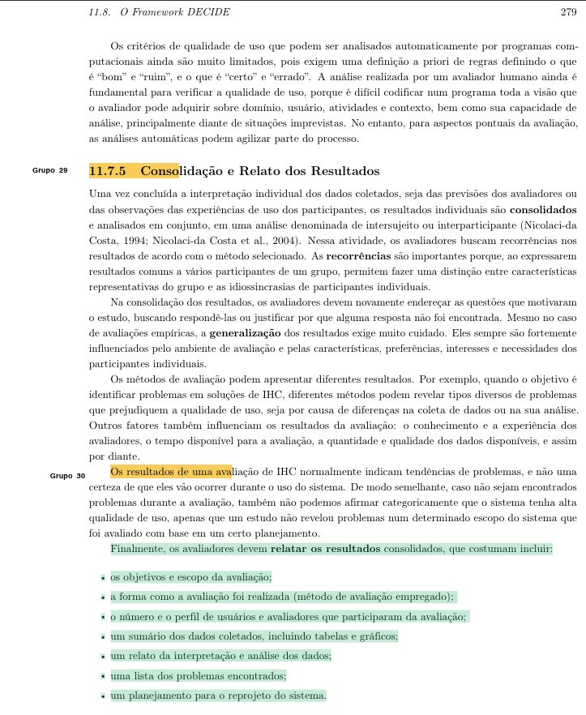

    Fonte: Barbosa et al. (2021, cap. 11, seç. 11.7.5, p. 279).

## Referências

BARBOSA, Simone Diniz Junqueira; SILVA, Bruno Santana da; SILVEIRA, Milene Selbach; GASPARINI, Isabela; DARIN, Ticianne; BARBOSA, Gabriel Diniz Junqueira. *Interação Humano-Computador e Experiência do Usuário*. [*S. l.*]: Autopublicação, 2021. Disponível em: https://leanpub.com/ihc-ux.

SALES, André Barros de. *Lista de Exercícios*: elaborar listas de verificação. Brasília: Universidade de Brasília, [2026]. Enunciado da atividade avaliativa Verificação 2.

SALES, André Barros de. *Plano de Ensino*: Interação Humano Computador (FGA0173), 02/2026, Turma 01, v1. Brasília: Universidade de Brasília, 2026.

## Agradecimentos e uso de IA generativa

**Uso de IA generativa nesta página.** O Claude (Anthropic) foi utilizado na transcrição do documento original para o site e na padronização da formatação, das legendas, das citações e das referências às normas da disciplina. O conteúdo do trabalho é de Alexandre Vilar, indicado(a) na tabela de contribuição. A ferramenta não é autora do artefato e seu uso não exime os autores da responsabilidade sobre o conteúdo (SALES, 2026, p. 3).
