# Lista de Exercícios – Planejamento da Avaliação de IHC

**Autoria:** Henrique Schneider Fernandes da Rosa · **Entrega 1**

## Tabela de contribuição

**Tabela 1 – Contribuições no trabalho "Lista de Exercícios – Planejamento da Avaliação de IHC"**

| Integrante | Contribuição | Atividade (link) | Gravação (link) |
| --- | --- | --- | --- |
| Alexandre Vilar Valadares Fonsêca | Não se aplica (atividade individual) | — | — |
| Gabriel Robson Nunes Neiva da Silva | Não se aplica (atividade individual) | — | — |
| Henrique Schneider Fernandes da Rosa | Autoria do trabalho (atividade individual) | Esta página | — |
| João Vitor Tavares de Sá Lima | Não se aplica (atividade individual) | — | — |

Fonte: elaborado pelos autores (2026).

## Histórico de versões

**Tabela 2 – Histórico de versões do trabalho "Lista de Exercícios – Planejamento da Avaliação de IHC"**

| Data | Versão | Descrição | Autor(es) | Revisor(es) |
| --- | --- | --- | --- | --- |
| 28/08/2026 | 1.0 | Elaboração do trabalho, entregue no Moodle (prazo da atividade no Moodle) | Henrique Schneider | — |
| 17/10/2026 | 1.1 | Publicação no site: transcrição, fotos das fontes, citações e referências no padrão da disciplina | Henrique Schneider | — |

Fonte: elaborado pelos autores (2026).

## 1. Introdução

Lista de exercícios individual sobre o planejamento da avaliação de IHC. O enunciado pede que as respostas venham das referências bibliográficas da disciplina, com o item do capítulo, a página, o nome e a edição do livro.

Cada resposta traz a fonte (página, minuto do vídeo ou slide) e a foto do trecho correspondente. Clique no título de cada figura para abrir a foto.

## 2. Perguntas e respostas

### Pergunta 1

**Pergunta:** Explique as vantagens de avaliar a qualidade de uso?

**Resposta:** Todo produto pode sofrer erros durante o desenvolvimento. A solução hipotética ideal seria avaliar todas as iterações de um produto final, o que teria custo altíssimo, logo, inviável. Tendo isso em mente, avaliar a qualidade de uso tem de forma resumida um custo pouco elevado quando comparado ao orçamento global de um projeto de desenvolvimento. Além disso, seus benefícios incluem aumentar a produtividade dos usuários, diminuir os erros de uso, aumentando a satisfação do usuário, contribui também para diminuir o custo de treinamento e suporte, além de facilitar o planejamento de protótipos.

**Fonte:** Barbosa e Silva (2010, cap. 9, p. 288–289).

??? quote "Figura 1 – Evidência da resposta à pergunta 1"

    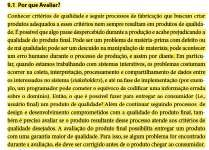

    Fonte: Barbosa e Silva (2010, cap. 9, p. 288–289).

### Pergunta 2

**Pergunta:** A avaliação de IHC deve ser conduzida pelos avaliadores que participaram da concepção da solução? Justifique a sua resposta.

**Resposta:** Não. Para manter neutralidade e imparcialidade, avaliadores externos são fundamentais. Além disso, é necessário atribuir o papel de advogado do usuário, que é a entidade que avalia a qualidade de uso, perspectiva de um defensor dos interesses do usuário. Apenas um avaliador neutro seria capaz de identificar choques entre a expectativa do usuário com a lógica do desenvolvedor.

**Fonte:** Barbosa e Silva (2010, cap. 9, p. 288).

??? quote "Figura 2 – Evidência da resposta à pergunta 2"

    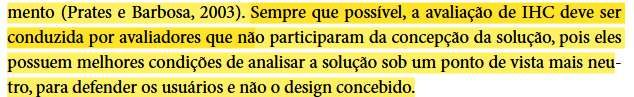

    Fonte: Barbosa e Silva (2010, cap. 9, p. 288).

### Pergunta 3

**Pergunta:** Quais são as razões para se avaliar a qualidade de uso de sistemas computacionais interativos?

**Resposta:** Dentre as razões estão: resolver problemas antes do lançamento e focar a equipe em soluções para problemas reais. O engenheiro apenas desenvolve o sistema, mas alguém deve advogar pelos interesses do usuário. Além disso, o tempo de lançamento no mercado diminui, exigindo menos tempo e esforço para corrigir erros. Como o produto entregue é mais robusto, uma versão atualizada pode ser construída com mais calma.

**Fonte:** Barbosa e Silva (2010, cap. 9, seç. 9.1, p. 288–289).

??? quote "Figura 3 – Evidência da resposta à pergunta 3"

    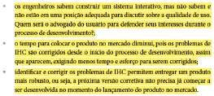

    Fonte: Barbosa e Silva (2010, cap. 9, seç. 9.1, p. 288–289).

??? quote "Figura 4 – Evidência da resposta à pergunta 3"

    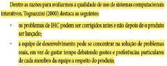

    Fonte: Barbosa e Silva (2010, cap. 9, seç. 9.1, p. 288–289).

### Pergunta 4

**Pergunta:** Quais os benefícios a curto, médio e longo prazo de avaliar a qualidade de uso?

**Resposta:** Os benefícios a curto prazo são: aumentar a produtividade dos usuários, diminuir o número e a gravidade dos erros durante o uso e, consequentemente, aumentar a satisfação do público. A médio e longo prazo, contribui para diminuir o custo de treinamento e suporte, além de facilitar o planejamento de versões futuras do software.

**Fonte:** Barbosa e Silva (2010, cap. 9, seç. 9.1, p. 289).

??? quote "Figura 5 – Evidência da resposta à pergunta 4"

    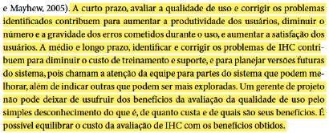

    Fonte: Barbosa e Silva (2010, cap. 9, seç. 9.1, p. 289).

### Pergunta 5

**Pergunta:** O que se deve fazer no planejamento de uma avaliação?

**Resposta:** No planejamento de uma avaliação, deve-se definir o escopo da avaliação, escolher o método de avaliação e, por fim, utilizar o framework DECIDE.

**Fonte:** Barbosa e Silva (2010, cap. 9, p. 287, 305, 311).

??? quote "Figura 6 – Evidência da resposta à pergunta 5"

    

    Fonte: Barbosa e Silva (2010, cap. 9, p. 287, 305, 311).

??? quote "Figura 7 – Evidência da resposta à pergunta 5"

    

    Fonte: Barbosa e Silva (2010, cap. 9, p. 287, 305, 311).

??? quote "Figura 8 – Evidência da resposta à pergunta 5"

    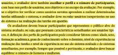

    Fonte: Barbosa e Silva (2010, cap. 9, p. 287, 305, 311).

### Pergunta 6

**Pergunta:** O que são os objetivos de uma avaliação, a quem eles interessam e por quê?

**Resposta:** Os objetivos consistem em uma definição clara e precisa dos aspectos do sistema que serão investigados. O interesse pertence aos stakeholders — ou seja, às partes interessadas no sistema —, que revelarão requisitos, reclamações e comportamentos em relação à tecnologia. O motivo varia de acordo com o interessado: enquanto um usuário pode demonstrar interesse prático no software, os proprietários do sistema podem buscar verificar se o produto possui diferencial competitivo no mercado.

**Fonte:** Barbosa e Silva (2010, cap. 9, p. 290–291).

??? quote "Figura 9 – Evidência da resposta à pergunta 6"

    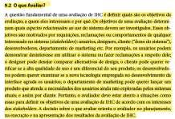

    Fonte: Barbosa e Silva (2010, cap. 9, p. 290–291).

### Pergunta 7

**Pergunta:** O que significa avaliação de ideias e alternativas de design? Cite exemplos.

**Resposta:** Consiste em comparar diferentes propostas de solução de interface e interação. O objetivo é analisar e apontar a melhor alternativa, tendo em mente as metas do projeto antes da implementação final. Como exemplo, têm-se os protótipos de baixa e média fidelidade; essa representação visual é um método que facilita a compreensão dos diferentes rumos que a tecnologia pode tomar. Outro exemplo abrange o uso de perguntas avaliativas de comparação, com base na Tabela 9.1.

**Fonte:** Barbosa e Silva (2010, cap. 9, p. 291–293).

??? quote "Figura 10 – Evidência da resposta à pergunta 7"

    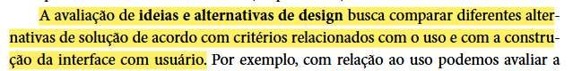

    Fonte: Barbosa e Silva (2010, cap. 9, p. 291–293).

### Pergunta 8

**Pergunta:** O que significa avaliação de conformidade com um padrão? Cite exemplos.

**Resposta:** Avaliar a conformidade com um padrão envolve verificar se uma solução de IHC segue características específicas determinadas por normas estabelecidas. Como exemplo, têm-se os padrões da W3C para acessibilidade ou as diretrizes de ambientes computacionais, como os sistemas operacionais Windows e macOS.

**Fonte:** Barbosa e Silva (2010, cap. 9, p. 291–292, 301).

??? quote "Figura 11 – Evidência da resposta à pergunta 8"

    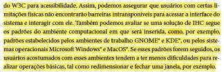

    Fonte: Barbosa e Silva (2010, cap. 9, p. 291–292, 301).

### Pergunta 9

**Pergunta:** Cite exemplos de perguntas que uma avaliação deve responder em relação ao objetivo da avaliação.

**Resposta:** Alguns exemplos de perguntas são: "Quais são os pontos fortes e fracos do sistema na opinião dos usuários?" e "Por que os usuários não incorporam o sistema em seu cotidiano?" — estas servem para analisar a apropriação da tecnologia. Em sequência, temos: "Qual das alternativas é a mais eficiente e mais fácil de aprender?", voltada para a comparação de ideias e alternativas de design. Por fim: "Considerando o perfil de usuário esperado, o usuário consegue operar o sistema?" e "Que parte da interface e da interação o deixa insatisfeito?", que servem para identificar problemas na interação e na interface.

**Fonte:** Barbosa e Silva (2010, cap. 9, tab. 9.1, p. 293).

??? quote "Figura 12 – Evidência da resposta à pergunta 9"

    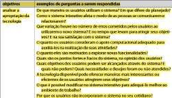

    Fonte: Barbosa e Silva (2010, cap. 9, tab. 9.1, p. 293).

??? quote "Figura 13 – Evidência da resposta à pergunta 9"

    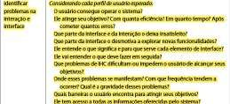

    Fonte: Barbosa e Silva (2010, cap. 9, tab. 9.1, p. 293).

### Pergunta 10

**Pergunta:** Qual a diferença entre a avaliação formativa e somativa?

**Resposta:** A avaliação formativa é realizada durante a elaboração da solução, ou seja, antes do resultado final. A somativa, por outro lado, é realizada após a solução ficar pronta ou pelo menos parcialmente pronta. Outra forma de comparar as duas é analisando seus nomes: "formativa" deriva de formação, enquanto "somativa" deriva de soma, podendo também ser chamada de conclusiva, que deriva de conclusão.

**Fonte:** Barbosa e Silva (2010, cap. 9, seç. 9.3, p. 294).

??? quote "Figura 14 – Evidência da resposta à pergunta 10"

    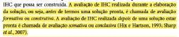

    Fonte: Barbosa e Silva (2010, cap. 9, seç. 9.3, p. 294).

### Pergunta 11

**Pergunta:** Qual a diferença da avaliação de IHC em um contexto real de uso e em laboratório?

**Resposta:** A avaliação em laboratório é previsível, ou seja, oferece um controle maior sobre as interferências no ambiente de uso. Em contrapartida, o contexto real proporciona uma interação muito mais realista e, por sua imprevisibilidade, pode revelar problemas de interação que um ambiente controlado, como o laboratório, não seria capaz de prever.

**Fonte:** Barbosa e Silva (2010, cap. 9, seç. 9.4, p. 295).

??? quote "Figura 15 – Evidência da resposta à pergunta 11"

    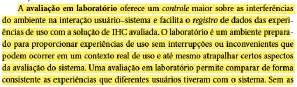

    Fonte: Barbosa e Silva (2010, cap. 9, seç. 9.4, p. 295).

### Pergunta 12

**Pergunta:** Qual a diferença entre os métodos de investigação, inspeção e observação?

**Resposta:** Um método de investigação envolve o uso de questionários, entrevistas, estudos de campo ou outras abordagens que exigem interação direta com o usuário. Por outro lado, o método de inspeção consiste em prever problemas que o usuário pode vir a enfrentar; logo, não há envolvimento direto com os usuários, utilizando-se dados potenciais. Por fim, a observação envolve deixar o usuário realizar suas atividades sem intervenção, apenas acompanhando e registrando os problemas conforme eles surgem em uma situação real de uso.

**Fonte:** Barbosa e Silva (2010, cap. 9, seç. 9.6, p. 301–302).

??? quote "Figura 16 – Evidência da resposta à pergunta 12"

    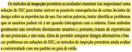

    Fonte: Barbosa e Silva (2010, cap. 9, seç. 9.6, p. 301–302).

??? quote "Figura 17 – Evidência da resposta à pergunta 12"

    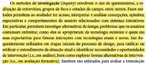

    Fonte: Barbosa e Silva (2010, cap. 9, seç. 9.6, p. 301–302).

??? quote "Figura 18 – Evidência da resposta à pergunta 12"

    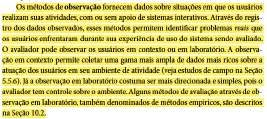

    Fonte: Barbosa e Silva (2010, cap. 9, seç. 9.6, p. 301–302).

### Pergunta 13

**Pergunta:** Descreva a atividade de preparação da avaliação.

**Resposta:** A preparação envolve garantir que a avaliação forneça resultados úteis e confiáveis. Primeiramente, devemos estabelecer os objetivos da avaliação. Em seguida, é necessário definir o escopo, de modo a delimitar quais partes da interface serão avaliadas. Depois, escolhem-se um ou mais métodos de avaliação; essa escolha determina se haverá a necessidade de alocar pessoal, recursos ou equipamentos. Por fim, deve-se garantir que o material de apoio esteja em conformidade com as diretrizes éticas.

**Fonte:** Barbosa e Silva (2010, cap. 9, seç. 9.7.2, p. 304–306).

??? quote "Figura 19 – Evidência da resposta à pergunta 13"

    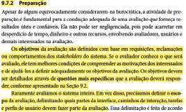

    Fonte: Barbosa e Silva (2010, cap. 9, seç. 9.7.2, p. 304–306).

??? quote "Figura 20 – Evidência da resposta à pergunta 13"

    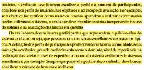

    Fonte: Barbosa e Silva (2010, cap. 9, seç. 9.7.2, p. 304–306).

??? quote "Figura 21 – Evidência da resposta à pergunta 13"

    

    Fonte: Barbosa e Silva (2010, cap. 9, seç. 9.7.2, p. 304–306).

### Pergunta 14

**Pergunta:** Apresente um modelo de termo de consentimento. Para que ele deve ser usado?

**Resposta:** De acordo com o Exemplo 5.1, da página 141, o objetivo é garantir que um código de ética específico seja seguido. Um exemplo é o código da ACM, de 1992, que estabelece que evitar causar danos ou consequências negativas a terceiros — o que inclui perda de informação, perda de bens, danos à propriedade ou impactos ambientais indesejados — é um compromisso mandatório.

**Fonte:** Barbosa e Silva (2010, cap. 5, seç. 5.4, p. 138, 141).

??? quote "Figura 22 – Evidência da resposta à pergunta 14"

    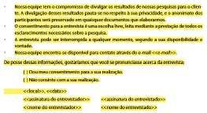

    Fonte: Barbosa e Silva (2010, cap. 5, seç. 5.4, p. 138, 141).

??? quote "Figura 23 – Evidência da resposta à pergunta 14"

    

    Fonte: Barbosa e Silva (2010, cap. 5, seç. 5.4, p. 138, 141).

??? quote "Figura 24 – Evidência da resposta à pergunta 14"

    

    Fonte: Barbosa e Silva (2010, cap. 5, seç. 5.4, p. 138, 141).

### Pergunta 15

**Pergunta:** Explique o que é um teste-piloto. Quem realiza o teste piloto?

**Resposta:** O teste piloto é um procedimento que confirma se a avaliação conseguirá gerar os resultados e atingir os objetivos de estudo necessários. Além disso, garante o funcionamento do software que coletará os dados, bem como dos equipamentos envolvidos. O participante do teste piloto pode ser um conhecido do desenvolvedor ou um colaborador; o perfil do indivíduo pouco importa, pois o objetivo não é gerar dados, mas sim testar a infraestrutura e a dinâmica do processo. Os dados gerados nessa etapa serão descartados, uma vez que não refletem o público-alvo nem os resultados planejados para a avaliação final.

**Fonte:** Barbosa e Silva (2010, cap. 9, seç. 9.7.2, p. 307–308).

??? quote "Figura 25 – Evidência da resposta à pergunta 15"

    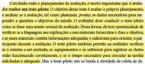

    Fonte: Barbosa e Silva (2010, cap. 9, seç. 9.7.2, p. 307–308).

### Pergunta 16

**Pergunta:** Qual o tempo máximo sugerido para um participante realizar uma tarefa na avaliação? Qual o tempo máximo sugerido para uma avaliação?

**Resposta:** O tempo estimado para realizar cada tarefa não deve ultrapassar 20 minutos; caso mais tempo seja necessário, o ideal é instruir o participante a fazer uma pausa rápida. O tempo total varia dependendo do método escolhido: com a participação de usuários, por exemplo, dura cerca de uma hora, enquanto pelo método de inspeção pode levar de uma a duas horas. De forma geral, contudo, pode-se assumir que o teste deve durar entre uma e três horas.

**Fonte:** Barbosa e Silva (2010, caps. 9 e 10, seç. 9.7.2, p. 305–306 e 320).

??? quote "Figura 26 – Evidência da resposta à pergunta 16"

    

    Fonte: Barbosa e Silva (2010, caps. 9 e 10, seç. 9.7.2, p. 305–306 e 320).

### Pergunta 17

**Pergunta:** Que informações devem ser colhidas no formulário de acompanhamento das sessões de observação?

**Resposta:** Não está contido no formulário o relato espontâneo do usuário durante o sucesso ou a falha na utilização do sistema, tampouco a informação sobre se foi necessária alguma ajuda, além de outros dados que não serão citados nesta resposta.

**Fonte:** Barbosa e Silva (2010, cap. 9, seç. 9.7.2, p. 306).

??? quote "Figura 27 – Evidência da resposta à pergunta 17"

    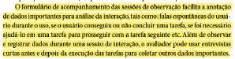

    Fonte: Barbosa e Silva (2010, cap. 9, seç. 9.7.2, p. 306).

### Pergunta 18

**Pergunta:** Explique como se faz para recrutar participantes para uma avaliação de design.

**Resposta:** Para o recrutamento, pode ser necessário aplicar questionários ou realizar entrevistas para verificar a adequação ao perfil desejado. O avaliador deve descrever de forma clara e objetiva os objetivos da avaliação, onde e como ela será realizada, o tempo estimado e os materiais necessários. Dessa forma, garante-se que os participantes selecionados possuam o perfil necessário.

**Fonte:** Barbosa e Silva (2010, cap. 9, seç. 9.7.2, p. 308).

??? quote "Figura 28 – Evidência da resposta à pergunta 18"

    

    Fonte: Barbosa e Silva (2010, cap. 9, seç. 9.7.2, p. 308).

### Pergunta 19

**Pergunta:** Quem o avaliador deve evitar para ser o participante da avaliação?

**Resposta:** O avaliador deve evitar amigos, familiares e qualquer participante que possa ter uma opinião enviesada sobre o teste. Um amigo do avaliador, por exemplo, pode omitir certas informações por receio de criticar o trabalho, o que afetaria negativamente a precisão dos dados, visto que os resultados não seriam totalmente espontâneos. Para evitar esse problema, o avaliador deve reiterar o propósito da avaliação, garantindo que o usuário se sinta à vontade para não omitir nenhuma informação.

**Fonte:** Barbosa e Silva (2010, cap. 9, seç. 9.7.2, p. 306).

??? quote "Figura 29 – Evidência da resposta à pergunta 19"

    

    Fonte: Barbosa e Silva (2010, cap. 9, seç. 9.7.2, p. 306).

### Pergunta 20

**Pergunta:** Explique o framework Decide.

**Resposta:** O framework DECIDE serve para orientar o planejamento, a execução e a análise de avaliações em IHC. As atividades são nomeadas por cada letra da sigla: a letra D corresponde a determinar os objetivos; E, a explorar as perguntas a serem respondidas; C, do inglês choose, a escolher os métodos de avaliação; I, a identificar questões práticas; D, a decidir como lidar com questões éticas; e a última letra E, do inglês evaluate, a avaliar, interpretar e apresentar os dados. Dessa forma, constitui-se o framework DECIDE.

**Fonte:** Barbosa e Silva (2010, cap. 9, seç. 9.8, p. 312–313).

??? quote "Figura 30 – Evidência da resposta à pergunta 20"

    

    Fonte: Barbosa e Silva (2010, cap. 9, seç. 9.8, p. 312–313).

??? quote "Figura 31 – Evidência da resposta à pergunta 20"

    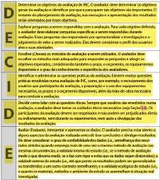

    Fonte: Barbosa e Silva (2010, cap. 9, seç. 9.8, p. 312–313).

## Referências

BARBOSA, Simone Diniz Junqueira; SILVA, Bruno Santana da. *Interação Humano-Computador*. Rio de Janeiro: Elsevier, 2010.

SALES, André Barros de. *Plano de Ensino*: Interação Humano Computador (FGA0173), 02/2026, Turma 01, v1. Brasília: Universidade de Brasília, 2026.

## Agradecimentos e uso de IA generativa

**Uso de IA generativa nesta página.** O Claude (Anthropic) foi utilizado na transcrição do documento original para o site e na padronização da formatação, das legendas, das citações e das referências às normas da disciplina. O conteúdo do trabalho é de Henrique Schneider, indicado(a) na tabela de contribuição. A ferramenta não é autora do artefato e seu uso não exime os autores da responsabilidade sobre o conteúdo (SALES, 2026, p. 3).
