# Lista de Exercícios – Qualidade de Software: Verificação

**Autoria:** João Vitor Tavares de Sá Lima · **Entrega 1**

## Tabela de contribuição

**Tabela 1 – Contribuições no trabalho "Lista de Exercícios – Qualidade de Software: Verificação"**

| Integrante | Contribuição | Atividade (link) | Gravação (link) |
| --- | --- | --- | --- |
| Alexandre Vilar Valadares Fonsêca | Não se aplica (atividade individual) | — | — |
| Gabriel Robson Nunes Neiva da Silva | Não se aplica (atividade individual) | — | — |
| Henrique Schneider Fernandes da Rosa | Não se aplica (atividade individual) | — | — |
| João Vitor Tavares de Sá Lima | Autoria do trabalho (atividade individual) | Esta página | — |

Fonte: elaborado pelos autores (2026).

## Histórico de versões

**Tabela 2 – Histórico de versões do trabalho "Lista de Exercícios – Qualidade de Software: Verificação"**

| Data | Versão | Descrição | Autor(es) | Revisor(es) |
| --- | --- | --- | --- | --- |
| 15/08/2026 | 1.0 | Elaboração do trabalho, entregue no Moodle (data do arquivo entregue) | João Vitor | — |
| 17/10/2026 | 1.1 | Publicação no site: transcrição, fotos das fontes, citações e referências no padrão da disciplina | Henrique Schneider | — |

Fonte: elaborado pelos autores (2026).

## 1. Introdução

Lista de exercícios individual sobre verificação e validação, respondida a partir de duas videoaulas da Univesp e dos slides da aula 23 de Requisitos. O enunciado pede, em cada resposta, a fonte com a página ou o minuto do vídeo e a foto do momento da resposta.

Cada resposta traz a fonte (página, minuto do vídeo ou slide) e a foto do trecho correspondente. Clique no título de cada figura para abrir a foto.

## 2. Perguntas e respostas

### Pergunta 1

**Pergunta:** Quais são os produtos que podem ser analisados pela Verificação e Validação?

**Resposta:** Manuais, modelos e outros artefatos de software.

**Fonte:** Univesp ([20--]a, 1:12).

??? quote "Figura 1 – Evidência da resposta à pergunta 1"

    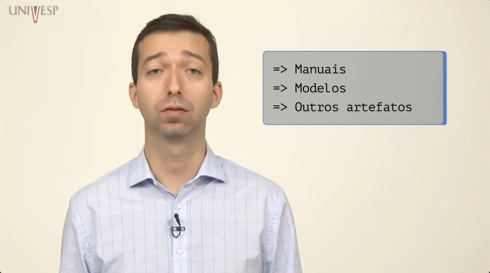

    Fonte: Univesp ([20--]a, 1:12).

### Pergunta 2

**Pergunta:** O que é uma análise estática e análise dinâmica?

**Resposta:** Na análise estática não executamos o software, mas a partir dessa análise determinamos propriedades válidas para qualquer execução do produto, por exemplo a revisão que é uma forma de análise estática. Já na análise dinâmica temos a execução do produto e os testes são suas formas mais comuns, mas não únicas.

**Fonte:** Univesp ([20--]a, 1:20).

??? quote "Figura 2 – Evidência da resposta à pergunta 2"

    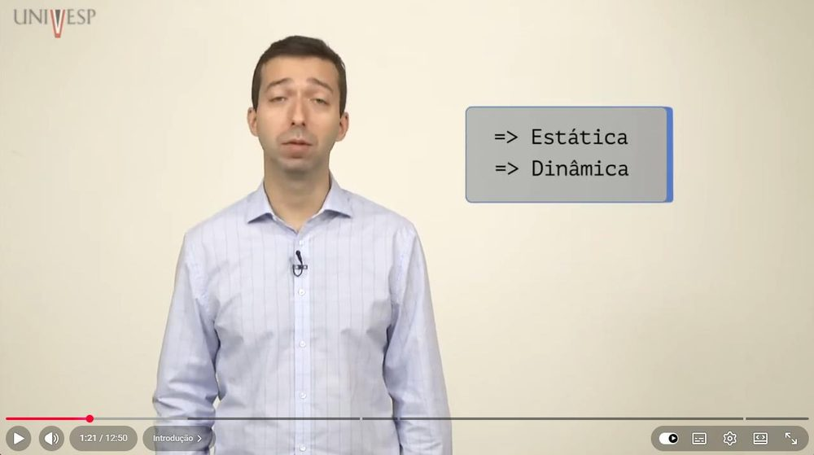

    Fonte: Univesp ([20--]a, 1:20).

### Pergunta 3

**Pergunta:** O que é verificação?

**Resposta:** É garantir que os produtos de trabalho cumpram seus requisitos especificados.

**Fonte:** Univesp ([20--]a, 2:02).

??? quote "Figura 3 – Evidência da resposta à pergunta 3"

    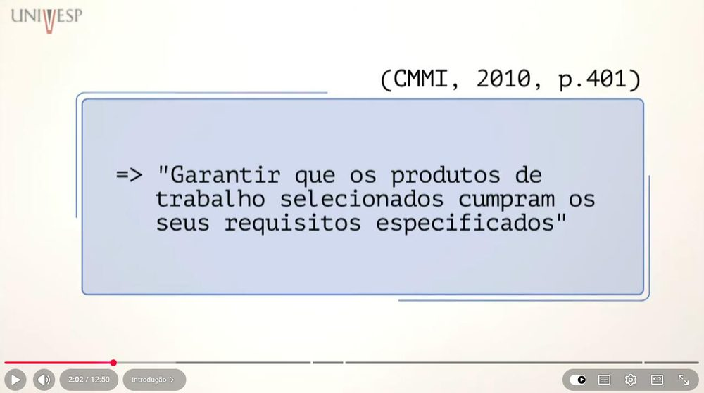

    Fonte: Univesp ([20--]a, 2:02).

### Pergunta 4

**Pergunta:** Cite alguns exemplos de verificação.

**Resposta:** Podem ser requisitos de software, condições impostas, padrões, práticas e convenções.

**Fonte:** Univesp ([20--]a, 2:05).

??? quote "Figura 4 – Evidência da resposta à pergunta 4"

    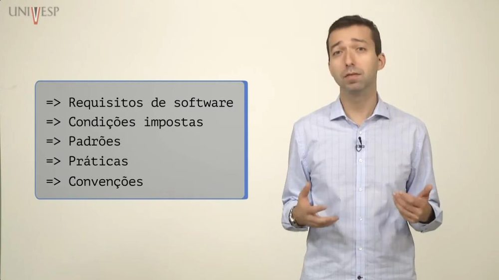

    Fonte: Univesp ([20--]a, 2:05).

### Pergunta 5

**Pergunta:** O que pode ser verificado?

**Resposta:** Pode ser verificado praticamente qualquer artefato de software, qualquer forma de revisão ou auditoria que analisa se o produto segue os requisitos solicitados.

**Fonte:** Univesp ([20--]a, 2:20).

??? quote "Figura 5 – Evidência da resposta à pergunta 5"

    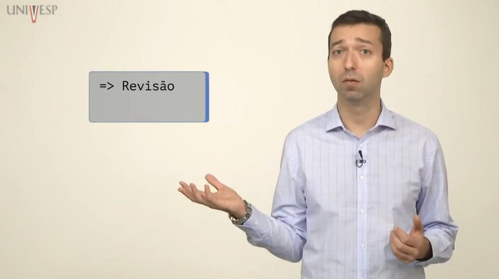

    Fonte: Univesp ([20--]a, 2:20).

### Pergunta 6

**Pergunta:** O que é validação?

**Resposta:** É demonstrar que o produto ou componente do produto cumpre o uso pretendido quando colocado em seu ambiente desejado.

**Fonte:** Univesp ([20--]a, 3:45).

??? quote "Figura 6 – Evidência da resposta à pergunta 6"

    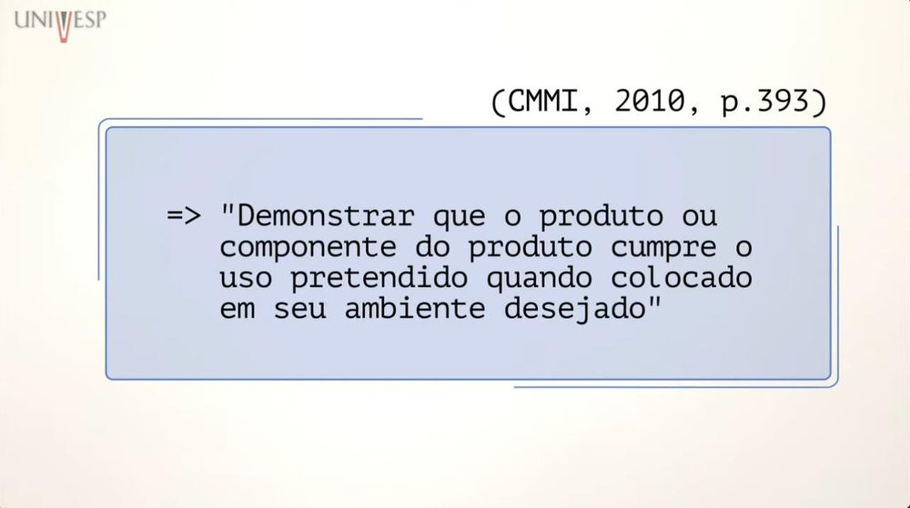

    Fonte: Univesp ([20--]a, 3:45).

### Pergunta 7

**Pergunta:** O que é revisão?

**Resposta:** É a forma que é feita para avaliar algum produto à procura de defeitos, pode ser usado tanto para a garantia da qualidade quanto para a verificação de validação.

**Fonte:** Univesp ([20--]b, 0:25).

??? quote "Figura 7 – Evidência da resposta à pergunta 7"

    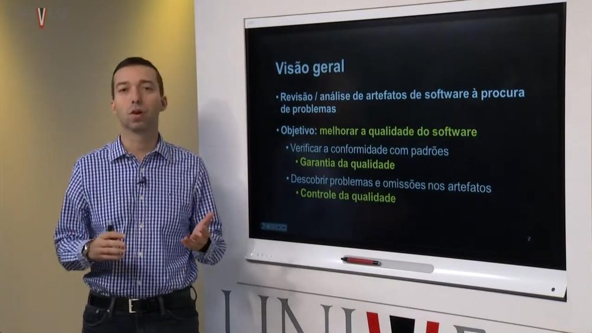

    Fonte: Univesp ([20--]b, 0:25).

### Pergunta 8

**Pergunta:** Cite exemplos de revisão estática e revisão dinâmica?

**Resposta:** Revisões estáticas (sem executar o código): inspeção, checklist, análise estática do código Revisões dinâmicas (com a execução do código): inspeção de usabilidade e testes no geral.

**Fonte:** Univesp ([20--]b, 1:12).

??? quote "Figura 8 – Evidência da resposta à pergunta 8"

    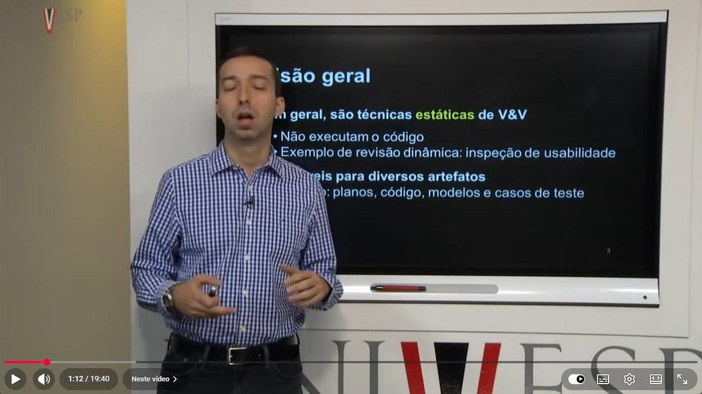

    Fonte: Univesp ([20--]b, 1:12).

### Pergunta 9

**Pergunta:** Quais são os tipos de revisão formais?

**Resposta:** Revisões gerenciais, técnicas, inspeção, walkthrough e auditoria.

**Fonte:** Univesp ([20--]b, 13:00).

??? quote "Figura 9 – Evidência da resposta à pergunta 9"

    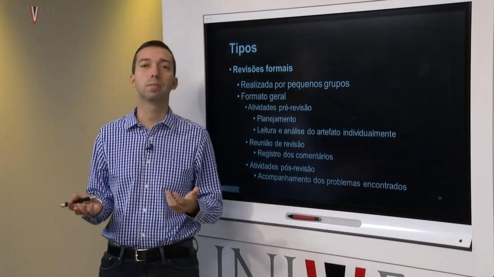

    Fonte: Univesp ([20--]b, 13:00).

### Pergunta 10

**Pergunta:** Explique o processo de Inspeção.

**Resposta:** Ela é um tipo de revisão formal, originalmente usada para código, com papéis e características bem definidos.

**Fonte:** Univesp ([20--]b, 14:10).

??? quote "Figura 10 – Evidência da resposta à pergunta 10"

    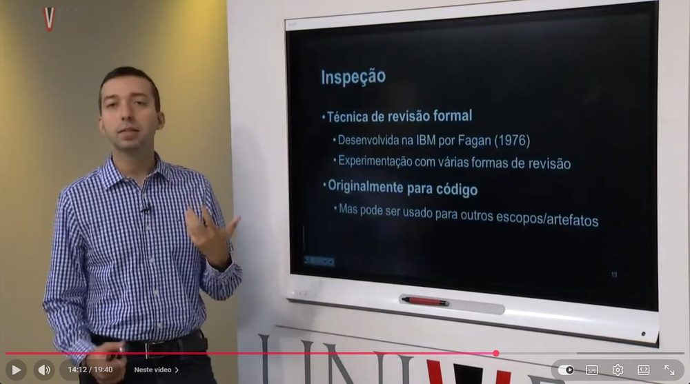

    Fonte: Univesp ([20--]b, 14:10).

### Pergunta 11

**Pergunta:** Quais são as características principais da Inspeção?

**Resposta:** Uso de checklist, classificação dos defeitos identificados, ênfase na preparação, a leitura do artefato não é feita pelo autor e sim pelo leitor

**Fonte:** Univesp ([20--]b, 15:15).

??? quote "Figura 11 – Evidência da resposta à pergunta 11"

    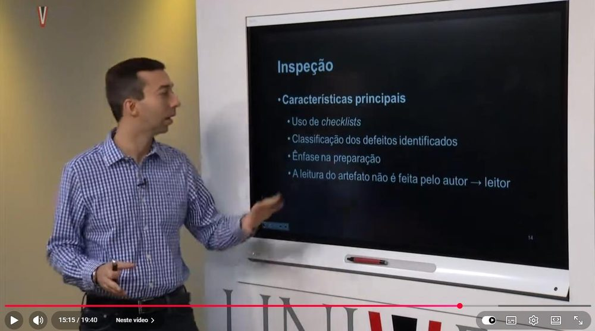

    Fonte: Univesp ([20--]b, 15:15).

### Pergunta 12

**Pergunta:** Quais são os seis passos do método de inspeção proposto por Fagan?

**Resposta:** Planejamento, visão geral, preparação, inspeção, correção e acompanhamento.

**Fonte:** Serrano e Serrano ([20--], slide 21).

??? quote "Figura 12 – Evidência da resposta à pergunta 12"

    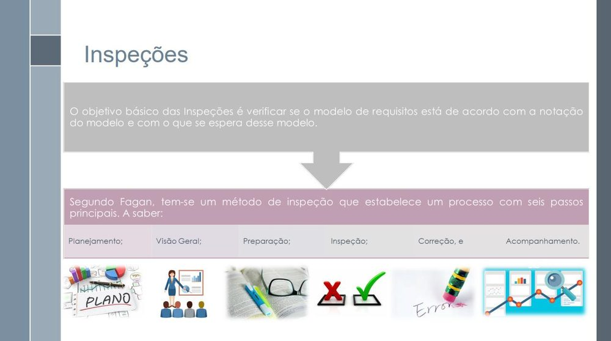

    Fonte: Serrano e Serrano ([20--], slide 21).

### Pergunta 13

**Pergunta:** Cite algumas estratégias de validação de software?

**Resposta:** Comprovação informal, prototipagem e validação baseada em ponto de vista.

**Fonte:** Serrano e Serrano ([20--], slide 29).

??? quote "Figura 13 – Evidência da resposta à pergunta 13"

    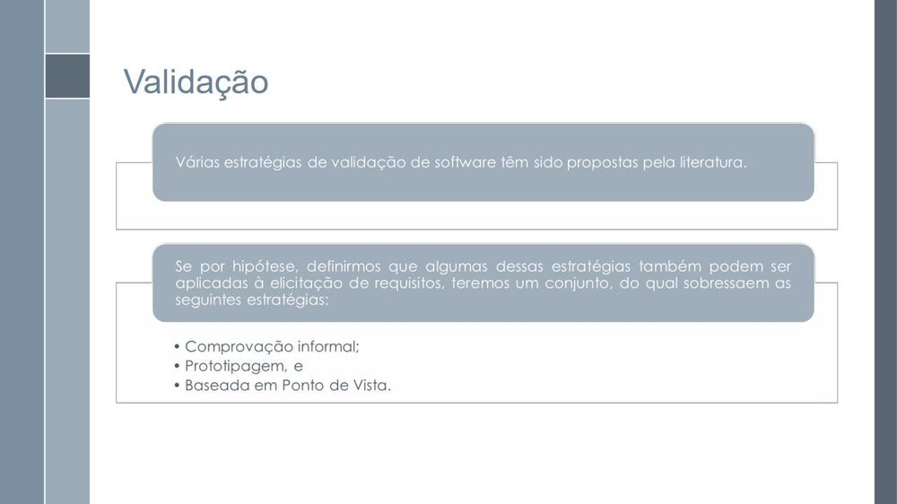

    Fonte: Serrano e Serrano ([20--], slide 29).

### Pergunta 14

**Pergunta:** Escolha uma estratégia de verificação e explique como utilizar essa estratégia para verificar um artefato do seu projeto de IHC.

**Resposta:** Ainda não tenho grupo definido para o projeto de IHC, mas, se eu fosse escolher, escolheria a estratégia de Inspeção que é um método gerencial de reuniões, com papéis bem definidos entre os membros da equipe, cujo objetivo é descobrir defeitos em documentos. Segundo Fagan, o processo segue seis passos: Planejamento, Visão Geral, Preparação, Inspeção, Correção e Acompanhamento.

**Fonte:** Serrano e Serrano ([20--], slides 20–22).

??? quote "Figura 14 – Evidência da resposta à pergunta 14"

    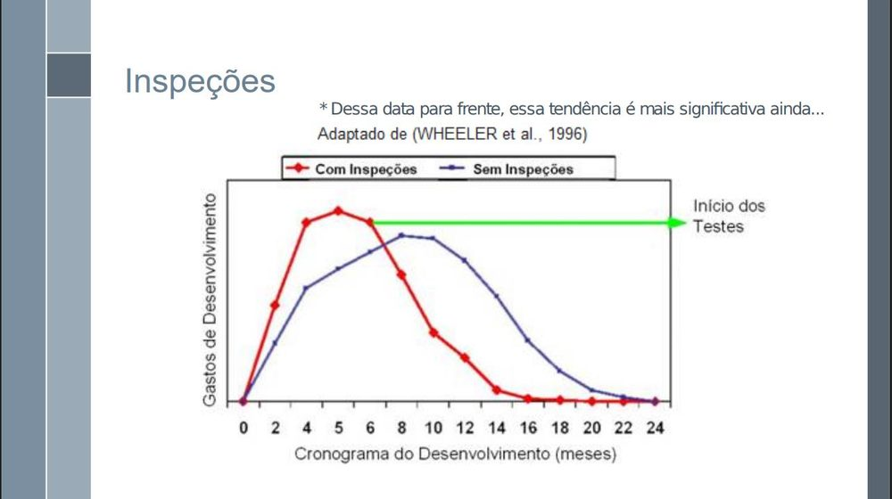

    Fonte: Serrano e Serrano ([20--], slides 20–22).

## Referências

SALES, André Barros de. *Plano de Ensino*: Interação Humano Computador (FGA0173), 02/2026, Turma 01, v1. Brasília: Universidade de Brasília, 2026.

SERRANO, Milene; SERRANO, Maurício. *Requisitos*: aula 23: análise, verificação e validação. Brasília: Universidade de Brasília, [20--]. 52 slides.

UNIVESP. *Gerência e qualidade de software*: aula 05: verificação e validação. São Paulo: Univesp, [20--]a. 1 vídeo (12 min 51 s). Disponível em: https://www.youtube.com/watch?v=1Y-1zz6rZxo.

UNIVESP. *Gerência e qualidade de software*: aula 06: técnica de revisão. São Paulo: Univesp, [20--]b. 1 vídeo (19 min 40 s).

## Agradecimentos e uso de IA generativa

**Uso de IA generativa nesta página.** O Claude (Anthropic) foi utilizado na transcrição do documento original para o site e na padronização da formatação, das legendas, das citações e das referências às normas da disciplina. O conteúdo do trabalho é de João Vitor, indicado(a) na tabela de contribuição. A ferramenta não é autora do artefato e seu uso não exime os autores da responsabilidade sobre o conteúdo (SALES, 2026, p. 3).
