# Lista de Verificação – Planejamento da Avaliação com o Framework DECIDE

**Autoria:** João Vitor Tavares de Sá Lima · **Entrega 1**

## Tabela de contribuição

**Tabela 1 – Contribuições no trabalho "Lista de Verificação – Planejamento da Avaliação com o Framework DECIDE"**

| Integrante | Contribuição | Atividade (link) | Gravação (link) |
| --- | --- | --- | --- |
| Alexandre Vilar Valadares Fonsêca | Não se aplica (atividade individual) | — | — |
| Gabriel Robson Nunes Neiva da Silva | Não se aplica (atividade individual) | — | — |
| Henrique Schneider Fernandes da Rosa | Não se aplica (atividade individual) | — | — |
| João Vitor Tavares de Sá Lima | Autoria do trabalho (atividade individual) | Esta página | — |

Fonte: elaborado pelos autores (2026).

## Histórico de versões

**Tabela 2 – Histórico de versões do trabalho "Lista de Verificação – Planejamento da Avaliação com o Framework DECIDE"**

| Data | Versão | Descrição | Autor(es) | Revisor(es) |
| --- | --- | --- | --- | --- |
| 28/08/2026 | 1.0 | Elaboração do trabalho, entregue no Moodle (data do arquivo entregue) | João Vitor | — |
| 17/10/2026 | 1.1 | Publicação no site: transcrição, fotos das fontes, citações e referências no padrão da disciplina | Henrique Schneider | — |

Fonte: elaborado pelos autores (2026).

## 1. Introdução

Atividade individual do Moodle "Lista de verificação – DECIDE": elaborar itens de uma lista de verificação para inspecionar o planejamento de uma avaliação de IHC feito com o framework DECIDE.

Cada item é uma pergunta autocontida, respondida com **Conforme**, **Não conforme** ou **Não se aplica**. Abaixo de cada item estão a fonte, com capítulo, seção e página, e a foto do trecho que o fundamenta, como pede a atividade de elaboração de listas de verificação (SALES, [2026], p. 1). Clique no título de cada figura para abrir a foto.

As fotos do trecho são da edição de 2021 do livro de Barbosa e colaboradores (*Interação Humano-Computador e Experiência do Usuário*), cuja numeração de capítulos e páginas é a usada nas citações.

## 2. Itens da lista

### D – Determinar os objetivos da avaliação

#### Item 1

Foi determinado ao menos um objetivo geral da avaliação, escolhido entre: (a) avaliar a apropriação de tecnologia pelos usuários; (b) comparar ideias e alternativas de design; (c) verificar a conformidade com um padrão; ou (d) identificar problemas na interação e na interface?

**Fonte:** Barbosa et al. (2021, cap. 11, seç. 11.2, p. 264).

??? quote "Figura 1 – Trecho que fundamenta o item 1"

    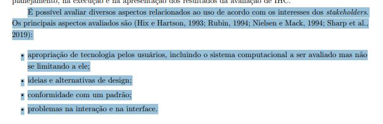

    Fonte: Barbosa et al. (2021, cap. 11, seç. 11.2, p. 264).

#### Item 2

Foi identificado e registrado quem solicita a avaliação e por que os objetivos definidos são importantes para essa pessoa ou grupo (ex.: usuários, designers, cliente/dono do sistema, desenvolvedores, departamento de marketing)?

**Fonte:** Barbosa et al. (2021, cap. 11, seç. 11.2, p. 264).

??? quote "Figura 2 – Trecho que fundamenta o item 2"

    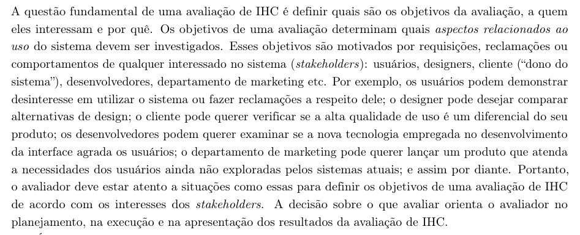

    Fonte: Barbosa et al. (2021, cap. 11, seç. 11.2, p. 264).

### E – Explorar as perguntas a serem respondidas

#### Item 3

Cada objetivo geral definido foi detalhado em perguntas específicas e operacionais (ex.: para o objetivo "identificar problemas na interação", perguntas como "o usuário consegue operar o sistema?", "em quanto tempo atinge seu objetivo?", "após quantos erros?"), considerando o perfil dos usuários-alvo e suas atividades?

**Fonte:** Barbosa et al. (2021, cap. 11, seç. 11.2, p. 265–266, e seç. 11.8, p. 280).

??? quote "Figura 3 – Trecho que fundamenta o item 3"

    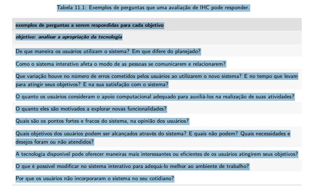

    Fonte: Barbosa et al. (2021, cap. 11, seç. 11.2, p. 265–266, e seç. 11.8, p. 280).

### C – Escolher os métodos de avaliação

#### Item 4

Foi escolhido um ou mais métodos de avaliação dentre as três categorias possíveis: métodos de investigação (questionário, entrevista, grupo de foco, estudo de campo), métodos de inspeção (exame da interface sem a participação de usuários) ou métodos de observação (em contexto real ou em laboratório)?

**Fonte:** Barbosa et al. (2021, cap. 11, seç. 11.6, p. 272–273).

??? quote "Figura 4 – Trecho que fundamenta o item 4"

    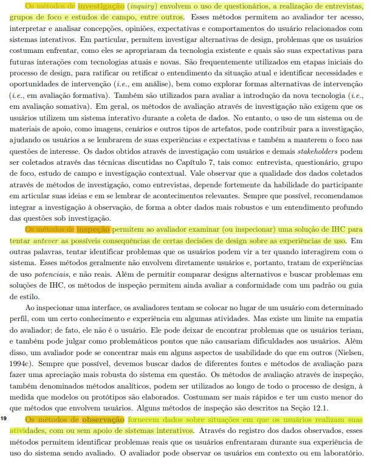

    Fonte: Barbosa et al. (2021, cap. 11, seç. 11.6, p. 272–273).

#### Item 5

A escolha do(s) método(s) considerou o objetivo da avaliação (ex.: inspeção para achar problemas de forma rápida e barata; investigação/observação para avaliar apropriação de tecnologia, pois exigem participação dos usuários; inspeção para verificar conformidade com padrão) e também o prazo, o orçamento, os equipamentos e a experiência dos avaliadores disponíveis?

**Fonte:** Barbosa et al. (2021, cap. 11, seç. 11.6, p. 272–273).

??? quote "Figura 5 – Trecho que fundamenta o item 5"

    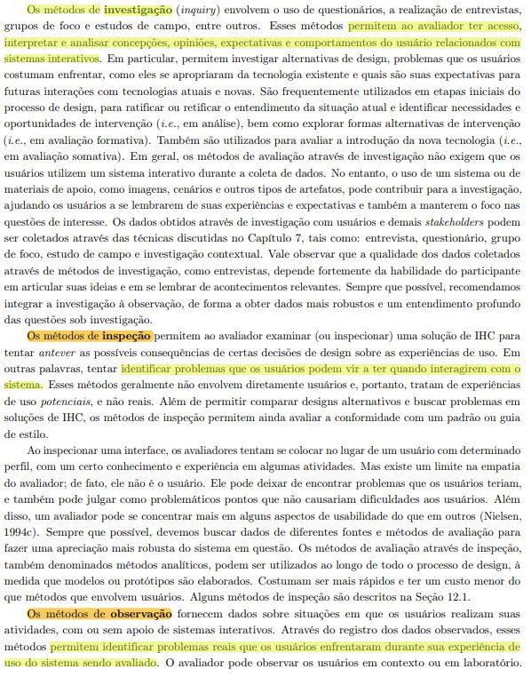

    Fonte: Barbosa et al. (2021, cap. 11, seç. 11.6, p. 272–273).

### I – Identificar e administrar as questões práticas

#### Item 6

Foi definido o perfil e o número de participantes considerando a representatividade do público-alvo, sabendo que a literatura indica de 5 a 12 usuários por avaliação e que 5 usuários já permitem encontrar cerca de 85% dos problemas de interface?

**Fonte:** Barbosa et al. (2021, cap. 11, seç. 11.7.2, p. 274–275).

??? quote "Figura 6 – Trecho que fundamenta o item 6"

    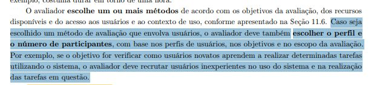

    Fonte: Barbosa et al. (2021, cap. 11, seç. 11.7.2, p. 274–275).

#### Item 7

Foi preparado o material de apoio necessário para a sessão: termo de consentimento livre e esclarecido (TCLE), questionário pré-teste, roteiro de entrevista pós-teste, instruções/cenários das tarefas e roteiro de acompanhamento da observação?

**Fonte:** Barbosa et al. (2021, cap. 11, seç. 11.7.2, p. 275–276).

??? quote "Figura 7 – Trecho que fundamenta o item 7"

    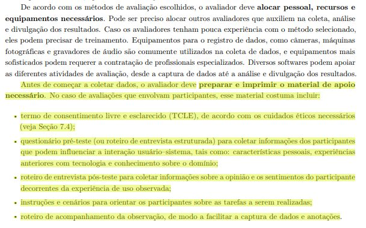

    Fonte: Barbosa et al. (2021, cap. 11, seç. 11.7.2, p. 275–276).

#### Item 8

O ambiente, o hardware e o software necessários para a sessão (câmeras, gravadores, monitorclone, softwares de captura, o próprio sistema a ser avaliado) foram preparados, configurados e testados antes da chegada de cada participante?

**Fonte:** Barbosa et al. (2021, cap. 11, seç. 11.7.2, p. 275–276).

??? quote "Figura 8 – Trecho que fundamenta o item 8"

    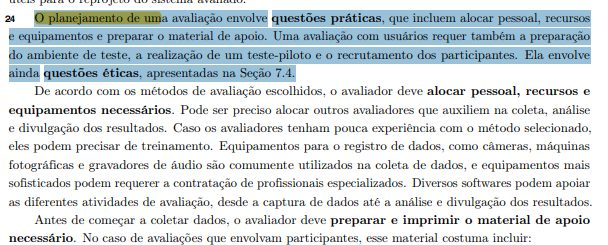

    Fonte: Barbosa et al. (2021, cap. 11, seç. 11.7.2, p. 275–276).

#### Item 9

Foi planejado e executado um teste-piloto de todo o procedimento de avaliação (material, tempo das tarefas, equipamentos) antes da coleta de dados definitiva, descartando os dados desse teste-piloto ao final?

**Fonte:** Barbosa et al. (2021, cap. 11, seç. 11.7.2, p. 276).

??? quote "Figura 9 – Trecho que fundamenta o item 9"

    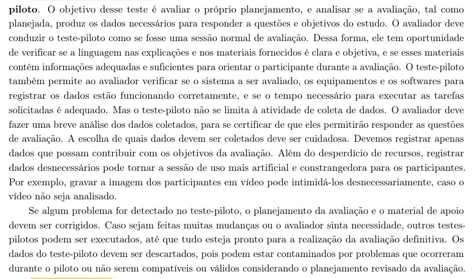

    Fonte: Barbosa et al. (2021, cap. 11, seç. 11.7.2, p. 276).

### D – Decidir como lidar com as questões éticas

#### Item 10

Foi elaborado um termo de consentimento livre e esclarecido (TCLE) informando aos participantes os objetivos da pesquisa, a duração estimada, os procedimentos de coleta, os tipos de dados coletados, como serão analisados e usados, e os eventuais riscos ou desconfortos da participação?

**Fonte:** Barbosa et al. (2021, cap. 7, seç. 7.4, p. 140–141).

??? quote "Figura 10 – Trecho que fundamenta o item 10"

    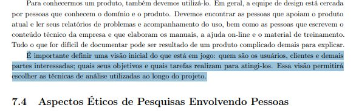

    Fonte: Barbosa et al. (2021, cap. 7, seç. 7.4, p. 140–141).

#### Item 11

Foram previstas garantias de confidencialidade dos dados brutos coletados (acesso restrito à equipe de pesquisa) e de anonimato dos participantes na divulgação dos resultados (uso de nomes fictícios, sem revelar informações — como idade, profissão ou sexo — que possam identificá-los)?

**Fonte:** Barbosa et al. (2021, cap. 7, seç. 7.4, p. 141).

??? quote "Figura 11 – Trecho que fundamenta o item 11"

    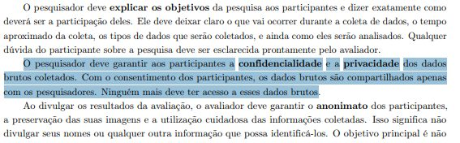

    Fonte: Barbosa et al. (2021, cap. 7, seç. 7.4, p. 141).

### E – Avaliar, interpretar e apresentar os dados

#### Item 12

Foi definido como os dados serão interpretados, considerando a confiabilidade dos dados (repetir o método nas mesmas condições produziria resultados semelhantes?), a validade interna (o método mede o que deveria medir, sem distorções?), a validade externa (os resultados podem ser generalizados a outro contexto semelhante?) e a validade ecológica (o quanto o ambiente e os materiais do estudo se assemelham à situação real)?

**Fonte:** Barbosa et al. (2021, cap. 11, seç. 11.8, p. 280).

??? quote "Figura 12 – Trecho que fundamenta o item 12"

    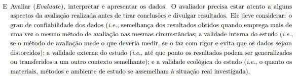

    Fonte: Barbosa et al. (2021, cap. 11, seç. 11.8, p. 280).

#### Item 13

Foi definido o formato do relato final dos resultados, contendo objetivos e escopo da avaliação, método de avaliação empregado, número e perfil de usuários/avaliadores, sumário dos dados coletados, interpretação dos dados, lista dos problemas encontrados e planejamento para o reprojeto do sistema?

**Fonte:** Barbosa et al. (2021, cap. 11, seç. 11.7.5, p. 279).

??? quote "Figura 13 – Trecho que fundamenta o item 13"

    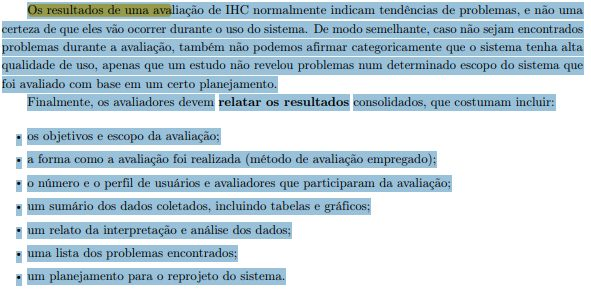

    Fonte: Barbosa et al. (2021, cap. 11, seç. 11.7.5, p. 279).

## Referências

BARBOSA, Simone Diniz Junqueira; SILVA, Bruno Santana da; SILVEIRA, Milene Selbach; GASPARINI, Isabela; DARIN, Ticianne; BARBOSA, Gabriel Diniz Junqueira. *Interação Humano-Computador e Experiência do Usuário*. [*S. l.*]: Autopublicação, 2021. Disponível em: https://leanpub.com/ihc-ux.

SALES, André Barros de. *Lista de Exercícios*: elaborar listas de verificação. Brasília: Universidade de Brasília, [2026]. Enunciado da atividade avaliativa Verificação 2.

SALES, André Barros de. *Plano de Ensino*: Interação Humano Computador (FGA0173), 02/2026, Turma 01, v1. Brasília: Universidade de Brasília, 2026.

## Agradecimentos e uso de IA generativa

**Uso de IA generativa nesta página.** O Claude (Anthropic) foi utilizado na transcrição do documento original para o site e na padronização da formatação, das legendas, das citações e das referências às normas da disciplina. O conteúdo do trabalho é de João Vitor, indicado(a) na tabela de contribuição. A ferramenta não é autora do artefato e seu uso não exime os autores da responsabilidade sobre o conteúdo (SALES, 2026, p. 3).
