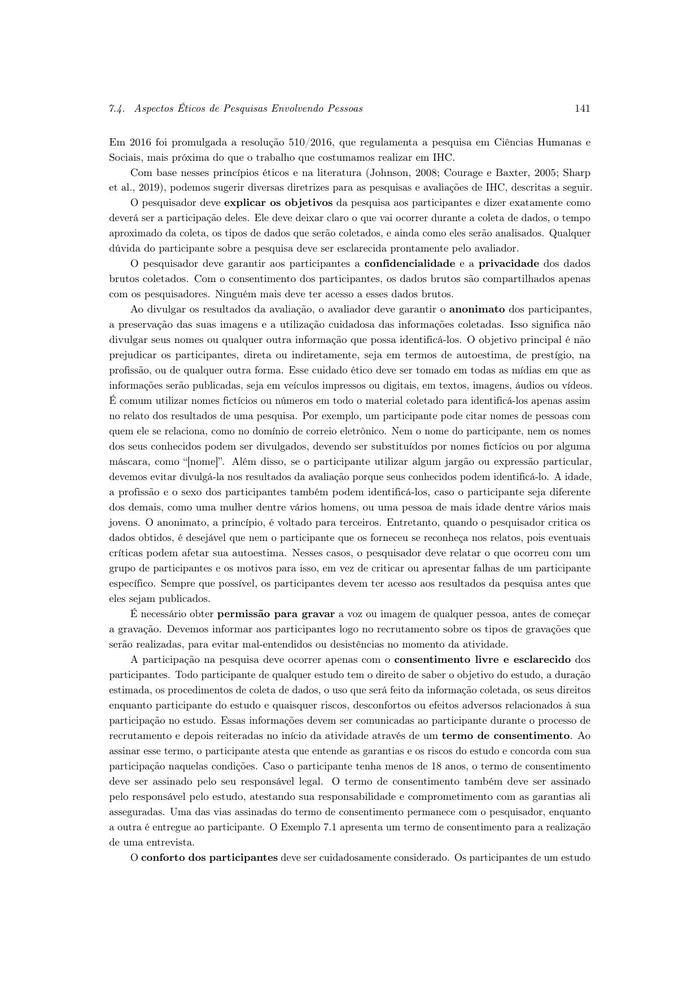
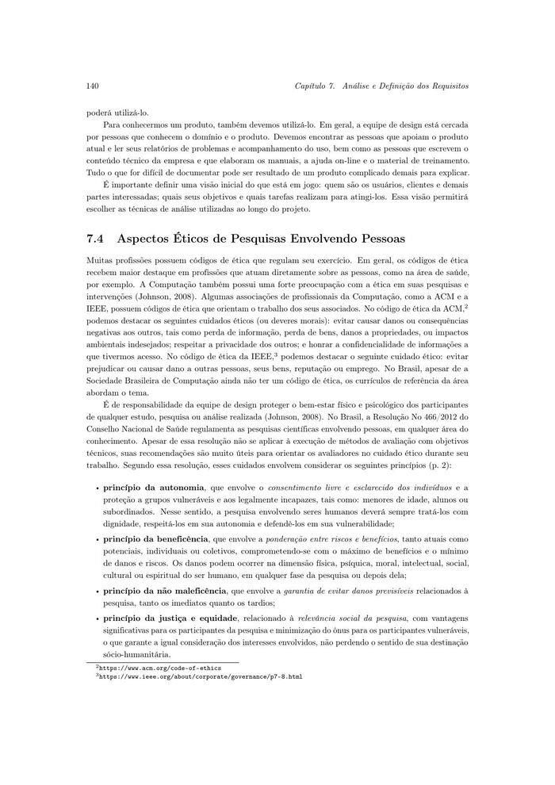
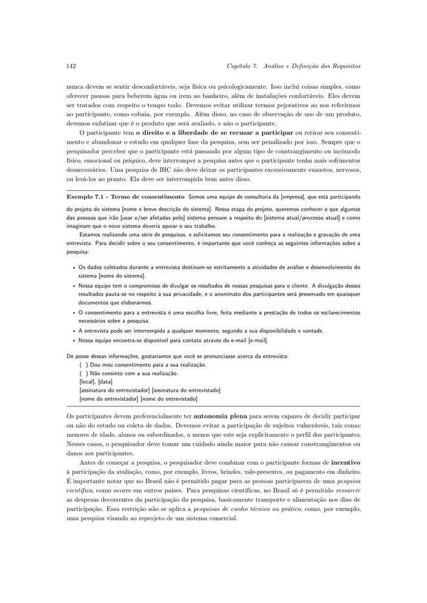
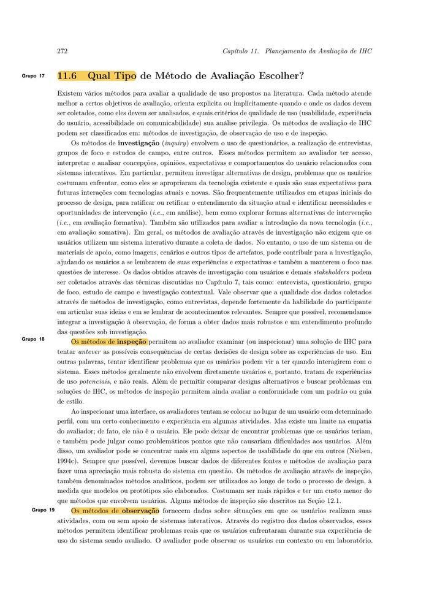
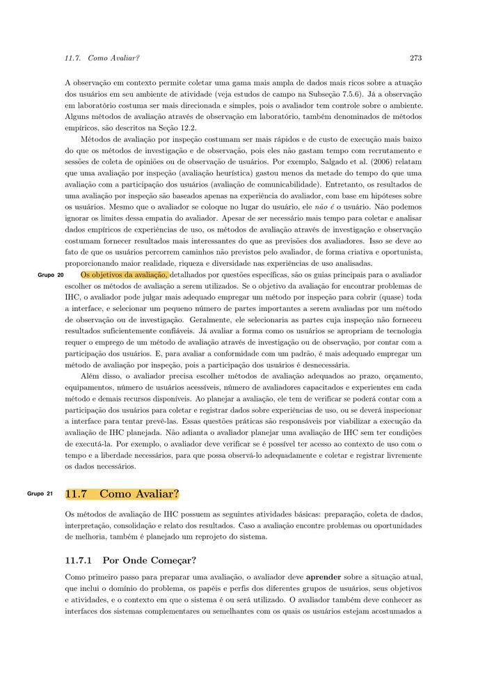
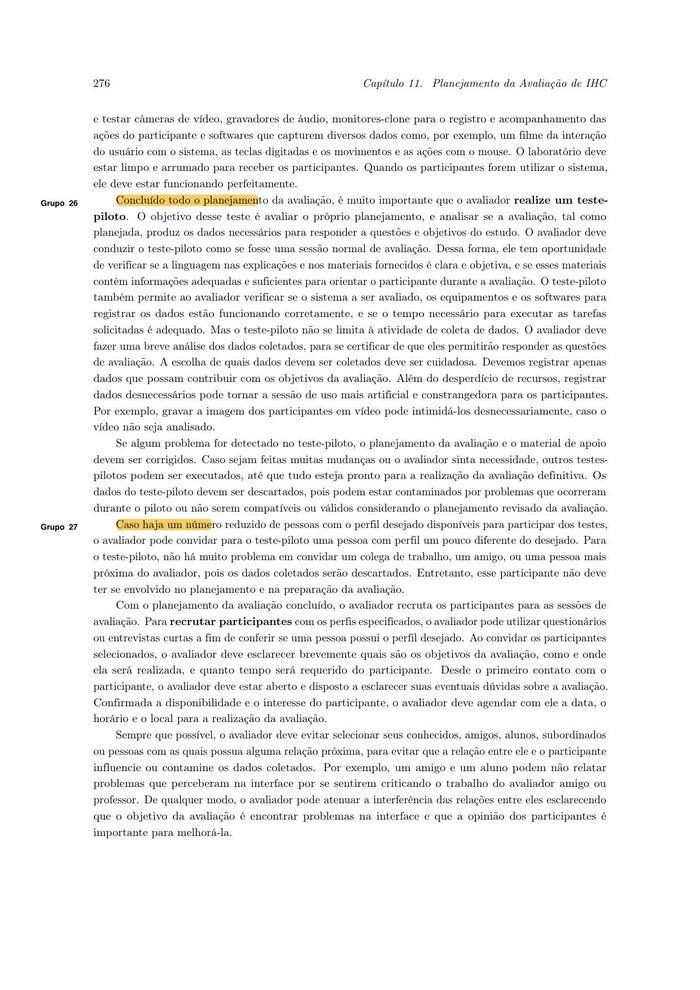
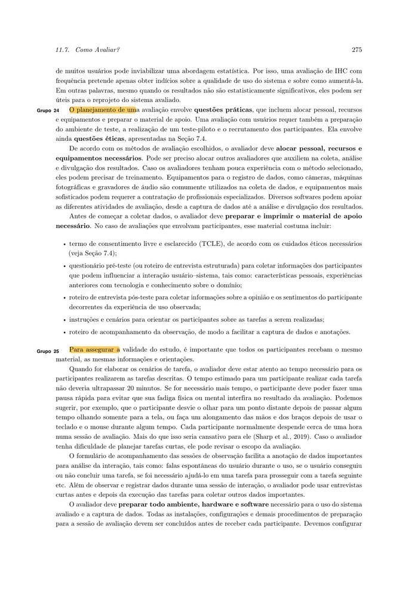
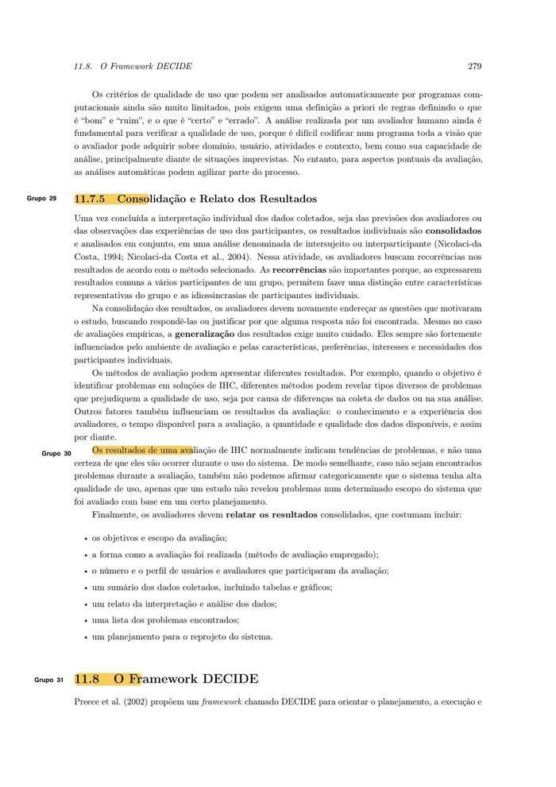

# Lista de Verificação – Métodos de Avaliação de IHC

**Autoria:** João Vitor Tavares de Sá Lima · **Entrega 1**

## Tabela de contribuição

**Tabela 1 – Contribuições no trabalho "Lista de Verificação – Métodos de Avaliação de IHC"**

| Integrante | Contribuição | Atividade (link) | Gravação (link) |
| --- | --- | --- | --- |
| Alexandre Vilar Valadares Fonsêca | Não se aplica (atividade individual) | — | — |
| Gabriel Robson Nunes Neiva da Silva | Não se aplica (atividade individual) | — | — |
| Henrique Schneider Fernandes da Rosa | Não se aplica (atividade individual) | — | — |
| João Vitor Tavares de Sá Lima | Autoria do trabalho (atividade individual) | Esta página | — |

Fonte: elaborado pelos autores (2026).

## Histórico de versões

**Tabela 2 – Histórico de versões do trabalho "Lista de Verificação – Métodos de Avaliação de IHC"**

| Data | Versão | Descrição | Autor(es) | Revisor(es) |
| --- | --- | --- | --- | --- |
| 03/09/2026 | 1.0 | Elaboração do trabalho, entregue no Moodle (data do arquivo entregue) | João Vitor | — |
| 17/10/2026 | 1.1 | Publicação no site: transcrição, fotos das fontes, citações e referências no padrão da disciplina | Henrique Schneider | — |

Fonte: elaborado pelos autores (2026).

## 1. Introdução

Atividade individual do Moodle "Lista de verificação – Métodos de Avaliação": elaborar itens de uma lista de verificação para inspecionar o planejamento e a execução de uma avaliação de IHC.

Cada item é uma pergunta autocontida, respondida com **Conforme**, **Não conforme** ou **Não se aplica**. Abaixo de cada item estão a fonte, com capítulo, seção e página, e a foto do trecho que o fundamenta, como pede a atividade de elaboração de listas de verificação (SALES, [2026], p. 1). Clique no título de cada figura para abrir a foto.

As fotos do trecho são da edição de 2021 do livro de Barbosa e colaboradores (*Interação Humano-Computador e Experiência do Usuário*), cuja numeração de capítulos e páginas é a usada nas citações.

## 2. Itens da lista

### Item 1

O termo de consentimento livre e esclarecido (TCLE) utilizado na avaliação informa aos participantes os objetivos da pesquisa, a duração estimada, os procedimentos de coleta de dados, o uso que será feito das informações coletadas, os direitos do participante e os riscos ou desconfortos relacionados à sua participação, sendo assinado em duas vias ?

**Fonte:** Barbosa et al. (2021, cap. 7, seç. 7.4, p. 141).

??? quote "Figura 1 – Trecho que fundamenta o item 1"

    

    Fonte: Barbosa et al. (2021, cap. 7, seç. 7.4, p. 141).

### Item 2

Caso algum participante tenha menos de 18 anos, o termo de consentimento foi assinado pelo seu responsável legal?

**Fonte:** Barbosa et al. (2021, cap. 7, seç. 7.4, p. 141).

??? quote "Figura 2 – Trecho que fundamenta o item 2"

    

    Fonte: Barbosa et al. (2021, cap. 7, seç. 7.4, p. 141).

### Item 3

Foi garantida a confidencialidade e a privacidade dos dados brutos coletados na avaliação, de modo que, mediante o consentimento dos participantes, apenas os pesquisadores/avaliadores tenham acesso a esses dados brutos?

**Fonte:** Barbosa et al. (2021, cap. 7, seç. 7.4, p. 140).

??? quote "Figura 3 – Trecho que fundamenta o item 3"

    

    Fonte: Barbosa et al. (2021, cap. 7, seç. 7.4, p. 140).

### Item 4

Ao divulgar os resultados da avaliação, foi garantido o anonimato dos participantes — por exemplo, substituindo seus nomes reais e os de pessoas citadas por eles por nomes fictícios ou máscaras (como "[nome]"), evitando divulgar jargões ou expressões particulares, e evitando expor características (como idade, profissão ou sexo) que possam destacar e identificar um participante entre os demais?

**Fonte:** Barbosa et al. (2021, cap. 7, seç. 7.4, p. 140–141).

??? quote "Figura 4 – Trecho que fundamenta o item 4"

    

    Fonte: Barbosa et al. (2021, cap. 7, seç. 7.4, p. 140–141).

### Item 5

Foi obtida a permissão dos participantes antes de realizar qualquer gravação de voz ou imagem, tendo sido informado previamente, ainda no recrutamento, quais tipos de gravação seriam realizados durante a avaliação?

**Fonte:** Barbosa et al. (2021, cap. 7, seç. 7.4, p. 141).

??? quote "Figura 5 – Trecho que fundamenta o item 5"

    

    Fonte: Barbosa et al. (2021, cap. 7, seç. 7.4, p. 141).

### Item 6

O conforto físico e psicológico dos participantes foi considerado durante a sessão de avaliação (por exemplo, oferecendo pausas para beberem água ou irem ao banheiro, instalações confortáveis, tratamento respeitoso, evitando termos pejorativos como "cobaia", e deixando claro que é o produto — e não o participante — que está sendo avaliado)?

**Fonte:** Barbosa et al. (2021, cap. 7, seç. 7.4, p. 141–142).

??? quote "Figura 6 – Trecho que fundamenta o item 6"

    

    Fonte: Barbosa et al. (2021, cap. 7, seç. 7.4, p. 141–142).

### Item 7

Foi assegurado a cada participante o direito de se recusar a participar da avaliação ou de retirar seu consentimento e abandonar o estudo em qualquer fase da pesquisa, sem ser penalizado por isso?

**Fonte:** Barbosa et al. (2021, cap. 7, seç. 7.4, p. 142).

??? quote "Figura 7 – Trecho que fundamenta o item 7"

    

    Fonte: Barbosa et al. (2021, cap. 7, seç. 7.4, p. 142).

### Item 8

Caso tenha sido oferecido algum incentivo à participação (como livros, brindes ou vale-presentes), esse incentivo respeitou a regra de que, no Brasil, pesquisas científicas envolvendo pessoas não podem pagar em dinheiro pela participação — sendo permitido apenas o ressarcimento de despesas como transporte e alimentação nos dias de participação (restrição que não se aplica a pesquisas de cunho técnico ou prático, como o reprojeto de um sistema comercial)?

**Fonte:** Barbosa et al. (2021, cap. 7, seç. 7.4, p. 142).

??? quote "Figura 8 – Trecho que fundamenta o item 8"

    

    Fonte: Barbosa et al. (2021, cap. 7, seç. 7.4, p. 142).

### Item 9

Foi definida a categoria do(s) método(s) de avaliação de IHC a ser(em) utilizado(s), entre: métodos de investigação (questionário, entrevista, grupo de foco, estudo de campo — sem exigir o uso do sistema pelos usuários), métodos de inspeção (exame da interface pelo avaliador, sem a participação direta de usuários) ou métodos de observação (observação do uso do sistema pelos usuários, em contexto real ou em laboratório)?

**Fonte:** Barbosa et al. (2021, cap. 11, seç. 11.6, p. 272).

??? quote "Figura 9 – Trecho que fundamenta o item 9"

    

    Fonte: Barbosa et al. (2021, cap. 11, seç. 11.6, p. 272).

### Item 10

A escolha do(s) método(s) de avaliação considerou os objetivos da avaliação, o prazo, o orçamento, os equipamentos disponíveis, o número de usuários acessíveis e o grau de conhecimento/experiência dos avaliadores nos métodos selecionados?

**Fonte:** Barbosa et al. (2021, cap. 11, seç. 11.6, p. 272–273).

??? quote "Figura 10 – Trecho que fundamenta o item 10"

    

    Fonte: Barbosa et al. (2021, cap. 11, seç. 11.6, p. 272–273).

### Item 11

Foram definidos o perfil (por exemplo, idade, sexo, formação acadêmica, nível de experiência com o sistema e com o domínio) e o número de participantes da avaliação, evitando-se selecionar conhecidos, amigos, alunos ou subordinados do avaliador para não influenciar os dados coletados?

**Fonte:** Barbosa et al. (2021, cap. 11, seç. 11.7.2, p. 274 e 276).

??? quote "Figura 11 – Trecho que fundamenta o item 11"

    

    Fonte: Barbosa et al. (2021, cap. 11, seç. 11.7.2, p. 274 e 276).

### Item 12

Foi realizado um teste-piloto do planejamento da avaliação antes da sua execução definitiva (utilizando, se necessário, um colega ou conhecido que não tenha participado do planejamento), com os dados desse teste-piloto descartados da análise final?

**Fonte:** Barbosa et al. (2021, cap. 11, seç. 11.7.2, p. 275–276).

??? quote "Figura 12 – Trecho que fundamenta o item 12"

    

    Fonte: Barbosa et al. (2021, cap. 11, seç. 11.7.2, p. 275–276).

### Item 13

Foi preparado o material de apoio necessário para a sessão de avaliação, incluindo o termo de consentimento, o questionário pré-teste (ou roteiro de entrevista estruturada), o roteiro de entrevista pós-teste, as instruções/cenários das tarefas a serem realizadas pelos participantes e o roteiro de acompanhamento da observação?

**Fonte:** Barbosa et al. (2021, cap. 11, seç. 11.7.2, p. 275).

??? quote "Figura 13 – Trecho que fundamenta o item 13"

    

    Fonte: Barbosa et al. (2021, cap. 11, seç. 11.7.2, p. 275).

### Item 14

O tempo estimado para a realização de cada tarefa pelos participantes não ultrapassou 20 minutos, e a duração total da sessão de avaliação ficou em torno de uma hora por participante?

**Fonte:** Barbosa et al. (2021, cap. 11, seç. 11.7.2, p. 275).

??? quote "Figura 14 – Trecho que fundamenta o item 14"

    

    Fonte: Barbosa et al. (2021, cap. 11, seç. 11.7.2, p. 275).

### Item 15

Ao final da avaliação, foi elaborado um relato dos resultados contendo os objetivos e o escopo da avaliação, o método de avaliação empregado, o número e o perfil dos usuários e avaliadores que participaram, um sumário dos dados coletados (com tabelas e/ou gráficos), a interpretação e análise dos dados, a lista dos problemas encontrados e um planejamento para o reprojeto do sistema?

**Fonte:** Barbosa et al. (2021, cap. 11, seç. 11.7.5, p. 279).

??? quote "Figura 15 – Trecho que fundamenta o item 15"

    

    Fonte: Barbosa et al. (2021, cap. 11, seç. 11.7.5, p. 279).

## Referências

BARBOSA, Simone Diniz Junqueira; SILVA, Bruno Santana da; SILVEIRA, Milene Selbach; GASPARINI, Isabela; DARIN, Ticianne; BARBOSA, Gabriel Diniz Junqueira. *Interação Humano-Computador e Experiência do Usuário*. [*S. l.*]: Autopublicação, 2021. Disponível em: https://leanpub.com/ihc-ux.

SALES, André Barros de. *Lista de Exercícios*: elaborar listas de verificação. Brasília: Universidade de Brasília, [2026]. Enunciado da atividade avaliativa Verificação 2.

SALES, André Barros de. *Plano de Ensino*: Interação Humano Computador (FGA0173), 02/2026, Turma 01, v1. Brasília: Universidade de Brasília, 2026.

## Agradecimentos e uso de IA generativa

**Uso de IA generativa nesta página.** O Claude (Anthropic) foi utilizado na transcrição do documento original para o site e na padronização da formatação, das legendas, das citações e das referências às normas da disciplina. O conteúdo do trabalho é de João Vitor, indicado(a) na tabela de contribuição. A ferramenta não é autora do artefato e seu uso não exime os autores da responsabilidade sobre o conteúdo (SALES, 2026, p. 3).
