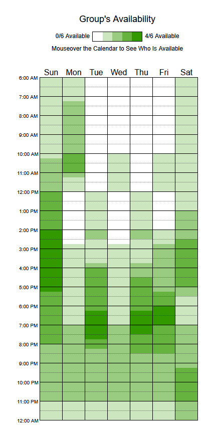

# Heatmap de Disponibilidade

## Tabela de contribuição

**Tabela 1 – Contribuições no artefato Heatmap de Disponibilidade**

| Integrante | Contribuição | Atividade (link) | Gravação (link) |
| --- | --- | --- | --- |
| Alexandre Vilar Valadares Fonsêca | — | — | — |
| Eduardo Ribeiro Gomes da Silva | Inclusão da imagem do heatmap e síntese dos horários de maior disponibilidade (versão 1.1) | [Commit e39565e](https://github.com/Interacao-Humano-Computador/2026.2-Grupo03/commit/e39565e) | — |
| Gabriel Robson Nunes Neiva da Silva | Não se aplica (integrante a partir da Entrega 2) | — | — |
| Henrique Schneider Fernandes da Rosa | Registro do método de coleta e da disponibilidade dos integrantes (versão 1.0); criação e organização do mapa de calor (GRUPO 03, 2026, seção 6) | [When2Meet](https://www.when2meet.com/?38373487-SW1oI) | — |
| João Vitor Tavares de Sá Lima | — | — | — |

Fonte: elaborado pelos autores (2026).

## Histórico de versões

**Tabela 2 – Histórico de versões do artefato Heatmap de Disponibilidade**

| Data | Versão | Descrição | Autor(es) | Revisor(es) |
| --- | --- | --- | --- | --- |
| 06/09/2026 | 1.0 | Registro do método de coleta e da disponibilidade dos integrantes. | Henrique Schneider | — |
| 10/09/2026 | 1.1 | Inclusão da imagem do heatmap e síntese dos horários de maior disponibilidade dos quatro integrantes. | Eduardo Ribeiro | — |
| 15/10/2026 | 1.2 | Padronização da estrutura (tabela de contribuição, numeração das seções, chamadas da figura e da tabela), das referências (ABNT) e inclusão da seção de uso de IA | Henrique Schneider | — |
| 17/10/2026 | 1.3 | Organização por entrega; revisão da tabela de contribuição | Henrique Schneider | — |

Fonte: elaborado pelos autores (2026).

## 1. Introdução

O heatmap apresenta visualmente os períodos de disponibilidade dos quatro integrantes do Grupo 3. Seu objetivo é apoiar a definição dos horários de reuniões e a distribuição das atividades do planejamento do projeto. Quanto mais escura a faixa de cor, maior é a quantidade de integrantes disponíveis naquele período.

## 2. Coleta e consolidação dos dados

Os dados foram coletados por meio do When2Meet, ferramenta utilizada para comparar a disponibilidade informada pelos integrantes (When2Meet, 2026). A Figura 1 apresenta a consolidação visual dos horários registrados.

**Figura 1 – Heatmap de disponibilidade dos integrantes**

Fonte: elaborado pelos autores (2026), com dados coletados no When2Meet (When2Meet, 2026).

## 3. Análise

As faixas de maior sobreposição, representadas pelas tonalidades mais escuras, indicam períodos em que os quatro integrantes estavam disponíveis simultaneamente. A leitura do gráfico aponta como janelas preferenciais as faixas aproximadas apresentadas na Tabela 3.

**Tabela 3 – Faixas de maior disponibilidade dos integrantes**

| Dia | Faixa de maior disponibilidade | Quantidade indicada |
| --- | --- | ---: |
| Domingo | 12h às 17h | 4/4 |
| Segunda-feira | 10h às 11h | 4/4 |
| Terça-feira | 16h às 20h | 4/4 |
| Quarta-feira | 18h às 19h | 4/4 |
| Quinta-feira | 17h às 20h | 4/4 |
| Sexta-feira | 18h às 19h | 4/4 |
| Sábado | 15h às 17h | 4/4 |

Fonte: elaborado pelos autores (2026), por interpretação dos dados coletados no When2Meet (When2Meet, 2026).

Esses horários servem como referência inicial para reuniões síncronas. A confirmação de quais integrantes estão disponíveis em cada faixa deve ser feita no calendário interativo do When2Meet.

## Referências

GRUPO 03. *Relatório da Etapa 1: Planejamento do Projeto – Portal do Detran-DF*. Brasília: Universidade de Brasília, 2026. Disponível em: [PDF](../../assets/pdfs/entregas/relatorio-entrega-1-grupo-03.pdf).

SALES, André Barros de. *Plano de Ensino: Interação Humano Computador (FGA0173), 02/2026, Turma 01, v1*. Brasília: Universidade de Brasília, 2026.

WHEN2MEET. *When2Meet: find a time to meet*. [*S. l.*], 2026. Disponível em: https://www.when2meet.com/. Acesso em: 10 set. 2026.

## Agradecimentos e uso de IA generativa

**Uso de IA generativa nesta página.** Em 15/10/2026 e 17/10/2026, o Claude (Anthropic) foi utilizado, a pedido de Henrique Schneider, para padronizar esta página no modelo de artefato da disciplina (tabela de contribuição, histórico em ordem cronológica, numeração das seções, chamadas da figura e da tabela, texto alternativo da imagem) e padronizar as referências conforme a ABNT. O texto e a análise dos horários não foram alterados. A ferramenta não é autora do artefato e seu uso não exime os autores da responsabilidade sobre o conteúdo (SALES, 2026, p. 3).
