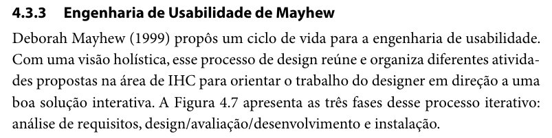
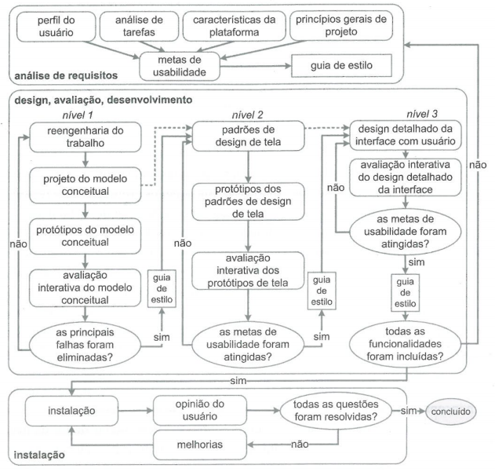

# Processo de Design

## Tabela de contribuição

**Tabela 1 – Contribuições no artefato Processo de Design**

| Integrante | Contribuição | Atividade (link) | Gravação (link) |
| --- | --- | --- | --- |
| Alexandre Vilar Valadares Fonsêca | Redação das ferramentas do projeto e do processo de design, segundo o cronograma (GRUPO 03, 2026, seção 4.1) | — | — |
| Eduardo Ribeiro Gomes da Silva | Estudo e escolha do processo de design (GRUPO 03, 2026, seção 6); registro da Engenharia de Usabilidade de Mayhew e do DECIDE (versão 1.0) e ampliação da fundamentação (versão 1.1) | [Commit 7f93ba5](https://github.com/Interacao-Humano-Computador/2026.2-Grupo03/commit/7f93ba5); [commit f88c791](https://github.com/Interacao-Humano-Computador/2026.2-Grupo03/commit/f88c791) | — |
| Gabriel Robson Nunes Neiva da Silva | Não se aplica (integrante a partir da Entrega 2) | — | — |
| Henrique Schneider Fernandes da Rosa | — | — | — |
| João Vitor Tavares de Sá Lima | Redação das ferramentas do projeto e do processo de design, segundo o cronograma (GRUPO 03, 2026, seção 4.1) | — | — |

Fonte: elaborado pelos autores (2026).

## Histórico de versões

**Tabela 2 – Histórico de versões do artefato Processo de Design**

| Data | Versão | Descrição | Autor(es) | Revisor(es) |
| --- | --- | --- | --- | --- |
| 10/09/2026 | 1.0 | Registro da Engenharia de Usabilidade de Mayhew e do framework DECIDE. | Eduardo Ribeiro | — |
| 10/09/2026 | 1.1 | Ampliação da fundamentação teórica, das etapas e da aplicação do processo ao Portal de Serviços do Detran-DF. | Eduardo Ribeiro | — |
| 15/10/2026 | 1.2 | Padronização da estrutura (tabela de contribuição, numeração das seções), das referências (ABNT), inclusão da Figura 1 (ciclo de vida de Mayhew, a partir do material de consulta do grupo) e reunião das declarações de uso de IA em uma seção final | Henrique Schneider | — |
| 17/10/2026 | 1.3 | Organização por entrega; foto do trecho de Barbosa e Silva (2010, p. 109) e citação indireta de Mayhew (1999); identificação do autor do item | Henrique Schneider | — |

Fonte: elaborado pelos autores (2026).

## 1. Introdução

O processo de design define como o grupo compreenderá o problema, levantará evidências, proporá soluções e avaliará os resultados da interface do Portal de Serviços do Detran-DF. Em Interação Humano-Computador, o projeto da interação deve considerar as pessoas, seus objetivos, as tarefas realizadas e o contexto em que o sistema é utilizado (Barbosa; Silva, 2010).

Para organizar esse trabalho, o grupo adotou a Engenharia de Usabilidade de Mayhew (Mayhew, 1999 *apud* Barbosa; Silva, 2010, cap. 4, seç. 4.3.3, p. 109), que será complementada pelo framework DECIDE e pela avaliação heurística em etapas posteriores. Neste momento, o foco está apenas na escolha e na justificativa do processo. A Figura 1 reproduz o trecho em que Barbosa e Silva apresentam esse processo.

**Figura 1 – Trecho de Barbosa e Silva (2010, p. 109) sobre a Engenharia de Usabilidade de Mayhew**

Fonte: Barbosa e Silva (2010, cap. 4, seç. 4.3.3, p. 109).

## 2. Abordagem adotada

**Autor do item:** Eduardo Ribeiro Gomes da Silva (versões 1.0 e 1.1; GRUPO 03, 2026, seção 6).

A Engenharia de Usabilidade de Mayhew é adequada a um sistema governamental com alta densidade de informações e fluxos burocráticos porque prioriza a compreensão dos usuários e das tarefas antes das decisões detalhadas de design. O modelo foi escolhido para reduzir decisões baseadas apenas em preferência estética e orientar o projeto por evidências de uso.

Essa abordagem também está alinhada à avaliação heurística, que permite inspecionar a interface em busca de problemas de usabilidade a partir de princípios reconhecidos. As heurísticas ajudam a identificar falhas de visibilidade do estado do sistema, compatibilidade com o mundo real, controle do usuário, prevenção de erros, consistência e ajuda (Nielsen, 1994).

## 3. Fundamentos do processo

O processo será orientado pelos seguintes fundamentos:

- **Centrado no usuário:** decisões devem considerar as características, necessidades, objetivos e limitações dos cidadãos que utilizam os serviços.
- **Orientado às tarefas:** a análise deve observar o que o usuário precisa realizar, como localizar multas, agendar atendimento, consultar credenciadas e acessar sua conta.
- **Baseado em evidências:** problemas e soluções devem ser apoiados por observações, registros da inspeção, resultados de avaliação e justificativas documentadas.
- **Iterativo:** cada avaliação pode revelar novos problemas e gerar ajustes no modelo conceitual, nos protótipos e na interface final.
- **Acessível e inclusivo:** contraste, hierarquia visual, linguagem, navegação por teclado e compatibilidade com tecnologias assistivas devem ser considerados desde o início.
- **Comunicável:** a interface deve tornar compreensíveis suas funções, estados, consequências das ações e formas de recuperação de erros (Barbosa; Silva, 2010).

## 4. Fases gerais do processo

As três fases do ciclo de vida estão representadas na Figura 2.

1. **Análise de requisitos:** compreensão dos usuários, das tarefas e das necessidades de usabilidade do sistema.
2. **Design e desenvolvimento:** criação e evolução das soluções de interação, considerando os requisitos levantados.
3. **Avaliação e refinamento:** verificação das soluções e realização de ajustes com base nas evidências encontradas.

**Figura 2 – Ciclo de vida para a engenharia de usabilidade (Barbosa; Silva, 2010, cap. 4, p. 110)**

Fonte: Mayhew (1999 *apud* Barbosa; Silva, 2010, cap. 4, Fig. 4.7, p. 110).

## 5. Aplicação ao Portal de Serviços do Detran-DF

No projeto, o processo será aplicado aos fluxos de consulta e pagamento de multas, agendamento de atendimento presencial, consulta de credenciadas, autenticação e uso do assistente virtual. Esses fluxos foram considerados relevantes por fazerem parte dos serviços oferecidos ao cidadão e dos problemas identificados na inspeção preliminar.

Em uma etapa posterior, o grupo deverá verificar questões como:

- O cidadão encontra rapidamente o serviço que procura?
- O sistema informa claramente em que etapa do fluxo o usuário está?
- Os campos obrigatórios, erros e consequências das ações estão explícitos?
- O usuário recebe feedback compreensível após salvar, consultar ou concluir uma tarefa?
- A interface oferece ajuda e recuperação quando ocorre uma falha de login ou preenchimento?
- Os conteúdos e controles são acessíveis a pessoas com diferentes necessidades?

## 6. Critérios de decisão

O planejamento da avaliação será apoiado pelo framework DECIDE, de Sharp, Rogers e Preece (Sharp; Rogers; Preece, 2019). A inspeção heurística utilizará as dez heurísticas de Nielsen, enquanto os referenciais de Barbosa e Silva apoiarão a análise de comunicabilidade, especialmente em falhas de feedback e na ausência de explicação sobre a lógica do sistema.

Cada problema identificado deverá ser registrado com sua localização, contexto, heurística relacionada, impacto sobre o usuário, impacto sobre a tarefa, grau de severidade e recomendação de melhoria. Essa forma de registro facilita a rastreabilidade entre o problema observado, a decisão de design e a solução proposta.

## Referências

BARBOSA, Simone Diniz Junqueira; SILVA, Bruno Santana da. *Interação Humano-Computador*. Rio de Janeiro: Elsevier, 2010.

GOOGLE. *Gemini*. [*S. l.*], 2026. Disponível em: https://gemini.google.com/. Acesso em: 10 set. 2026.

GRUPO 03. *Relatório da Etapa 1: Planejamento do Projeto – Portal do Detran-DF*. Brasília: Universidade de Brasília, 2026. Disponível em: [PDF](../../assets/pdfs/entregas/relatorio-entrega-1-grupo-03.pdf).

MAYHEW, Deborah J. *The usability engineering lifecycle: a practitioner's handbook for user interface design*. San Francisco: Morgan Kaufmann, 1999.

NIELSEN, Jakob. Heuristic evaluation. *In*: NIELSEN, Jakob; MACK, Robert L. (ed.). *Usability inspection methods*. New York: John Wiley & Sons, 1994. p. 25-62.

SALES, André Barros de. *Plano de Ensino: Interação Humano Computador (FGA0173), 02/2026, Turma 01, v1*. Brasília: Universidade de Brasília, 2026.

SHARP, Helen; ROGERS, Yvonne; PREECE, Jennifer. *Interaction design: beyond human-computer interaction*. 5. ed. Indianapolis: Wiley, 2019.

## Agradecimentos e uso de IA generativa

### Declaração de uso de inteligência artificial generativa (Eduardo Ribeiro, versões 1.0 e 1.1)

O Google Gemini foi utilizado como ferramenta de apoio à organização das ideias, à revisão da redação e à estruturação inicial desta página (Google, 2026). Seu uso não substituiu a leitura das referências, a análise do grupo ou a decisão sobre o processo de design.

As sugestões geradas foram revisadas e validadas pelos integrantes. A responsabilidade pelo conteúdo final, pelas interpretações, pelas citações e pelas referências é exclusivamente do Grupo 3.

### Uso de IA generativa na padronização da página

Em 15/10/2026 e 17/10/2026, o Claude (Anthropic) foi utilizado, a pedido de Henrique Schneider, para padronizar esta página no modelo de artefato da disciplina (tabela de contribuição, histórico, numeração das seções e das figuras), padronizar as citações e as referências conforme a ABNT, inserir a Figura 2 com legenda e fonte e recortar, do PDF de Barbosa e Silva (2010), a foto do trecho da Figura 1. A imagem da Figura 2 já estava no material de consulta do grupo; a página e a figura do livro foram conferidas no PDF de Barbosa e Silva (2010). A ferramenta não é autora do artefato e seu uso não exime os autores da responsabilidade sobre o conteúdo (SALES, 2026, p. 3).
