# Lista de Verificação – Árvores de Tarefas Concorrentes (CTT)

**Autoria:** Alexandre Vilar Valadares Fonsêca · **Entrega 2**

## Tabela de contribuição

**Tabela 1 – Contribuições no trabalho "Lista de Verificação – Árvores de Tarefas Concorrentes (CTT)"**

| Integrante | Contribuição | Atividade (link) | Gravação (link) |
| --- | --- | --- | --- |
| Alexandre Vilar Valadares Fonsêca | Autoria do trabalho (atividade individual) | Esta página | — |
| Gabriel Robson Nunes Neiva da Silva | Não se aplica (atividade individual) | — | — |
| Henrique Schneider Fernandes da Rosa | Não se aplica (atividade individual) | — | — |
| João Vitor Tavares de Sá Lima | Não se aplica (atividade individual) | — | — |

Fonte: elaborado pelos autores (2026).

## Histórico de versões

**Tabela 2 – Histórico de versões do trabalho "Lista de Verificação – Árvores de Tarefas Concorrentes (CTT)"**

| Data | Versão | Descrição | Autor(es) | Revisor(es) |
| --- | --- | --- | --- | --- |
| 22/09/2026 | 1.0 | Elaboração do trabalho, entregue no Moodle (prazo da atividade no Moodle) | Alexandre Vilar | — |
| 17/10/2026 | 1.1 | Publicação no site: transcrição, fotos das fontes, citações e referências no padrão da disciplina | Henrique Schneider | — |

Fonte: elaborado pelos autores (2026).

## 1. Introdução

Atividade individual do Moodle "Listas de verificação – Personas, Elenco de Personas, HTA e CTT", parte relativa às Árvores de Tarefas Concorrentes (CTT).

Cada item é uma pergunta autocontida, respondida com **Conforme**, **Não conforme** ou **Não se aplica**. Abaixo de cada item estão a fonte, com capítulo, seção e página, e a foto do trecho que o fundamenta, como pede a atividade de elaboração de listas de verificação (SALES, [2026], p. 1). Clique no título de cada figura para abrir a foto.

## 2. Itens da lista

### Item 1

A tarefa raiz (topo) da árvore é uma tarefa abstrata, representada pelo ícone de nuvem, que expressa o objetivo geral do usuário (por exemplo: “Agendar compromisso”)?

**Fonte:** Barbosa e Silva (2010), slides do cap. 6, slide 25 (tarefas abstratas) e slide 29 (exemplo de modelo CTT).

??? quote "Figura 1 – Trecho que fundamenta o item 1"

    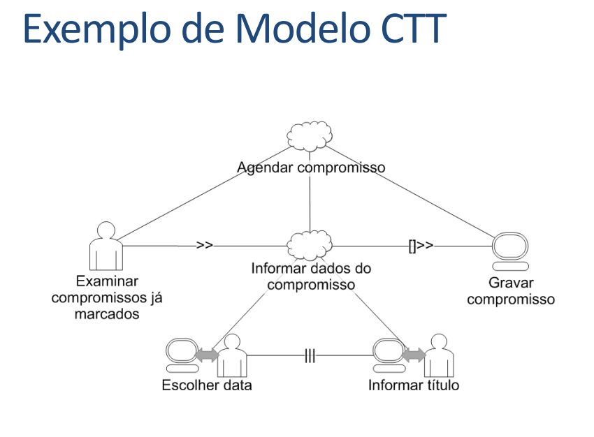

    Fonte: Barbosa e Silva (2010), slides do cap. 6, slide 25 (tarefas abstratas) e slide 29 (exemplo de modelo CTT).

### Item 2

Todas as tarefas da árvore estão classificadas em um dos quatro tipos do CTT, com o ícone correspondente: tarefa do usuário (ícone de pessoa), tarefa do sistema (ícone de computador), tarefa interativa (computador e pessoa ligados por seta dupla) ou tarefa abstrata (ícone de nuvem)?

**Fonte:** Barbosa e Silva (2010), slides do cap. 6, slide 25 (“existem 4 tipos de tarefas” e legenda dos ícones).

??? quote "Figura 2 – Trecho que fundamenta o item 2"

    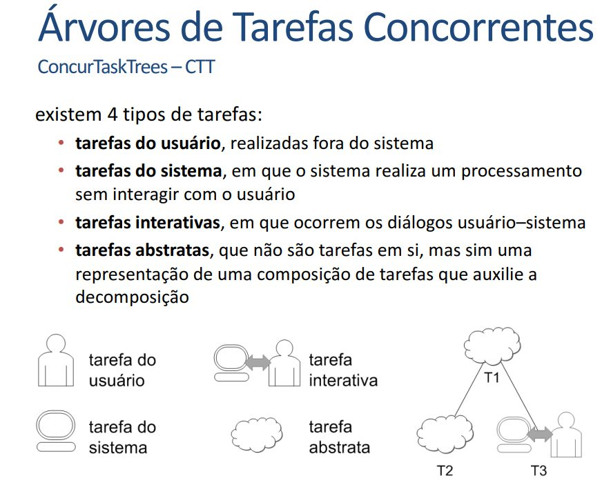

    Fonte: Barbosa e Silva (2010), slides do cap. 6, slide 25 (“existem 4 tipos de tarefas” e legenda dos ícones).

### Item 3

As tarefas marcadas como tarefa do usuário (ícone de pessoa) representam apenas atividades realizadas FORA do sistema, sem interação com ele (por exemplo: examinar compromissos já marcados, decidir, ler um papel)?

**Fonte:** Barbosa e Silva (2010), slides do cap. 6, slide 25 (definição de tarefa do usuário) e slide 29 (“Examinar compromissos já marcados”).

??? quote "Figura 3 – Trecho que fundamenta o item 3"

    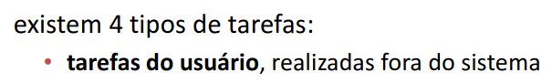

    Fonte: Barbosa e Silva (2010), slides do cap. 6, slide 25 (definição de tarefa do usuário) e slide 29 (“Examinar compromissos já marcados”).

### Item 4

As tarefas marcadas como tarefa do sistema (ícone de computador) representam apenas processamentos que o sistema executa SEM interagir com o usuário (por exemplo: gravar compromisso, calcular, validar dados)?

**Fonte:** Barbosa e Silva (2010), slides do cap. 6, slide 25 (definição de tarefa do sistema) e slide 29 (“Gravar compromisso”).

??? quote "Figura 4 – Trecho que fundamenta o item 4"

    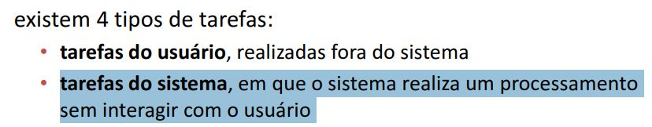

    Fonte: Barbosa e Silva (2010), slides do cap. 6, slide 25 (definição de tarefa do sistema) e slide 29 (“Gravar compromisso”).

### Item 5

As tarefas marcadas como tarefa interativa (computador e pessoa com seta dupla) representam um diálogo entre usuário e sistema, isto é, o usuário fornece ou seleciona algo na interface e o sistema responde (por exemplo: escolher data, informar título)?

**Fonte:** Barbosa e Silva (2010), slides do cap. 6, slide 25 (definição de tarefa interativa) e slide 29 (“Escolher data”, “Informar título”).

??? quote "Figura 5 – Trecho que fundamenta o item 5"

    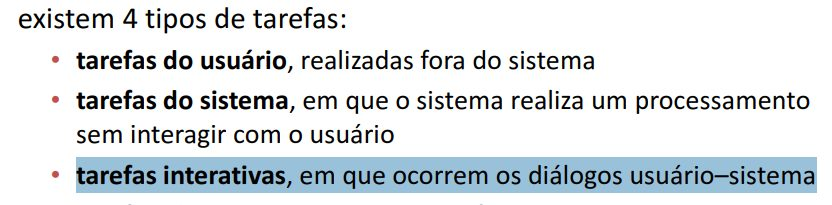

    Fonte: Barbosa e Silva (2010), slides do cap. 6, slide 25 (definição de tarefa interativa) e slide 29 (“Escolher data”, “Informar título”).

### Item 6

Toda tarefa abstrata (ícone de nuvem) está decomposta em sub tarefas, ou seja, nenhuma tarefa abstrata aparece como folha (último nível) da árvore, já que ela serve apenas para agrupar uma composição de tarefas?

**Fonte:** Barbosa e Silva (2010), slides do cap. 6, slide 25 (tarefas abstratas como representação de uma composição que auxilia a decomposição).

??? quote "Figura 6 – Trecho que fundamenta o item 6"

    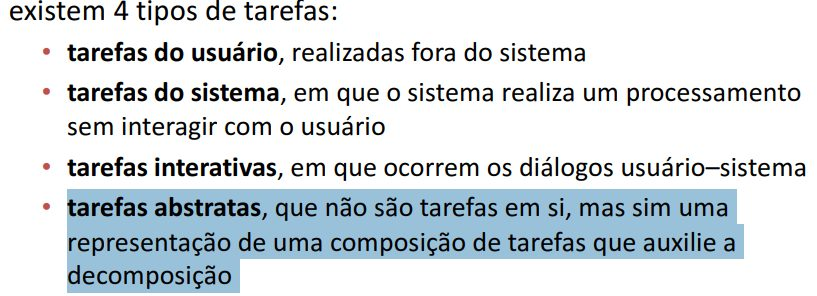

    Fonte: Barbosa e Silva (2010), slides do cap. 6, slide 25 (tarefas abstratas como representação de uma composição que auxilia a decomposição).

### Item 7

Toda tarefa está nomeada com um verbo no infinitivo seguido do objeto da ação (por exemplo: “Informar título”, “Gravar compromisso”), deixando claro o que é feito?

**Fonte:** Barbosa e Silva (2010), slides do cap. 6, slide 29 (padrão de nomes adotado no exemplo de modelo CTT).

??? quote "Figura 7 – Trecho que fundamenta o item 7"

    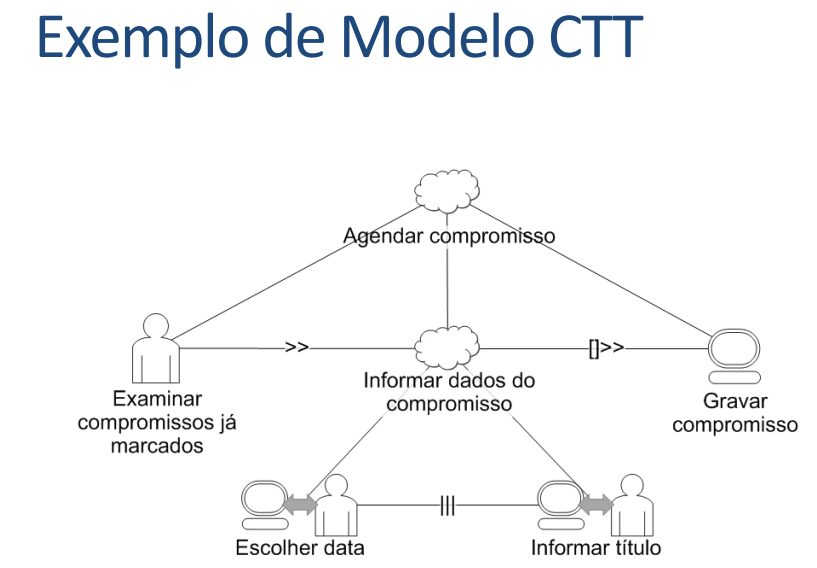

    Fonte: Barbosa e Silva (2010), slides do cap. 6, slide 29 (padrão de nomes adotado no exemplo de modelo CTT).

### Item 8

Entre cada par de tarefas irmãs (tarefas do mesmo nível e mesmo pai) existe um operador temporal desenhado na linha horizontal que as liga, sendo ele um dos oito operadores do CTT: >> (ativação), []>> (ativação com passagem de informação), [] (escolha), ||| (concorrência), |[]| (concorrência e comunicação), |=| (independência), [> (desativação) ou |> (suspensão/retomada)?

**Fonte:** Barbosa e Silva (2010), slides do cap. 6, slides 26, 27 e 28 (“Relações entre Tarefas no CTT”).

??? quote "Figura 8 – Trecho que fundamenta o item 8"

    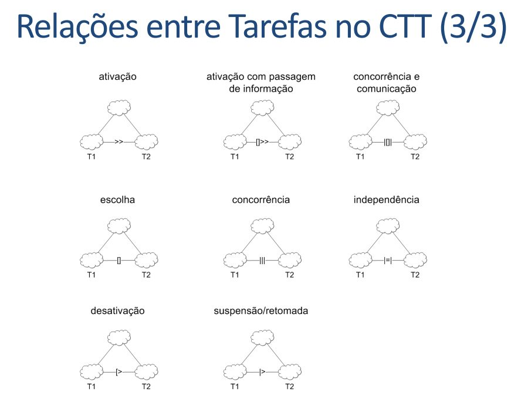

    Fonte: Barbosa e Silva (2010), slides do cap. 6, slides 26, 27 e 28 (“Relações entre Tarefas no CTT”).

### Item 9

O operador >> (ativação) é usado somente quando a segunda tarefa (T2) só pode iniciar depois que a primeira (T1) termina, e o operador []>> (ativação com passagem de informação) é usado quando, além disso, a informação produzida por T1 é passada para T2 (por exemplo: os dados informados do compromisso são passados para “Gravar compromisso”)?

**Fonte:** Barbosa e Silva (2010), slides do cap. 6, slide 26 (ativação e ativação com passagem de informação) e slide 29 (exemplo).

??? quote "Figura 9 – Trecho que fundamenta o item 9"

    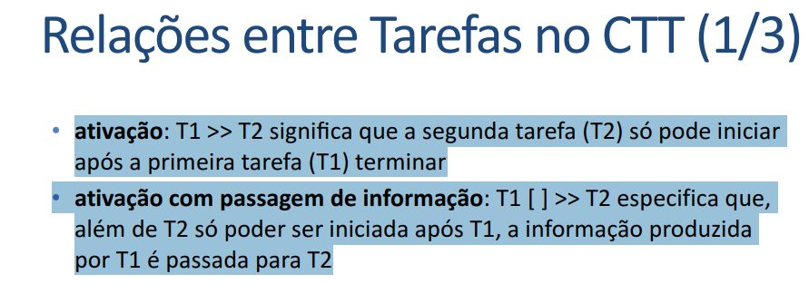

    Fonte: Barbosa e Silva (2010), slides do cap. 6, slide 26 (ativação e ativação com passagem de informação) e slide 29 (exemplo).

### Item 10

O operador [] (escolha) é usado somente entre tarefas alternativas, isto é, as duas estão disponíveis ao mesmo tempo, mas, quando o usuário inicia uma delas, a outra fica desabilitada (por exemplo: selecionar coorientador já cadastrado OU cadastrar um novo)?

**Fonte:** Barbosa e Silva (2010), slides do cap. 6, slide 26 (escolha – tarefas alternativas).

??? quote "Figura 10 – Trecho que fundamenta o item 10"

    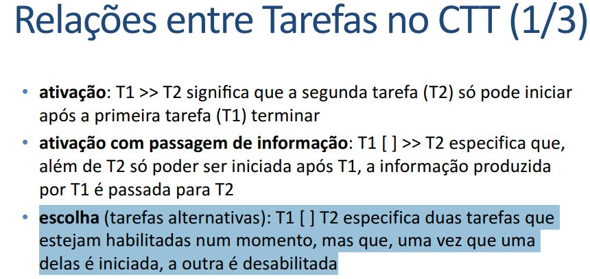

    Fonte: Barbosa e Silva (2010), slides do cap. 6, slide 26 (escolha – tarefas alternativas).

### Item 11

O operador ||| (concorrência) é usado quando as tarefas podem ser feitas em qualquer ordem ou ao mesmo tempo (por exemplo: “Escolher data” ||| “Informar título”), e o operador |[]| (concorrência e comunicação) é usado quando, além disso, as tarefas trocam informações entre si?

**Fonte:** Barbosa e Silva (2010), slides do cap. 6, slide 26 (tarefas concorrentes e concorrentes comunicantes) e slide 29 (exemplo).

??? quote "Figura 11 – Trecho que fundamenta o item 11"

    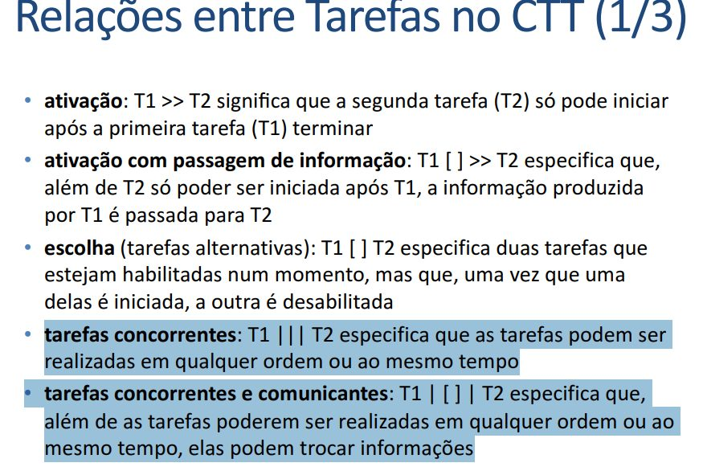

    Fonte: Barbosa e Silva (2010), slides do cap. 6, slide 26 (tarefas concorrentes e concorrentes comunicantes) e slide 29 (exemplo).

### Item 12

O operador |=| (independência) é usado quando as tarefas podem ser feitas em qualquer ordem, mas uma vez iniciada, uma tarefa precisa terminar antes que a outra possa começar (ou seja, não podem ser feitas ao mesmo tempo)?

**Fonte:** Barbosa e Silva (2010), slides do cap. 6, slide 27 (tarefas independentes).

??? quote "Figura 12 – Trecho que fundamenta o item 12"

    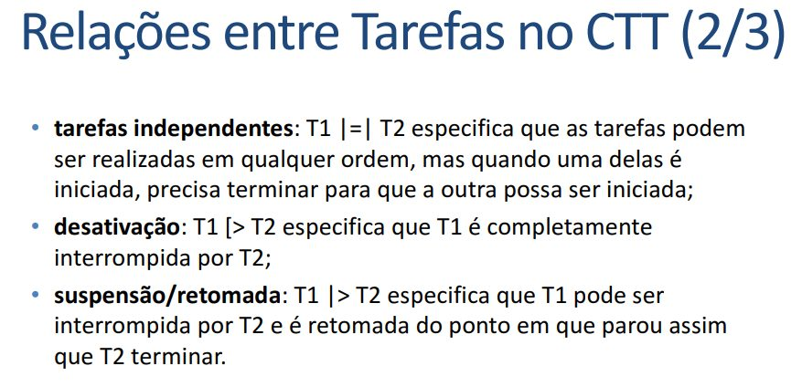

    Fonte: Barbosa e Silva (2010), slides do cap. 6, slide 27 (tarefas independentes).

### Item 13

O operador [> (desativação) é usado quando T1 é completamente interrompida por T2 sem retorno (por exemplo: “Cancelar” encerra o preenchimento), e o operador |> (suspensão/retomada) é usado quando T1 é interrompida por T2 e retomada do ponto em que parou assim que T2 termina (por exemplo: consultar uma ajuda e voltar ao preenchimento)?

**Fonte:** Barbosa e Silva (2010), slides do cap. 6, slide 27 (desativação e suspensão/retomada).

??? quote "Figura 13 – Trecho que fundamenta o item 13"

    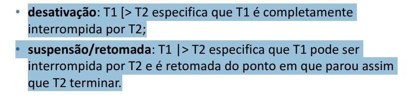

    Fonte: Barbosa e Silva (2010), slides do cap. 6, slide 27 (desativação e suspensão/retomada).

### Item 14

O modelo CTT permite entender qual é o trabalho do usuário, como ele o realiza e por quê, ou seja, as tarefas modeladas correspondem às atividades reais identificadas na análise (entrevistas, observação, cenários) e não a funções inventadas pela equipe?

**Fonte:** Barbosa e Silva (2010), slides do cap. 6, slide 16 (objetivo da análise de tarefas; CTT como método de análise de tarefas).

??? quote "Figura 14 – Trecho que fundamenta o item 14"

    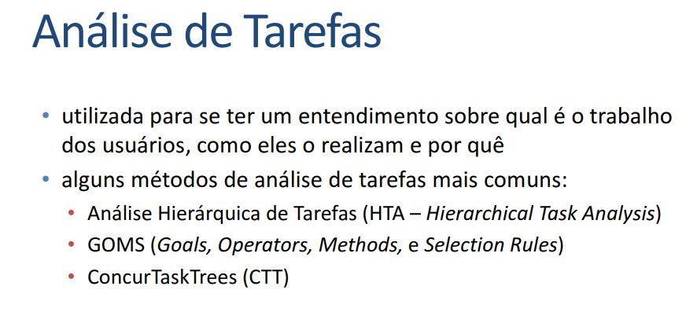

    Fonte: Barbosa e Silva (2010), slides do cap. 6, slide 16 (objetivo da análise de tarefas; CTT como método de análise de tarefas).

## Referências

BARBOSA, Simone Diniz Junqueira; SILVA, Bruno Santana da. *Organização do espaço de problema*: slides do capítulo 6 de *Interação Humano-Computador*. Rio de Janeiro: Elsevier, 2010. 30 slides.

SALES, André Barros de. *Lista de Exercícios*: elaborar listas de verificação. Brasília: Universidade de Brasília, [2026]. Enunciado da atividade avaliativa Verificação 2.

SALES, André Barros de. *Plano de Ensino*: Interação Humano Computador (FGA0173), 02/2026, Turma 01, v1. Brasília: Universidade de Brasília, 2026.

## Agradecimentos e uso de IA generativa

**Uso de IA generativa nesta página.** O Claude (Anthropic) foi utilizado na transcrição do documento original para o site e na padronização da formatação, das legendas, das citações e das referências às normas da disciplina. O conteúdo do trabalho é de Alexandre Vilar, indicado(a) na tabela de contribuição. A ferramenta não é autora do artefato e seu uso não exime os autores da responsabilidade sobre o conteúdo (SALES, 2026, p. 3).
