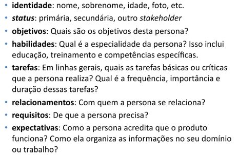
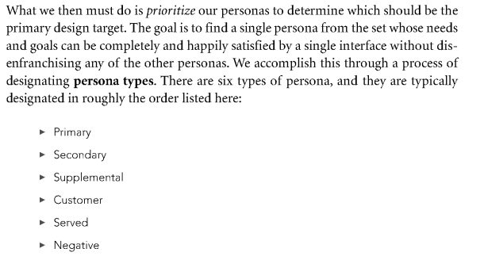
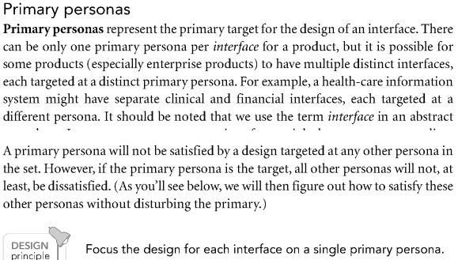
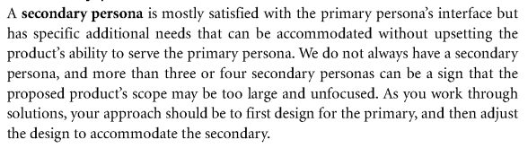
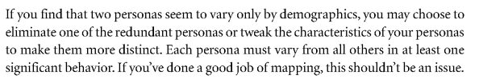
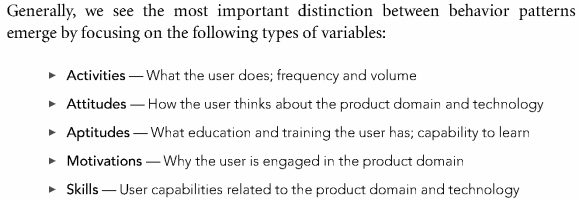
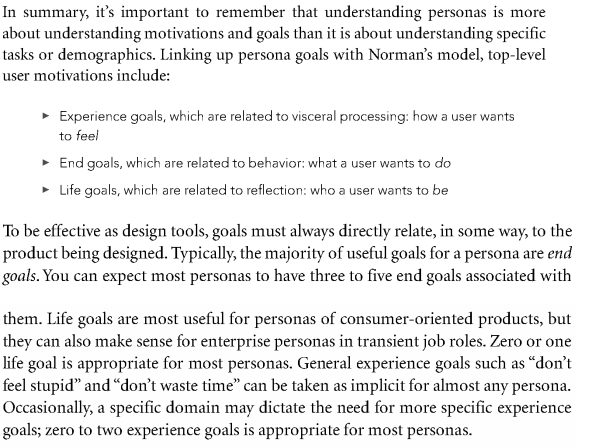
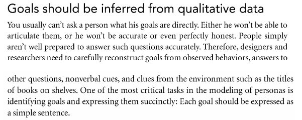

# Lista de Verificação – Elenco de Personas

**Autoria:** Alexandre Vilar Valadares Fonsêca · **Entrega 2**

## Tabela de contribuição

**Tabela 1 – Contribuições no trabalho "Lista de Verificação – Elenco de Personas"**

| Integrante | Contribuição | Atividade (link) | Gravação (link) |
| --- | --- | --- | --- |
| Alexandre Vilar Valadares Fonsêca | Autoria do trabalho (atividade individual) | Esta página | — |
| Gabriel Robson Nunes Neiva da Silva | Não se aplica (atividade individual) | — | — |
| Henrique Schneider Fernandes da Rosa | Não se aplica (atividade individual) | — | — |
| João Vitor Tavares de Sá Lima | Não se aplica (atividade individual) | — | — |

Fonte: elaborado pelos autores (2026).

## Histórico de versões

**Tabela 2 – Histórico de versões do trabalho "Lista de Verificação – Elenco de Personas"**

| Data | Versão | Descrição | Autor(es) | Revisor(es) |
| --- | --- | --- | --- | --- |
| 22/09/2026 | 1.0 | Elaboração do trabalho, entregue no Moodle (prazo da atividade no Moodle) | Alexandre Vilar | — |
| 17/10/2026 | 1.1 | Publicação no site: transcrição, fotos das fontes, citações e referências no padrão da disciplina | Henrique Schneider | — |

Fonte: elaborado pelos autores (2026).

## 1. Introdução

Atividade individual do Moodle "Listas de verificação – Personas, Elenco de Personas, HTA e CTT", parte relativa ao elenco de personas.

Cada item é uma pergunta autocontida, respondida com **Conforme**, **Não conforme** ou **Não se aplica**. Abaixo de cada item estão a fonte, com capítulo, seção e página, e a foto do trecho que o fundamenta, como pede a atividade de elaboração de listas de verificação (SALES, [2026], p. 1). Clique no título de cada figura para abrir a foto.

## 2. Itens da lista

### Item 1 – Oito Características da Persona

Cada persona do elenco apresenta todas as oito características de uma persona: identidade (nome, sobrenome, idade, foto); status (primária, secundária ou outro stakeholder); objetivos; habilidades (educação, treinamento e competências específicas); tarefas (básicas ou críticas, com frequência, importância e duração); relacionamentos (com quem a persona se relaciona); requisitos (de que a persona precisa); e expectativas (como ela acredita que o produto funciona e como organiza as informações do seu domínio)?

**Fonte:** Barbosa e Silva (2010), slides do cap. 6, slide 7 “Características das Personas”.

??? quote "Figura 1 – Trecho que fundamenta o item 1"

    

    Fonte: Barbosa e Silva (2010), slides do cap. 6, slide 7 “Características das Personas”.

### Item 2 – Tipos de Persona

Cada persona do elenco tem o seu tipo explicitamente designado entre os seis tipos possíveis: primária (alvo principal do design da interface); secundária (satisfeita pela interface da primária, mas com necessidades adicionais); suplementar (necessidades já cobertas pelas primárias e secundárias); cliente (quem compra ou contrata, mas não necessariamente usa); servida (não usa o produto, mas é afetada pelo seu uso); ou negativa (tipo de usuário para quem o produto não está sendo projetado)?

**Fonte:** Cooper, Reimann e Cronin (2007), cap. 5, p. 104–106 (Step 7: Designate persona types).

??? quote "Figura 2 – Trecho que fundamenta o item 2"

    

    Fonte: Cooper, Reimann e Cronin (2007), cap. 5, p. 104–106 (Step 7: Designate persona types).

### Item 3 – Persona Primária Única por Interface

Existe exatamente uma persona primária para cada interface do produto (se o produto tiver interfaces distintas, por exemplo uma clínica e uma financeira, cada uma deve ter a sua própria e única persona primária)?

**Fonte:** Cooper, Reimann e Cronin (2007), cap. 5, p. 104–105 (Primary personas).

??? quote "Figura 3 – Trecho que fundamenta o item 3"

    

    Fonte: Cooper, Reimann e Cronin (2007), cap. 5, p. 104–105 (Primary personas).

### Item 4 – Limite de Personas Secundárias

O elenco tem no máximo três ou quatro personas secundárias (ter zero secundárias é aceitável; mais do que quatro indica escopo do produto amplo e sem foco)?

**Fonte:** Cooper, Reimann e Cronin (2007), cap. 5, p. 105 (Secondary personas).

??? quote "Figura 4 – Trecho que fundamenta o item 4"

    

    Fonte: Cooper, Reimann e Cronin (2007), cap. 5, p. 105 (Secondary personas).

### Item 5 – Diferenciação Comportamental

Cada persona difere de todas as demais em pelo menos um comportamento significativo, ou seja, não existem duas personas que variam apenas em dados demográficos (como idade, gênero, renda ou localização)?

**Fonte:** Cooper, Reimann e Cronin (2007), cap. 5, p. 102 (Step 5: Check for completeness and redundancy).

??? quote "Figura 5 – Trecho que fundamenta o item 5"

    

    Fonte: Cooper, Reimann e Cronin (2007), cap. 5, p. 102 (Step 5: Check for completeness and redundancy).

### Item 6 – Variáveis Comportamentais

As diferenças entre as personas estão descritas em termos de variáveis comportamentais, isto é, cada persona informa seu posicionamento em pelo menos alguns destes tipos de variável: atividades (o que faz, com que frequência e volume), atitudes (o que pensa sobre o domínio e a tecnologia), aptidões (educação, treinamento, capacidade de aprender), motivações (por que se envolve com o domínio) e habilidades (capacidades relacionadas ao domínio e à tecnologia)?

**Fonte:** Cooper, Reimann e Cronin (2007), cap. 5, p. 98 (Step 1: Identify behavioral variables).

??? quote "Figura 6 – Trecho que fundamenta o item 6"

    

    Fonte: Cooper, Reimann e Cronin (2007), cap. 5, p. 98 (Step 1: Identify behavioral variables).

### Item 7 – Quantidade e Tipos de Metas

Cada persona tem metas nas quantidades recomendadas para cada tipo: de 3 a 5 metas finais (end goals: o que a persona quer fazer com o produto), de 0 a 1 meta de vida (life goal: quem a persona quer ser) e de 0 a 2 metas de experiência (experience goals: como a persona quer se sentir ao usar o produto)?

**Fonte:** Cooper, Reimann e Cronin (2007), cap. 5, p. 94 e p. 100–101 (Synthesizing goals).

??? quote "Figura 7 – Trecho que fundamenta o item 7"

    

    Fonte: Cooper, Reimann e Cronin (2007), cap. 5, p. 94 e p. 100–101 (Synthesizing goals).

### Item 8 – Redação das Metas

Cada meta das personas está escrita como uma frase simples (ex.: "Ficar ciente de problemas antes que se tornem críticos"), e não como um parágrafo, uma lista de funcionalidades do sistema ou uma tarefa detalhada?

**Fonte:** Cooper, Reimann e Cronin (2007), cap. 5, p. 88–89 (Goals should be inferred from qualitative data).

??? quote "Figura 8 – Trecho que fundamenta o item 8"

    

    Fonte: Cooper, Reimann e Cronin (2007), cap. 5, p. 88–89 (Goals should be inferred from qualitative data).

## Referências

BARBOSA, Simone Diniz Junqueira; SILVA, Bruno Santana da. *Organização do espaço de problema*: slides do capítulo 6 de *Interação Humano-Computador*. Rio de Janeiro: Elsevier, 2010. 30 slides.

COOPER, Alan; REIMANN, Robert; CRONIN, David. *About Face 3*: the essentials of interaction design. Indianapolis: Wiley, 2007.

SALES, André Barros de. *Lista de Exercícios*: elaborar listas de verificação. Brasília: Universidade de Brasília, [2026]. Enunciado da atividade avaliativa Verificação 2.

SALES, André Barros de. *Plano de Ensino*: Interação Humano Computador (FGA0173), 02/2026, Turma 01, v1. Brasília: Universidade de Brasília, 2026.

## Agradecimentos e uso de IA generativa

**Uso de IA generativa nesta página.** O Claude (Anthropic) foi utilizado na transcrição do documento original para o site e na padronização da formatação, das legendas, das citações e das referências às normas da disciplina. O conteúdo do trabalho é de Alexandre Vilar, indicado(a) na tabela de contribuição. A ferramenta não é autora do artefato e seu uso não exime os autores da responsabilidade sobre o conteúdo (SALES, 2026, p. 3).
