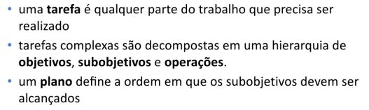
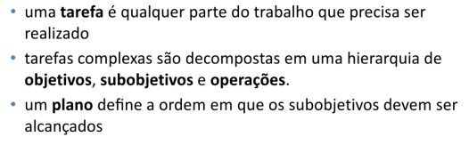
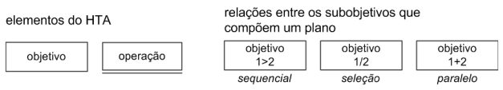
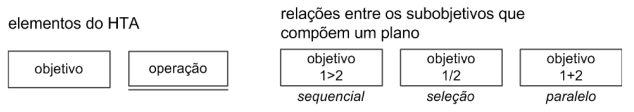
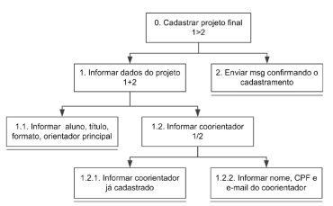
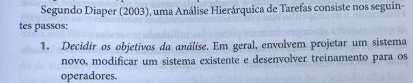
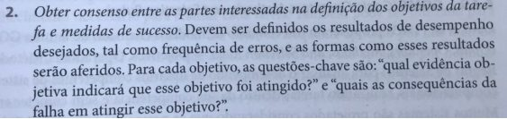
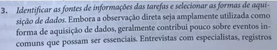
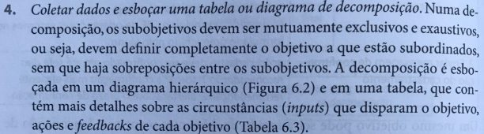
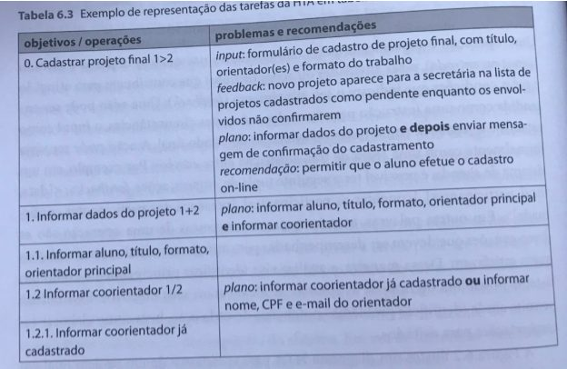

# Lista de Verificação – Análise Hierárquica de Tarefas (HTA)

**Autoria:** Alexandre Vilar Valadares Fonsêca · **Entrega 2**

## Tabela de contribuição

**Tabela 1 – Contribuições no trabalho "Lista de Verificação – Análise Hierárquica de Tarefas (HTA)"**

| Integrante | Contribuição | Atividade (link) | Gravação (link) |
| --- | --- | --- | --- |
| Alexandre Vilar Valadares Fonsêca | Autoria do trabalho (atividade individual) | Esta página | — |
| Gabriel Robson Nunes Neiva da Silva | Não se aplica (atividade individual) | — | — |
| Henrique Schneider Fernandes da Rosa | Não se aplica (atividade individual) | — | — |
| João Vitor Tavares de Sá Lima | Não se aplica (atividade individual) | — | — |

Fonte: elaborado pelos autores (2026).

## Histórico de versões

**Tabela 2 – Histórico de versões do trabalho "Lista de Verificação – Análise Hierárquica de Tarefas (HTA)"**

| Data | Versão | Descrição | Autor(es) | Revisor(es) |
| --- | --- | --- | --- | --- |
| 22/09/2026 | 1.0 | Elaboração do trabalho, entregue no Moodle (prazo da atividade no Moodle) | Alexandre Vilar | — |
| 17/10/2026 | 1.1 | Publicação no site: transcrição, fotos das fontes, citações e referências no padrão da disciplina | Henrique Schneider | — |

Fonte: elaborado pelos autores (2026).

## 1. Introdução

Atividade individual do Moodle "Listas de verificação – Personas, Elenco de Personas, HTA e CTT", parte relativa à Análise Hierárquica de Tarefas (HTA).

Cada item é uma pergunta autocontida, respondida com **Conforme**, **Não conforme** ou **Não se aplica**. Abaixo de cada item estão a fonte, com capítulo, seção e página, e a foto do trecho que o fundamenta, como pede a atividade de elaboração de listas de verificação (SALES, [2026], p. 1). Clique no título de cada figura para abrir a foto.

## 2. Itens da lista

### Item 1 – Decomposição Hierárquica

A tarefa analisada foi decomposta de forma hierárquica, isto é, o artefato apresenta um objetivo principal (nível 0) que é desmembrado em subobjetivos e estes, por sua vez, em operações (ações concretas que não são mais decompostas)?

**Fonte:** Barbosa e Silva (2010), slides do cap. 6, slide 17 (Análise Hierárquica de Tarefas).

??? quote "Figura 1 – Trecho que fundamenta o item 1"

    

    Fonte: Barbosa e Silva (2010), slides do cap. 6, slide 17 (Análise Hierárquica de Tarefas).

### Item 2 – Presença de Planos

Todo objetivo que possui sub-objetivos tem um plano explícito, ou seja, uma indicação da ordem ou forma em que os seus sub-objetivos devem ser alcançados (um objetivo com filhos sem plano indicado = não conforme)?

**Fonte:** Barbosa e Silva (2010), slides do cap. 6, slide 17 (Análise Hierárquica de Tarefas).

??? quote "Figura 2 – Trecho que fundamenta o item 2"

    

    Fonte: Barbosa e Silva (2010), slides do cap. 6, slide 17 (Análise Hierárquica de Tarefas).

### Item 3 – Notação das Relações nos Planos

Os planos usam a notação da HTA para a relação entre os subobjetivos: 1>2 = sequencial (primeiro 1, depois 2); 1/2 = seleção (1 ou 2); 1+2 = paralelo (1 e 2, em qualquer ordem ou ao mesmo tempo)?

**Fonte:** Barbosa e Silva (2010), slides do cap. 6, slide 17, legenda “relações entre os sub-objetivos que compõem um plano”.

??? quote "Figura 3 – Trecho que fundamenta o item 3"

    

    Fonte: Barbosa e Silva (2010), slides do cap. 6, slide 17, legenda “relações entre os sub-objetivos que compõem um plano”.

### Item 4 – Representação Gráfica de Objetivos e Operações

No diagrama, objetivos e operações estão visualmente diferenciados conforme a notação da HTA: objetivo = retângulo simples; operação (nó folha, que não é decomposto) = retângulo com uma linha dupla traçada logo abaixo dele?

**Fonte:** Barbosa e Silva (2010), slides do cap. 6, slide 17, legenda “elementos do HTA”.

??? quote "Figura 4 – Trecho que fundamenta o item 4"

    

    Fonte: Barbosa e Silva (2010), slides do cap. 6, slide 17, legenda “elementos do HTA”.

### Item 5 – Numeração Hierárquica

Cada nó do diagrama está numerado hierarquicamente de acordo com sua posição na árvore (0 para o objetivo principal; 1, 2... para seus subobjetivos; 1.1, 1.2... para os filhos do nó 1; 1.2.1, 1.2.2... e assim por diante), e os números usados em cada plano (ex.: "1>2" no nó 0) referem-se aos filhos daquele nó?

**Fonte:** Barbosa e Silva (2010), slides do cap. 6, slide 18, Figura 6.2 – exemplo de diagrama HTA “Cadastrar projeto final”.

??? quote "Figura 5 – Trecho que fundamenta o item 5"

    

    Fonte: Barbosa e Silva (2010), slides do cap. 6, slide 18, Figura 6.2 – exemplo de diagrama HTA “Cadastrar projeto final”.

### Item 6 – Declaração dos Objetivos da Análise

O artefato declara os objetivos da própria análise, isto é, para que a HTA foi feita, indicando pelo menos um destes propósitos: projetar um sistema novo, modificar um sistema existente ou desenvolver treinamento para os operadores?

**Fonte:** Barbosa e Silva (2010), slides do cap. 6, slide 20, passo 1 da HTA segundo Diaper (2003).

??? quote "Figura 6 – Trecho que fundamenta o item 6"

    

    Fonte: Barbosa e Silva (2010), slides do cap. 6, slide 20, passo 1 da HTA segundo Diaper (2003).

### Item 7 – Medidas de Sucesso da Tarefa

Estão registradas as medidas de sucesso da tarefa acordadas com as partes interessadas, contendo: (a) os resultados de desempenho desejados (ex.: frequência de erros); (b) como esses resultados serão aferidos; (c) qual evidência objetiva indica que cada objetivo foi atingido; e (d) quais as consequências de falhar em atingi-lo?

**Fonte:** Barbosa e Silva (2010), slides do cap. 6, slide 20, passo 2 da HTA segundo Diaper (2003).

??? quote "Figura 7 – Trecho que fundamenta o item 7"

    

    Fonte: Barbosa e Silva (2010), slides do cap. 6, slide 20, passo 2 da HTA segundo Diaper (2003).

### Item 8 – Fontes de Informação e Aquisição de Dados

Estão identificadas as fontes de informação sobre as tarefas e as formas de aquisição de dados usados (ex.: observação direta, entrevistas com especialistas, registros/documentos), sem depender apenas de observação direta, que costuma revelar pouco sobre eventos incomuns mas essenciais?

**Fonte:** Barbosa e Silva (2010), slides do cap. 6, slide 20, passo 3 da HTA segundo Diaper (2003).

??? quote "Figura 8 – Trecho que fundamenta o item 8"

    

    Fonte: Barbosa e Silva (2010), slides do cap. 6, slide 20, passo 3 da HTA segundo Diaper (2003).

### Item 9 – Subobjetivos Mutuamente Exclusivos e Exaustivos

Os sub-objetivos de cada objetivo são mutuamente exclusivos (não há sobreposição, ou seja, nenhuma ação aparece em dois sub-objetivos irmãos) e exaustivos (juntos cobrem completamente o objetivo a que estão subordinados, sem faltar nenhuma parte)?

**Fonte:** Barbosa e Silva (2010), slides do cap. 6, slide 21, passo 4 da HTA.

??? quote "Figura 9 – Trecho que fundamenta o item 9"

    

    Fonte: Barbosa e Silva (2010), slides do cap. 6, slide 21, passo 4 da HTA.

### Item 10 – Representação em Tabela com Detalhes

Além do diagrama, a decomposição é apresentada em uma tabela com as colunas "objetivos/operações" e "problemas e recomendações", que registra para os objetivos: input (circunstância que dispara o objetivo), feedback (resposta do sistema), plano e recomendação de design?

**Fonte:** Barbosa e Silva (2010), slides do cap. 6, slide 21, passo 4, e slide 19, Tabela 6.3 – exemplo de representação das tarefas da HTA em tabela.

??? quote "Figura 10 – Trecho que fundamenta o item 10"

    

    Fonte: Barbosa e Silva (2010), slides do cap. 6, slide 21, passo 4, e slide 19, Tabela 6.3 – exemplo de representação das tarefas da HTA em tabela.

??? quote "Figura 11 – Trecho que fundamenta o item 10"

    

    Fonte: Barbosa e Silva (2010), slides do cap. 6, slide 21, passo 4, e slide 19, Tabela 6.3 – exemplo de representação das tarefas da HTA em tabela.

## Referências

BARBOSA, Simone Diniz Junqueira; SILVA, Bruno Santana da. *Organização do espaço de problema*: slides do capítulo 6 de *Interação Humano-Computador*. Rio de Janeiro: Elsevier, 2010. 30 slides.

SALES, André Barros de. *Lista de Exercícios*: elaborar listas de verificação. Brasília: Universidade de Brasília, [2026]. Enunciado da atividade avaliativa Verificação 2.

SALES, André Barros de. *Plano de Ensino*: Interação Humano Computador (FGA0173), 02/2026, Turma 01, v1. Brasília: Universidade de Brasília, 2026.

## Agradecimentos e uso de IA generativa

**Uso de IA generativa nesta página.** O Claude (Anthropic) foi utilizado na transcrição do documento original para o site e na padronização da formatação, das legendas, das citações e das referências às normas da disciplina. O conteúdo do trabalho é de Alexandre Vilar, indicado(a) na tabela de contribuição. A ferramenta não é autora do artefato e seu uso não exime os autores da responsabilidade sobre o conteúdo (SALES, 2026, p. 3).
