# Lista de Verificação – Perfil de Usuário

**Autoria:** Alexandre Vilar Valadares Fonsêca · **Entrega 2**

## Tabela de contribuição

**Tabela 1 – Contribuições no trabalho "Lista de Verificação – Perfil de Usuário"**

| Integrante | Contribuição | Atividade (link) | Gravação (link) |
| --- | --- | --- | --- |
| Alexandre Vilar Valadares Fonsêca | Autoria do trabalho (atividade individual) | Esta página | — |
| Gabriel Robson Nunes Neiva da Silva | Não se aplica (atividade individual) | — | — |
| Henrique Schneider Fernandes da Rosa | Não se aplica (atividade individual) | — | — |
| João Vitor Tavares de Sá Lima | Não se aplica (atividade individual) | — | — |

Fonte: elaborado pelos autores (2026).

## Histórico de versões

**Tabela 2 – Histórico de versões do trabalho "Lista de Verificação – Perfil de Usuário"**

| Data | Versão | Descrição | Autor(es) | Revisor(es) |
| --- | --- | --- | --- | --- |
| 15/09/2026 | 1.0 | Elaboração do trabalho, entregue no Moodle (prazo da atividade no Moodle) | Alexandre Vilar | — |
| 17/10/2026 | 1.1 | Publicação no site: transcrição, fotos das fontes, citações e referências no padrão da disciplina | Henrique Schneider | — |

Fonte: elaborado pelos autores (2026).

## 1. Introdução

Atividade individual do Moodle "Lista de verificação – Perfil de Usuário": elaborar itens para inspecionar o artefato de perfil de usuário e a coleta de dados que o fundamenta.

Cada item é uma pergunta autocontida, respondida com **Conforme**, **Não conforme** ou **Não se aplica**. Abaixo de cada item estão a fonte, com capítulo, seção e página, e a foto do trecho que o fundamenta, como pede a atividade de elaboração de listas de verificação (SALES, [2026], p. 1). Clique no título de cada figura para abrir a foto.

As fotos do trecho são da edição de 2021 do livro de Barbosa e colaboradores (*Interação Humano-Computador e Experiência do Usuário*), cuja numeração de capítulos e páginas é a usada nas citações.

## 2. Itens da lista

### Seção 7.2 – Que dados coletar?

#### Item 1

O perfil de usuário registra os dados demográficos dos usuários, isto é, a idade, o sexo e o status socioeconômico?

**Fonte:** Barbosa et al. (2021, cap. 7, seç. 7.2, p. 137).

??? quote "Figura 1 – Trecho que fundamenta o item 1"

    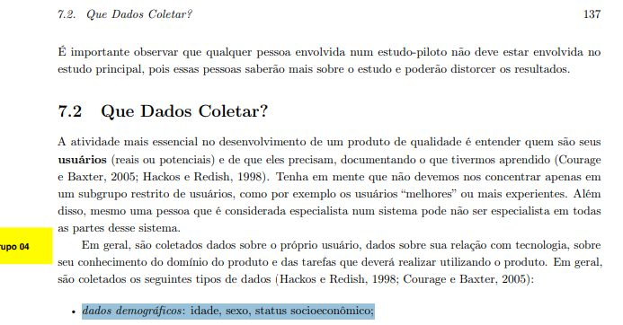

    Fonte: Barbosa et al. (2021, cap. 7, seç. 7.2, p. 137).

#### Item 2

O perfil de usuário registra a experiência no cargo que o usuário ocupa, incluindo: cargo atual, tempo de experiência nesse cargo, tempo na empresa, responsabilidades, trabalhos e cargos anteriores e plano de carreira?

**Fonte:** Barbosa et al. (2021, cap. 7, seç. 7.2, p. 137).

??? quote "Figura 2 – Trecho que fundamenta o item 2"

    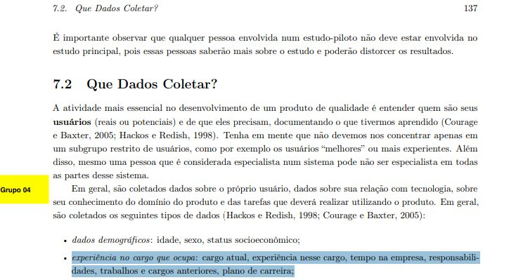

    Fonte: Barbosa et al. (2021, cap. 7, seç. 7.2, p. 137).

#### Item 3

O perfil de usuário registra informações sobre a empresa em que o usuário atua, como o tamanho da empresa e a sua área de atuação?

**Fonte:** Barbosa et al. (2021, cap. 7, seç. 7.2, p. 137).

??? quote "Figura 3 – Trecho que fundamenta o item 3"

    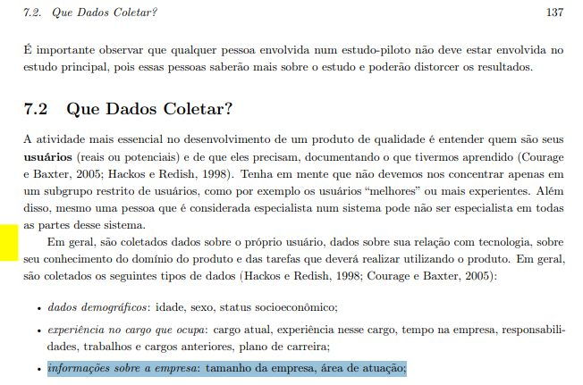

    Fonte: Barbosa et al. (2021, cap. 7, seç. 7.2, p. 137).

#### Item 4

O perfil de usuário registra a educação do usuário, incluindo grau de instrução, área de formação, cursos realizados e alfabetismo (quão bem lê, se tem dificuldade com informação impressa ou textos complexos, se está disposto a ler ao usar o produto e se prefere aprender com outras pessoas ou fazendo)?

**Fonte:** Barbosa et al. (2021, cap. 7, seç. 7.2, p. 137).

??? quote "Figura 4 – Trecho que fundamenta o item 4"

    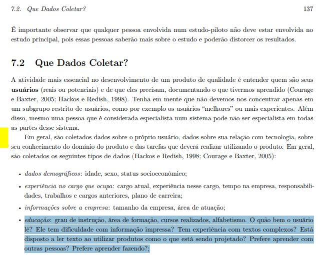

    Fonte: Barbosa et al. (2021, cap. 7, seç. 7.2, p. 137).

#### Item 5

O perfil de usuário registra a experiência com computadores, incluindo alfabetismo computacional, habilidade com computadores, anos de experiência, sistemas computacionais que conhece e utiliza e hardware que costuma utilizar?

**Fonte:** Barbosa et al. (2021, cap. 7, seç. 7.2, p. 137).

??? quote "Figura 5 – Trecho que fundamenta o item 5"

    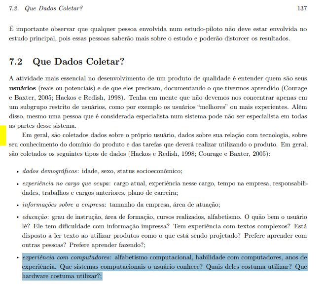

    Fonte: Barbosa et al. (2021, cap. 7, seç. 7.2, p. 137).

#### Item 6

O perfil de usuário registra a experiência com o produto específico ou com ferramentas semelhantes, incluindo experiência com produtos concorrentes e outros produtos do domínio, hábitos de uso, preferências e descontentamentos?

**Fonte:** Barbosa et al. (2021, cap. 7, seç. 7.2, p. 137).

??? quote "Figura 6 – Trecho que fundamenta o item 6"

    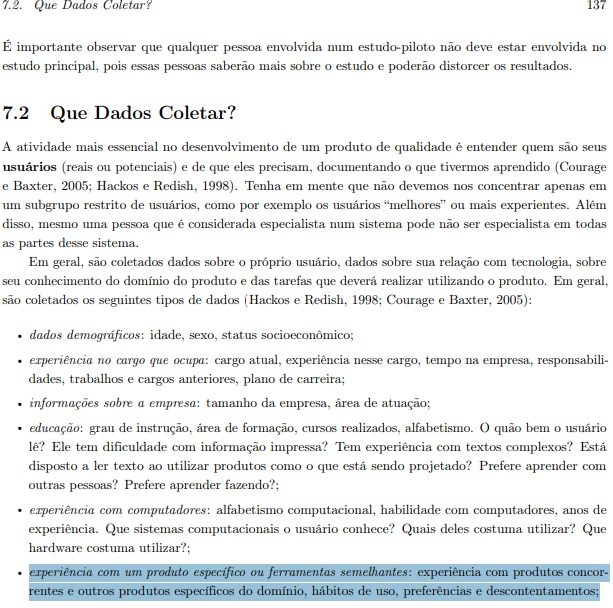

    Fonte: Barbosa et al. (2021, cap. 7, seç. 7.2, p. 137).

#### Item 7

O perfil de usuário registra a tecnologia disponível para o usuário, isto é, o hardware (por exemplo, tamanho e resolução do monitor ou tela, velocidade de processamento), o software e outras ferramentas às quais ele tem acesso?

**Fonte:** Barbosa et al. (2021, cap. 7, seç. 7.2, p. 137).

??? quote "Figura 7 – Trecho que fundamenta o item 7"

    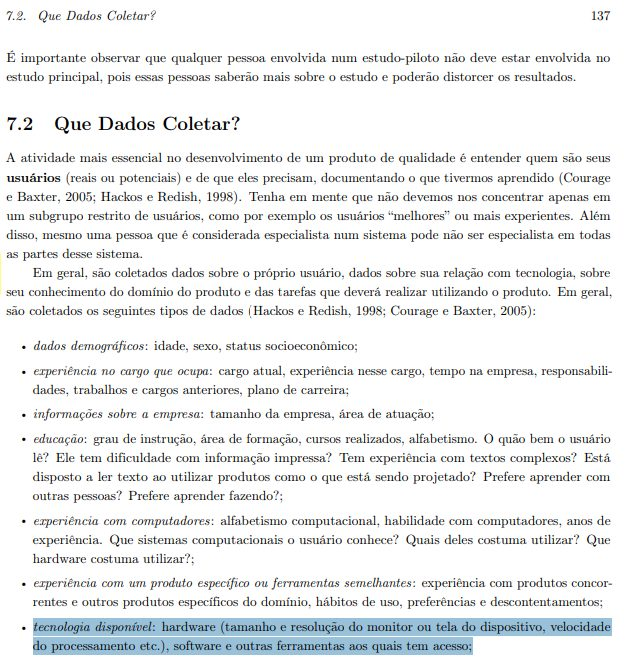

    Fonte: Barbosa et al. (2021, cap. 7, seç. 7.2, p. 137).

#### Item 8

O perfil de usuário registra dados sobre treinamento: o quanto o usuário valoriza treinamento, qual seu estilo de aprendizado preferido (visual, auditivo ou outro) e se pode investir tempo aprendendo a utilizar o produto?

**Fonte:** Barbosa et al. (2021, cap. 7, seç. 7.2, p. 137).

??? quote "Figura 8 – Trecho que fundamenta o item 8"

    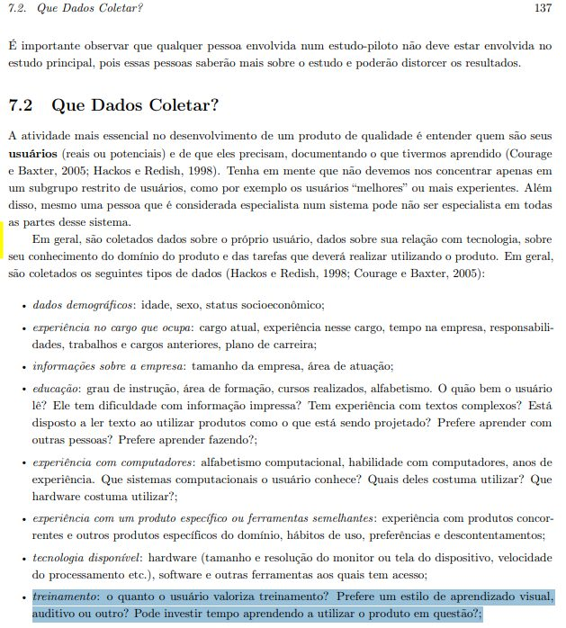

    Fonte: Barbosa et al. (2021, cap. 7, seç. 7.2, p. 137).

#### Item 9

O perfil de usuário registra as atitudes e valores do usuário, como preferências de produto, medo de tecnologia e se ele costuma assumir riscos e explorar novas formas de trabalhar, evitar novas experiências ou preferir que alguém lhe mostre cada passo de uma tarefa nova?

**Fonte:** Barbosa et al. (2021, cap. 7, seç. 7.2, p. 137).

??? quote "Figura 9 – Trecho que fundamenta o item 9"

    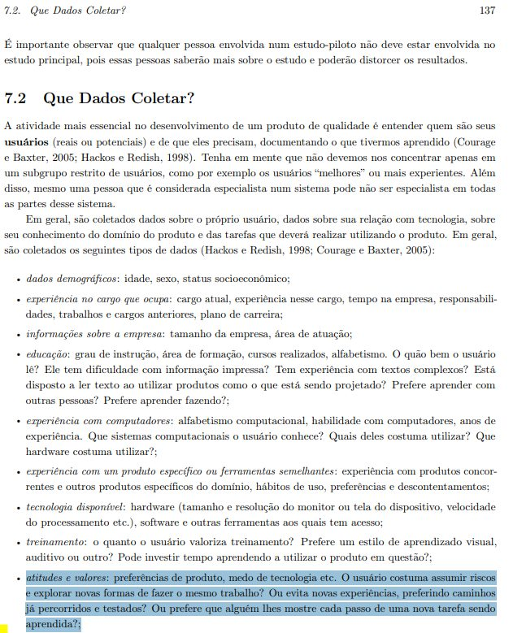

    Fonte: Barbosa et al. (2021, cap. 7, seç. 7.2, p. 137).

#### Item 10

O perfil de usuário registra o conhecimento do domínio, ou seja, o que e quanto o usuário conhece sobre o assunto do produto, se é especialista e se é esperado que se torne um especialista?

**Fonte:** Barbosa et al. (2021, cap. 7, seç. 7.2, p. 137).

??? quote "Figura 10 – Trecho que fundamenta o item 10"

    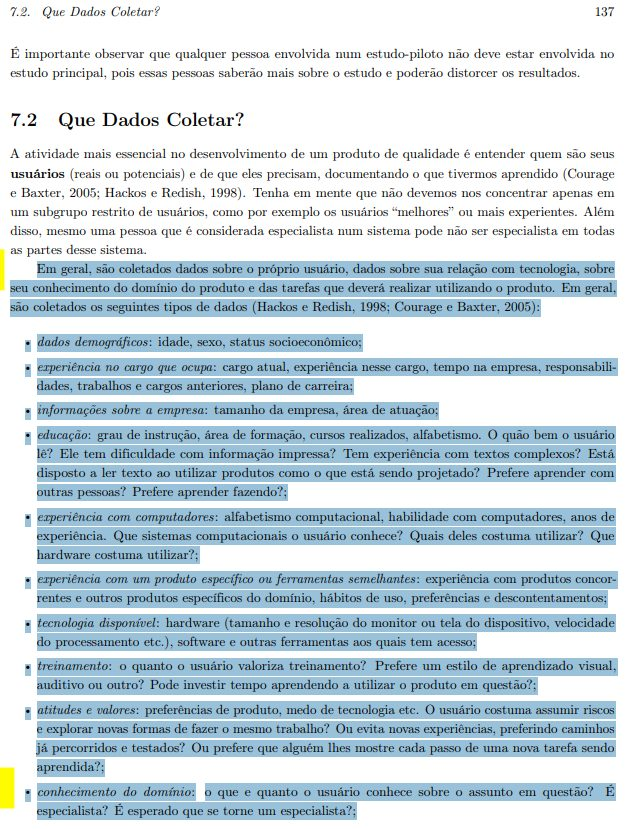

    Fonte: Barbosa et al. (2021, cap. 7, seç. 7.2, p. 137).

#### Item 11

O perfil de usuário registra os objetivos do usuário, indicando quais são os seus principais objetivos e como eles são alcançados atualmente?

**Fonte:** Barbosa et al. (2021, cap. 7, seç. 7.2, p. 137).

??? quote "Figura 11 – Trecho que fundamenta o item 11"

    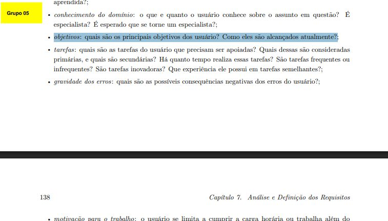

    Fonte: Barbosa et al. (2021, cap. 7, seç. 7.2, p. 137).

#### Item 12

O perfil de usuário registra as tarefas do usuário que precisam ser apoiadas, indicando quais são primárias e quais são secundárias, há quanto tempo são realizadas, se são frequentes ou infrequentes, se são inovadoras e que experiência o usuário possui em tarefas semelhantes?

**Fonte:** Barbosa et al. (2021, cap. 7, seç. 7.2, p. 137).

??? quote "Figura 12 – Trecho que fundamenta o item 12"

    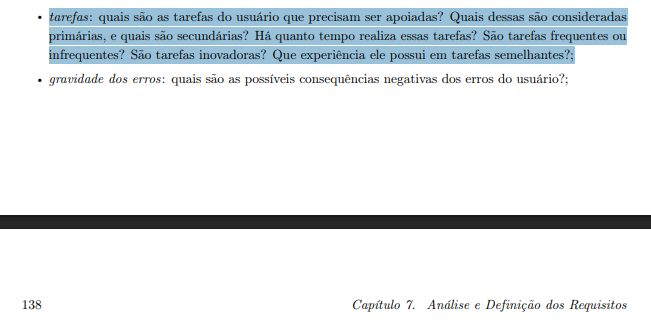

    Fonte: Barbosa et al. (2021, cap. 7, seç. 7.2, p. 137).

#### Item 13

O perfil de usuário registra a gravidade dos erros, isto é, quais são as possíveis consequências negativas dos erros que o usuário pode cometer?

**Fonte:** Barbosa et al. (2021, cap. 7, seç. 7.2, p. 137).

??? quote "Figura 13 – Trecho que fundamenta o item 13"

    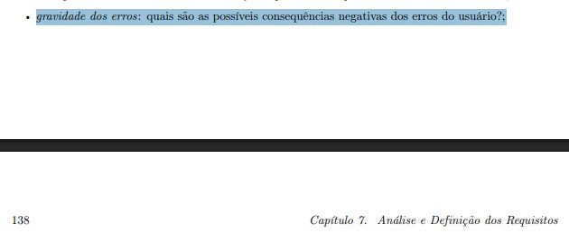

    Fonte: Barbosa et al. (2021, cap. 7, seç. 7.2, p. 137).

#### Item 14

O perfil de usuário registra a motivação para o trabalho: se o usuário se limita a cumprir a carga horária ou trabalha além do expediente por prazer, se gosta da interação social no local de trabalho e se tem ambição de ser promovido?

**Fonte:** Barbosa et al. (2021, cap. 7, seç. 7.2, p. 138).

??? quote "Figura 14 – Trecho que fundamenta o item 14"

    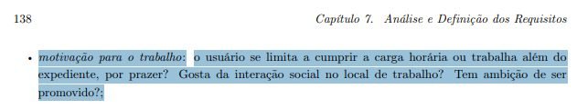

    Fonte: Barbosa et al. (2021, cap. 7, seç. 7.2, p. 138).

#### Item 15

O perfil de usuário registra idiomas e jargões: quais idiomas o usuário conhece e utiliza fluentemente e se ele possui jargão profissional ou vocabulário próprio da empresa, da sua atividade ou de algum grupo social relevante para o projeto?

**Fonte:** Barbosa et al. (2021, cap. 7, seç. 7.2, p. 138).

??? quote "Figura 15 – Trecho que fundamenta o item 15"

    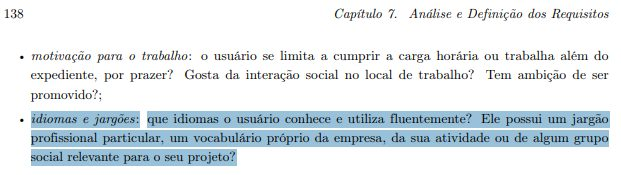

    Fonte: Barbosa et al. (2021, cap. 7, seç. 7.2, p. 138).

### Seção 7.3 – De quem coletar dados?

#### Item 16

O artefato identifica os usuários finais, distinguindo os primários (que utilizam o produto regularmente) dos secundários (que o utilizam ocasionalmente, por exemplo em configurações eventuais), e também as demais partes interessadas (stakeholders), que não usam o produto diretamente mas são afetadas pelo seu uso?

**Fonte:** Barbosa et al. (2021, cap. 7, seç. 7.3, p. 138–139).

??? quote "Figura 16 – Trecho que fundamenta o item 16"

    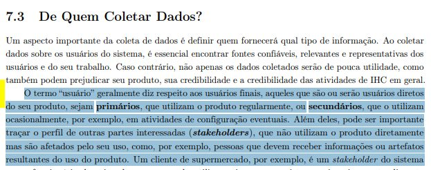

    Fonte: Barbosa et al. (2021, cap. 7, seç. 7.3, p. 138–139).

#### Item 17

O artefato responde às perguntas para identificar as fontes de dados: quem utilizará o sistema? Quem será afetado por ele? Quem é responsável por decidir quais objetivos e funcionalidades o sistema deve ter? Quem definiu os processos a serem apoiados pelo sistema?

**Fonte:** Barbosa et al. (2021, cap. 7, seç. 7.3, p. 138–139).

??? quote "Figura 17 – Trecho que fundamenta o item 17"

    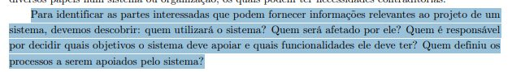

    Fonte: Barbosa et al. (2021, cap. 7, seç. 7.3, p. 138–139).

#### Item 18

Caso o projeto seja de melhoria ou expansão de um sistema existente, o artefato identifica: quem utiliza o sistema atualmente; quem passará a utilizá-lo; quem são os usuários satisfeitos e os insatisfeitos; e quem concebeu, documentou, projetou, dá treinamento, dá suporte e faz manutenção do sistema?

**Fonte:** Barbosa et al. (2021, cap. 7, seç. 7.3, p. 138–139).

??? quote "Figura 18 – Trecho que fundamenta o item 18"

    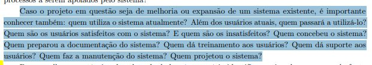

    Fonte: Barbosa et al. (2021, cap. 7, seç. 7.3, p. 138–139).

#### Item 19

O artefato registra o tipo de acesso a cada fonte de informação (disponibilidade e localização das pessoas, como pessoas que saíram da empresa, foram deslocadas de setor, não têm tempo disponível ou estão geograficamente dispersas), considerando essa restrição na escolha da técnica de coleta de dados?

**Fonte:** Barbosa et al. (2021, cap. 7, seç. 7.3, p. 138–139).

??? quote "Figura 19 – Trecho que fundamenta o item 19"

    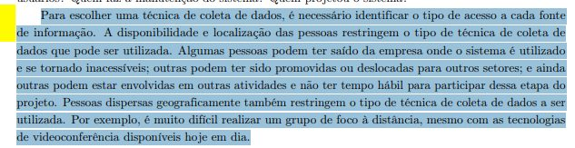

    Fonte: Barbosa et al. (2021, cap. 7, seç. 7.3, p. 138–139).

#### Item 20

Além dos usuários, o artefato considera outras fontes de dados sobre o produto, como: feedback dos usuários (por exemplo, via equipe de suporte), arquivos de registro (log), análise competitiva e pesquisa em geral? Pessoas

**Fonte:** Barbosa et al. (2021, cap. 7, seç. 7.3, p. 138–139).

??? quote "Figura 20 – Trecho que fundamenta o item 20"

    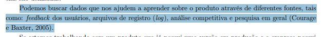

    Fonte: Barbosa et al. (2021, cap. 7, seç. 7.3, p. 138–139).

### Seção 7.4 – Aspectos éticos de pesquisas envolvendo pessoas

#### Item 21

O artefato prevê que os participantes sejam informados sobre os objetivos da pesquisa e sobre como será a sua participação: o que ocorrerá durante a coleta, o tempo aproximado, os tipos de dados coletados e como eles serão analisados?

**Fonte:** Barbosa et al. (2021, cap. 7, seç. 7.4, p. 141).

??? quote "Figura 21 – Trecho que fundamenta o item 21"

    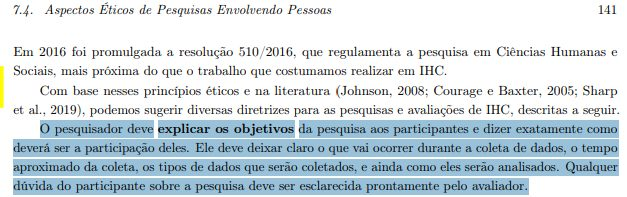

    Fonte: Barbosa et al. (2021, cap. 7, seç. 7.4, p. 141).

#### Item 22

O artefato garante a confidencialidade e a privacidade dos dados brutos coletados, de modo que esses dados sejam compartilhados apenas com os pesquisadores e ninguém mais tenha acesso a eles?

**Fonte:** Barbosa et al. (2021, cap. 7, seç. 7.4, p. 141).

??? quote "Figura 22 – Trecho que fundamenta o item 22"

    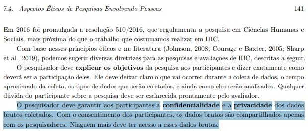

    Fonte: Barbosa et al. (2021, cap. 7, seç. 7.4, p. 141).

#### Item 23

Na divulgação dos resultados, o artefato garante o anonimato dos participantes (não divulga nomes, imagens ou qualquer informação que permita identificá-los, usando nomes fictícios, números ou máscaras como "[nome]")?

**Fonte:** Barbosa et al. (2021, cap. 7, seç. 7.4, p. 141).

??? quote "Figura 23 – Trecho que fundamenta o item 23"

    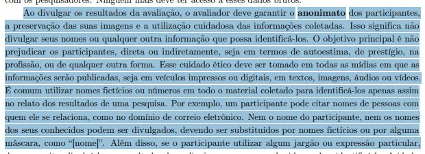

    Fonte: Barbosa et al. (2021, cap. 7, seç. 7.4, p. 141).

#### Item 24

Existe um termo de consentimento livre e esclarecido que informa ao participante o objetivo do estudo, a duração estimada, os procedimentos de coleta, o uso da informação coletada, seus direitos e os riscos, desconfortos ou efeitos adversos, sendo assinado pelo participante (ou pelo responsável legal, se menor de 18 anos) e pelo responsável pelo estudo?

**Fonte:** Barbosa et al. (2021, cap. 7, seç. 7.4, p. 141).

??? quote "Figura 24 – Trecho que fundamenta o item 24"

    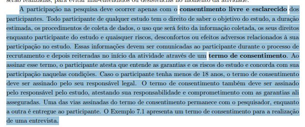

    Fonte: Barbosa et al. (2021, cap. 7, seç. 7.4, p. 141).

#### Item 25

O artefato informa que o participante tem o direito de se recusar a participar ou de abandonar o estudo em qualquer fase, sem ser penalizado, e prevê a interrupção da atividade caso ele apresente constrangimento ou incômodo físico, emocional ou psíquico?

**Fonte:** Barbosa et al. (2021, cap. 7, seç. 7.4, p. 142).

??? quote "Figura 25 – Trecho que fundamenta o item 25"

    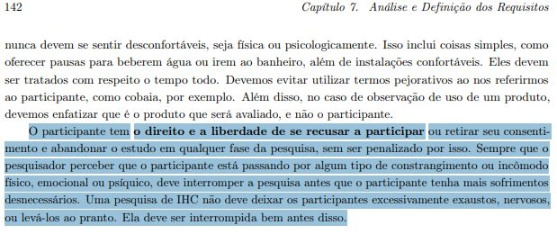

    Fonte: Barbosa et al. (2021, cap. 7, seç. 7.4, p. 142).

### Seção 7.5.1 – Entrevistas

#### Item 26

O roteiro define o tipo de entrevista utilizado, dentre: estruturada (perguntas previamente definidas, feitas na ordem especificada), não estruturada (perguntas abertas e flexíveis, compromisso apenas com o tópico) ou semiestruturada (tópicos/perguntas em ordem lógica, com liberdade para aprofundar e reordenar, mantendo o foco nos objetivos)?

**Fonte:** Barbosa et al. (2021, cap. 7, seç. 7.5.1, p. 145).

??? quote "Figura 26 – Trecho que fundamenta o item 26"

    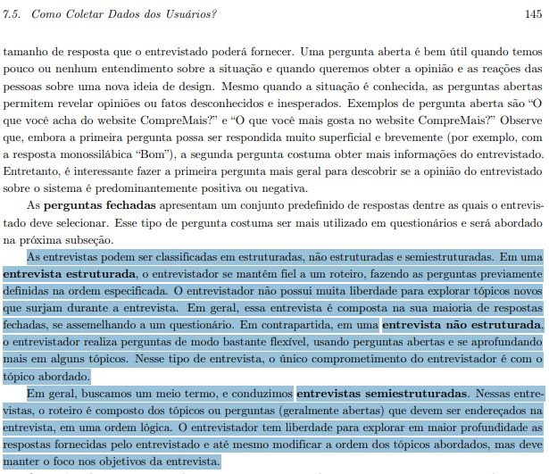

    Fonte: Barbosa et al. (2021, cap. 7, seç. 7.5.1, p. 145).

#### Item 27

O roteiro organiza a sessão de entrevista nas cinco etapas: (1) apresentação e explicação do objetivo; (2) aquecimento com perguntas fáceis, como dados demográficos; (3) parte principal; (4) desaquecimento; e (5) conclusão, com agradecimento e encerramento?

**Fonte:** Barbosa et al. (2021, cap. 7, seç. 7.5.1, p. 145–146).

??? quote "Figura 27 – Trecho que fundamenta o item 27"

    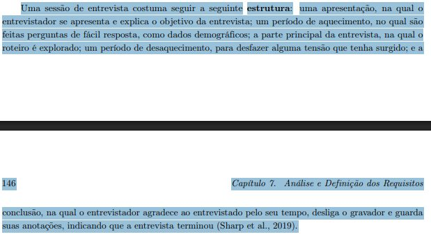

    Fonte: Barbosa et al. (2021, cap. 7, seç. 7.5.1, p. 145–146).

#### Item 28

As perguntas do roteiro estão livres de formulações que induzem a resposta (por exemplo, "Por que você gosta de X?", que pressupõe que o entrevistado gosta), usando perguntas do tipo "sim ou não" apenas para filtrar perguntas subsequentes?

**Fonte:** Barbosa et al. (2021, cap. 7, seç. 7.5.1, p. 146–147).

??? quote "Figura 28 – Trecho que fundamenta o item 28"

    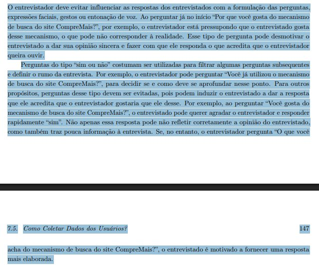

    Fonte: Barbosa et al. (2021, cap. 7, seç. 7.5.1, p. 146–147).

#### Item 29

O roteiro evita perguntas longas, complexas ou compostas, desdobrando-as em perguntas menores (por exemplo, perguntar separadamente sobre a estrutura dos menus, sobre os rótulos e sobre a comparação com outros sites)?

**Fonte:** Barbosa et al. (2021, cap. 7, seç. 7.5.1, p. 147).

??? quote "Figura 29 – Trecho que fundamenta o item 29"

    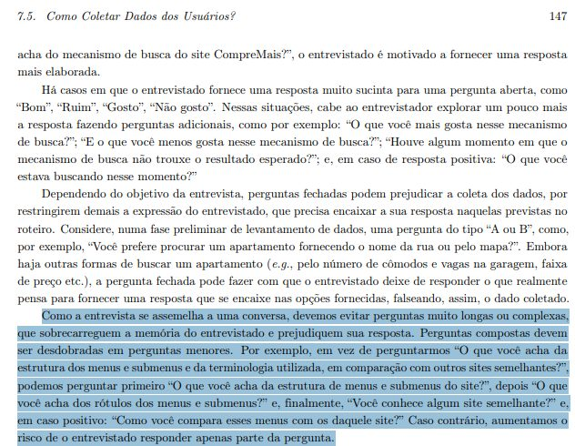

    Fonte: Barbosa et al. (2021, cap. 7, seç. 7.5.1, p. 147).

#### Item 30

O roteiro evita o uso de termos técnicos ou jargões com os quais os entrevistados não tenham familiaridade?

**Fonte:** Barbosa et al. (2021, cap. 7, seç. 7.5.1).

??? quote "Figura 30 – Trecho que fundamenta o item 30"

    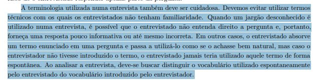

    Fonte: Barbosa et al. (2021, cap. 7, seç. 7.5.1).

### Seção 7.5.2 – Questionários

#### Item 31

O questionário contém instruções claras sobre como responder cada pergunta, indicando explicitamente se a pergunta admite uma única resposta ou múltiplas respostas, e utiliza símbolos informativos de forma consistente?

**Fonte:** Barbosa et al. (2021, cap. 7, seç. 7.5.2, p. 149).

??? quote "Figura 31 – Trecho que fundamenta o item 31"

    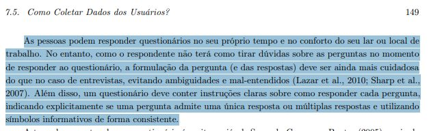

    Fonte: Barbosa et al. (2021, cap. 7, seç. 7.5.2, p. 149).

#### Item 32

As perguntas fechadas do questionário incluem respostas neutras ou alternativas, como "não sei", "não quero responder" ou "outros" (com espaço para o respondente complementar)?

**Fonte:** Barbosa et al. (2021, cap. 7, seç. 7.5.2).

??? quote "Figura 32 – Trecho que fundamenta o item 32"

    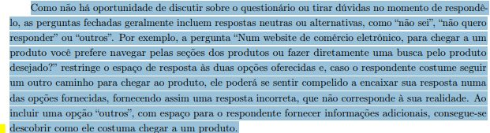

    Fonte: Barbosa et al. (2021, cap. 7, seç. 7.5.2).

#### Item 33

O questionário segue a estrutura típica: começa com informações demográficas básicas (por exemplo, sexo, idade) e detalhes relevantes sobre a experiência do respondente, apresenta perguntas gerais antes das específicas e agrupa as perguntas por tópicos relacionados quando é longo?

**Fonte:** Barbosa et al. (2021, cap. 7, seç. 7.5.2).

??? quote "Figura 33 – Trecho que fundamenta o item 33"

    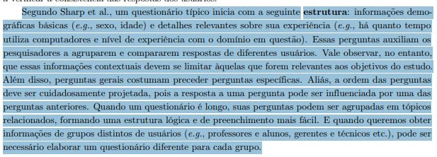

    Fonte: Barbosa et al. (2021, cap. 7, seç. 7.5.2).

#### Item 34

Nas perguntas sobre valores específicos (como idade ou renda mensal), o questionário oferece faixas de valores sem sobreposição (por exemplo, "21-30" e "31-40", e não "20-30" e "30-40")? dos Usuários

**Fonte:** Barbosa et al. (2021, cap. 7, seç. 7.5.2).

??? quote "Figura 34 – Trecho que fundamenta o item 34"

    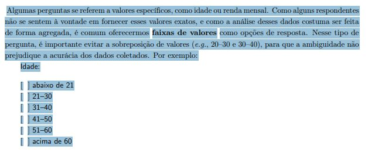

    Fonte: Barbosa et al. (2021, cap. 7, seç. 7.5.2).

### Seção 7.5.4 – Brainstorming de necessidades e desejos dos usuários

#### Item 35

O planejamento do brainstorming prevê sessões com entre 8 e 12 usuários finais, de preferência com perfil semelhante, e mais de uma sessão caso haja mais de um perfil de usuário?

**Fonte:** Barbosa et al. (2021, cap. 7, seç. 7.5.4, p. 153).

??? quote "Figura 35 – Trecho que fundamenta o item 35"

    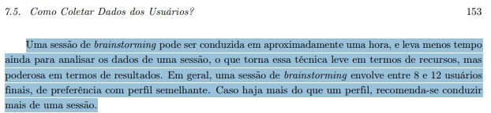

    Fonte: Barbosa et al. (2021, cap. 7, seç. 7.5.4, p. 153).

#### Item 36

A sessão de brainstorming começa com uma pergunta inicial referente ao "sistema ideal", formulada para identificar (1) as informações que o sistema deve fornecer, (2) as atividades/tarefas que os usuários esperam realizar ou (3) características como confiabilidade, rapidez e segurança?

**Fonte:** Barbosa et al. (2021, cap. 7, seç. 7.5.4).

??? quote "Figura 36 – Trecho que fundamenta o item 36"

    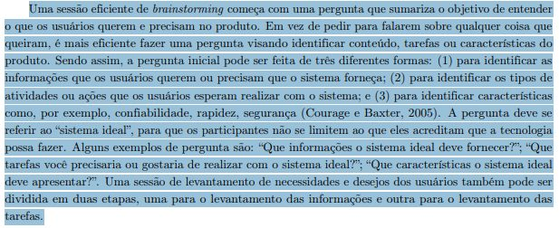

    Fonte: Barbosa et al. (2021, cap. 7, seç. 7.5.4).

#### Item 37

O planejamento define um moderador responsável por: esclarecer o que for dito; manter o foco e o andamento da sessão sem dar opiniões próprias nem influenciar respostas; manter os participantes motivados; não criticar; e garantir que todos participem sem que ninguém domine a sessão?

**Fonte:** Barbosa et al. (2021, cap. 7, seç. 7.5.4).

??? quote "Figura 37 – Trecho que fundamenta o item 37"

    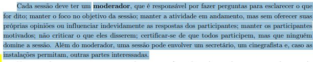

    Fonte: Barbosa et al. (2021, cap. 7, seç. 7.5.4).

#### Item 38

No início da sessão, os participantes são informados sobre o objetivo e o procedimento da atividade, incluindo as duas partes: o brainstorming de itens do sistema ideal e a priorização individual dos itens levantados?

**Fonte:** Barbosa et al. (2021, cap. 7, seç. 7.5.4).

??? quote "Figura 38 – Trecho que fundamenta o item 38"

    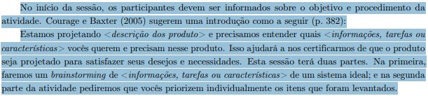

    Fonte: Barbosa et al. (2021, cap. 7, seç. 7.5.4).

#### Item 39

São apresentadas as regras da seção: (a) é um sistema ideal, então todas as ideias são corretas e ninguém deve censurar a si ou aos outros; e (b) não se trata de uma sessão de design, então os participantes não devem tentar projetar o sistema?

**Fonte:** Barbosa et al. (2021, cap. 7, seç. 7.5.4).

??? quote "Figura 39 – Trecho que fundamenta o item 39"

    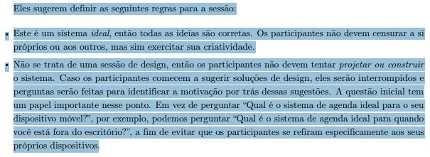

    Fonte: Barbosa et al. (2021, cap. 7, seç. 7.5.4).

#### Item 40

O planejamento prevê um secretário (escriba) que registra apenas o que o moderador parafrasear, numerando cada sugestão para facilitar referências futuras?

**Fonte:** Barbosa et al. (2021, cap. 7, seç. 7.5.4, p. 154).

??? quote "Figura 40 – Trecho que fundamenta o item 40"

    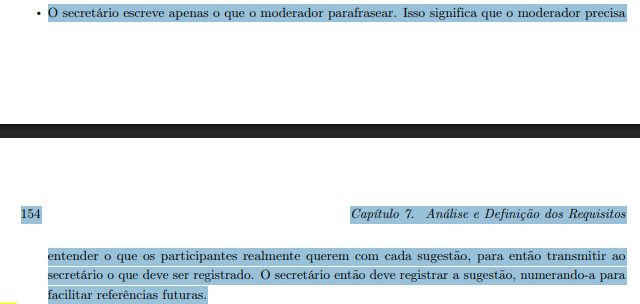

    Fonte: Barbosa et al. (2021, cap. 7, seç. 7.5.4, p. 154).

#### Item 41

Na priorização, cada participante registra em formulário os cinco itens que considera essenciais (com número, descrição e justificativa), sendo informado que os cinco itens têm o mesmo peso e que votos duplicados serão descartados?

**Fonte:** Barbosa et al. (2021, cap. 7, seç. 7.5.4).

??? quote "Figura 41 – Trecho que fundamenta o item 41"

    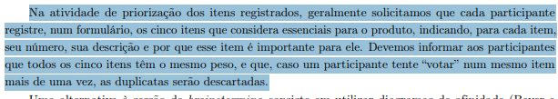

    Fonte: Barbosa et al. (2021, cap. 7, seç. 7.5.4).

#### Item 42

Os resultados do brainstorming são sumarizados em uma tabela com: item ou categoria; exemplos fornecidos pelos participantes; e porcentagem de participantes que o selecionaram entre os cinco prioritários, ordenada da maior para a menor prioridade, com a lista completa de ideias incluída no relatório?

**Fonte:** Barbosa et al. (2021, cap. 7, seç. 7.5.4, p. 155).

??? quote "Figura 42 – Trecho que fundamenta o item 42"

    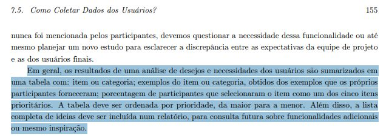

    Fonte: Barbosa et al. (2021, cap. 7, seç. 7.5.4, p. 155).

??? quote "Figura 43 – Trecho que fundamenta o item 42"

    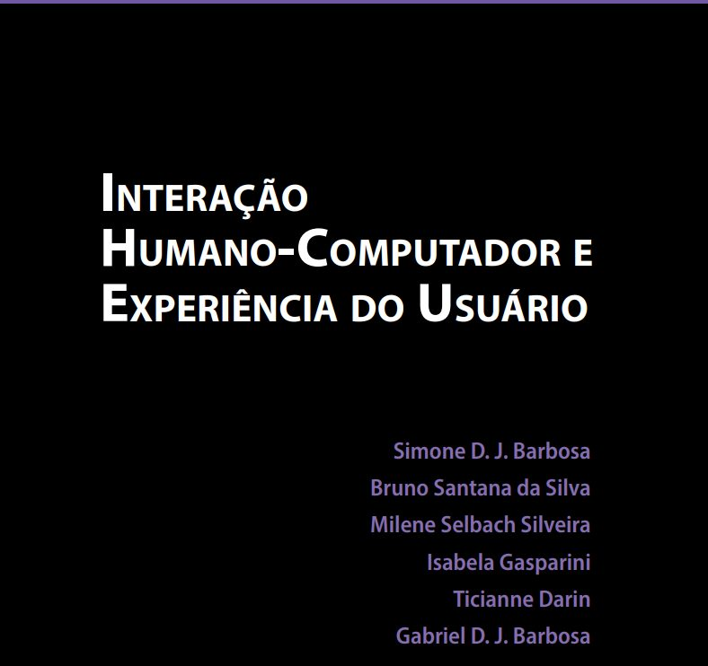

    Fonte: Barbosa et al. (2021, cap. 7, seç. 7.5.4, p. 155).

## Referências

BARBOSA, Simone Diniz Junqueira; SILVA, Bruno Santana da; SILVEIRA, Milene Selbach; GASPARINI, Isabela; DARIN, Ticianne; BARBOSA, Gabriel Diniz Junqueira. *Interação Humano-Computador e Experiência do Usuário*. [*S. l.*]: Autopublicação, 2021. Disponível em: https://leanpub.com/ihc-ux.

SALES, André Barros de. *Lista de Exercícios*: elaborar listas de verificação. Brasília: Universidade de Brasília, [2026]. Enunciado da atividade avaliativa Verificação 2.

SALES, André Barros de. *Plano de Ensino*: Interação Humano Computador (FGA0173), 02/2026, Turma 01, v1. Brasília: Universidade de Brasília, 2026.

## Agradecimentos e uso de IA generativa

**Uso de IA generativa nesta página.** O Claude (Anthropic) foi utilizado na transcrição do documento original para o site e na padronização da formatação, das legendas, das citações e das referências às normas da disciplina. O conteúdo do trabalho é de Alexandre Vilar, indicado(a) na tabela de contribuição. A ferramenta não é autora do artefato e seu uso não exime os autores da responsabilidade sobre o conteúdo (SALES, 2026, p. 3).
