# Lista de Verificação – Personas

**Autoria:** Alexandre Vilar Valadares Fonsêca · **Entrega 2**

## Tabela de contribuição

**Tabela 1 – Contribuições no trabalho "Lista de Verificação – Personas"**

| Integrante | Contribuição | Atividade (link) | Gravação (link) |
| --- | --- | --- | --- |
| Alexandre Vilar Valadares Fonsêca | Autoria do trabalho (atividade individual) | Esta página | — |
| Gabriel Robson Nunes Neiva da Silva | Não se aplica (atividade individual) | — | — |
| Henrique Schneider Fernandes da Rosa | Não se aplica (atividade individual) | — | — |
| João Vitor Tavares de Sá Lima | Não se aplica (atividade individual) | — | — |

Fonte: elaborado pelos autores (2026).

## Histórico de versões

**Tabela 2 – Histórico de versões do trabalho "Lista de Verificação – Personas"**

| Data | Versão | Descrição | Autor(es) | Revisor(es) |
| --- | --- | --- | --- | --- |
| 22/09/2026 | 1.0 | Elaboração do trabalho, entregue no Moodle (prazo da atividade no Moodle) | Alexandre Vilar | — |
| 17/10/2026 | 1.1 | Publicação no site: transcrição, fotos das fontes, citações e referências no padrão da disciplina | Henrique Schneider | — |

Fonte: elaborado pelos autores (2026).

## 1. Introdução

Atividade individual do Moodle "Listas de verificação – Personas, Elenco de Personas, HTA e CTT", parte relativa a personas.

Cada item é uma pergunta autocontida, respondida com **Conforme**, **Não conforme** ou **Não se aplica**. Abaixo de cada item estão a fonte, com capítulo, seção e página, e a foto do trecho que o fundamenta, como pede a atividade de elaboração de listas de verificação (SALES, [2026], p. 1). Clique no título de cada figura para abrir a foto.

## 2. Itens da lista

### Item 1

A persona foi construída a partir de dados de pesquisa com usuários reais ou potenciais (por exemplo: entrevistas contextuais/etnográficas, observação dos usuários em seu contexto de uso), e não apenas a partir de suposições, opiniões da equipe ou estereótipos?

**Fonte:** Cooper, Reimann e Cronin (2007), cap. 5, p. 80, seção “Personas are based on research”; Barbosa e Silva (2010), slides do cap. 6, slide 6 (definição de persona).

??? quote "Figura 1 – Trecho que fundamenta o item 1"

    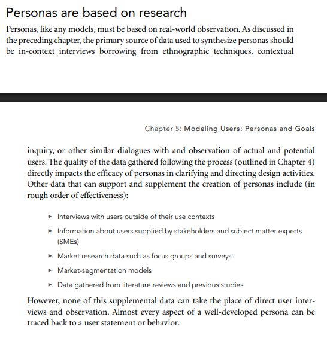

    Fonte: Cooper, Reimann e Cronin (2007), cap. 5, p. 80, seção “Personas are based on research”; Barbosa e Silva (2010), slides do cap. 6, slide 6 (definição de persona).

### Item 2

A persona apresenta dados de identidade, ou seja, possui nome, sobrenome, idade e uma foto (ou esboço) que a represente?

**Fonte:** Barbosa e Silva (2010), slides do cap. 6, slide 7 (“Características das Personas” – identidade); Cooper, Reimann e Cronin (2007), p. 100 (nomes das personas).

??? quote "Figura 2 – Trecho que fundamenta o item 2"

    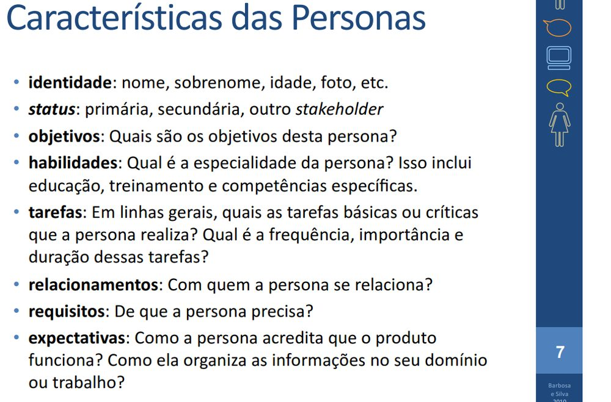

    Fonte: Barbosa e Silva (2010), slides do cap. 6, slide 7 (“Características das Personas” – identidade); Cooper, Reimann e Cronin (2007), p. 100 (nomes das personas).

### Item 3

A persona tem seu status/tipo explicitamente designado como um dos seguintes: primária (alvo principal do design da interface), secundária (satisfeita pela interface da primária, mas com necessidades adicionais), suplementar (necessidades já cobertas pelas primárias e secundárias), cliente (quem compra, mas não necessariamente usa), servida (não usa, mas é afetada pelo uso) ou negativa (tipo de usuário para o qual o produto NÃO é projetado)?

**Fonte:** Cooper, Reimann e Cronin (2007), p. 104–106, seção “Step 7: Designate persona types”; Barbosa e Silva (2010), slides do cap. 6, slide 7 (item “status”).

??? quote "Figura 3 – Trecho que fundamenta o item 3"

    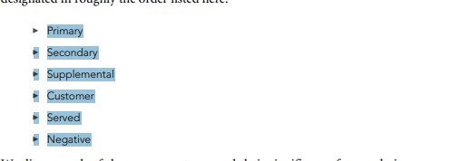

    Fonte: Cooper, Reimann e Cronin (2007), p. 104–106, seção “Step 7: Designate persona types”; Barbosa e Silva (2010), slides do cap. 6, slide 7 (item “status”).

### Item 4

Caso existam várias personas para o mesmo produto, há apenas UMA persona primária para cada interface do produto?

**Fonte:** Cooper, Reimann e Cronin (2007), p. 104–105, seção “Primary personas” (princípio de design: focar o design de cada interface em uma única persona primária).

??? quote "Figura 4 – Trecho que fundamenta o item 4"

    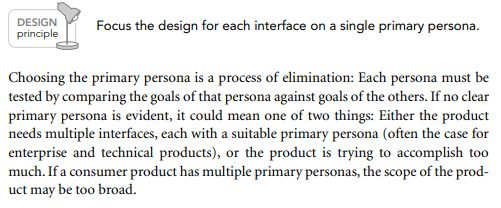

    Fonte: Cooper, Reimann e Cronin (2007), p. 104–105, seção “Primary personas” (princípio de design: focar o design de cada interface em uma única persona primária).

### Item 5

Cada objetivo da persona está escrito como uma frase simples e está diretamente relacionado ao produto que está sendo projetado?

**Fonte:** Cooper, Reimann e Cronin (2007), p. 89 (fim da seção “Goals should be inferred from qualitative data”) e p. 100 (“Synthesizing goals”).

??? quote "Figura 5 – Trecho que fundamenta o item 5"

    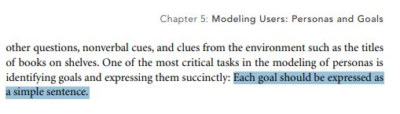

    Fonte: Cooper, Reimann e Cronin (2007), p. 89 (fim da seção “Goals should be inferred from qualitative data”) e p. 100 (“Synthesizing goals”).

### Item 6

A persona possui de três a cinco objetivos finais (end goals), isto é, objetivos que expressam O QUE o usuário quer fazer/alcançar com o produto (por exemplo: “ficar ciente dos problemas antes que se tornem críticos”, “conseguir o melhor preço”)?

**Fonte:** Cooper, Reimann e Cronin (2007), p. 93 (“End goals”) e p. 100–101 (“Synthesizing goals”); Barbosa e Silva (2010), slides do cap. 6, slide 8 (“objetivos práticos” da persona Marta Batista).

??? quote "Figura 6 – Trecho que fundamenta o item 6"

    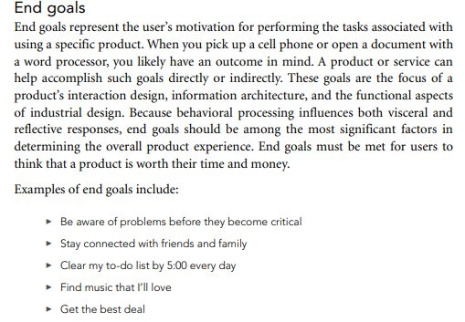

    Fonte: Cooper, Reimann e Cronin (2007), p. 93 (“End goals”) e p. 100–101 (“Synthesizing goals”); Barbosa e Silva (2010), slides do cap. 6, slide 8 (“objetivos práticos” da persona Marta Batista).

### Item 7

A persona possui, no máximo, dois objetivos de experiência (COMO o usuário quer se sentir ao usar o produto, por exemplo: “sentir-se no controle”, “divertir-se”) e, no máximo, um objetivo de vida (QUEM o usuário quer ser, aspirações pessoais que vão além do produto, por exemplo: “ser respeitado pelos colegas”)?

**Fonte:** Cooper, Reimann e Cronin (2007), p. 92–94 (“The three types of user goals”) e p. 101; Barbosa e Silva (2010), slides do cap. 6, slide 8 (“objetivos pessoais”); p. 94 (“Types of goals”).

??? quote "Figura 7 – Trecho que fundamenta o item 7"

    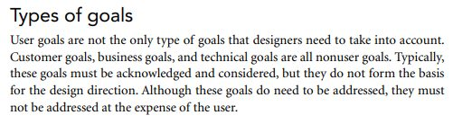

    Fonte: Cooper, Reimann e Cronin (2007), p. 92–94 (“The three types of user goals”) e p. 101; Barbosa e Silva (2010), slides do cap. 6, slide 8 (“objetivos pessoais”); p. 94 (“Types of goals”).

### Item 8

A persona descreve suas habilidades, isto é, sua especialidade, incluindo educação, treinamento e competências específicas relacionadas ao domínio do produto e à tecnologia?

**Fonte:** Barbosa e Silva (2010), slides do cap. 6, slide 7 (item “habilidades”); Cooper, Reimann e Cronin (2007), p. 98 (variáveis “Aptitudes” e “Skills”).

??? quote "Figura 8 – Trecho que fundamenta o item 8"

    

    Fonte: Barbosa e Silva (2010), slides do cap. 6, slide 7 (item “habilidades”); Cooper, Reimann e Cronin (2007), p. 98 (variáveis “Aptitudes” e “Skills”).

### Item 9

A persona descreve as tarefas básicas ou críticas que realiza, informando para cada uma a frequência, a importância e a duração?

**Fonte:** Barbosa e Silva (2010), slides do cap. 6, slide 7 (item “tarefas”).

??? quote "Figura 9 – Trecho que fundamenta o item 9"

    

    Fonte: Barbosa e Silva (2010), slides do cap. 6, slide 7 (item “tarefas”).

### Item 10

A persona descreve com quem ela se relaciona (colegas, chefes, alunos, familiares, clientes etc.) no contexto de uso do produto?

**Fonte:** Barbosa e Silva (2010), slides do cap. 6, slide 7 (item “relacionamentos”); Cooper, Reimann e Cronin (2007), p. 100–101 (“Persona relationships”).

??? quote "Figura 10 – Trecho que fundamenta o item 10"

    

    Fonte: Barbosa e Silva (2010), slides do cap. 6, slide 7 (item “relacionamentos”); Cooper, Reimann e Cronin (2007), p. 100–101 (“Persona relationships”).

### Item 11

A persona descreve seus requisitos (de que ela precisa) e suas expectativas (como ela acredita que o produto funciona e como organiza as informações no seu domínio ou trabalho)?

**Fonte:** Barbosa e Silva (2010), slides do cap. 6, slide 7 (itens “requisitos” e “expectativas”).

??? quote "Figura 11 – Trecho que fundamenta o item 11"

    

    Fonte: Barbosa e Silva (2010), slides do cap. 6, slide 7 (itens “requisitos” e “expectativas”).

### Item 12

A descrição da persona contempla variáveis comportamentais, e não apenas demográficas, abordando pelo menos: atividades (o que faz, com que frequência e volume), atitudes (o que pensa sobre o domínio e a tecnologia), aptidões (formação e capacidade de aprender) e motivações (por que atua no domínio do produto)?

**Fonte:** Cooper, Reimann e Cronin (2007), p. 98, seção “Step 1: Identify behavioral variables”.

??? quote "Figura 12 – Trecho que fundamenta o item 12"

    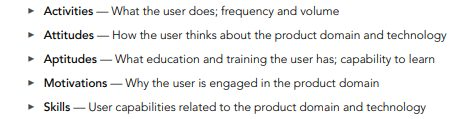

    Fonte: Cooper, Reimann e Cronin (2007), p. 98, seção “Step 1: Identify behavioral variables”.

### Item 13

A persona se diferencia das demais personas do conjunto em pelo menos um comportamento significativo (ou seja, não difere das outras apenas por dados demográficos como idade, sexo ou cidade)?

**Fonte:** Cooper, Reimann e Cronin (2007), p. 101–102, seção “Step 5: Check for completeness and redundancy”.

??? quote "Figura 13 – Trecho que fundamenta o item 13"

    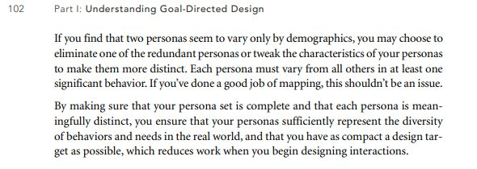

    Fonte: Cooper, Reimann e Cronin (2007), p. 101–102, seção “Step 5: Check for completeness and redundancy”.

### Item 14

A persona possui uma narrativa em terceira pessoa, de no máximo uma a duas páginas, que apresenta seu trabalho ou estilo de vida, um dia típico com suas frustrações e interesses relacionados ao produto, e termina indicando o que ela espera do produto?

**Fonte:** Cooper, Reimann e Cronin (2007), p. 102, seção “Step 6: Expand description of attributes and behaviors”.

??? quote "Figura 14 – Trecho que fundamenta o item 14"

    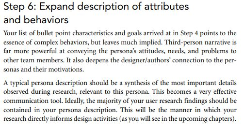

    Fonte: Cooper, Reimann e Cronin (2007), p. 102, seção “Step 6: Expand description of attributes and behaviors”.

### Item 15

A persona evita estereótipos e excesso de detalhes fictícios (biografia, gostos pessoais, carro, família etc. que não têm relação com o uso do produto), mantendo o foco em comportamentos e motivações observados?

**Fonte:** Cooper, Reimann e Cronin (2007), p. 82–83 (“Archetypes versus stereotypes”) e p. 100 (“Step 4”).

??? quote "Figura 15 – Trecho que fundamenta o item 15"

    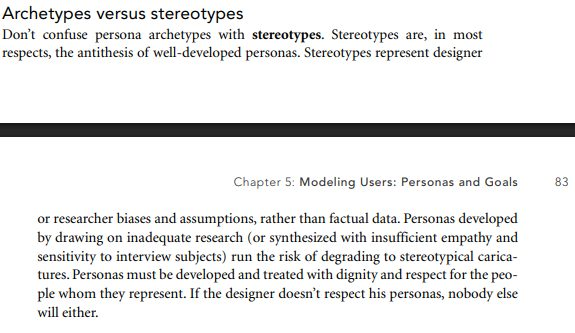

    Fonte: Cooper, Reimann e Cronin (2007), p. 82–83 (“Archetypes versus stereotypes”) e p. 100 (“Step 4”).

## Referências

BARBOSA, Simone Diniz Junqueira; SILVA, Bruno Santana da. *Organização do espaço de problema*: slides do capítulo 6 de *Interação Humano-Computador*. Rio de Janeiro: Elsevier, 2010. 30 slides.

COOPER, Alan; REIMANN, Robert; CRONIN, David. *About Face 3*: the essentials of interaction design. Indianapolis: Wiley, 2007.

SALES, André Barros de. *Lista de Exercícios*: elaborar listas de verificação. Brasília: Universidade de Brasília, [2026]. Enunciado da atividade avaliativa Verificação 2.

SALES, André Barros de. *Plano de Ensino*: Interação Humano Computador (FGA0173), 02/2026, Turma 01, v1. Brasília: Universidade de Brasília, 2026.

## Agradecimentos e uso de IA generativa

**Uso de IA generativa nesta página.** O Claude (Anthropic) foi utilizado na transcrição do documento original para o site e na padronização da formatação, das legendas, das citações e das referências às normas da disciplina. O conteúdo do trabalho é de Alexandre Vilar, indicado(a) na tabela de contribuição. A ferramenta não é autora do artefato e seu uso não exime os autores da responsabilidade sobre o conteúdo (SALES, 2026, p. 3).
