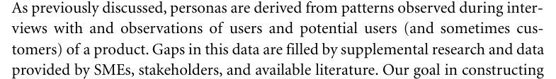
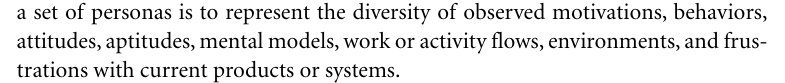
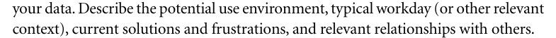
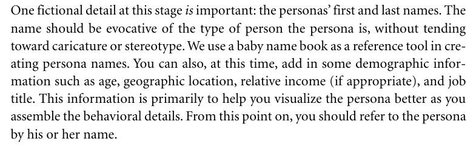
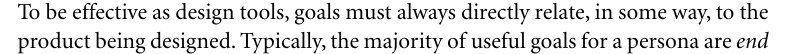
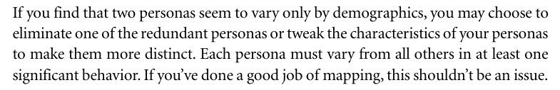
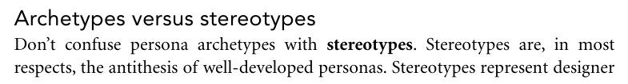
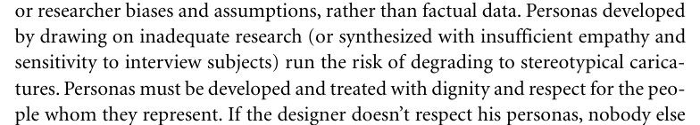
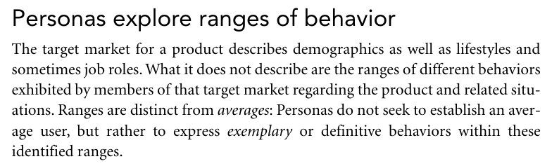

# Lista de Verificação – Elenco de Personas

**Autoria:** Gabriel Robson Nunes Neiva da Silva · **Entrega 2**

## Tabela de contribuição

**Tabela 1 – Contribuições no trabalho "Lista de Verificação – Elenco de Personas"**

| Integrante | Contribuição | Atividade (link) | Gravação (link) |
| --- | --- | --- | --- |
| Alexandre Vilar Valadares Fonsêca | Não se aplica (atividade individual) | — | — |
| Gabriel Robson Nunes Neiva da Silva | Autoria do trabalho (atividade individual) | Esta página | — |
| Henrique Schneider Fernandes da Rosa | Não se aplica (atividade individual) | — | — |
| João Vitor Tavares de Sá Lima | Não se aplica (atividade individual) | — | — |

Fonte: elaborado pelos autores (2026).

## Histórico de versões

**Tabela 2 – Histórico de versões do trabalho "Lista de Verificação – Elenco de Personas"**

| Data | Versão | Descrição | Autor(es) | Revisor(es) |
| --- | --- | --- | --- | --- |
| 22/09/2026 | 1.0 | Elaboração do trabalho, entregue no Moodle (data do arquivo entregue) | Gabriel Robson | — |
| 17/10/2026 | 1.1 | Publicação no site: transcrição, fotos das fontes, citações e referências no padrão da disciplina | Henrique Schneider | — |

Fonte: elaborado pelos autores (2026).

## 1. Introdução

Atividade individual do Moodle "Listas de verificação – Personas, Elenco de Personas, HTA e CTT", parte relativa ao elenco de personas.

Cada item é uma pergunta autocontida, respondida com **Conforme**, **Não conforme** ou **Não se aplica**. Abaixo de cada item estão a fonte, com capítulo, seção e página, e a foto do trecho que o fundamenta, como pede a atividade de elaboração de listas de verificação (SALES, [2026], p. 1). Clique no título de cada figura para abrir a foto.

O autor citou o capítulo 5 de *About Face*, com os trechos copiados de uma edição consultada on-line. As fotos são do trecho correspondente na 3ª edição (Cooper, Reimann e Cronin, 2007), cuja paginação é a usada nas citações; a redação do livro pode diferir ligeiramente da dos trechos citados.

## 2. Itens da lista

### Item 1

O elenco de personas foi construído a partir de padrões observados em entrevistas e observações de usuários ou usuários potenciais, complementados por outras fontes apenas quando necessário?

**Fonte:** Cooper, Reimann e Cronin (2007, cap. 5, seç. “Constructing Personas”, p. 97).

**Trecho citado pelo autor:** “personas are derived from patterns observed during interviews with and observations of users and potential users ... Gaps in this data are filled by supplemental research and data provided by SMEs, stakeholders, and available literature.”

??? quote "Figura 1 – Trecho correspondente ao item 1 na 3ª edição (Cooper, Reimann e Cronin, 2007, p. 97)"

    

    Fonte: Cooper, Reimann e Cronin (2007, cap. 5, p. 97).

### Item 2

Cada persona do elenco apresenta informações sobre objetivos, atitudes, fluxo de trabalho ou atividade, ambiente, habilidades e níveis de habilidade e frustrações, quando esses elementos são relevantes ao projeto?

**Fonte:** Cooper, Reimann e Cronin (2007, cap. 5, seç. “Constructing Personas”, p. 97).

**Trecho citado pelo autor:** “Well-developed personas incorporate information about goals, attitudes, work or activity flow, environment, skills and skill levels, and frustrations.”

??? quote "Figura 2 – Trecho correspondente ao item 2 na 3ª edição (Cooper, Reimann e Cronin, 2007, p. 97)"

    

    Fonte: Cooper, Reimann e Cronin (2007, cap. 5, p. 97).

### Item 3

Para cada padrão de comportamento significativo identificado, a persona sintetiza características do ambiente de uso, do dia de trabalho ou período relevante, das soluções atuais, das frustrações e das relações relevantes com outras pessoas?

**Fonte:** Cooper, Reimann e Cronin (2007, cap. 5, passo 4, “Synthesize characteristics and relevant goals”, p. 100).

**Trecho citado pelo autor:** “Describe the potential use environment, typical workday (or other relevant time period), current solutions and frustrations, and relevant relationships with others.”

??? quote "Figura 3 – Trecho correspondente ao item 3 na 3ª edição (Cooper, Reimann e Cronin, 2007, p. 100)"

    

    Fonte: Cooper, Reimann e Cronin (2007, cap. 5, p. 100).

### Item 4

Cada persona possui nome e sobrenome e, quando pertinentes ao projeto, informações demográficas como idade, localização geográfica, renda relativa e cargo, sem transformar esses dados em uma biografia fictícia excessiva?

**Fonte:** Cooper, Reimann e Cronin (2007, cap. 5, passo 4, “Synthesize characteristics and relevant goals”, p. 100).

**Trecho citado pelo autor:** “One fictional detail at this stage is important: the personas' first and last names... You can also, at this time, add in some demographic information such as age, geographic location, relative income (if appropriate), and job title.”

??? quote "Figura 4 – Trecho correspondente ao item 4 na 3ª edição (Cooper, Reimann e Cronin, 2007, p. 100)"

    

    Fonte: Cooper, Reimann e Cronin (2007, cap. 5, p. 100).

### Item 5

Cada persona possui objetivos explicitamente relacionados ao produto que está sendo projetado, derivados da análise dos comportamentos observados, em vez de objetivos genéricos sem relação com o produto?

**Fonte:** Cooper, Reimann e Cronin (2007, cap. 5, seç. “Synthesizing goals”, p. 100).

**Trecho citado pelo autor:** “To be effective as design tools, goals must always directly relate, in some way, to the product being designed.”

??? quote "Figura 5 – Trecho correspondente ao item 5 na 3ª edição (Cooper, Reimann e Cronin, 2007, p. 100)"

    

    Fonte: Cooper, Reimann e Cronin (2007, cap. 5, p. 100).

### Item 6

As personas do elenco são suficientemente distintas entre si, de modo que cada uma apresente pelo menos um comportamento significativo diferente das demais e o conjunto não contenha personas redundantes?

**Fonte:** Cooper, Reimann e Cronin (2007, cap. 5, passo 5, “Check for redundancy and completeness”, p. 102).

**Trecho citado pelo autor:** “Each persona must vary from all others in at least one significant behavior.”

??? quote "Figura 6 – Trecho correspondente ao item 6 na 3ª edição (Cooper, Reimann e Cronin, 2007, p. 102)"

    

    Fonte: Cooper, Reimann e Cronin (2007, cap. 5, p. 102).

### Item 7

A descrição de cada persona evita características estereotipadas e utiliza dados factuais de pesquisa para representar de forma típica e crível o grupo de usuários que a persona representa?

**Fonte:** Cooper, Reimann e Cronin (2007, cap. 5, seç. “Archetypes versus stereotypes”, p. 82–83).

**Trecho citado pelo autor:** “Stereotypes represent designer or researcher biases and assumptions, rather than factual data... Personas must be developed and treated with dignity and respect.”

??? quote "Figura 7 – Trecho correspondente ao item 7 na 3ª edição (Cooper, Reimann e Cronin, 2007, p. 82)"

    

    Fonte: Cooper, Reimann e Cronin (2007, cap. 5, p. 82).

??? quote "Figura 8 – Trecho correspondente ao item 7 na 3ª edição (Cooper, Reimann e Cronin, 2007, p. 83)"

    

    Fonte: Cooper, Reimann e Cronin (2007, cap. 5, p. 83).

### Item 8

O elenco de personas representa diferentes faixas ou padrões de comportamento relacionados ao produto, em vez de representar apenas um usuário médio baseado em médias demográficas?

**Fonte:** Cooper, Reimann e Cronin (2007, cap. 5, seç. “Personas explore ranges of behavior”, p. 83).

**Trecho citado pelo autor:** “Personas do not seek to establish an average user, but rather to identify exemplary types of behaviors along identified ranges.”

??? quote "Figura 9 – Trecho correspondente ao item 8 na 3ª edição (Cooper, Reimann e Cronin, 2007, p. 83)"

    

    Fonte: Cooper, Reimann e Cronin (2007, cap. 5, p. 83).

## Referências

COOPER, Alan; REIMANN, Robert; CRONIN, David. *About Face 3*: the essentials of interaction design. Indianapolis: Wiley, 2007.

SALES, André Barros de. *Lista de Exercícios*: elaborar listas de verificação. Brasília: Universidade de Brasília, [2026]. Enunciado da atividade avaliativa Verificação 2.

SALES, André Barros de. *Plano de Ensino*: Interação Humano Computador (FGA0173), 02/2026, Turma 01, v1. Brasília: Universidade de Brasília, 2026.

## Agradecimentos e uso de IA generativa

**Uso de IA generativa nesta página.** O Claude (Anthropic) foi utilizado na transcrição do documento original para o site e na padronização da formatação, das legendas, das citações e das referências às normas da disciplina. O conteúdo do trabalho é de Gabriel Robson, indicado(a) na tabela de contribuição. A ferramenta não é autora do artefato e seu uso não exime os autores da responsabilidade sobre o conteúdo (SALES, 2026, p. 3).
