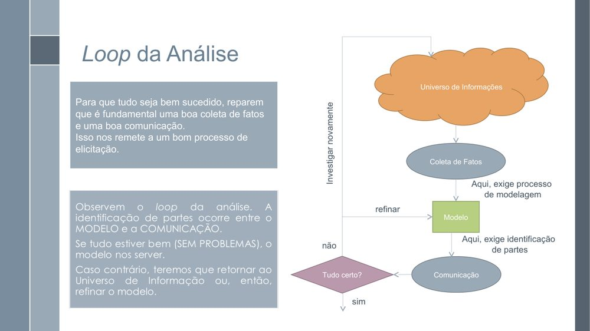
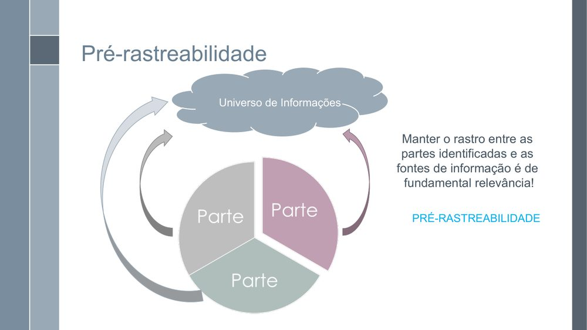
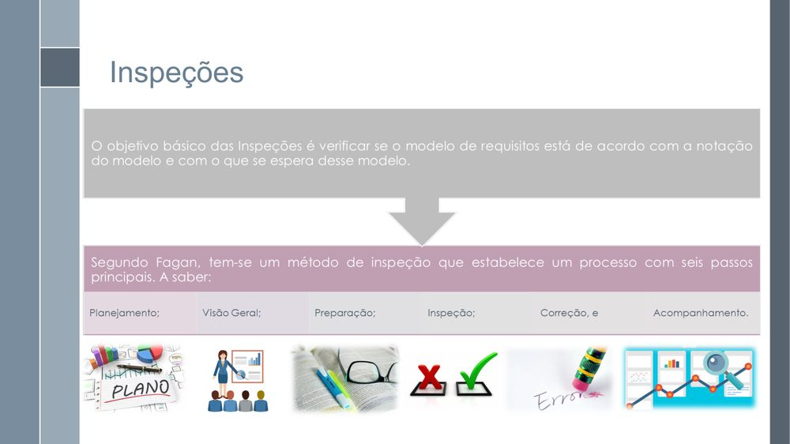
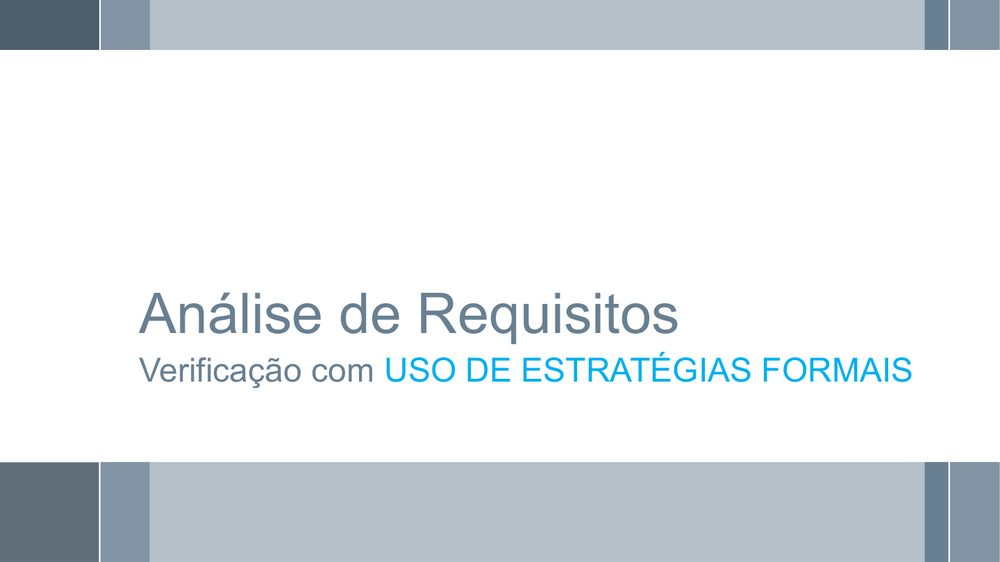
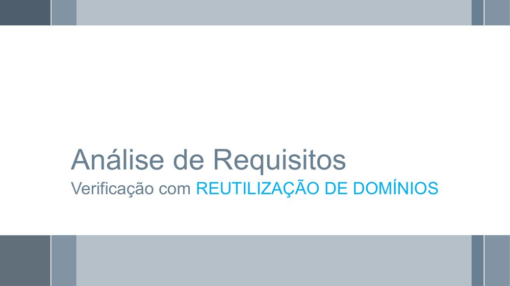
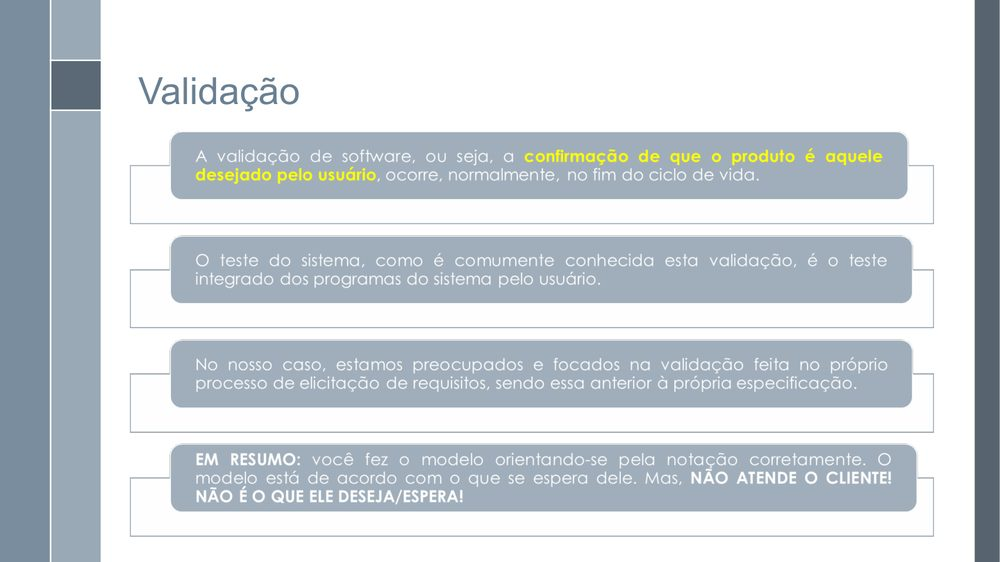
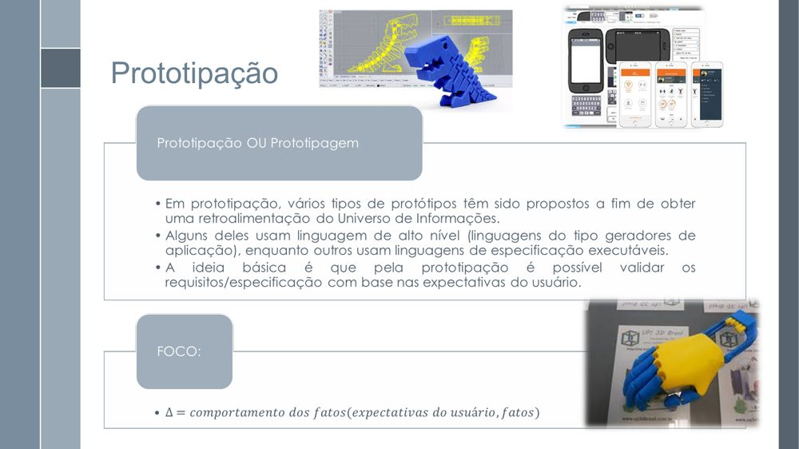
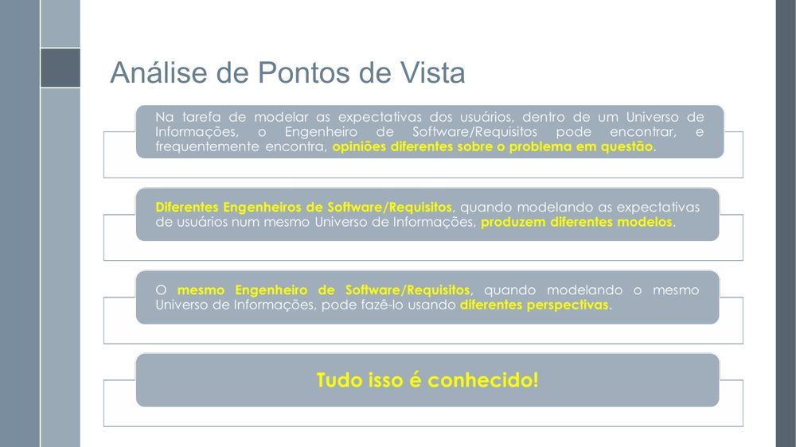

# Lista de Verificação – Análise Hierárquica de Tarefas (HTA)

**Autoria:** Gabriel Robson Nunes Neiva da Silva · **Entrega 2**

## Tabela de contribuição

**Tabela 1 – Contribuições no trabalho "Lista de Verificação – Análise Hierárquica de Tarefas (HTA)"**

| Integrante | Contribuição | Atividade (link) | Gravação (link) |
| --- | --- | --- | --- |
| Alexandre Vilar Valadares Fonsêca | Não se aplica (atividade individual) | — | — |
| Gabriel Robson Nunes Neiva da Silva | Autoria do trabalho (atividade individual) | Esta página | — |
| Henrique Schneider Fernandes da Rosa | Não se aplica (atividade individual) | — | — |
| João Vitor Tavares de Sá Lima | Não se aplica (atividade individual) | — | — |

Fonte: elaborado pelos autores (2026).

## Histórico de versões

**Tabela 2 – Histórico de versões do trabalho "Lista de Verificação – Análise Hierárquica de Tarefas (HTA)"**

| Data | Versão | Descrição | Autor(es) | Revisor(es) |
| --- | --- | --- | --- | --- |
| 22/09/2026 | 1.0 | Elaboração do trabalho, entregue no Moodle (prazo da atividade no Moodle) | Gabriel Robson | — |
| 17/10/2026 | 1.1 | Publicação no site: transcrição, fotos das fontes, citações e referências no padrão da disciplina | Henrique Schneider | — |

Fonte: elaborado pelos autores (2026).

## 1. Introdução

Atividade individual do Moodle "Listas de verificação – Personas, Elenco de Personas, HTA e CTT", parte relativa à Análise Hierárquica de Tarefas (HTA).

Cada item é uma pergunta autocontida, respondida com **Conforme**, **Não conforme** ou **Não se aplica**. Abaixo de cada item estão a fonte, com capítulo, seção e página, e a foto do trecho que o fundamenta, como pede a atividade de elaboração de listas de verificação (SALES, [2026], p. 1). Clique no título de cada figura para abrir a foto.

Os itens se fundamentam nos slides da aula 23 de Requisitos (Serrano e Serrano), que tratam de coleta de fatos, rastreabilidade, verificação, inspeção e validação, aplicados à inspeção do artefato. As fotos são dos slides citados.

## 2. Itens da lista

### Item 1

O artefato apresenta uma coleta de fatos suficientemente clara e uma comunicação adequada das informações, permitindo verificar o que foi levantado e como essas informações foram compreendidas?

**Fonte:** Serrano e Serrano ([20--], slide 5, “Loop da Análise”).

??? quote "Figura 1 – Trecho que fundamenta o item 1"

    

    Fonte: Serrano e Serrano ([20--], slide 5, “Loop da Análise”).

### Item 2

O artefato mantém o rastro entre as partes identificadas e as respectivas fontes de informação, de modo que seja possível relacionar cada parte às informações que a originaram?

**Fonte:** Serrano e Serrano ([20--], slide 14, “Pré-rastreabilidade”).

??? quote "Figura 2 – Trecho que fundamenta o item 2"

    

    Fonte: Serrano e Serrano ([20--], slide 14, “Pré-rastreabilidade”).

### Item 3

O artefato foi submetido a uma inspeção, entendida como uma verificação estruturada do conteúdo, para identificar problemas antes da continuidade do processo de desenvolvimento?

**Fonte:** Serrano e Serrano ([20--], slides 19 e 21, “Inspeções”).

??? quote "Figura 3 – Trecho que fundamenta o item 3"

    

    Fonte: Serrano e Serrano ([20--], slides 19 e 21, “Inspeções”).

### Item 4

O artefato foi verificado por meio de uma estratégia formal quando essa estratégia foi definida para a atividade de verificação, em vez de depender apenas de uma conferência informal?

**Fonte:** Serrano e Serrano ([20--], slide 22, “Verificação com uso de estratégias formais”).

??? quote "Figura 4 – Trecho que fundamenta o item 4"

    

    Fonte: Serrano e Serrano ([20--], slide 22, “Verificação com uso de estratégias formais”).

### Item 5

O artefato considera informações ou soluções já existentes no domínio quando elas podem ser reutilizadas, evitando reconstruir desnecessariamente informações que já estão disponíveis?

**Fonte:** Serrano e Serrano ([20--], slide 25, “Verificação com reutilização de domínios”).

??? quote "Figura 5 – Trecho que fundamenta o item 5"

    

    Fonte: Serrano e Serrano ([20--], slide 25, “Verificação com reutilização de domínios”).

### Item 6

O artefato foi validado por meio de uma comprovação informal, isto é, houve uma análise destinada a confirmar se o conteúdo representa adequadamente o que deveria ser representado?

**Fonte:** Serrano e Serrano ([20--], slides 28–29, “Validação”).

??? quote "Figura 6 – Trecho que fundamenta o item 6"

    

    Fonte: Serrano e Serrano ([20--], slides 28–29, “Validação”).

### Item 7

O artefato foi analisado com apoio de prototipação quando uma representação preliminar poderia ajudar a verificar o comportamento esperado ou os fatos esperados do usuário?

**Fonte:** Serrano e Serrano ([20--], slide 33, “Prototipação”).

??? quote "Figura 7 – Trecho que fundamenta o item 7"

    

    Fonte: Serrano e Serrano ([20--], slide 33, “Prototipação”).

### Item 8

O artefato foi analisado considerando diferentes pontos de vista dos envolvidos, especialmente quando diferentes usuários ou participantes podem ter expectativas ou fatos distintos sobre o mesmo universo de informações?

**Fonte:** Serrano e Serrano ([20--], slides 35–36, “Análise de Pontos de Vista”).

??? quote "Figura 8 – Trecho que fundamenta o item 8"

    

    Fonte: Serrano e Serrano ([20--], slides 35–36, “Análise de Pontos de Vista”).

## Referências

SALES, André Barros de. *Lista de Exercícios*: elaborar listas de verificação. Brasília: Universidade de Brasília, [2026]. Enunciado da atividade avaliativa Verificação 2.

SALES, André Barros de. *Plano de Ensino*: Interação Humano Computador (FGA0173), 02/2026, Turma 01, v1. Brasília: Universidade de Brasília, 2026.

SERRANO, Milene; SERRANO, Maurício. *Requisitos*: aula 23: análise, verificação e validação. Brasília: Universidade de Brasília, [20--]. 52 slides.

## Agradecimentos e uso de IA generativa

**Uso de IA generativa nesta página.** O Claude (Anthropic) foi utilizado na transcrição do documento original para o site e na padronização da formatação, das legendas, das citações e das referências às normas da disciplina. O conteúdo do trabalho é de Gabriel Robson, indicado(a) na tabela de contribuição. A ferramenta não é autora do artefato e seu uso não exime os autores da responsabilidade sobre o conteúdo (SALES, 2026, p. 3).
