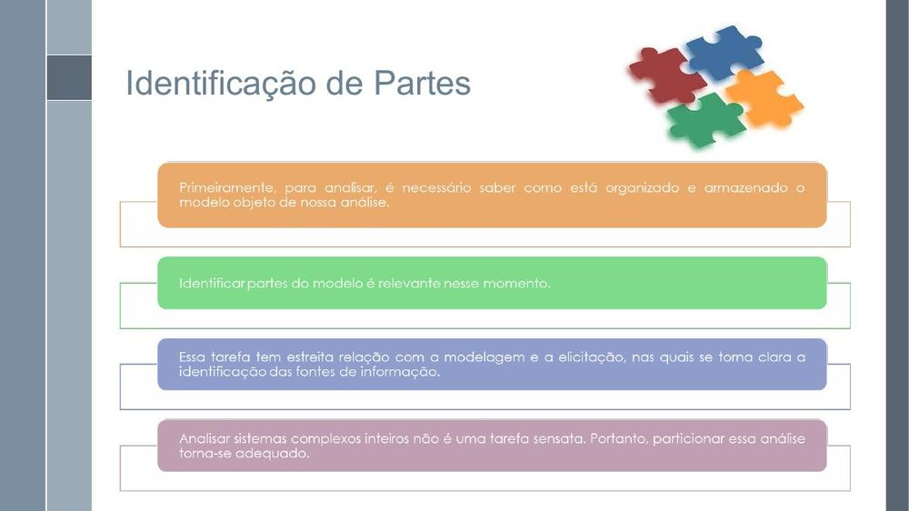
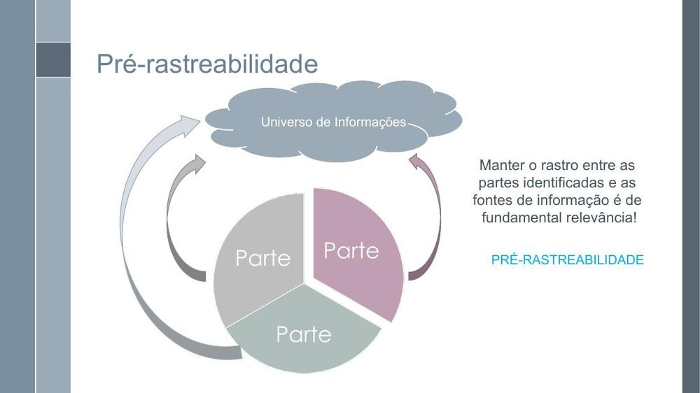
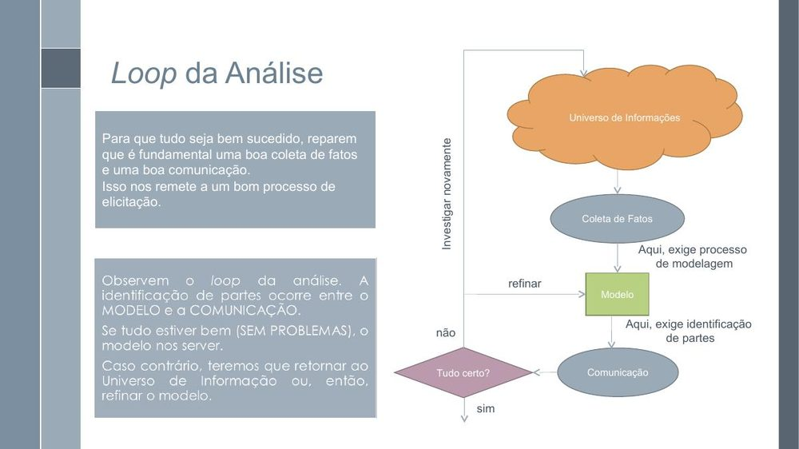
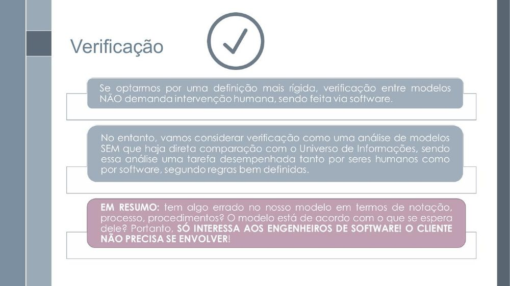
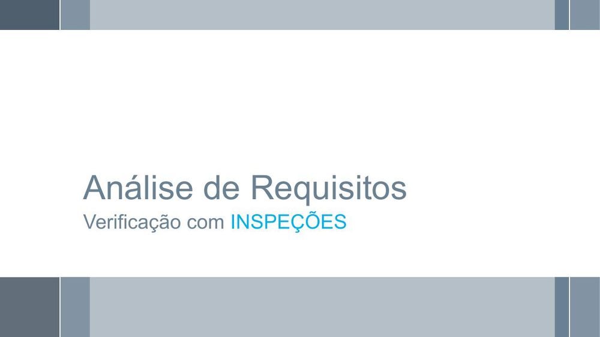
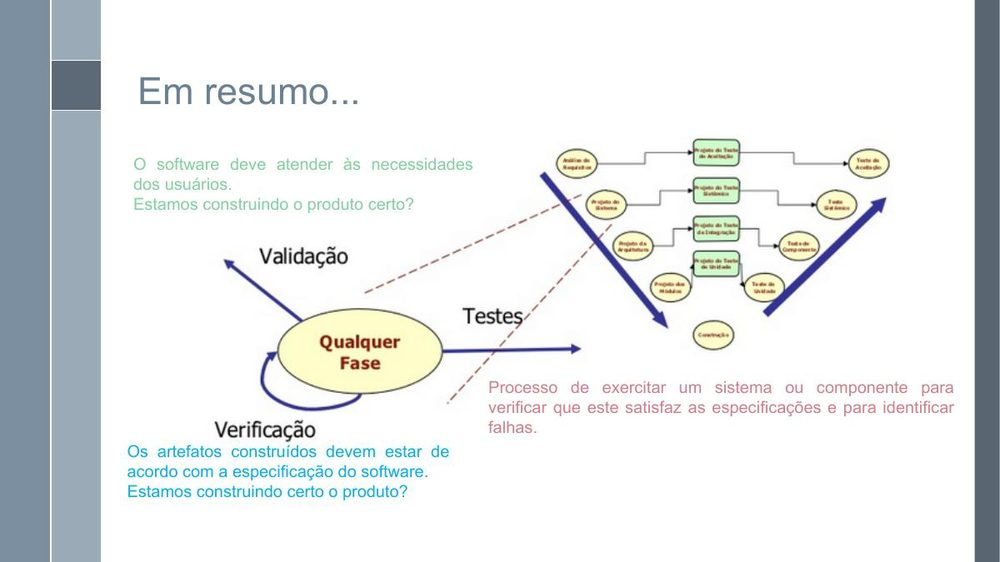
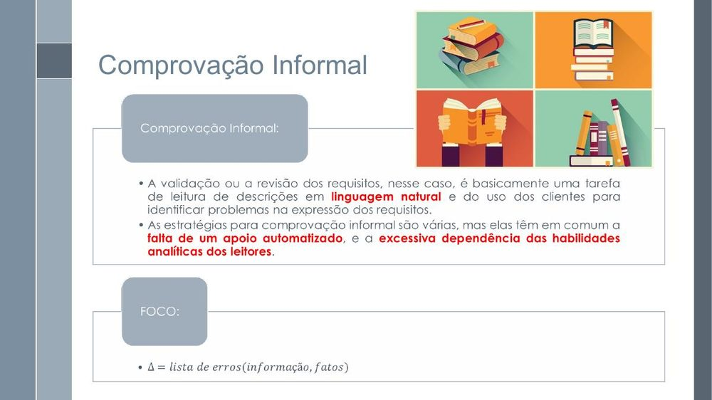
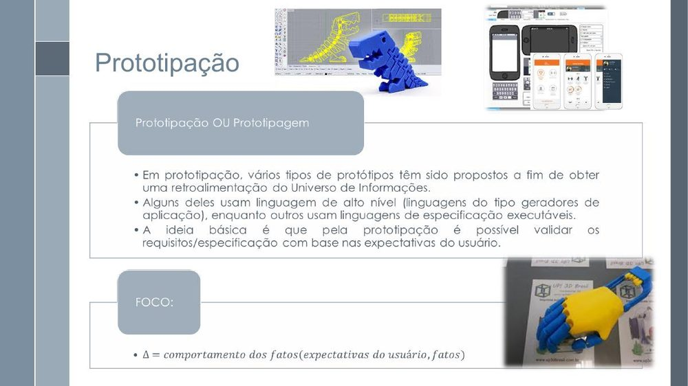
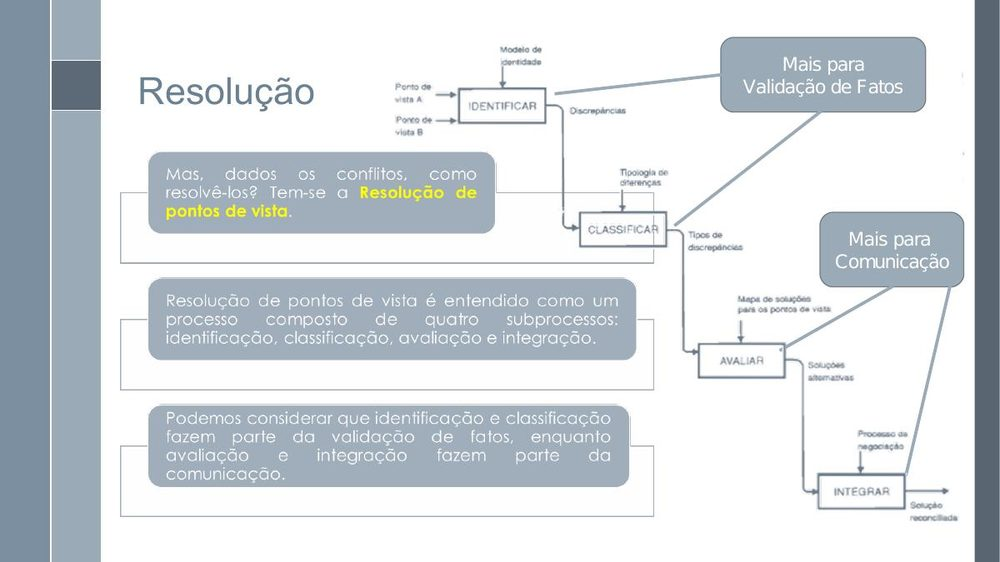

# Lista de Verificação – Personas

**Autoria:** Gabriel Robson Nunes Neiva da Silva · **Entrega 2**

## Tabela de contribuição

**Tabela 1 – Contribuições no trabalho "Lista de Verificação – Personas"**

| Integrante | Contribuição | Atividade (link) | Gravação (link) |
| --- | --- | --- | --- |
| Alexandre Vilar Valadares Fonsêca | Não se aplica (atividade individual) | — | — |
| Gabriel Robson Nunes Neiva da Silva | Autoria do trabalho (atividade individual) | Esta página | — |
| Henrique Schneider Fernandes da Rosa | Não se aplica (atividade individual) | — | — |
| João Vitor Tavares de Sá Lima | Não se aplica (atividade individual) | — | — |

Fonte: elaborado pelos autores (2026).

## Histórico de versões

**Tabela 2 – Histórico de versões do trabalho "Lista de Verificação – Personas"**

| Data | Versão | Descrição | Autor(es) | Revisor(es) |
| --- | --- | --- | --- | --- |
| 22/09/2026 | 1.0 | Elaboração do trabalho, entregue no Moodle (prazo da atividade no Moodle) | Gabriel Robson | — |
| 17/10/2026 | 1.1 | Publicação no site: transcrição, fotos das fontes, citações e referências no padrão da disciplina | Henrique Schneider | — |

Fonte: elaborado pelos autores (2026).

## 1. Introdução

Atividade individual do Moodle "Listas de verificação – Personas, Elenco de Personas, HTA e CTT", parte relativa a personas.

Cada item é uma pergunta autocontida, respondida com **Conforme**, **Não conforme** ou **Não se aplica**. Abaixo de cada item estão a fonte, com capítulo, seção e página, e a foto do trecho que o fundamenta, como pede a atividade de elaboração de listas de verificação (SALES, [2026], p. 1). Clique no título de cada figura para abrir a foto.

Os itens se fundamentam nos slides da aula 23 de Requisitos (Serrano e Serrano), que tratam de coleta de fatos, rastreabilidade, verificação, inspeção e validação, aplicados à inspeção do artefato. As fotos são dos slides citados.

## 2. Itens da lista

### Item 1

A Persona identifica explicitamente qual grupo de usuários ou parte interessada do projeto ela representa?

**Fonte:** Serrano e Serrano ([20--], slides 11–12, “Identificação de Partes”).

??? quote "Figura 1 – Trecho que fundamenta o item 1"

    

    Fonte: Serrano e Serrano ([20--], slides 11–12, “Identificação de Partes”).

### Item 2

A Persona apresenta informações que permitem identificar claramente a parte ou grupo de usuários representado, sem deixar indefinido quem é o público retratado?

**Fonte:** Serrano e Serrano ([20--], slides 11–12, “Identificação de Partes”).

??? quote "Figura 2 – Trecho que fundamenta o item 2"

    

    Fonte: Serrano e Serrano ([20--], slides 11–12, “Identificação de Partes”).

### Item 3

A Persona mantém registrado o vínculo entre as informações apresentadas e as fontes de informação utilizadas para obtê-las?

**Fonte:** Serrano e Serrano ([20--], slide 14, “Pré-rastreabilidade”).

??? quote "Figura 3 – Trecho que fundamenta o item 3"

    

    Fonte: Serrano e Serrano ([20--], slide 14, “Pré-rastreabilidade”).

### Item 4

As informações usadas para construir a Persona estão relacionadas ao universo de informações coletado durante a análise do projeto?

**Fonte:** Serrano e Serrano ([20--], slides 5 e 14, “Loop da Análise” e “Pré-rastreabilidade”).

??? quote "Figura 4 – Trecho que fundamenta o item 4"

    

    Fonte: Serrano e Serrano ([20--], slides 5 e 14, “Loop da Análise” e “Pré-rastreabilidade”).

### Item 5

A Persona foi construída a partir de fatos coletados sobre os usuários ou partes representadas, em vez de depender somente de informações não relacionadas ao processo de coleta de fatos?

**Fonte:** Serrano e Serrano ([20--], slide 5, “Loop da Análise”).

??? quote "Figura 5 – Trecho que fundamenta o item 5"

    

    Fonte: Serrano e Serrano ([20--], slide 5, “Loop da Análise”).

### Item 6

As informações apresentadas na Persona estão organizadas de forma compatível com o modelo utilizado no projeto, sem apresentar contradições evidentes com as informações coletadas?

**Fonte:** Serrano e Serrano ([20--], slide 16, “Verificação”).

??? quote "Figura 6 – Trecho que fundamenta o item 6"

    

    Fonte: Serrano e Serrano ([20--], slide 16, “Verificação”).

### Item 7

A Persona pode ser analisada segundo regras previamente definidas para verificar se seu conteúdo, sua organização e seus procedimentos de construção estão de acordo com o que foi especificado para o projeto?

**Fonte:** Serrano e Serrano ([20--], slide 16, “Verificação”).

??? quote "Figura 7 – Trecho que fundamenta o item 7"

    

    Fonte: Serrano e Serrano ([20--], slide 16, “Verificação”).

### Item 8

A Persona foi submetida a uma inspeção que permite verificar sistematicamente se o artefato apresenta problemas em relação aos critérios definidos para o projeto?

**Fonte:** Serrano e Serrano ([20--], slide 18, “Verificação com inspeções”).

??? quote "Figura 8 – Trecho que fundamenta o item 8"

    

    Fonte: Serrano e Serrano ([20--], slide 18, “Verificação com inspeções”).

### Item 9

A Persona foi validada considerando se as informações representadas correspondem às necessidades dos usuários que ela pretende representar?

**Fonte:** Serrano e Serrano ([20--], slide 46, “Em resumo”).

??? quote "Figura 9 – Trecho que fundamenta o item 9"

    

    Fonte: Serrano e Serrano ([20--], slide 46, “Em resumo”).

### Item 10

A validação da Persona inclui uma forma de comprovação informal para verificar se sua representação está de acordo com as informações e necessidades consideradas no projeto?

**Fonte:** Serrano e Serrano ([20--], slides 30–31, “Validação com comprovação informal”).

??? quote "Figura 10 – Trecho que fundamenta o item 10"

    

    Fonte: Serrano e Serrano ([20--], slides 30–31, “Validação com comprovação informal”).

### Item 11

Quando a Persona é utilizada durante a validação de uma solução, ela é considerada junto com protótipos ou outros modelos que permitam analisar a adequação da solução às necessidades dos usuários?

**Fonte:** Serrano e Serrano ([20--], slides 32–33, “Validação com prototipação”).

??? quote "Figura 11 – Trecho que fundamenta o item 11"

    

    Fonte: Serrano e Serrano ([20--], slides 32–33, “Validação com prototipação”).

### Item 12

A Persona considera diferentes pontos de vista relevantes para o projeto quando esses pontos de vista podem contribuir para a comunicação ou para a resolução e validação dos fatos?

**Fonte:** Serrano e Serrano ([20--], slides 35–40, “Análise de Pontos de Vista”).

??? quote "Figura 12 – Trecho que fundamenta o item 12"

    

    Fonte: Serrano e Serrano ([20--], slides 35–40, “Análise de Pontos de Vista”).

## Referências

SALES, André Barros de. *Lista de Exercícios*: elaborar listas de verificação. Brasília: Universidade de Brasília, [2026]. Enunciado da atividade avaliativa Verificação 2.

SALES, André Barros de. *Plano de Ensino*: Interação Humano Computador (FGA0173), 02/2026, Turma 01, v1. Brasília: Universidade de Brasília, 2026.

SERRANO, Milene; SERRANO, Maurício. *Requisitos*: aula 23: análise, verificação e validação. Brasília: Universidade de Brasília, [20--]. 52 slides.

## Agradecimentos e uso de IA generativa

**Uso de IA generativa nesta página.** O Claude (Anthropic) foi utilizado na transcrição do documento original para o site e na padronização da formatação, das legendas, das citações e das referências às normas da disciplina. O conteúdo do trabalho é de Gabriel Robson, indicado(a) na tabela de contribuição. A ferramenta não é autora do artefato e seu uso não exime os autores da responsabilidade sobre o conteúdo (SALES, 2026, p. 3).
