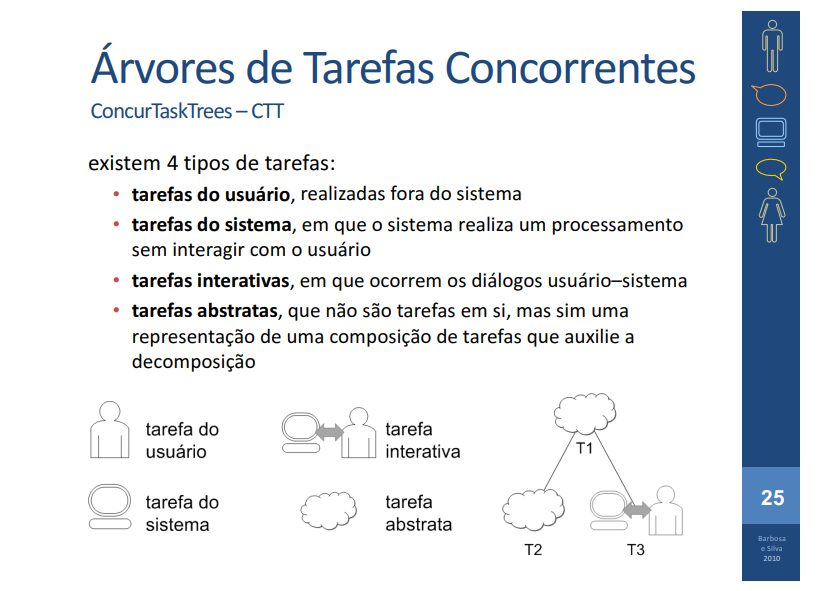
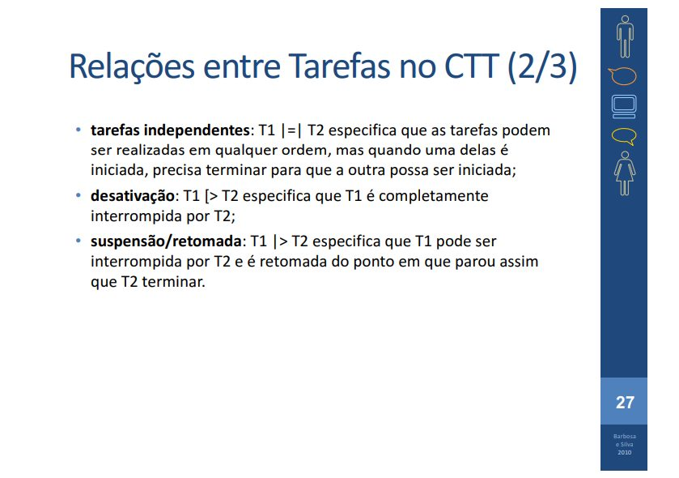

# Lista de Verificação – Árvores de Tarefas Concorrentes (CTT)

**Autoria:** João Vitor Tavares de Sá Lima · **Entrega 2**

## Tabela de contribuição

**Tabela 1 – Contribuições no trabalho "Lista de Verificação – Árvores de Tarefas Concorrentes (CTT)"**

| Integrante | Contribuição | Atividade (link) | Gravação (link) |
| --- | --- | --- | --- |
| Alexandre Vilar Valadares Fonsêca | Não se aplica (atividade individual) | — | — |
| Gabriel Robson Nunes Neiva da Silva | Não se aplica (atividade individual) | — | — |
| Henrique Schneider Fernandes da Rosa | Não se aplica (atividade individual) | — | — |
| João Vitor Tavares de Sá Lima | Autoria do trabalho (atividade individual) | Esta página | — |

Fonte: elaborado pelos autores (2026).

## Histórico de versões

**Tabela 2 – Histórico de versões do trabalho "Lista de Verificação – Árvores de Tarefas Concorrentes (CTT)"**

| Data | Versão | Descrição | Autor(es) | Revisor(es) |
| --- | --- | --- | --- | --- |
| 21/09/2026 | 1.0 | Elaboração do trabalho, entregue no Moodle (data do arquivo entregue) | João Vitor | — |
| 17/10/2026 | 1.1 | Publicação no site: transcrição, fotos das fontes, citações e referências no padrão da disciplina | Henrique Schneider | — |

Fonte: elaborado pelos autores (2026).

## 1. Introdução

Atividade individual do Moodle "Listas de verificação – Personas, Elenco de Personas, HTA e CTT", parte relativa às Árvores de Tarefas Concorrentes (CTT).

Cada item é uma pergunta autocontida, respondida com **Conforme**, **Não conforme** ou **Não se aplica**. Abaixo de cada item estão a fonte, com capítulo, seção e página, e a foto do trecho que o fundamenta, como pede a atividade de elaboração de listas de verificação (SALES, [2026], p. 1). Clique no título de cada figura para abrir a foto.

## 2. Itens da lista

### Item 1

A árvore CTT utiliza o símbolo correto de tarefa do usuário (um boneco) para toda tarefa realizada fora do sistema, sem envolver processamento ou interação com o computador?

**Fonte:** Barbosa e Silva (2010), slides do cap. 6, slide 25.

??? quote "Figura 1 – Trecho que fundamenta o item 1"

    

    Fonte: Barbosa e Silva (2010), slides do cap. 6, slide 25.

### Item 2

A árvore CTT utiliza o símbolo correto de tarefa do sistema (uma tela) para toda tarefa em que o sistema realiza um processamento sem interagir com o usuário?

**Fonte:** Barbosa e Silva (2010), slides do cap. 6, slide 25.

??? quote "Figura 2 – Trecho que fundamenta o item 2"

    

    Fonte: Barbosa e Silva (2010), slides do cap. 6, slide 25.

### Item 3

A árvore CTT utiliza o símbolo correto de tarefa interativa (um boneco e uma tela) para toda tarefa em que ocorre um diálogo entre usuário e sistema?

**Fonte:** Barbosa e Silva (2010), slides do cap. 6, slide 25.

??? quote "Figura 3 – Trecho que fundamenta o item 3"

    

    Fonte: Barbosa e Silva (2010), slides do cap. 6, slide 25.

### Item 4

A árvore CTT utiliza o símbolo correto de tarefa abstrata (uma nuvem) apenas para representar uma composição/decomposição de tarefas, e não uma tarefa executável em si?

**Fonte:** Barbosa e Silva (2010), slides do cap. 6, slide 25.

??? quote "Figura 4 – Trecho que fundamenta o item 4"

    

    Fonte: Barbosa e Silva (2010), slides do cap. 6, slide 25.

### Item 5

Nos pontos da árvore em que uma tarefa só pode começar depois que a outra termina, foi utilizada a relação de ativação (T1 >> T2)?

**Fonte:** Barbosa e Silva (2010), slides do cap. 6, slide 27.

??? quote "Figura 5 – Trecho que fundamenta o item 5"

    

    Fonte: Barbosa e Silva (2010), slides do cap. 6, slide 27.

### Item 6

Nos pontos da árvore em que, além de uma tarefa só poder começar depois que a outra termina, a informação produzida pela primeira tarefa é necessária para a segunda, foi utilizada a relação de ativação com passagem de informação (T1 []>> T2)?

**Fonte:** Barbosa e Silva (2010), slides do cap. 6, slide 27.

??? quote "Figura 6 – Trecho que fundamenta o item 6"

    

    Fonte: Barbosa e Silva (2010), slides do cap. 6, slide 27.

### Item 7

Nos pontos da árvore em que duas tarefas estão disponíveis ao mesmo tempo, mas o início de uma desabilita a outra, foi utilizada a relação de escolha (T1 [] T2)?

**Fonte:** Barbosa e Silva (2010), slides do cap. 6, slide 27.

??? quote "Figura 7 – Trecho que fundamenta o item 7"

    

    Fonte: Barbosa e Silva (2010), slides do cap. 6, slide 27.

### Item 8

Nos pontos da árvore em que as tarefas podem ser realizadas em qualquer ordem ou ao mesmo tempo, sem trocar informações entre si, foi utilizada a relação de tarefas concorrentes (T1 ||| T2)?

**Fonte:** Barbosa e Silva (2010), slides do cap. 6, slide 27.

??? quote "Figura 8 – Trecho que fundamenta o item 8"

    

    Fonte: Barbosa e Silva (2010), slides do cap. 6, slide 27.

### Item 9

Nos pontos da árvore em que as tarefas podem ser realizadas em qualquer ordem ou ao mesmo tempo E podem trocar informações entre si, foi utilizada a relação de tarefas concorrentes e comunicantes (T1 |[]| T2)?

**Fonte:** Barbosa e Silva (2010), slides do cap. 6, slide 27.

??? quote "Figura 9 – Trecho que fundamenta o item 9"

    

    Fonte: Barbosa e Silva (2010), slides do cap. 6, slide 27.

## Referências

BARBOSA, Simone Diniz Junqueira; SILVA, Bruno Santana da. *Organização do espaço de problema*: slides do capítulo 6 de *Interação Humano-Computador*. Rio de Janeiro: Elsevier, 2010. 30 slides.

SALES, André Barros de. *Lista de Exercícios*: elaborar listas de verificação. Brasília: Universidade de Brasília, [2026]. Enunciado da atividade avaliativa Verificação 2.

SALES, André Barros de. *Plano de Ensino*: Interação Humano Computador (FGA0173), 02/2026, Turma 01, v1. Brasília: Universidade de Brasília, 2026.

## Agradecimentos e uso de IA generativa

**Uso de IA generativa nesta página.** O Claude (Anthropic) foi utilizado na transcrição do documento original para o site e na padronização da formatação, das legendas, das citações e das referências às normas da disciplina. O conteúdo do trabalho é de João Vitor, indicado(a) na tabela de contribuição. A ferramenta não é autora do artefato e seu uso não exime os autores da responsabilidade sobre o conteúdo (SALES, 2026, p. 3).
