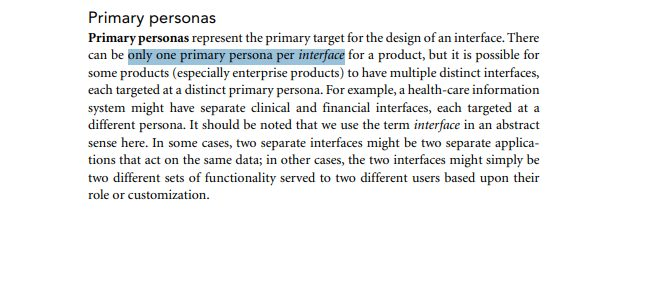
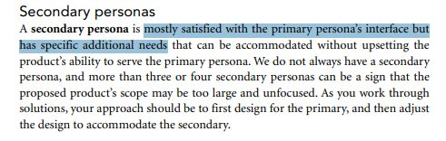
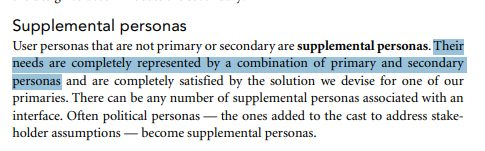
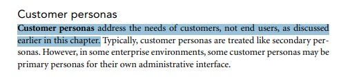
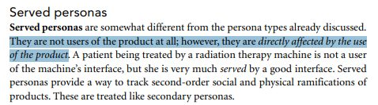
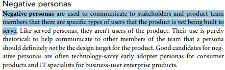

# Lista de Verificação – Elenco de Personas

**Autoria:** João Vitor Tavares de Sá Lima · **Entrega 2**

## Tabela de contribuição

**Tabela 1 – Contribuições no trabalho "Lista de Verificação – Elenco de Personas"**

| Integrante | Contribuição | Atividade (link) | Gravação (link) |
| --- | --- | --- | --- |
| Alexandre Vilar Valadares Fonsêca | Não se aplica (atividade individual) | — | — |
| Gabriel Robson Nunes Neiva da Silva | Não se aplica (atividade individual) | — | — |
| Henrique Schneider Fernandes da Rosa | Não se aplica (atividade individual) | — | — |
| João Vitor Tavares de Sá Lima | Autoria do trabalho (atividade individual) | Esta página | — |

Fonte: elaborado pelos autores (2026).

## Histórico de versões

**Tabela 2 – Histórico de versões do trabalho "Lista de Verificação – Elenco de Personas"**

| Data | Versão | Descrição | Autor(es) | Revisor(es) |
| --- | --- | --- | --- | --- |
| 21/09/2026 | 1.0 | Elaboração do trabalho, entregue no Moodle (data do arquivo entregue) | João Vitor | — |
| 17/10/2026 | 1.1 | Publicação no site: transcrição, fotos das fontes, citações e referências no padrão da disciplina | Henrique Schneider | — |

Fonte: elaborado pelos autores (2026).

## 1. Introdução

Atividade individual do Moodle "Listas de verificação – Personas, Elenco de Personas, HTA e CTT", parte relativa ao elenco de personas.

Cada item é uma pergunta autocontida, respondida com **Conforme**, **Não conforme** ou **Não se aplica**. Abaixo de cada item estão a fonte, com capítulo, seção e página, e a foto do trecho que o fundamenta, como pede a atividade de elaboração de listas de verificação (SALES, [2026], p. 1). Clique no título de cada figura para abrir a foto.

## 2. Itens da lista

### Item 1

O elenco de personas indica claramente qual é a persona primária do projeto, ou seja, aquela cuja interface deve satisfazer completamente as necessidades e que serve de alvo principal do design (havendo, no máximo, uma persona primária por interface do produto)?

**Fonte:** Cooper, Reimann e Cronin (2007), cap. 5, “Designate Persona Types”, p. 104–105.

??? quote "Figura 1 – Trecho que fundamenta o item 1"

    

    Fonte: Cooper, Reimann e Cronin (2007), cap. 5, “Designate Persona Types”, p. 104–105.

### Item 2

O elenco de personas identifica as personas secundárias, isto é, personas cujas necessidades são majoritariamente atendidas pela interface projetada para a persona primária, mas que possuem necessidades adicionais específicas que também precisam ser consideradas no design?

**Fonte:** Cooper, Reimann e Cronin (2007), cap. 5, “Designate Persona Types”, p. 105.

??? quote "Figura 2 – Trecho que fundamenta o item 2"

    

    Fonte: Cooper, Reimann e Cronin (2007), cap. 5, “Designate Persona Types”, p. 105.

### Item 3

O elenco de personas identifica as personas suplementares, ou seja, personas que não são primárias nem secundárias, cujas necessidades já estão completamente cobertas pela combinação das personas primária e secundárias, e que não representam um grande número de usuários?

**Fonte:** Cooper, Reimann e Cronin (2007), cap. 5, “Designate Persona Types”, p. 105.

??? quote "Figura 3 – Trecho que fundamenta o item 3"

    

    Fonte: Cooper, Reimann e Cronin (2007), cap. 5, “Designate Persona Types”, p. 105.

### Item 4

O elenco de personas identifica a(s) persona(s) cliente, isto é, pessoa(s) que não utilizam diretamente o sistema, mas são responsáveis por adquirir, contratar ou especificar o produto (ex.: um gestor de TI que compra o software para a empresa)?

**Fonte:** Cooper, Reimann e Cronin (2007), cap. 5, “Designate Persona Types”, p. 105.

??? quote "Figura 4 – Trecho que fundamenta o item 4"

    

    Fonte: Cooper, Reimann e Cronin (2007), cap. 5, “Designate Persona Types”, p. 105.

### Item 5

O elenco de personas identifica a(s) persona(s) atendida(s), isto é, pessoa(s) que são diretamente afetadas pelo uso do sistema, mesmo sem interagir com sua interface (ex.: um paciente atendido por meio de um equipamento de radioterapia operado por um profissional de saúde)?

**Fonte:** Cooper, Reimann e Cronin (2007), cap. 5, “Designate Persona Types”, p. 106.

??? quote "Figura 5 – Trecho que fundamenta o item 5"

    

    Fonte: Cooper, Reimann e Cronin (2007), cap. 5, “Designate Persona Types”, p. 106.

### Item 6

O elenco de personas apresenta ao menos uma persona negativa (anti-persona), isto é, uma persona criada apenas para comunicar à equipe que um tipo específico de usuário NÃO é o alvo do projeto (ex.: um usuário avançado/early adopter para um produto de consumo, ou um especialista em TI para um sistema corporativo voltado a usuários finais)?

**Fonte:** Cooper, Reimann e Cronin (2007), cap. 5, “Designate Persona Types”, p. 106.

??? quote "Figura 6 – Trecho que fundamenta o item 6"

    

    Fonte: Cooper, Reimann e Cronin (2007), cap. 5, “Designate Persona Types”, p. 106.

## Referências

COOPER, Alan; REIMANN, Robert; CRONIN, David. *About Face 3*: the essentials of interaction design. Indianapolis: Wiley, 2007.

SALES, André Barros de. *Lista de Exercícios*: elaborar listas de verificação. Brasília: Universidade de Brasília, [2026]. Enunciado da atividade avaliativa Verificação 2.

SALES, André Barros de. *Plano de Ensino*: Interação Humano Computador (FGA0173), 02/2026, Turma 01, v1. Brasília: Universidade de Brasília, 2026.

## Agradecimentos e uso de IA generativa

**Uso de IA generativa nesta página.** O Claude (Anthropic) foi utilizado na transcrição do documento original para o site e na padronização da formatação, das legendas, das citações e das referências às normas da disciplina. O conteúdo do trabalho é de João Vitor, indicado(a) na tabela de contribuição. A ferramenta não é autora do artefato e seu uso não exime os autores da responsabilidade sobre o conteúdo (SALES, 2026, p. 3).
