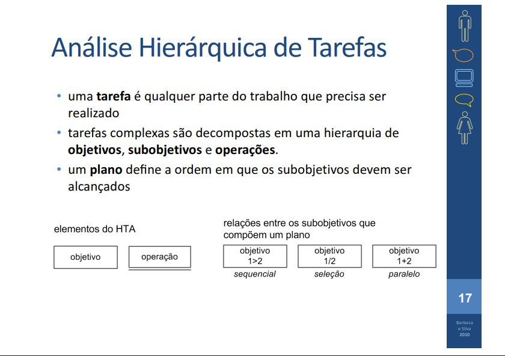
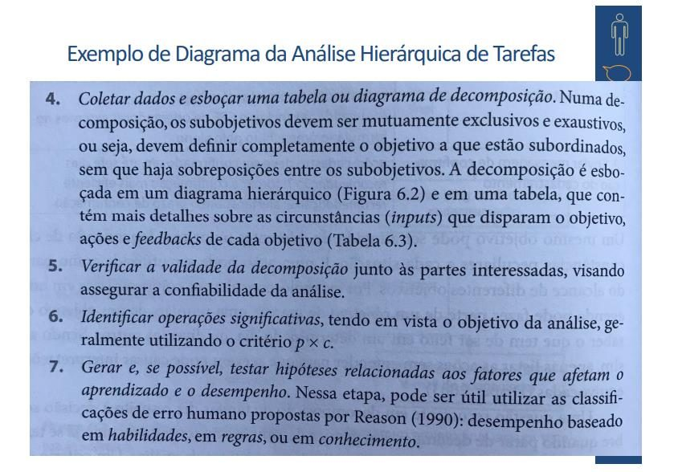
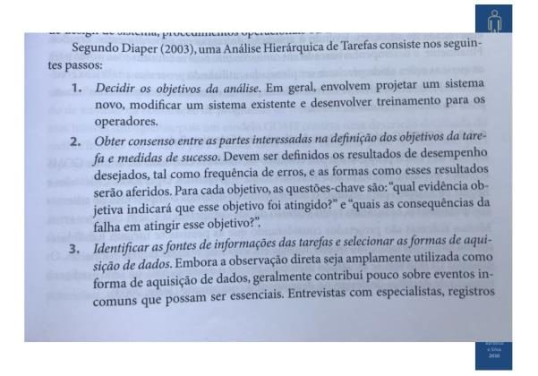
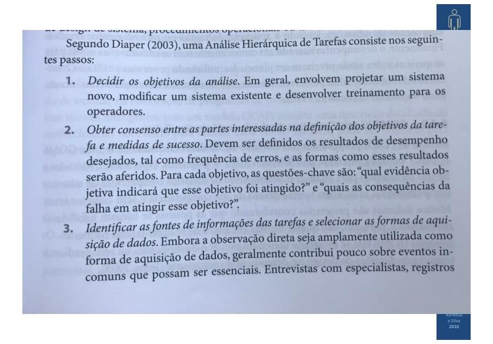
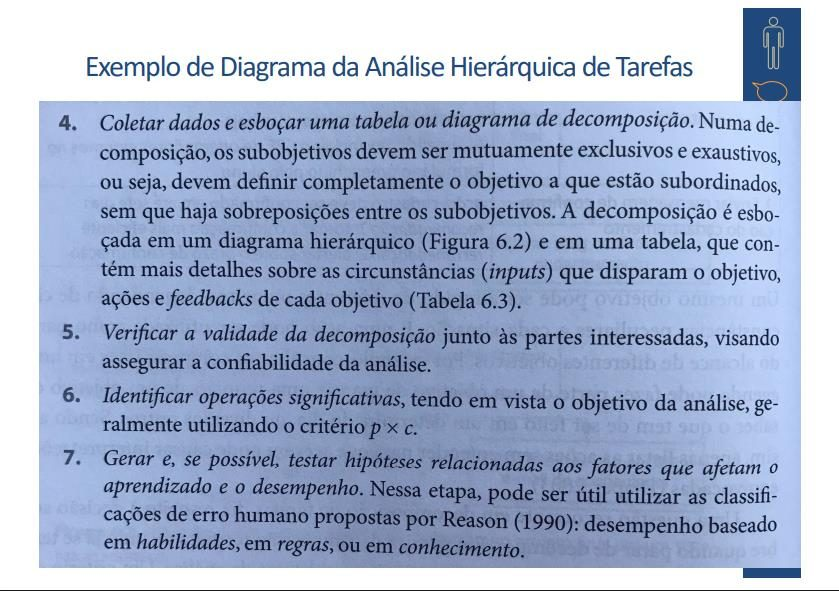
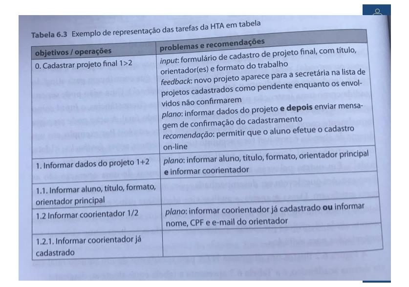

# Lista de Verificação – Análise Hierárquica de Tarefas (HTA)

**Autoria:** João Vitor Tavares de Sá Lima · **Entrega 2**

## Tabela de contribuição

**Tabela 1 – Contribuições no trabalho "Lista de Verificação – Análise Hierárquica de Tarefas (HTA)"**

| Integrante | Contribuição | Atividade (link) | Gravação (link) |
| --- | --- | --- | --- |
| Alexandre Vilar Valadares Fonsêca | Não se aplica (atividade individual) | — | — |
| Gabriel Robson Nunes Neiva da Silva | Não se aplica (atividade individual) | — | — |
| Henrique Schneider Fernandes da Rosa | Não se aplica (atividade individual) | — | — |
| João Vitor Tavares de Sá Lima | Autoria do trabalho (atividade individual) | Esta página | — |

Fonte: elaborado pelos autores (2026).

## Histórico de versões

**Tabela 2 – Histórico de versões do trabalho "Lista de Verificação – Análise Hierárquica de Tarefas (HTA)"**

| Data | Versão | Descrição | Autor(es) | Revisor(es) |
| --- | --- | --- | --- | --- |
| 21/09/2026 | 1.0 | Elaboração do trabalho, entregue no Moodle (data do arquivo entregue) | João Vitor | — |
| 17/10/2026 | 1.1 | Publicação no site: transcrição, fotos das fontes, citações e referências no padrão da disciplina | Henrique Schneider | — |

Fonte: elaborado pelos autores (2026).

## 1. Introdução

Atividade individual do Moodle "Listas de verificação – Personas, Elenco de Personas, HTA e CTT", parte relativa à Análise Hierárquica de Tarefas (HTA).

Cada item é uma pergunta autocontida, respondida com **Conforme**, **Não conforme** ou **Não se aplica**. Abaixo de cada item estão a fonte, com capítulo, seção e página, e a foto do trecho que o fundamenta, como pede a atividade de elaboração de listas de verificação (SALES, [2026], p. 1). Clique no título de cada figura para abrir a foto.

## 2. Itens da lista

### Item 1

A decomposição hierárquica utiliza corretamente os dois elementos do HTA: objetivo (retângulo simples, que pode ser decomposto em subobjetivos) e operação (retângulo sublinhado, que representa uma ação final, não decomposta)?

**Fonte:** Barbosa e Silva (2010), slides do cap. 6, slide 17.

??? quote "Figura 1 – Trecho que fundamenta o item 1"

    

    Fonte: Barbosa e Silva (2010), slides do cap. 6, slide 17.

### Item 2

Para cada objetivo decomposto em subobjetivos, foi indicado explicitamente o tipo de plano que rege a execução entre eles: sequencial (1>2 – um subobjetivo é realizado após o outro), seleção (1/2 – apenas um dos subobjetivos é realizado) ou paralelo (1+2 – os subobjetivos podem ser realizados ao mesmo tempo)?

**Fonte:** Barbosa e Silva (2010), slides do cap. 6, slide 17.

??? quote "Figura 2 – Trecho que fundamenta o item 2"

    

    Fonte: Barbosa e Silva (2010), slides do cap. 6, slide 17.

### Item 3

Os subobjetivos que compõem um mesmo objetivo são mutuamente exclusivos e exaustivos, ou seja, definem completamente o objetivo do qual fazem parte, sem que haja sobreposição de conteúdo entre eles?

**Fonte:** Barbosa e Silva (2010), slides do cap. 6, slides 20–21.

??? quote "Figura 3 – Trecho que fundamenta o item 3"

    

    Fonte: Barbosa e Silva (2010), slides do cap. 6, slides 20–21.

??? quote "Figura 4 – Trecho que fundamenta o item 3"

    

    Fonte: Barbosa e Silva (2010), slides do cap. 6, slides 20–21.

### Item 4

O documento indica que os objetivos da análise foram decididos previamente, esclarecendo se a HTA visa projetar um sistema novo, modificar um sistema existente ou desenvolver treinamento para os operadores?

**Fonte:** Barbosa e Silva (2010), slides do cap. 6, slide 20.

??? quote "Figura 5 – Trecho que fundamenta o item 4"

    

    Fonte: Barbosa e Silva (2010), slides do cap. 6, slide 20.

### Item 5

O documento indica que houve consenso entre as partes interessadas sobre os objetivos da tarefa e sobre as medidas de sucesso desejadas (ex.: frequência de erros aceitável) antes da realização da decomposição?

**Fonte:** Barbosa e Silva (2010), slides do cap. 6, slide 20.

??? quote "Figura 6 – Trecho que fundamenta o item 5"

    

    Fonte: Barbosa e Silva (2010), slides do cap. 6, slide 20.

### Item 7

O documento indica que a validade da decomposição hierárquica foi verificada junto às partes interessadas, com o objetivo de assegurar a confiabilidade da análise?

**Fonte:** Barbosa e Silva (2010), slides do cap. 6, slide 21.

??? quote "Figura 7 – Trecho que fundamenta o item 7"

    

    Fonte: Barbosa e Silva (2010), slides do cap. 6, slide 21.

### Item 8

O documento indica que as operações consideradas significativas para a análise foram identificadas com base no critério p × c, isto é, a probabilidade de ocorrência de um erro multiplicada pelo custo/consequência desse erro?

**Fonte:** Barbosa e Silva (2010), slides do cap. 6, slide 21.

??? quote "Figura 8 – Trecho que fundamenta o item 8"

    

    Fonte: Barbosa e Silva (2010), slides do cap. 6, slide 21.

### Item 9

Além do diagrama hierárquico, o documento apresenta uma tabela complementar para cada objetivo/operação, contendo informações como input (o que dispara o objetivo), feedback, plano de execução e recomendações de melhoria?

**Fonte:** Barbosa e Silva (2010), slides do cap. 6, slide 19.

??? quote "Figura 9 – Trecho que fundamenta o item 9"

    

    Fonte: Barbosa e Silva (2010), slides do cap. 6, slide 19.

### Item 10

O documento indica que foram levantadas hipóteses sobre os fatores que afetam o aprendizado e o desempenho do usuário, classificando os possíveis erros humanos em baseados em habilidades, em regras ou em conhecimento, conforme a classificação de Reason (1990)?

**Fonte:** Barbosa e Silva (2010), slides do cap. 6, slide 21.

??? quote "Figura 10 – Trecho que fundamenta o item 10"

    

    Fonte: Barbosa e Silva (2010), slides do cap. 6, slide 21.

## Referências

BARBOSA, Simone Diniz Junqueira; SILVA, Bruno Santana da. *Organização do espaço de problema*: slides do capítulo 6 de *Interação Humano-Computador*. Rio de Janeiro: Elsevier, 2010. 30 slides.

SALES, André Barros de. *Lista de Exercícios*: elaborar listas de verificação. Brasília: Universidade de Brasília, [2026]. Enunciado da atividade avaliativa Verificação 2.

SALES, André Barros de. *Plano de Ensino*: Interação Humano Computador (FGA0173), 02/2026, Turma 01, v1. Brasília: Universidade de Brasília, 2026.

## Agradecimentos e uso de IA generativa

**Uso de IA generativa nesta página.** O Claude (Anthropic) foi utilizado na transcrição do documento original para o site e na padronização da formatação, das legendas, das citações e das referências às normas da disciplina. O conteúdo do trabalho é de João Vitor, indicado(a) na tabela de contribuição. A ferramenta não é autora do artefato e seu uso não exime os autores da responsabilidade sobre o conteúdo (SALES, 2026, p. 3).
