# Lista de Verificação – Perfil de Usuário

**Autoria:** João Vitor Tavares de Sá Lima · **Entrega 2**

## Tabela de contribuição

**Tabela 1 – Contribuições no trabalho "Lista de Verificação – Perfil de Usuário"**

| Integrante | Contribuição | Atividade (link) | Gravação (link) |
| --- | --- | --- | --- |
| Alexandre Vilar Valadares Fonsêca | Não se aplica (atividade individual) | — | — |
| Gabriel Robson Nunes Neiva da Silva | Não se aplica (atividade individual) | — | — |
| Henrique Schneider Fernandes da Rosa | Não se aplica (atividade individual) | — | — |
| João Vitor Tavares de Sá Lima | Autoria do trabalho (atividade individual) | Esta página | — |

Fonte: elaborado pelos autores (2026).

## Histórico de versões

**Tabela 2 – Histórico de versões do trabalho "Lista de Verificação – Perfil de Usuário"**

| Data | Versão | Descrição | Autor(es) | Revisor(es) |
| --- | --- | --- | --- | --- |
| 15/09/2026 | 1.0 | Elaboração do trabalho, entregue no Moodle (data do arquivo entregue) | João Vitor | — |
| 17/10/2026 | 1.1 | Publicação no site: transcrição, fotos das fontes, citações e referências no padrão da disciplina | Henrique Schneider | — |

Fonte: elaborado pelos autores (2026).

## 1. Introdução

Atividade individual do Moodle "Lista de verificação – Perfil de Usuário": elaborar itens para inspecionar o artefato de perfil de usuário e a coleta de dados que o fundamenta.

Cada item é uma pergunta autocontida, respondida com **Conforme**, **Não conforme** ou **Não se aplica**. Abaixo de cada item estão a fonte, com capítulo, seção e página, e a foto do trecho que o fundamenta, como pede a atividade de elaboração de listas de verificação (SALES, [2026], p. 1). Clique no título de cada figura para abrir a foto.

Os itens seguem o capítulo 7 da edição de 2021 do livro de Barbosa e colaboradores. Para cada item, a figura mostra o trecho correspondente na edição de 2010 (Barbosa e Silva, cap. 5), que traz o mesmo conteúdo.

## 2. Itens da lista

### Seção 7.2 – Que dados coletar?

#### Item 1

O documento apresenta dados demográficos dos usuários, tais como idade, sexo e status socioeconômico?

**Fonte:** Barbosa et al. (2021, cap. 7, seç. 7.2).

??? quote "Figura 1 – Trecho correspondente ao item 1 na edição de 2010"

    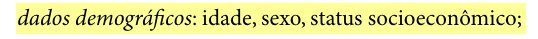

    Fonte: Barbosa e Silva (2010, cap. 5, seç. 5.2, p. 134).

#### Item 2

O documento descreve a experiência do usuário no cargo que ocupa, incluindo cargo atual, tempo na empresa, responsabilidades, cargos anteriores e plano de carreira?

**Fonte:** Barbosa et al. (2021, cap. 7, seç. 7.2).

??? quote "Figura 2 – Trecho correspondente ao item 2 na edição de 2010"

    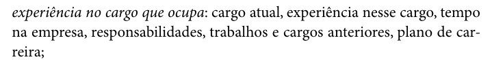

    Fonte: Barbosa e Silva (2010, cap. 5, seç. 5.2, p. 134).

#### Item 3

O documento apresenta informações sobre a empresa em que o usuário atua, como tamanho da empresa e área de atuação?

**Fonte:** Barbosa et al. (2021, cap. 7, seç. 7.2).

??? quote "Figura 3 – Trecho correspondente ao item 3 na edição de 2010"

    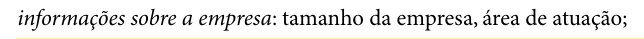

    Fonte: Barbosa e Silva (2010, cap. 5, seç. 5.2, p. 134).

#### Item 4

O documento descreve a educação do usuário, incluindo grau de instrução, área de formação, cursos realizados e nível de alfabetismo (facilidade de leitura de textos)?

**Fonte:** Barbosa et al. (2021, cap. 7, seç. 7.2).

??? quote "Figura 4 – Trecho correspondente ao item 4 na edição de 2010"

    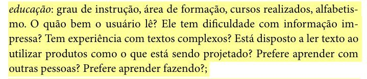

    Fonte: Barbosa e Silva (2010, cap. 5, seç. 5.2, p. 134).

#### Item 5

O documento descreve a experiência do usuário com computadores, incluindo alfabetismo computacional, habilidade e anos de experiência, além dos sistemas e hardwares que costuma utilizar?

**Fonte:** Barbosa et al. (2021, cap. 7, seç. 7.2).

??? quote "Figura 5 – Trecho correspondente ao item 5 na edição de 2010"

    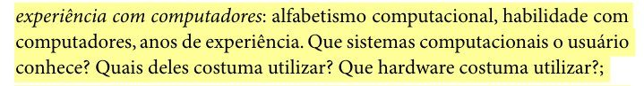

    Fonte: Barbosa e Silva (2010, cap. 5, seç. 5.2, p. 134).

#### Item 6

O documento descreve a experiência do usuário com um produto específico ou com ferramentas semelhantes, incluindo experiência com produtos concorrentes, hábitos de uso, preferências e descontentamentos?

**Fonte:** Barbosa et al. (2021, cap. 7, seç. 7.2).

??? quote "Figura 6 – Trecho correspondente ao item 6 na edição de 2010"

    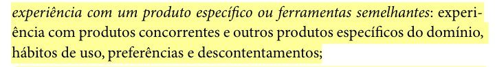

    Fonte: Barbosa e Silva (2010, cap. 5, seç. 5.2, p. 134).

#### Item 7

O documento relaciona a tecnologia disponível ao usuário, incluindo hardware (tamanho e resolução de tela, velocidade de processamento etc.), software e outras ferramentas a que tem acesso?

**Fonte:** Barbosa et al. (2021, cap. 7, seç. 7.2).

??? quote "Figura 7 – Trecho correspondente ao item 7 na edição de 2010"

    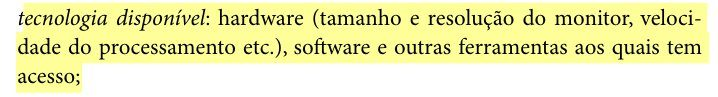

    Fonte: Barbosa e Silva (2010, cap. 5, seç. 5.2, p. 134).

#### Item 8

O documento indica o quanto o usuário valoriza treinamento e qual estilo de aprendizado prefere (visual, auditivo ou outro)?

**Fonte:** Barbosa et al. (2021, cap. 7, seç. 7.2).

??? quote "Figura 8 – Trecho correspondente ao item 8 na edição de 2010"

    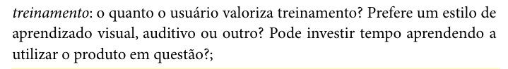

    Fonte: Barbosa e Silva (2010, cap. 5, seç. 5.2, p. 135).

#### Item 9

O documento descreve as atitudes e os valores do usuário em relação à tecnologia, indicando se ele costuma assumir riscos e explorar novidades ou se prefere caminhos já testados?

**Fonte:** Barbosa et al. (2021, cap. 7, seç. 7.2).

??? quote "Figura 9 – Trecho correspondente ao item 9 na edição de 2010"

    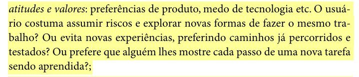

    Fonte: Barbosa e Silva (2010, cap. 5, seç. 5.2, p. 135).

#### Item 10

O documento indica o conhecimento do usuário sobre o domínio em questão, apontando se ele é ou está próximo de se tornar um especialista no assunto?

**Fonte:** Barbosa et al. (2021, cap. 7, seç. 7.2).

??? quote "Figura 10 – Trecho correspondente ao item 10 na edição de 2010"

    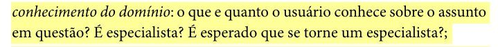

    Fonte: Barbosa e Silva (2010, cap. 5, seç. 5.2, p. 135).

#### Item 11

O documento apresenta os objetivos principais do usuário e como eles são alcançados atualmente?

**Fonte:** Barbosa et al. (2021, cap. 7, seç. 7.2).

??? quote "Figura 11 – Trecho correspondente ao item 11 na edição de 2010"

    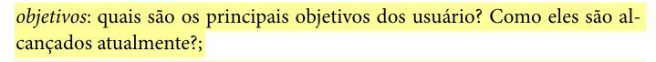

    Fonte: Barbosa e Silva (2010, cap. 5, seç. 5.2, p. 135).

#### Item 12

O documento descreve as tarefas do usuário que precisam ser apoiadas, indicando quais são primárias e quais são secundárias, e se são frequentes, infrequentes ou inovadoras?

**Fonte:** Barbosa et al. (2021, cap. 7, seç. 7.2).

??? quote "Figura 12 – Trecho correspondente ao item 12 na edição de 2010"

    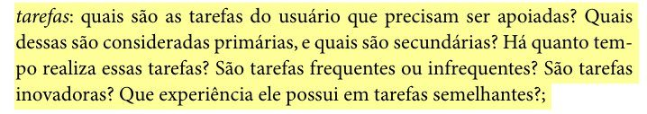

    Fonte: Barbosa e Silva (2010, cap. 5, seç. 5.2, p. 135).

#### Item 13

O documento indica a gravidade dos erros do usuário, isto é, as possíveis consequências negativas caso ele cometa um erro ao usar o sistema?

**Fonte:** Barbosa et al. (2021, cap. 7, seç. 7.2).

??? quote "Figura 13 – Trecho correspondente ao item 13 na edição de 2010"

    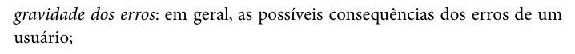

    Fonte: Barbosa e Silva (2010, cap. 5, seç. 5.2, p. 135).

#### Item 14

O documento descreve a motivação do usuário para o trabalho, indicando se ele se limita à carga horária ou se busca ir além por prazer, ambição ou interação social?

**Fonte:** Barbosa et al. (2021, cap. 7, seç. 7.2).

??? quote "Figura 14 – Trecho correspondente ao item 14 na edição de 2010"

    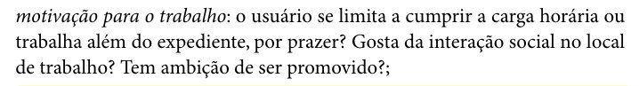

    Fonte: Barbosa e Silva (2010, cap. 5, seç. 5.2, p. 135).

#### Item 15

O documento indica os idiomas e jargões que o usuário conhece e utiliza fluentemente, incluindo vocabulário próprio da empresa, da atividade ou de algum grupo social relevante?

**Fonte:** Barbosa et al. (2021, cap. 7, seç. 7.2).

??? quote "Figura 15 – Trecho correspondente ao item 15 na edição de 2010"

    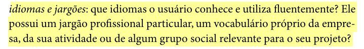

    Fonte: Barbosa e Silva (2010, cap. 5, seç. 5.2, p. 135).

### Seção 7.3 – De quem coletar dados?

#### Item 16

O documento identifica os usuários finais primários, isto é, aqueles que utilizarão o produto regularmente?

**Fonte:** Barbosa et al. (2021, cap. 7, seç. 7.3).

??? quote "Figura 16 – Trecho correspondente ao item 16 na edição de 2010"

    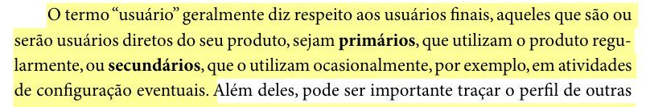

    Fonte: Barbosa e Silva (2010, cap. 5, seç. 5.3, p. 136).

#### Item 17

O documento identifica os usuários finais secundários, isto é, aqueles que utilizarão o produto apenas ocasionalmente (ex.: em atividades de configuração eventuais)?

**Fonte:** Barbosa et al. (2021, cap. 7, seç. 7.3).

??? quote "Figura 17 – Trecho correspondente ao item 17 na edição de 2010"

    

    Fonte: Barbosa e Silva (2010, cap. 5, seç. 5.3, p. 136).

#### Item 18

O documento identifica outras partes interessadas (stakeholders) que não utilizam o produto diretamente, mas que são afetadas pelo seu uso (ex.: pessoas que recebem informações ou artefatos resultantes do uso do produto)?

**Fonte:** Barbosa et al. (2021, cap. 7, seç. 7.3).

??? quote "Figura 18 – Trecho correspondente ao item 18 na edição de 2010"

    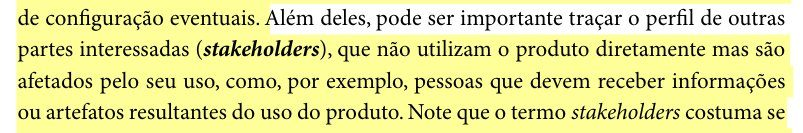

    Fonte: Barbosa e Silva (2010, cap. 5, seç. 5.3, p. 136).

#### Item 19

Caso o projeto seja de melhoria ou expansão de um sistema existente, o documento identifica quem projetou, documentou, dá treinamento, dá suporte ou faz a manutenção do sistema atual?

**Fonte:** Barbosa et al. (2021, cap. 7, seç. 7.3).

??? quote "Figura 19 – Trecho correspondente ao item 19 na edição de 2010"

    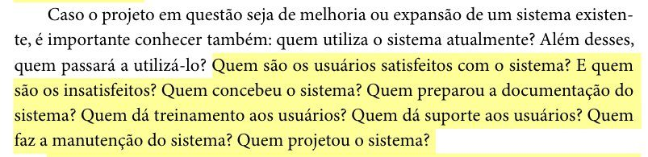

    Fonte: Barbosa e Silva (2010, cap. 5, seç. 5.3, p. 136).

#### Item 20

O documento indica se foram utilizadas fontes adicionais de dados sobre o produto, como feedback de usuários já registrado, arquivos de log, análise competitiva ou documentação de processos e normas?

**Fonte:** Barbosa et al. (2021, cap. 7, seç. 7.3).

??? quote "Figura 20 – Trecho correspondente ao item 20 na edição de 2010"

    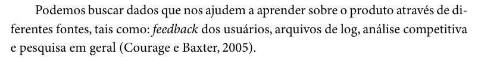

    Fonte: Barbosa e Silva (2010, cap. 5, seç. 5.3, p. 137).

??? quote "Figura 21 – Trecho correspondente ao item 20 na edição de 2010"

    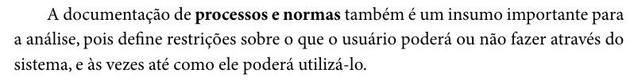

    Fonte: Barbosa e Silva (2010, cap. 5, seç. 5.3, p. 138).

### Seção 7.4 – Aspectos éticos de pesquisas envolvendo pessoas

#### Item 21

O documento indica que os objetivos da pesquisa, o procedimento de coleta, o tempo aproximado, os tipos de dados coletados e a forma de análise foram explicados aos participantes?

**Fonte:** Barbosa et al. (2021, cap. 7, seç. 7.4).

??? quote "Figura 22 – Trecho correspondente ao item 21 na edição de 2010"

    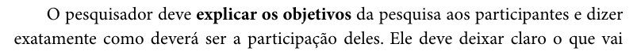

    Fonte: Barbosa e Silva (2010, cap. 5, seç. 5.4, p. 139).

??? quote "Figura 23 – Trecho correspondente ao item 21 na edição de 2010"

    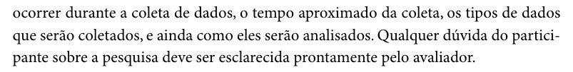

    Fonte: Barbosa e Silva (2010, cap. 5, seç. 5.4, p. 140).

#### Item 22

O documento garante a confidencialidade e a privacidade dos dados brutos coletados, informando que eles são compartilhados apenas com a equipe de pesquisa, mediante consentimento dos participantes?

**Fonte:** Barbosa et al. (2021, cap. 7, seç. 7.4).

??? quote "Figura 24 – Trecho correspondente ao item 22 na edição de 2010"

    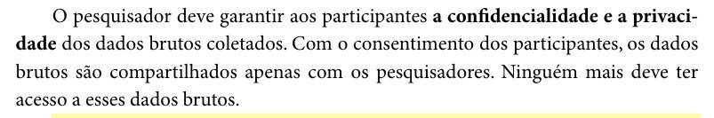

    Fonte: Barbosa e Silva (2010, cap. 5, seç. 5.4, p. 140).

#### Item 23

O documento garante o anonimato dos participantes na divulgação dos resultados, indicando o uso de nomes fictícios ou máscaras no lugar de nomes reais e de outras informações que possam identificá-los?

**Fonte:** Barbosa et al. (2021, cap. 7, seç. 7.4).

??? quote "Figura 25 – Trecho correspondente ao item 23 na edição de 2010"

    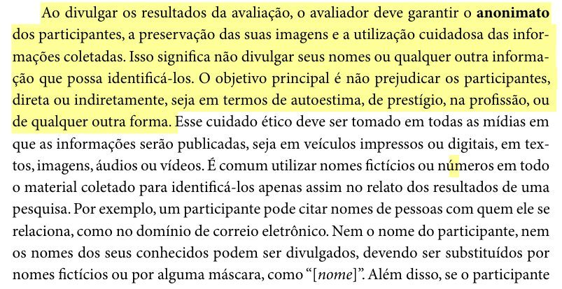

    Fonte: Barbosa e Silva (2010, cap. 5, seç. 5.4, p. 140).

#### Item 24

O documento indica que foi obtido o consentimento livre e esclarecido dos participantes por meio de um termo assinado (e, no caso de participante menor de 18 anos, assinado também pelo seu responsável legal)?

**Fonte:** Barbosa et al. (2021, cap. 7, seç. 7.4).

??? quote "Figura 26 – Trecho correspondente ao item 24 na edição de 2010"

    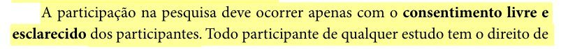

    Fonte: Barbosa e Silva (2010, cap. 5, seç. 5.4, p. 140).

??? quote "Figura 27 – Trecho correspondente ao item 24 na edição de 2010"

    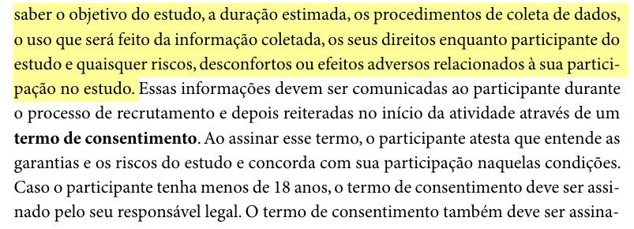

    Fonte: Barbosa e Silva (2010, cap. 5, seç. 5.4, p. 141).

#### Item 25

O documento informa que os participantes foram avisados de que tinham o direito de recusar ou retirar seu consentimento e abandonar o estudo a qualquer momento, sem qualquer penalização?

**Fonte:** Barbosa et al. (2021, cap. 7, seç. 7.4).

??? quote "Figura 28 – Trecho correspondente ao item 25 na edição de 2010"

    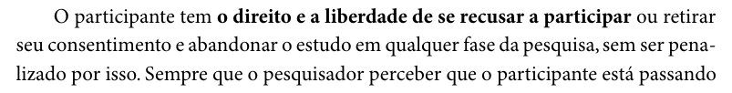

    Fonte: Barbosa e Silva (2010, cap. 5, seç. 5.4, p. 141).

### Seção 7.5.1 – Entrevistas

#### Item 26

O documento indica se as perguntas da entrevista são predominantemente abertas (sem restrição sobre o tipo ou tamanho de resposta) ou fechadas (com um conjunto predefinido de respostas)?

**Fonte:** Barbosa et al. (2021, cap. 7, seç. 7.5.1).

??? quote "Figura 29 – Trecho correspondente ao item 26 na edição de 2010"

    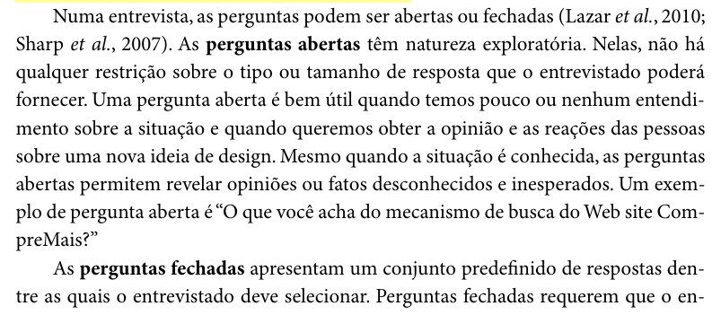

    Fonte: Barbosa e Silva (2010, cap. 5, seç. 5.5.1, p. 145).

#### Item 27

O documento indica qual tipo de entrevista foi utilizado entre os três tipos possíveis: estruturada (roteiro fixo, seguido na ordem definida), não estruturada (perguntas abertas e flexíveis, sem roteiro fixo) ou semiestruturada (roteiro de tópicos ou perguntas abertas, seguido com liberdade para explorar respostas)?

**Fonte:** Barbosa et al. (2021, cap. 7, seç. 7.5.1).

??? quote "Figura 30 – Trecho correspondente ao item 27 na edição de 2010"

    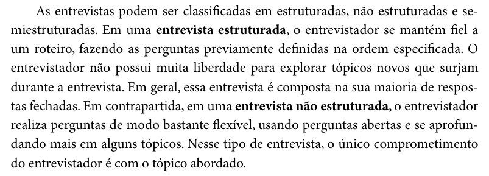

    Fonte: Barbosa e Silva (2010, cap. 5, seç. 5.5.1, p. 145).

??? quote "Figura 31 – Trecho correspondente ao item 27 na edição de 2010"

    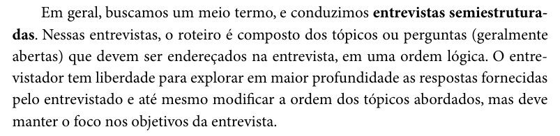

    Fonte: Barbosa e Silva (2010, cap. 5, seç. 5.5.1, p. 146).

#### Item 28

O documento apresenta o roteiro da entrevista, indicando se ele é composto por perguntas completas, por tópicosguia ou por um roteiro híbrido (tópicos com perguntas de exemplo)?

**Fonte:** Barbosa et al. (2021, cap. 7, seç. 7.5.1).

??? quote "Figura 32 – Trecho correspondente ao item 28 na edição de 2010"

    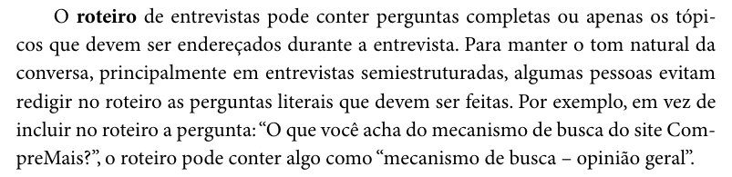

    Fonte: Barbosa e Silva (2010, cap. 5, seç. 5.5.1, p. 146).

??? quote "Figura 33 – Trecho correspondente ao item 28 na edição de 2010"

    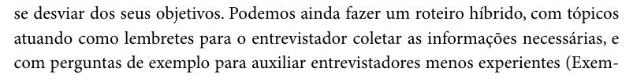

    Fonte: Barbosa e Silva (2010, cap. 5, seç. 5.5.1, p. 146).

#### Item 29

O documento indica que a sessão de entrevista seguiu a estrutura de apresentação, aquecimento (perguntas fáceis, como dados demográficos), parte principal, desaquecimento e conclusão?

**Fonte:** Barbosa et al. (2021, cap. 7, seç. 7.5.1).

??? quote "Figura 34 – Trecho correspondente ao item 29 na edição de 2010"

    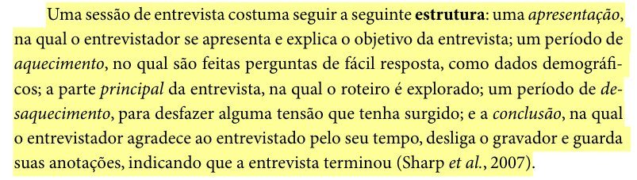

    Fonte: Barbosa e Silva (2010, cap. 5, seç. 5.5.1, p. 146).

#### Item 30

O documento indica que o entrevistador tomou cuidado para não induzir ou influenciar as respostas do entrevistado por meio da formulação das perguntas, de expressões faciais, gestos ou entonação de voz?

**Fonte:** Barbosa et al. (2021, cap. 7, seç. 7.5.1).

??? quote "Figura 35 – Trecho correspondente ao item 30 na edição de 2010"

    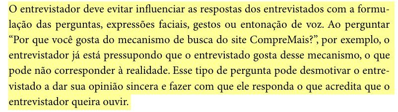

    Fonte: Barbosa e Silva (2010, cap. 5, seç. 5.5.1, p. 147).

### Seção 7.5.2 – Questionários

#### Item 31

O documento indica quais tipos de pergunta o questionário utiliza dentre os seguintes: múltipla escolha, faixas de valores, escalas (como Likert ou diferencial semântico) ou perguntas abertas?

**Fonte:** Barbosa et al. (2021, cap. 7, seç. 7.5.2).

??? quote "Figura 36 – Trecho correspondente ao item 31 na edição de 2010"

    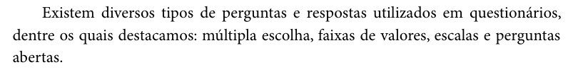

    Fonte: Barbosa e Silva (2010, cap. 5, seç. 5.5.2, p. 152).

#### Item 32

O documento indica que o questionário contém instruções claras sobre como responder a cada pergunta, deixando explícito quando uma pergunta admite uma única resposta ou múltiplas respostas?

**Fonte:** Barbosa et al. (2021, cap. 7, seç. 7.5.2).

??? quote "Figura 37 – Trecho correspondente ao item 32 na edição de 2010"

    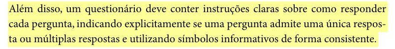

    Fonte: Barbosa e Silva (2010, cap. 5, seç. 5.5.2, p. 150).

#### Item 33

O documento indica que o questionário segue a estrutura recomendada, iniciando com informações demográficas básicas e de experiência do respondente, e apresentando perguntas gerais antes das perguntas específicas?

**Fonte:** Barbosa et al. (2021, cap. 7, seç. 7.5.2).

??? quote "Figura 38 – Trecho correspondente ao item 33 na edição de 2010"

    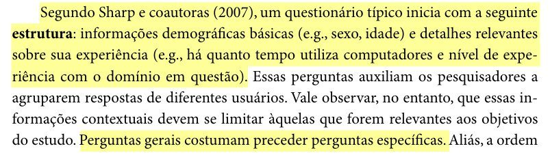

    Fonte: Barbosa e Silva (2010, cap. 5, seç. 5.5.2, p. 151).

#### Item 34

No caso de perguntas com faixas de valores (ex.: idade, renda), o documento indica que as faixas não se sobrepõem (ex.: evitando algo como 20-30 e 30-40)?

**Fonte:** Barbosa et al. (2021, cap. 7, seç. 7.5.2).

??? quote "Figura 39 – Trecho correspondente ao item 34 na edição de 2010"

    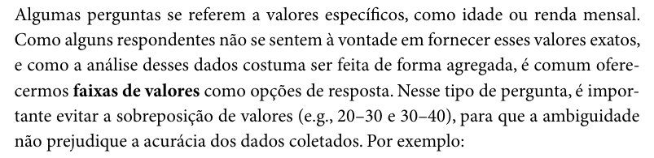

    Fonte: Barbosa e Silva (2010, cap. 5, seç. 5.5.2, p. 152).

### Seção 7.5.4 – Brainstorming de necessidades e desejos dos usuários

#### Item 35

O documento indica que a sessão de brainstorming envolveu entre 8 e 12 usuários finais de perfil semelhante, com sessões separadas para perfis diferentes?

**Fonte:** Barbosa et al. (2021, cap. 7, seç. 7.5.4).

??? quote "Figura 40 – Trecho correspondente ao item 35 na edição de 2010"

    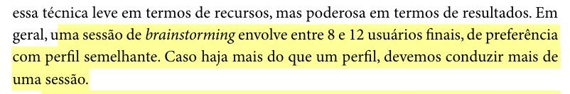

    Fonte: Barbosa e Silva (2010, cap. 5, seç. 5.5.4, p. 155).

#### Item 36

O documento apresenta a pergunta inicial da sessão voltada a um "sistema ideal", elaborada para identificar informações, tarefas ou características desejadas pelos usuários (e não uma pergunta genérica sobre "qualquer coisa")?

**Fonte:** Barbosa et al. (2021, cap. 7, seç. 7.5.4).

??? quote "Figura 41 – Trecho correspondente ao item 36 na edição de 2010"

    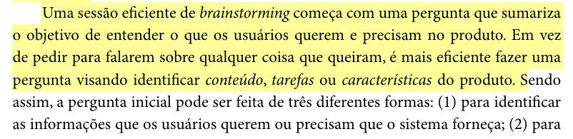

    Fonte: Barbosa e Silva (2010, cap. 5, seç. 5.5.4, p. 155).

??? quote "Figura 42 – Trecho correspondente ao item 36 na edição de 2010"

    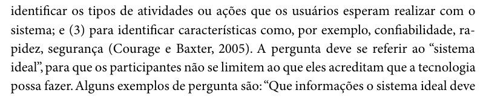

    Fonte: Barbosa e Silva (2010, cap. 5, seç. 5.5.4, p. 156).

#### Item 37

O documento indica que a sessão contou com um moderador responsável por esclarecer as sugestões, manter o foco no objetivo, motivar os participantes, não criticar o que for dito e evitar que poucos participantes dominem a sessão?

**Fonte:** Barbosa et al. (2021, cap. 7, seç. 7.5.4).

??? quote "Figura 43 – Trecho correspondente ao item 37 na edição de 2010"

    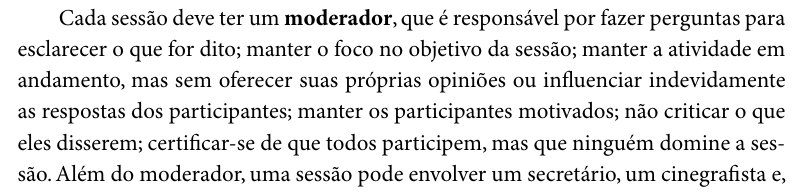

    Fonte: Barbosa e Silva (2010, cap. 5, seç. 5.5.4, p. 156).

#### Item 38

O documento indica que foram estabelecidas as regras de que todas as ideias são válidas no sistema ideal (sem autocensura) e de que a sessão não é de projeto/design do sistema?

**Fonte:** Barbosa et al. (2021, cap. 7, seç. 7.5.4).

??? quote "Figura 44 – Trecho correspondente ao item 38 na edição de 2010"

    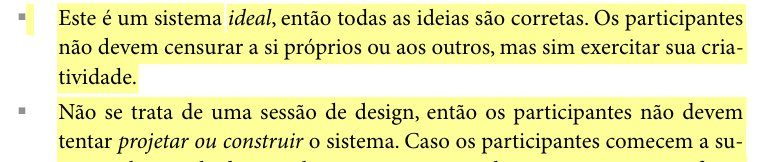

    Fonte: Barbosa e Silva (2010, cap. 5, seç. 5.5.4, p. 156).

#### Item 39

O documento indica que um secretário registrou apenas o que o moderador parafraseou, numerando cada sugestão para referência futura?

**Fonte:** Barbosa et al. (2021, cap. 7, seç. 7.5.4).

??? quote "Figura 45 – Trecho correspondente ao item 39 na edição de 2010"

    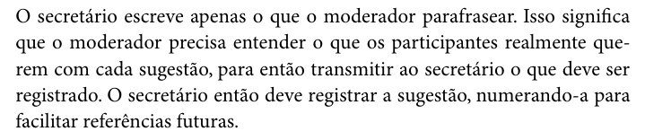

    Fonte: Barbosa e Silva (2010, cap. 5, seç. 5.5.4, p. 157).

#### Item 40

O documento indica que a sessão durou em torno de uma hora, encerrando a geração de ideias quando os participantes começaram a ficar em silêncio (o que costuma ocorrer por volta de 40 minutos)?

**Fonte:** Barbosa et al. (2021, cap. 7, seç. 7.5.4).

??? quote "Figura 46 – Trecho correspondente ao item 40 na edição de 2010"

    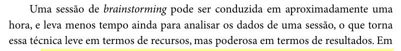

    Fonte: Barbosa e Silva (2010, cap. 5, seç. 5.5.4, p. 155).

??? quote "Figura 47 – Trecho correspondente ao item 40 na edição de 2010"

    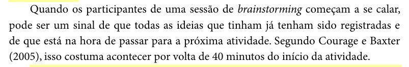

    Fonte: Barbosa e Silva (2010, cap. 5, seç. 5.5.4, p. 157).

#### Item 41

O documento indica que, na etapa de priorização, cada participante registrou os cinco itens que considerava essenciais, com número, descrição e justificativa, todos com o mesmo peso?

**Fonte:** Barbosa et al. (2021, cap. 7, seç. 7.5.4).

??? quote "Figura 48 – Trecho correspondente ao item 41 na edição de 2010"

    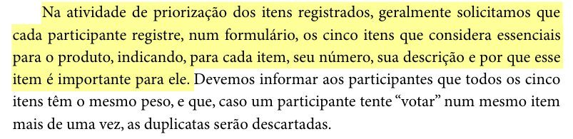

    Fonte: Barbosa e Silva (2010, cap. 5, seç. 5.5.4, p. 157).

#### Item 42

Caso tenha sido utilizado um diagrama de afinidade como alternativa ao brainstorming, o documento indica que os participantes escreveram os itens em papéis autocolantes, agruparam os itens semelhantes e os priorizaram com asteriscos (três para o mais importante, dois para o segundo e um para o terceiro)?

**Fonte:** Barbosa et al. (2021, cap. 7, seç. 7.5.4).

??? quote "Figura 49 – Trecho correspondente ao item 42 na edição de 2010"

    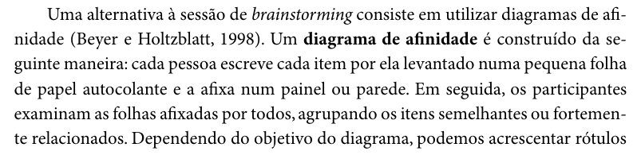

    Fonte: Barbosa e Silva (2010, cap. 5, seç. 5.5.4, p. 157).

??? quote "Figura 50 – Trecho correspondente ao item 42 na edição de 2010"

    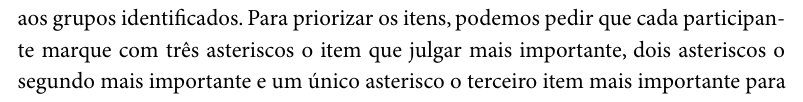

    Fonte: Barbosa e Silva (2010, cap. 5, seç. 5.5.4, p. 158).

## Referências

BARBOSA, Simone Diniz Junqueira; SILVA, Bruno Santana da. *Interação Humano-Computador*. Rio de Janeiro: Elsevier, 2010.

BARBOSA, Simone Diniz Junqueira; SILVA, Bruno Santana da; SILVEIRA, Milene Selbach; GASPARINI, Isabela; DARIN, Ticianne; BARBOSA, Gabriel Diniz Junqueira. *Interação Humano-Computador e Experiência do Usuário*. [*S. l.*]: Autopublicação, 2021. Disponível em: https://leanpub.com/ihc-ux.

SALES, André Barros de. *Lista de Exercícios*: elaborar listas de verificação. Brasília: Universidade de Brasília, [2026]. Enunciado da atividade avaliativa Verificação 2.

SALES, André Barros de. *Plano de Ensino*: Interação Humano Computador (FGA0173), 02/2026, Turma 01, v1. Brasília: Universidade de Brasília, 2026.

## Agradecimentos e uso de IA generativa

**Uso de IA generativa nesta página.** O Claude (Anthropic) foi utilizado na transcrição do documento original para o site e na padronização da formatação, das legendas, das citações e das referências às normas da disciplina. O conteúdo do trabalho é de João Vitor, indicado(a) na tabela de contribuição. A ferramenta não é autora do artefato e seu uso não exime os autores da responsabilidade sobre o conteúdo (SALES, 2026, p. 3).
