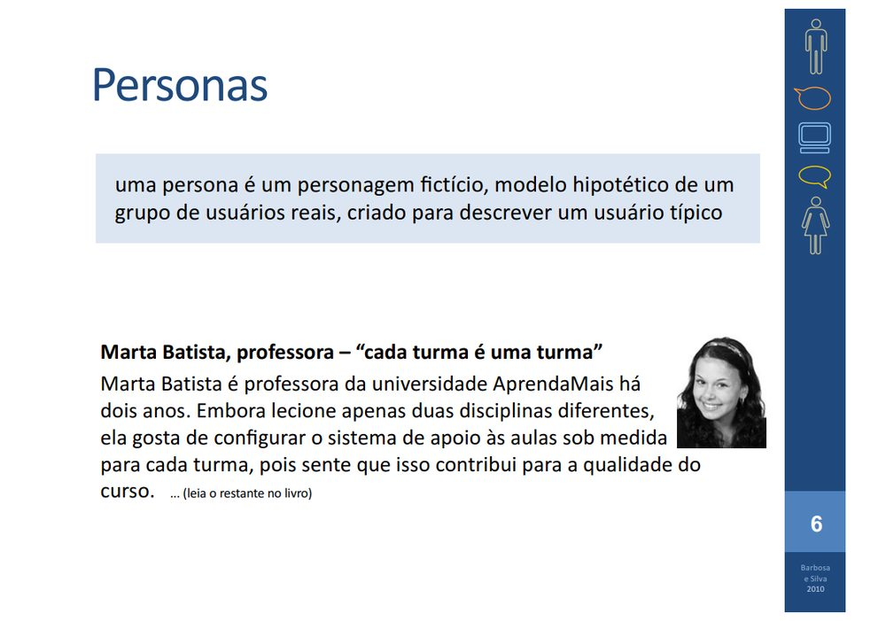
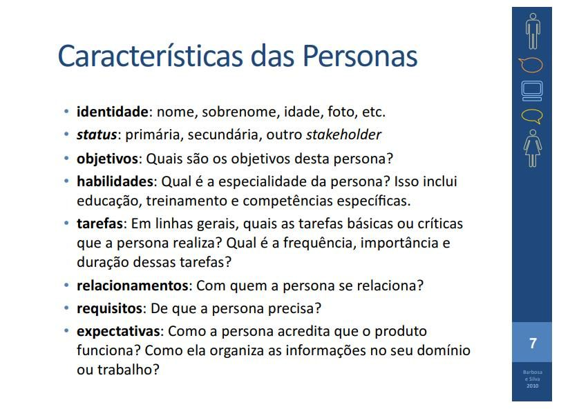
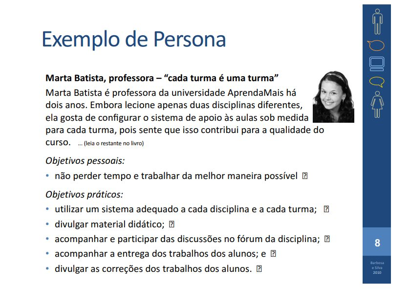
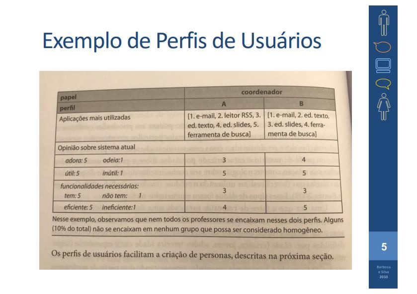

# Lista de Verificação – Personas

**Autoria:** João Vitor Tavares de Sá Lima · **Entrega 2**

## Tabela de contribuição

**Tabela 1 – Contribuições no trabalho "Lista de Verificação – Personas"**

| Integrante | Contribuição | Atividade (link) | Gravação (link) |
| --- | --- | --- | --- |
| Alexandre Vilar Valadares Fonsêca | Não se aplica (atividade individual) | — | — |
| Gabriel Robson Nunes Neiva da Silva | Não se aplica (atividade individual) | — | — |
| Henrique Schneider Fernandes da Rosa | Não se aplica (atividade individual) | — | — |
| João Vitor Tavares de Sá Lima | Autoria do trabalho (atividade individual) | Esta página | — |

Fonte: elaborado pelos autores (2026).

## Histórico de versões

**Tabela 2 – Histórico de versões do trabalho "Lista de Verificação – Personas"**

| Data | Versão | Descrição | Autor(es) | Revisor(es) |
| --- | --- | --- | --- | --- |
| 21/09/2026 | 1.0 | Elaboração do trabalho, entregue no Moodle (data do arquivo entregue) | João Vitor | — |
| 17/10/2026 | 1.1 | Publicação no site: transcrição, fotos das fontes, citações e referências no padrão da disciplina | Henrique Schneider | — |

Fonte: elaborado pelos autores (2026).

## 1. Introdução

Atividade individual do Moodle "Listas de verificação – Personas, Elenco de Personas, HTA e CTT", parte relativa a personas.

Cada item é uma pergunta autocontida, respondida com **Conforme**, **Não conforme** ou **Não se aplica**. Abaixo de cada item estão a fonte, com capítulo, seção e página, e a foto do trecho que o fundamenta, como pede a atividade de elaboração de listas de verificação (SALES, [2026], p. 1). Clique no título de cada figura para abrir a foto.

## 2. Itens da lista

### Item 1

A persona é apresentada como um personagem fictício, isto é, um modelo hipotético de um grupo de usuários reais criado para descrever um usuário típico (e não uma pessoa real específica)?

**Fonte:** Barbosa e Silva (2010), slides do cap. 6, slide 6.

??? quote "Figura 1 – Trecho que fundamenta o item 1"

    

    Fonte: Barbosa e Silva (2010), slides do cap. 6, slide 6.

### Item 2

A persona possui uma identidade definida, incluindo nome, sobrenome, idade e uma foto ou outra representação visual?

**Fonte:** Barbosa e Silva (2010), slides do cap. 6, slide 7.

??? quote "Figura 2 – Trecho que fundamenta o item 2"

    

    Fonte: Barbosa e Silva (2010), slides do cap. 6, slide 7.

### Item 3

A persona indica seu status, esclarecendo se ela é uma persona primária, secundária ou outro tipo de stakeholder?

**Fonte:** Barbosa e Silva (2010), slides do cap. 6, slide 7.

??? quote "Figura 3 – Trecho que fundamenta o item 3"

    

    Fonte: Barbosa e Silva (2010), slides do cap. 6, slide 7.

### Item 4

A persona apresenta seus objetivos, ou seja, o que ela busca alcançar ao utilizar o sistema?

**Fonte:** Barbosa e Silva (2010), slides do cap. 6, slide 7.

??? quote "Figura 4 – Trecho que fundamenta o item 4"

    

    Fonte: Barbosa e Silva (2010), slides do cap. 6, slide 7.

### Item 5

A persona descreve suas habilidades, incluindo a especialidade da persona, sua educação, treinamento e competências específicas relevantes ao domínio do sistema?

**Fonte:** Barbosa e Silva (2010), slides do cap. 6, slide 7.

??? quote "Figura 5 – Trecho que fundamenta o item 5"

    

    Fonte: Barbosa e Silva (2010), slides do cap. 6, slide 7.

### Item 6

A persona descreve, em linhas gerais, quais são as tarefas básicas ou críticas que ela realiza, indicando a frequência, a importância e a duração dessas tarefas?

**Fonte:** Barbosa e Silva (2010), slides do cap. 6, slide 7.

??? quote "Figura 6 – Trecho que fundamenta o item 6"

    

    Fonte: Barbosa e Silva (2010), slides do cap. 6, slide 7.

### Item 7

A persona indica seus relacionamentos, esclarecendo com quem ela se relaciona no contexto de uso do sistema?

**Fonte:** Barbosa e Silva (2010), slides do cap. 6, slide 7.

??? quote "Figura 7 – Trecho que fundamenta o item 7"

    

    Fonte: Barbosa e Silva (2010), slides do cap. 6, slide 7.

### Item 8

A persona apresenta seus requisitos, explicitando do que ela precisa para realizar suas tarefas ou alcançar seus objetivos?

**Fonte:** Barbosa e Silva (2010), slides do cap. 6, slide 7.

??? quote "Figura 8 – Trecho que fundamenta o item 8"

    

    Fonte: Barbosa e Silva (2010), slides do cap. 6, slide 7.

### Item 9

A persona indica suas expectativas, descrevendo como ela acredita que o produto funciona e/ou como ela organiza as informações no seu domínio ou trabalho?

**Fonte:** Barbosa e Silva (2010), slides do cap. 6, slide 7.

??? quote "Figura 9 – Trecho que fundamenta o item 9"

    

    Fonte: Barbosa e Silva (2010), slides do cap. 6, slide 7.

### Item 10

A persona é identificada por um nome associado a um papel/cargo e a uma frase-resumo (tagline) que sintetiza sua característica ou atitude principal (ex.: "Marta Batista, professora – 'cada turma é uma turma'")?

**Fonte:** Barbosa e Silva (2010), slides do cap. 6, slide 8.

??? quote "Figura 10 – Trecho que fundamenta o item 10"

    

    Fonte: Barbosa e Silva (2010), slides do cap. 6, slide 8.

### Item 11

A persona é acompanhada de uma narrativa textual descrevendo seu contexto de trabalho ou de uso do sistema, incluindo aspectos como há quanto tempo ela exerce sua função e como costuma se comportar no dia a dia?

**Fonte:** Barbosa e Silva (2010), slides do cap. 6, slide 8.

??? quote "Figura 11 – Trecho que fundamenta o item 11"

    

    Fonte: Barbosa e Silva (2010), slides do cap. 6, slide 8.

### Item 12

Os objetivos da persona estão organizados em ao menos duas categorias distintas — objetivos pessoais (relacionados ao bem-estar ou à satisfação da persona) e objetivos práticos (relacionados às tarefas que ela precisa realizar)?

**Fonte:** Barbosa e Silva (2010), slides do cap. 6, slide 8.

??? quote "Figura 12 – Trecho que fundamenta o item 12"

    

    Fonte: Barbosa e Silva (2010), slides do cap. 6, slide 8.

### Item 13

O documento indica que a(s) persona(s) foi(ram) construída(s) a partir de dados reais sobre os usuários, agrupados em perfis de usuários (e não apenas de suposições da equipe de projeto), com uma persona distinta para cada perfil relevante identificado?

**Fonte:** Barbosa e Silva (2010), slides do cap. 6, slide 5.

??? quote "Figura 13 – Trecho que fundamenta o item 13"

    

    Fonte: Barbosa e Silva (2010), slides do cap. 6, slide 5.

## Referências

BARBOSA, Simone Diniz Junqueira; SILVA, Bruno Santana da. *Organização do espaço de problema*: slides do capítulo 6 de *Interação Humano-Computador*. Rio de Janeiro: Elsevier, 2010. 30 slides.

SALES, André Barros de. *Lista de Exercícios*: elaborar listas de verificação. Brasília: Universidade de Brasília, [2026]. Enunciado da atividade avaliativa Verificação 2.

SALES, André Barros de. *Plano de Ensino*: Interação Humano Computador (FGA0173), 02/2026, Turma 01, v1. Brasília: Universidade de Brasília, 2026.

## Agradecimentos e uso de IA generativa

**Uso de IA generativa nesta página.** O Claude (Anthropic) foi utilizado na transcrição do documento original para o site e na padronização da formatação, das legendas, das citações e das referências às normas da disciplina. O conteúdo do trabalho é de João Vitor, indicado(a) na tabela de contribuição. A ferramenta não é autora do artefato e seu uso não exime os autores da responsabilidade sobre o conteúdo (SALES, 2026, p. 3).
