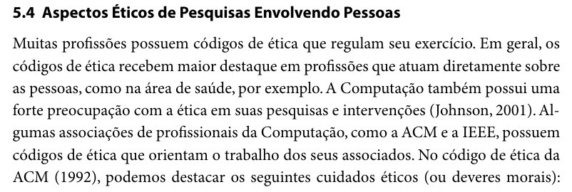
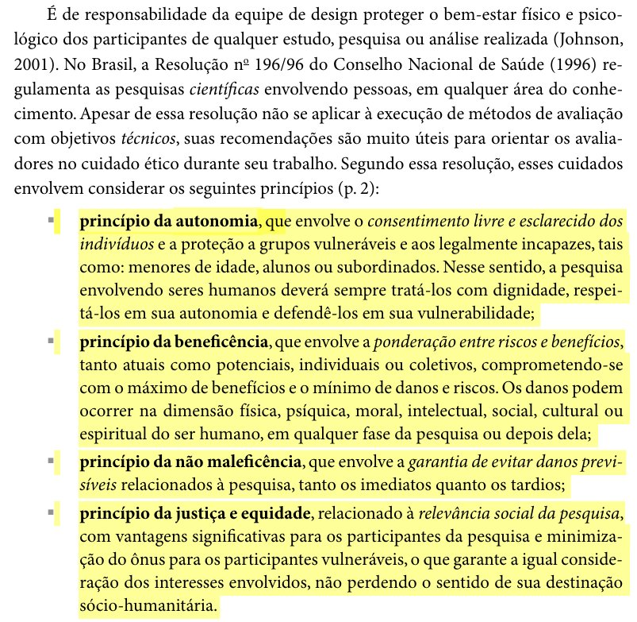
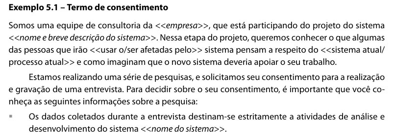
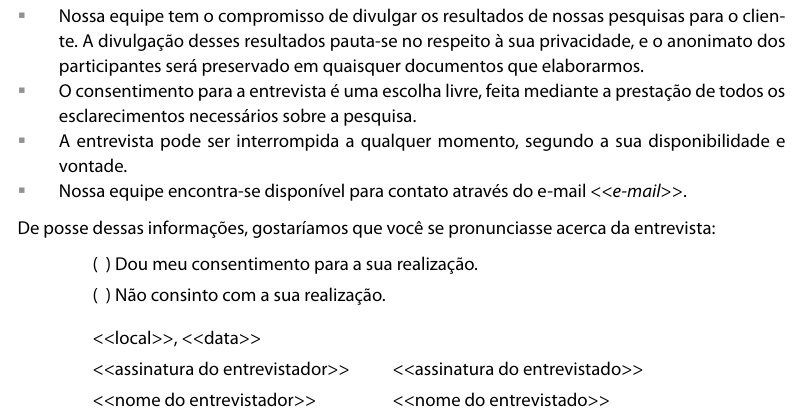

# Aspectos Éticos e Termo de Consentimento Livre e Esclarecido (TCLE)

## Tabela de contribuição

**Tabela 1 – Contribuições no artefato Aspectos Éticos e TCLE**

| Integrante | Contribuição | Atividade (link) | Gravação (link) |
| --- | --- | --- | --- |
| Alexandre Vilar Valadares Fonsêca | — | — | — |
| Eduardo Ribeiro Gomes da Silva | "Ajuda inicial na elaboração do TCLE", registrada na ata da Reunião 01 | [Ata da Reunião 01](../../atas/ata-reuniao-20260927-01.md), Tabela 7 | — |
| Gabriel Robson Nunes Neiva da Silva | Apoio aos aspectos éticos e ao TCLE, registrado na matriz de contribuição da Entrega 2 | [Matriz de Contribuição](../contribuicoes.md), Tabela 4 | — |
| Henrique Schneider Fernandes da Rosa | Ajustes nas cláusulas de anonimato e desistência (v1.1) e introdução sobre os 4 princípios (v1.2); revisão da v1.0 | [Commit 142c6cb](https://github.com/Interacao-Humano-Computador/2026.2-Grupo03/commit/142c6cb); [commit 530579c](https://github.com/Interacao-Humano-Computador/2026.2-Grupo03/commit/530579c) | — |
| João Vitor Tavares de Sá Lima | Elaboração inicial das diretrizes éticas e do TCLE (v1.0); revisão das v1.1 e v1.2 | [Commit 01df6a6](https://github.com/Interacao-Humano-Computador/2026.2-Grupo03/commit/01df6a6) | — |

Fonte: elaborado pelos autores (2026).

## Histórico de versões

**Tabela 2 – Histórico de versões do artefato Aspectos Éticos e TCLE**

| Data | Versão | Descrição | Autor(es) | Revisor(es) |
| --- | --- | --- | --- | --- |
| 17/09/2026 | 1.0 | Elaboração inicial das diretrizes éticas e estruturação do TCLE para pesquisas no Portal Detran-DF. | João Vitor | Henrique Schneider |
| 27/09/2026 | 1.1 | Ajustes nas cláusulas de salvaguarda de anonimato e direito de desistência do participante. | Henrique Schneider | João Vitor |
| 27/09/2026 | 1.2 | Inclusão de texto introdutório fundamentando a importância teórica dos 4 princípios éticos e do TCLE em IHC. | Henrique Schneider | João Vitor |
| 15/10/2026 | 1.3 | Padronização da estrutura (tabela de contribuição, numeração das seções), das citações e referências (ABNT), inclusão da seção de itens de conteúdo e da seção de uso de IA | Henrique Schneider | — |
| 17/10/2026 | 1.4 | Inclusão das fotos dos trechos de Barbosa e Silva (2010, pp. 138, 139, 141 e 142) como Figuras 1 a 4, da fonte do termo de consentimento e retirada da seção de itens de conteúdo | Henrique Schneider | — |

Fonte: elaborado pelos autores (2026).

## 1. Introdução e Importância no Contexto de IHC

A consideração dos **Aspectos Éticos** em Interação Humano-Computador (IHC) é um requisito obrigatório e indispensável em qualquer pesquisa ou avaliação que envolva direta ou indiretamente a participação de seres humanos (Barbosa; Silva, 2010, cap. 5, seç. 5.4, pp. 138–141). Durante a condução de estudos de campo, entrevistas, aplicação de questionários ou testes de usabilidade no Portal do Detran-DF, a equipe de design tem o dever moral e legal de proteger o bem-estar físico, psicológico, moral e social dos participantes. O início da seção 5.4 do livro está na Figura 1.

??? quote "Figura 1 – Trecho de Barbosa e Silva (2010, cap. 5, seç. 5.4, p. 138) sobre os aspectos éticos de pesquisas envolvendo pessoas"

    

    Fonte: Barbosa e Silva (2010, cap. 5, seç. 5.4, p. 138).

Inspirado na Resolução nº 196/96 do Conselho Nacional de Saúde e na conduta ética da *Association for Computing Machinery* (ACM) e do IEEE, a conduta ética em IHC apoia-se em quatro princípios fundamentais (Barbosa; Silva, 2010, cap. 5, seç. 5.4, p. 139):

1. **Princípio da Autonomia:** Assegura o consentimento livre e esclarecido dos indivíduos para participar do estudo, respeitando sua dignidade e protegendo sujeitos vulneráveis.
2. **Princípio da Beneficência:** Compromete os pesquisadores com a ponderação entre riscos e benefícios, garantindo o máximo de proveito científico/social com o mínimo de danos e impactos indesejados.
3. **Princípio da Não Maleficência:** Garante a prevenção de danos previsíveis, constrangimentos, estresse ou prejuízos à reputação e autoestima do participante, tanto imediatos quanto tardios.
4. **Princípio da Justiça e Equidade:** Assegura a distribuição justa dos benefícios da pesquisa e a igual consideração dos direitos de todos os participantes envolvidos.

O trecho do livro com a responsabilidade da equipe de design sobre o bem-estar dos participantes, a Resolução nº 196/96 e os quatro princípios está na Figura 2.

??? quote "Figura 2 – Trecho de Barbosa e Silva (2010, cap. 5, seç. 5.4, p. 139) sobre os quatro princípios éticos"

    

    Fonte: Barbosa e Silva (2010, cap. 5, seç. 5.4, p. 139).

No âmbito do projeto do Portal Detran-DF, o **Termo de Consentimento Livre e Esclarecido (TCLE)** materializa essas garantias éticas. Ele atua como um contrato transparente em que o participante é plenamente informado sobre os objetivos da investigação, a natureza voluntária da sua colaboração, o anonimato das suas informações e imagens, a autorização para gravações de mídia e a garantia irrestrita de retirar seu consentimento a qualquer momento, sem qualquer tipo de penalidade ou constrangimento.

## 2. Termo de Consentimento

O termo a seguir adapta o termo de consentimento para entrevista apresentado por Barbosa e Silva (2010, cap. 5, seç. 5.4, Exemplo 5.1, pp. 141–142), reproduzido nas Figuras 3 e 4.

Somos alunos da disciplina de Interação Humano-Computador da Universidade de Brasília, estamos fazendo um projeto de avaliação do Portal Detran-DF. Nessa etapa do projeto, queremos conhecer o que algumas das pessoas que irão usar ou ser afetadas pelo sistema pensam a respeito do portal atual e dos seus serviços de trânsito, e como imaginam que o novo sistema deveria apoiar o seu trabalho.

Estamos realizando uma série de pesquisas, e solicitamos seu consentimento para a realização e gravação de uma entrevista. Para decidir sobre o seu consentimento, é importante que você conheça as seguintes informações sobre a pesquisa:

* **Finalidade dos dados:** Os dados coletados durante a entrevista destinam-se estritamente a atividades de análise e desenvolvimento do projeto do portal do Detran-DF na disciplina de IHC.
* **Privacidade e Anonimato:** Nossa equipe tem o compromisso de divulgar os resultados de nossas pesquisas para o cliente. A divulgação desses resultados pauta-se no respeito à sua privacidade, e o anonimato dos participantes será preservado em quaisquer documentos que elaborarmos.
* **Livre Escolha:** O consentimento para a entrevista é uma escolha livre, feita mediante a prestação de todos os esclarecimentos necessários sobre a pesquisa.
* **Direito de Interrupção:** A entrevista pode ser interrompida a qualquer momento, segundo a sua disponibilidade e vontade.
* **Contato:** Nossa equipe encontra-se disponível para contato através do e-mail ___________________________________.

De posse dessas informações, gostaríamos que você se pronunciasse acerca da entrevista:

- [ ] Dou meu consentimento para a sua realização.
- [ ] Não consinto com a sua realização.

**Local e Data:** Brasília, ____ de _______________ de 2026.

| Assinatura do Entrevistador | Assinatura do Entrevistado |
| :---: | :---: |
| ___________________________________ | ___________________________________ |
| **[Nome do Entrevistador]** | **[Nome do Entrevistado]** |

Fonte: adaptado de Barbosa e Silva (2010, cap. 5, seç. 5.4, Exemplo 5.1, pp. 141–142).

??? quote "Figura 3 – Trecho de Barbosa e Silva (2010, cap. 5, p. 141) com o início do Exemplo 5.1 (termo de consentimento)"

    

    Fonte: Barbosa e Silva (2010, cap. 5, seç. 5.4, Exemplo 5.1, p. 141).

??? quote "Figura 4 – Trecho de Barbosa e Silva (2010, cap. 5, p. 142) com a continuação do Exemplo 5.1 (termo de consentimento)"

    

    Fonte: Barbosa e Silva (2010, cap. 5, seç. 5.4, Exemplo 5.1, p. 142).

## Referências Bibliográficas

ASSOCIAÇÃO BRASILEIRA DE NORMAS TÉCNICAS. *NBR 6023*: informação e documentação: referências: elaboração. Rio de Janeiro: ABNT, 2018.

BARBOSA, Simone Diniz Junqueira; SILVA, Bruno Santana da. *Interação Humano-Computador*. Rio de Janeiro: Elsevier, 2010.

CONSELHO NACIONAL DE SAÚDE. *Resolução nº 196/96* sobre pesquisas envolvendo seres humanos. Brasília, DF: CNS, 1996.

SALES, André Barros de. *Plano de Ensino: Interação Humano Computador (FGA0173), 02/2026, Turma 01, v1*. Brasília: Universidade de Brasília, 2026.

## Agradecimentos e uso de IA generativa

**Uso de IA generativa nesta página.** Em 15/10/2026, o Claude (Anthropic) foi utilizado, a pedido de Henrique Schneider, para reorganizar a página no modelo de artefato da disciplina (tabela de contribuição, histórico, numeração das seções) e padronizar as citações após conferir as páginas no PDF de Barbosa e Silva (2010). Em 17/10/2026, a ferramenta foi usada para recortar do PDF do livro as fotos dos trechos citados (Figuras 1 a 4) e para identificar no livro o exemplo de termo de consentimento em que o termo da seção 2 se baseia. O texto da introdução e do termo não foi alterado; o campo do e-mail de contato aparece em branco, como os demais campos do formulário. A ferramenta não é autora do artefato e seu uso não exime os autores da responsabilidade sobre o conteúdo (SALES, 2026, p. 3).
