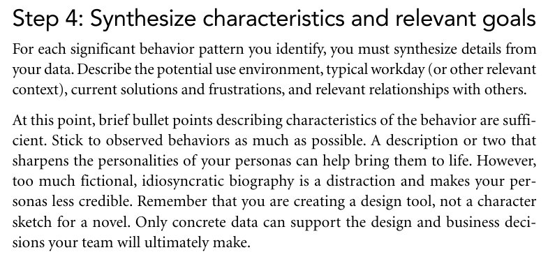
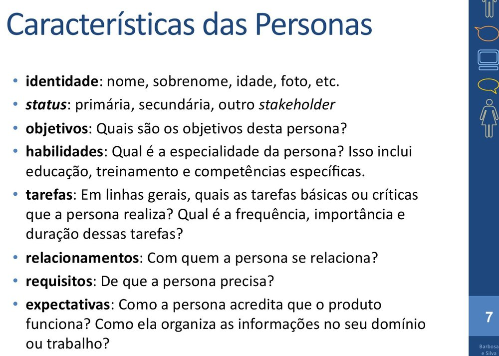
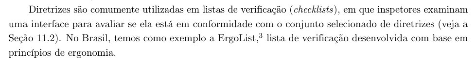
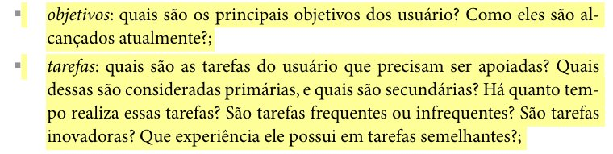
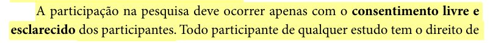
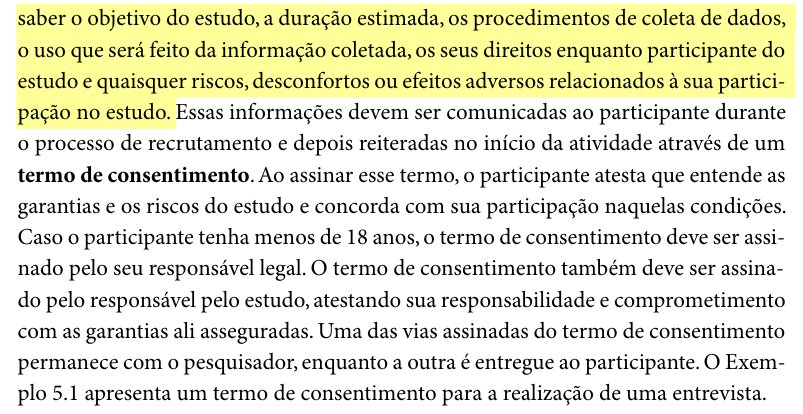

# Entrega 2 – Inspeção do Grupo 02 (Grupo -1)

## Tabela de contribuição

**Tabela 1 – Contribuições no artefato Inspeção da Entrega 2 do Grupo 02**

| Integrante | Contribuição | Atividade (link) | Gravação (link) |
| --- | --- | --- | --- |
| Alexandre Vilar Valadares Fonsêca | — | — | — |
| Eduardo Ribeiro Gomes da Silva | — | — | — |
| Gabriel Robson Nunes Neiva da Silva | — | — | — |
| Henrique Schneider Fernandes da Rosa | Criação da estrutura da página (06/10/2026) | [Commit a0d81cd](https://github.com/Interacao-Humano-Computador/2026.2-Grupo03/commit/a0d81cd) | — |
| João Vitor Tavares de Sá Lima | — | — | — |

Fonte: elaborado pelos autores (2026).

## Histórico de versões

**Tabela 2 – Histórico de versões do artefato Inspeção da Entrega 2 do Grupo 02**

| Data | Versão | Descrição | Autor(es) | Revisor(es) |
| --- | --- | --- | --- | --- |
| 06/10/2026 | 0.1 | Criação do arquivo vazio da página | Henrique Schneider | — |
| 15/10/2026 | 1.0 | Transcrição, para o site, do relatório de inspeção entregue em 02/10/2026 (identificação, 21 itens com resposta e hora, fontes dos itens adicionais) | Henrique Schneider | — |
| 17/10/2026 | 1.1 | Inclusão das fotos dos trechos citados como fonte dos itens adicionais (Figuras 1 a 5) e conferência das páginas dos itens 17, 18 e 19 | Henrique Schneider | — |

Fonte: elaborado pelos autores (2026).

## 1. Introdução

Esta página registra a inspeção feita pelo Grupo 03 sobre a Entrega 2 (Perfil do Usuário, Aspectos Éticos e Análise de Tarefas) do Grupo 02, cujo projeto trata do NoFluxoUnb. O conteúdo foi transcrito do relatório de inspeção entregue no Moodle (Grupo 03, 2026), disponível em PDF nas referências. A Tabela 3 reúne os dados de identificação; a Tabela 4, os itens verificados.

**Tabela 3 – Identificação da inspeção**

| Campo | Registro |
| --- | --- |
| Grupo inspecionado | Grupo 02 (Grupo -1) |
| Etapa avaliada | Entrega 2 – Perfil do usuário, Aspectos Éticos de Pesquisas Envolvendo Pessoas e Análise de tarefas |
| Data da inspeção | 02/10/2026 |
| Gravação da inspeção | <https://youtu.be/xNhCVgt2FE4> |

Fonte: Grupo 03 (2026).

## 2. Itens verificados

A coluna "Versão, data e hora" reproduz a data e a hora registradas no relatório para cada item.

**Tabela 4 – Lista de verificação aplicada à Entrega 2 do Grupo 02**

| ID | Questão | Fonte do item | Resposta (Sim / Não / Incompleto) | Versão, data e hora |
| :---: | :--- | :--- | :---: | :---: |
| 01 | O perfil do usuário é definido por mais de uma forma (técnica de elicitação e/ou ferramenta)? | Plano de Ensino | Não | 02/10/2026, 00:41 |
| 02 | O perfil do usuário possui os atributos de um perfil (dados demográficos, experiência no cargo…)? | Plano de Ensino | Incompleto | 02/10/2026, 00:43 |
| 03 | O perfil do usuário define os grupos de atributos: idade, experiência, atitudes e tarefas primárias? | Plano de Ensino | Incompleto | 02/10/2026, 00:44 |
| 04 | Considera aspectos éticos de pesquisas envolvendo pessoas? | Plano de Ensino | Sim | 02/10/2026, 00:46 |
| 05 | Os 4 princípios (autonomia, beneficência, não maleficência e justiça e equidade)? | Plano de Ensino | Não | 02/10/2026, 00:48 |
| 06 | Solicitará a permissão para gravar a voz ou imagem de qualquer pessoa antes de começar a gravação? | Plano de Ensino | Sim | 02/10/2026, 00:50 |
| 07 | O termo de consentimento livre e esclarecido dos participantes? | Plano de Ensino | Não | 02/10/2026, 00:50 |
| 08 | Foram utilizadas no mínimo duas técnicas para coletar dados e levantar os requisitos dos usuários? | Plano de Ensino | Sim | 02/10/2026, 00:51 |
| 09 | Os cenários, com referência bibliográfica e foto do texto da referência? | Plano de Ensino | Sim | 02/10/2026, 00:52 |
| 10 | A análise de tarefas? | Plano de Ensino | Sim | 02/10/2026, 00:52 |
| 11 | Uma atividade para cada integrante modelada em ao menos duas técnicas (HTA; GOMS ou CTT)? | Plano de Ensino | Incompleto | 02/10/2026, 00:54 |
| 12 | Utilizaram alguma técnica para especificar as tarefas? | Plano de Ensino | Sim | 02/10/2026, 00:54 |
| 13 | A descrição de cada persona apresenta comportamentos e necessidades associados a dados de entrevistas ou observações de usuários, com indicação do registro de pesquisa que permite conferir essa associação? | Cooper, Reimann e Cronin (2007, cap. 5, p. 100) | Sim | 02/10/2026, 00:56 |
| 14 | Cada persona possui nome, sobrenome, idade e uma foto que permitam identificá-la individualmente no elenco? | Apresentação do cap. 6, slide 7, "Características das Personas" (Barbosa e Silva, 2010, conforme atribuição do slide) | Incompleto | 02/10/2026, 00:59 |
| 15 | A descrição de cada persona informa quais tarefas básicas ou críticas ela realiza e, para cada tarefa, sua frequência, importância e duração? | Apresentação do cap. 6, slide 7, "Características das Personas" | Incompleto | 02/10/2026, 01:01 |
| 16 | O artefato explica claramente quais informações foram coletadas e como foram interpretadas? | — | Sim | 02/10/2026, 01:02 |
| 17 | É possível identificar a fonte das informações apresentadas em cada parte do artefato? | Barbosa et al. (2021, cap. 10, seç. 10.1, p. 238) | Sim | 02/10/2026, 01:04 |
| 18 | Quando foi definido um método formal de verificação, como uma lista de critérios, ele foi utilizado? | Barbosa et al. (2021, cap. 10, seç. 10.1, p. 238) | Sim | 02/10/2026, 01:05 |
| 19 | Foram mapeados os principais objetivos dos usuários e como funcionam os fluxos de tarefas do usuário no portal do NoFluxoUnb? | Barbosa e Silva (2010, cap. 5, seç. 5.2, p. 135) | Sim | 02/10/2026, 01:06 |
| 20 | O uso de IA generativa está declarado e a contribuição de cada ferramenta está identificada? | Plano de Ensino | Sim | 02/10/2026, 01:07 |
| 21 | Existe TCLE, e ele foi aplicado a todos os participantes? | Barbosa e Silva (2010, cap. 5, seç. 5.4, pp. 140–141) | Sim | 02/10/2026, 01:07 |

Fonte: Grupo 03 (2026), transcrito do relatório de inspeção; itens 01 a 12 adaptados de Sales (2026, pp. 9–10).

As fotos dos trechos citados como fonte dos itens 13, 14, 15, 17, 18, 19 e 21 estão nas Figuras 1 a 5. Nos itens 17, 18 e 19, a fonte foi conferida nos livros em 17/10/2026: o relatório registra, no item 17, "página 258, último parágrafo da seção 10.5"; no item 18, "página 238, parágrafo que começa com 'Diretrizes'"; e, no item 19, "Capítulo 5, p. 136". O trecho citado nos itens 17 e 18 está em Barbosa et al. (2021, cap. 10, seç. 10.1, p. 238), e o do item 19, em Barbosa e Silva (2010, cap. 5, seç. 5.2, p. 135).

??? quote "Figura 1 – Trecho de Cooper, Reimann e Cronin (2007, cap. 5, p. 100) citado no item 13"

    

    Fonte: Cooper, Reimann e Cronin (2007, cap. 5, p. 100).

??? quote "Figura 2 – Slide 7 do capítulo 6 de Barbosa e Silva (2010), "Características das Personas", citado nos itens 14 e 15"

    

    Fonte: Barbosa e Silva (2010, slides do cap. 6, slide 7).

??? quote "Figura 3 – Trecho de Barbosa et al. (2021, cap. 10, seç. 10.1, p. 238) citado nos itens 17 e 18"

    

    Fonte: Barbosa et al. (2021, cap. 10, seç. 10.1, p. 238).

??? quote "Figura 4 – Trecho de Barbosa e Silva (2010, cap. 5, seç. 5.2, p. 135) citado no item 19"

    

    Fonte: Barbosa e Silva (2010, cap. 5, seç. 5.2, p. 135).

??? quote "Figura 5 – Trecho de Barbosa e Silva (2010, cap. 5, seç. 5.4, pp. 140–141) citado no item 21"

    

    

    Fonte: Barbosa e Silva (2010, cap. 5, seç. 5.4, pp. 140–141).

## Referências

BARBOSA, Simone Diniz Junqueira et al. *Interação Humano-Computador e Experiência do Usuário*. Rio de Janeiro: Simone Diniz Junqueira Barbosa, 2021. E-book.

BARBOSA, Simone Diniz Junqueira; SILVA, Bruno Santana da. *Interação Humano-Computador*. Rio de Janeiro: Elsevier, 2010.

BARBOSA, Simone Diniz Junqueira; SILVA, Bruno Santana da. *Organização do espaço de problema*: slides do capítulo 6 de *Interação Humano-Computador*. Rio de Janeiro: Elsevier, 2010. 30 slides.

COOPER, Alan; REIMANN, Robert; CRONIN, David. *About Face 3*: the essentials of interaction design. Indianapolis: Wiley, 2007.

GRUPO 03. *Inspeção Grupo -1 (Grupo 2): Entrega 2*. Brasília: Universidade de Brasília, 2026. Disponível em: [PDF](../../assets/pdfs/entregas/inspecao-entrega-2-grupo-02.pdf).

SALES, André Barros de. *Plano de Ensino: Interação Humano Computador (FGA0173), 02/2026, Turma 01, v1*. Brasília: Universidade de Brasília, 2026.

## Agradecimentos e uso de IA generativa

**Uso de IA generativa nesta página.** Em 15/10/2026, o Claude (Anthropic) foi utilizado, a pedido de Henrique Schneider, para transcrever para o site o relatório de inspeção da Entrega 2 entregue pelo grupo (extração do texto do PDF e organização nas Tabelas 3 e 4), sem alterar perguntas, respostas ou horários. Em 17/10/2026, a ferramenta foi usada para localizar nos livros e nos slides os trechos citados como fonte dos itens adicionais e recortar as fotos desses trechos (Figuras 1 a 5). A ferramenta não é autora do artefato e seu uso não exime os autores da responsabilidade sobre o conteúdo (SALES, 2026, p. 3).
