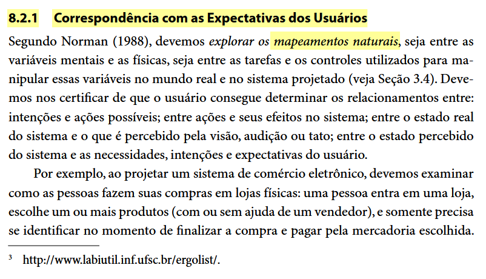
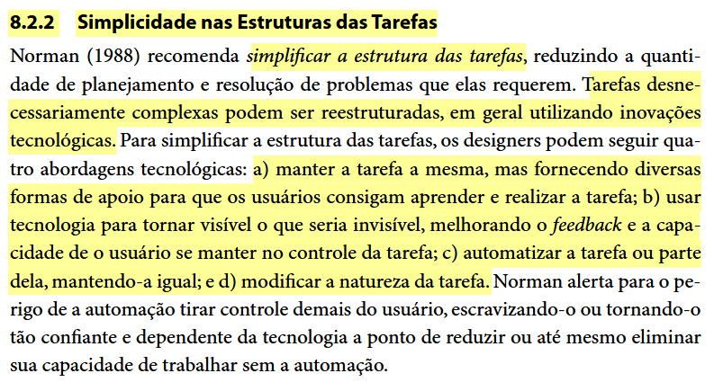
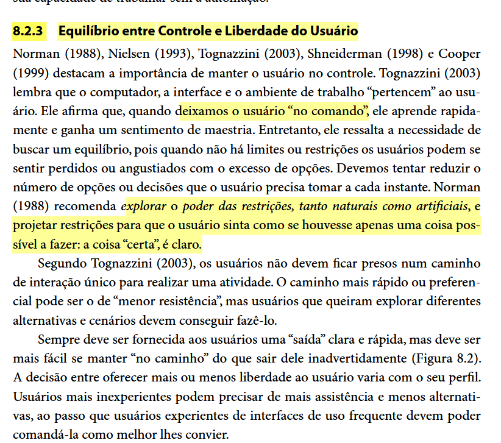
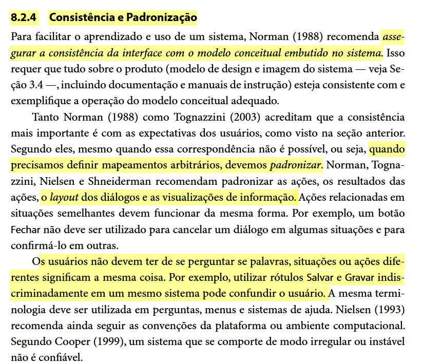
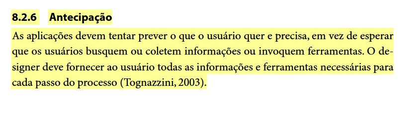
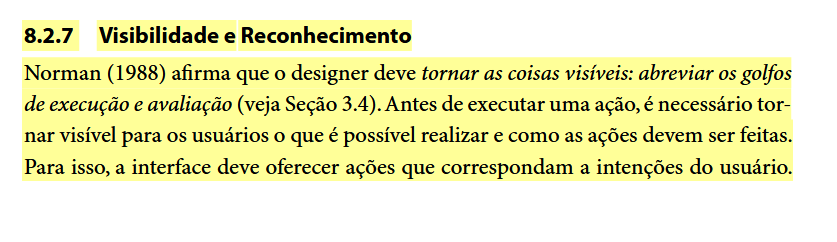
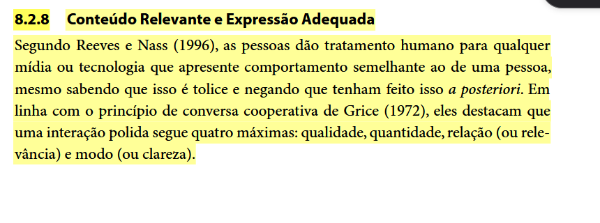
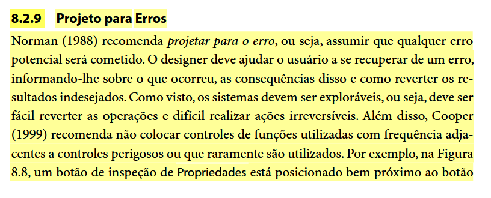
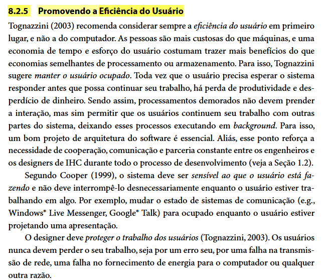

# Princípios Gerais de Projeto

## Tabela de contribuição

**Tabela 1 – Contribuições no artefato Princípios Gerais de Projeto**

| Integrante | Contribuição | Atividade (link) | Gravação (link) |
| --- | --- | --- | --- |
| Alexandre Vilar Valadares Fonsêca | Adição dos princípios gerais e conformidades do Detran-DF (v1.1, com Henrique Schneider) | — | — |
| Gabriel Robson Nunes Neiva da Silva | — | — | — |
| Henrique Schneider Fernandes da Rosa | Criação do documento (v1.0) e adição dos princípios gerais e conformidades do Detran-DF (v1.1, com Alexandre Vilar) | [Commit d803534](https://github.com/Interacao-Humano-Computador/2026.2-Grupo03/commit/d803534); [commit 54c77f2](https://github.com/Interacao-Humano-Computador/2026.2-Grupo03/commit/54c77f2) | — |
| João Vitor Tavares de Sá Lima | Revisão da v1.1 | — | — |

Fonte: elaborado pelos autores (2026).

## Histórico de versões

**Tabela 2 – Histórico de versões do artefato Princípios Gerais de Projeto**

| Data | Versão | Descrição | Autor(es) | Revisor(es) |
| --- | --- | --- | --- | --- |
| 06/10/2026 | 1.0 | Criação do Documento | Henrique Schneider | Integrantes do Grupo |
| 06/10/2026 | 1.1 | Adição dos principios gerais e conformidades do Detran-DF | Henrique Schneider, Alexandre Vilar | João Vitor |
| 15/10/2026 | 1.2 | Padronização da estrutura (tabela de contribuição, seções numeradas), conversão dos "Quadros" com fotos do livro em Figuras com legenda, texto alternativo e fonte, correção da página das Figuras 1 e 2 (p. 265) após conferência no livro e inclusão da seção de uso de IA | Henrique Schneider | — |
| 17/10/2026 | 1.3 | Revisão das citações de Tognazzini (2003) e Cooper (1999), feitas por meio de Barbosa e Silva (2010), e organização da página | Henrique Schneider | — |

Fonte: elaborado pelos autores (2026).

## 1. Introdução e fundamentação teórica

Segundo Barbosa e Silva (2010), a construção de interfaces de usuário apoia-se em princípios e diretrizes projetados para garantir uma boa qualidade de uso. A literatura destaca a importância de explorar o mapeamento natural entre as variáveis mentais e físicas, e simplificar a estrutura das tarefas para reduzir a sobrecarga cognitiva do usuário.

**Figura 1 – Trecho de Barbosa e Silva (2010, cap. 8, seç. 8.2, p. 265) com os tópicos dos princípios e diretrizes gerais**

Fonte: Barbosa e Silva (2010, cap. 8, seç. 8.2, p. 265).

## 2. Diretrizes e princípios aplicados ao Detran-DF

A avaliação e o projeto da interface do portal do Detran-DF estão embasados em 8 (oito) princípios e tópicos gerais de projeto descritos por Barbosa e Silva (2010). A aplicação de cada princípio visa solucionar rupturas de usabilidade específicas observadas no contexto do cidadão que busca serviços de trânsito.

A Figura 1 mostra a lista de tópicos; as Figuras 2 a 10 trazem o trecho do livro correspondente a cada princípio.

### 2.1 Correspondência com as expectativas dos usuários

*   **Fundamentação:** O design deve explorar mapeamentos naturais entre intenções, ações e resultados visíveis, utilizando conceitos familiares ao invés de jargões de sistema.
*   **Aplicação no Detran-DF:** O portal deve adotar nomenclaturas claras e do dia a dia do cidadão (ex: "Débitos e Multas" ao invés de termos puramente legais ou técnicos obscuros) para que a navegação seja intuitiva.

**Figura 2 – Trecho de Barbosa e Silva (2010, cap. 8, seç. 8.2.1, p. 265) sobre correspondência com as expectativas dos usuários**

Fonte: Barbosa e Silva (2010, cap. 8, seç. 8.2.1, p. 265).

### 2.2 Simplicidade nas estruturas das tarefas

*   **Fundamentação:** Reduzir a quantidade de planejamento e resolução de problemas necessários para a conclusão de uma tarefa, eliminando passos desnecessários.
*   **Aplicação no Detran-DF:** Simplificar o fluxo de emissão de guias de pagamento (PIX ou Boleto) garantindo que o usuário chegue ao seu objetivo no menor número de passos possível, minimizando preenchimentos repetitivos.

**Figura 3 – Trecho de Barbosa e Silva (2010, cap. 8, seç. 8.2.2, p. 267) sobre simplicidade nas estruturas das tarefas**

Fonte: Barbosa e Silva (2010, cap. 8, seç. 8.2.2, p. 267).

### 2.3 Equilíbrio entre controle e liberdade do usuário

*   **Fundamentação:** Os usuários devem sentir que controlam o sistema e que este responde às suas ações. O sistema deve disponibilizar opções claras de cancelar, desfazer e refazer (a "saída de emergência").
*   **Aplicação no Detran-DF:** As solicitações irreversíveis, como a solicitação de uma 2ª via de CNH, não devem avançar diretamente para o pagamento. O sistema deve fornecer telas intermediárias com botões visíveis de "Cancelar" e "Voltar".

**Figura 4 – Trecho de Barbosa e Silva (2010, cap. 8, seç. 8.2.3, p. 267) sobre equilíbrio entre controle e liberdade do usuário**

Fonte: Barbosa e Silva (2010, cap. 8, seç. 8.2.3, p. 267).

### 2.4 Consistência e padronização

*   **Fundamentação:** A consistência evita que o usuário tenha dúvidas se palavras, símbolos ou ações diferentes significam a mesma coisa.
*   **Aplicação no Detran-DF:** Manter a consistência visual em todo o portal, garantindo que botões principais (como o login via Gov.br) não apresentem estados confusos ou aparência "esmaecida" de forma inconsistente após uma falha de conexão.

**Figura 5 – Trecho de Barbosa e Silva (2010, cap. 8, seç. 8.2.4, p. 270) sobre consistência e padronização**

Fonte: Barbosa e Silva (2010, cap. 8, seç. 8.2.4, p. 270).

### 2.5 Antecipação

*   **Fundamentação:** O software deve antecipar as necessidades do usuário, fornecendo informações e ferramentas adequadas para cada passo do processo.
*   **Aplicação no Detran-DF:** Ao invés de aguardar que o cidadão erre o preenchimento da Placa ou Renavam, o formulário deve conter máscaras de entrada e instruções proativas sobre o formato correto esperado.

**Figura 6 – Trecho de Barbosa e Silva (2010, cap. 8, seç. 8.2.6, p. 272) sobre antecipação das necessidades do usuário**

Fonte: Barbosa e Silva (2010, cap. 8, seç. 8.2.6, p. 272).

### 2.6 Visibilidade e reconhecimento

*   **Fundamentação:** Avaliar o estado corrente do sistema, mantendo o usuário informado sobre as operações em andamento por meio de feedback imediato e claro.
*   **Aplicação no Detran-DF:** Ao emitir um boleto ou submeter uma consulta, o sistema deve exibir mensagens temporárias (toast ou modais) confirmando o processamento antes de prosseguir com a ação de download.

**Figura 7 – Trecho de Barbosa e Silva (2010, cap. 8, seç. 8.2.7, p. 273) sobre visibilidade e reconhecimento**

Fonte: Barbosa e Silva (2010, cap. 8, seç. 8.2.7, p. 273).

### 2.7 Conteúdo relevante e expressão adequada

*   **Fundamentação:** O sistema deve tomar a iniciativa de oferecer ajuda focada na tarefa do usuário e evitar apresentar informações ou passos inúteis que o sobrecarreguem. A documentação deve ser concisa e focada em ações concretas.
*   **Aplicação no Detran-DF:** Inserir guias rápidos e instruções contextuais nas telas de preenchimento, ajudando o cidadão na hora exata em que ele precisa emitir uma taxa, já que o portal atualmente não conta com guias passo a passo integrados aos formulários.

**Figura 8 – Trecho de Barbosa e Silva (2010, cap. 8, seç. 8.2.8, p. 275) sobre conteúdo relevante e expressão adequada**

Fonte: Barbosa e Silva (2010, cap. 8, seç. 8.2.8, p. 275).

### 2.8 Projeto para erros

*   **Fundamentação:** O sistema deve ter um design que se preocupe ativamente em prevenir erros. Quando os erros ocorrem, as mensagens devem indicar de forma construtiva como corrigir o problema, ao invés de mensagens vagas.
*   **Aplicação no Detran-DF:** Corrigir as mensagens de erro vagas (como "Carro não encontrado"). O sistema deve especificar visualmente qual campo (Placa ou Renavam) contém a divergência, sugerindo a correção correta ao cidadão. Deve também tratar falhas críticas de autenticação sem forçar o fechamento completo da sessão do usuário.

**Figura 9 – Trecho de Barbosa e Silva (2010, cap. 8, seç. 8.2.9, p. 277) sobre projeto para erros**

Fonte: Barbosa e Silva (2010, cap. 8, seç. 8.2.9, p. 277).

### 2.9 Promoção da eficiência do usuário

*   **Fundamentação:** Segundo Tognazzini (2003 apud Barbosa; Silva, 2010, cap. 8, seç. 8.2.5, p. 271), ao projetar um sistema interativo, deve-se considerar sempre a eficiência do usuário em primeiro lugar, e não a do computador. As pessoas são mais custosas do que as máquinas, de modo que uma economia no tempo e esforço cognitivo do usuário costuma trazer mais benefícios reais. O sistema deve manter o usuário produtivo e evitar interrompê-lo desnecessariamente com processos de *background* ou passos burocráticos irrelevantes para sua tarefa atual.

Além disso, Cooper (1999 apud Barbosa; Silva, 2010, cap. 8, seç. 8.2.5, p. 271) reforça que o sistema deve proteger o trabalho dos usuários, garantindo que eles não percam seu progresso ou informações preenchidas devido a erros de navegação, quedas de conexão ou *timeouts* excessivamente rigorosos.

A avaliação heurística e o projeto de interface do portal do Detran-DF incorporam as diretrizes de promoção da eficiência do usuário, buscando eliminar gargalos que desperdiçam o tempo do cidadão e do servidor durante a busca por serviços de trânsito.

*   **Aplicação no Detran-DF:** A avaliação heurística e o projeto de interface do portal do Detran-DF incorporam as diretrizes de promoção da eficiência do usuário, buscando eliminar gargalos que desperdiçam o tempo do cidadão e do servidor durante a busca por serviços de trânsito.

#### 2.9.1 Minimização do Tempo de Espera e Navegação

*   **Fundamentação:** O sistema não deve exigir que o usuário percorra caminhos longos ou aguarde processamentos travados na tela para realizar tarefas rotineiras. Os fluxos devem ser ágeis e exigir o menor número de cliques possível.
*   **Aplicação no Detran-DF:** O portal deve manter e aprimorar a seção de atalhos rápidos na página inicial (*Home*), permitindo que serviços altamente requisitados (como a consulta de CNH e a emissão de débitos) sejam acessados diretamente por usuários experientes e novatos, sem a necessidade de navegar por múltiplos submenus.

#### 2.9.2 Proteção do Trabalho e dos Dados do Usuário

*   **Fundamentação:** O usuário nunca deve perder os dados preenchidos em um formulário extenso por falhas de sessão ou *timeout*, sendo dever do sistema proteger esse progresso.
*   **Aplicação no Detran-DF:** O portal deve tratar de forma elegante as quedas de sessão na integração com o Gov.br. Ao invés de travar o portal e forçar o fechamento do navegador (o que descarta qualquer preenchimento feito pelo usuário), o sistema deve oferecer uma forma de "Reconectar" e retomar o serviço exatamente do ponto onde parou.

#### 2.9.3 Redução de Passos Intermediários Desnecessários

*   **Fundamentação:** Processos demorados ou que bloqueiam a atenção devem ser evitados, liberando o usuário para prosseguir rapidamente.
*   **Aplicação no Detran-DF:** A simplificação do fluxo de pagamento (disponibilização de código PIX diretamente na tela, sem exigir múltiplos downloads e aberturas de PDFs) é uma forma direta de priorizar o tempo e a conveniência do cidadão, tornando a tarefa final eficiente.

**Figura 10 – Trecho de Barbosa e Silva (2010, cap. 8, seç. 8.2.5, p. 271) sobre a promoção da eficiência do usuário**

Fonte: Barbosa e Silva (2010, cap. 8, seç. 8.2.5, p. 271).

## Referências bibliográficas

BARBOSA, Simone Diniz Junqueira; SILVA, Bruno Santana da. *Interação Humano-Computador*. Rio de Janeiro: Elsevier, 2010.

SALES, André Barros de. *Plano de Ensino: Interação Humano Computador (FGA0173), 02/2026, Turma 01, v1*. Brasília: Universidade de Brasília, 2026.

## Agradecimentos e uso de IA generativa

**Uso de IA generativa nesta página.** O Claude (Anthropic) foi utilizado, a pedido de Henrique Schneider, para padronizar a página no modelo de artefato da disciplina (tabela de contribuição, histórico e seções numeradas); organizar as fotos do livro já incluídas pelos autores como Figuras numeradas, com legenda acima, texto alternativo e fonte abaixo; conferir no livro de Barbosa e Silva (2010) a página de cada figura, corrigindo a das Figuras 1 e 2 (de p. 264 para p. 265); renumerar a subseção de eficiência do usuário, que repetia o número 8; e padronizar as citações de Tognazzini (2003) e Cooper (1999) na forma *apud*. Fundamentações e aplicações ao Detran-DF não foram alteradas. A ferramenta não é autora do artefato e seu uso não exime os autores da responsabilidade sobre o conteúdo (SALES, 2026, p. 3).
