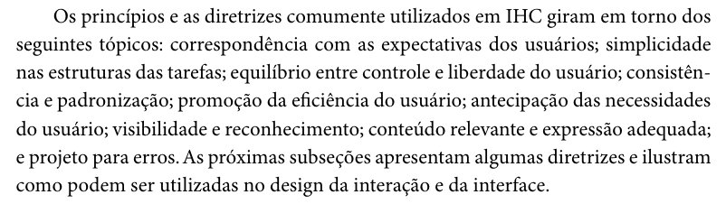
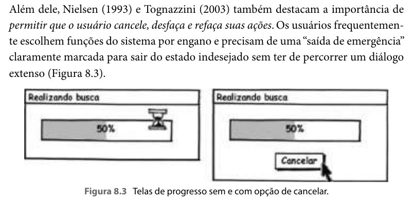
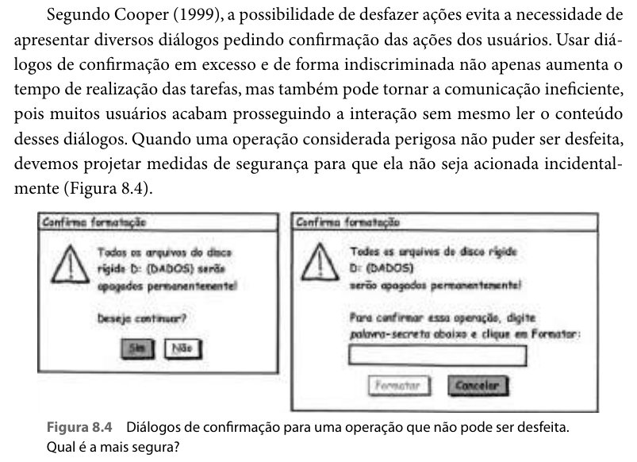
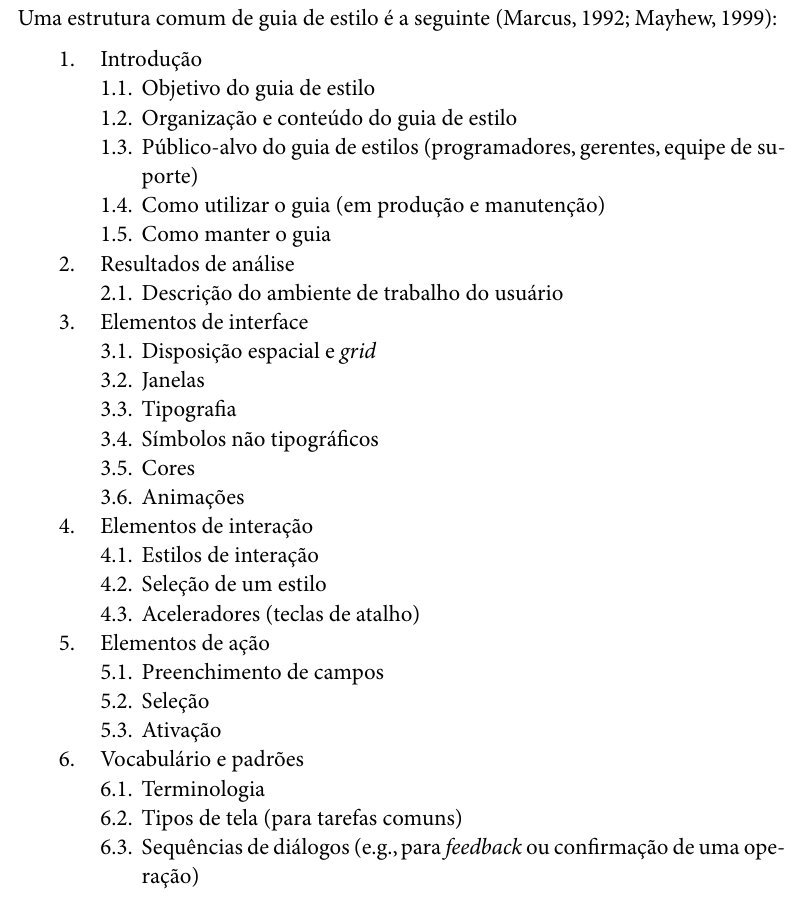
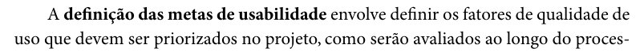
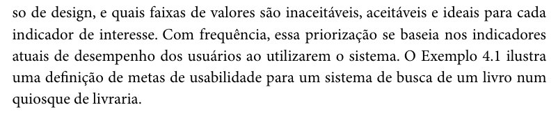
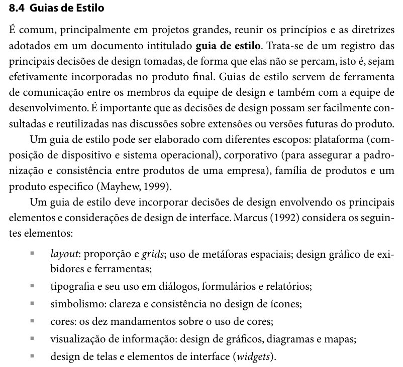
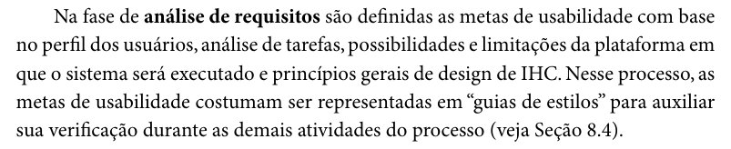

# Entrega 3 – Inspeção do Grupo 07 (Grupo +1)

## Tabela de contribuição

**Tabela 1 – Contribuições no artefato Inspeção da Entrega 3 do Grupo 07**

| Integrante | Contribuição | Atividade (link) | Gravação (link) |
| --- | --- | --- | --- |
| Alexandre Vilar Valadares Fonsêca | Inspeção em dupla (com João Vitor); autoria dos itens adicionais 20 a 22 | Tabela 5, itens 20–22 | [Inspeção em dupla](https://www.youtube.com/watch?v=ObXAAFdPD_I) |
| Gabriel Robson Nunes Neiva da Silva | — | — | — |
| Henrique Schneider Fernandes da Rosa | Inspeção individual; autoria dos itens adicionais 11 a 15 | Tabela 5, itens 11–15 | [Inspeção individual](https://youtu.be/TYv1vovnuYc) |
| João Vitor Tavares de Sá Lima | Inspeção em dupla (com Alexandre Vilar); autoria dos itens adicionais 16 a 19 | Tabela 5, itens 16–19 | [Inspeção em dupla](https://www.youtube.com/watch?v=ObXAAFdPD_I) |

Fonte: elaborado pelos autores (2026), com base no relatório de inspeção (Grupo 03, 2026).

## Histórico de versões

**Tabela 2 – Histórico de versões do artefato Inspeção da Entrega 3 do Grupo 07**

| Data | Versão | Descrição | Autor(es) | Revisor(es) |
| --- | --- | --- | --- | --- |
| 10/10/2026 | 1.0 | Relatório de inspeção entregue em PDF no Moodle | Alexandre Vilar, João Vitor Tavares e Henrique Schneider | — |
| 15/10/2026 | 1.1 | Transcrição do relatório para o site (metodologia, 22 itens com respostas, horários, fontes e autores, ferramentas e uso de IA) | Henrique Schneider | — |
| 17/10/2026 | 1.2 | Inclusão das fotos das fontes dos itens adicionais (Figuras 1 a 8), correção das páginas citadas nos itens 16, 17 e 19 e identificação das duas avaliações | Henrique Schneider | — |

Fonte: elaborado pelos autores (2026).

## 1. Introdução

Esta página registra a inspeção feita pelo Grupo 03 sobre a Entrega 3 (Princípios Gerais de Projeto, Metas de Usabilidade e Guia de Estilo) do Grupo 07. O conteúdo foi transcrito do relatório de inspeção entregue no Moodle (Grupo 03, 2026). A Tabela 3 reúne os dados de identificação.

**Tabela 3 – Identificação da inspeção**

| Campo | Registro |
| --- | --- |
| Grupo inspecionado | Grupo 07 (Grupo +1) – <https://interacao-humano-computador.github.io/2026.2-Grupo07/> |
| Etapa avaliada | Entrega 3 – Princípios Gerais de Projeto, Metas de Usabilidade e Guia de Estilo |
| Data da inspeção | 10/10/2026 |
| Gravação da inspeção em dupla (Alexandre Vilar e João Vitor) | <https://www.youtube.com/watch?v=ObXAAFdPD_I> (segundo o relatório, a reunião do Teams reaproveitada ainda tinha o nome "Entrega 2") |
| Gravação da inspeção individual (Henrique Schneider) | <https://youtu.be/TYv1vovnuYc> |

Fonte: Grupo 03 (2026).

## 2. Metodologia de execução da inspeção

Segundo o relatório, a inspeção não foi feita de forma síncrona por todos os integrantes do Grupo 03, por "conflitos imprevisíveis nas agendas dos integrantes". A equipe se dividiu em uma inspeção em dupla (Alexandre Vilar e João Vitor Tavares) e uma inspeção individual (Henrique Schneider). Cada avaliação aplicou as perguntas de verificação e registrou as próprias respostas; as respostas aos itens do professor foram alinhadas em discussão assíncrona no WhatsApp, e as duas respostas foram mantidas, com data e horário (Grupo 03, 2026, p. 2).

## 3. Itens verificados

Os itens 1 a 10 têm duas respostas, uma de cada avaliação (Tabela 4). A 1ª avaliação é a inspeção individual de Henrique Schneider: seus horários (20:50 a 21:08), assim como os dos itens 11 a 15, de autoria dele (21:09 a 21:12), ficam dentro da gravação dessa inspeção, iniciada às 20:48, na qual ele responde "Incompleto" ao item 08 por falta da foto do texto. A 2ª avaliação (22:13 a 22:22) é a inspeção em dupla de Alexandre Vilar e João Vitor Tavares, seguida dos itens 16 a 22, de autoria dos dois (22:23 a 22:28). Os itens 11 a 22 foram elaborados pelos integrantes, que aparecem como autores na Tabela 5.

**Tabela 4 – Itens do Plano de Ensino aplicados à Entrega 3 do Grupo 07**

| ID | Questão | Resposta – 1ª avaliação (individual) | Hora | Resposta – 2ª avaliação (dupla) | Hora |
| :---: | :--- | :---: | :---: | :---: | :---: |
| 01 | O GitHub Pages possui todos os 10 itens do desenvolvimento do projeto avaliados para o próprio grupo e para o grupo +1? | Incompleto | 20:55 | Incompleto | 22:13 |
| 02 | O documento descreve as características da plataforma para o projeto? (item 10) | Sim | 20:50 | Sim | 22:13 |
| 03 | Os princípios gerais do projeto estão definidos, com referência bibliográfica, foto do texto original e nome do autor do item? (item 11) | Sim | 20:52 | Sim | 22:14 |
| 04 | Os princípios gerais contemplam os 8 tópicos exigidos, com referência, foto do texto e autor do item? (item 12) | Sim | 20:54 | Sim | 22:15 |
| 05 | As metas de usabilidade ou os objetivos de uma avaliação estão estabelecidos, com referência, foto e autor do item? (item 13) | Sim | 20:57 | Sim | 22:16 |
| 06 | A razão da seleção das metas de usabilidade está justificada? (item 14) | Sim | 20:59 | Sim | 22:17 |
| 07 | O guia de estilo está presente, com referência explicando o que é um guia de estilo, foto do texto e autor do item? (item 15) | Sim | 21:00 | Sim | 22:18 |
| 08 | O guia de estilo possui a estrutura completa exigida (introdução; resultados de análise; elementos de interface, de interação e de ação; vocabulário e padrões)? (item 16) | Incompleto | 21:03 | Sim | 22:20 |
| 09 | O guia de estilo corresponde ao site avaliado? (item 17) | Sim | 21:06 | Sim | 22:21 |
| 10 | Cada integrante elaborou ao menos 1 item de conteúdo da disciplina com referência e foto do texto? | Sim | 21:08 | Sim | 22:22 |

Fonte: Grupo 03 (2026), transcrito do relatório de inspeção; questões adaptadas de Sales (2026, pp. 11–12). Todas as avaliações em 10/10/2026.

**Tabela 5 – Itens adicionais elaborados pelo Grupo 03**

| ID | Questão | Fonte | Resposta | Hora | Autor do item |
| :---: | :--- | :--- | :---: | :---: | :--- |
| 11 | A seção de Princípios Gerais inclui capturas de tela/fotos demonstrando as falhas/oportunidades de melhoria do site, com o nome do autor do item e as referências? | Barbosa e Silva (2010, cap. 8, p. 265, 268, 269) | Não | 21:09 | Henrique Schneider |
| 12 | Todos os artefatos da Entrega 3 identificam autor(es) e revisor(es) no histórico de versão, garantindo que nenhum integrante seja revisor do próprio trabalho no mesmo ciclo? | Plano de Ensino (p. 8) | Sim | 21:10 | Henrique Schneider |
| 13 | O grupo disponibiliza o cronograma executado da Entrega 3, com responsáveis, revisores e datas reais de início e término? | Plano de Ensino (p. 8) | Sim | 21:11 | Henrique Schneider |
| 14 | O documento apresenta uma introdução teórica definindo o que é um guia de estilo, seu objetivo no ciclo de vida de IHC e seu público-alvo, com foto do texto original? | Barbosa e Silva (2010, cap. 8, p. 283); comentários em sala de aula | Incompleto | 21:11 | Henrique Schneider |
| 15 | Todas as figuras, tabelas e quadros têm legenda/título na parte superior, fonte na parte inferior e chamadas no texto? | ABNT NBR 6023 (2018) | Sim | 21:12 | Henrique Schneider |
| 16 | A seção de Metas de Usabilidade indica quais metas foram selecionadas, com justificativa, texto de referência original e autor do item? | Barbosa e Silva (2010, cap. 4, seç. 4.3.2, pp. 105–106) | Sim | 22:23 | João Vitor Tavares |
| 17 | O guia de estilo apresenta os padrões de layout, tipografia, paleta de cores e componentes do site avaliado, com histórico de versão e autor do item? | Barbosa e Silva (2010, cap. 8, seç. 8.4, pp. 282–283) | Sim | 22:24 | João Vitor Tavares |
| 18 | As tabelas de verificação dos Princípios Gerais e Metas contêm resposta (Sim/Não/Incompleto), versão, data e hora preenchidos? | Barbosa e Silva, cap. 10 (pág. 153-159) | Incompleto | 22:24 | João Vitor Tavares |
| 19 | As metas de usabilidade relacionam as limitações da Análise de Tarefas e do Perfil de Usuário às soluções propostas? | Barbosa e Silva (2010, cap. 2 e cap. 4, seç. 4.3.3, p. 109) | Sim | 22:25 | João Vitor Tavares |
| 20 | O grupo relaciona os princípios de projeto a exemplos do site avaliado? | Barbosa e Silva (2010, seç. 8.2, p. 265) | Sim | 22:26 | Alexandre Vilar |
| 21 | O grupo explica como verificar se as metas de usabilidade foram alcançadas? | Barbosa e Silva (2010, seç. 4.3.2, pp. 105–106) | Sim | 22:27 | Alexandre Vilar |
| 22 | O guia de estilo do grupo define padrões de cores, fontes e organização das telas? | Barbosa e Silva (2010, seç. 8.4, pp. 282–283) | Sim | 22:28 | Alexandre Vilar |

Fonte: Grupo 03 (2026), transcrito do relatório de inspeção. Todas as avaliações em 10/10/2026.

Nos itens 16, 17 e 19, as páginas de Barbosa e Silva foram conferidas na edição de 2010 e corrigidas na Tabela 5; o relatório registra, respectivamente, "pág. 78-81", "pág. 134-142" e "pág. 46, 78-80". As Figuras 1 a 8 reproduzem os trechos de Barbosa e Silva (2010) citados como fonte dos itens 11, 14, 16, 17 e 19 a 22.

??? quote "Figura 1 – Trecho de Barbosa e Silva (2010, cap. 8, p. 265) citado nos itens 11 e 20"

    

    Fonte: Barbosa e Silva (2010, cap. 8, seç. 8.2, p. 265).

??? quote "Figura 2 – Trecho de Barbosa e Silva (2010, cap. 8, p. 268) citado no item 11"

    

    Fonte: Barbosa e Silva (2010, cap. 8, seç. 8.2.3, p. 268).

??? quote "Figura 3 – Trecho de Barbosa e Silva (2010, cap. 8, p. 269) citado no item 11"

    

    Fonte: Barbosa e Silva (2010, cap. 8, seç. 8.2.3, p. 269).

??? quote "Figura 4 – Trecho de Barbosa e Silva (2010, cap. 8, p. 283) citado nos itens 14, 17 e 22"

    

    Fonte: Barbosa e Silva (2010, cap. 8, seç. 8.4, p. 283).

??? quote "Figura 5 – Trecho de Barbosa e Silva (2010, cap. 4, p. 105) citado nos itens 16 e 21"

    

    Fonte: Barbosa e Silva (2010, cap. 4, seç. 4.3.2, p. 105).

??? quote "Figura 6 – Trecho de Barbosa e Silva (2010, cap. 4, p. 106) citado nos itens 16 e 21"

    

    Fonte: Barbosa e Silva (2010, cap. 4, seç. 4.3.2, p. 106).

??? quote "Figura 7 – Trecho de Barbosa e Silva (2010, cap. 8, p. 282) citado nos itens 17 e 22"

    

    Fonte: Barbosa e Silva (2010, cap. 8, seç. 8.4, p. 282).

??? quote "Figura 8 – Trecho de Barbosa e Silva (2010, cap. 4, p. 109) citado no item 19"

    

    Fonte: Barbosa e Silva (2010, cap. 4, seç. 4.3.3, p. 109).

## 4. Ferramentas utilizadas

Segundo o relatório, a inspeção usou o Microsoft Teams (realização e gravação das sessões), GitHub Pages e Git, Google Docs e Google Drive, e o Mozilla Firefox, em aba privada, sem cache prévio e sem extensões (Grupo 03, 2026).

## Referências

BARBOSA, Simone Diniz Junqueira; SILVA, Bruno Santana da. *Interação Humano-Computador*. Rio de Janeiro: Elsevier, 2010.

GRUPO 03. *Inspeção Grupo +1 (Grupo 7): Entrega 3*. Brasília: Universidade de Brasília, 2026. Disponível em: [PDF](../../assets/pdfs/entregas/inspecao-entrega-3-grupo-07.pdf).

SALES, André Barros de. *Plano de Ensino: Interação Humano Computador (FGA0173), 02/2026, Turma 01, v1*. Brasília: Universidade de Brasília, 2026.

## Agradecimentos e uso de IA generativa

### Declaração de uso de IA do relatório de inspeção (10/10/2026)

Segundo o relatório, o Riverside foi usado na transcrição automatizada das gravações das inspeções e na separação dos tópicos, e o Gemini (Google), na síntese e no refinamento textual das descrições da checklist, na organização das tabelas e na formatação do documento final (Grupo 03, 2026).

### Uso de IA generativa na transcrição e na padronização da página (15 e 17/10/2026)

O Claude (Anthropic) foi utilizado, a pedido de Henrique Schneider, para transcrever para o site o relatório de inspeção entregue pelo grupo (extração do texto do PDF e organização nas Tabelas 3 a 5), sem alterar perguntas, respostas, horários ou autores; para conferir no livro de Barbosa e Silva (2010) as páginas citadas como fonte dos itens adicionais, corrigindo as dos itens 16, 17 e 19; e para recortar as fotos dos trechos citados (Figuras 1 a 8). A ferramenta não é autora do artefato e seu uso não exime os autores da responsabilidade sobre o conteúdo (SALES, 2026, p. 3).
