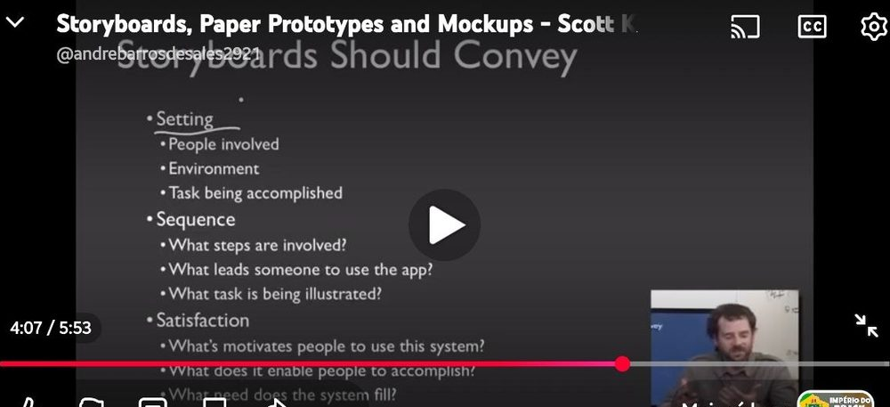

# Lista de Verificação – Storyboard

**Autoria:** Alexandre Vilar Valadares Fonsêca · **Entrega 4**

## Tabela de contribuição

**Tabela 1 – Contribuições no trabalho "Lista de Verificação – Storyboard"**

| Integrante | Contribuição | Atividade (link) | Gravação (link) |
| --- | --- | --- | --- |
| Alexandre Vilar Valadares Fonsêca | Autoria do trabalho (atividade individual) | Esta página | — |
| Gabriel Robson Nunes Neiva da Silva | Não se aplica (atividade individual) | — | — |
| Henrique Schneider Fernandes da Rosa | Não se aplica (atividade individual) | — | — |
| João Vitor Tavares de Sá Lima | Não se aplica (atividade individual) | — | — |

Fonte: elaborado pelos autores (2026).

## Histórico de versões

**Tabela 2 – Histórico de versões do trabalho "Lista de Verificação – Storyboard"**

| Data | Versão | Descrição | Autor(es) | Revisor(es) |
| --- | --- | --- | --- | --- |
| 13/10/2026 | 1.0 | Elaboração do trabalho, entregue no Moodle (prazo da atividade no Moodle) | Alexandre Vilar | — |
| 17/10/2026 | 1.1 | Publicação no site: transcrição, fotos das fontes, citações e referências no padrão da disciplina | Henrique Schneider | — |

Fonte: elaborado pelos autores (2026).

## 1. Introdução

Atividade individual do Moodle "Lista de verificação – Storyboard": elaborar itens para inspecionar os storyboards do projeto.

Cada item é uma pergunta autocontida, respondida com **Conforme**, **Não conforme** ou **Não se aplica**. Abaixo de cada item estão a fonte, com capítulo, seção e página, e a foto do trecho que o fundamenta, como pede a atividade de elaboração de listas de verificação (SALES, [2026], p. 1). Clique no título de cada figura para abrir a foto.

## 2. Itens da lista

### Item 1 – Pessoas Envolvidas

O storyboard identifica claramente as pessoas envolvidas na situação apresentada e seus papéis na realização da tarefa?

**Fonte:** Klemmer ([20--], 4:07, slide “Storyboards Should Convey”).

??? quote "Figura 1 – Trecho que fundamenta o item 1"

    

    Fonte: Klemmer ([20--], 4:07, slide “Storyboards Should Convey”).

### Item 2 – Ambiente

O storyboard apresenta o ambiente em que a interação ocorre, permitindo compreender o contexto de uso do sistema?

**Fonte:** Klemmer ([20--], 4:07, slide “Storyboards Should Convey”).

??? quote "Figura 2 – Trecho que fundamenta o item 2"

    

    Fonte: Klemmer ([20--], 4:07, slide “Storyboards Should Convey”).

### Item 3 – Tarefa Realizada

O storyboard deixa claro qual tarefa as pessoas estão realizando no contexto apresentado?

**Fonte:** Klemmer ([20--], 4:07, slide “Storyboards Should Convey”).

??? quote "Figura 3 – Trecho que fundamenta o item 3"

    

    Fonte: Klemmer ([20--], 4:07, slide “Storyboards Should Convey”).

### Item 4 – Etapas da Interação

O storyboard apresenta as etapas envolvidas na realização da tarefa em uma sequência clara e compreensível?

**Fonte:** Klemmer ([20--], 4:07, slide “Storyboards Should Convey”).

??? quote "Figura 4 – Trecho que fundamenta o item 4"

    

    Fonte: Klemmer ([20--], 4:07, slide “Storyboards Should Convey”).

### Item 5 – Situação que Leva ao Uso do Aplicativo

O storyboard apresenta a situação ou o acontecimento que leva a pessoa a utilizar o aplicativo?

**Fonte:** Klemmer ([20--], 4:07, slide “Storyboards Should Convey”).

??? quote "Figura 5 – Trecho que fundamenta o item 5"

    

    Fonte: Klemmer ([20--], 4:07, slide “Storyboards Should Convey”).

### Item 6 – Tarefa Ilustrada na Sequência

A sequência de cenas do storyboard permite compreender qual tarefa está sendo ilustrada e como ela é realizada?

**Fonte:** Klemmer ([20--], 4:07, slide “Storyboards Should Convey”).

??? quote "Figura 6 – Trecho que fundamenta o item 6"

    

    Fonte: Klemmer ([20--], 4:07, slide “Storyboards Should Convey”).

### Item 7 – Motivação para o Uso do Sistema

O storyboard evidencia o que motiva as pessoas a utilizar o sistema, como seus interesses, expectativas ou objetivos?

**Fonte:** Klemmer ([20--], 4:07, slide “Storyboards Should Convey”).

??? quote "Figura 7 – Trecho que fundamenta o item 7"

    

    Fonte: Klemmer ([20--], 4:07, slide “Storyboards Should Convey”).

### Item 8 – Resultados Possibilitados pelo Sistema

O storyboard demonstra o que o sistema permite que as pessoas realizem ou alcancem por meio de seu uso?

**Fonte:** Klemmer ([20--], 4:07, slide “Storyboards Should Convey”).

??? quote "Figura 8 – Trecho que fundamenta o item 8"

    

    Fonte: Klemmer ([20--], 4:07, slide “Storyboards Should Convey”).

### Item 9 – Necessidade Atendida pelo Sistema

O storyboard deixa claro qual necessidade das pessoas é atendida pelo sistema?

**Fonte:** Klemmer ([20--], 4:07, slide “Storyboards Should Convey”).

??? quote "Figura 9 – Trecho que fundamenta o item 9"

    

    Fonte: Klemmer ([20--], 4:07, slide “Storyboards Should Convey”).

### Item 10 – Simplicidade da Representação Visual

O storyboard utiliza desenhos e símbolos simples, suficientes para representar os elementos e as ações da interação, sem depender de detalhes visuais de um produto acabado?

**Fonte:** Preece, Rogers e Sharp (2005, p. 264).

??? quote "Figura 10 – Trecho que fundamenta o item 10"

    

    Fonte: Preece, Rogers e Sharp (2005, p. 264).

### Item 11 – Complementação do Cenário Escrito

Quando utilizado em conjunto com um cenário escrito, o storyboard acrescenta detalhes visuais que ajudam a compreender a interação descrita nesse cenário?

**Fonte:** Preece, Rogers e Sharp (2005, p. 263).

??? quote "Figura 11 – Trecho que fundamenta o item 11"

    

    Fonte: Preece, Rogers e Sharp (2005, p. 263).

### Item 12 – Simulação da Interação

O storyboard permite que as pessoas envolvidas no projeto simulem mentalmente a interação do usuário com o produto ao observar as cenas apresentadas?

**Fonte:** Preece, Rogers e Sharp (2005, p. 263).

??? quote "Figura 12 – Trecho que fundamenta o item 12"

    

    Fonte: Preece, Rogers e Sharp (2005, p. 263).

## Referências

KLEMMER, Scott. *Storyboards, paper prototypes and mockups*. [*S. l.*: *s. n.*], [20--]. 1 vídeo (5 min 53 s). Publicado no canal da disciplina no YouTube.

PREECE, Jennifer; ROGERS, Yvonne; SHARP, Helen. *Design de interação*: além da interação homem-computador. Porto Alegre: Bookman, 2005.

SALES, André Barros de. *Lista de Exercícios*: elaborar listas de verificação. Brasília: Universidade de Brasília, [2026]. Enunciado da atividade avaliativa Verificação 2.

SALES, André Barros de. *Plano de Ensino*: Interação Humano Computador (FGA0173), 02/2026, Turma 01, v1. Brasília: Universidade de Brasília, 2026.

## Agradecimentos e uso de IA generativa

**Uso de IA generativa nesta página.** O Claude (Anthropic) foi utilizado na transcrição do documento original para o site e na padronização da formatação, das legendas, das citações e das referências às normas da disciplina. O conteúdo do trabalho é de Alexandre Vilar, indicado(a) na tabela de contribuição. A ferramenta não é autora do artefato e seu uso não exime os autores da responsabilidade sobre o conteúdo (SALES, 2026, p. 3).
