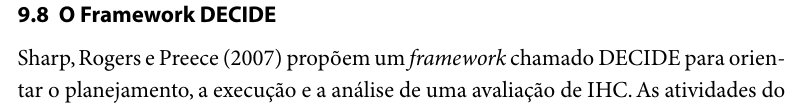
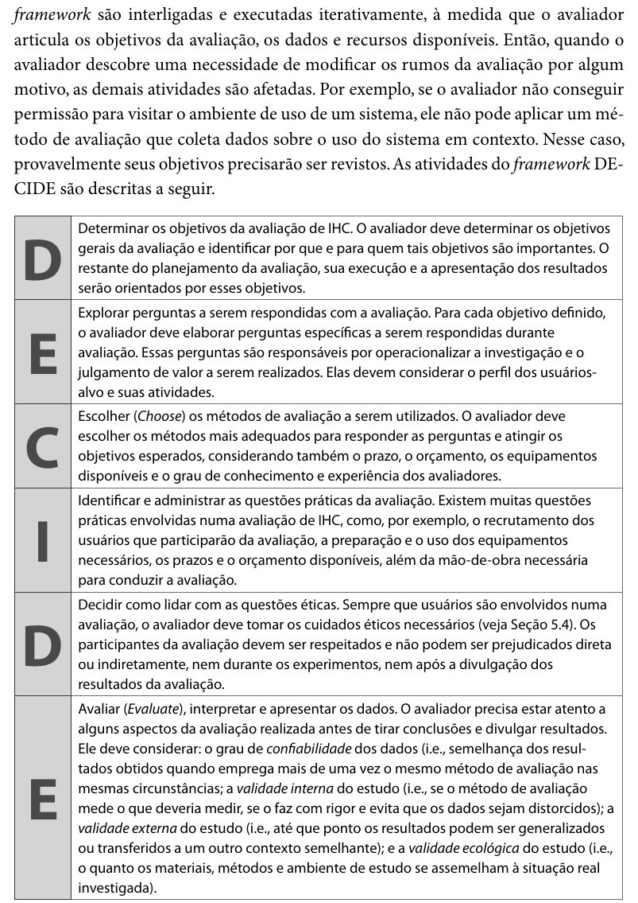

# Planejamento da Entrega 4 — Alexandre Vilar Valadares Fonsêca

**Projeto da Disciplina de Interação Humano-Computador (2026.2)**
Universidade de Brasília — Campus Darcy Ribeiro / FCTE — Turma 01
Prof. Dr. André Barros de Sales — **Grupo 03**

Integrantes do grupo: Alexandre Vilar, Gabriel Robson, Henrique Schneider e João Vitor.

## Tabela de contribuição

**Tabela 1 – Contribuições no artefato Planejamento da Entrega 4 – Alexandre Vilar**

| Integrante | Contribuição | Atividade (link) | Gravação (link) |
| --- | --- | --- | --- |
| Alexandre Vilar Valadares Fonsêca | Cronogramas individuais do planejamento da avaliação do storyboard, do relato dos resultados e da HTA (Relatório da Entrega 4, pp. 7–14) | [Relatório da Entrega 4](../../../assets/pdfs/entregas/relatorio-entrega-4-grupo-03.pdf) | — |
| Gabriel Robson Nunes Neiva da Silva | Não se aplica (página individual de Alexandre Vilar) | — | — |
| Henrique Schneider Fernandes da Rosa | Publicação da página no site | [Commit 661c014](https://github.com/Interacao-Humano-Computador/2026.2-Grupo03/commit/661c014) | — |
| João Vitor Tavares de Sá Lima | Não se aplica (página individual de Alexandre Vilar) | — | — |

Fonte: elaborado pelos autores (2026).

## Histórico de versões

**Tabela 2 – Histórico de versões do artefato Planejamento da Entrega 4 – Alexandre Vilar**

| Data | Versão | Descrição | Autor(es) | Revisor(es) |
| :---: | :---: | :--- | :--- | :--- |
| 06/10/2026 | 1.0 | Criação do Documento | Henrique Schneider | Integrantes do grupo |
| 13/10/2026 | 2.0 | Atualização do Documento | Henrique Schneider | Integrantes do grupo |
| 15/10/2026 | 2.1 | Padronização da estrutura no modelo da disciplina (tabela de contribuição, legenda do histórico corrigida, introdução, seções numeradas, legendas dos cronogramas, seções do storyboard e da relação com a análise de tarefas) e inclusão da seção de uso de IA | Henrique Schneider | — |
| 17/10/2026 | 2.2 | Organização por entrega; fotos das fontes; revisão das citações e das referências; reorganização das seções | Henrique Schneider | — |

Fonte: elaborado pelos autores (2026).

## 1. Introdução

Esta página reúne o planejamento individual de Alexandre Vilar para a Entrega 4: os cronogramas do planejamento da avaliação do storyboard, do relato dos resultados e da avaliação da análise de tarefas (HTA). O planejamento comum do grupo, pelo framework DECIDE, está na página [Planejamento da Avaliação (DECIDE)](../../planejamento-da-avaliacao/decide.md).

## 2. Framework DECIDE

O planejamento da avaliação de Interação Humano-Computador (IHC) deste projeto é estruturado com base no framework **DECIDE**, proposto por Sharp, Rogers e Preece (2007 apud Barbosa; Silva, 2010, cap. 9, seç. 9.8, p. 312) e sistematizado por Barbosa e Silva (2010). O objetivo do framework é orientar e documentar, de maneira metódica, rigorosa e iterativa, a condução da avaliação por meio de seis etapas ordenadas.

A Tabela 3 apresenta essas seis etapas.

**Tabela 3 – Etapas do framework DECIDE**

| Letra | Etapa | Descrição |
|:-----:|-------|-----------|
| **D** | Determinar os Objetivos (*Determine goals*) | Define o propósito técnico e o escopo da avaliação de IHC. Busca identificar problemas de usabilidade, navegabilidade e acessibilidade na interface do portal (por exemplo, validar a fidelidade e a correspondência do fluxo do Storyboard com a realidade do cidadão, bem como diagnosticar lacunas no cumprimento dos objetivos de uso durante a Análise de Tarefas). |
| **E** | Explorar Questões de Avaliação (*Explore questions*) | Desdobra os objetivos gerais em perguntas específicas e operacionais que guiarão o trabalho do avaliador durante as sessões de investigação e inspeção. |
| **C** | Escolher os Métodos de Avaliação (*Choose evaluation methods*) | Seleciona as técnicas de avaliação de IHC mais adequadas para responder às questões formuladas (por exemplo, inspeção heurística ou entrevistas guiadas com usuários com base nas personas estabelecidas). |
| **I** | Identificar e Administrar as Questões Práticas (*Identify practical issues*) | Gerencia a infraestrutura, a logística e os recursos indispensáveis para viabilizar a avaliação: perfil e recrutamento de participantes, preparação do ambiente e dos equipamentos (hardware/software), disponibilidade do Storyboard/protótipo (impresso ou digital) e realização prévia do Teste-Piloto. |
| **D** | Decidir como Lidar com as Questões Éticas (*Decide on ethical issues*) | Garante a salvaguarda e o respeito à dignidade dos participantes por meio do Termo de Consentimento Livre e Esclarecido (TCLE), assegurando anonimato, privacidade e direito de desistência sem penalidades (quando houver envolvimento de usuários reais). |
| **E** | Avaliar, Interpretar e Apresentar os Dados (*Evaluate, analyze, and present data*) | Estabelece como os dados brutos coletados serão consolidados, categorizados e interpretados, servindo de base para o diagnóstico de problemas e a elaboração de recomendações de redesign. |

Fonte: elaborado pelos autores (2026), com base em Barbosa e Silva (2010, cap. 9, seç. 9.8, pp. 312–313).

As Figuras 1 e 2 mostram os trechos de Barbosa e Silva (2010) em que a Tabela 3 se baseia.

??? quote "Figura 1 – Trecho de Barbosa e Silva (2010, p. 312) sobre a origem do framework DECIDE"

    

    Fonte: Barbosa e Silva (2010, cap. 9, seç. 9.8, p. 312).

??? quote "Figura 2 – Trecho de Barbosa e Silva (2010, p. 313) com as atividades do framework DECIDE"

    

    Fonte: Barbosa e Silva (2010, cap. 9, seç. 9.8, p. 313).

## 3. Cronogramas de Alexandre Vilar

As Tabelas 4 a 6 apresentam os cronogramas individuais.

### 3.1 Cronograma do planejamento da Avaliação de Storyboard

**Tabela 4 – Cronograma do planejamento da avaliação do storyboard – Alexandre Vilar**

| Nº | Nome da Tarefa | Integrante | Data de Início | Data de Fim |
|:-:|---|---|:-:|:-:|
| 1 | Definição dos Objetivos da Avaliação (Framework DECIDE - D) | Alexandre Vilar Valadares Fonsêca | 15/10/2026 | 15/10/2026 |
| 2 | Elaboração das Questões de Avaliação (Framework DECIDE - E) | Alexandre Vilar Valadares Fonsêca | 16/10/2026 | 17/10/2026 |
| 3 | Seleção do Método e Ferramentas de Investigação (Framework DECIDE - C) | Alexandre Vilar Valadares Fonsêca | 16/10/2026 | 18/10/2026 |
| 4 | Gestão das Questões Práticas e Logística de Recrutamento (Framework DECIDE - I) | Alexandre Vilar Valadares Fonsêca | 16/10/2026 | 18/10/2026 |
| 5 | Elaboração do Termo de Consentimento - TCLE e Salvaguardas Éticas (Framework DECIDE - D) | Alexandre Vilar Valadares Fonsêca | 19/10/2026 | 19/10/2026 |
| 6 | Planejamento da Análise de Dados e Estrutura do Relato (Framework DECIDE - E) | Alexandre Vilar Valadares Fonsêca | 20/10/2026 | 21/10/2026 |
| 7 | Execução do Teste-Piloto da Avaliação do Storyboard | Alexandre Vilar Valadares Fonsêca | 20/10/2026 | 24/10/2026 |
| 8 | Condução das Sessões de Avaliação e Coleta de Dados com Participantes | Alexandre Vilar Valadares Fonsêca | 21/10/2026 | 24/10/2026 |
| 9 | Consolidação, Análise Qualitativa dos Dados e Redação do Relato dos Resultados | Alexandre Vilar Valadares Fonsêca | 21/10/2026 | 24/10/2026 |
| 10 | Revisão Geral, Publicação no GitHub Pages e Gravação do Vídeo da Entrega | Alexandre Vilar Valadares Fonsêca | 24/10/2026 | 25/10/2026 |

Fonte: elaborado pelos autores (2026).

### 3.2 Cronograma do planejamento do Relato de Resultados da Avaliação

**Tabela 5 – Cronograma do planejamento do relato dos resultados – Alexandre Vilar**

| Nº | Tarefa | Integrante | Data de Início | Data de Fim |
|:-:|---|---|:-:|:-:|
| 1 | Definição da estrutura e tópicos do relatório de resultados | Alexandre Vilar Valadares Fonsêca | 19/10/2026 | 19/10/2026 |
| 2 | Elaboração do modelo de tabelas para consolidação dos problemas e sugestões | Alexandre Vilar Valadares Fonsêca | 19/10/2026 | 19/10/2026 |
| 3 | Definição dos critérios de análise e categorização dos dados qualitativos | Alexandre Vilar Valadares Fonsêca | 20/10/2026 | 20/10/2026 |
| 4 | Estruturação da seção de recomendações de reprojeto e cronograma de correção | Alexandre Vilar Valadares Fonsêca | 20/10/2026 | 21/10/2026 |
| 5 | Revisão cruzada e formatação do planejamento no GitHub Pages | Alexandre Vilar Valadares Fonsêca | 22/10/2026 | 23/10/2026 |
| 6 | Fechamento e publicação final da Entrega 4 | Alexandre Vilar Valadares Fonsêca | 23/10/2026 | 25/10/2026 |

Fonte: elaborado pelos autores (2026).

### 3.3 Cronograma do planejamento do HTA

**Tabela 6 – Cronograma do planejamento da avaliação da HTA – Alexandre Vilar**

| Nº | Tarefa | Integrante | Data de Início | Data de Fim |
|:-:|---|---|:-:|:-:|
| 1 | Definição dos Objetivos da Avaliação da HTA (Framework DECIDE - D) | Alexandre Vilar Valadares Fonsêca | 14/10/2026 | 14/10/2026 |
| 2 | Elaboração das Questões de Avaliação da HTA (Framework DECIDE - E) | Alexandre Vilar Valadares Fonsêca | 14/10/2026 | 14/10/2026 |
| 3 | Seleção e Justificativa do Método de Inspeção (Framework DECIDE - C) | Alexandre Vilar Valadares Fonsêca | 15/10/2026 | 16/10/2026 |
| 4 | Definição da Infraestrutura e Material de Apoio (Framework DECIDE - I) | Alexandre Vilar Valadares Fonsêca | 15/10/2026 | 16/10/2026 |
| 5 | Definição da Diretriz Ética de Inspeção Analítica (Framework DECIDE - D) | Alexandre Vilar Valadares Fonsêca | 16/10/2026 | 17/10/2026 |
| 6 | Planejamento da Consolidação e Relato dos Dados (Framework DECIDE - E) | Alexandre Vilar Valadares Fonsêca | 18/10/2026 | 19/10/2026 |
| 7 | Execução do Teste-Piloto da Inspeção das Tabelas HTA | Alexandre Vilar Valadares Fonsêca | 19/10/2026 | 20/10/2026 |
| 8 | Condução da Inspeção Técnica nos Diagramas e Tabelas HTA | Alexandre Vilar Valadares Fonsêca | 21/10/2026 | 22/10/2026 |
| 9 | Consolidação do Relatório e Lista de Erros Encontrados na HTA | Alexandre Vilar Valadares Fonsêca | 22/10/2026 | 23/10/2026 |
| 10 | Revisão Final, Publicação no GitHub Pages e Formatação Markdown | Alexandre Vilar Valadares Fonsêca | 24/10/2026 | 25/10/2026 |

Fonte: elaborado pelos autores (2026).

## Referências Bibliográficas

BARBOSA, Simone Diniz Junqueira; SILVA, Bruno Santana da. *Interação Humano-Computador*. Rio de Janeiro: Elsevier, 2010.

GRUPO 03. *Planejamento Entrega 4*. Brasília: Universidade de Brasília, 2026. Disponível em: [PDF](../../../assets/pdfs/entregas/relatorio-entrega-4-grupo-03.pdf).

SALES, André Barros de. *Plano de Ensino: Interação Humano Computador (FGA0173), 02/2026, Turma 01, v1*. Brasília: Universidade de Brasília, 2026.

## Agradecimentos e uso de IA generativa

**Uso de IA generativa nesta página.** Em 15/10/2026 e 17/10/2026, o Claude (Anthropic) foi utilizado, a pedido de Henrique Schneider, para padronizar esta página no mesmo modelo das demais páginas individuais da Entrega 4 (tabela de contribuição, legenda do histórico, antes "Documento de Análise de Tarefas", introdução, legendas e fontes das tabelas, citações e referências) e para recortar as fotos dos trechos de Barbosa e Silva (2010) das Figuras 1 e 2. A tabela do DECIDE e as datas dos cronogramas não foram alteradas. O relatório da Entrega 4 registra o uso do Claude na formatação dos cronogramas individuais e do Gemini na estruturação dos relatórios (GRUPO 03, 2026, p. 15). A ferramenta não é autora do artefato e seu uso não exime os autores da responsabilidade sobre o conteúdo (SALES, 2026, p. 3).

---

*Interação Humano Computador — André Barros de Sales — 2026.2 — Grupo 03*
