# Lista de Verificação – Storyboard

**Autoria:** João Vitor Tavares de Sá Lima · **Entrega 4**

## Tabela de contribuição

**Tabela 1 – Contribuições no trabalho "Lista de Verificação – Storyboard"**

| Integrante | Contribuição | Atividade (link) | Gravação (link) |
| --- | --- | --- | --- |
| Alexandre Vilar Valadares Fonsêca | Não se aplica (atividade individual) | — | — |
| Gabriel Robson Nunes Neiva da Silva | Não se aplica (atividade individual) | — | — |
| Henrique Schneider Fernandes da Rosa | Não se aplica (atividade individual) | — | — |
| João Vitor Tavares de Sá Lima | Autoria do trabalho (atividade individual) | Esta página | — |

Fonte: elaborado pelos autores (2026).

## Histórico de versões

**Tabela 2 – Histórico de versões do trabalho "Lista de Verificação – Storyboard"**

| Data | Versão | Descrição | Autor(es) | Revisor(es) |
| --- | --- | --- | --- | --- |
| 13/10/2026 | 1.0 | Elaboração do trabalho, entregue no Moodle (prazo da atividade no Moodle) | João Vitor | — |
| 17/10/2026 | 1.1 | Publicação no site: transcrição, fotos das fontes, citações e referências no padrão da disciplina | Henrique Schneider | — |

Fonte: elaborado pelos autores (2026).

## 1. Introdução

Atividade individual do Moodle "Lista de verificação – Storyboard": elaborar itens para inspecionar os storyboards do projeto.

Cada item é uma pergunta autocontida, respondida com **Conforme**, **Não conforme** ou **Não se aplica**. Abaixo de cada item estão a fonte, com capítulo, seção e página, e a foto do trecho que o fundamenta, como pede a atividade de elaboração de listas de verificação (SALES, [2026], p. 1). Clique no título de cada figura para abrir a foto.

## 2. Itens da lista

### Item 1 – Apresentação Visual Sequencial

O Storyboard apresenta uma sequência de quadros estáticos (desenhos, colagens, fotografias ou ilustrações digitais dispostos em ordem cronológica) para representar e comunicar o encadeamento visual da história ou da solução?

**Fonte:** Vianna et al. (2012, p. 135).

??? quote "Figura 1 – Trecho que fundamenta o item 1"

    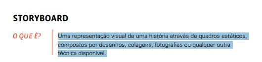

    Fonte: Vianna et al. (2012, p. 135).

### Item 2 – Presença e Articulação de Roteiro Escrito

O Storyboard é acompanhado por um roteiro escrito (descrições textuais, falas de personagens ou legendas em cada quadro) que orienta e explica a cena representada de forma clara?

**Fonte:** Vianna et al. (2012, p. 135).

??? quote "Figura 2 – Trecho que fundamenta o item 2"

    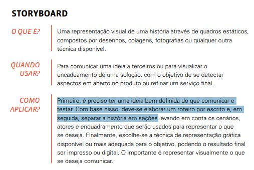

    Fonte: Vianna et al. (2012, p. 135).

### Item 3 – Mapeamento de Elementos de Cena (Cenário, Atores e Enquadramento)

A história representada no Storyboard está estruturada em seções/quadros que discriminam de forma visível o cenário (local), os atores (personas/usuários) e o enquadramento da ação?

**Fonte:** Vianna et al. (2012, p. 135).

??? quote "Figura 3 – Trecho que fundamenta o item 3"

    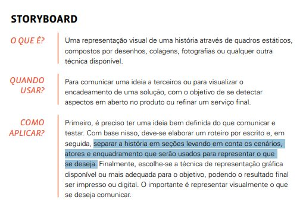

    Fonte: Vianna et al. (2012, p. 135).

### Item 4 – Associação e Alinhamento a Cenários de Uso

O Storyboard é utilizado em conjunto com um Cenário de Uso (narrativa contextual detalhando um usuário tentando alcançar um objetivo), trazendo mais detalhes e permitindo simular a interação com o produto?

**Fonte:** Preece, Rogers e Sharp (2005, p. 263).

??? quote "Figura 4 – Trecho que fundamenta o item 4"

    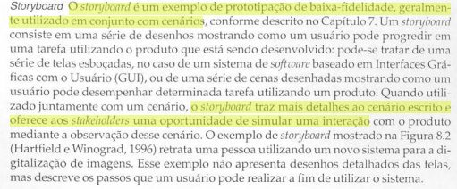

    Fonte: Preece, Rogers e Sharp (2005, p. 263).

### Item 5 – Demonstração da Progressão e Passos da Tarefa do Usuário

As ilustrações do Storyboard detalham progressivamente os passos consecutivos que o usuário realiza ao longo do tempo para desempenhar e concluir uma tarefa com o sistema/produto?

**Fonte:** Preece, Rogers e Sharp (2005, p. 263).

??? quote "Figura 5 – Trecho que fundamenta o item 5"

    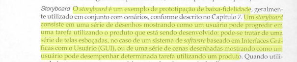

    Fonte: Preece, Rogers e Sharp (2005, p. 263).

### Item 6 – Nível Prototípico de Baixa Fidelidade

O Storyboard é apresentado com caracterização de protótipo de baixa fidelidade (usando esboços simples, desenhos feitos à mão em papel/quadros ou colagens básicas, em vez de telas finais codificadas)?

**Fonte:** Preece, Rogers e Sharp (2005, p. 263).

??? quote "Figura 6 – Trecho que fundamenta o item 6"

    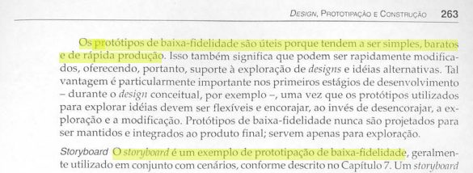

    Fonte: Preece, Rogers e Sharp (2005, p. 263).

### Item 7 – Representação de Interações no Ambiente Real e Contextual

O Storyboard explicita não apenas a tela ou interface do produto, mas a pessoa em seu contexto/ambiente real de uso (ex.: interagindo em casa, no trabalho ou em um estabelecimento comercial)?

**Fonte:** Preece, Rogers e Sharp (2005, p. 263).

??? quote "Figura 7 – Trecho que fundamenta o item 7"

    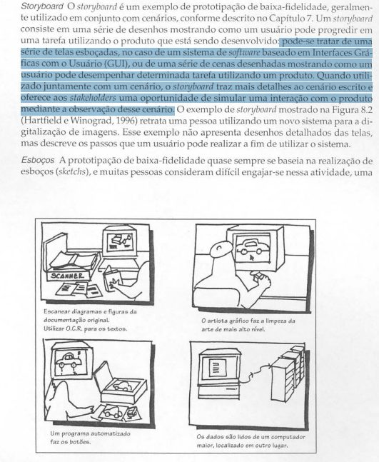

    Fonte: Preece, Rogers e Sharp (2005, p. 263).

### Item 8 – Foco na Comunicação do Conceito e Descoberta de Lacunas

O Storyboard cumpre a finalidade de expor o conceito da ideia a terceiros e de permitir identificar aspectos em aberto ou lacunas não resolvidas no fluxo do produto/serviço?

**Fonte:** Vianna et al. (2012, p. 135).

??? quote "Figura 8 – Trecho que fundamenta o item 8"

    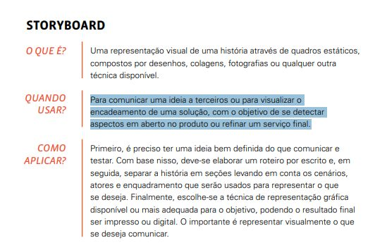

    Fonte: Vianna et al. (2012, p. 135).

### Item 9 – Legibilidade e Utilização de Símbolos Gráficos Expressivos

Os quadros do Storyboard empregam elementos visuais de fácil compreensão (como ícones simples, figuras tipo palito/stick figures, setas de ação ou balões de fala) para expressar ações humanas e movimentos?

**Fonte:** Preece, Rogers e Sharp (2005, p. 264).

??? quote "Figura 9 – Trecho que fundamenta o item 9"

    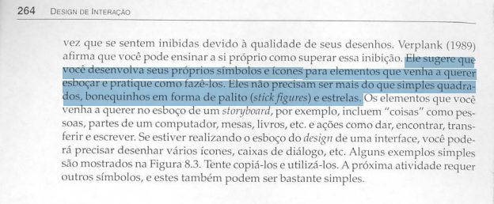

    Fonte: Preece, Rogers e Sharp (2005, p. 264).

### Item 10 – Enquadramento do Objetivo Principal do Usuário (Início, Meio e Fim)

O Storyboard descreve uma jornada com início (gatilho/motivação inicial), meio (execução das ações com o sistema) e fim (conclusão do objetivo pelo usuário)?

**Fonte:** Vianna et al. (2012, p. 136–137).

??? quote "Figura 10 – Trecho que fundamenta o item 10"

    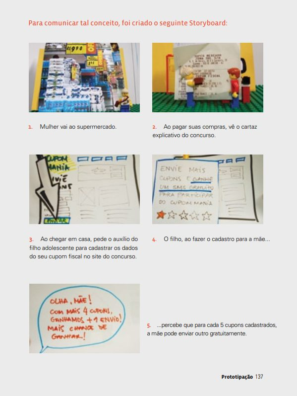

    Fonte: Vianna et al. (2012, p. 136–137).

### Item 11 – Adequação da Linguagem Visual ao Público-Alvo

A técnica de representação visual adotada no Storyboard (seja ilustrada, fotográfica ou esquemática) transmite o conceito de forma lúdica e compreensível para os envolvidos (usuários e equipe)?

**Fonte:** Vianna et al. (2012, p. 136).

??? quote "Figura 11 – Trecho que fundamenta o item 11"

    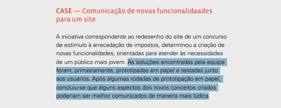

    Fonte: Vianna et al. (2012, p. 136).

## Referências

PREECE, Jennifer; ROGERS, Yvonne; SHARP, Helen. *Design de interação*: além da interação homem-computador. Porto Alegre: Bookman, 2005.

SALES, André Barros de. *Lista de Exercícios*: elaborar listas de verificação. Brasília: Universidade de Brasília, [2026]. Enunciado da atividade avaliativa Verificação 2.

SALES, André Barros de. *Plano de Ensino*: Interação Humano Computador (FGA0173), 02/2026, Turma 01, v1. Brasília: Universidade de Brasília, 2026.

VIANNA, Maurício; VIANNA, Ysmar; ADLER, Isabel Krumholz; LUCENA, Brenda de Figueiredo; RUSSO, Beatriz. *Design thinking*: inovação em negócios. Rio de Janeiro: MJV Press, 2012.

## Agradecimentos e uso de IA generativa

**Uso de IA generativa nesta página.** O Claude (Anthropic) foi utilizado na transcrição do documento original para o site e na padronização da formatação, das legendas, das citações e das referências às normas da disciplina. O conteúdo do trabalho é de João Vitor, indicado(a) na tabela de contribuição. A ferramenta não é autora do artefato e seu uso não exime os autores da responsabilidade sobre o conteúdo (SALES, 2026, p. 3).
