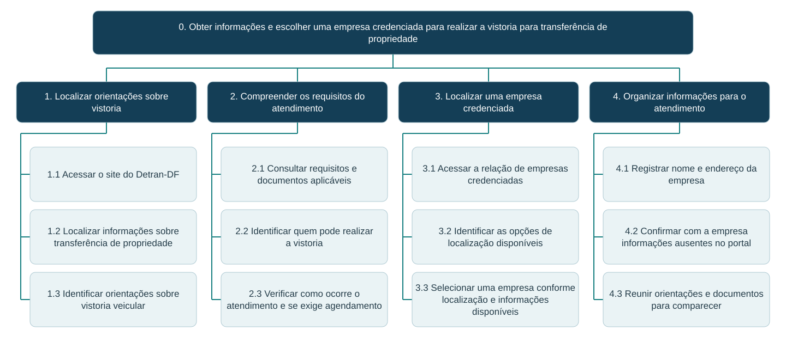

# HTA do Processo Atual – Alexandre Vilar

## Tabela de contribuição

**Tabela 1 – Contribuição no artefato HTA do Processo Atual – Alexandre Vilar**

| Integrante | Contribuição | Atividade (link) | Gravação (link) |
| --- | --- | --- | --- |
| Alexandre Vilar Valadares Fonsêca | Estruturação do objetivo, da árvore de tarefas e dos planos do processo atual, com apoio de IA generativa | [Visão geral](index.md) | [Espaço da entrevista](video-entrevista.md) |

Fonte: elaborado a partir dos materiais fornecidos por Alexandre Vilar (2026).

## Histórico de versões

**Tabela 2 – Histórico de versões do artefato HTA do Processo Atual – Alexandre Vilar**

| Data | Versão | Descrição | Autor(es) | Revisor(es) |
| --- | --- | --- | --- | --- |
| 25/10/2026 | 1.0 | Estruturação do objetivo, da árvore de tarefas e dos planos do processo atual | Alexandre Vilar, com apoio do ChatGPT | — |

Fonte: registro desta versão (2026).

## 1. Objetivo e recorte

**Objetivo 0:** obter as informações necessárias e escolher uma empresa credenciada para realizar a vistoria veicular para transferência de propriedade.

O recorte termina na preparação para o atendimento. A realização física da vistoria e a conclusão da transferência ficam fora da tarefa avaliada. O modelo deve ser confrontado com a navegação e com os relatos dos participantes; não corresponde a um registro de execução já observado.

## 2. Árvore HTA

**Figura 1 – Árvore HTA do processo atual**

Fonte: elaboração para esta atividade, com apoio do ChatGPT (2026). As linhas indicam decomposição; a ordem é definida nos planos.

## 3. Objetivos e operações

**Tabela 3 – Decomposição da tarefa atual**

| Tarefa | Subtarefas |
| --- | --- |
| 1. Localizar orientações sobre vistoria | 1.1 Acessar o site do Detran-DF 1.2 Localizar informações sobre transferência de propriedade 1.3 Identificar orientações sobre vistoria veicular |
| 2. Compreender os requisitos do atendimento | 2.1 Consultar requisitos e documentos aplicáveis 2.2 Identificar quem pode realizar a vistoria 2.3 Verificar como ocorre o atendimento e se exige agendamento |
| 3. Localizar uma empresa credenciada | 3.1 Acessar a relação de empresas credenciadas 3.2 Identificar as opções de localização disponíveis 3.3 Selecionar uma empresa conforme localização e informações disponíveis |
| 4. Organizar informações para o atendimento | 4.1 Registrar nome e endereço da empresa 4.2 Confirmar com a empresa informações ausentes no portal 4.3 Reunir orientações e documentos para comparecer |

Fonte: elaboração para esta atividade (2026).

## 4. Planos de execução

**Tabela 4 – Planos do HTA atual**

| Plano | Regra |
| --- | --- |
| 0 | Executar **1 → 2 → 3 → 4**. Encerrar quando o usuário souber onde realizar a vistoria e como se preparar. |
| 1 | Executar **1.1 → 1.2 → 1.3**. Se não localizar as orientações, retornar à busca ou à navegação do site. |
| 2 | Executar **2.1 → 2.2 → 2.3**. Se as informações se referirem a outra modalidade, retornar a **1.3**. |
| 3 | Executar **3.1 → 3.2 → 3.3**. Se nenhuma opção atender à necessidade, consultar outras empresas da relação. |
| 4 | Executar **4.1**; realizar **4.2** quando faltarem informações; finalizar com **4.3**. Se a empresa não puder atender, retornar a **3.3**. |

Fonte: elaboração para esta atividade (2026).

## 5. Critério de sucesso e validação

O usuário identifica uma empresa credenciada, registra sua localização e compreende o que precisa fazer para comparecer ao atendimento. As perguntas Q4 e Q5 do [roteiro](roteiro-entrevista.md) verificam se o critério de sucesso e a decomposição fazem sentido para o participante (Barbosa et al., 2021, pp. 166-167).

## Referências

BARBOSA, Simone Diniz Junqueira; SILVA, Bruno Santana da; SILVEIRA, Milene Selbach; GASPARINI, Isabela; DARIN, Ticianne; BARBOSA, Gabriel Diniz Junqueira. *Interação Humano-Computador e Experiência do Usuário*. 2021.

## Agradecimentos e uso de IA generativa

**Uso de IA generativa nesta página.** Em 25/10/2026, o ChatGPT (OpenAI) foi utilizado, a pedido de Alexandre Vilar, para apoiar a organização do conteúdo, a redação das páginas, a estruturação dos HTAs e a adaptação das perguntas do livro. O storyboard foi desenhado por Alexandre e mantido na versão fornecida. Não foram gerados dados de participantes, resultados ou registros de entrevistas. A responsabilidade pelo conteúdo e pela revisão é dos autores.
