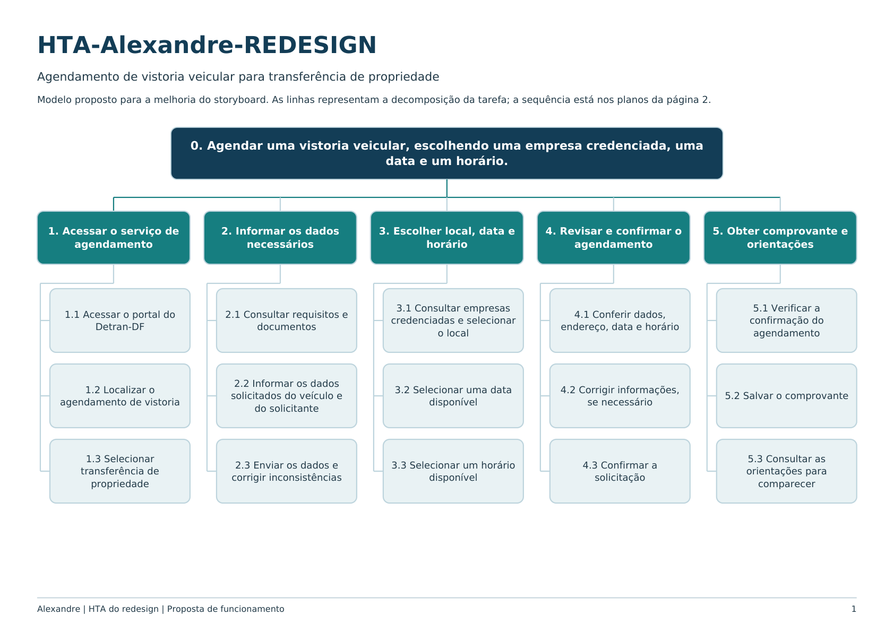

# HTA do Redesign – Alexandre Vilar

## Tabela de contribuição

**Tabela 1 – Contribuição no artefato HTA do Redesign – Alexandre Vilar**

| Integrante | Contribuição | Atividade (link) | Gravação (link) |
| --- | --- | --- | --- |
| Alexandre Vilar Valadares Fonsêca | Detalhamento da proposta de agendamento e organização do PDF do redesign, com apoio de IA generativa | [Visão geral](index.md) | [Espaço da entrevista](video-entrevista.md) |

Fonte: elaborado a partir dos materiais fornecidos por Alexandre Vilar (2026).

## Histórico de versões

**Tabela 2 – Histórico de versões do artefato HTA do Redesign – Alexandre Vilar**

| Data | Versão | Descrição | Autor(es) | Revisor(es) |
| --- | --- | --- | --- | --- |
| 25/10/2026 | 1.0 | Detalhamento da proposta de agendamento e organização do PDF do redesign | Alexandre Vilar, com apoio do ChatGPT | — |

Fonte: registro desta versão (2026).

## 1. Objetivo e escopo

**Objetivo 0:** agendar uma vistoria veicular para transferência de propriedade, escolhendo uma empresa credenciada, uma data e um horário.

Este HTA representa a proposta de melhoria apresentada no storyboard. O modelo ainda precisa ser validado; os campos exigidos, a autenticação e a integração com a agenda das empresas não foram implementados nesta atividade.

## 2. Árvore HTA

**Figura 1 – Árvore HTA do redesign**

Fonte: HTA-Alexandre-REDESIGN, elaborado nesta atividade com apoio do ChatGPT (2026).

[Baixar HTA-Alexandre-REDESIGN.pdf](arquivos/HTA-Alexandre-REDESIGN.pdf).

## 3. Objetivos e operações

**Tabela 3 – Decomposição da proposta de agendamento**

| Tarefa | Subtarefas |
| --- | --- |
| 1. Acessar o serviço de agendamento | 1.1 Acessar o portal do Detran-DF. 1.2 Localizar o agendamento de vistoria. 1.3 Selecionar transferência de propriedade. |
| 2. Informar os dados necessários | 2.1 Consultar requisitos e documentos. 2.2 Informar os dados solicitados do veículo e do solicitante. 2.3 Enviar os dados e corrigir inconsistências. |
| 3. Escolher local, data e horário | 3.1 Consultar empresas credenciadas e selecionar o local. 3.2 Selecionar uma data disponível. 3.3 Selecionar um horário disponível. |
| 4. Revisar e confirmar o agendamento | 4.1 Conferir dados, endereço, data e horário. 4.2 Corrigir informações, se necessário. 4.3 Confirmar a solicitação. |
| 5. Obter comprovante e orientações | 5.1 Verificar a confirmação do agendamento. 5.2 Salvar o comprovante. 5.3 Consultar as orientações para comparecer. |

Fonte: HTA-Alexandre-REDESIGN (2026).

## 4. Planos de execução

**Tabela 4 – Planos do HTA do redesign**

| Plano | Regra |
| --- | --- |
| 0 | Executar **1 → 2 → 3 → 4 → 5**. Encerrar quando o agendamento estiver confirmado e o comprovante e as orientações estiverem disponíveis. |
| 1 | Executar **1.1 → 1.2 → 1.3**. Se necessário, realizar a autenticação solicitada pelo portal antes de prosseguir. |
| 2 | Executar **2.1 → 2.2 → 2.3**. Se houver inconsistências, corrigir os dados e reenviar. Se faltar um requisito obrigatório, providenciá-lo antes de continuar. |
| 3 | Executar **3.1 → 3.2 → 3.3**. Se não houver disponibilidade, escolher outra data ou outro local. Ao mudar o local, selecionar novamente data e horário. |
| 4 | Executar **4.1**. Se houver informação incorreta, executar **4.2**, retornando à etapa correspondente, e revisar novamente. Com tudo correto, executar **4.3**. |
| 5 | Executar **5.1 → 5.2 → 5.3**. Se não houver confirmação, verificar o resultado da solicitação antes de tentar novamente, evitando duplicidade. |

Fonte: HTA-Alexandre-REDESIGN (2026).

## 5. Entrada, sucesso e limites

**Entrada:** necessidade de realizar a vistoria para transferência de propriedade e disponibilidade dos dados solicitados.

**Critério de sucesso:** o portal apresenta um agendamento confirmado, com identificação do veículo, empresa escolhida, endereço, data, horário e comprovante.

**Limite:** a tarefa termina na preparação para o comparecimento. A realização da vistoria e a conclusão da transferência ficam fora desse fluxo.

## Referências

BARBOSA, Simone Diniz Junqueira; SILVA, Bruno Santana da; SILVEIRA, Milene Selbach; GASPARINI, Isabela; DARIN, Ticianne; BARBOSA, Gabriel Diniz Junqueira. *Interação Humano-Computador e Experiência do Usuário*. 2021.

## Agradecimentos e uso de IA generativa

**Uso de IA generativa nesta página.** Em 25/10/2026, o ChatGPT (OpenAI) foi utilizado, a pedido de Alexandre Vilar, para apoiar a organização do conteúdo, a redação das páginas, a estruturação dos HTAs e a adaptação das perguntas do livro. O storyboard foi desenhado por Alexandre e mantido na versão fornecida. Não foram gerados dados de participantes, resultados ou registros de entrevistas. A responsabilidade pelo conteúdo e pela revisão é dos autores.
