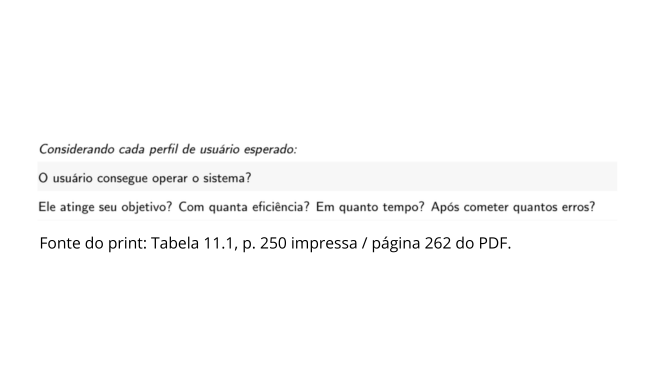
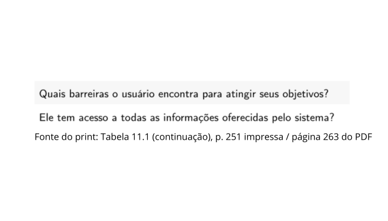
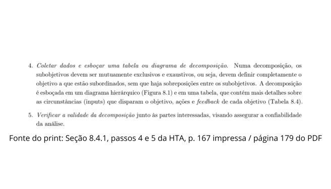
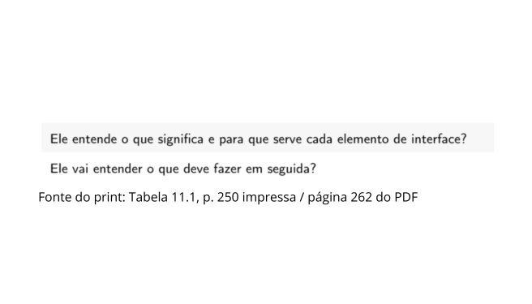
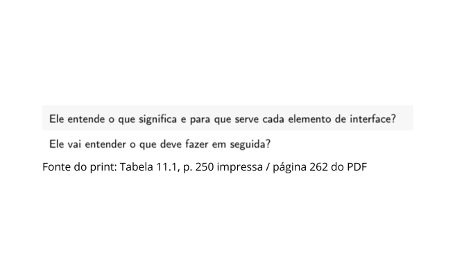
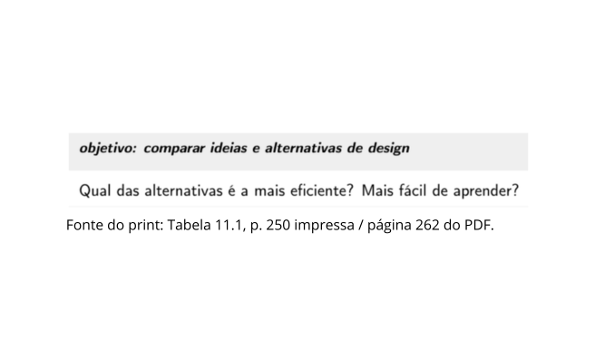

# Roteiro de Entrevista – Alexandre Vilar

## Tabela de contribuição

**Tabela 1 – Contribuição no artefato Roteiro de Entrevista – Alexandre Vilar**

| Integrante | Contribuição | Atividade (link) | Gravação (link) |
| --- | --- | --- | --- |
| Alexandre Vilar Valadares Fonsêca | Adaptação das perguntas e organização das referências da fundamentação, com apoio de IA generativa | [Visão geral](index.md) | [Espaço da entrevista](video-entrevista.md) |

Fonte: elaborado a partir dos materiais fornecidos por Alexandre Vilar (2026).

## Histórico de versões

**Tabela 2 – Histórico de versões do artefato Roteiro de Entrevista – Alexandre Vilar**

| Data | Versão | Descrição | Autor(es) | Revisor(es) |
| --- | --- | --- | --- | --- |
| 25/10/2026 | 1.0 | Adaptação das perguntas e organização das referências da fundamentação | Alexandre Vilar, com apoio do ChatGPT | — |

Fonte: registro desta versão (2026).

[Baixar roteiro da entrevista com fundamentação](arquivos/roteiro-entrevista-decide-vistoria.pdf)

## 1. Primeiro E do DECIDE

O primeiro E orienta a explorar perguntas que operacionalizem os objetivos da avaliação, considerando os usuários e suas atividades (Barbosa et al., 2021, seção 11.8, p. 264). As perguntas de exemplo utilizadas estão na Tabela 11.1, pp. 250-251; a validação do HTA utiliza também a seção 8.4.1, pp. 166-167.

As referências abaixo indicam as páginas impressas e as páginas correspondentes no arquivo do livro utilizado. As reproduções do livro e o PDF com esses prints não estão publicados nesta página.

## 2. Orientações de aplicação

Leia ao participante a pergunta adaptada, usando a sondagem apenas quando necessário. As indicações de seção e página documentam a fundamentação das adaptações. As perguntas ao participante não são transcrições literais do livro. Q5 deriva de uma orientação metodológica de validação da HTA.

Q1-Q3 tratam do processo atual; Q4-Q5, da validação do HTA; Q6-Q8, do storyboard; Q9-Q10, da comparação entre o processo atual e a proposta. Na comparação, registre se houve navegação ou apenas relato. Se um elemento de interface não estiver representado no storyboard, registre sua ausência.

## 3. Perguntas e fundamentação

### Q01. Autonomia na busca

**Tema:** PROCESSO ATUAL.

**Pergunta ao participante:** Ao buscar as orientações para a vistoria, o que você conseguiu fazer sozinho e em que momento, se houve algum, precisou de ajuda?

**Sondagem opcional:** Peça que indique o trecho ou a etapa em que isso ocorreu.

**O que investigar:** Investigar autonomia e necessidade de auxílio.

**Figura 1 – Trecho que fundamenta a pergunta Q01**

**Fundamentação:** Barbosa et al. (2021), Tabela 11.1, p. 250 impressa / página 262 do PDF enviado.

### Q02. Informações para preparar o atendimento

**Tema:** PROCESSO ATUAL.

**Pergunta ao participante:** Quais informações você encontrou para escolher onde realizar a vistoria e se preparar para o atendimento? O que ainda precisaria descobrir?

**Sondagem opcional:** Se necessário: onde procuraria as informações que faltaram?

**O que investigar:** Investigar acesso às informações relevantes para a tarefa.

**Figura 2 – Trecho que fundamenta a pergunta Q02**

**Fundamentação:** Barbosa et al. (2021), Tabela 11.1 (continuação), p. 251 impressa / página 263 do PDF enviado.

### Q03. Dificuldades e barreiras

**Tema:** PROCESSO ATUAL.

**Pergunta ao participante:** Que dificuldades, se houve alguma, você encontrou para identificar uma empresa credenciada e entender como seria atendido?

**Sondagem opcional:** O que você fez ou faria para superar essa dificuldade?

**O que investigar:** Identificar barreiras sem pressupor a existência de um problema.

**Figura 3 – Trecho que fundamenta a pergunta Q03**

**Fundamentação:** Barbosa et al. (2021), Tabela 11.1 (continuação), p. 251 impressa / página 263 do PDF enviado.

### Q04. Critério de conclusão da tarefa

**Tema:** VALIDAÇÃO DO HTA.

**Pergunta ao participante:** Como você saberia que já tem as informações necessárias para escolher uma empresa e comparecer para a vistoria?

**Sondagem opcional:** O que precisaria ter em mãos ou ter confirmado?

**O que investigar:** Verificar se o critério de sucesso do HTA faz sentido para o participante.

**Figura 4 – Trecho que fundamenta a pergunta Q04**

**Fundamentação:** Barbosa et al. (2021), Seção 8.4.1, passo 2 da HTA, p. 166 impressa / página 178 do PDF enviado.

### Q05. Etapas e ordem do HTA

**Tema:** VALIDAÇÃO DO HTA.

**Pergunta ao participante:** Olhando a árvore HTA e os planos, como essas etapas se comparam ao caminho que você seguiu ou seguiria? O que acrescentaria, retiraria ou mudaria de ordem?

**Sondagem opcional:** Peça um exemplo concreto para cada mudança sugerida.

**O que investigar:** Verificar completude e adequação da decomposição.

**Figura 5 – Trecho que fundamenta a pergunta Q05**

**Fundamentação:** Barbosa et al. (2021), Seção 8.4.1, passos 4 e 5 da HTA, p. 167 impressa / página 179 do PDF enviado.

### Q06. Compreensão da sequência

**Tema:** STORYBOARD.

**Pergunta ao participante:** Ao acompanhar o storyboard, o que você entende que a pessoa precisa fazer em cada etapa para agendar a vistoria? Em que ponto, se houver, ficou em dúvida sobre o próximo passo?

**Sondagem opcional:** Peça que a pessoa aponte o quadro correspondente.

**O que investigar:** Investigar clareza da sequência proposta de agendamento.

**Figura 6 – Trecho que fundamenta a pergunta Q06**

**Fundamentação:** Barbosa et al. (2021), Tabela 11.1, p. 250 impressa / página 262 do PDF enviado.

### Q07. Compreensão das escolhas

**Tema:** STORYBOARD.

**Pergunta ao participante:** Como você interpreta as opções e informações mostradas no storyboard para escolher o local, a data e o horário da vistoria?

**Sondagem opcional:** Se alguma dessas escolhas não estiver representada, registre a ausência em vez de inventar uma tela.

**O que investigar:** Investigar o significado atribuído aos elementos efetivamente representados.

**Figura 7 – Trecho que fundamenta a pergunta Q07**

**Fundamentação:** Barbosa et al. (2021), Tabela 11.1, p. 250 impressa / página 262 do PDF enviado.

### Q08. Necessidades atendidas e ausentes

**Tema:** STORYBOARD.

**Pergunta ao participante:** O que a proposta apresentada no storyboard ajudaria você a resolver ao organizar uma vistoria? O que continuaria faltando?

**Sondagem opcional:** Peça que relacione a resposta a uma situação concreta de uso.

**O que investigar:** Identificar utilidade percebida e necessidades não contempladas.

**Figura 8 – Trecho que fundamenta a pergunta Q08**

**Fundamentação:** Barbosa et al. (2021), Tabela 11.1, p. 250 impressa / página 262 do PDF enviado.

### Q09. Facilidade percebida

**Tema:** COMPARAÇÃO.

**Pergunta ao participante:** Comparando o processo atual com a proposta do storyboard, qual parece mais fácil de aprender e usar? Por quê?

**Sondagem opcional:** Quais etapas sustentam essa comparação? Se não houver diferença clara, registre isso.

**O que investigar:** Comparar facilidade percebida. Não medir eficiência real por opinião.

**Figura 9 – Trecho que fundamenta a pergunta Q09**

**Fundamentação:** Barbosa et al. (2021), Tabela 11.1, p. 250 impressa / página 262 do PDF enviado.

### Q10. Preferência e justificativa

**Tema:** COMPARAÇÃO.

**Pergunta ao participante:** Para organizar sua vistoria, qual das duas alternativas você preferiria: o processo atual ou a proposta do storyboard? Por quê? Você pode também não ter preferência.

**Sondagem opcional:** Que mudança, se alguma, faria na alternativa escolhida?

**O que investigar:** Identificar preferência, razões e sugestões sem induzir aprovação.

**Figura 10 – Trecho que fundamenta a pergunta Q10**

**Fundamentação:** Barbosa et al. (2021), Tabela 11.1, p. 250 impressa / página 262 do PDF enviado.

## 4. Adequação ao storyboard

O PDF do roteiro foi preparado com base no tema do StoryBoard.

## Referências

BARBOSA, Simone Diniz Junqueira; SILVA, Bruno Santana da; SILVEIRA, Milene Selbach; GASPARINI, Isabela; DARIN, Ticianne; BARBOSA, Gabriel Diniz Junqueira. *Interação Humano-Computador e Experiência do Usuário*. 2021.

## Agradecimentos e uso de IA generativa

**Uso de IA generativa nesta página.** Em 25/10/2026, o ChatGPT (OpenAI) foi utilizado, a pedido de Alexandre Vilar, para apoiar a organização do conteúdo, a redação das páginas, a estruturação dos HTAs e a adaptação das perguntas do livro. O storyboard foi desenhado por Alexandre e mantido na versão fornecida. Não foram gerados dados de participantes, resultados ou registros de entrevistas. A responsabilidade pelo conteúdo e pela revisão é dos autores.
