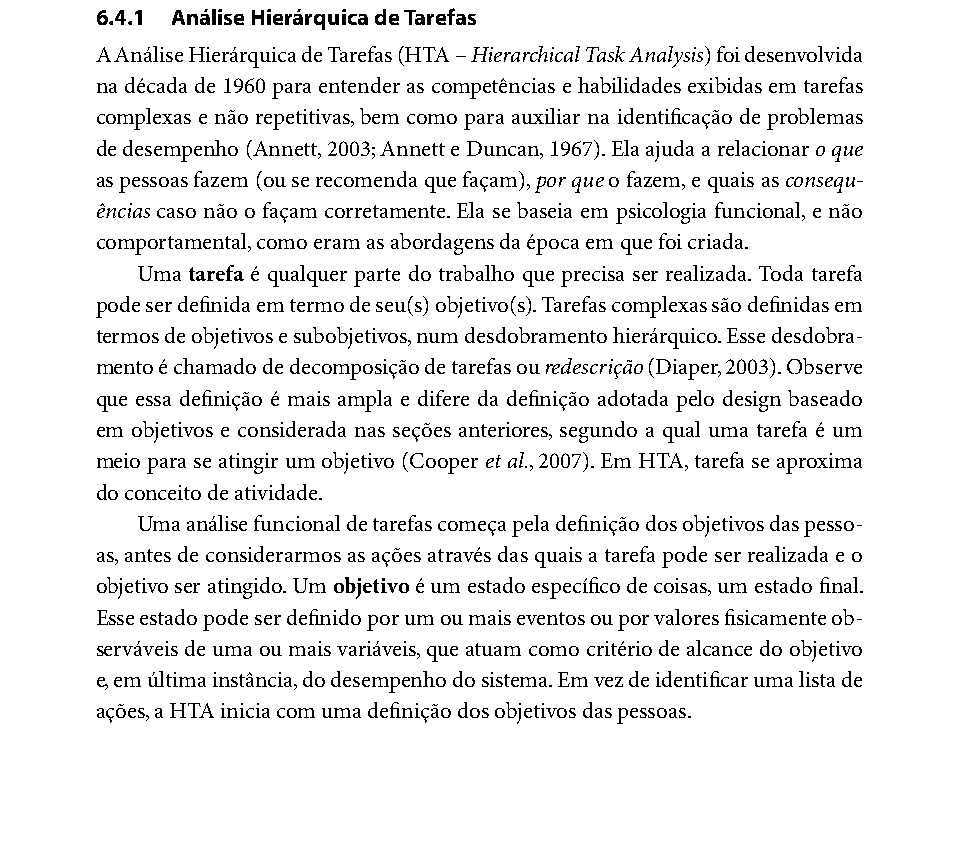
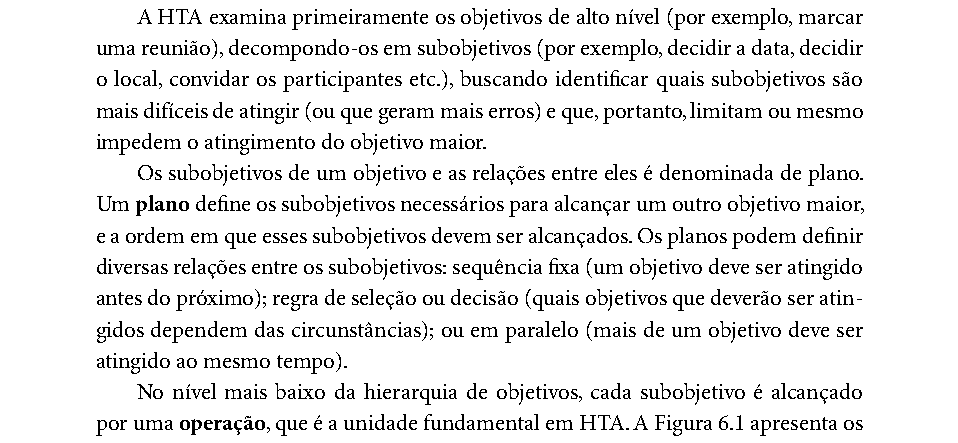
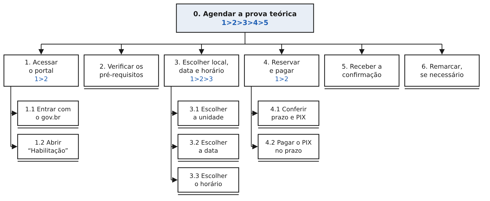

# HTA do Agendamento da Prova Teórica – Henrique Schneider

Tarefa: agendar a prova teórica com reserva de horário · Portal do Detran-DF · IHC 2026.2 · Grupo 03 · Entrega 5 · Autor: Henrique Schneider Fernandes da Rosa

## Tabela de contribuição

**Tabela 1 – Contribuição no artefato HTA do Agendamento da Prova Teórica – Henrique Schneider**

| Integrante | Contribuição | Atividade (link) | Gravação (link) |
| --- | --- | --- | --- |
| Henrique Schneider Fernandes da Rosa | Elaboração da HTA (diagrama, tabela, planos e correspondência com o storyboard) e registro do resultado das entrevistas | [Visão geral](index.md) | [Vídeos das entrevistas](video-entrevista.md) |

Fonte: elaborado pelo autor (2026).

## Histórico de versões

**Tabela 2 – Histórico de versões da HTA do agendamento da prova teórica**

| Data       | Versão | Descrição                                                                                                                                                                                                                                                      | Autor(es)                                                                 | Revisor(es)    |
|------------|--------|----------------------------------------------------------------------------------------------------------------------------------------------------------------------------------------------------------------------------------------------------------------|---------------------------------------------------------------------------|----------------|
| 22/10/2026 | 1.0    | Criação do diagrama, da tabela, dos planos e da correspondência com os quadros do storyboard e com as perguntas da entrevista                                                                                                                                  | Henrique Schneider Fernandes da Rosa                                      | Gabriel Robson |
| 25/10/2026 | 1.1    | Registro do resultado da entrevista de 25/10/2026 na Tabela 5 e no plano 4 (prazo de reserva sugerido de 24 horas), situação da inspeção técnica e da observação do objetivo 6                                                                                 | Henrique Schneider Fernandes da Rosa, com apoio do Claude (IA generativa) | Gabriel Robson |
| 25/10/2026 | 1.2    | Inclusão do resultado da segunda entrevista (P2) na Tabela 5; registro da entrada, da ação e do feedback das operações 1.1, 1.2, 3.1 a 3.3 e 4.1 (problema PH03 do relatório do grupo); novo problema na operação 1.2 (serviço difícil de encontrar no gov.br) | Henrique Schneider Fernandes da Rosa, com apoio do Claude (IA generativa) | Gabriel Robson |

Fonte: elaborado pelo autor (2026).

## 1. Introdução

Esta HTA decompõe a tarefa que o storyboard do autor ilustra: a candidata à primeira habilitação agenda a prova teórica no portal do Detran-DF. A decomposição descreve a versão proposta no reprojeto, em que o horário é reservado antes do pagamento e a prova é confirmada automaticamente depois que o PIX compensa. Os problemas da versão atual que motivaram a proposta aparecem na Tabela 3 como hipóteses, e o resultado da entrevista de avaliação do storyboard para cada uma está na Tabela 5.

O objetivo da análise, no sentido do primeiro passo de Diaper (2003 apud Barbosa; Silva, 2010, cap. 6, seç. 6.4.1, p. 195), é modificar um sistema existente: identificar em que ponto do agendamento a candidata corre o risco de não atingir o objetivo e sustentar a recomendação de reprojeto.

## 2. Fundamentação

A HTA “ajuda a relacionar o que as pessoas fazem (ou se recomenda que façam), por que o fazem, e quais as consequências caso não o façam corretamente” (Barbosa; Silva, 2010, cap. 6, seç. 6.4.1, p. 192, 1º parágrafo da seção). A análise começa pelos objetivos das pessoas, e não por uma lista de ações (Barbosa; Silva, 2010, cap. 6, seç. 6.4.1, p. 192, 3º parágrafo da seção), conforme a Figura 1.

**Figura 1 – Trecho de Barbosa e Silva (2010, cap. 6, seç. 6.4.1, p. 192) sobre a HTA**

Fonte: Barbosa e Silva (2010, p. 192).

Os objetivos são decompostos em subobjetivos, e as relações entre eles formam o plano, que pode ser de sequência fixa, de seleção ou paralelo. No nível mais baixo, cada subobjetivo é alcançado por uma operação (Barbosa; Silva, 2010, cap. 6, seç. 6.4.1, p. 193, 1º a 3º parágrafos), como mostra a Figura 2. A notação usada no diagrama segue a Figura 6.1 do livro (Figura 3): 1\>2 indica sequência, 1/2 seleção e 1+2 paralelo; a operação é desenhada com linha dupla na base.

**Figura 2 – Trecho de Barbosa e Silva (2010, cap. 6, seç. 6.4.1, p. 193) sobre planos e operações**

Fonte: Barbosa e Silva (2010, p. 193).

**Figura 3 – Elementos de um diagrama HTA (Barbosa e Silva, 2010, Figura 6.1, p. 193)**

Fonte: Barbosa e Silva (2010, p. 193).

Cada operação é especificada pelo *input* que a dispara, pelas ações e pelo *feedback* que indica que o objetivo foi atingido, e a tabela da HTA registra esses elementos junto com problemas e recomendações (Barbosa; Silva, 2010, cap. 6, seç. 6.4.1, pp. 193–194, Tabela 6.3). A Tabela 3 segue esse formato.

## 3. Diagrama

A Figura 4 apresenta o diagrama da tarefa. O objetivo 6 é opcional e só ocorre depois de 5, como explica o plano 0 na Tabela 3.

**Figura 4 – Diagrama HTA para o objetivo de agendar a prova teórica (versão proposta)**

Fonte: elaborado pelo autor (2026), com a notação de Barbosa e Silva (2010, p. 193).

## 4. Tabela da HTA

A Tabela 3 detalha cada objetivo e operação. Os problemas marcados com **(H)** são hipóteses verificadas nas perguntas da entrevista indicadas entre parênteses (resultado na Tabela 5). Os problemas marcados com **(E2)** já foram apontados pelo grupo na análise de tarefas da Entrega 2 para o login gov.br e para o acesso ao serviço de Habilitação (Grupo 03, Relatório da Entrega 2, seç. 2.3.2, pp. 14–15).

**Tabela 3 – Representação da HTA em tabela**

| Objetivos / operações                                               | Problemas e recomendações                                                                                                                                                                                                                                                                                                                                                                                                                                                                                                                                                                                                                                                                     |
|---------------------------------------------------------------------|-----------------------------------------------------------------------------------------------------------------------------------------------------------------------------------------------------------------------------------------------------------------------------------------------------------------------------------------------------------------------------------------------------------------------------------------------------------------------------------------------------------------------------------------------------------------------------------------------------------------------------------------------------------------------------------------------|
| **0. Agendar a prova teórica**; 1\>2\>3\>4\>5                       | *input*: curso teórico concluído e processo de primeira habilitação aberto (quadro 1); *feedback*: prova confirmada, com comprovante e lista de documentos para levar (quadro 7); *plano*: acessar o portal, verificar os pré-requisitos, escolher unidade, data e horário, reservar e pagar **e depois** receber a confirmação; remarcar (6) só se surgir um imprevisto depois de 5; *problema (H, P2 e P3)*: quando a taxa é paga antes da escolha do horário, a espera pela compensação pode fazer a candidata perder a data desejada; *recomendação*: reservar o horário antes do pagamento e confirmar automaticamente após a compensação                                                |
| **1. Acessar o portal** 1\>2                                        | *plano*: entrar com a conta gov.br e depois abrir o serviço de Habilitação (quadro 2)                                                                                                                                                                                                                                                                                                                                                                                                                                                                                                                                                                                                         |
| 1.1 Entrar com a conta gov.br                                       | *input*: conta gov.br da candidata; *ação*: informar CPF e senha (ou entrar pelo aplicativo gov.br); *feedback*: portal mostra a candidata identificada; *problema (E2)*: sessão que expira com mensagens de erro genéricas; *recomendação*: avisar antes de a sessão expirar e permitir estendê-la (Grupo 03, Rel. E2, p. 15)                                                                                                                                                                                                                                                                                                                                                                |
| 1.2 Abrir “Habilitação” e o agendamento da prova                    | *input*: candidata identificada no portal; *ação*: localizar o serviço “Habilitação” e abrir o agendamento da prova teórica; *feedback*: tela de agendamento da prova teórica aberta; *problema (E2)*: requisitos prévios não aparecem na tela inicial do serviço; *problema (entrevistas P1 e P2)*: o serviço não aparece de início no gov.br, exige busca e o termo “habilitação” é genérico; *recomendação*: mostrar o que é preciso antes de iniciar o serviço (Grupo 03, Rel. E2, p. 15), o que leva ao objetivo 2; dar ao serviço um nome específico e destacá-lo entre os mais acessados                                                                                               |
| **2. Verificar os pré-requisitos**                                  | *input*: situação do processo (curso teórico, biometria, exames); *feedback*: todos os itens aparecem como cumpridos (quadro 3); *problema (H, P4)*: a candidata só descobre uma pendência quando tenta agendar; *recomendação*: lista de pré-requisitos com o estado de cada um antes do calendário, com o caminho para resolver o que faltar                                                                                                                                                                                                                                                                                                                                                |
| **3. Escolher unidade, data e horário** 1\>2\>3                     | *plano*: escolher a unidade, depois a data, depois o horário; se não houver horário na data, voltar a 3.2; *feedback*: unidade, data e horário destacados (quadro 4); *problema (H, P3)*: falta de horário na data ou na unidade desejada; *recomendação*: mostrar a disponibilidade por unidade num calendário e sugerir a data livre mais próxima                                                                                                                                                                                                                                                                                                                                           |
| 3.1 Escolher a unidade; 3.2 Escolher a data; 3.3 Escolher o horário | *input*: lista de unidades e calendário com vagas; *ação*: tocar na unidade, na data e no horário desejados; *feedback*: seleção marcada na tela                                                                                                                                                                                                                                                                                                                                                                                                                                                                                                                                              |
| **4. Reservar e pagar** 1\>2                                        | *input*: horário escolhido em 3; *feedback*: “Horário reservado até 13h” e o PIX da taxa na mesma tela (quadro 5); *plano*: conferir o prazo e depois pagar; se o PIX não compensar no prazo, a reserva expira e a candidata volta para 3; *problema (H, P9)*: prazo da reserva insuficiente para a compensação; *recomendação*: mostrar o tempo restante e avisar antes de a reserva expirar. Nas entrevistas de 25/10/2026, os dois participantes consideraram insuficiente um prazo de 3 a 5 horas e sugeriram 24 horas; P1 sugeriu ainda aviso cerca de uma hora antes de expirar e liberação da vaga se o PIX não compensar (P9); o prazo de 24 horas será testado no protótipo de papel |
| 4.1 Conferir o prazo da reserva e o PIX                             | *input*: horário reservado; *ação*: ler o prazo da reserva e copiar o código PIX; *feedback*: prazo, valor e código PIX visíveis (quadro 5)                                                                                                                                                                                                                                                                                                                                                                                                                                                                                                                                                   |
| 4.2 Pagar o PIX dentro do prazo                                     | *ação*: pagar pelo aplicativo do banco, fora do portal (quadro 6); *feedback*: comprovante do banco                                                                                                                                                                                                                                                                                                                                                                                                                                                                                                                                                                                           |
| **5. Receber a confirmação automática**                             | *input*: compensação do PIX; *feedback*: notificação “Prova confirmada”, com comprovante e documentos para levar (quadro 7); *recomendação*: manter a confirmação acessível no portal para consulta no dia da prova (quadro 8)                                                                                                                                                                                                                                                                                                                                                                                                                                                                |
| **6. Remarcar, se necessário**                                      | *input*: imprevisto depois da confirmação; *plano*: repetir 3 e 4 a partir da reserva existente; *observação*: as regras de remarcação e de taxa do portal do Detran-DF ainda não foram conferidas; por isso, este objetivo não é ilustrado no storyboard nem avaliado no protótipo de papel                                                                                                                                                                                                                                                                                                                                                                                                  |

Fonte: elaborado pelo autor (2026), no formato da Tabela 6.3 de Barbosa e Silva (2010, p. 194).

## 5. Correspondência com o storyboard

Cada quadro do storyboard está ligado a um nó da HTA, como pede o item 9 da lista de verificação da Entrega 4 (Sales, 2026, p. 13). A Tabela 4 mostra essa correspondência.

**Tabela 4 – Quadros do storyboard e nós da HTA**

| Quadro | O que o quadro mostra                                       | Nó da HTA    | Elemento da HTA                          |
|--------|-------------------------------------------------------------|--------------|------------------------------------------|
| 1      | Camila termina o curso teórico e decide marcar a prova      | 0            | *input* do objetivo 0                    |
| 2      | Entra no portal com a conta gov.br e abre “Habilitação”     | 1 (1.1, 1.2) | Operações 1.1 e 1.2                      |
| 3      | O sistema mostra os pré-requisitos cumpridos                | 2            | *feedback* da operação 2                 |
| 4      | Escolhe a unidade de Taguatinga, a data e o horário das 9h  | 3 (3.1–3.3)  | Operações 3.1 a 3.3                      |
| 5      | “Horário reservado até 13h” e o PIX na mesma tela           | 4.1          | *feedback* do objetivo 4                 |
| 6      | Paga pelo app do banco, sem medo de perder a vaga           | 4.2          | Operação 4.2                             |
| 7      | Notificação “Prova confirmada” com comprovante e documentos | 5            | *feedback* da operação 5 e do objetivo 0 |
| 8      | Chega à unidade com tudo pronto                             | 0 atingido   | Satisfação (resultado)                   |

Fonte: elaborado pelo autor (2026).

## 6. Avaliação da HTA

Barbosa e Silva (2010, cap. 6, seç. 6.4.1, p. 196, passo 5) recomendam verificar a validade da decomposição junto às partes interessadas. Esta HTA é validada de duas formas, conforme o planejamento da Entrega 4 (Grupo 03, Relatório da Entrega 4, pp. 11–12):

1.  **Validação com usuários:** as perguntas da entrevista semiestruturada confirmam ou refutam as hipóteses (H) da Tabela 3. A Tabela 5 mostra a correspondência e o resultado das entrevistas realizadas em 25/10/2026 com dois participantes (P1 e P2), relatadas no documento “Relato dos resultados da avaliação do storyboard” (v3.0).
2.  **Inspeção técnica:** outro integrante inspeciona o diagrama e a tabela com a lista de verificação de HTA da disciplina. Situação em 25/10/2026: ainda não realizada; o inspetor e a data serão registrados no histórico de versões quando a inspeção ocorrer.

**Tabela 5 – Nós da HTA, perguntas da entrevista e resultado**

| Nó da HTA    | O que a entrevista verifica                              | Perguntas   | Resultado (entrevistas de 25/10/2026)                                                                                                                                                                           |
|--------------|----------------------------------------------------------|-------------|-----------------------------------------------------------------------------------------------------------------------------------------------------------------------------------------------------------------|
| 0            | Se a sequência completa corresponde à experiência real   | P1, P5, P10 | Confirmada em parte: os dois reconheceram a sequência como fiel; P1 dependeu da autoescola e dos pais, e P2 se lembra pouco do processo (P1: 3:30; 12:57–15:25 · P2: 7:19–7:38)                                 |
| 1            | Canal usado (site ou app) e dificuldades no acesso       | P1          | P1 usou o gov.br só para ver o resultado e o considera confuso; P2 diz ter agendado pelo site e descreveu a dificuldade de encontrar o serviço “Habilitação” no gov.br (P1: 18:39–19:28 · P2: 4:27; 7:59–10:31) |
| 2            | Como a candidata descobre pendências                     | P4          | Hipótese confirmada por P1 (soube da biometria por amigas, 7:14–8:26); não observada em P2, que tinha as informações (6:10–6:18)                                                                                |
| 3            | Oferta de horários e unidades                            | P3          | Hipótese confirmada por P1 (no máximo duas datas, 5:40–6:16); não observada em P2 (muitas opções, 5:18–5:35)                                                                                                    |
| 4 e plano 4  | Espera pela compensação e aceitação da reserva com prazo | P2, P9      | P1 esperou quase um mês e teve medo de perder a vaga; P2 levou minutos. Os dois acharam 3 a 5 horas pouco e sugeriram 24 horas (P1: 20:32–21:38 · P2: 13:47–15:12)                                              |
| 5 e quadro 8 | Se a confirmação deixa claro que o objetivo foi atingido | P8          | Confirmada pelos dois; P2 apontou o quadro 8 em resposta a uma pergunta aberta (P1: 19:35–19:55 · P2: 12:13–12:22)                                                                                              |

Fonte: elaborado pelo autor (2026). As perguntas estão no roteiro de entrevista semiestruturada do autor (v1.2, Tabela 4); as minutagens são as das gravações.

## Documento em PDF

A versão em PDF deste artefato está disponível para download: [HTA – Agendamento da prova teórica (v1.2)](arquivos/hta-agendamento-prova-teorica.pdf).

## Referências

BARBOSA, Simone Diniz Junqueira; SILVA, Bruno Santana da. *Interação Humano-Computador*. Rio de Janeiro: Elsevier, 2010.

GRUPO 03. *Relatório da Entrega 2*: Perfil do Usuário, Aspectos Éticos e Análise de Tarefas. Brasília: Universidade de Brasília, 2026.

GRUPO 03. *Planejamento da Entrega 4*: Planejamento da Avaliação do Storyboard e da Análise de Tarefas. Brasília: Universidade de Brasília, 2026.

ROSA, Henrique Schneider Fernandes da. *Relato dos resultados da avaliação do storyboard* “Agendamento da prova teórica com reserva de horário”. Versão 3.0. Brasília: Universidade de Brasília, 2026.

SALES, André Barros de. *Plano de Ensino*: Interação Humano Computador (FGA0173), 02/2026, Turma 01, v1. Brasília: Universidade de Brasília, 2026.

## Uso de IA generativa

Conforme o Código de Conduta da SBC adotado no Plano de Ensino (Sales, 2026, p. 3), declara-se que o Claude (Anthropic) foi usado como apoio na decomposição da tarefa, no desenho do diagrama, na diagramação deste PDF e na localização dos trechos citados de Barbosa e Silva (2010) e, nas versões 1.1 e 1.2, no registro dos resultados das entrevistas a partir das transcrições automáticas e das gravações e na especificação das operações. A validação da análise e a revisão do conteúdo são de responsabilidade do autor.

**Uso de IA generativa nesta página.** Em 25/10/2026, o Claude (Anthropic) foi utilizado, a pedido de Henrique Schneider, para converter o PDF deste artefato em página do site, com a tabela de contribuição e a renumeração das tabelas a partir da Tabela 2. A ferramenta não é autora do artefato e seu uso não exime o autor da responsabilidade sobre o conteúdo (Sales, 2026, p. 3).
