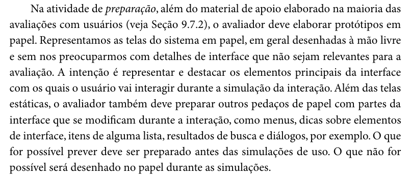

# Protótipo de Papel – Henrique Schneider

## Tabela de contribuição

**Tabela 1 – Contribuição no artefato Protótipo de Papel – Henrique Schneider**

| Integrante | Contribuição | Atividade (link) | Gravação (link) |
| --- | --- | --- | --- |
| Henrique Schneider Fernandes da Rosa | Planejamento individual da avaliação do protótipo de papel: telas, partes móveis, tarefas, participantes, avaliadores, teste piloto, registro e cronograma | [Visão geral](index.md) | — |

Fonte: elaborado pelo autor (2026).

## Histórico de versões

**Tabela 2 – Histórico de versões do artefato Protótipo de Papel – Henrique Schneider**

| Data | Versão | Descrição | Autor(es) | Revisor(es) |
| --- | --- | --- | --- | --- |
| 25/10/2026 | 1.0 | Publicação da parte de Henrique Schneider no planejamento da avaliação do protótipo de papel (seções 3.8.1 e 4.4 do relatório do grupo) | Henrique Schneider, com apoio do Claude (IA generativa) | Gabriel Robson |

Fonte: elaborado pelo autor (2026).

## 1. Telas e partes móveis do protótipo

O protótipo de papel de Henrique Schneider representa a tarefa do seu storyboard, agendar a prova teórica da primeira habilitação com reserva de horário (Fluxo 3, persona Camila), na versão proposta da sua HTA (HTA do agendamento da prova teórica, v1.0, 22/10/2026). O protótipo será construído pelo próprio autor. Cada tela corresponde a um objetivo da HTA:

- Tela 1 – entrada com a conta gov.br e abertura do serviço “Habilitação” (objetivos 1.1 e 1.2);
- Tela 2 – pré-requisitos, com a situação do curso teórico, da biometria e dos exames (objetivo 2);
- Tela 3 – escolha da unidade, da data em um calendário com vagas e do horário (objetivos 3.1 a 3.3);
- Tela 4 – horário reservado, com o prazo da reserva, o valor e o código PIX na mesma tela (objetivo 4.1);
- Tela 5 – confirmação “Prova confirmada”, com o comprovante e os documentos para levar (objetivo 5).

Além das telas, serão preparadas as partes da interface que mudam durante a simulação, porque, segundo Barbosa e Silva, “Além das telas estáticas, o avaliador também deve preparar outros pedaços de papel com partes da interface que se modificam durante a interação, como menus, dicas sobre elementos de interface, itens de alguma lista, resultados de busca e diálogos” (BARBOSA; SILVA, 2010, cap. 10, seção 10.2.3, p. 358, 3º parágrafo da seção), conforme a Figura 1. No protótipo do autor, essas partes são: a mensagem de data sem horário, com a sugestão da data livre mais próxima (plano 3 da HTA); o aviso de tempo restante da reserva e a mensagem de reserva expirada (plano 4); um item de pré-requisito pendente, com o caminho para resolvê-lo (objetivo 2); e a notificação de confirmação (objetivo 5).

**Figura 1 – Barbosa e Silva (2010), cap. 10, seção 10.2.3, p. 358: preparação das telas e das partes móveis do protótipo de papel.**

Fonte: BARBOSA; SILVA (2010, p. 358).

## 2. Tarefas da avaliação

Os participantes executarão as tarefas abaixo. Cada uma deve durar bem menos que o limite de 20 minutos por tarefa indicado por Barbosa e Silva (2010, cap. 9, seção 9.7.2, p. 306, 3º parágrafo), para que a sessão caiba nos 30 minutos previstos na [seção 3.4 do relatório do grupo](../../relatorio-do-grupo.md#34-i-identificar-e-administrar-as-questoes-praticas):

- T1 – “Você terminou o curso teórico e quer fazer a prova na unidade de Taguatinga. Agende a prova para a data mais próxima, no período da manhã.” (objetivos 1 a 4.1);
- T2 – “Na data que você escolheu não há horário disponível. Encontre outra opção.” (plano 3);
- T3 – “Você já pagou o PIX. Verifique se a prova foi confirmada e quais documentos deve levar.” (objetivo 5);
- T4 – “A reserva expirou antes de o pagamento compensar. Recupere um horário para a prova.” (plano 4).

## 3. Decisões da avaliação e cronograma

O objetivo 6 da HTA (remarcar a prova) fica fora do escopo, porque as regras de remarcação ainda não foram conferidas no portal. As demais decisões da parte de Henrique Schneider são:

- **Participantes:** três participantes (no mínimo dois) com o perfil candidato à habilitação (persona Camila; GRUPO 03, 2026a, seção 1.4). O número é menor que os cinco usuários que, segundo Nielsen (2000 apud BARBOSA; SILVA, 2010, cap. 9, seção 9.7.2, p. 305, 3º parágrafo), bastam para encontrar a maioria dos problemas na interface. Ele foi definido pela realização das sessões no mesmo dia e é compensado pelos ciclos de avaliação e reprojeto, em que os problemas simples são corrigidos entre uma sessão e outra (BARBOSA; SILVA, 2010, cap. 10, seção 10.2.3, p. 361, 2º parágrafo). Por isso, os resultados serão tratados como indícios sobre a qualidade de uso, e não como resultados estatisticamente significativos (BARBOSA; SILVA, 2010, cap. 9, p. 305, 3º parágrafo).
- **Recrutamento:** entre pessoas que ainda vão agendar a prova teórica ou que a agendaram recentemente, evitando, sempre que possível, conhecidos próximos do avaliador, para que a relação entre eles não influencie os dados (BARBOSA; SILVA, 2010, cap. 9, seção 9.7.2, p. 308, 3º parágrafo).
- **Avaliadores:** Henrique Schneider simula o sistema (“computador”); o observador será um integrante do grupo, a definir, pois o método exige pelo menos dois avaliadores ([seção 3.4 do relatório do grupo](../../relatorio-do-grupo.md#34-i-identificar-e-administrar-as-questoes-praticas)).
- **Data, horário e local:** construção do protótipo, teste piloto e sessões em 25/10/2026, presencialmente, em horário e local a definir pelo autor (Tabela 3).
- **Teste piloto:** em 25/10/2026, antes da primeira sessão, com uma pessoa que não participou do planejamento, pois esse participante “não deve ter se envolvido no planejamento e na preparação da avaliação” (BARBOSA; SILVA, 2010, cap. 9, seção 9.7.2, p. 308, 1º parágrafo). Os dados do piloto serão descartados e não entrarão no relato (BARBOSA; SILVA, 2010, cap. 9, p. 307, 3º parágrafo), conforme a Figura 4 do relatório do grupo.
- **Registro:** gravação de áudio somente com autorização no TCLE ([seção 3.5 do relatório do grupo](../../relatorio-do-grupo.md#35-d-decidir-como-lidar-com-as-questoes-eticas)). O observador anota as partes da interface que funcionaram bem e mal, as tarefas concluídas, os erros e os comentários do participante, como orientam Barbosa e Silva (2010, cap. 10, seção 10.2.3, p. 360, último parágrafo), e cada problema é depois classificado pela escala de severidade de Nielsen (Tabela 7 do relatório do grupo).

**Tabela 3 – Cronograma da avaliação do protótipo de papel – Henrique Schneider**

| Tarefa | Integrante | Início | Fim | Local e horário |
| --- | --- | --- | --- | --- |
| Construção do protótipo de papel | Henrique Schneider | 25/10/2026 | 25/10/2026 | Remoto; concluída antes do teste piloto |
| Teste piloto | Henrique Schneider | 25/10/2026 | 25/10/2026 | Presencial; local e horário a definir, antes da primeira sessão |
| Sessão com participante | Henrique Schneider | 25/10/2026 | 25/10/2026 | Presencial; local e horários a definir (três sessões, no mínimo duas) |
| Interpretação e consolidação | Henrique Schneider | 25/10/2026 | 01/11/2026 | Remoto |
| Relato e publicação | Henrique Schneider | 01/11/2026 | 03/11/2026 | Remoto |

Fonte: Relatório da Entrega 5 (GRUPO 03, 2026b, Tabela 16).

## 4. Cronograma do relato

O relato dos resultados da avaliação do protótipo de papel será apresentado na Entrega 6, seguindo a estrutura da [seção 4.1 do relatório do grupo](../../relatorio-do-grupo.md#41-estrutura-do-relato), e os participantes serão identificados apenas por códigos.

**Tabela 4 – Cronograma do relato dos resultados – Henrique Schneider**

| Tarefa | Integrante | Início | Fim |
| --- | --- | --- | --- |
| Consolidação da lista de problemas | Henrique Schneider | 26/10/2026 | 30/10/2026 |
| Redação do relato | Henrique Schneider | 30/10/2026 | 01/11/2026 |
| Revisão cruzada | Henrique Schneider | 02/11/2026 | 02/11/2026 |
| Publicação no GitHub Pages | Henrique Schneider | 03/11/2026 | 03/11/2026 |

Fonte: Relatório da Entrega 5 (GRUPO 03, 2026b, Tabela 19).

O planejamento coletivo (Framework DECIDE) está no [capítulo 3 do relatório do grupo](../../relatorio-do-grupo.md#3-planejamento-da-avaliacao-do-prototipo-de-papel-framework-decide).

## Referências

BARBOSA, Simone Diniz Junqueira; SILVA, Bruno Santana da. *Interação Humano-Computador*. Rio de Janeiro: Elsevier, 2010.

GRUPO 03. *Relatório da Entrega 2*: Perfil do Usuário, Aspectos Éticos e Análise de Tarefas. Brasília: Universidade de Brasília, 2026a.

GRUPO 03. *Relatório da Entrega 5*: Relato do Storyboard e da HTA e Planejamento do Protótipo de Papel. Brasília: Universidade de Brasília, 2026b.

NIELSEN, Jakob. Why you only need to test with 5 users. *Alertbox*, 2000. Consulta indireta por Barbosa e Silva (2010).

SALES, André Barros de. *Plano de Ensino*: Interação Humano Computador (FGA0173), 02/2026, Turma 01, v1. Brasília: Universidade de Brasília, 2026.

## Agradecimentos e uso de IA generativa

**Uso de IA generativa nesta página.** Em 25/10/2026, o Claude (Anthropic) foi utilizado, a pedido de Henrique Schneider, para organizar esta página a partir das seções 3.8.1 e 4.4 do Relatório da Entrega 5, sem alterar o planejamento registrado. A ferramenta não é autora do artefato e seu uso não exime o autor da responsabilidade sobre o conteúdo (SALES, 2026, p. 3).
