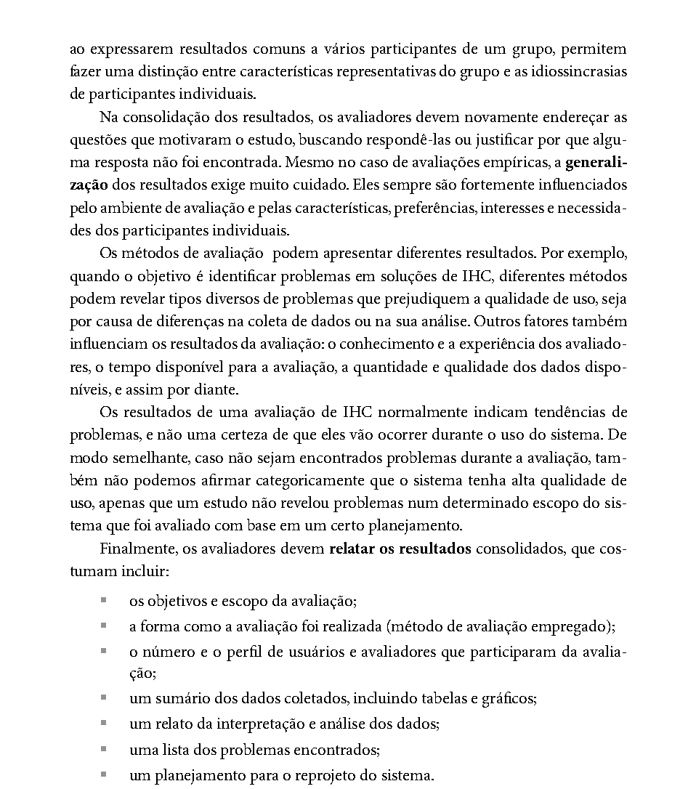

# Relato dos Resultados da Avaliação do Storyboard – Henrique Schneider

Portal do Detran-DF · IHC 2026.2 · Grupo 03 · Entrega 5 · Autor: Henrique Schneider Fernandes da Rosa

## Tabela de contribuição

**Tabela 1 – Contribuição no artefato Relato dos Resultados da Avaliação do Storyboard – Henrique Schneider**

| Integrante | Contribuição | Atividade (link) | Gravação (link) |
| --- | --- | --- | --- |
| Henrique Schneider Fernandes da Rosa | Condução das entrevistas com P1 e P2 e relato dos resultados | [Visão geral](index.md) | [Vídeos das entrevistas](video-entrevista.md) |

Fonte: elaborado pelo autor (2026).

## Histórico de versões

**Tabela 2 – Histórico de versões do relato dos resultados da avaliação do storyboard**

| Data       | Versão | Descrição                                                                                                                                                                                                                                                                     | Autor(es)                                                                 | Revisor(es)    |
|------------|--------|-------------------------------------------------------------------------------------------------------------------------------------------------------------------------------------------------------------------------------------------------------------------------------|---------------------------------------------------------------------------|----------------|
| 24/10/2026 | 1.0    | Criação da estrutura do relato dos resultados, conforme Barbosa e Silva (2010, p. 312)                                                                                                                                                                                        | Henrique Schneider Fernandes da Rosa                                      | Gabriel Robson |
| 25/10/2026 | 2.0    | Preenchimento com os dados da entrevista de 25/10/2026 (participante P1): perfil e condições da sessão, sumário das respostas, interpretação, resultado das hipóteses da HTA, lista de problemas e planejamento do reprojeto; registro dos desvios e das limitações da sessão | Henrique Schneider Fernandes da Rosa, com apoio do Claude (IA generativa) | Gabriel Robson |
| 25/10/2026 | 3.0    | Inclusão da segunda sessão (participante P2): perfil, respostas, comparação entre os participantes (recorrências e divergências), novos problemas 06 e 07, atualização das hipóteses, do reprojeto e das limitações                                                           | Henrique Schneider Fernandes da Rosa, com apoio do Claude (IA generativa) | Gabriel Robson |
| 25/10/2026 | 3.1    | Inclusão do link da gravação da sessão com P2 (YouTube, não listado), no lugar do marcador provisório, para publicação no GitHub Pages                                                                                                                                        | Henrique Schneider Fernandes da Rosa, com apoio do Claude (IA generativa) | Gabriel Robson |

Fonte: elaborado pelo autor (2026).

## 1. Objetivos e escopo da avaliação

Este documento relata os resultados da avaliação do storyboard “Agendamento da prova teórica com reserva de horário”, elaborado pelo autor para o projeto do Grupo 03 sobre o portal do Detran-DF. O storyboard mostra a persona Camila, candidata à primeira CNH, agendando a prova teórica com uma proposta de reprojeto: reservar o horário antes do pagamento e confirmar a prova automaticamente após a compensação do PIX (Figura 1). Cada quadro corresponde a um nó da Análise Hierárquica de Tarefas (HTA) do autor, conforme o Quadro 1.

**Figura 1 – Storyboard “Agendamento da prova teórica com reserva de horário”, mostrado aos participantes durante as entrevistas**

Fonte: elaborado pelo autor (2026).

**Quadro 1 – Quadros do storyboard e nós da HTA**

| Quadro    | 1   | 2   | 3   | 4   | 5   | 6   | 7   | 8          |
|-----------|-----|-----|-----|-----|-----|-----|-----|------------|
| Nó da HTA | 0   | 1   | 2   | 3   | 4.1 | 4.2 | 5   | 0 atingido |

Fonte: elaborado pelo autor (2026), a partir da HTA do agendamento da prova teórica (v1.0, Tabela 3).

A avaliação teve o objetivo de verificar se o storyboard representa de forma fiel e compreensível a tarefa de agendar a prova teórica e se a proposta de reserva de horário responde a uma dificuldade real dos candidatos. As questões de avaliação são as quatro definidas na etapa E do DECIDE no planejamento da Entrega 4 (Grupo 03, Relatório da Entrega 4, p. 4): fidelidade à realidade, clareza na interação, alinhamento com as personas e coerência de metas, acrescidas da questão sobre a proposta de reprojeto (nó 4 da HTA).

O escopo desta rodada são duas sessões de entrevista, realizadas em 25/10/2026 com dois participantes, identificados como P1 e P2 (no relatório do grupo da Entrega 5, eles aparecem como P3 e P4).

## 2. Método de avaliação

Foi usada a entrevista semiestruturada apoiada pelo storyboard, como definido na etapa C do DECIDE (Grupo 03, Relatório da Entrega 4, p. 4). Barbosa e Silva (2010, cap. 9, seç. 9.6, p. 301, 2º parágrafo) explicam que os métodos de investigação permitem ao avaliador acessar concepções, opiniões e expectativas dos usuários e explorar alternativas de design em avaliação formativa, e que “o uso de um sistema ou de materiais de apoio, como imagens, cenários e outros tipos de artefatos, pode contribuir para a investigação” (Barbosa; Silva, 2010, p. 301), conforme a Figura 2.

**Figura 2 – Trecho de Barbosa e Silva (2010, cap. 9, seç. 9.6, p. 301) sobre métodos de investigação**

Fonte: Barbosa e Silva (2010, p. 301).

A sessão seguiu o roteiro de entrevista semiestruturada do autor (v1.0): apresentação e TCLE, aquecimento, Bloco 1 sobre a experiência real (perguntas P1 a P4), leitura do storyboard, Bloco 2 sobre o storyboard (P5 a P8), Bloco 3 sobre a proposta (P9 e P10), desaquecimento e conclusão. Essa ordem segue a estrutura de sessão de Sharp et al. (2007 apud Barbosa; Silva, 2010, cap. 5, seç. 5.5.1, p. 146). O teste-piloto foi realizado em 24/10/2026, às 15:24, pelo próprio autor, sem outro participante, e seus dados foram descartados, como recomendam Barbosa e Silva (2010, cap. 9, seç. 9.7.2, p. 307, 3º parágrafo). Como os autores indicam que o participante do piloto “não deve ter se envolvido no planejamento e na preparação da avaliação” (Barbosa; Silva, 2010, cap. 9, seç. 9.7.2, p. 308, 1º parágrafo), esse piloto serviu para conferir o roteiro, o tempo e os equipamentos, mas não testou a compreensão das perguntas por outra pessoa nem o envio do material aos participantes.

Os dados vêm das gravações das sessões no Microsoft Teams (25 min 16 s e 17 min 9 s) e das transcrições automáticas geradas pela ferramenta. As minutagens citadas neste relato são as da gravação. Trechos em que a transcrição automática ficou sem sentido foram tratados como não captados, e as frases literais citadas foram escolhidas entre os trechos transcritos sem erro aparente.

**Desvios em relação ao roteiro na sessão 1 (P1).** (a) O arquivo enviado à participante antes da sessão não era o storyboard; depois de algumas tentativas (8:36–12:39), o storyboard foi mostrado por compartilhamento de tela. A partir de cerca de 13:30, a página 2 do PDF (apoio ao entrevistador, com as perguntas), que não deveria ser mostrada, ficou visível na tela junto com os quadros. (b) Ao responder P5, a participante já comentou os quadros um a um (12:57–15:25), e repetiu a descrição em P6 a pedido do entrevistador. (c) Em P9 e P10, o entrevistador resumiu as respostas antes de a participante confirmá-las (21:58–22:18 e 23:43–24:05); como o roteiro orienta evitar perguntas que pressuponham a opinião do entrevistado (Barbosa; Silva, 2010, cap. 5, seç. 5.5.1, p. 147), essas confirmações foram usadas apenas junto com o que a participante disse antes delas.

**Desvios em relação ao roteiro na sessão 2 (P2).** (a) Como P2 não se lembrava do agendamento, o entrevistador descreveu o fluxo atual antes de P1 (3:33–4:13), e as respostas de P1 a P4 vieram depois dessa descrição. (b) Ao apresentar a proposta em P9, o entrevistador a descreveu de forma diferente do storyboard: disse que o candidato faria a prova e pagaria em até 3 a 5 horas depois (12:59–13:47), enquanto o storyboard mostra a reserva do horário e o pagamento antes da prova. Por isso, as respostas de P2 sobre o prazo valem como opinião sobre a duração da reserva, e não sobre o fluxo exato do quadro 5. Nesta sessão, só a página 1 do storyboard foi compartilhada, e a autorização de gravação e de uso da imagem foi dada em voz alta no início (1:22–1:39).

## 3. Participantes e avaliadores

A Tabela 3 apresenta o perfil dos participantes e as condições das sessões. Em respeito ao TCLE, eles são identificados apenas como P1 e P2.

**Tabela 3 – Participantes, avaliadores e condições das sessões**

| Item                                                                                                                | Sessão 1 – P1                                                                                                                      | Sessão 2 – P2                                                                                                                                                                |
|---------------------------------------------------------------------------------------------------------------------|------------------------------------------------------------------------------------------------------------------------------------|------------------------------------------------------------------------------------------------------------------------------------------------------------------------------|
| Código no relatório do grupo                                                                                        | P3                                                                                                                                 | P4                                                                                                                                                                           |
| Idade                                                                                                               | 22 anos                                                                                                                            | 57 anos                                                                                                                                                                      |
| Ocupação                                                                                                            | Não perguntada diretamente; situa a prova antes do início das aulas da UnB (2:39)                                                  | Executivo de vendas da área de tecnologia (2:06)                                                                                                                             |
| Etapa da habilitação                                                                                                | Habilitada em 2026, cerca de nove a dez meses antes da entrevista (2:18–2:43); o agendamento foi feito pela autoescola (3:30)      | Habilitado há 39 anos (1:50); disse ter agendado pelo site, mas não se lembra do processo (3:16–4:27)                                                                        |
| Uso de serviços digitais do governo; conta gov.br                                                                   | Celular para tarefas rápidas e notebook para serviços do governo (1:27–2:18); tem conta gov.br; nível não captado (2:50–2:57)      | Prefere os aplicativos no celular, também para o Detran (2:20–2:33); conta gov.br de nível ouro (2:51)                                                                       |
| Correspondência com a persona Camila (perfil “Candidato à habilitação”, Relatório da Entrega 2, seç. 1.4, perfil B) | Parcial: primeira habilitação recente, mas não agendou sozinha                                                                     | Baixa: condutor experiente, fora do perfil “Candidato à habilitação”                                                                                                         |
| Data e horário                                                                                                      | 25/10/2026, 17:11 (25 min 16 s)                                                                                                    | 25/10/2026, 20:14 (17 min 9 s)                                                                                                                                               |
| Modalidade                                                                                                          | Remota, Microsoft Teams; storyboard por compartilhamento de tela                                                                   | Remota, Microsoft Teams; storyboard (só a página 1) por compartilhamento de tela                                                                                             |
| TCLE e autorização                                                                                                  | TCLE entregue antes da gravação; segundo o entrevistador, a participante autorizou o uso da imagem antes da entrevista (0:12–1:08) | TCLE enviado no material da sessão, com assinatura combinada para depois da gravação (1:01–1:22); autorizou em voz alta a gravação do rosto para fins educativos (1:22–1:39) |
| Entrevistador e relator                                                                                             | Henrique Schneider; sem relator (registro pela gravação e pela transcrição)                                                        | Henrique Schneider; sem relator (registro pela gravação e pela transcrição)                                                                                                  |
| Gravação                                                                                                            | <https://youtu.be/TTIRe6Id010> (não listado)                                                                                       | <https://youtu.be/4wEvZ1Okwwk> (não listado)                                                                                                                                 |

Fonte: elaborado pelo autor (2026), a partir das gravações das entrevistas.

## 4. Sumário dos dados coletados

As Tabelas 4 e 5 resumem as respostas de cada participante a cada pergunta do roteiro, com o quadro e o nó da HTA a que se referem, o problema ou a sugestão percebida e a severidade provisória. A severidade segue a escala de Nielsen (1994a apud Barbosa; Silva, 2010, cap. 10, seç. 10.1.1, p. 320), mostrada na Figura 3; “—” indica que a resposta não revelou problema. A numeração dos problemas é a da Tabela 8.

**Figura 3 – Trecho de Barbosa e Silva (2010, cap. 10, seç. 10.1.1, p. 320) com a escala de severidade de Nielsen**

Fonte: Barbosa e Silva (2010, p. 320).

**Tabela 4 – Respostas da participante P1 por pergunta do roteiro**

| Perg. | Tema                       | Resposta resumida / frase literal                                                                                                                                                                                                                                                                                                                                                                               | Quadro / HTA          | Problema ou sugestão                                | Sev. |
|-------|----------------------------|-----------------------------------------------------------------------------------------------------------------------------------------------------------------------------------------------------------------------------------------------------------------------------------------------------------------------------------------------------------------------------------------------------------------|-----------------------|-----------------------------------------------------|------|
| P1    | Como agendou a prova       | O agendamento foi feito pela autoescola ao fim das aulas: “O agendamento da prova teórica realmente foi dado \[...\] pela própria autoescola” (3:30).                                                                                                                                                                                                                                                           | HTA 1                 | Agendamento delegado à autoescola (ver problema 04) | —    |
| P2    | Pagamento e espera         | Pagou pelo site, sem certeza, e só depois marcou a prova (3:47–4:21). A espera foi longa: “foi cerca de ali quase um mês” (4:44); colegas da mesma turma tiveram o mesmo problema (5:19).                                                                                                                                                                                                                       | HTA 4; objetivo 0     | Problema 02                                         | 3    |
| P3    | Oferta de horários         | “Era um escopo bem limitado de horários e datas”, com “2 opções de data no máximo”; sentiu-se obrigada a aceitar o que havia (5:53). A prova não conflitou com outros compromissos (6:27).                                                                                                                                                                                                                      | HTA 3                 | Problema 02                                         | 3    |
| P4    | Pré-requisitos             | “Basicamente tudo me pegou de surpresa” (7:14); soube da biometria por amigas e não encontrou no portal onde confirmar: “eu não sabia onde procurar” (8:05); perguntou ao irmão e a conhecidos.                                                                                                                                                                                                                 | HTA 2                 | Problema 01                                         | 3    |
| P5    | Fidelidade                 | Reconheceu a sequência dos quadros como fiel. Diferenças: no quadro 2, não foi ela quem acessou o portal; no quadro 4, as opções eram mais limitadas; nos quadros 5 e 6, o pagamento foi feito pelos pais e havia medo de perder a vaga; no quadro 7, o aviso veio da autoescola (12:57–15:25). Não apontou passo faltando ou sobrando; citou só a preocupação de esquecer o conteúdo durante a espera (15:33). | Todos                 | Problema 03                                         | 3    |
| P6    | Clareza                    | Recontou os oito quadros com as próprias palavras (16:09–18:19) e respondeu que nenhum quadro foi menos claro (18:24).                                                                                                                                                                                                                                                                                          | Todos                 | —                                                   | —    |
| P7    | Persona                    | A pressa da Camila “fez sentido”; a diferença é que Camila age sozinha, enquanto ela dependeu da autoescola e dos pais, porque acha o gov.br confuso e tinha pouco tempo para explorá-lo (18:39–19:28).                                                                                                                                                                                                         | Quadros 1 e 2; HTA 1  | Problema 04                                         | 3    |
| P8    | Metas                      | Entendeu que Camila conseguiu marcar e fazer a prova de acordo com a sua rotina (19:35); quando o entrevistador perguntou se ela percebeu isso no quadro 8, assentiu (19:50–19:55).                                                                                                                                                                                                                             | Quadros 7–8           | —                                                   | —    |
| P9    | Reserva antes do pagamento | “Acho que seria muito interessante”: a reserva evita a nova espera e a necessidade de rever o conteúdo (20:32). Considerou curto o prazo de 3 a 5 horas e sugeriu “pelo menos 24 horas” (21:03). Se o PIX não compensar, a vaga deve ser liberada, com aviso cerca de uma hora antes de expirar e pedido para escolher novamente (21:38).                                                                       | HTA 4, plano 4        | Problema 05; sugestão para o plano 4                | 2    |
| P10   | Melhorias                  | Além da reserva, sugeriu mostrar os pré-requisitos e enviar lembretes das datas marcadas (por exemplo, da biometria), dos documentos a levar e do horário, com instruções sobre para que serve cada etapa (22:29–23:43).                                                                                                                                                                                        | Reprojeto (HTA 2 e 5) | Sugestão para o problema 01                         | —    |
| Livre | Comentários finais         | Não tinha mais nada a comentar sobre o agendamento (24:37).                                                                                                                                                                                                                                                                                                                                                     | —                     | —                                                   | —    |

Fonte: elaborado pelo autor (2026), a partir da sessão 1 (minutagem da gravação). Reações não verbais: não houve relator para registrá-las; a participante não verbalizou dúvida diante de nenhum quadro.

**Tabela 5 – Respostas do participante P2 por pergunta do roteiro**

| Perg. | Tema                       | Resposta resumida / frase literal                                                                                                                                                                                                                                                                                                                                                                                                      | Quadro / HTA                         | Problema ou sugestão                      | Sev. |
|-------|----------------------------|----------------------------------------------------------------------------------------------------------------------------------------------------------------------------------------------------------------------------------------------------------------------------------------------------------------------------------------------------------------------------------------------------------------------------------------|--------------------------------------|-------------------------------------------|------|
| P1    | Como agendou a prova       | “Não lembro” (3:16; 3:26). Depois que o entrevistador descreveu o fluxo (3:33–4:13), lembrou “vagamente” e disse que fez “pelo site” e achou fácil (4:13–4:36).                                                                                                                                                                                                                                                                        | HTA 1                                | Lembrança fraca do processo (ver Seção 2) | —    |
| P2    | Pagamento e espera         | Não precisou voltar ao portal; levou “alguns minutos” (4:53–5:08).                                                                                                                                                                                                                                                                                                                                                                     | HTA 4                                | —                                         | —    |
| P3    | Oferta de horários         | “Tinha muitas opções”, tanto de data quanto de hora, e conseguiu a unidade e a data que queria (5:18–5:35).                                                                                                                                                                                                                                                                                                                            | HTA 3                                | —                                         | —    |
| P4    | Pré-requisitos             | Tinha todas as informações e as procurou no próprio site, sem dificuldade, mas não lembra onde (6:10–6:18).                                                                                                                                                                                                                                                                                                                            | HTA 2                                | —                                         | —    |
| P5    | Fidelidade                 | Os quadros “parecem com a vida real”; não faltou nem sobrou passo: “tá bem realista” (7:19–7:38).                                                                                                                                                                                                                                                                                                                                      | Todos                                | —                                         | —    |
| P6    | Clareza                    | Recontou o quadro 1 e, no quadro 2, apontou que no gov.br “não aparece a opção de habilitação de cara”: é preciso pesquisar, o termo “habilitação” é genérico e o serviço do Detran não aparece com facilidade nos resultados (7:59–10:31). Não se lembrou dos quadros seguintes. O quadro menos claro foi o 2 (10:53); esperava ver os serviços mais acessados e algo personalizado pela localização, idade e situação (10:59–11:13). | Quadro 2; HTA 1.2                    | Problemas 04 e 06                         | 3    |
| P7    | Persona                    | Não se identificou: “esse caminho está muito simples e não tem nada a ver com o que acontecia, especialmente no quadro 2” (11:24); não lembra das etapas de pagamento (11:41).                                                                                                                                                                                                                                                         | Quadro 2                             | Problema 06                               | 2    |
| P8    | Metas                      | “Ela está conseguindo aqui o agendamento da prova dela” (12:13); percebeu no quadro 8 (12:22), em resposta a uma pergunta aberta.                                                                                                                                                                                                                                                                                                      | Quadro 8                             | —                                         | —    |
| P9    | Reserva antes do pagamento | Com a proposta descrita pelo entrevistador (Seção 2), achou 3 a 5 horas “muito pouco” e disse que “precisaria de 24 horas” (13:47–14:06). Se o prazo estourasse, deveria haver uma extensão de pelo menos 24 horas, para “conseguir o dinheiro” da taxa (14:54–15:12).                                                                                                                                                                 | HTA 4, plano 4                       | Problema 05                               | 2    |
| P10   | Melhorias                  | Faria a prova em casa, com câmera aberta, como em outros cursos (15:34–16:07).                                                                                                                                                                                                                                                                                                                                                         | Fora do escopo (realização da prova) | —                                         | —    |
| Livre | Comentários finais         | Os quadros mostram o processo como se fosse um aplicativo de celular, mas ele fez tudo pela web (16:16).                                                                                                                                                                                                                                                                                                                               | Quadros 2–7                          | Problema 07                               | 1    |

Fonte: elaborado pelo autor (2026), a partir da sessão 2 (minutagem da gravação). Reações não verbais: não houve relator; o participante pediu um momento para examinar o quadro 2 (8:41–9:29).

## 5. Interpretação e análise dos dados

Na consolidação, os avaliadores devem voltar às questões que motivaram o estudo e respondê-las, ou justificar por que não houve resposta (Barbosa; Silva, 2010, cap. 9, seç. 9.7.5, p. 312, 2º parágrafo). A Tabela 6 responde às questões de avaliação, comparando os dois participantes, e a Tabela 7 confronta as hipóteses da HTA com as respostas.

**Tabela 6 – Respostas às questões de avaliação**

| Questão de avaliação              | Perguntas      | Resultado (P1 e P2)                                                                                                                                                                                                                                                                 |
|-----------------------------------|----------------|-------------------------------------------------------------------------------------------------------------------------------------------------------------------------------------------------------------------------------------------------------------------------------------|
| 1\. Fidelidade à realidade        | P1, P2, P3, P5 | Atendida em parte. Os dois reconheceram a sequência como fiel (“tá bem realista”, disse P2). P1 dependeu da autoescola e dos pais, e P2 se lembra pouco do processo. As experiências divergem: P1 esperou quase um mês e teve duas datas; P2 agendou em minutos, com muitas opções. |
| 2\. Clareza na interação          | P6             | Atendida em parte. P1 recontou os oito quadros e não achou nenhum confuso. P2 apontou o quadro 2 como o menos claro, por mostrar como simples um acesso que, no gov.br real, exige busca e usa um termo genérico.                                                                   |
| 3\. Alinhamento com as personas   | P4, P7         | Atendida em parte. A pressa da Camila fez sentido para P1, que é menos autônoma do que a persona. P2, condutor há 39 anos e fora do perfil, não se identificou.                                                                                                                     |
| 4\. Coerência de metas            | P8             | Atendida. Os dois entenderam que Camila conseguiu agendar a prova; P2 apontou o quadro 8 em resposta a uma pergunta aberta.                                                                                                                                                         |
| Proposta de reprojeto (HTA, nó 4) | P9, P10        | Bem recebida, com o mesmo ajuste nos dois: prazo de reserva de pelo menos 24 horas. P1 também sugeriu aviso antes de expirar, liberação da vaga e lembretes.                                                                                                                        |

Fonte: elaborado pelo autor (2026), a partir das questões de Grupo 03 (Relatório da Entrega 4, p. 4).

**Tabela 7 – Hipóteses da HTA e resultado da avaliação**

| Nó          | Hipótese (HTA v1.0, Tabela 2)                                | Resultado                                                                                                                                | Evidência                                                |
|-------------|--------------------------------------------------------------|------------------------------------------------------------------------------------------------------------------------------------------|----------------------------------------------------------|
| 0 / 4       | Pagar antes de escolher o horário faz perder a data desejada | Confirmada em parte por P1 (pagou antes, esperou quase um mês e teve medo de perder a vaga); não observada em P2, que agendou em minutos | P1: P2 e P5 (4:08–4:57; 12:57–15:25); P2: P2 (4:53–5:08) |
| 2           | A candidata só descobre uma pendência quando tenta agendar   | Confirmada por P1; não observada em P2, que tinha as informações                                                                         | P1: P4 (7:14–8:26); P2: P4 (6:10–6:18)                   |
| 3           | Falta horário na data ou na unidade desejada                 | Confirmada por P1 (duas datas); não observada em P2 (muitas opções)                                                                      | P1: P3 (5:40–6:16); P2: P3 (5:18–5:35)                   |
| 4 (plano 4) | O prazo da reserva pode ser insuficiente para a compensação  | Confirmada pelos dois: 3 a 5 horas é pouco; ambos sugeriram 24 horas                                                                     | P1: P9 (20:50–21:30); P2: P9 (13:47–15:12)               |
| 1.2 (E2)    | O serviço de Habilitação é difícil de encontrar no gov.br    | Confirmada pelos dois: P1 considera o gov.br confuso; P2 descreveu a busca e o termo genérico                                            | P1: P7 (18:39–19:28); P2: P6 (7:59–10:31)                |

Fonte: elaborado pelo autor (2026).

Em síntese, as duas sessões convergem em dois pontos: o acesso ao serviço pelo gov.br é difícil (problema 04) e um prazo de reserva de 3 a 5 horas é curto, devendo chegar a 24 horas (problema 05). Os problemas da espera, da falta de datas e dos pré-requisitos (01 a 03) apareceram só com P1, que tirou a habilitação neste ano, e não com P2, habilitado há 39 anos e com pouca lembrança do processo. Essa divergência é coerente com a diferença de perfil e indica que os problemas 01 a 03 devem ser verificados com outros candidatos recentes.

Com dois participantes de perfis diferentes, os resultados indicam tendências de problemas, e não a certeza de que eles vão ocorrer; da mesma forma, a ausência de um problema não prova que ele não exista (Barbosa; Silva, 2010, cap. 9, seç. 9.7.5, p. 312, 4º parágrafo). As recorrências entre participantes são o que permite distinguir características do grupo das idiossincrasias individuais (Barbosa; Silva, 2010, cap. 9, seç. 9.7.5, pp. 311–312).

## 6. Lista de problemas encontrados

A Tabela 8 consolida os problemas identificados nas duas sessões, ordenados pela severidade, com o número de participantes que os relataram. A coluna “Tipo” indica se o problema se refere ao processo atual do portal, ao storyboard como artefato ou à proposta de reprojeto. As severidades são provisórias, atribuídas pelo autor.

**Tabela 8 – Problemas encontrados na avaliação do storyboard**

| ID  | Tipo                  | Problema                                                                                                                                                                 | Quadro | HTA         | Sev. | Participantes | Evidência                                          |
|-----|-----------------------|--------------------------------------------------------------------------------------------------------------------------------------------------------------------------|--------|-------------|------|---------------|----------------------------------------------------|
| 04  | Processo atual        | O serviço de Habilitação é difícil de encontrar no gov.br: não aparece de início, exige busca e o termo é genérico; P1 considera o gov.br confuso e delega o agendamento | 2      | 1 (1.2)     | 3    | P1, P2        | P1: 3:30; 18:39–19:28 · P2: 7:59–10:31             |
| 01  | Processo atual        | A candidata não sabe quais são os pré-requisitos (por exemplo, a biometria) e não encontra no portal onde conferi-los                                                    | 3      | 2           | 3    | P1            | P4: “basicamente tudo me pegou de surpresa” (7:14) |
| 02  | Processo atual        | Espera de quase um mês entre o pagamento e o agendamento e oferta de no máximo duas datas                                                                                | 4      | 3           | 3    | P1            | 4:44; 5:53                                         |
| 03  | Processo atual        | Medo de perder a vaga durante o pagamento, porque as vagas são disputadas                                                                                                | 5–6    | 4           | 3    | P1            | 12:57–15:25                                        |
| 05  | Proposta de reprojeto | Prazo de reserva de 3 a 5 horas insuficiente; os dois sugeriram 24 horas                                                                                                 | 5      | 4 (plano 4) | 2    | P1, P2        | P1: 21:03 · P2: 13:47–14:06                        |
| 06  | Storyboard            | O quadro 2 mostra como simples o acesso ao serviço, que no portal real é difícil de encontrar; foi o quadro menos claro para P2                                          | 2      | 1           | 2    | P2            | 10:53–11:24                                        |
| 07  | Storyboard            | Os quadros mostram só o celular, mas P2 fez tudo pela web                                                                                                                | 2–7    | —           | 1    | P2            | 16:16                                              |

Fonte: elaborado pelo autor (2026). Correspondência com o relatório do grupo da Entrega 5: 01 = PS02, 02 = PS03, 03 e 05 = PS04, 04 = PS05, 06 = PS06, 07 = PS07.

## 7. Planejamento do reprojeto

A Tabela 9 associa cada problema a uma recomendação de reprojeto, priorizada pela severidade. As recomendações serão representadas no protótipo de papel do autor (Relatório da Entrega 5, seção 3.8.1). As alterações no storyboard geram uma nova versão do artefato (v1.1), registrada no seu histórico.

**Tabela 9 – Recomendações de reprojeto**

| Problema | Recomendação                                                                                                                                                                                                                          | Artefato afetado                                          | Prioridade        | Responsável e prazo                                                        |
|----------|---------------------------------------------------------------------------------------------------------------------------------------------------------------------------------------------------------------------------------------|-----------------------------------------------------------|-------------------|----------------------------------------------------------------------------|
| 01       | Mostrar, antes do calendário, a lista de pré-requisitos com a situação de cada um, o que levar e o caminho para resolver o que faltar; enviar lembretes das etapas marcadas, como sugeriu P1                                          | Proposta (HTA, objetivo 2; protótipo, Tela 2)             | Alta (3)          | Henrique Schneider; protótipo de papel em 25/10/2026                       |
| 02       | Mostrar a disponibilidade por unidade em um calendário e sugerir a data livre mais próxima                                                                                                                                            | Proposta (HTA, objetivo 3; protótipo, Tela 3)             | Alta (3)          | Henrique Schneider; protótipo de papel em 25/10/2026                       |
| 03       | Manter a reserva do horário antes do pagamento, com o prazo visível na tela de pagamento                                                                                                                                              | Proposta (HTA, objetivo 4; protótipo, Tela 4)             | Alta (3)          | Henrique Schneider; protótipo de papel em 25/10/2026                       |
| 04       | Dar ao serviço um nome específico (por exemplo, “Habilitação – CNH”), destacá-lo entre os serviços mais acessados do gov.br, como sugeriu P2, e mostrar no início do serviço as etapas do processo e em qual delas o candidato está   | Proposta (HTA, objetivos 1 e 1.2; protótipo, Telas 1 e 2) | Alta (3; P1 e P2) | Henrique Schneider; protótipo de papel em 25/10/2026                       |
| 05       | Testar no protótipo um prazo de reserva de 24 horas, com aviso uma hora antes de expirar e mensagem de que a vaga foi liberada; registrar o prazo no plano 4 da HTA e ajustar o texto do quadro 5 do storyboard (“reservado até 13h”) | HTA (plano 4, v1.1) e storyboard (quadro 5, v1.1)         | Alta (2; P1 e P2) | Henrique Schneider; HTA v1.1 em 25/10/2026; storyboard v1.1 até 01/11/2026 |
| 06       | Mostrar no quadro 2 a busca pelo serviço no gov.br, para que o storyboard não esconda essa etapa                                                                                                                                      | Storyboard (quadro 2, v1.1)                               | Média (2)         | Henrique Schneider; storyboard v1.1 até 01/11/2026                         |
| 07       | Indicar que o serviço pode ser usado no celular ou no computador (por exemplo, com um quadro na web)                                                                                                                                  | Storyboard (v1.1)                                         | Baixa (1)         | Henrique Schneider; storyboard v1.1 até 01/11/2026                         |

Fonte: elaborado pelo autor (2026).

## 8. Estrutura do relato

Este relato segue os itens que, segundo Barbosa e Silva (2010, cap. 9, seç. 9.7.5, p. 312, último parágrafo), os resultados consolidados costumam incluir (Figura 4): objetivos e escopo (Seção 1), método (Seção 2), número e perfil de participantes e avaliadores (Seção 3), sumário dos dados (Seção 4), interpretação e análise (Seção 5), lista de problemas (Seção 6) e planejamento do reprojeto (Seção 7).

**Figura 4 – Trecho de Barbosa e Silva (2010, cap. 9, seç. 9.7.5, p. 312) sobre o relato dos resultados**

Fonte: Barbosa e Silva (2010, p. 312).

## Documento em PDF

A versão em PDF deste artefato está disponível para download: [Relato dos resultados da avaliação do storyboard (v3.0)](arquivos/relato-resultados-storyboard.pdf).

## Referências

BARBOSA, Simone Diniz Junqueira; SILVA, Bruno Santana da. *Interação Humano-Computador*. Rio de Janeiro: Elsevier, 2010.

GRUPO 03. *Planejamento da Entrega 4*: Planejamento da Avaliação do Storyboard e da Análise de Tarefas. Brasília: Universidade de Brasília, 2026.

GRUPO 03. *Relatório da Entrega 2*: Perfil do Usuário, Aspectos Éticos e Análise de Tarefas. Brasília: Universidade de Brasília, 2026.

ROSA, Henrique Schneider Fernandes da. *Análise Hierárquica de Tarefas (HTA)*: agendar a prova teórica com reserva de horário. Versão 1.2. Brasília: Universidade de Brasília, 2026.

ROSA, Henrique Schneider Fernandes da. *Entrevista de avaliação do storyboard com a participante P1*. Brasília, 25 out. 2026. 1 vídeo (25 min 16 s). Disponível em: https://youtu.be/TTIRe6Id010. Acesso em: 25 out. 2026.

ROSA, Henrique Schneider Fernandes da. *Entrevista de avaliação do storyboard com o participante P2*. Brasília, 25 out. 2026. 1 vídeo (17 min 9 s). Disponível em: https://youtu.be/4wEvZ1Okwwk. Acesso em: 25 out. 2026.

ROSA, Henrique Schneider Fernandes da. *Roteiro de entrevista semiestruturada*: avaliação do storyboard “Agendamento da prova teórica com reserva de horário”. Versão 1.2. Brasília: Universidade de Brasília, 2026.

ROSA, Henrique Schneider Fernandes da. *Storyboard*: agendamento da prova teórica com reserva de horário. Versão 1.0. Brasília: Universidade de Brasília, 2026.

SALES, André Barros de. *Plano de Ensino*: Interação Humano Computador (FGA0173), 02/2026, Turma 01, v1. Brasília: Universidade de Brasília, 2026.

## Agradecimentos e uso de IA generativa

O autor agradece aos participantes P1 e P2 pela disponibilidade e pela paciência durante as sessões.

Conforme o Código de Conduta da SBC adotado no Plano de Ensino (Sales, 2026, p. 3), declara-se que o Claude (Anthropic) foi usado como apoio na diagramação deste relato e na localização dos trechos citados de Barbosa e Silva (2010) (versão 1.0) e, na versão 2.0, na organização das respostas a partir da transcrição automática e da gravação da entrevista, na redação das tabelas de resultados e na proposta de severidades; a idade da participante P1, a data do teste-piloto e a autorização de imagem de P1 foram informadas pelo autor. Na versão 3.0, foi usado para organizar as respostas da sessão 2 e comparar os dois participantes. A condução da entrevista, os dados coletados, a revisão da análise e as conclusões são de responsabilidade do autor.

**Uso de IA generativa nesta página.** Em 25/10/2026, o Claude (Anthropic) foi utilizado, a pedido de Henrique Schneider, para converter o PDF deste artefato em página do site, com a tabela de contribuição e a renumeração das tabelas a partir da Tabela 2. Os participantes aparecem como P1 e P2, como no PDF; no relatório do grupo, são P3 e P4. A ferramenta não é autora do artefato e seu uso não exime o autor da responsabilidade sobre o conteúdo (Sales, 2026, p. 3).
