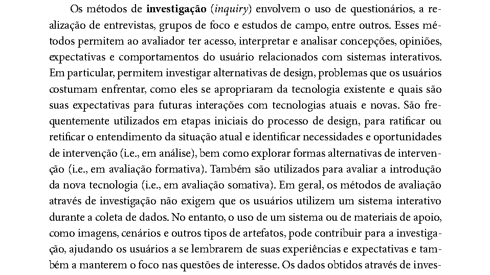
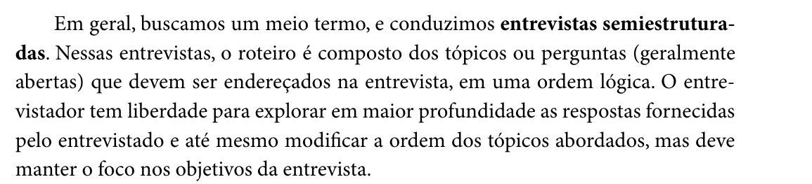
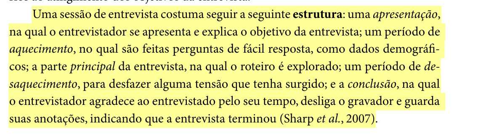
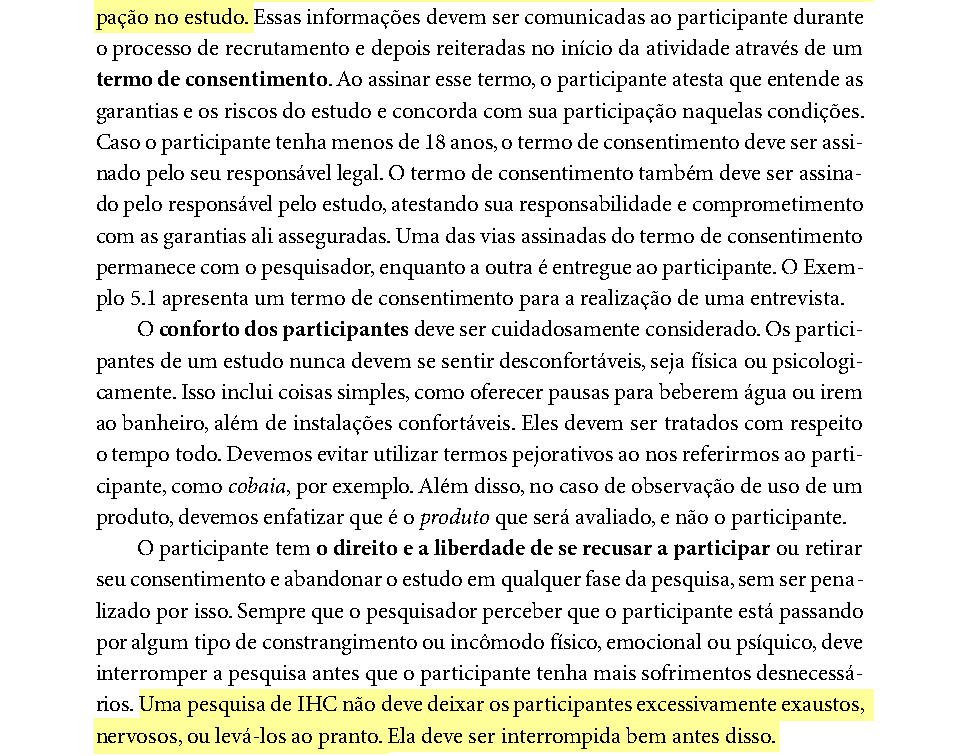
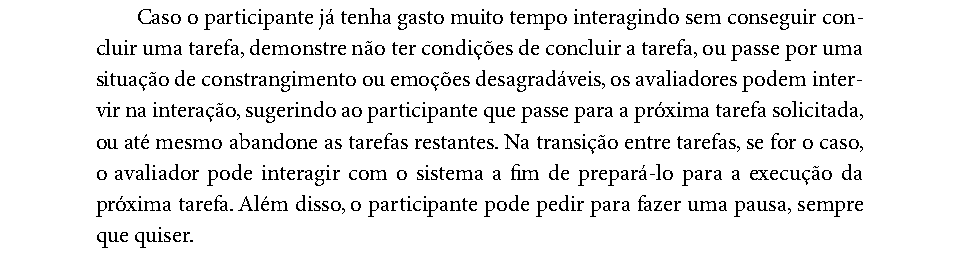
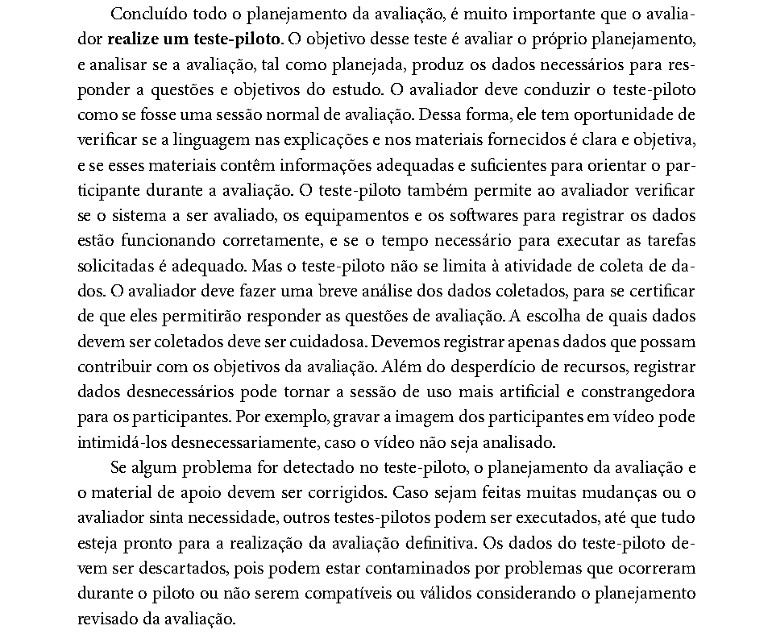
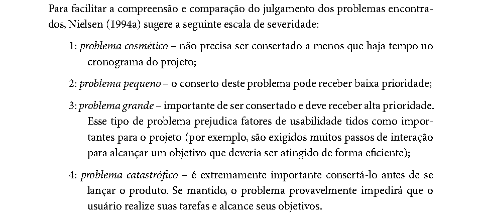

# Roteiro de Entrevista – Henrique Schneider

Avaliação do storyboard “Agendamento da prova teórica com reserva de horário” · Portal do Detran-DF · IHC 2026.2 · Grupo 03 · Entrega 5 · Autor: Henrique Schneider Fernandes da Rosa

## Tabela de contribuição

**Tabela 1 – Contribuição no artefato Roteiro de Entrevista – Henrique Schneider**

| Integrante | Contribuição | Atividade (link) | Gravação (link) |
| --- | --- | --- | --- |
| Henrique Schneider Fernandes da Rosa | Elaboração do roteiro de entrevista semiestruturada, da folha de registro e da consolidação dos problemas | [Visão geral](index.md) | [Vídeos das entrevistas](video-entrevista.md) |

Fonte: elaborado pelo autor (2026).

## Histórico de versões

**Tabela 2 – Histórico de versões do roteiro de entrevista semiestruturada**

| Data       | Versão | Descrição                                                                                                                                                                                                                | Autor(es)                                                                 | Revisor(es)    |
|------------|--------|--------------------------------------------------------------------------------------------------------------------------------------------------------------------------------------------------------------------------|---------------------------------------------------------------------------|----------------|
| 22/10/2026 | 1.0    | Criação do roteiro de entrevista semiestruturada, da folha de registro do relator e da tabela de consolidação dos problemas                                                                                              | Henrique Schneider Fernandes da Rosa                                      | Gabriel Robson |
| 25/10/2026 | 1.1    | Registro da sessão realizada em 25/10/2026 (quantidade de participantes, papéis e cronograma das sessões) e preenchimento da tabela de consolidação dos problemas (Apêndice B); nenhuma pergunta do roteiro foi alterada | Henrique Schneider Fernandes da Rosa, com apoio do Claude (IA generativa) | Gabriel Robson |
| 25/10/2026 | 1.2    | Registro da sessão 2 (P2) no cronograma e na logística e atualização da tabela de consolidação dos problemas (Apêndice B) com os dois participantes                                                                      | Henrique Schneider Fernandes da Rosa, com apoio do Claude (IA generativa) | Gabriel Robson |

Fonte: elaborado pelo autor (2026).

## 1. Introdução

Este documento operacionaliza o método escolhido no planejamento da Entrega 4 para avaliar o storyboard: a entrevista guiada (semiestruturada), apoiada pelos quadros do storyboard (Grupo 03, Relatório da Entrega 4, etapa C do DECIDE, p. 4). O storyboard avaliado mostra a persona Camila agendando a prova teórica com uma proposta de reprojeto: reservar o horário antes de pagar e receber a confirmação automática depois que o PIX compensar. Cada quadro está ligado a um nó da Análise Hierárquica de Tarefas (HTA) do mesmo integrante, conforme o Quadro 1 da Seção 7.

O documento traz a fundamentação do método (Seção 2), as questões de avaliação (Seção 3), a logística (Seção 4), os cuidados éticos (Seção 5), o teste-piloto (Seção 6), o roteiro (Seção 7) e o que o relator deve anotar (Seção 8). A folha de registro e a tabela de consolidação estão nos Apêndices A e B.

## 2. Fundamentação do método

### 2.1 Métodos de investigação apoiados por artefatos

Segundo Barbosa e Silva (2010, cap. 9, seç. 9.6, p. 301, 2º parágrafo), os métodos de investigação, como questionários, entrevistas e grupos de foco, permitem ao avaliador acessar e interpretar concepções, opiniões e expectativas dos usuários, e são usados também em avaliação formativa para explorar alternativas de design. Os autores destacam que, embora esses métodos não exijam o uso de um sistema, “o uso de um sistema ou de materiais de apoio, como imagens, cenários e outros tipos de artefatos, pode contribuir para a investigação” (Barbosa; Silva, 2010, cap. 9, seç. 9.6, p. 301). É esse o papel do storyboard nesta entrevista, conforme a Figura 1.

**Figura 1 – Trecho de Barbosa e Silva (2010, cap. 9, seç. 9.6, p. 301) sobre métodos de investigação**

Fonte: Barbosa e Silva (2010, p. 301).

### 2.2 Entrevista semiestruturada e roteiro híbrido

Na entrevista semiestruturada, “o roteiro é composto dos tópicos ou perguntas (geralmente abertas) que devem ser endereçados na entrevista, em uma ordem lógica” (Barbosa; Silva, 2010, cap. 5, seç. 5.5.1, p. 146, 1º parágrafo). O entrevistador pode aprofundar respostas e mudar a ordem dos tópicos, desde que mantenha o foco nos objetivos (Figura 2). Os autores admitem ainda um roteiro híbrido, com tópicos que servem de lembrete e perguntas de exemplo para entrevistadores menos experientes (Barbosa; Silva, 2010, cap. 5, seç. 5.5.1, p. 146, 3º parágrafo). Este roteiro adota o formato híbrido: a Tabela 5 traz o tópico, uma pergunta de exemplo e as sondagens.

**Figura 2 – Trecho de Barbosa e Silva (2010, cap. 5, seç. 5.5.1, p. 146) sobre entrevistas semiestruturadas**

Fonte: Barbosa e Silva (2010, p. 146).

A sessão segue a estrutura descrita por Sharp et al. (2007 apud Barbosa; Silva, 2010, cap. 5, seç. 5.5.1, p. 146, último parágrafo): apresentação, aquecimento, parte principal, desaquecimento e conclusão (Figura 3). As etapas da Tabela 5 seguem essa ordem.

**Figura 3 – Trecho de Barbosa e Silva (2010, cap. 5, seç. 5.5.1, p. 146) sobre a estrutura da sessão de entrevista**

Fonte: Barbosa e Silva (2010, p. 146).

Para não induzir respostas, o entrevistador deve evitar perguntas que pressuponham a opinião do entrevistado e usar perguntas do tipo “sim ou não” apenas como filtro para decidir se aprofunda um tema (Barbosa; Silva, 2010, cap. 5, seç. 5.5.1, p. 147, 1º e 2º parágrafos). Por isso, as perguntas 4, 6, 8 e 9 do roteiro impresso no storyboard (versão 1.0, p. 2) foram reformuladas como perguntas abertas na Tabela 5. A numeração foi mantida para que as duas folhas continuem correspondentes.

## 3. Objetivos e questões de avaliação

O objetivo é verificar se o storyboard representa de forma fiel e compreensível a tarefa de agendar a prova teórica e se a proposta de reserva de horário responde a uma dificuldade real dos candidatos. As quatro questões vêm da etapa E do DECIDE no planejamento da Entrega 4 (Grupo 03, Relatório da Entrega 4, p. 4). A Tabela 3 mostra quais perguntas respondem a cada uma.

**Tabela 3 – Questões de avaliação e perguntas do roteiro**

| Questão de avaliação (Entrega 4)  | O que se quer saber                                                                   | Perguntas      |
|-----------------------------------|---------------------------------------------------------------------------------------|----------------|
| 1\. Fidelidade à realidade        | O fluxo dos quadros corresponde ao que o candidato faz no Detran-DF?                  | P1, P2, P3, P5 |
| 2\. Clareza na interação          | As ações e os estados mostrados nos quadros são fáceis de entender?                   | P6             |
| 3\. Alinhamento com as personas   | A motivação e a frustração da Camila condizem com o perfil “Candidato à habilitação”? | P4, P7         |
| 4\. Coerência de metas            | Fica claro que a usuária atinge o objetivo com o apoio do sistema?                    | P8             |
| Proposta de reprojeto (HTA, nó 4) | A reserva antes do pagamento resolve a dificuldade relatada?                          | P9, P10        |

Fonte: elaborado pelo autor (2026), a partir de Grupo 03 (Relatório da Entrega 4, p. 4).

## 4. Participantes e logística

- **Perfil:** pessoas que tiraram a primeira CNH no Distrito Federal recentemente ou que estão no processo, correspondentes ao perfil “Candidato à habilitação” e à persona Camila (Grupo 03, Relatório da Entrega 2, seç. 1.4, perfil B).
- **Quantidade:** a Tabela 4 previa até três sessões. Até o prazo da Entrega 5 foram realizadas duas sessões, com P1 e P2, e o teste-piloto foi conduzido pelo próprio autor. Com dois participantes, os resultados indicam tendências de problemas, e não certezas (Barbosa; Silva, 2010, cap. 9, seç. 9.7.5, p. 312, 4º parágrafo).
- **Modalidade e duração:** presencial, com o storyboard impresso, ou remota pelo Microsoft Teams, com os quadros em tela. Duração prevista de 20 a 25 minutos. As duas sessões foram remotas, com 25 min 16 s e 17 min 9 s de gravação.
- **Papéis:** entrevistador, Henrique Schneider. Nas sessões 1 e 2 não houve relator/observador; o registro foi feito pela gravação e pela transcrição automática do Teams. Os papéis seguem a etapa I do DECIDE (Grupo 03, Relatório da Entrega 4, p. 5).
- **Materiais:** página 1 do storyboard (mostrada ao participante); página 2 (só para o entrevistador); TCLE do grupo (Entrega 2); este roteiro; uma folha de registro por participante (Apêndice A); gravador ou gravação do Teams.

**Tabela 4 – Cronograma das sessões**

| Atividade             | Data          | Horário        | Local ou meio                                        | Participante        |
|-----------------------|---------------|----------------|------------------------------------------------------|---------------------|
| Teste-piloto          | 24/10/2026    | 15:24          | Conduzido pelo próprio autor, sem outro participante | Piloto (descartado) |
| Sessão 1              | 25/10/2026    | 17:11 (25 min) | Remota, Microsoft Teams                              | P1                  |
| Sessão 2              | 25/10/2026    | 20:14 (17 min) | Remota, Microsoft Teams                              | P2                  |
| Sessão 3              | Não realizada | —              | —                                                    | —                   |
| Consolidação e relato | 25/10/2026    | —              | —                                                    | —                   |

Fonte: elaborado pelo autor (2026). O relato da Entrega 5 vence em 25/10/2026 (Sales, 2026, p. 5).

## 5. Questões éticas

Antes de começar, o entrevistador explica o objetivo do estudo, apresenta o TCLE do grupo e pede autorização para gravar. O termo atesta que o participante entende as garantias e os riscos e concorda em participar; uma via fica com o pesquisador e a outra com o participante (Barbosa; Silva, 2010, cap. 5, seç. 5.4, p. 141). O participante pode recusar ou abandonar a entrevista a qualquer momento, sem penalidade, e o entrevistador deve interromper a sessão se perceber constrangimento ou incômodo (Barbosa; Silva, 2010, cap. 5, seç. 5.4, p. 141). Ver a Figura 4. No relato, os participantes aparecem apenas como P1, P2, P3.

**Figura 4 – Trecho de Barbosa e Silva (2010, cap. 5, seç. 5.4, p. 141) sobre consentimento e conforto dos participantes**

Fonte: Barbosa e Silva (2010, p. 141).

Se o participante travar ou demonstrar desconforto, o entrevistador passa para a próxima pergunta, como os autores recomendam para a intervenção do avaliador (Barbosa; Silva, 2010, cap. 9, seç. 9.7.3, p. 310, 2º parágrafo), mostrado na Figura 5.

**Figura 5 – Trecho de Barbosa e Silva (2010, cap. 9, seç. 9.7.3, p. 310) sobre a intervenção do avaliador**

Fonte: Barbosa e Silva (2010, p. 310).

## 6. Teste-piloto

O teste-piloto avalia o próprio planejamento: se a linguagem do roteiro e dos materiais é clara, se os equipamentos funcionam e se o tempo é adequado. Ele deve ser conduzido como uma sessão normal, e “os dados do teste-piloto devem ser descartados” (Barbosa; Silva, 2010, cap. 9, seç. 9.7.2, p. 307, 3º parágrafo), conforme a Figura 6. O piloto será feito com um colega fora do Grupo 03 ou com alguém próximo de perfil semelhante, como os autores admitem no mesmo trecho. As mudanças feitas no roteiro depois do piloto entram no histórico de versões (Tabela 2), e nenhuma resposta do piloto entra no relato dos resultados.

O piloto foi realizado em 24/10/2026, às 15:24, pelo próprio autor, sem outro participante. Como o participante do piloto “não deve ter se envolvido no planejamento e na preparação da avaliação” (Barbosa; Silva, 2010, cap. 9, seç. 9.7.2, p. 308, 1º parágrafo), esse piloto conferiu o roteiro, o tempo e os equipamentos, mas não a compreensão das perguntas por outra pessoa.

**Figura 6 – Trecho de Barbosa e Silva (2010, cap. 9, seç. 9.7.2, p. 307) sobre o teste-piloto**

Fonte: Barbosa e Silva (2010, p. 307).

## 7. Roteiro da entrevista

O Bloco 1 vem antes de mostrar o storyboard, para que o relato da experiência real não seja influenciado pelos quadros. O Quadro 1 lembra a ligação entre os quadros e a HTA.

**Quadro 1 – Quadros do storyboard e nós da HTA**

| Quadro    | 1   | 2   | 3   | 4   | 5   | 6   | 7   | 8                   |
|-----------|-----|-----|-----|-----|-----|-----|-----|---------------------|
| Nó da HTA | 0   | 1   | 2   | 3   | 4.1 | 4.2 | 5   | Objetivo 0 atingido |

Fonte: elaborado pelo autor (2026), a partir do storyboard (v1.0, p. 1).

**Tabela 5 – Roteiro híbrido da entrevista**

| Etapa                                                                                                                                       | Tópico (lembrete)                                           | Pergunta de exemplo                                                                                                                                                                                                                                                                   | Sondagens                                                                                      | Vínculo            |
|---------------------------------------------------------------------------------------------------------------------------------------------|-------------------------------------------------------------|---------------------------------------------------------------------------------------------------------------------------------------------------------------------------------------------------------------------------------------------------------------------------------------|------------------------------------------------------------------------------------------------|--------------------|
| Apresentação (2 min)                                                                                                                        | Quem somos, objetivo, TCLE, gravação                        | “Somos do Grupo 03 da disciplina de IHC da UnB. Estamos estudando o agendamento da prova teórica no portal do Detran-DF. Não existe resposta certa: quem está sendo avaliado é a proposta, não você. Você pode parar quando quiser.” Entregar o TCLE e pedir autorização para gravar. |                                                                                                | Ética              |
| Aquecimento (3 min)                                                                                                                         | Perfil, uso de celular e de serviços digitais, etapa da CNH | “Conte um pouco sobre você: o que faz no dia a dia e como costuma usar o celular para resolver coisas do governo?”                                                                                                                                                                    | Em que etapa da habilitação você está? Tem conta gov.br?                                       | Perfil             |
| Principal, Bloco 1: experiência real (8 min)                                                                                                | Como agendou                                                | **P1.** “Você já agendou a prova teórica?” (filtro) Se sim: “Como foi? Me conte o passo a passo.” Se não: “Como você imagina que vai fazer?”                                                                                                                                          | Pelo site ou pelo app? Sozinha(o) ou com ajuda da autoescola?                                  | Q1 · HTA 1         |
|                                                                                                                                             | Pagamento e espera                                          | **P2.** “Como foi o intervalo entre pagar a taxa e conseguir agendar?”                                                                                                                                                                                                                | Quanto tempo levou? Precisou voltar ao portal mais de uma vez?                                 | Q1 · HTA 4         |
|                                                                                                                                             | Oferta de horários                                          | **P3.** “Quando foi escolher a data, como estava a oferta de horários?”                                                                                                                                                                                                               | Conseguiu a data e a unidade que queria? O que fez quando não havia?                           | Q1 · HTA 3         |
|                                                                                                                                             | Pré-requisitos                                              | **P4.** “Como você descobriu o que faltava (curso, biometria, exames) antes de poder agendar?”                                                                                                                                                                                        | Onde procurou essa informação? Algo te pegou de surpresa?                                      | Q3 · HTA 2         |
| **Transição:** mostrar a página 1 do storyboard e pedir que o participante leia os quadros 1 a 8 no próprio ritmo. Não explicar os quadros. |                                                             |                                                                                                                                                                                                                                                                                       |                                                                                                |                    |
| Principal, Bloco 2: storyboard (8 min)                                                                                                      | Fidelidade                                                  | **P5.** “Comparando com o que você fez (ou faria), o que nos quadros se parece com a vida real e o que é diferente?”                                                                                                                                                                  | Faltou algum passo? Sobrou algum?                                                              | Q1 · todos         |
|                                                                                                                                             | Clareza                                                     | **P6.** “Me conte, com suas palavras, o que acontece em cada quadro.”                                                                                                                                                                                                                 | Qual quadro foi o menos claro? O que você esperava ver nele?                                   | Q2 · quadro citado |
|                                                                                                                                             | Persona                                                     | **P7.** “O que você acha da situação da Camila, comparada com a sua?”                                                                                                                                                                                                                 | A pressa dela para marcar a prova faz sentido? O que seria diferente para você?                | Q3 · quadro 1      |
|                                                                                                                                             | Metas                                                       | **P8.** “Como você descreveria o final da história? O que a Camila conseguiu?”                                                                                                                                                                                                        | Em que quadro você percebeu que tinha dado certo?                                              | Q4 · quadros 7–8   |
| Principal, Bloco 3: proposta (4 min)                                                                                                        | Reserva antes do pagamento                                  | **P9.** “O que você acha de o sistema guardar o horário enquanto o pagamento compensa, como no quadro 5?”                                                                                                                                                                             | O prazo da reserva seria suficiente? O que deveria acontecer se o PIX não compensasse a tempo? | HTA 4, plano 4     |
|                                                                                                                                             | Melhorias                                                   | **P10.** “Se você pudesse mudar uma coisa nesse processo, o que mudaria?”                                                                                                                                                                                                             | Por quê? Em que momento isso ajudaria?                                                         | Reprojeto          |
| Desaquecimento (2 min)                                                                                                                      | Comentários livres                                          | “Tem alguma coisa sobre o agendamento ou sobre o portal que a gente não perguntou e você gostaria de comentar?”                                                                                                                                                                       |                                                                                                | —                  |
| Conclusão (1 min)                                                                                                                           | Agradecimento                                               | Agradecer, desligar o gravador, informar que a entrevista terminou e que os dados serão anonimizados.                                                                                                                                                                                 |                                                                                                | Ética              |

Fonte: elaborado pelo autor (2026), com a estrutura de sessão de Sharp et al. (2007 apud Barbosa; Silva, 2010, p. 146).

## 8. O que o relator anota durante a sessão

Para cada pergunta, o relator registra na folha do Apêndice A: (a) a resposta resumida e, quando houver, uma frase literal curta do participante; (b) o quadro e o nó da HTA a que a resposta se refere; (c) o problema ou a sugestão percebida; (d) a severidade provisória do problema, usando a escala de Nielsen (1994 apud Barbosa; Silva, 2010, cap. 10, seç. 10.1.1, p. 320), da Figura 7; e (e) reações não verbais relevantes, como hesitação ou confusão diante de um quadro. Os problemas são depois consolidados no Apêndice B, e a correção é priorizada pela severidade. Nas sessões 1 e 2, sem relator, esses itens foram extraídos das gravações e das transcrições e estão nas Tabelas 3 e 4 do relato dos resultados (v3.0).

**Figura 7 – Trecho de Barbosa e Silva (2010, cap. 10, seç. 10.1.1, p. 320) com a escala de severidade**

Fonte: Barbosa e Silva (2010, p. 320).

## Apêndice A – Folha de registro do relator (uma por participante)

|                                           |                          |                                       |                        |
|-------------------------------------------|--------------------------|---------------------------------------|------------------------|
| Participante: P\_\_\_                     | Data: \_\_\_/\_\_\_/2026 | Início: \_\_\_:\_\_\_                 | Término: \_\_\_:\_\_\_ |
| Modalidade: ☐ presencial ☐ remota (Teams) |                          | ☐ TCLE assinado ☐ gravação autorizada |                        |
| Entrevistador:                            |                          | Relator:                              |                        |
| Perfil (aquecimento):                     |                          |                                       |                        |

**Tabela 6 – Registro das respostas**

<table>
<colgroup>
<col style="width: 20%" />
<col style="width: 20%" />
<col style="width: 20%" />
<col style="width: 20%" />
<col style="width: 20%" />
</colgroup>
<thead>
<tr class="header">
<th>Perg.</th>
<th>Resposta resumida / frase literal</th>
<th>Quadro / HTA</th>
<th>Problema ou sugestão</th>
<th>Sev. (0–4)</th>
</tr>
</thead>
<tbody>
<tr class="odd">
<td>P1</td>
<td>

&#10;
</td>
<td></td>
<td></td>
<td></td>
</tr>
<tr class="even">
<td>P2</td>
<td>

&#10;
</td>
<td></td>
<td></td>
<td></td>
</tr>
<tr class="odd">
<td>P3</td>
<td>

&#10;
</td>
<td></td>
<td></td>
<td></td>
</tr>
<tr class="even">
<td>P4</td>
<td>

&#10;
</td>
<td></td>
<td></td>
<td></td>
</tr>
<tr class="odd">
<td>P5</td>
<td>

&#10;
</td>
<td></td>
<td></td>
<td></td>
</tr>
<tr class="even">
<td>P6</td>
<td>

&#10;
</td>
<td></td>
<td></td>
<td></td>
</tr>
<tr class="odd">
<td>P7</td>
<td>

&#10;
</td>
<td></td>
<td></td>
<td></td>
</tr>
<tr class="even">
<td>P8</td>
<td>

&#10;
</td>
<td></td>
<td></td>
<td></td>
</tr>
<tr class="odd">
<td>P9</td>
<td>

&#10;
</td>
<td></td>
<td></td>
<td></td>
</tr>
<tr class="even">
<td>P10</td>
<td>

&#10;
</td>
<td></td>
<td></td>
<td></td>
</tr>
<tr class="odd">
<td>Livre</td>
<td>

&#10;
</td>
<td></td>
<td></td>
<td></td>
</tr>
</tbody>
</table>

Reações não verbais e observações gerais:  
  
\_\_\_\_\_\_\_\_\_\_\_\_\_\_\_\_\_\_\_\_\_\_\_\_\_\_\_\_\_\_\_\_\_\_\_\_\_\_\_\_\_\_\_\_\_\_\_\_\_\_\_\_\_\_\_\_\_\_\_\_\_\_\_\_\_\_\_\_\_\_\_\_\_\_\_\_\_\_  
  
\_\_\_\_\_\_\_\_\_\_\_\_\_\_\_\_\_\_\_\_\_\_\_\_\_\_\_\_\_\_\_\_\_\_\_\_\_\_\_\_\_\_\_\_\_\_\_\_\_\_\_\_\_\_\_\_\_\_\_\_\_\_\_\_\_\_\_\_\_\_\_\_\_\_\_\_\_\_  
  
Fonte: elaborado pelo autor (2026).

## Apêndice B – Tabela de consolidação dos problemas

Preenchida depois das sessões, seguindo a consolidação e o relato descritos por Barbosa e Silva (2010, cap. 9, seç. 9.7.5, pp. 311–312). Problemas iguais citados por participantes diferentes ocupam uma única linha. Nesta versão, a tabela reúne os problemas das sessões 1 e 2; a análise completa está no relato dos resultados (v3.0, Tabelas 7 e 8).

**Tabela 7 – Consolidação dos problemas encontrados na avaliação do storyboard**

| ID  | Problema                                                                                   | Quadro | HTA         | Participantes | Sev. | Recomendação de reprojeto                                                                       |
|-----|--------------------------------------------------------------------------------------------|--------|-------------|---------------|------|-------------------------------------------------------------------------------------------------|
| 04  | O serviço de Habilitação é difícil de encontrar no gov.br (exige busca; termo genérico)    | 2      | 1 (1.2)     | P1, P2        | 3    | Nome específico para o serviço, destaque entre os mais acessados e etapas do processo no início |
| 01  | A candidata não sabe quais são os pré-requisitos e não encontra no portal onde conferi-los | 3      | 2           | P1            | 3    | Lista de pré-requisitos com a situação de cada um antes do calendário; lembretes das etapas     |
| 02  | Espera de quase um mês e oferta de no máximo duas datas                                    | 4      | 3           | P1            | 3    | Calendário com disponibilidade por unidade e sugestão da data livre mais próxima                |
| 03  | Medo de perder a vaga durante o pagamento                                                  | 5–6    | 4           | P1            | 3    | Manter a reserva antes do pagamento, com o prazo visível                                        |
| 05  | Prazo de reserva de 3 a 5 horas insuficiente (proposta)                                    | 5      | 4 (plano 4) | P1, P2        | 2    | Testar no protótipo um prazo de 24 horas, com aviso uma hora antes de expirar                   |
| 06  | O quadro 2 mostra como simples um acesso que é difícil no portal real (storyboard)         | 2      | 1           | P2            | 2    | Mostrar a busca pelo serviço no quadro 2                                                        |
| 07  | Os quadros mostram só o celular, mas o participante usou a web (storyboard)                | 2–7    | —           | P2            | 1    | Indicar uso no celular ou no computador                                                         |

Fonte: elaborado pelo autor (2026), a partir das sessões 1 e 2 (25/10/2026).

## Documento em PDF

A versão em PDF deste artefato está disponível para download: [Roteiro de entrevista semiestruturada (v1.2)](arquivos/roteiro-entrevista-agendamento-prova-teorica.pdf).

## Referências

BARBOSA, Simone Diniz Junqueira; SILVA, Bruno Santana da. *Interação Humano-Computador*. Rio de Janeiro: Elsevier, 2010.

GRUPO 03. *Relatório da Entrega 2*: Perfil do Usuário, Aspectos Éticos e Análise de Tarefas. Brasília: Universidade de Brasília, 2026.

GRUPO 03. *Planejamento da Entrega 4*: Planejamento da Avaliação do Storyboard e da Análise de Tarefas. Brasília: Universidade de Brasília, 2026.

ROSA, Henrique Schneider Fernandes da. *Relato dos resultados da avaliação do storyboard* “Agendamento da prova teórica com reserva de horário”. Versão 3.0. Brasília: Universidade de Brasília, 2026.

SALES, André Barros de. *Plano de Ensino*: Interação Humano Computador (FGA0173), 02/2026, Turma 01, v1. Brasília: Universidade de Brasília, 2026.

## Uso de IA generativa

Conforme o Código de Conduta da SBC adotado no Plano de Ensino (Sales, 2026, p. 3), declara-se que o Claude (Anthropic) foi usado como apoio na redação do roteiro, na diagramação deste PDF e na localização dos trechos citados de Barbosa e Silva (2010) e, nas versões 1.1 e 1.2, no registro das sessões realizadas e na consolidação dos problemas a partir da transcrição automática e da gravação. As decisões do planejamento, a condução das entrevistas e a revisão do conteúdo são de responsabilidade do autor.

**Uso de IA generativa nesta página.** Em 25/10/2026, o Claude (Anthropic) foi utilizado, a pedido de Henrique Schneider, para converter o PDF deste artefato em página do site, com a tabela de contribuição e a renumeração das tabelas a partir da Tabela 2. A ferramenta não é autora do artefato e seu uso não exime o autor da responsabilidade sobre o conteúdo (Sales, 2026, p. 3).
