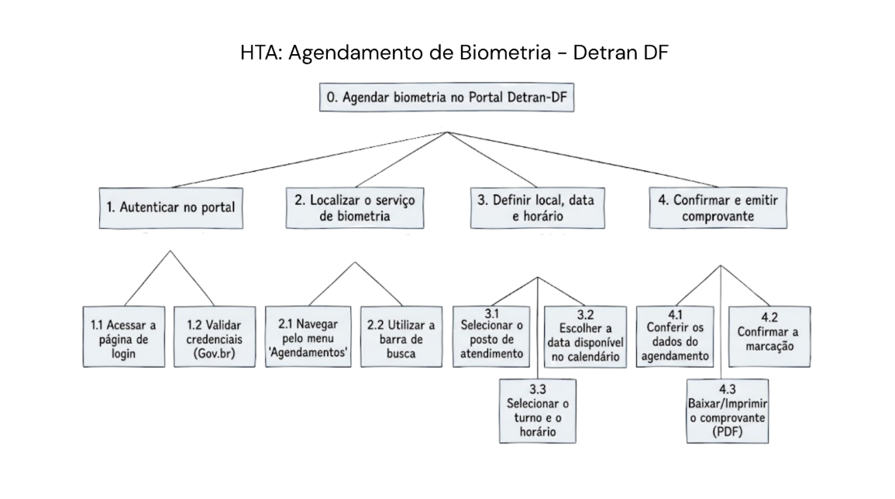

# HTA do Processo Atual – João Vitor

## Tabela de contribuição

**Tabela 1 – Contribuição no artefato HTA do Processo Atual – João Vitor**

| Integrante | Contribuição | Atividade (link) | Gravação (link) |
| --- | --- | --- | --- |
| João Vitor Tavares | Elaboração do HTA do processo de agendamento de biometria | [Visão geral](index.md) | [Espaço do vídeo](video-entrevista.md) |

Fonte: material elaborado pelo responsável (2026).

## Histórico de versões

**Tabela 2 – Histórico de versões do artefato HTA do Processo Atual – João Vitor**

| Data | Versão | Descrição | Autor(es) | Revisor(es) |
| --- | --- | --- | --- | --- |
| 25/10/2026 | 1.0 | Publicação da árvore, decomposição e planos do processo atual | João Vitor Tavares | — |

Fonte: registro desta versão (2026).

## 1. Objetivo e recorte

**Objetivo 0:** agendar biometria no Portal Detran-DF.

O modelo representa o caminho de autenticação, localização do serviço, definição de local, data e horário e confirmação do agendamento. O recorte termina com a emissão do comprovante.

## 2. Árvore HTA

**Figura 1 – HTA do processo atual de agendamento de biometria**

Fonte: HTA fornecido por João Vitor (2026).

## 3. Objetivos e operações

**Tabela 3 – Decomposição da tarefa atual**

| Tarefa | Subtarefas |
| --- | --- |
| 1. Autenticar no portal | 1.1 Acessar a página de login. 1.2 Validar credenciais (Gov.br). |
| 2. Localizar o serviço de biometria | 2.1 Navegar pelo menu “Agendamentos”. 2.2 Utilizar a barra de busca. |
| 3. Definir local, data e horário | 3.1 Selecionar o posto de atendimento. 3.2 Escolher a data disponível no calendário. 3.3 Selecionar o turno e o horário. |
| 4. Confirmar e emitir comprovante | 4.1 Conferir os dados do agendamento. 4.2 Confirmar a marcação. 4.3 Baixar ou imprimir o comprovante em PDF. |

Fonte: árvore HTA fornecida pelo responsável (2026).

## 4. Planos de execução

**Tabela 4 – Planos do HTA atual**

| Plano | Regra |
| --- | --- |
| 0 | Executar **1 → 2 → 3 → 4**. |
| 1 | Executar **1.1 → 1.2**. Se a autenticação falhar, corrigir as credenciais antes de prosseguir. |
| 2 | Localizar o serviço por **2.1** ou **2.2**, conforme a estratégia escolhida pelo usuário. |
| 3 | Executar **3.1 → 3.2 → 3.3**. Se não houver disponibilidade, retornar à escolha de data ou posto. |
| 4 | Executar **4.1 → 4.2 → 4.3**. Se houver dado incorreto, retornar à etapa correspondente antes de confirmar. |

Fonte: organização textual baseada no HTA fornecido (2026).

## 5. Critério de sucesso e validação

O critério de sucesso é a marcação confirmada, com posto, data e horário definidos e comprovante disponível. A avaliação deve verificar se a decomposição representa o caminho compreendido pelo participante e se há etapas ausentes, redundantes ou fora de ordem.

## Referências

BARBOSA, Simone Diniz Junqueira; SILVA, Bruno Santana da; SILVEIRA, Milene Selbach; GASPARINI, Isabela; DARIN, Ticianne; BARBOSA, Gabriel Diniz Junqueira. *Interação Humano-Computador e Experiência do Usuário*. 2021.
