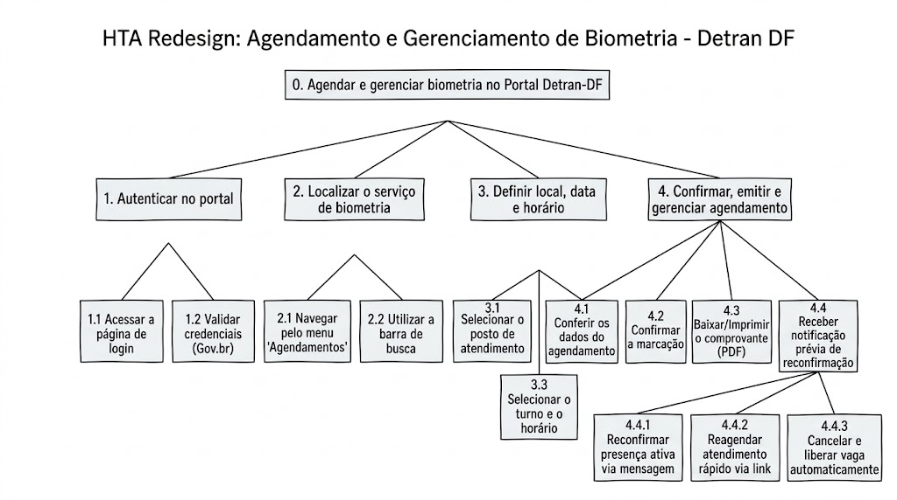

# HTA do Redesign – João Vitor

## Tabela de contribuição

**Tabela 1 – Contribuição no artefato HTA do Redesign – João Vitor**

| Integrante | Contribuição | Atividade (link) | Gravação (link) |
| --- | --- | --- | --- |
| João Vitor Tavares de Sá Lima | Elaboração da proposta de agendamento e gerenciamento de biometria | [Visão geral](index.md) | [Espaço do vídeo](video-entrevista.md) |

Fonte: material elaborado pelo responsável (2026).

## Histórico de versões

**Tabela 2 – Histórico de versões do artefato HTA do Redesign – João Vitor**

| Data | Versão | Descrição | Autor(es) | Revisor(es) |
| --- | --- | --- | --- | --- |
| 25/10/2026 | 1.0 | Publicação da árvore, decomposição e planos do redesign | João Vitor Tavares de Sá Lima, com apoio do ChatGPT | — |

Fonte: registro desta versão (2026).

## 1. Objetivo e escopo

**Objetivo 0:** agendar e gerenciar biometria no Portal Detran-DF.

O redesign mantém o fluxo de agendamento e amplia a etapa final para apoiar o gerenciamento posterior da marcação, especialmente quando o usuário recebe uma notificação prévia e precisa reconfirmar, reagendar ou cancelar.

## 2. Árvore HTA

**Figura 1 – HTA do redesign de agendamento e gerenciamento de biometria**

Fonte: HTA redesign fornecido por João Vitor (2026).

## 3. Objetivos e operações

**Tabela 3 – Decomposição da proposta**

| Tarefa | Subtarefas |
| --- | --- |
| 1. Autenticar no portal | 1.1 Acessar a página de login. 1.2 Validar credenciais (Gov.br). |
| 2. Localizar o serviço de biometria | 2.1 Navegar pelo menu “Agendamentos”. 2.2 Utilizar a barra de busca. |
| 3. Definir local, data e horário | 3.1 Selecionar o posto de atendimento. 3.2 Escolher a data disponível no calendário. 3.3 Selecionar o turno e o horário. |
| 4. Confirmar, emitir e gerenciar agendamento | 4.1 Conferir os dados do agendamento. 4.2 Confirmar a marcação. 4.3 Baixar ou imprimir o comprovante (PDF). 4.4 Receber notificação prévia de reconfirmação. |
| 4.4. Gerenciar a notificação | 4.4.1 Reconfirmar presença ativa via mensagem. 4.4.2 Reagendar atendimento rápido via link. 4.4.3 Cancelar e liberar a vaga automaticamente. |

Fonte: árvore HTA do redesign fornecida pelo responsável (2026).

## 4. Planos de execução

**Tabela 4 – Planos do HTA do redesign**

| Plano | Regra |
| --- | --- |
| 0 | Executar **1 → 2 → 3 → 4** para criar o agendamento; posteriormente, quando houver notificação, executar uma das alternativas de **4.4**. |
| 1 | Executar **1.1 → 1.2**. |
| 2 | Localizar o serviço por **2.1** ou **2.2**. |
| 3 | Executar **3.1 → 3.2 → 3.3**. |
| 4 | Executar **4.1 → 4.2 → 4.3** e, quando aplicável, **4.4**. |
| 4.4 | Escolher uma alternativa: **4.4.1** reconfirmar, **4.4.2** reagendar ou **4.4.3** cancelar. |

Fonte: organização textual baseada no HTA do redesign fornecido (2026).

## 5. Entrada, sucesso e limites

**Entrada:** usuário com necessidade de realizar biometria e condições para acessar o portal.

**Critério de sucesso do agendamento:** marcação confirmada com posto, data, horário e comprovante.

**Critério de sucesso do gerenciamento:** diante da notificação, o usuário consegue expressar sua decisão sem repetir desnecessariamente o fluxo de autenticação e localização do serviço.

**Limite:** os mecanismos de mensagem, link rápido e liberação automática de vaga são elementos da proposta e precisam ser avaliados; não são apresentados como funcionalidades implementadas.

## Referências

BARBOSA, Simone Diniz Junqueira; SILVA, Bruno Santana da; SILVEIRA, Milene Selbach; GASPARINI, Isabela; DARIN, Ticianne; BARBOSA, Gabriel Diniz Junqueira. *Interação Humano-Computador e Experiência do Usuário*. 2021.
