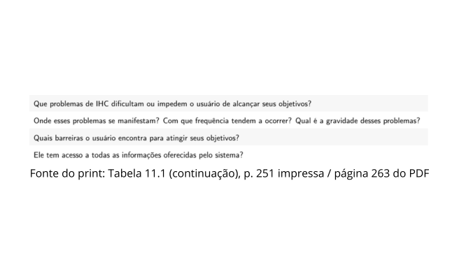
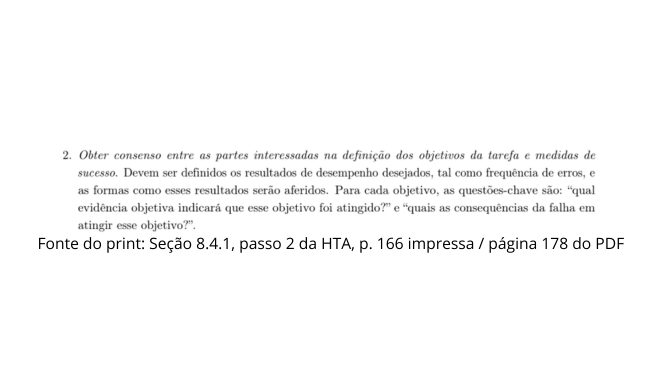
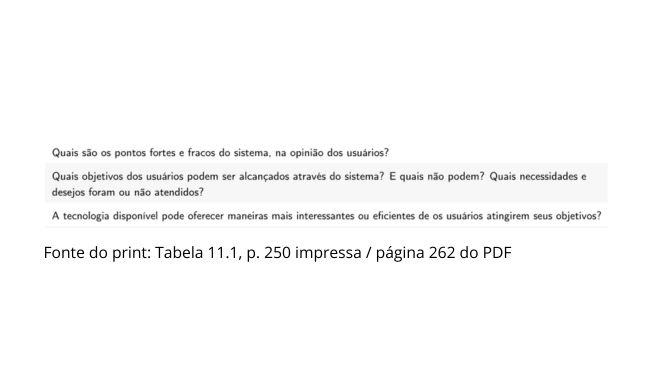
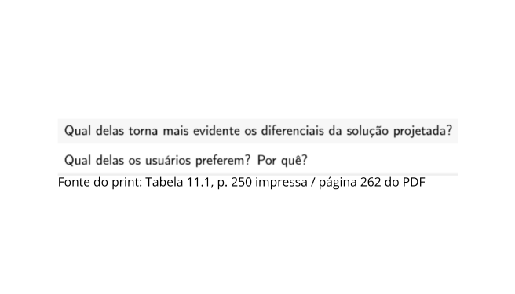

# Roteiro de Entrevista – João Vitor

## Tabela de contribuição

**Tabela 1 – Contribuição no artefato Roteiro de Entrevista – João Vitor**

| Integrante | Contribuição | Atividade (link) | Gravação (link) |
| --- | --- | --- | --- |
| João Vitor Tavares | Organização das perguntas para avaliação do HTA e do storyboard | [Visão geral](index.md) | [Espaço do vídeo](video-entrevista.md) |

Fonte: organização para esta atividade (2026).

## Histórico de versões

**Tabela 2 – Histórico de versões do artefato Roteiro de Entrevista – João Vitor**

| Data | Versão | Descrição | Autor(es) | Revisor(es) |
| --- | --- | --- | --- | --- |
| 25/10/2026 | 1.0 | Organização do roteiro de entrevista no padrão da Entrega 5 | João Vitor Tavares de Sá Lima, com apoio do ChatGPT | — |
| 25/10/2026 | 1.1 | Inclusão dos recortes de fundamentação abaixo das perguntas | João Vitor Tavares de Sá Lima, com apoio do ChatGPT | — |

Fonte: registro desta versão (2026).

## 1. Fundamentação

O roteiro operacionaliza os objetivos da avaliação, relacionando perguntas sobre o processo atual, validação do HTA, compreensão do storyboard e comparação com a proposta de redesign. A análise hierárquica de tarefas é tratada por Barbosa et al. (2021) na seção 8.4.1; o planejamento e o relato da avaliação são tratados nos capítulos 11 e 12.

Os recortes apresentados abaixo registram os trechos utilizados como apoio para a formulação das perguntas.

## 2. Orientações de aplicação

As perguntas devem ser abertas e apresentadas de maneira neutra. Sondagens servem apenas para aprofundar uma resposta já iniciada, evitando induzir aprovação da proposta.

Q1 a Q3 tratam do processo atual; Q4 e Q5, da validação do HTA; Q6 a Q8, do storyboard e redesign; Q9 e Q10, da comparação e preferência.

## 3. Perguntas

### Q01. Compreensão do processo atual

**Pergunta:** Ao pensar em agendar a biometria no Detran-DF, quais etapas você esperaria realizar do início até a confirmação?

### Q02. Localização do serviço

**Pergunta:** Como você procuraria o serviço de biometria dentro do portal? Em algum momento você esperaria ter dificuldade?

### Q03. Informações necessárias

**Pergunta:** Que informações você considera necessárias antes de confirmar um agendamento de biometria?

### Q04. Critério de conclusão da tarefa

**Pergunta:** Como você saberia que o agendamento foi concluído corretamente?

### Q05. Etapas e ordem do HTA

**Pergunta:** Observando a árvore HTA atual, essas etapas correspondem ao caminho que você seguiria? O que acrescentaria, retiraria ou mudaria de ordem?

### Q06. Compreensão do storyboard

**Pergunta:** Depois de acompanhar o storyboard, o que você entende que aconteceu com Carlos e qual problema a proposta tenta resolver?

### Q07. Notificação de reconfirmação

**Pergunta:** O que você entende que a notificação enviada antes do atendimento permite fazer?

### Q08. Reagendamento

**Pergunta:** Na situação de Carlos, como você esperaria que o reagendamento funcionasse? Há alguma informação ou etapa que ainda faltaria?

### Q09. Facilidade percebida

**Pergunta:** Comparando o fluxo atual com a proposta do storyboard e do redesign, qual parece mais fácil de entender e usar? Por quê?

### Q10. Preferência e sugestão

**Pergunta:** Qual alternativa você preferiria para lidar com um imprevisto depois de já ter agendado a biometria? O que mudaria na proposta?

## 4. Cuidados de interpretação

Uma avaliação favorável do storyboard indica compreensão ou utilidade percebida naquele contexto, mas não comprova desempenho de uma interface ainda não implementada. As respostas devem ser analisadas junto às limitações da sessão.

## Referências

BARBOSA, Simone Diniz Junqueira; SILVA, Bruno Santana da; SILVEIRA, Milene Selbach; GASPARINI, Isabela; DARIN, Ticianne; BARBOSA, Gabriel Diniz Junqueira. *Interação Humano-Computador e Experiência do Usuário*. 2021.
