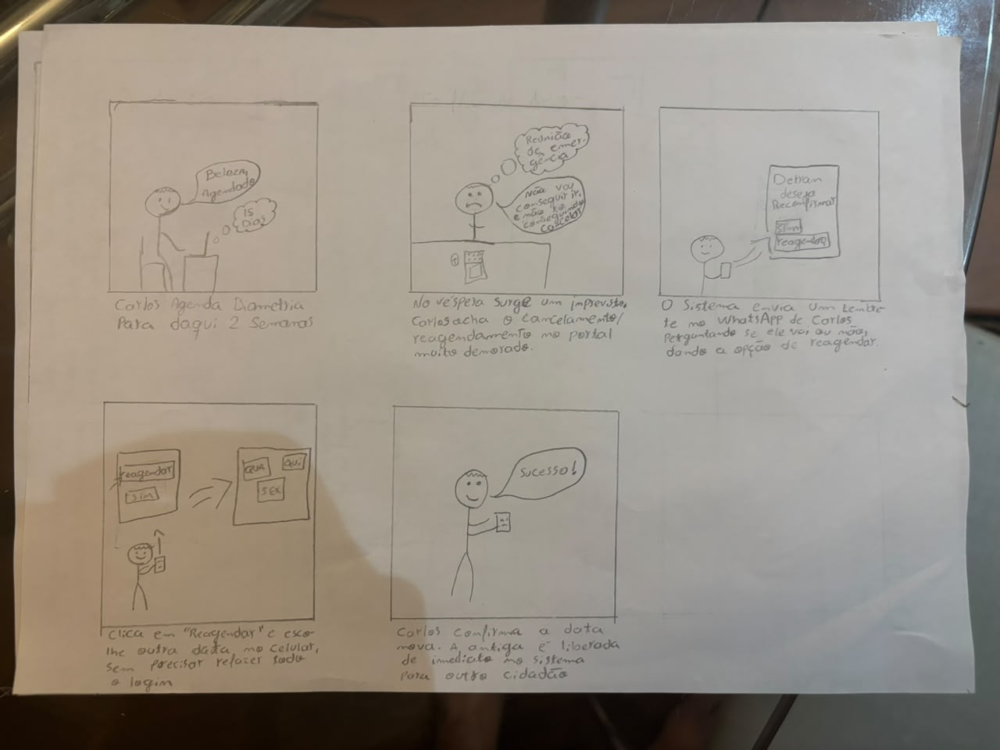

# Storyboard – João Vitor

## Tabela de contribuição

**Tabela 1 – Contribuição no artefato Storyboard – João Vitor**

| Integrante | Contribuição | Atividade (link) | Gravação (link) |
| --- | --- | --- | --- |
| João Vitor Tavares | Elaboração do storyboard do cenário de reagendamento de biometria | [Visão geral](index.md) | [Espaço do vídeo](video-entrevista.md) |

Fonte: material elaborado pelo responsável (2026).

## Histórico de versões

**Tabela 2 – Histórico de versões do artefato Storyboard – João Vitor**

| Data | Versão | Descrição | Autor(es) | Revisor(es) |
| --- | --- | --- | --- | --- |
| 25/10/2026 | 1.0 | Publicação da narrativa e representação do storyboard | João Vitor Tavares | Alexandre Vilar |
| 10/11/2026 | 1.1 | Substituição do revisor genérico ou vazio por Gabriel Robson no histórico de versões | Henrique Schneider (solicitante), com apoio do Claude (IA generativa) | João Vitor |

| 22/11/2026 | 1.2 | Inclusão da introdução, a partir da inspeção de Fagan da Entrega 8 | Henrique Schneider (solicitante), com apoio do Claude (IA generativa) | João Vitor |
| 22/11/2026 | 1.3 | Troca do revisor Gabriel Robson, que deixou o grupo, por Alexandre Vilar e João Vitor no histórico de versões | Henrique Schneider (solicitante), com apoio do Claude (IA generativa) | João Vitor |
Fonte: registro desta versão (2026).

## Introdução

Esta página registra o artefato “Storyboard”, de João Vitor, na Entrega 5 (relato da avaliação do storyboard e da análise de tarefas e planejamento da avaliação do protótipo de papel). Ela faz parte do material individual de João Vitor e está ligada à [visão geral](index.md) da entrega. A Seção 1 trata de “Contexto e proposta”, a Seção 2 trata de “Storyboard”, a Seção 3 trata de “Relação com a análise de tarefas” e a Seção 4 trata de “Avaliação da narrativa”.

## 1. Contexto e proposta

Carlos agenda a biometria para aproximadamente duas semanas depois. Perto da data, surge um imprevisto e ele percebe que não conseguirá comparecer. A proposta do storyboard introduz uma notificação prévia do Detran perguntando se o usuário vai ao atendimento e oferecendo uma alternativa de reagendamento.

## 2. Storyboard

A representação abaixo organiza de forma legível a narrativa do desenho original fornecido pelo autor.

1. Carlos conclui o agendamento da biometria e recebe a confirmação.
2. Próximo à data, surge um imprevisto e ele percebe que não poderá comparecer.
3. O sistema envia um lembrete perguntando se ele vai ao atendimento e oferece a opção de reagendar.
4. Carlos escolhe “Reagendar”, seleciona outra data disponível sem repetir todo o fluxo inicial.
5. Carlos confirma a nova data e a vaga anterior pode ser liberada para outro cidadão.

**Figura 1 – Storyboard da proposta de reagendamento de biometria**

Fonte: Storyboard desenvolvido por João Vitor Tavares(2026).

## 3. Relação com a análise de tarefas

O [HTA atual](hta-atual.md) termina com a confirmação e emissão do comprovante. O [HTA do redesign](hta-redesign.md) acrescenta o gerenciamento posterior da marcação por meio de reconfirmação, reagendamento ou cancelamento. O storyboard concretiza especialmente a alternativa de reagendamento.

## 4. Avaliação da narrativa

A avaliação deve investigar se os participantes compreendem o problema, a sequência da história, a finalidade da notificação e o significado das alternativas propostas. Como o storyboard não é um protótipo funcional, facilidade percebida não equivale a eficiência medida.

## Referências

BARBOSA, Simone Diniz Junqueira; SILVA, Bruno Santana da; SILVEIRA, Milene Selbach; GASPARINI, Isabela; DARIN, Ticianne; BARBOSA, Gabriel Diniz Junqueira. *Interação Humano-Computador e Experiência do Usuário*. 2021.

## Agradecimentos e uso de IA generativa

Em 10/11/2026 e 15/11/2026, a pedido de Henrique Schneider, o Claude (Anthropic) foi usado para substituir, no histórico de versões, o revisor genérico ou vazio por Gabriel Robson, indicado por Henrique Schneider como revisor, sem alterar o conteúdo da página. O uso de IA generativa pelos autores no conteúdo desta página.

Em 22/11/2026, a pedido de Henrique Schneider, o Claude (Anthropic) foi usado para incluir a introdução, que apresenta as seções já existentes, a partir da inspeção de Fagan da Entrega 8, sem alterar o conteúdo do autor. A ferramenta não é autora do artefato e seu uso não exime os autores da responsabilidade sobre o conteúdo (SALES, 2026, p. 3).

Em 22/11/2026, a pedido de Henrique Schneider, o Claude (Anthropic) foi usado para trocar o revisor Gabriel Robson, que deixou o grupo, por Alexandre Vilar e João Vitor no histórico de versões; os revisores foram indicados por Henrique Schneider. A ferramenta não é autora do artefato e seu uso não exime os autores da responsabilidade sobre o conteúdo (SALES, 2026, p. 3).
