# Relatório da Entrega 5 – Relato do Storyboard e da HTA e Planejamento do Protótipo de Papel

## Tabela de contribuição

**Tabela 1 – Contribuições no Relatório da Entrega 5**

| Integrante | Contribuição | Atividade (link) | Gravação (link) |
| --- | --- | --- | --- |
| Alexandre Vilar Valadares Fonsêca | Resultados de P2, storyboard de vistoria, Fluxo 5 da HTA, problemas e recomendações; consolidação dos dados disponíveis e escopo do planejamento do protótipo, com apoio de IA | [Material individual](integrantes/alexandre-vilar/index.md); [relato](integrantes/alexandre-vilar/relatorio-pos-entrevista.md) | [Entrevista](integrantes/alexandre-vilar/video-entrevista.md) |
| Gabriel Robson Nunes Neiva da Silva | — | — | — |
| Henrique Schneider Fernandes da Rosa | Estrutura do relatório, seções coletivas, storyboard, HTA e relato do Fluxo 3 (P3 e P4), parte individual do planejamento do protótipo de papel e cronograma executado | [Material de Henrique Schneider](integrantes/henrique-schneider/index.md) | [Entrevista com P3](https://youtu.be/TTIRe6Id010); [Entrevista com P4](https://youtu.be/4wEvZ1Okwwk) |
| João Vitor Tavares de Sá Lima | Resultados da avaliação do storyboard de biometria e atualização do Fluxo 4 da HTA (versão 1.4) | [Material de João Vitor](integrantes/joao-vitor/index.md) | [Vídeos](integrantes/joao-vitor/video-entrevista.md) |

Fonte: elaborado pelos autores (2026), com base no histórico de versões do relatório.

## Histórico de versões

**Tabela 2 – Histórico de versões do Relatório da Entrega 5**

| Data | Versão | Descrição | Autor(es) | Revisor(es) |
| --- | --- | --- | --- | --- |
| 22/10/2026 | 1.0 | Criação da estrutura de capítulos do relatório da Entrega 5 | Henrique Schneider | Grupo 03 |
| 22/10/2026 | 1.1 | Formatação no padrão dos relatórios anteriores: fonte Arial, estilos dos títulos, quebra de página antes de cada capítulo e rodapé da disciplina | Claude (IA generativa), a pedido de Henrique Schneider | Grupo 03 |
| 22/10/2026 | 1.2 | Redação das seções coletivas, tabelas-modelo, citações com capítulo, página e parágrafo, e referências; seções individuais marcadas para preenchimento | Claude (IA generativa), a pedido de Henrique Schneider | Grupo 03 |
| 22/10/2026 | 1.3 | Inserção das imagens dos trechos citados (Figuras 1 a 15) no lugar dos marcadores, a partir de recortes das páginas das fontes | Claude (IA generativa), a pedido de Henrique Schneider | Grupo 03 |
| 25/10/2026 | 1.4 | Inclusão dos resultados da avaliação do storyboard de biometria e atualização do Fluxo 4 da HTA, com sumário dos dados, análise, problemas encontrados e recomendações para o reprojeto. | João Vitor Tavares | Grupo 03 |
| 25/10/2026 | 1.5 | Preenchimento da parte de Henrique Schneider no planejamento da avaliação do protótipo de papel: seção 3.8.1 (telas, partes móveis, tarefas, participantes, recrutamento, avaliadores, teste piloto e registro, com item de conteúdo e Figura 15), linhas das Tabelas 15 e 18 e texto da seção 4.4; inclusão da referência de Nielsen (2000); renumeração da antiga Figura 15 para Figura 16 | Henrique Schneider, com apoio do Claude (IA generativa) | Gabriel Robson |
| 25/10/2026 | 1.6 | Inclusão dos resultados da avaliação do storyboard de Henrique Schneider com a participante P3 (25/10/2026): seção 1.4.1, linha P3 da Tabela 3, coluna P3 da Tabela 5, problemas PS02 a PS05 nas Tabelas 7 e 8, Fluxo 3 nas Tabelas 11 e 12 e limitação da sessão na seção 1.9 | Henrique Schneider, com apoio do Claude (IA generativa) | Gabriel Robson |
| 25/10/2026 | 1.7 | Conclusão da parte de Henrique Schneider: interpretação de P3 (seção 1.6), verificação e análise do Fluxo 3 (Tabela 11, PH03 na Tabela 12, seções 2.5 e 2.7), atividades de Henrique no cronograma executado (Tabela 19), ferramentas e referências dos documentos individuais; revisor Gabriel Robson nas versões 1.5 e 1.6 | Henrique Schneider, com apoio do Claude (IA generativa) | Gabriel Robson |
| 25/10/2026 | 1.8 | Inclusão da segunda sessão de Henrique Schneider (P4), link da gravação de P4, retirada dos textos de instrução e publicação do relatório no GitHub Pages | Henrique Schneider, com apoio do Claude (IA generativa) | Gabriel Robson |
| 25/10/2026 | 1.9 | Consolidação de P2 e do Fluxo 5 de Alexandre, achados de vistoria e sincronização dos dados disponíveis | Alexandre Vilar, com apoio do ChatGPT | — |

Fonte: elaborado pelos autores (2026).

## Resumo

Este relatório apresenta a Quinta Entrega do projeto da disciplina de Interação Humano-Computador do Grupo 03, que tem como objeto de estudo o portal do Detran-DF. A entrega reúne quatro artefatos previstos no Plano de Ensino: o relato dos resultados da avaliação dos storyboards, o relato dos resultados da avaliação da Análise Hierárquica de Tarefas (HTA), o planejamento da avaliação do protótipo de papel e o planejamento do relato dos resultados dessa avaliação. As avaliações executadas seguem o planejamento elaborado na Entrega 4 com o framework DECIDE e têm caráter formativo, ou seja, buscam identificar problemas de interação antes da construção de uma solução executável. Cada integrante elaborou um storyboard vinculado a um fluxo da HTA e o avaliou com participantes compatíveis com os perfis de usuário definidos na Entrega 2. Os problemas encontrados alimentam o reprojeto e o planejamento da avaliação do protótipo de papel, a ser executada na Entrega 6.

**Palavras-chave:** Interação Humano-Computador; Storyboard; Análise Hierárquica de Tarefas; Protótipo de Papel; Framework DECIDE; Detran-DF.

## Introdução

Na Entrega 4, o Grupo 03 planejou, com o framework DECIDE, a avaliação dos storyboards e da Análise de Tarefas, bem como o relato de seus resultados. Esta Quinta Entrega dá continuidade a esse trabalho em duas frentes. A primeira é a execução das avaliações planejadas e o relato de seus resultados, apresentados nos Capítulos 1 e 2. A segunda é a preparação da próxima etapa do processo de design, com o planejamento da avaliação do protótipo de papel e do relato de seus resultados, apresentados nos Capítulos 3 e 4.

O escopo da entrega segue o cronograma do Plano de Ensino, que prevê para a etapa 5 o “Relato dos resultados do Story Board e da Análise de tarefas, o Planejamento da Avaliação do Protótipo de Papel e do Planejamento do relato dos resultados da avaliação do Protótipo de Papel” (SALES, 2026a, Cronograma das Aulas, p. 5). O Capítulo 5 apresenta o cronograma executado, e o Capítulo 6 traz as conclusões da entrega.

## 1. Relato dos Resultados da Avaliação dos Storyboards

Este capítulo relata os resultados da avaliação dos storyboards elaborados pelos integrantes do grupo. A estrutura do relato segue a recomendação de Barbosa e Silva para a consolidação e o relato dos resultados de uma avaliação de IHC (BARBOSA; SILVA, 2010, cap. 9, seção 9.7.5, p. 312, 5º parágrafo), apresentada na Figura 6.

### 1.1. Objetivos e Escopo da Avaliação

A avaliação dos storyboards é uma avaliação formativa. Segundo Barbosa e Silva, “A avaliação de IHC realizada durante a elaboração da solução, ou seja, antes de termos uma solução pronta, é chamada de avaliação formativa ou construtiva” (BARBOSA; SILVA, 2010, cap. 9, p. 294, 1º parágrafo). Os mesmos autores citam os storyboards entre os artefatos que podem servir de insumo para esse tipo de avaliação (BARBOSA; SILVA, 2010, cap. 9, p. 294, 2º parágrafo), conforme a Figura 1.

**Figura 1 – Barbosa e Silva (2010), cap. 9, p. 294: definição de avaliação formativa.**

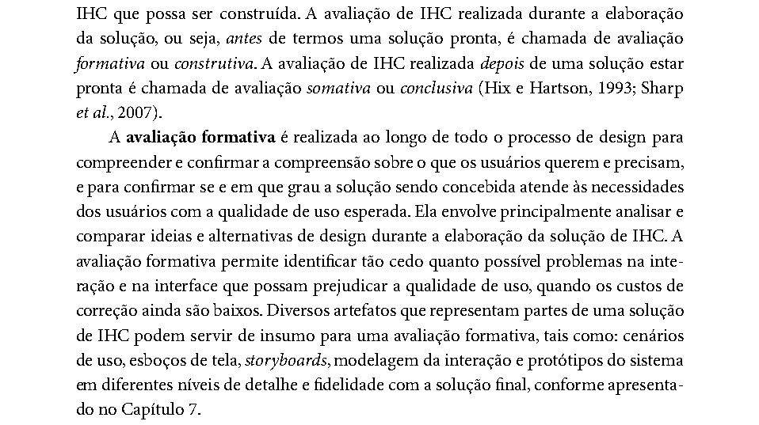

Fonte: BARBOSA; SILVA (2010, p. 294).

Conforme o planejamento da Entrega 4, a avaliação teve quatro objetivos: representar a interação e o contexto de uso do portal; realizar uma avaliação formativa precoce; identificar problemas de interação antes da prototipação; e apoiar a comunicação da equipe (GRUPO 03, 2026b, p. 4). Para operacionalizar esses objetivos, foram usadas as quatro questões de avaliação apresentadas na Tabela 3.

**Tabela 3 – Questões de avaliação dos storyboards**

| Questão | Pergunta orientadora |
| --- | --- |
| Fidelidade à realidade | O fluxo apresentado no storyboard retrata com precisão as ações e necessidades reais do cidadão no contexto do Detran-DF? |
| Clareza na interação | As expressões, ações e dificuldades representadas no storyboard são fáceis de compreender pelo participante? |
| Alinhamento com as personas | As motivações e frustrações ilustradas condizem com o perfil das personas e as metas de usuário mapeadas no projeto? |
| Coerência de metas | A sequência de quadros ilustra claramente se o usuário atinge o seu objetivo com o auxílio do sistema? |

Fonte: Grupo 03 (2026b, p. 4).

O escopo da avaliação compreende cinco storyboards, um por integrante, como exige o item 10 da lista de verificação da Apresentação 4 do Plano de Ensino (SALES, 2026a, p. 13). Cada storyboard representa uma tarefa do portal do Detran-DF modelada na HTA, e cada quadro está relacionado a um objetivo ou operação dessa HTA (item 9 da mesma lista).

### 1.2. Método de Avaliação Empregado

Foi empregado um método de investigação, a entrevista semiestruturada, com o storyboard como material de apoio. Barbosa e Silva explicam que, embora esses métodos não exijam o uso do sistema, “o uso de um sistema ou de materiais de apoio, como imagens, cenários e outros tipos de artefatos, pode contribuir para a investigação” (BARBOSA; SILVA, 2010, cap. 9, seção 9.6, p. 301, 2º parágrafo), conforme a Figura 2.

**Figura 2 – Barbosa e Silva (2010), cap. 9, seção 9.6, p. 301: métodos de investigação e materiais de apoio.**

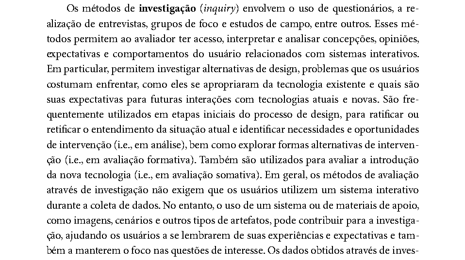

Fonte: BARBOSA; SILVA (2010, p. 301).

Cada sessão seguiu os passos abaixo:

- apresentação do objetivo da sessão, leitura e assinatura do Termo de Consentimento Livre e Esclarecido (TCLE) e pedido de autorização para gravação;
- perguntas de perfil, para caracterizar o participante;
- apresentação do storyboard quadro a quadro, com as perguntas da Tabela 3 e as perguntas específicas de cada integrante;
- entrevista final, para colher sugestões de melhoria.

Cada sessão contou com dois papéis: o entrevistador, que conduziu a conversa e apresentou o storyboard, e o relator, que registrou respostas, reações e dúvidas (GRUPO 03, 2026b, p. 5). Quando o participante não soube responder ou demonstrou desconforto, o entrevistador passou para a pergunta seguinte, sem explicar o storyboard. Barbosa e Silva orientam que, nessas situações, os avaliadores podem sugerir “ao participante que passe para a próxima tarefa solicitada, ou até mesmo abandone as tarefas restantes” (BARBOSA; SILVA, 2010, cap. 9, seção 9.7.3, p. 310, 2º parágrafo), conforme a Figura 3.

**Figura 3 – Barbosa e Silva (2010), cap. 9, seção 9.7.3, p. 310: intervenção do avaliador durante a sessão.**

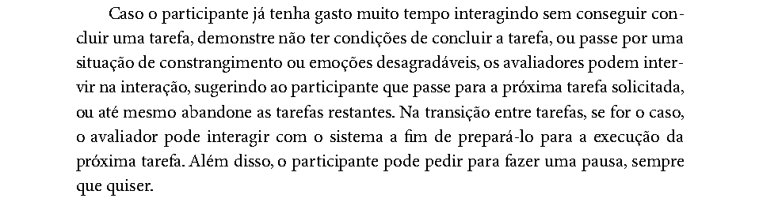

Fonte: BARBOSA; SILVA (2010, p. 310).

Antes das sessões, foi realizado um teste piloto com um integrante do grupo. Seus dados não fazem parte deste relato, porque “Os dados do teste-piloto devem ser descartados, pois podem estar contaminados por problemas que ocorreram durante o piloto” (BARBOSA; SILVA, 2010, cap. 9, seção 9.7.2, p. 307, 3º parágrafo), conforme a Figura 4. O piloto serviu apenas para ajustar o roteiro e o tempo da sessão.

**Figura 4 – Barbosa e Silva (2010), cap. 9, seção 9.7.2, p. 307: teste piloto.**

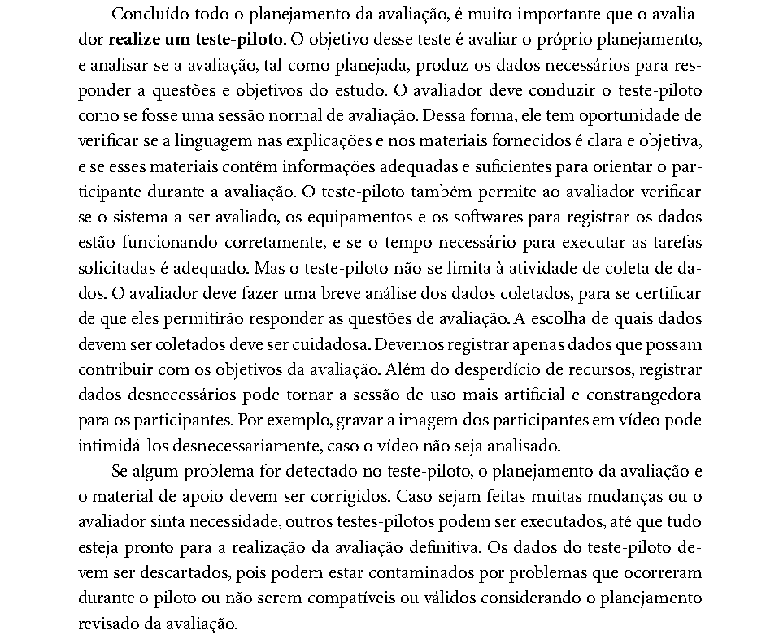

Fonte: BARBOSA; SILVA (2010, p. 307).

### 1.3. Número e Perfil dos Participantes e Avaliadores

Os avaliadores foram os cinco integrantes do Grupo 03. Os participantes foram recrutados entre pessoas compatíveis com os perfis de usuário da Entrega 2: condutor habilitado (persona João Paulo) e candidato à habilitação (persona Camila) (GRUPO 03, 2026a, seção 1.4). O perfil de servidor ou agente do Detran (persona Ricardo) não foi incluído, porque suas tarefas pertencem a sistemas institucionais restritos e não ao portal público. Para preservar o anonimato, os participantes são identificados por códigos (P1, P2…), conforme a Tabela 4.

**Tabela 4 – Perfil dos participantes**

| Código | Faixa etária | Perfil de usuário | Experiência com o portal | Storyboard avaliado | Data | Modalidade |
| --- | --- | --- | --- | --- | --- | --- |
| P1 | 18 | Candidato a habilitação | Básica | João Vitor | 24/10/2026 | Biometria |
| P2 | 21 | Condutor habilitado | Básica | Alexandre Vilar – vistoria para transferência de propriedade | 25/10/2026 | Não informada; serviço avaliado: vistoria veicular |
| P3 | 22 | Condutora habilitada em 2026; o agendamento da prova teórica foi feito pela autoescola | Usa o gov.br para consultar resultados e o considera confuso | Henrique Schneider | 25/10/2026 | Remota (Microsoft Teams) – Prova teórica |
| P4 | 57 | Condutor habilitado há 39 anos; disse ter agendado pelo site, mas não se lembra do processo | Prefere os aplicativos no celular, também para o Detran; conta gov.br de nível ouro | Henrique Schneider | 25/10/2026 | Remota (Microsoft Teams) – Prova teórica |

Fonte: Elaborado pelos autores (2026).

**Correspondência dos códigos de Alexandre:** o participante P2 deste relatório é identificado como P01 no relato individual e na análise da entrevista de Alexandre. Trata-se da mesma sessão, vinculada ao vídeo U1eg2EeanWg. Idade, perfil, experiência básica e data foram registrados na Tabela 4 do relatório coletivo; a transcrição foi utilizada para analisar as respostas. Não foram informados local, modalidade ou forma de recrutamento dessa sessão. Os dados do piloto permanecem separados.

### 1.4. Storyboards Avaliados e Relação com a Análise de Tarefas

Um storyboard é, segundo Preece, Rogers e Sharp, uma série de desenhos que mostra como um usuário pode progredir em uma tarefa utilizando o produto em desenvolvimento, geralmente utilizado em conjunto com cenários (PREECE; ROGERS; SHARP, 2005, cap. 8, seção 8.2.3, p. 263, 2º parágrafo), conforme a Figura 5. Cada storyboard desta entrega traz uma parte textual com as pessoas envolvidas, o ambiente, a tarefa, os passos, a motivação para usar o sistema e o resultado obtido, como pede a Lista de Exercícios de Storyboard (SALES, 2026b, questão 12). A Tabela 5 relaciona cada storyboard ao fluxo da HTA e à persona correspondentes.

**Figura 5 – Preece, Rogers e Sharp (2005), cap. 8, p. 263: definição de storyboard.**

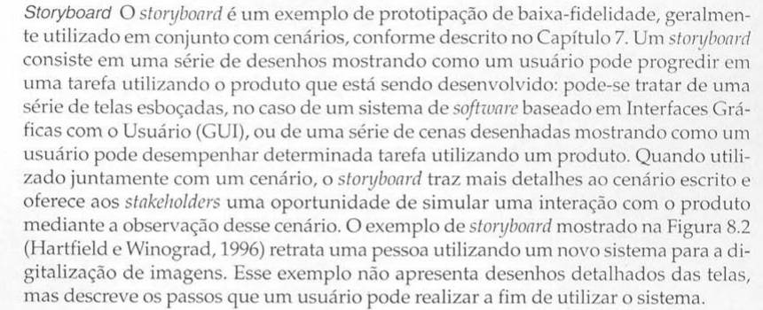

Fonte: PREECE; ROGERS; SHARP (2005, p. 263).

**Tabela 5 – Relação entre storyboards, fluxos a HTA e personas**

| Integrante | Tarefa representada | Fluxo da HTA | Persona |
| --- | --- | --- | --- |
| Alexandre Vilar | Obter orientações e escolher empresa para vistoria de transferência de propriedade; proposta de agendamento por local, data e horário | [Fluxo 5 – HTA atual](integrantes/alexandre-vilar/hta-atual.md) e [redesign proposto](integrantes/alexandre-vilar/hta-redesign.md) | Perfil condutor habilitado, associado à proto-persona João Paulo na Entrega 2; identificação direta de P2 com a persona não foi investigada |
| Gabriel Robson | — | — | — |
| Henrique Schneider | Agendar a prova teórica da primeira habilitação no portal do Detran-DF | Fluxo 3 (criado nesta entrega) | Camila |
| João Vitor | Agendar a biometria presencial no portal do Detran-DF | Fluxo 4 | Carlos |

Fonte: Elaborado pelos autores (2026).

#### 1.4.1. Storyboard — Henrique Schneider

O storyboard de Henrique Schneider mostra a persona Camila, candidata à primeira habilitação, agendando a prova teórica no portal do Detran-DF com a proposta de reprojeto do autor: reservar o horário antes do pagamento e confirmar a prova automaticamente depois que o PIX compensa (Fluxo 3).

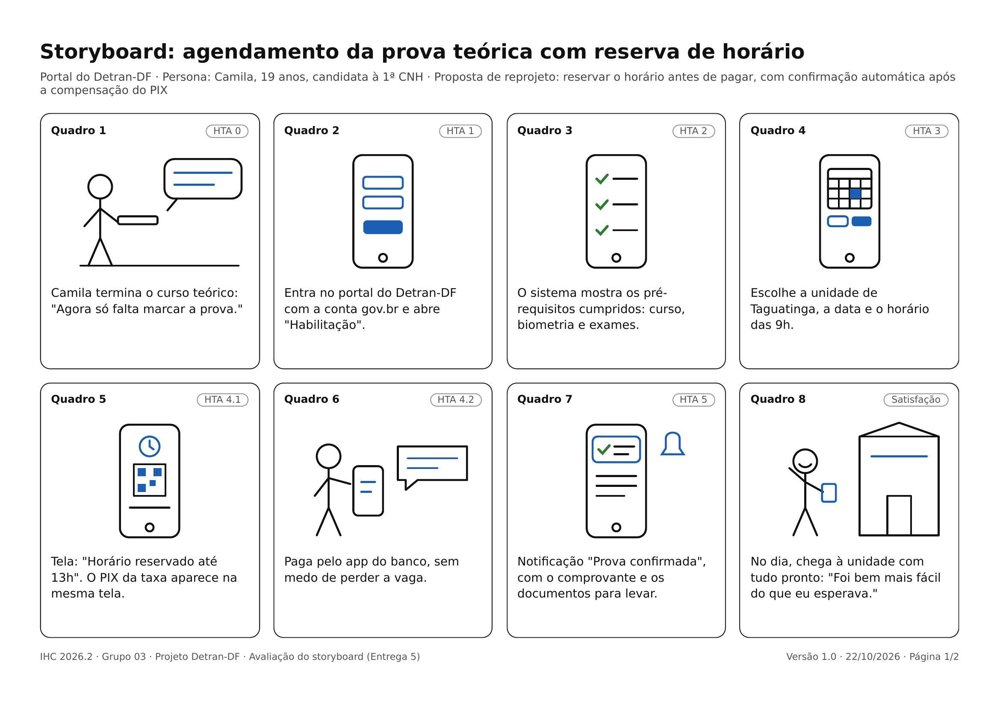

Parte textual do storyboard:

- **Pessoas:** Camila, 19 anos, universitária e estagiária, candidata à primeira habilitação (persona da Entrega 2);
- **Ambiente:** em casa e no ônibus, pelo celular, entre a faculdade e o estágio;
- **Tarefa:** agendar a prova teórica no portal do Detran-DF;
- **Passos:** objetivos 1 a 5 da HTA do Fluxo 3;
- **Motivação:** terminou o curso e quer fazer a prova logo, sem arriscar perder o horário enquanto o pagamento compensa;
- **Resultado:** prova confirmada automaticamente, com os documentos em mãos (quadro 8).

Relação de cada quadro com a HTA do Fluxo 3:

- Quadro 1 – Camila termina o curso teórico: entrada (input) do objetivo 0;
- Quadro 2 – entra no portal com a conta gov.br e abre “Habilitação”: operações 1.1 e 1.2;
- Quadro 3 – o sistema mostra os pré-requisitos cumpridos: feedback do objetivo 2;
- Quadro 4 – escolhe a unidade de Taguatinga, a data e o horário das 9h: operações 3.1 a 3.3;
- Quadro 5 – “Horário reservado até 13h” e o PIX na mesma tela: operação 4.1;
- Quadro 6 – paga pelo aplicativo do banco, sem medo de perder a vaga: operação 4.2;
- Quadro 7 – notificação “Prova confirmada”, com o comprovante e os documentos: objetivo 5;
- Quadro 8 – chega à unidade com tudo pronto: objetivo 0 atingido.

O storyboard foi avaliado com a participante P3 em 25/10/2026, em sessão remota pelo Microsoft Teams, com 25 minutos de gravação, publicada no YouTube como “não listado” ([https://youtu.be/TTIRe6Id010](https://youtu.be/TTIRe6Id010)). Em 25/10/2026, às 20:14, foi avaliado também com o participante P4, em sessão remota pelo Microsoft Teams, com 17 minutos de gravação, publicada no YouTube como “não listado” ([https://youtu.be/4wEvZ1Okwwk](https://youtu.be/4wEvZ1Okwwk)). As respostas estão na Tabela 6 e os problemas, nas Tabelas 8 e 9. O relato completo das duas sessões está no documento individual do autor (Relato dos resultados da avaliação do storyboard “Agendamento da prova teórica com reserva de horário”, v3.1).

#### 1.4.2. Storyboard — Alexandre Vilar

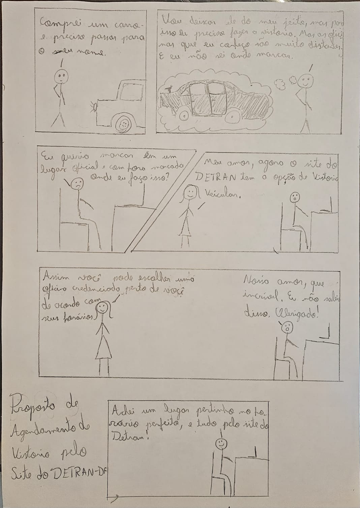

Na sessão de 25/10/2026, P2 relatou dificuldade para localizar orientações e uma empresa credenciada (1:58–3:26). Reconheceu o caminho geral do HTA, mas o percebeu como complexo (4:04–5:34), e considerou a proposta do storyboard mais direta e fácil de aprender (5:36–8:21). Manifestou preferência pela proposta (8:22–8:53). As respostas não demonstram a execução de um agendamento nem a compreensão detalhada de todos os controles. O [relato individual](integrantes/alexandre-vilar/relatorio-pos-entrevista.md) apresenta a análise de Q01 a Q10, evidências e limitações.

**Relação dos quadros com o HTA:** os quadros iniciais estabelecem a necessidade de vistoria e a dificuldade de obter orientações (HTA atual, tarefas 1 a 3); os quadros em que a companheira apresenta o serviço e a escolha de local/horário correspondem conceitualmente às tarefas 1 e 3 do redesign; o quadro final expressa o resultado pretendido. A história não detalha o preenchimento dos dados, a revisão ou a emissão do comprovante (tarefas 2, 4 e 5 do redesign), que continuam a avaliar em um protótipo. Não se atribui ao desenho a representação de telas que não aparecem nele.

#### 1.4.3. Storyboard — João Vitor Tavares

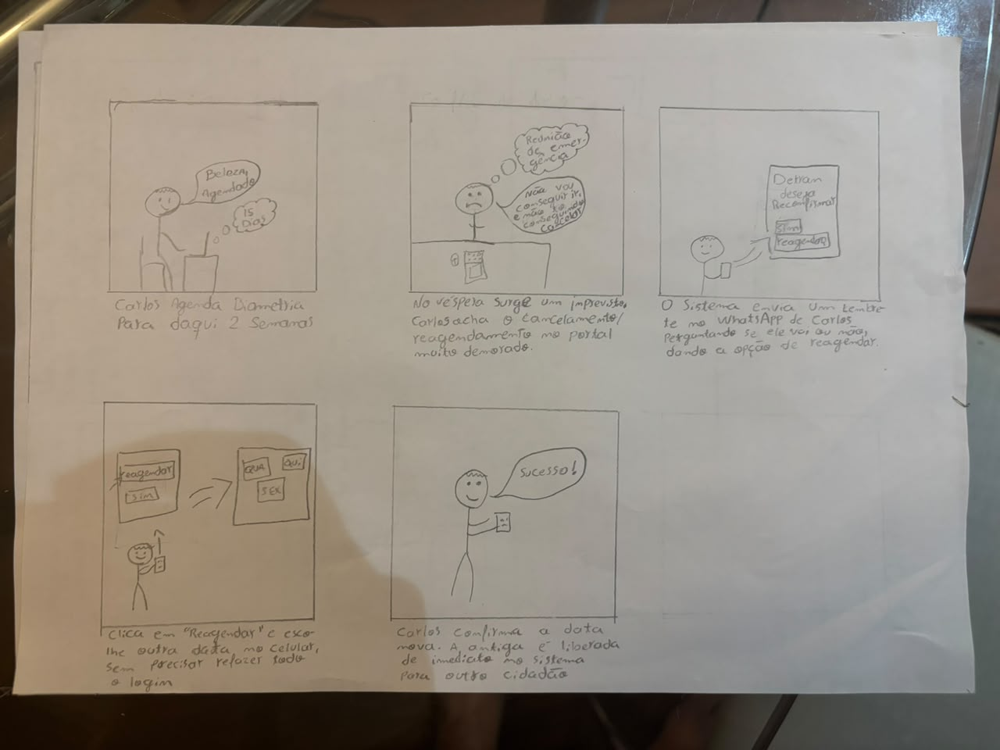

Link do vídeo ([https://youtu.be/28PRTzyCLf0](https://youtu.be/28PRTzyCLf0))

### 1.5. Sumário dos Dados Coletados

Os dados coletados são qualitativos: respostas, comentários e reações dos participantes a cada quadro. Eles foram organizados por questão de avaliação e por participante, conforme a Tabela 6, para permitir a comparação entre participantes descrita na seção seguinte.

**Tabela 6 – Síntese das respostas por questão de avaliação**

| Questão de avaliação | P1 | P2 | P3 | P4 | Recorrência |
| --- | --- | --- | --- | --- | --- |
| Fidelidade à realidade | o participante já havia realizado um agendamento antes e teve que enfrentar imprevistos. | Relata dificuldade para localizar a vistoria e uma empresa credenciada (1:58–3:26); reconhece correspondência geral do HTA com o caminho percebido (4:04–5:34). Não foi demonstrada conclusão da tarefa. | Considerou a sequência dos quadros correta, mas na experiência dela o agendamento foi feito pela autoescola e o pagamento pelos pais; houve espera de quase um mês e no máximo duas opções de data (4:44–5:53; 12:57–15:25). | Os quadros “parecem com a vida real”, sem passo faltando ou sobrando (7:19–7:38); lembra pouco do agendamento, feito pelo site em minutos e com muitas opções de data e hora (3:16–5:35). | — |
| Clareza na interação | O participante compreendeu a proposta apresentada e considerou o fluxo do storyboard mais prático do que o processo atual | Compreende a oposição entre a dificuldade inicial do personagem e uma proposta mais direta (5:36–6:28). A resposta sobre local, data e horário é geral e não valida os controles (6:29–7:00). | Descreveu com as próprias palavras os oito quadros e disse que nenhum quadro foi menos claro (16:09–18:24). | O quadro 2 foi o menos claro: no gov.br, o serviço “Habilitação” não aparece de início, exige busca e o termo é genérico (7:59–10:53). | — |
| Alinhamento com as personas | o incômodo com a repetição do processo são compatíveis com as personas. | A Tabela 4 o classifica como condutor habilitado com experiência básica no portal. Há correspondência de perfil com João Paulo, mas a identificação com a persona não foi perguntada; resposta direta não disponível. | A pressa da Camila fez sentido para ela; a diferença é que Camila age sozinha, enquanto ela dependeu da autoescola e dos pais por achar o gov.br confuso e ter pouco tempo (18:39–19:28). | Não se identificou com Camila: o caminho do storyboard é “muito simples”, especialmente no quadro 2 (11:24); está fora do perfil “Candidato à habilitação”. | — |
| Coerência de metas | O participante compreendeu que a proposta busca facilitar a confirmação, o reagendamento ou o cancelamento após um imprevisto e preferiu essa alternativa. | Espera local, data, horário, credenciamento e confirmação (3:29–4:01); acredita que a proposta facilitaria o atendimento e a prefere (7:03–8:53). Trata-se de utilidade percebida, não de sucesso medido no agendamento. | Entendeu que Camila conseguiu marcar e fazer a prova de acordo com a sua rotina (19:35–19:55). | Entendeu que Camila conseguiu agendar a prova e apontou o quadro 8 em resposta a uma pergunta aberta (12:13–12:22). | — |

Fonte: Elaborado pelos autores (2026).

### 1.6. Interpretação e Análise dos Dados

A análise ocorreu em duas etapas. Primeiro, cada integrante interpretou os dados das suas próprias sessões, buscando respostas às questões da Tabela 3 (análise intrassujeito). Em seguida, o grupo comparou os resultados de todos os participantes. Barbosa e Silva descrevem essa etapa como uma análise “intersujeito ou interparticipante”, na qual “os avaliadores buscam recorrências nos resultados” (BARBOSA; SILVA, 2010, cap. 9, seção 9.7.5, p. 311, último parágrafo), conforme a Figura 6. As recorrências permitem distinguir características do grupo de usuários das particularidades de um único participante (BARBOSA; SILVA, 2010, cap. 9, p. 312, 1º parágrafo).

**Figura 6 – Barbosa e Silva (2010), cap. 9, seção 9.7.5, pp. 311–312: consolidação e relato dos resultados.**

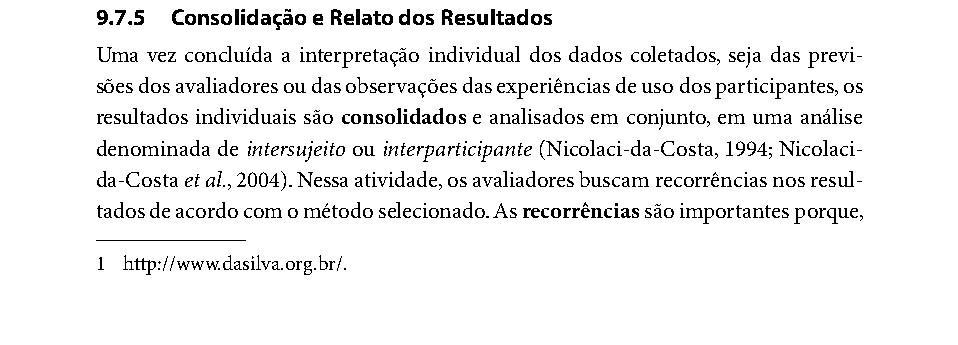

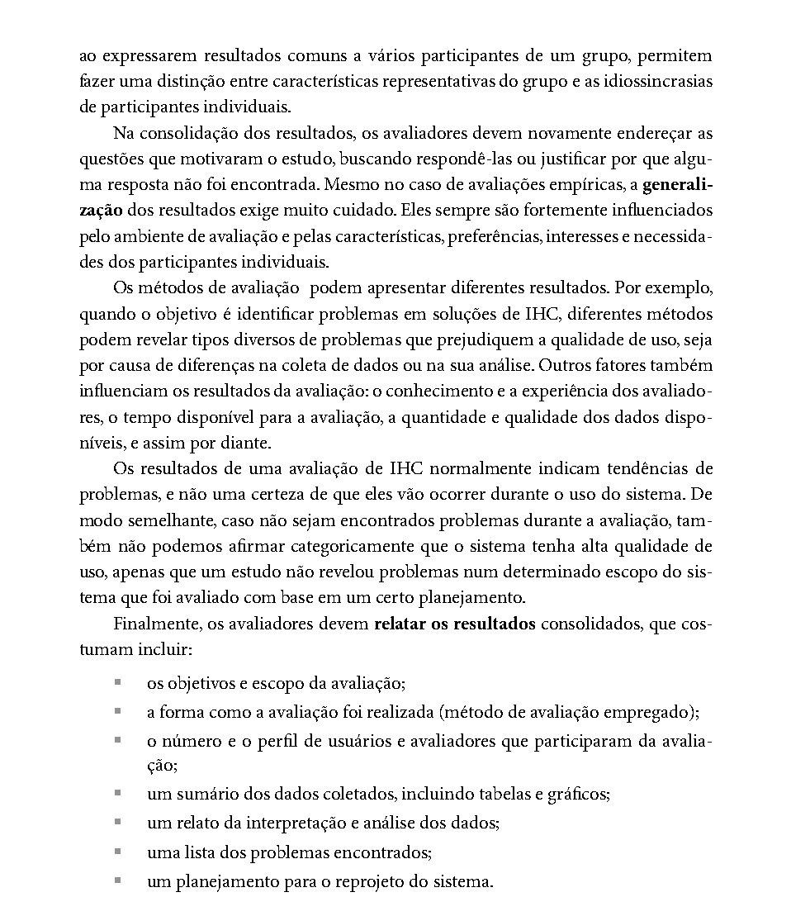

Fonte: BARBOSA; SILVA (2010, pp. 311–312).

**Storyboard de Henrique Schneider (P3 e P4):** os dois reconheceram a sequência dos quadros como fiel e entenderam que Camila conseguiu agendar a prova. As sessões convergem em dois pontos: o serviço de Habilitação é difícil de encontrar no gov.br (PS05) e um prazo de reserva de 3 a 5 horas é curto, devendo chegar a 24 horas (PS04). A espera, a falta de datas, os pré-requisitos desconhecidos (PS02 e PS03) e o medo de perder a vaga apareceram só com P3, que tirou a habilitação neste ano; P4, habilitado há 39 anos e fora do perfil da persona, agendou sem dificuldade, mas se lembra pouco do processo. P4 também apontou que o quadro 2 simplifica o acesso ao serviço (PS06) e que os quadros mostram só o celular (PS07). Com dois participantes de perfis diferentes, os resultados indicam tendências; as limitações das sessões estão na seção 1.9.

**Storyboard de Alexandre Vilar (P2):** Q01 a Q03 indicam dificuldade relatada nas tarefas de obter orientações e escolher uma empresa. Q05 fornece reconhecimento parcial do HTA, sem nova ordem sugerida. Q06 a Q10 indicam compreensão do benefício geral e preferência pelo redesign, mas não demonstram uso de controles ou desempenho real. A relação com a persona é documental, a partir do perfil registrado, e não uma identificação expressa do participante.

**Consolidação transversal de P2:** há convergência temática com os relatos de dificuldade de localizar um serviço específico no portal registrados para P1, P3 e P4. As tarefas são diferentes (vistoria, biometria e prova teórica), portanto essa convergência não representa frequência de um mesmo defeito na mesma tela nem autoriza somar as sessões como teste de um único fluxo. A gravidade e a frequência dos problemas próprios da vistoria são registradas separadamente.

### 1.7. Lista de Problemas Encontrados

Cada problema foi classificado pelo fator de usabilidade prejudicado e pela gravidade. Os fatores de usabilidade considerados são facilidade de aprendizado, facilidade de recordação, eficiência, segurança no uso e satisfação do usuário (BARBOSA; SILVA, 2010, cap. 2, p. 29, apud NIELSEN, 1993), conforme a Figura 7. A gravidade segue a escala de severidade de Nielsen apresentada por Barbosa e Silva, reproduzida na Tabela 7 (BARBOSA; SILVA, 2010, cap. 10, pp. 319–320), conforme a Figura 8.

**Figura 7 – Barbosa e Silva (2010), cap. 2, p. 29: fatores de usabilidade.**

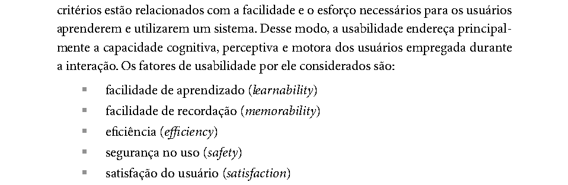

Fonte: BARBOSA; SILVA (2010, p. 29).

**Tabela 7 – Escala de severidade dos problemas**

| Grau | Classificação | Significado |
| --- | --- | --- |
| 1 | Cosmético | Não precisa ser consertado, a menos que haja tempo no cronograma do projeto. |
| 2 | Pequeno | O conserto pode receber baixa prioridade. |
| 3 | Grande | Importante de ser consertado; deve receber alta prioridade. |
| 4 | Catastrófico | Extremamente importante de consertar; se mantido, provavelmente impedirá o usuário de realizar suas tarefas. |

Fonte: Adaptado de Barbosa e Silva (2010, cap. 10, p. 320), com base em Nielsen (1994).

**Figura 8 – Barbosa e Silva (2010), cap. 10, pp. 319–320: escala de severidade de Nielsen.**

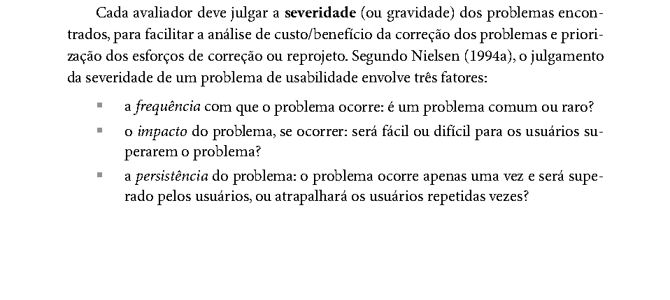

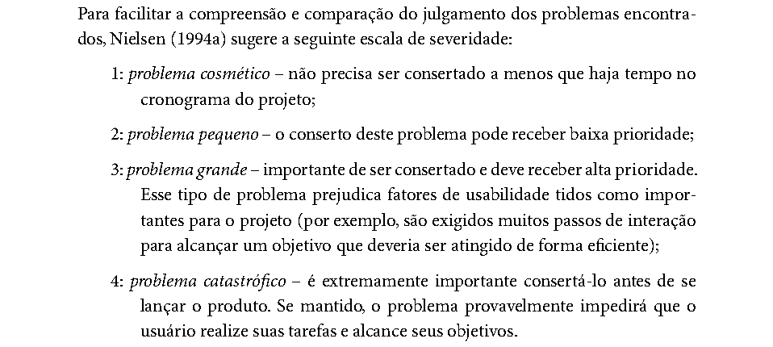

Fonte: BARBOSA; SILVA (2010, pp. 319–320).

A Tabela 8 apresenta a lista consolidada de problemas, ordenada por gravidade e frequência.

**Tabela 8 – Problemas encontrados na avaliação dos storyboards**

| ID | Storyboard e quadro | Objetivo ou operação da HTA | Fator de usabilidade | Descrição e justificativa | Gravidade (1–4) | Frequência (nº de participantes) |
| --- | --- | --- | --- | --- | --- | --- |
| PS01 | Agendamento de biometria | Localizar o serviço de Biometria | eficiência/ facilidade de aprendizado | P1 relatou dificuldade para localizar o serviço específico que desejava agendar, embora considerasse o restante do processo relativamente simples. | 3 | 1 participante |
| PS02 | Agendamento da prova teórica (Henrique), quadro 3 | 2. Verificar os pré-requisitos | facilidade de aprendizado | P3 não sabia que precisava fazer a biometria e não encontrou no portal onde confirmar os pré-requisitos; soube por amigas e confirmou perguntando a outras pessoas (7:14–8:26). Confirma a hipótese da HTA de que a candidata descobre as pendências tarde. | 3 | 1 participante |
| PS03 | Agendamento da prova teórica (Henrique), quadro 4 | 3. Escolher unidade, data e horário | eficiência; satisfação do usuário | P3 esperou quase um mês pelo agendamento e teve no máximo duas opções de data, aceitando o que havia (4:44–5:53; 16:09–18:19). Confirma a hipótese da HTA de falta de horário. | 3 | 1 participante |
| PS04 | Agendamento da prova teórica (Henrique), quadros 5 e 6 | 4. Reservar e pagar (plano 4) | segurança no uso; satisfação do usuário | P3 relatou medo de perder a vaga durante o pagamento, porque as vagas eram disputadas (12:57–15:25). Sobre a proposta, P3 e P4 consideraram insuficiente uma reserva de 3 a 5 horas e sugeriram 24 horas, para quem precisa juntar o dinheiro da taxa (P3: 20:50–21:30; P4: 13:47–15:12). | 3 | 2 participantes (prazo: P3 e P4; medo de perder a vaga: P3) |
| PS05 | Agendamento da prova teórica (Henrique), quadro 2 | 1. Acessar o portal (1.2. Abrir “Habilitação”) | facilidade de aprendizado | P3 considera o gov.br confuso e deixou o agendamento com a autoescola e o pagamento com os pais (18:39–19:28). P4 relatou que o serviço “Habilitação” não aparece de início no gov.br, exige busca, e o termo é genérico (7:59–10:31). | 3 | 2 participantes |
| PS06 | Agendamento da prova teórica (Henrique), quadro 2 | 1. Acessar o portal | facilidade de aprendizado | O quadro 2 mostra como simples o acesso ao serviço, que no portal real exige busca; foi o quadro menos claro para P4, que não se identificou com a persona por isso (10:53–11:24). | 2 | 1 participante |
| PS07 | Agendamento da prova teórica (Henrique), quadros 2 a 7 | — | satisfação do usuário | Os quadros mostram só o uso pelo celular, mas P4 fez todo o processo pela web (16:16). | 1 | 1 participante |
| PS08 | Vistoria (Alexandre), dúvida do personagem sobre onde realizar o atendimento | HTA atual: 1.3 e 3.1–3.3 | Facilidade de aprendizado; eficiência | P2 relata não localizar orientações de vistoria e uma empresa credenciada (1:58–3:26), sem alcançar esse subobjetivo na experiência relatada. Não se verificou ausência da informação em todo o portal. | 3 (proposta do avaliador) | 1 participante (P2) |

Fonte: Elaborado pelos autores (2026).

**Justificativa de PS08:** propõe-se grau 3 porque a dificuldade relatada impede a escolha informada do local, prejudicando um objetivo central da tarefa. Trata-se de julgamento exploratório com um participante: a repetição do relato em Q01–Q03 não aumenta a frequência para três ocorrências independentes; persistência e recorrência em outros usuários não foram medidas. A classificação deverá ser revista pelo responsável e pelos pares. A ausência de detalhe dos controles no storyboard é registrada como limite de validação, sem classificá-la como falha de uso observada.

### 1.8. Planejamento para o Reprojeto

Os problemas da Tabela 8 orientam o reprojeto, que será representado no protótipo de papel (Capítulo 3). A prioridade de correção considera a gravidade e a frequência de cada problema, critério que Barbosa e Silva recomendam ao consolidar os resultados (BARBOSA; SILVA, 2010, cap. 10, seção 10.2.3, p. 361, 4º parágrafo). A Tabela 9 registra a proposta de correção de cada problema.

**Tabela 9 – Planejamento do reprojeto**

| ID do problema | Proposta de correção | Prioridade | Responsável | Será avaliada no protótipo de papel? |
| --- | --- | --- | --- | --- |
| PS01 | Disponibilizar, após o agendamento, opções diretas de confirmar presença, reagendar ou cancelar, evitando que o usuário precise repetir todo o processo. A ação poderá ser acessada também por notificação enviada por e-mail, SMS ou WhatsApp. | 3 | João Vitor Tavares | Sim |
| PS02 | Mostrar, antes do calendário, a lista de pré-requisitos (curso, biometria e exames) com a situação de cada um, o que levar e o caminho para resolver o que faltar, e enviar lembretes das etapas marcadas, como sugeriu P3 (22:29–23:57). | 3 | Henrique Schneider | Sim (Tela 2) |
| PS03 | Mostrar a disponibilidade por unidade em um calendário e sugerir a data livre mais próxima, como recomenda a HTA (objetivo 3). | 3 | Henrique Schneider | Sim (Tela 3 e tarefa T2) |
| PS04 | Reservar o horário antes do pagamento e testar no protótipo um prazo de reserva de 24 horas, sugerido por P3, com aviso uma hora antes de expirar e mensagem informando que a vaga foi liberada (21:03–22:18). | 3 | Henrique Schneider | Sim (Tela 4 e tarefa T4) |
| PS05 | Dar ao serviço um nome específico (por exemplo, “Habilitação – CNH”), destacá-lo entre os serviços mais acessados do gov.br, como sugeriu P4 (10:59–11:13), e mostrar no início do serviço as etapas do processo e em qual delas o candidato está. | 3 | Henrique Schneider | Sim (Telas 1 e 2) |
| PS06 | Mostrar no quadro 2 do storyboard a busca pelo serviço no gov.br, para que o storyboard não esconda essa etapa. | 2 | Henrique Schneider | Não (alteração do storyboard, v1.1) |
| PS07 | Indicar no storyboard que o serviço pode ser usado no celular ou no computador. | 1 | Henrique Schneider | Não (alteração do storyboard, v1.1) |
| PS08 | Destacar a finalidade da vistoria e o acesso à relação de credenciadas; na proposta, reunir orientações e permitir escolher local, data e horário com resumo e confirmação. Verificar em protótipo a compreensão e a execução das escolhas. | 3 (proposta a revisar) | Alexandre Vilar | Prevista no escopo da seção 3.8.2; sessões ainda não realizadas |

Fonte: Elaborado pelos autores (2026).

### 1.9. Limitações da Avaliação

- **Tamanho da amostra:** com poucos participantes por storyboard, os resultados indicam tendências de problemas, não certezas. Barbosa e Silva lembram que os resultados de uma avaliação de IHC “normalmente indicam tendências de problemas, e não uma certeza de que eles vão ocorrer durante o uso do sistema” (BARBOSA; SILVA, 2010, cap. 9, p. 312, 4º parágrafo).
- **Recrutamento por conveniência:** parte dos participantes é conhecida dos entrevistadores, o que pode suavizar as críticas.
- **Proto-personas:** as personas da Entrega 2 ainda são hipóteses de trabalho, e esta avaliação também serve para validá-las.
- **Nível de abstração do storyboard:** o storyboard representa a tarefa em desenhos simplificados, então não permite avaliar detalhes de leiaute, rótulos e mensagens da interface.
- **Fontes sobre o portal:** alguns fluxos atuais do portal foram descritos com base em fontes secundárias e na experiência dos integrantes, pois certas telas exigem login gov.br.
- **Sessão de P3 (storyboard de Henrique Schneider):** o arquivo enviado à participante antes da sessão não era o storyboard, que foi mostrado por compartilhamento de tela a partir de 12:39; desde cerca de 13:30, a página de apoio ao entrevistador, com as perguntas do roteiro, ficou visível junto com o storyboard. Além disso, P3 já é habilitada e não fez o agendamento sozinha, então suas respostas sobre o processo atual são relatos indiretos.
- **Sessão de P4 (storyboard de Henrique Schneider):** o participante, habilitado há 39 anos, está fora do perfil “Candidato à habilitação” e não se lembrava do agendamento; por isso, o entrevistador descreveu o fluxo atual antes das perguntas do Bloco 1 (3:33–4:13). Na pergunta P9, a proposta foi descrita como pagamento depois da prova, e não como no storyboard, em que o pagamento ocorre durante a reserva, antes da prova (12:59–13:47); as respostas sobre o prazo foram consideradas apenas quanto à duração da reserva.

- **Sessão de P2 (Alexandre):** um participante, roteiro apoiado em transcrição automática e respostas parcialmente conduzidas por sondagens (4:45–5:34, 6:50–6:54 e 8:25–8:32). A navegação prévia é mencionada, mas não foram reconstruídos todos os cliques. Os dados sustentam preferência e utilidade percebida, não redução de tempo, execução integral do redesign ou validação de todos os seus controles. A data e o perfil vêm do registro coletivo; local e recrutamento permanecem sem informação.

## 2. Relato dos Resultados da Avaliação da Análise de Tarefas (HTA)

### 2.1. Objetivos e Escopo da Avaliação

A avaliação da HTA teve dois objetivos: verificar se as tabelas e diagramas HTA do grupo estão construídos de acordo com a técnica, e verificar se representam a forma como os usuários realmente executam as tarefas no portal do Detran-DF. O escopo inclui os fluxos da Entrega 2 e os fluxos criados nesta entrega para servir de base aos storyboards, listados na Tabela 11.

### 2.2. Método de Avaliação Empregado

Foram usados dois procedimentos complementares. O primeiro é a inspeção das tabelas e diagramas HTA pelos integrantes, com os critérios da Tabela 10, derivados da descrição da técnica por Barbosa e Silva. Nessa descrição, os objetivos são decompostos em subobjetivos, e “Os subobjetivos de um objetivo e as relações entre eles é denominada de plano”, que pode ser de sequência fixa, de seleção ou decisão, ou em paralelo (BARBOSA; SILVA, 2010, cap. 6, seção 6.4.1, p. 193, 2º parágrafo), conforme a Figura 9. O segundo procedimento é a comparação da HTA com as evidências das entrevistas do Capítulo 1: os passos que os participantes disseram executar na prática foram confrontados com os planos da HTA.

**Figura 9 – Barbosa e Silva (2010), cap. 6, seção 6.4.1, pp. 192–193: Análise Hierárquica de Tarefas.**

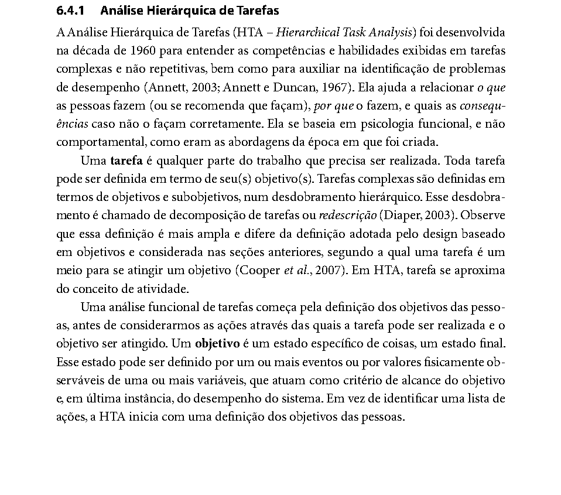

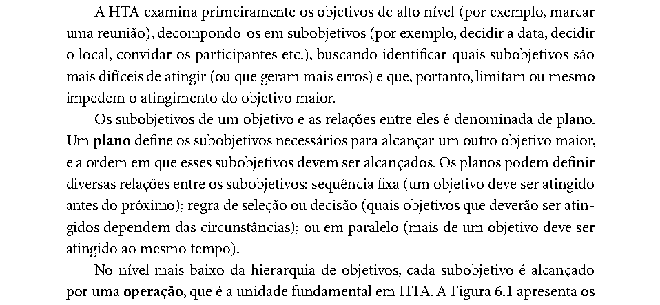

Fonte: BARBOSA; SILVA (2010, pp. 192–193).

A inspeção é adequada aqui porque permite “examinar (ou inspecionar) uma solução de IHC para tentar antever as possíveis consequências de certas decisões de design” (BARBOSA; SILVA, 2010, cap. 9, seção 9.6, p. 301, 3º parágrafo). Como o avaliador não é o usuário (BARBOSA; SILVA, 2010, cap. 9, p. 302, 1º parágrafo), a comparação com os dados das entrevistas compensa essa limitação.

**Tabela 10 – Critérios de inspeção da HTA**

| Critério | Pergunta de verificação |
| --- | --- |
| Objetivo geral | O objetivo de nível 0 está descrito como um estado final a ser alcançado pelo usuário? |
| Decomposição | Cada objetivo está decomposto em sub objetivos numerados de forma hierárquica (1, 1.1, 1.1.1…)? |
| Plano | Cada objetivo decomposto tem um plano que indica a ordem dos subobjetivos? |
| Tipo de plano | O plano indica se a relação é de sequência fixa, de seleção ou decisão, ou em paralelo? |
| Operações | O nível mais baixo da hierarquia termina em operações, com entrada, ação e feedback identificáveis? |
| Problemas e recomendações | Cada subobjetivo crítico tem os problemas potenciais e as recomendações de IHC registrados? |
| Fidelidade | Os passos da HTA correspondem ao que os participantes relataram fazer no portal? |

Fonte: Elaborado pelos autores com base em Barbosa e Silva (2010, cap. 6, pp. 192–193).

### 2.3. Fluxos HTA Avaliados

**Tabela 11 – Fluxos HTA avaliados**

| Fluxo | Objetivo geral | Origem | Responsável |
| --- | --- | --- | --- |
| Fluxo 1 | Consultar débitos e emitir a guia de pagamento de veículo | Entrega 2, seção 2.3.1 | — |
| Fluxo 2 | Solicitar a segunda via da CNH | Entrega 2, seção 2.3.2 | — |
| Fluxo 3 | Agendar a prova teórica da primeira habilitação | Entrega 5 (storyboard) | Henrique Schneider |
| Fluxo 4 | Agendar Biometria no Portal Detran DF | Entrega 5 (storyboard) | João Vitor Tavares |
| Fluxo 5 | Obter orientações e escolher empresa para vistoria de transferência de propriedade; redesign: agendar por local, data e horário | Entrega 5 – [HTA atual](integrantes/alexandre-vilar/hta-atual.md) e [HTA do redesign](integrantes/alexandre-vilar/hta-redesign.md) | Alexandre Vilar |

Fonte: Elaborado pelos autores (2026).

### 2.4. Sumário dos Dados Coletados

Para cada fluxo, registrou-se o resultado de cada critério da Tabela 10 (atende, atende parcialmente ou não atende) e os passos que os participantes relataram e que não estavam previstos na HTA, conforme a Tabela 12.

**Tabela 12 – Resultado da inspeção por critério**

| Critério | Fluxo 1 | Fluxo 2 | Fluxo 3 | Fluxo 4 | Fluxo 5 |
| --- | --- | --- | --- | --- | --- |
| Objetivo geral | — | — | Atende parcialmente (verificação do autor) | Atende | Atende parcialmente: ação e critério de sucesso definidos; estado final deve ser explicitado no objetivo 0 |
| Decomposição | — | — | Atende (verificação do autor) | Atende | Atende: numeração hierárquica e operações nas folhas |
| Plano | — | — | Atende (verificação do autor) | Atende | Atende: planos 0 a 4 no atual e 0 a 5 no redesign |
| Tipo de plano | — | — | Atende (verificação do autor) | Atende | Atende: sequência e regras condicionais de seleção/retorno identificáveis nos planos |
| Operações | — | — | Atende (verificação do autor; corrigido na HTA v1.2) | Atende | Atende parcialmente: ações identificáveis; entradas e feedback não especificados em cada operação |
| Problemas e recomendações | — | — | Atende (verificação do autor) | Atende | Atende parcialmente: achados vinculados a subobjetivos nesta consolidação; falta detalhamento por operação no artefato |
| Fidelidade | — | — | Atende parcialmente (P3 e P4) | Atende | Atende parcialmente: P2 reconhece o caminho, sem demonstração da tarefa concluída; redesign não executado |

Fonte: Elaborado pelos autores (2026).

Os resultados do Fluxo 5 decorrem de conferência documental dos HTAs publicados e confronto com o relato de P2, organizados com apoio de IA. Não são apresentados como inspeção independente por outro integrante. Os estados parciais mantêm explícitas as lacunas, sem converter recomendações em correções executadas.

### 2.5. Interpretação e Análise dos Dados

A interpretação busca identificar quais subobjetivos concentram as dificuldades relatadas pelos participantes, pois esse é o propósito da HTA: identificar os subobjetivos “mais difíceis de atingir (ou que geram mais erros)” (BARBOSA; SILVA, 2010, cap. 6, seção 6.4.1, p. 193, 1º parágrafo).

**Fluxo 3 (Henrique Schneider):** as entrevistas com P3 e P4 concentraram as dificuldades no acesso ao serviço (operação 1.2), relatado pelos dois, e, no caso de P3, nos subobjetivos 2 (verificar os pré-requisitos), 3 (escolher unidade, data e horário) e 4 (reservar e pagar), que a HTA marcava como hipóteses. Essas três hipóteses foram confirmadas por P3 e não observadas em P4, que agendou sem dificuldade. A lacuna apontada pelos dois é o prazo da reserva, que o plano 4 não definia (PH02), e P4 descreveu a busca pelo serviço no gov.br (PH04). Na verificação dos critérios da Tabela 10, feita pelo próprio autor com apoio do Claude, o objetivo 0 está descrito como ação, com o estado final indicado só no feedback, e as operações não registravam a ação (PH03), o que foi corrigido na versão 1.2 da HTA. A inspeção por outro integrante continua pendente.

**Fluxo 5 (Alexandre Vilar):** o relato de P2 concentra as dificuldades em localizar orientações (1.3) e identificar uma empresa (3.1–3.3), conforme Q01–Q03. A ligação com esses nós é uma interpretação da tarefa, não um registro de erros de clique. Em Q05, P2 reconhece a sequência geral, mas não sugere mudanças concretas na ordem. No atual e no redesign, as operações têm rótulos de ação, porém não registram individualmente entrada e feedback; os objetivos 0 estão formulados como ações e têm critérios finais em seções separadas. Por isso, a fidelidade, o objetivo geral e a especificação das operações recebem atendimento parcial. Os modelos não foram considerados integralmente validados.

### 2.6. Lista de Problemas Encontrados

**Tabela 13 – Problemas encontrados na HTA**

| ID | Fluxo | Objetivo ou operação | Critério não atendido | Descrição do problema | Correção proposta |
| --- | --- | --- | --- | --- | --- |
| PH01 | Agendamento de Biometria | Confirmar e emitir comprovante | Eficiência e Prevenção de Erros / Falta de lembrete e reconfirmação | O sistema não envia lembretes nem permite reconfirmação/cancelamento prévio, aumentando o absenteísmo e o retrabalho para remarcar. | Implementar notificações automáticas prévias (Email/SMS/WhatsApp) com botões para confirmação, cancelamento ou reagendamento rápido. |
| PH02 | Fluxo 3 – Agendar a prova teórica | 4. Reservar e pagar (plano 4) | Fidelidade | O plano 4 não define o prazo da reserva. P3 e P4 consideraram insuficiente o prazo de 3 a 5 horas apresentado nas entrevistas e sugeriram 24 horas (P3: 20:50–21:30; P4: 13:47–15:12). | Definir no plano 4 um prazo de reserva de 24 horas, com aviso uma hora antes de expirar, e validar esse prazo no protótipo de papel. |
| PH03 | Fluxo 3 – Agendar a prova teórica | Operações 1.1, 1.2, 3.1 a 3.3 e 4.1 | Operações | As operações 1.1, 1.2, 3.1 a 3.3 e 4.1 não registram a ação, e 1.2 e 4.1 também não registram a entrada (input), elementos que Barbosa e Silva (2010, cap. 6, seç. 6.4.1, p. 193) incluem na especificação de uma operação. | Corrigido na HTA do Fluxo 3, versão 1.2 (25/10/2026): entrada, ação e feedback registrados em cada operação. |
| PH04 | Fluxo 3 – Agendar a prova teórica | 1.2 Abrir “Habilitação” e o agendamento da prova | Fidelidade | A HTA não registrava a dificuldade de localizar o serviço no gov.br, relatada por P4: o serviço não aparece de início, exige busca e o termo “habilitação” é genérico (7:59–10:31). | Registrado como problema da operação 1.2 na HTA v1.2, com a recomendação de nome específico e destaque entre os serviços mais acessados. |
| PH05 | Fluxo 5 – HTA atual e redesign | Operações do nível mais baixo | Operações | As tabelas listam ações, mas não especificam entrada e feedback para cada operação. O redesign registra entrada e sucesso apenas em nível global. | Documentar entrada, ação e feedback por operação em uma próxima versão; não há registro de correção executada nesta consolidação. |
| PH06 | Fluxo 5 – HTA atual | 1.3 e 3.1–3.3 | Fidelidade; problemas e recomendações | P2 relata não localizar orientações ou credenciada (1:58–3:26). O percurso detalhado e a conclusão desses nós não foram demonstrados. | Vincular PS08 aos nós e observar uma execução futura para verificar pontos de interrupção; não afirmar ausência do serviço com base somente no relato. |
| PH07 | Fluxo 5 – HTA atual e redesign | Objetivo 0 | Objetivo geral | Os objetivos 0 são enunciados como ações; os critérios de sucesso são apresentados separadamente. | Explicitar o estado final esperado no objetivo 0 ao revisar o artefato, preservando a distinção entre obter informações e ter um agendamento confirmado. |

Fonte: Elaborado pelos autores (2026).

### 2.7. HTA Revisada e Recomendações de IHC

O estado das correções da Tabela 13 é apresentado por fluxo. Há correções já realizadas e recomendações ainda não executadas; uma recomendação não substitui automaticamente uma versão anterior do artefato.

**Fluxo 3 (Henrique Schneider):** a HTA foi revisada para as versões 1.1 e 1.2 (25/10/2026). A versão 1.2 registra no plano 4 o prazo de reserva de 24 horas sugerido por P3 e P4, a ser testado no protótipo de papel; a entrada, a ação e o feedback de cada operação (PH03); o problema de localização do serviço na operação 1.2 (PH04); e, na Tabela 4 da HTA, o resultado das duas entrevistas para cada nó. O diagrama não mudou, porque nenhum dos participantes apontou passos faltando ou sobrando. O documento completo está no arquivo “HTA - Agendamento Prova Teórica - Henrique Schneider.pdf” (v1.2).

**Fluxo 5 (Alexandre Vilar):** os [HTAs publicados](integrantes/alexandre-vilar/index.md) permanecem com as árvores e os planos existentes. Esta consolidação acrescenta sua conferência documental, os resultados parciais e PH05–PH07; não afirma que os diagramas foram corrigidos. O desenho do storyboard foi mantido por decisão anterior do autor. PS08 e as recomendações do relato orientam a preparação de um protótipo para verificar as escolhas e a clareza das orientações, sem confundir o funcionamento proposto com o processo atual do portal.

## 3. Planejamento da Avaliação do Protótipo de Papel (Framework DECIDE)

O planejamento segue o framework DECIDE, de Sharp, Rogers e Preece, apresentado por Barbosa e Silva (BARBOSA; SILVA, 2010, cap. 9, seção 9.8, pp. 312–313), conforme a Figura 10. As seis atividades do framework estão descritas nas seções 3.1 a 3.6.

**Figura 10 – Barbosa e Silva (2010), cap. 9, seção 9.8, pp. 312–313: atividades do framework DECIDE.**

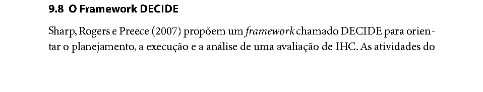

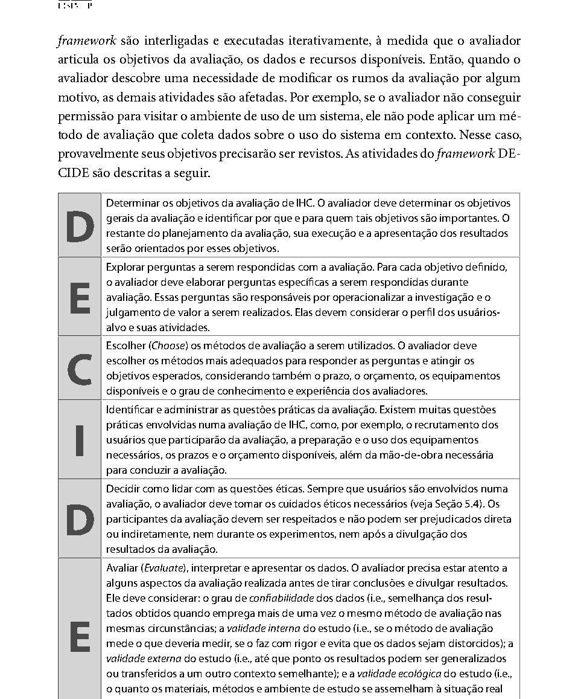

Fonte: BARBOSA; SILVA (2010, pp. 312–313).

### 3.1. D — Determinar os Objetivos

O protótipo de papel representará as soluções do reprojeto definidas na seção 1.8. A avaliação tem três objetivos:

- identificar problemas de usabilidade nas telas propostas para as tarefas modeladas na HTA, antes da construção do protótipo de alta fidelidade;
- verificar se as correções propostas no reprojeto resolvem os problemas encontrados na avaliação dos storyboards;
- comparar alternativas de design quando houver mais de uma proposta para a mesma tarefa.

O método é adequado a esses objetivos porque, segundo Barbosa e Silva, “Simular o uso em papel é um modo rápido e barato de identificar problemas de usabilidade antes mesmo de construir uma solução de IHC executável” (BARBOSA; SILVA, 2010, cap. 10, seção 10.2.3, p. 358, 1º parágrafo da seção), conforme a Figura 11.

**Figura 11 – Barbosa e Silva (2010), cap. 10, seção 10.2.3, p. 358: prototipação em papel.**

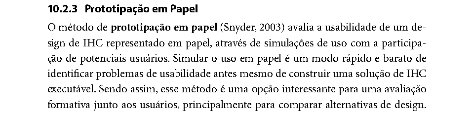

Fonte: BARBOSA; SILVA (2010, p. 358).

### 3.2. E — Explorar as Questões de Avaliação

Cada objetivo foi desdobrado em questões específicas, apresentadas na Tabela 14.

**Tabela 14 – Questões de avaliação do protótipo de papel**

| Objetivo | Questão |
| --- | --- |
| Identificar problemas | O participante consegue concluir a tarefa sem ajuda do avaliador? |
| Identificar problemas | Em quais telas e elementos o participante hesita, erra ou pede ajuda? |
| Identificar problemas | Os rótulos, menus e mensagens correspondem ao vocabulário do participante? |
| Validar o reprojeto | Os problemas da Tabela 8 voltam a ocorrer nas telas reprojetadas? |
| Validar o reprojeto | O participante percebe as confirmações e o feedback de cada etapa da tarefa? |
| Comparar alternativas | Qual alternativa o participante prefere e por quê? |

Fonte: Elaborado pelos autores (2026).

### 3.3. C — Escolher o Método de Avaliação

O método escolhido é a prototipação em papel, um método de observação em que o participante executa tarefas em telas desenhadas em papel enquanto um avaliador simula o comportamento do sistema (BARBOSA; SILVA, 2010, cap. 10, seção 10.2.3, p. 358). As atividades do método estão na Tabela 10.7 de Barbosa e Silva, apresentada na Figura 12: preparação, coleta de dados e interpretação, consolidação e relato dos resultados (BARBOSA; SILVA, 2010, cap. 10, p. 359). Ao final de cada sessão, será feita uma entrevista pós-teste para colher a opinião do participante (BARBOSA; SILVA, 2010, cap. 10, p. 361, 1º parágrafo).

**Figura 12 – Barbosa e Silva (2010), cap. 10, p. 359: Tabela 10.7, atividades do método de prototipação em papel.**

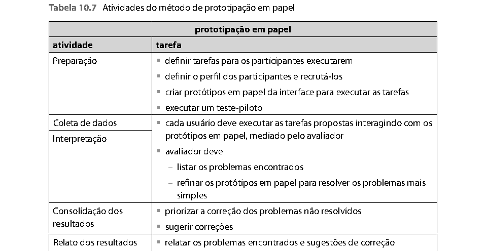

Fonte: BARBOSA; SILVA (2010, p. 359).

### 3.4. I — Identificar e Administrar as Questões Práticas

- **Papéis:** cada sessão terá dois avaliadores, um que simula o sistema (“computador”) e um observador que registra a sessão. Barbosa e Silva indicam que a coleta de dados nesse método “deve ser realizada por pelo menos dois avaliadores: um responsável por simular o comportamento do sistema e outro por observar a experiência de uso” (BARBOSA; SILVA, 2010, cap. 10, seção 10.2.3, p. 360, 2º parágrafo), conforme a Figura 13.
- **Participantes:** cinco participantes, um para cada protótipo, recrutados entre os perfis condutor habilitado e candidato à habilitação, preferencialmente diferentes dos participantes da avaliação dos storyboards. O número foi definido pelo prazo da entrega e pela disponibilidade dos avaliadores, critérios que Barbosa e Silva apontam para a escolha da avaliação (BARBOSA; SILVA, 2010, cap. 9, seção 9.6, p. 303, 3º parágrafo).
- **Local e modalidade:** sessões presenciais no campus UnB Gama (FCTE) ou em local escolhido pelo participante. A modalidade presencial é necessária porque o participante manipula as telas de papel.
- **Duração:** até 30 minutos por sessão, incluindo TCLE, tarefas e entrevista pós-teste.
- **Materiais:** telas desenhadas à mão, recortes para menus, mensagens e listas, notas adesivas, canetas, cenários das tarefas impressos, TCLE, roteiro de entrevista pré e pós-teste e celular para gravação de áudio.
- **Orçamento:** custo limitado a papel e material de escritório.

**Figura 13 – Barbosa e Silva (2010), cap. 10, seção 10.2.3, p. 360: papéis dos avaliadores na prototipação em papel.**

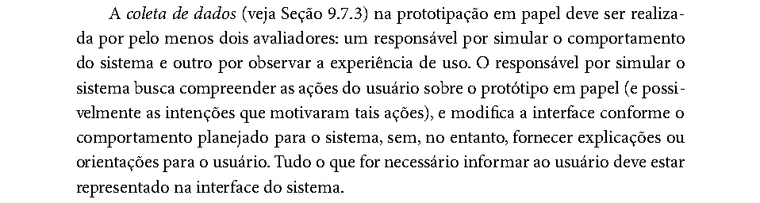

Fonte: BARBOSA; SILVA (2010, p. 360).

A Tabela 15 apresenta o cronograma geral previsto para a avaliação.

**Tabela 15 – Cronograma geral da avaliação do protótipo de papel**

| Atividade | Início | Fim | Local |
| --- | --- | --- | --- |
| Construção dos protótipos de papel | 25/10/2026 | 27/10/2026 | Remoto (cada integrante) |
| Teste piloto | 28/10/2026 | 28/10/2026 | A definir |
| Sessões com participantes | 28/10/2026 | 30/10/2026 | UnB Gama (FCTE) ou local do participante |
| Interpretação e consolidação dos resultados | 30/10/2026 | 01/11/2026 | Remoto |
| Relato dos resultados e publicação no GitHub Pages | 01/11/2026 | 03/11/2026 | Remoto |

Fonte: Elaborado pelos autores (2026), com base no prazo da Entrega 6 (SALES, 2026a, p. 5).

### 3.5. D — Decidir como Lidar com as Questões Éticas

A avaliação seguirá a diretriz do framework DECIDE de que “Os participantes da avaliação devem ser respeitados e não podem ser prejudicados direta ou indiretamente, nem durante os experimentos, nem após a divulgação dos resultados da avaliação” (BARBOSA; SILVA, 2010, cap. 9, seção 9.8, p. 313, quadro do framework DECIDE). Para isso:

- cada participante lerá e assinará o TCLE elaborado na Entrega 2 antes da sessão, ficando com uma via, como recomendam Barbosa e Silva (2010, cap. 5, seção 5.4, p. 141, 1º parágrafo), conforme a Figura 14;
- a gravação só será feita com autorização expressa do participante;
- os participantes serão identificados por códigos no relato, sem nome ou dado pessoal;
- o participante poderá pausar ou encerrar a sessão a qualquer momento, sem prejuízo; os participantes “nunca devem se sentir desconfortáveis, seja física ou psicologicamente” (BARBOSA; SILVA, 2010, cap. 5, seção 5.4, p. 141, 2º parágrafo).

**Figura 14 – Barbosa e Silva (2010), cap. 5, seção 5.4, p. 141: termo de consentimento e conforto dos participantes.**

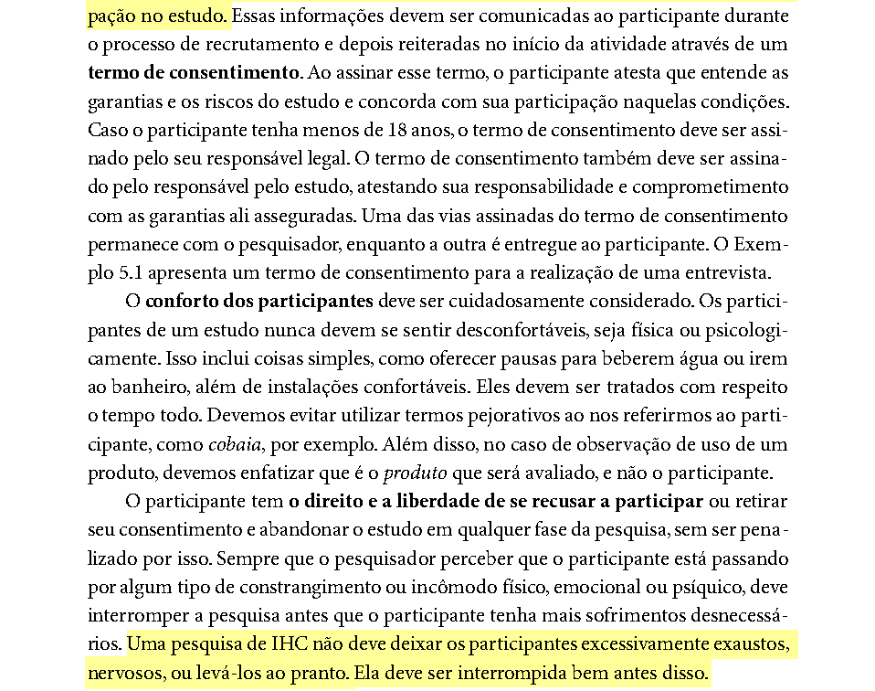

Fonte: BARBOSA; SILVA (2010, p. 141).

### 3.6. E — Avaliar, Interpretar e Apresentar os Dados

Após cada sessão, os avaliadores listarão os problemas encontrados e poderão corrigir no protótipo os mais simples antes da sessão seguinte, aprimorando o protótipo por ciclos de avaliação e reprojeto (BARBOSA; SILVA, 2010, cap. 10, seção 10.2.3, p. 361, 2º parágrafo). Na consolidação, os problemas não resolvidos serão priorizados “com base na gravidade (o quanto prejudicaram a interação) e frequência em que ocorreram” (BARBOSA; SILVA, 2010, cap. 10, seção 10.2.3, p. 361, 4º parágrafo), usando a escala da Tabela 7.

Antes de tirar conclusões, o grupo considerará a confiabilidade dos dados e as validades interna, externa e ecológica do estudo, como orienta a última atividade do framework DECIDE (BARBOSA; SILVA, 2010, cap. 9, seção 9.8, p. 313). Em particular, a validade ecológica é limitada, pois o papel não reproduz o uso do portal no celular ou no computador.

### 3.7. Teste Piloto

O teste piloto será realizado em 2/10/2026, com um integrante do grupo no papel de participante, antes das sessões definitivas. Seu objetivo, segundo Barbosa e Silva, “é avaliar o próprio planejamento, e analisar se a avaliação, tal como planejada, produz os dados necessários para responder a questões e objetivos do estudo” (BARBOSA; SILVA, 2010, cap. 9, seção 9.7.2, p. 307, 2º parágrafo), conforme a Figura 4. O piloto verificará a clareza das instruções e dos cenários, o tempo de cada tarefa e o funcionamento da gravação. Os resultados do piloto não serão apresentados no relato da avaliação, pois esses dados devem ser descartados (BARBOSA; SILVA, 2010, cap. 9, p. 307, 3º parágrafo).

### 3.8. Cronograma da Avaliação do Protótipo de Papel por Integrante

Cada integrante planeja a avaliação do seu próprio protótipo de papel e registra na Tabela 16 as tarefas, as datas, o local e o horário das suas sessões, acrescentando linhas à tabela. A seção 3.8.1 traz a parte de Henrique Schneider.

#### 3.8.1. Protótipo de Papel e Sessões — Henrique Schneider

O protótipo de papel de Henrique Schneider representa a tarefa do seu storyboard, agendar a prova teórica da primeira habilitação com reserva de horário (Fluxo 3, persona Camila; Tabela 5), na versão proposta da sua HTA (HTA do agendamento da prova teórica, v1.0, 22/10/2026). O protótipo será construído pelo próprio autor. Cada tela corresponde a um objetivo da HTA:

- Tela 1 – entrada com a conta gov.br e abertura do serviço “Habilitação” (objetivos 1.1 e 1.2);
- Tela 2 – pré-requisitos, com a situação do curso teórico, da biometria e dos exames (objetivo 2);
- Tela 3 – escolha da unidade, da data em um calendário com vagas e do horário (objetivos 3.1 a 3.3);
- Tela 4 – horário reservado, com o prazo da reserva, o valor e o código PIX na mesma tela (objetivo 4.1);
- Tela 5 – confirmação “Prova confirmada”, com o comprovante e os documentos para levar (objetivo 5).

Além das telas, serão preparadas as partes da interface que mudam durante a simulação, porque, segundo Barbosa e Silva, “Além das telas estáticas, o avaliador também deve preparar outros pedaços de papel com partes da interface que se modificam durante a interação, como menus, dicas sobre elementos de interface, itens de alguma lista, resultados de busca e diálogos” (BARBOSA; SILVA, 2010, cap. 10, seção 10.2.3, p. 358, 3º parágrafo da seção), conforme a Figura 15. No protótipo do autor, essas partes são: a mensagem de data sem horário, com a sugestão da data livre mais próxima (plano 3 da HTA); o aviso de tempo restante da reserva e a mensagem de reserva expirada (plano 4); um item de pré-requisito pendente, com o caminho para resolvê-lo (objetivo 2); e a notificação de confirmação (objetivo 5).

**Figura 15 – Barbosa e Silva (2010), cap. 10, seção 10.2.3, p. 358: preparação das telas e das partes móveis do protótipo de papel.**

Fonte: BARBOSA; SILVA (2010, p. 358).

Autor do item de conteúdo (Figura 15): Henrique Schneider.

Os participantes executarão as tarefas abaixo. Cada uma deve durar bem menos que o limite de 20 minutos por tarefa indicado por Barbosa e Silva (2010, cap. 9, seção 9.7.2, p. 306, 3º parágrafo), para que a sessão caiba nos 30 minutos previstos na seção 3.4:

- T1 – “Você terminou o curso teórico e quer fazer a prova na unidade de Taguatinga. Agende a prova para a data mais próxima, no período da manhã.” (objetivos 1 a 4.1);
- T2 – “Na data que você escolheu não há horário disponível. Encontre outra opção.” (plano 3);
- T3 – “Você já pagou o PIX. Verifique se a prova foi confirmada e quais documentos deve levar.” (objetivo 5);
- T4 – “A reserva expirou antes de o pagamento compensar. Recupere um horário para a prova.” (plano 4).

O objetivo 6 da HTA (remarcar a prova) fica fora do escopo, porque as regras de remarcação ainda não foram conferidas no portal. As demais decisões da parte de Henrique Schneider são:

- **Participantes:** três participantes (no mínimo dois) com o perfil candidato à habilitação (persona Camila; GRUPO 03, 2026a, seção 1.4). O número é menor que os cinco usuários que, segundo Nielsen (2000 apud BARBOSA; SILVA, 2010, cap. 9, seção 9.7.2, p. 305, 3º parágrafo), bastam para encontrar a maioria dos problemas na interface. Ele foi definido pela realização das sessões no mesmo dia e é compensado pelos ciclos de avaliação e reprojeto, em que os problemas simples são corrigidos entre uma sessão e outra (BARBOSA; SILVA, 2010, cap. 10, seção 10.2.3, p. 361, 2º parágrafo). Por isso, os resultados serão tratados como indícios sobre a qualidade de uso, e não como resultados estatisticamente significativos (BARBOSA; SILVA, 2010, cap. 9, p. 305, 3º parágrafo).
- **Recrutamento:** entre pessoas que ainda vão agendar a prova teórica ou que a agendaram recentemente, evitando, sempre que possível, conhecidos próximos do avaliador, para que a relação entre eles não influencie os dados (BARBOSA; SILVA, 2010, cap. 9, seção 9.7.2, p. 308, 3º parágrafo).
- **Avaliadores:** Henrique Schneider simula o sistema (“computador”); o observador será um integrante do grupo, a definir, pois o método exige pelo menos dois avaliadores (seção 3.4, Figura 13).
- **Data, horário e local:** construção do protótipo, teste piloto e sessões em 25/10/2026, presencialmente, em horário e local a definir pelo autor (Tabela 16).
- **Teste piloto:** em 25/10/2026, antes da primeira sessão, com uma pessoa que não participou do planejamento, pois esse participante “não deve ter se envolvido no planejamento e na preparação da avaliação” (BARBOSA; SILVA, 2010, cap. 9, seção 9.7.2, p. 308, 1º parágrafo). Os dados do piloto serão descartados e não entrarão no relato (BARBOSA; SILVA, 2010, cap. 9, p. 307, 3º parágrafo), conforme a Figura 4.
- **Registro:** gravação de áudio somente com autorização no TCLE (seção 3.5). O observador anota as partes da interface que funcionaram bem e mal, as tarefas concluídas, os erros e os comentários do participante, como orientam Barbosa e Silva (2010, cap. 10, seção 10.2.3, p. 360, último parágrafo), e cada problema é depois classificado pela escala da Tabela 7.

**Tabela 16 – Cronograma da avaliação do protótipo de papel por integrante**

| Tarefa | Integrante | Início | Fim | Local e horário |
| --- | --- | --- | --- | --- |
| Construção do protótipo de papel | Henrique Schneider | 25/10/2026 | 25/10/2026 | Remoto; concluída antes do teste piloto |
| Teste piloto | Henrique Schneider | 25/10/2026 | 25/10/2026 | Presencial; local e horário a definir, antes da primeira sessão |
| Sessão com participante | Henrique Schneider | 25/10/2026 | 25/10/2026 | Presencial; local e horários a definir (três sessões, no mínimo duas) |
| Interpretação e consolidação | Henrique Schneider | 25/10/2026 | 01/11/2026 | Remoto |
| Relato e publicação | Henrique Schneider | 01/11/2026 | 03/11/2026 | Remoto |

Fonte: Elaborado pelos autores (2026).

#### 3.8.2. Escopo Preparatório do Protótipo de Papel — Alexandre Vilar

A preparação da parte de Alexandre utiliza o [HTA do redesign de vistoria](integrantes/alexandre-vilar/hta-redesign.md) e os resultados de P2. O escopo disponível permite definir os seguintes cenários e telas; a construção e as sessões ainda não estão registradas como realizadas.

| Cenário proposto | Objetivos do redesign | Material a preparar | Evidência que se pretende coletar |
| --- | --- | --- | --- |
| Precisa providenciar a vistoria para transferir o veículo e quer identificar o serviço e seus requisitos | 1 e 2 | Acesso por finalidade e orientações/dados solicitados | Se a pessoa entende a finalidade e a próxima ação sem ajuda |
| Quer escolher uma empresa e um atendimento compatível com sua rotina | 3 | Relação de empresas, localização, calendário e horários; estado de indisponibilidade | Se consegue escolher local, data e horário e entende o retorno quando não há disponibilidade |
| Deseja conferir o atendimento escolhido e saber como comparecer | 4 e 5 | Resumo para revisão, correção dos dados, confirmação e comprovante com orientações | Se diferencia revisão de confirmação e identifica local, data, horário e preparação |

Fonte: proposta de preparação derivada do HTA e de PS08. Não descreve um protótipo já construído nem ações que P2 tenha executado.

O público de referência é o perfil **condutor habilitado**. A quantidade de participantes, a justificativa do tamanho da amostra, o recrutamento e os nomes de quem simulará o sistema e observará a sessão precisam ser definidos pelo responsável. O piloto deverá preceder as sessões, e suas respostas não integrarão o relato definitivo. Datas, horários, local/modalidade, tempo estimado das tarefas e recursos de registro ainda não foram informados para a parte de Alexandre.

| Atividade de Alexandre | Base disponível | Situação |
| --- | --- | --- |
| Preparar as telas e partes móveis | Objetivos 1–5 do redesign e cenários acima | Escopo definido; construção não comprovada |
| Definir participantes, papéis e logística | Perfil condutor habilitado | Quantidade, recrutamento, avaliadores e datas a definir |
| Ensaiar a avaliação | Método coletivo e roteiro a adaptar ao protótipo | Piloto futuro a planejar; não é o piloto do storyboard já realizado |
| Realizar as sessões e registrar os achados | Cenários e critérios de compreensão/execução | Sem datas ou registros de execução disponíveis |

## 4. Planejamento do Relato dos Resultados da Avaliação do Protótipo de Papel

### 4.1. Estrutura do Relato

O relato dos resultados da avaliação do protótipo de papel, a ser apresentado na Entrega 6, seguirá os itens indicados por Barbosa e Silva para esse método (BARBOSA; SILVA, 2010, cap. 10, seção 10.2.3, pp. 361–362), conforme a Figura 16:

- os objetivos da avaliação;
- uma breve descrição do método de prototipação em papel;
- o número e o perfil de avaliadores e participantes;
- as tarefas executadas pelos participantes;
- a lista de problemas corrigidos durante os ciclos de avaliação e reprojeto (seção 4.2);
- a lista de problemas ainda não corrigidos (seção 4.3);
- as partes do sistema que podem ser mais bem elaboradas.

**Figura 16 – Barbosa e Silva (2010), cap. 10, seção 10.2.3, pp. 361–362: relato dos resultados da prototipação em papel.**

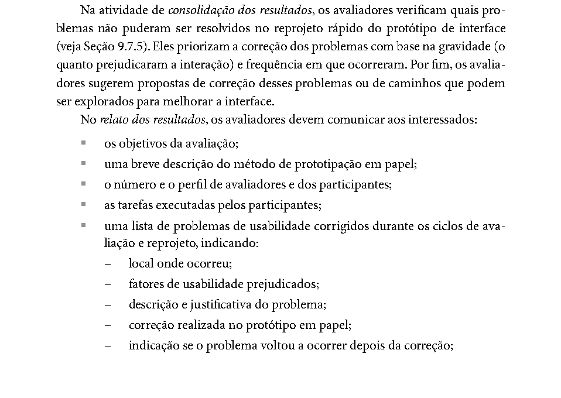

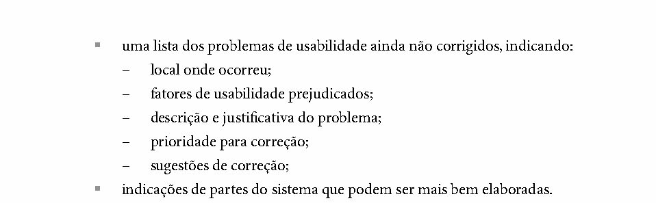

Fonte: BARBOSA; SILVA (2010, pp. 361–362).

### 4.2. Modelo da Lista de Problemas Corrigidos durante os Ciclos de Avaliação

A Tabela 17 apresenta o modelo para registrar os problemas corrigidos no protótipo entre uma sessão e outra.

**Tabela 17 – Modelo da lista de problemas corrigidos**

| ID | Local (tela e elemento) | Fatores de usabilidade prejudicados | Descrição e justificativa | Correção realizada no protótipo | Voltou a ocorrer após a correção? |
| --- | --- | --- | --- | --- | --- |
| PC01 | — | — | — | — | — |

Fonte: Elaborado pelos autores com base em Barbosa e Silva (2010, cap. 10, p. 361).

### 4.3. Modelo da Lista de Problemas Não Corrigidos e Prioridade de Correção

A Tabela 18 apresenta o modelo para os problemas que permanecerem ao final das sessões, com a prioridade de correção definida pela escala da Tabela 7.

**Tabela 18 – Modelo da lista de problemas não corrigidos**

| ID | Local (tela e elemento) | Fatores de usabilidade prejudicados | Descrição e justificativa | Prioridade (gravidade 1–4 e frequência) | Sugestão de correção |
| --- | --- | --- | --- | --- | --- |
| PN01 | — | — | — | — | — |

Fonte: Elaborado pelos autores com base em Barbosa e Silva (2010, cap. 10, p. 362).

### 4.4. Cronograma do Planejamento do Relato por Integrante

Cada integrante acrescenta à Tabela 19 as tarefas e as datas do seu relato. As linhas atuais são de Henrique Schneider: o relato dele seguirá a estrutura da seção 4.1, registrará os problemas nos modelos das Tabelas 17 e 18 e identificará os participantes apenas por códigos, como prevê a seção 3.5.

**Tabela 19 – Cronograma do relato dos resultados por integrante**

| Tarefa | Integrante | Início | Fim |
| --- | --- | --- | --- |
| Consolidação da lista de problemas | Henrique Schneider | 26/10/2026 | 30/10/2026 |
| Redação do relato | Henrique Schneider | 30/10/2026 | 01/11/2026 |
| Revisão cruzada | Henrique Schneider | 02/11/2026 | 02/11/2026 |
| Publicação no GitHub Pages | Henrique Schneider | 03/11/2026 | 03/11/2026 |

Fonte: Elaborado pelos autores (2026).

**Parte de Alexandre Vilar:** o relato do protótipo utilizará a estrutura da seção 4.1 e os modelos das Tabelas 17 e 18, separando problemas corrigidos entre sessões dos que permanecerem. As evidências serão vinculadas às telas, às tarefas e aos códigos dos participantes. O registro de planejamento disponível não define datas para Alexandre; as etapas abaixo não são apresentadas como executadas.

| Tarefa | Integrante | Início | Fim |
| --- | --- | --- | --- |
| Consolidar problemas por tela e tarefa após as sessões | Alexandre Vilar | A definir | A definir |
| Interpretar resultados e redigir o relato | Alexandre Vilar | A definir | A definir |
| Realizar revisão cruzada | Alexandre Vilar e revisor a definir | A definir | A definir |
| Publicar o relato e registrar a versão | Alexandre Vilar | A definir | A definir |

Fonte: etapas derivadas da estrutura coletiva do relato; datas dependem da definição das sessões futuras.

## 5. Cronograma Executado

A Tabela 20 registra as atividades realmente executadas nesta entrega, com o responsável e as datas de início e fim, para comparação com o cronograma planejado na Entrega 1.

**Tabela 20 – Cronograma executado da Entrega 5**

| Atividade | Responsável | Início | Fim | Situação |
| --- | --- | --- | --- | --- |
| Elaboração dos storyboards | Henrique Schneider | 22/10/2026 | 22/10/2026 | Concluída (Henrique) |
| Teste piloto da avaliação dos storyboards | Henrique Schneider | 24/10/2026 | 24/10/2026 | Concluído (Henrique) |
| Sessões de avaliação dos storyboards | Henrique Schneider | 25/10/2026 | 25/10/2026 | Concluída (Henrique: 2 sessões, P3 e P4) |
| Inspeção da HTA | Henrique Schneider | 25/10/2026 | 25/10/2026 | Fluxo 3: verificação do autor concluída; inspeção por outro integrante pendente |
| Consolidação e relato dos resultados | Henrique Schneider | 24/10/2026 | 25/10/2026 | Concluída (Henrique) |
| Planejamento da avaliação do protótipo de papel | Henrique Schneider | 25/10/2026 | 25/10/2026 | Concluído (Henrique) |
| Planejamento do relato do protótipo de papel | Henrique Schneider | 25/10/2026 | 25/10/2026 | Concluído (Henrique) |
| Gravação do vídeo de apresentação | — | — | — | — |
| Publicação no GitHub Pages | — | — | — | — |
| Sessão de avaliação de vistoria | Alexandre Vilar | 25/10/2026 | 25/10/2026 | Realizada com P2, conforme o registro da Tabela 4 e a gravação |
| Registro do teste-piloto e análise de seu procedimento | Alexandre Vilar | Não informado (sessão) | 25/10/2026 (registro) | Gravação e análise operacional publicadas; data da sessão do piloto a confirmar |
| Conclusão do relato individual e publicação dos resultados de vistoria | Alexandre Vilar | Não informado (início) | 25/10/2026 (registro) | Relato publicado; data de registro conforme histórico da página individual |
| Consolidação da participação de vistoria no relatório coletivo | Alexandre Vilar, com apoio do ChatGPT | 25/10/2026 | 25/10/2026 | Resultados de P2 e conferência do Fluxo 5 incorporados nesta versão |

Fonte: Elaborado pelos autores (2026).

## 6. Conclusão

Esta entrega fecha o ciclo iniciado na Entrega 4: os storyboards e a HTA, planejados com o framework DECIDE, foram avaliados com participantes compatíveis com os perfis de usuário do projeto, e os problemas encontrados foram organizados em uma lista priorizada e em um planejamento de reprojeto. Por ser formativa, a avaliação permitiu discutir problemas de interação do portal do Detran-DF a um custo baixo, antes da construção de qualquer protótipo. O planejamento da avaliação do protótipo de papel prepara a próxima etapa, em que as correções propostas serão representadas em telas e testadas com usuários.

## Agradecimentos, Uso de IA, Ferramentas e Referências Bibliográficas

### 1. Agradecimentos

A realização desta Quinta Entrega do projeto de Interação Humano-Computador do Grupo 03 foi construída de forma colaborativa e fundamentada em referenciais teóricos da área. Registramos nossos agradecimentos:

- **Orientação acadêmica:** ao Prof. Dr. André Barros de Sales, pelas diretrizes e pela supervisão das atividades da disciplina de Interação Humano-Computador na Faculdade UnB Gama.
- **Referencial teórico:** a Simone Diniz Junqueira Barbosa e Bruno Santana da Silva, cuja obra *Interação Humano-Computador* (2010) embasou o planejamento das avaliações, a prototipação em papel e a Análise Hierárquica de Tarefas; e a Jennifer Preece, Yvonne Rogers e Helen Sharp, pela fundamentação sobre storyboards e pelo framework DECIDE.
- **Participantes:** às pessoas que participaram voluntariamente das sessões de avaliação.
- **Objeto de estudo:** ao Detran-DF, cujo portal oficial é o objeto empírico deste projeto.

### 2. Uso de Inteligência Artificial

Em conformidade com o Código de Conduta da Sociedade Brasileira de Computação adotado no Plano de Ensino (SALES, 2026a, p. 3), declaramos o uso de ferramentas de Inteligência Artificial generativa nesta entrega. O conteúdo, as decisões metodológicas e a validação final dos artefatos são de responsabilidade do grupo.

- **Claude (Anthropic):** utilizado na estruturação dos capítulos deste relatório, na redação das seções coletivas, na elaboração das tabelas-modelo, na conferência das citações de Barbosa e Silva (2010) e de Preece, Rogers e Sharp (2005), na formatação do documento e na elaboração de um storyboard de referência. Em 25/10/2026, a pedido de Henrique Schneider, também foi utilizado para redigir a parte dele no planejamento da avaliação do protótipo de papel (seção 3.8.1 e linhas de Henrique nas Tabelas 16 e 19) a partir da HTA e do storyboard do autor, e para recortar a página 358 de Barbosa e Silva (2010) usada na Figura 15; as datas, o número de participantes e a construção do protótipo foram definidos pelo autor. Ainda em 25/10/2026, foi utilizado para organizar os resultados da entrevista de P3 (storyboard de Henrique Schneider) a partir da transcrição automática e da gravação da sessão, preenchendo a seção 1.4.1 e as linhas de P3 e de Henrique nas Tabelas 4, 6, 8, 9, 12 e 13; a gravidade dos problemas PS02 a PS05 é uma proposta a confirmar pelo autor. Na parte de Henrique Schneider, também foi utilizado para redigir as análises do Fluxo 3 nas seções 1.6, 2.5 e 2.7, verificar a HTA do Fluxo 3 com os critérios da Tabela 10 (Tabela 12 e PH03), registrar as atividades de Henrique no cronograma executado (Tabela 20) e anonimizar a transcrição da entrevista de P3. Também organizou os resultados da segunda entrevista de Henrique (P4), atualizou as tabelas e análises correspondentes e retirou do relatório os textos de instrução que restavam (“inserir aqui”, “a preencher”).
- **Gemini (Google):** utilizado na validação do documento e na redação dos relatórios de entrevistas

- **ChatGPT (OpenAI), na parte de Alexandre Vilar:** utilizado na organização do relato individual a partir da transcrição automática e, nesta atualização, no preenchimento das Tabelas 5, 6, 8, 9 e 11–13, na conferência documental do Fluxo 5, no registro das evidências e no escopo preparatório do protótipo. A classificação PS08 é uma proposta de julgamento a revisar, não uma medição. Perfil e data da sessão foram sincronizados com a Tabela 4 já publicada; não foram inventados dados de recrutamento, local, modalidade ou datas futuras. A revisão por outro integrante ainda não está registrada para esta contribuição.

### 3. Ferramentas Utilizadas

- **Google Docs e Google Drive:** redação colaborativa e controle de versões do relatório.
- **GitHub e GitHub Pages:** versionamento e publicação da documentação do projeto.
- **Microsoft Teams:** reuniões de alinhamento e gravação das sessões e apresentações.
- Claude (Anthropic) e Microsoft Teams, no material de Henrique Schneider: o storyboard foi desenhado com o Claude e exportado em PDF, e a entrevista foi gravada e transcrita automaticamente pelo Teams; o protótipo de papel será feito com folhas, canetas e notas adesivas.

### 4. Referências Bibliográficas

ASSOCIAÇÃO BRASILEIRA DE NORMAS TÉCNICAS. **NBR 6023**: informação e documentação: referências: elaboração. Rio de Janeiro: ABNT, 2018.

ASSOCIAÇÃO BRASILEIRA DE NORMAS TÉCNICAS. **NBR 10520**: informação e documentação: citações em documentos: apresentação. Rio de Janeiro: ABNT, 2023.

BARBOSA, Simone Diniz Junqueira; SILVA, Bruno Santana da. **Interação humano-computador**. 1. ed. Rio de Janeiro: Elsevier, 2010.

BARBOSA, Simone Diniz Junqueira et al. **Interação Humano-Computador e Experiência do Usuário**. 2021. Seções 8.4.1 e 11.7–11.8. Edição utilizada no roteiro e no relato individual de Alexandre Vilar.

GRUPO 03. **Segunda Entrega**: perfil de usuário, aspectos éticos e análise de tarefas. Projeto da disciplina de Interação Humano-Computador, Universidade de Brasília, 2026a. Disponível em: https://interacao-humano-computador.github.io/2026.2-Grupo03/.

GRUPO 03. **Planejamento Entrega 4**. Projeto da disciplina de Interação Humano-Computador, Universidade de Brasília, 2026b. Disponível em: https://interacao-humano-computador.github.io/2026.2-Grupo03/.

NIELSEN, Jakob. **Usability engineering**. Boston: Academic Press, 1993. Consulta indireta por Barbosa e Silva (2010).

NIELSEN, Jakob. Heuristic evaluation. In: NIELSEN, Jakob; MACK, Robert L. (ed.). **Usability inspection methods**. New York: John Wiley & Sons, 1994. Consulta indireta por Barbosa e Silva (2010).

NIELSEN, Jakob. Why you only need to test with 5 users. Alertbox, 2000. Disponível em: http://www.useit.com/alertbox/20000319.html. Consulta indireta por Barbosa e Silva (2010).

PREECE, Jennifer; ROGERS, Yvonne; SHARP, Helen. **Design de interação**: além da interação homem-computador. 1. ed. Porto Alegre: Bookman, 2005.

ROSA, Henrique Schneider Fernandes da. Análise Hierárquica de Tarefas (HTA): agendar a prova teórica com reserva de horário. Versão 1.2. Brasília: Universidade de Brasília, 2026.

ROSA, Henrique Schneider Fernandes da. Entrevista de avaliação do storyboard com a participante P3. Brasília, 25 out. 2026. 1 vídeo (25 min 16 s). Disponível em: https://youtu.be/TTIRe6Id010. Acesso em: 25 out. 2026.

ROSA, Henrique Schneider Fernandes da. Entrevista de avaliação do storyboard com o participante P4. Brasília, 25 out. 2026. 1 vídeo (17 min 9 s). Disponível em: https://youtu.be/4wEvZ1Okwwk. Acesso em: 25 out. 2026.

ROSA, Henrique Schneider Fernandes da. Relato dos resultados da avaliação do storyboard “Agendamento da prova teórica com reserva de horário”. Versão 3.1. Brasília: Universidade de Brasília, 2026.

ROSA, Henrique Schneider Fernandes da. Roteiro de entrevista semiestruturada: avaliação do storyboard “Agendamento da prova teórica com reserva de horário”. Versão 1.2. Brasília: Universidade de Brasília, 2026.

ROSA, Henrique Schneider Fernandes da. Storyboard: agendamento da prova teórica com reserva de horário. Versão 1.0. Brasília: Universidade de Brasília, 2026.

ROSA, Henrique Schneider Fernandes da. Transcrição anonimizada da entrevista de avaliação do storyboard (P3 e P4). Versão 1.0. Brasília: Universidade de Brasília, 2026.

SALES, André Barros de. **Plano de Ensino**: Interação Humano Computador (FGA0173), 02/2026, Turma 01, v1. Brasília: Universidade de Brasília, Faculdade UnB Gama, 2026a.

SALES, André Barros de. **Lista de exercícios**: Capítulo 8: Design, Prototipação e Construção. Brasília: Universidade de Brasília, Faculdade UnB Gama, 2026b.

SHARP, Helen; ROGERS, Yvonne; PREECE, Jennifer. **Interaction design**: beyond human-computer interaction. 2. ed. Chichester: John Wiley & Sons, 2007. Consulta indireta por Barbosa e Silva (2010).

SNYDER, Carolyn. **Paper prototyping**: the fast and easy way to design and refine user interfaces. San Francisco: Morgan Kaufmann, 2003. Consulta indireta por Barbosa e Silva (2010).

**Uso de IA generativa nesta página.** Em 25/10/2026, o Claude (Anthropic) foi utilizado, a pedido de Henrique Schneider, para converter o relatório da Entrega 5 (Google Docs) em página do site, no formato das demais páginas: tabela de contribuição, histórico de versões, numeração das tabelas renumeradas a partir da Tabela 3 e fotos dos trechos citados, recortadas das páginas do livro. O texto do relatório não foi alterado; as linhas de tabelas sem dados de quem não faz mais parte da equipe ou de participantes não ouvidos foram omitidas. A ferramenta não é autora do artefato e seu uso não exime os autores da responsabilidade sobre o conteúdo (SALES, 2026a, p. 3).
