# Inspeção do Grupo +1 (Grupo 08) – Entrega 5

**Projeto da Disciplina de Interação Humano-Computador (2026.2)**
Campus Darcy Ribeiro / Faculdade de Ciências da Tecnologia (FCTE) — Turma 01
Prof. Dr. André Barros de Sales — **Grupo 03**

Integrantes do grupo: Alexandre Vilar, Gabriel Robson, Henrique Schneider e João Vitor.

---

## Tabela de contribuição

<b>Tabela 1</b> – Contribuições no artefato Inspeção do Grupo +1 (Grupo 08) – Entrega 5.

| Integrante | Contribuição | Atividade (link) | Gravação (link) |
| :--- | :--- | :--- | :--- |
| Alexandre Vilar Valadares Fonsêca | Autoria dos itens R1, R2 e N1 | [Itens R1, R2 e N1](#12-itens-do-conteudo-da-disciplina) | — |
| Gabriel Robson Nunes Neiva da Silva | Autoria dos itens R3, R4 e N3 | [Itens R3, R4 e N3](#12-itens-do-conteudo-da-disciplina) | — |
| Henrique Schneider Fernandes da Rosa | Autoria dos itens R7, R8, N2 e N5; condução da inspeção e preenchimento das respostas | [Itens R7, R8, N2 e N5](#12-itens-do-conteudo-da-disciplina) | [Inspeção de 26/10/2026](https://youtu.be/4tzU4B-RVis) |
| João Vitor Tavares de Sá Lima | Autoria dos itens R5, R6, R9 e N4 | [Itens R5, R6, R9 e N4](#12-itens-do-conteudo-da-disciplina) | — |

<b>Fonte</b>: Elaborado pelos autores (2026).

---

## Histórico de Versões

<b>Tabela 2</b> – Histórico de Versões do Documento de Inspeção do Grupo +1 (Grupo 08) – Entrega 5.

| Data | Versão | Descrição | Autor(es) | Revisor(es) |
| :---: | :---: | :--- | :--- | :--- |
| 26/10/2026 | 1.0 | Criação da lista de verificação da Entrega 5 e registro dos resultados da inspeção do Grupo 08: respostas, evidências (minutos da gravação e links), versão, data e hora de cada item e fundamentação com foto das fontes. | Henrique Schneider | **[VERIFICAR: revisor]** |

<b>Fonte</b>: Elaborado pelos autores (2026).

---

## Introdução (contexto)

Esta página registra os resultados da inspeção da Entrega 5 do Grupo +1 (Grupo 08), cujo site é <https://interacao-humano-computador.github.io/2026.2-Grupo08/>. A Entrega 5 cobre o Relato dos resultados do Storyboard e da Análise de Tarefas, o Planejamento da Avaliação do Protótipo de Papel e o Planejamento do relato dos resultados da avaliação do Protótipo de Papel (SALES, 2026, p. 5).

A inspeção foi realizada por Henrique Schneider Fernandes da Rosa em 26/10/2026, das 22:48 às 23:20 (gravação de 32 min 10 s): [vídeo da inspeção](https://youtu.be/4tzU4B-RVis).

**Como ler as tabelas:** a coluna **Resposta** traz Sim, Não ou Incompleto; a coluna **Evidência** traz o minuto da gravação (com link para o ponto do vídeo), a justificativa e o link para a seção avaliada no site do Grupo 08; a coluna **Versão, data e hora** indica a versão da página do Grupo 08 avaliada e o horário em que o item foi avaliado. Os minutos são aproximados: foram estimados pela posição de cada item na transcrição da gravação, que só registra o horário de início e a fala “agora são 22:50”.

O Plano de Ensino não traz lista sugerida própria para a Apresentação 5; a lista vai até a Apresentação 4 (SALES, 2026, pp. 12–13). Por isso, os itens P adaptam os itens da Apresentação 4 ao Protótipo de Papel, e os itens R seguem a estrutura de relato de Barbosa e Silva (2010, p. 312).

---

## 1. Lista de verificação e resultados

### 1.1 Itens do desenvolvimento do projeto

Os 11 itens reproduzem a lista de referência do Plano de Ensino (SALES, 2026, pp. 8–9), conforme as [Figuras 1 e 2](#figura-1). Os resultados estão na Tabela 3.

<b>Tabela 3</b> – Itens do desenvolvimento do projeto – Grupo 08.

| # | Questão — O GitHub Pages possui: | Fonte | Autor do item | Resposta (Sim / Não / Incompleto) | Evidência (minuto do vídeo ou link) | Versão, data e hora da avaliação |
| :---: | :--- | :--- | :--- | :---: | :--- | :--- |
| D1 | O histórico de versão padronizado? | Plano de Ensino, p. 8 ([Figura 1](#figura-1)) | Plano de Ensino (Prof. André Barros de Sales) | **Sim** | [≈ 01:13](https://youtu.be/4tzU4B-RVis?t=73) — Histórico de versão padronizado (Versão, Data, Descrição, Autor(es) e Revisor(es)) na seção 6 da página da Entrega 5; o mesmo formato aparece nos artefatos de Nível 1 e 2. [Ver no GitHub Pages do Grupo 08](https://interacao-humano-computador.github.io/2026.2-Grupo08/entregas/entrega5/#6-historico-de-versao) | Entrega 5 v1.5 (25/10/2026); avaliado em 26/10/2026, ≈ 22:49 |
| D2 | O(s) autor(es) e o(s) revisor(es) para cada artefato? | Plano de Ensino, p. 8 ([Figura 1](#figura-1)) | Plano de Ensino (Prof. André Barros de Sales) | **Sim** | [≈ 01:59](https://youtu.be/4tzU4B-RVis?t=119) — A Tabela 2 da Entrega 5 indica autor(es) e revisor(es) de cada artefato, e o histórico de versão registra o revisor de cada versão. [Ver no GitHub Pages do Grupo 08](https://interacao-humano-computador.github.io/2026.2-Grupo08/entregas/entrega5/#2-artefatos-metodologicos-produzidos-na-entrega-5) | Entrega 5 v1.5 (25/10/2026); avaliado em 26/10/2026, ≈ 22:50 |
| D3 | Referências bibliográficas e/ou bibliografia em todos os artefatos? | Plano de Ensino, p. 8 ([Figura 1](#figura-1)) | Plano de Ensino (Prof. André Barros de Sales) | **Sim** | [≈ 02:44](https://youtu.be/4tzU4B-RVis?t=164) — Seção 7 com referências em ABNT (Barbosa et al., 2021; Klemmer; Mayhew, 1999; Nielsen, 1994; Rogers, Sharp e Preece). [Ver no GitHub Pages do Grupo 08](https://interacao-humano-computador.github.io/2026.2-Grupo08/entregas/entrega5/#7-referencias-bibliograficas-abnt) | Entrega 5 v1.5 (25/10/2026); avaliado em 26/10/2026, ≈ 22:50 |
| D4 | As tabelas e imagens possuem legenda e fonte e elas chamadas dentro do texto? | Plano de Ensino, p. 8 ([Figura 1](#figura-1)) | Plano de Ensino (Prof. André Barros de Sales) | **Incompleto** | [≈ 02:59](https://youtu.be/4tzU4B-RVis?t=179) — As tabelas têm legenda numerada e são chamadas no texto (ex.: “A Tabela 2 relaciona…”), mas a indicação de fonte abaixo das tabelas não foi encontrada de forma consistente. [Ver no GitHub Pages do Grupo 08](https://interacao-humano-computador.github.io/2026.2-Grupo08/entregas/entrega5/#2-artefatos-metodologicos-produzidos-na-entrega-5) | Entrega 5 v1.5 (25/10/2026); avaliado em 26/10/2026, ≈ 22:51 |
| D5 | Um texto fazendo uma introdução dos artefatos? | Plano de Ensino, p. 8 ([Figura 1](#figura-1)) | Plano de Ensino (Prof. André Barros de Sales) | **Sim** | [≈ 03:48](https://youtu.be/4tzU4B-RVis?t=228) — Seção “1. Introdução” apresenta os artefatos da Entrega 5 e sua função no ciclo de vida de Mayhew (1999). [Ver no GitHub Pages do Grupo 08](https://interacao-humano-computador.github.io/2026.2-Grupo08/entregas/entrega5/#1-introducao) | Entrega 5 v1.5 (25/10/2026); avaliado em 26/10/2026, ≈ 22:52 |
| D6 | O cronograma executado com quem realizou cada artefato/atividade com as datas de início e fim da construção/realização do artefato/atividade? | Plano de Ensino, p. 8 ([Figura 1](#figura-1)) | Plano de Ensino (Prof. André Barros de Sales) | **Sim** | [≈ 04:11](https://youtu.be/4tzU4B-RVis?t=251) — Tabela 5 do Cronograma Executado (Entrega 5) com atividade, período previsto, realizado, autores, período de revisão e revisores. [Ver no GitHub Pages do Grupo 08](https://interacao-humano-computador.github.io/2026.2-Grupo08/planejamento/cronograma-executado/#entrega-5-relato-dos-resultados-do-storyboard-e-tarefas-planejamento-do-prototipo-de-papel) | Cronograma Executado v1.5 (22/10/2026); avaliado em 26/10/2026, ≈ 22:52 |
| D7 | Ata(s) da(s) reuniões (com data, horário de início e do final, participantes, objetivo, atividades definidas etc.)? | Plano de Ensino, p. 9 ([Figura 2](#figura-2)) | Plano de Ensino (Prof. André Barros de Sales) | **Sim** | [≈ 05:12](https://youtu.be/4tzU4B-RVis?t=312) — Ata 7 (25/10/2026) com data, início (22:30), término (22:44), modalidade, objetivo, participantes, pauta e deliberações. [Ver no GitHub Pages do Grupo 08](https://interacao-humano-computador.github.io/2026.2-Grupo08/atas/ata7/#1-informacoes-da-reuniao) | Ata 7 v1.0 (25/10/2026); avaliado em 26/10/2026, ≈ 22:53 |
| D8 | A gravação da reunião do grupo? | Plano de Ensino, p. 9 ([Figura 2](#figura-2)) | Plano de Ensino (Prof. André Barros de Sales) | **Sim** | [≈ 05:55](https://youtu.be/4tzU4B-RVis?t=355) — A seção 5 da Ata 7 incorpora o vídeo da gravação da reunião de apresentação da Entrega 5. [Ver no GitHub Pages do Grupo 08](https://interacao-humano-computador.github.io/2026.2-Grupo08/atas/ata7/#5-registro-audiovisual-da-reuniao) | Ata 7 v1.0 (25/10/2026); avaliado em 26/10/2026, ≈ 22:54 |
| D9 | Vídeo de apresentação na categoria “não listado” no YouTube? | Plano de Ensino, p. 9 ([Figura 2](#figura-2)) | Plano de Ensino (Prof. André Barros de Sales) | **Sim** | [≈ 06:25](https://youtu.be/4tzU4B-RVis?t=385) — A seção 3 informa que os vídeos estão no YouTube como “Não Listado” (ex.: <https://youtu.be/KO4E0UjvhOw>), conforme declarado pelo grupo. [Ver no GitHub Pages do Grupo 08](https://interacao-humano-computador.github.io/2026.2-Grupo08/entregas/entrega5/#3-registros-audiovisuais-da-entrega-5) | Entrega 5 v1.5 (25/10/2026); avaliado em 26/10/2026, ≈ 22:54 |
| D10 | Tabela de contribuição no início do artefato com o nome de todos os integrantes com a contribuição de cada integrante com hiperligação da atividade e da gravação, se houver? | Plano de Ensino, p. 9 ([Figura 2](#figura-2)) | Plano de Ensino (Prof. André Barros de Sales) | **Sim** | [≈ 06:51](https://youtu.be/4tzU4B-RVis?t=411) — Tabela 1 “Matriz de Contribuição da Entrega 5” no início da página, com integrante, atribuição, data, ferramenta de IA e propósito do uso. [Ver no GitHub Pages do Grupo 08](https://interacao-humano-computador.github.io/2026.2-Grupo08/entregas/entrega5/#tabela-de-contribuicao-e-uso-de-ia-generativa) | Entrega 5 v1.5 (25/10/2026); avaliado em 26/10/2026, ≈ 22:55 |
| D11 | A seção de agradecimentos apresentando o uso de Inteligência Artificial (IA) Generativa no artefato? | Plano de Ensino, p. 9 ([Figura 2](#figura-2)) | Plano de Ensino (Prof. André Barros de Sales) | **Sim** | [≈ 07:22](https://youtu.be/4tzU4B-RVis?t=442) — Seção “Agradecimentos e Uso de Inteligência Artificial (IA) Generativa” ao final da página descreve o uso de LLM e o que foi feito pelos discentes. [Ver no GitHub Pages do Grupo 08](https://interacao-humano-computador.github.io/2026.2-Grupo08/entregas/entrega5/#agradecimentos-e-uso-de-inteligencia-artificial-ia-generativa) | Entrega 5 v1.5 (25/10/2026); avaliado em 26/10/2026, ≈ 22:55 |

<b>Fonte</b>: Elaborado pelos autores (2026).

### 1.2 Itens do conteúdo da disciplina

Os itens R1 a R7 seguem a lista do que o relato dos resultados consolidados costuma incluir ([Figura 3](#figura-3)); R8 e R9 adaptam os itens 12 e 10 da Apresentação 4. Os resultados estão na Tabela 4.

<b>Tabela 4</b> – Relato do Storyboard e da Análise de Tarefas – Grupo 08.

| # | Questão — O GitHub Pages possui: | Fonte | Autor do item | Resposta (Sim / Não / Incompleto) | Evidência (minuto do vídeo ou link) | Versão, data e hora da avaliação |
| :---: | :--- | :--- | :--- | :---: | :--- | :--- |
| R1 | O relato apresenta os objetivos e o escopo da avaliação do Storyboard e da Análise de Tarefas? | Barbosa e Silva (2010), seç. 9.7.5, p. 312 ([Figura 3](#figura-3)) | Alexandre Vilar Valadares Fonsêca | **Sim** | [≈ 08:18](https://youtu.be/4tzU4B-RVis?t=498) — Seção 1 “Introdução e Objetivos da Avaliação” do Relato do Storyboard. [Ver no GitHub Pages do Grupo 08](https://interacao-humano-computador.github.io/2026.2-Grupo08/design-avaliacao-desenvolvimento/nivel-1/storyboard/relato-resultados/#1-introducao-e-objetivos-da-avaliacao) | Relato do Storyboard v1.1 (25/10/2026); avaliado em 26/10/2026, ≈ 22:56 |
| R2 | O relato descreve a forma como a avaliação foi realizada (método de avaliação empregado)? | Barbosa e Silva (2010), seç. 9.7.5, p. 312 ([Figura 3](#figura-3)) | Alexandre Vilar Valadares Fonsêca | **Sim** | [≈ 09:15](https://youtu.be/4tzU4B-RVis?t=555) — Seção 2: investigação empírica por entrevistas semiestruturadas individuais com as pranchas em papel (Barbosa & Silva, 2021, p. 144). [Ver no GitHub Pages do Grupo 08](https://interacao-humano-computador.github.io/2026.2-Grupo08/design-avaliacao-desenvolvimento/nivel-1/storyboard/relato-resultados/#2-metodologia-de-investigacao-empirica-empregada) | Relato do Storyboard v1.1 (25/10/2026); avaliado em 26/10/2026, ≈ 22:57 |
| R3 | O relato informa o número e o perfil de usuários e avaliadores que participaram da avaliação? | Barbosa e Silva (2010), seç. 9.7.5, p. 312 ([Figura 3](#figura-3)) | Gabriel Robson | **Sim** | [≈ 09:36](https://youtu.be/4tzU4B-RVis?t=576) — Seção 3 e Tabela 2: 3 discentes voluntários da UnB com perfil Usuário Aprendiz/Intermediário em Linux, com o papel de cada um na sessão. [Ver no GitHub Pages do Grupo 08](https://interacao-humano-computador.github.io/2026.2-Grupo08/design-avaliacao-desenvolvimento/nivel-1/storyboard/relato-resultados/#3-caracterizacao-dos-avaliadores-e-participantes) | Relato do Storyboard v1.1 (25/10/2026); avaliado em 26/10/2026, ≈ 22:57 |
| R4 | O relato traz um sumário dos dados coletados, incluindo tabelas e gráficos? | Barbosa e Silva (2010), seç. 9.7.5, p. 312 ([Figura 3](#figura-3)) | Gabriel Robson | **Incompleto** | [≈ 10:20](https://youtu.be/4tzU4B-RVis?t=620) — A seção 5 sintetiza os dados em tabelas (P01 a P08), mas o relato não apresenta gráficos. [Ver no GitHub Pages do Grupo 08](https://interacao-humano-computador.github.io/2026.2-Grupo08/design-avaliacao-desenvolvimento/nivel-1/storyboard/relato-resultados/#5-sintese-dos-dados-coletados-e-analise-qualitativa-de-conteudo) | Relato do Storyboard v1.1 (25/10/2026); avaliado em 26/10/2026, ≈ 22:58 |
| R5 | O relato apresenta a interpretação e a análise dos dados? | Barbosa e Silva (2010), seç. 9.7.5, p. 312 ([Figura 3](#figura-3)) | João Vitor Tavares de Sá Lima | **Sim** | [≈ 10:51](https://youtu.be/4tzU4B-RVis?t=651) — Seção 5 “Síntese dos Dados Coletados e Análise Qualitativa de Conteúdo”, com interpretação por questão (P01 a P08). [Ver no GitHub Pages do Grupo 08](https://interacao-humano-computador.github.io/2026.2-Grupo08/design-avaliacao-desenvolvimento/nivel-1/storyboard/relato-resultados/#5-sintese-dos-dados-coletados-e-analise-qualitativa-de-conteudo) | Relato do Storyboard v1.1 (25/10/2026); avaliado em 26/10/2026, ≈ 22:59 |
| R6 | O relato lista os problemas encontrados? | Barbosa e Silva (2010), seç. 9.7.5, p. 312 ([Figura 3](#figura-3)) | João Vitor Tavares de Sá Lima | **Sim** | [≈ 11:49](https://youtu.be/4tzU4B-RVis?t=709) — Seção 6, Tabela 3: problemas de usabilidade com quadro afetado, descrição e severidade de Nielsen (0 a 4). [Ver no GitHub Pages do Grupo 08](https://interacao-humano-computador.github.io/2026.2-Grupo08/design-avaliacao-desenvolvimento/nivel-1/storyboard/relato-resultados/#6-tabela-estruturada-de-problemas-de-usabilidade-e-severidade-nielsen) | Relato do Storyboard v1.1 (25/10/2026); avaliado em 26/10/2026, ≈ 23:00 |
| R7 | O relato apresenta um planejamento para o reprojeto do sistema? | Barbosa e Silva (2010), seç. 9.7.5, p. 312 ([Figura 3](#figura-3)) | Henrique Schneider Fernandes da Rosa | **Não** | [≈ 12:16](https://youtu.be/4tzU4B-RVis?t=736) — A seção 7 lista recomendações de reprojeto para o Nível 2, mas não apresenta um planejamento do reprojeto. [Ver no GitHub Pages do Grupo 08](https://interacao-humano-computador.github.io/2026.2-Grupo08/design-avaliacao-desenvolvimento/nivel-1/storyboard/relato-resultados/#7-recomendacoes-concretas-de-reprojeto-para-a-prototipacao-em-papel-nivel-2) | Relato do Storyboard v1.1 (25/10/2026); avaliado em 26/10/2026, ≈ 23:00 |
| R8 | Os resultados do teste piloto ficaram fora dos resultados relatados? | Plano de Ensino, p. 13, item 12 (adaptado; [Figura 5](#figura-5)); Barbosa e Silva (2010), seç. 9.7.2, p. 307 ([Figura 11](#figura-11)) | Henrique Schneider Fernandes da Rosa | **Sim** | [≈ 13:31](https://youtu.be/4tzU4B-RVis?t=811) — Seção 9: cláusula declarando que os dados do teste-piloto não foram computados nos resultados. [Ver no GitHub Pages do Grupo 08](https://interacao-humano-computador.github.io/2026.2-Grupo08/design-avaliacao-desenvolvimento/nivel-1/storyboard/relato-resultados/#9-clausula-metodologica-obrigatoria-de-isolamento-dos-dados-do-teste-piloto) | Relato do Storyboard v1.1 (25/10/2026); avaliado em 26/10/2026, ≈ 23:01 |
| R9 | Há um relato para cada Storyboard planejado na Entrega 4 (quantidade igual à de integrantes)? | Plano de Ensino, p. 13, item 10 (adaptado; [Figura 5](#figura-5)) | João Vitor Tavares de Sá Lima | **Sim** | [≈ 14:36](https://youtu.be/4tzU4B-RVis?t=876) — Seção 4 relata os storyboards das três funcionalidades da equipe, um por integrante ativo. [Ver no GitHub Pages do Grupo 08](https://interacao-humano-computador.github.io/2026.2-Grupo08/design-avaliacao-desenvolvimento/nivel-1/storyboard/relato-resultados/#4-storyboards-avaliados) | Relato do Storyboard v1.1 (25/10/2026); avaliado em 26/10/2026, ≈ 23:02 |

<b>Fonte</b>: Elaborado pelos autores (2026).

Os itens P2 a P13 adaptam ao Protótipo de Papel os itens 2 a 13 da Apresentação 4 ([Figuras 4 e 5](#figura-4)). Os resultados estão na Tabela 5.

<b>Tabela 5</b> – Planejamento da avaliação e do relato do Protótipo de Papel – Grupo 08.

| # | Questão — O GitHub Pages possui: | Fonte | Autor do item | Resposta (Sim / Não / Incompleto) | Evidência (minuto do vídeo ou link) | Versão, data e hora da avaliação |
| :---: | :--- | :--- | :--- | :---: | :--- | :--- |
| P2 | O planejamento da avaliação do Protótipo de Papel segue o Framework DECIDE? | Plano de Ensino, p. 12, item 2 (adaptado; [Figura 4](#figura-4)) | Plano de Ensino (Prof. André Barros de Sales) | **Sim** | [≈ 16:16](https://youtu.be/4tzU4B-RVis?t=976) — O planejamento é organizado pelas etapas D-E-C-I-D-E (seções 3, 4, 5, 6, 9 e 11). [Ver no GitHub Pages do Grupo 08](https://interacao-humano-computador.github.io/2026.2-Grupo08/design-avaliacao-desenvolvimento/nivel-2/prototipo-papel/planejamento-avaliacao/#3-d-determinar-os-objetivos-da-avaliacao-da-tarefa-1) | Planejamento da Avaliação do Protótipo de Papel v1.0 (24/10/2026); avaliado em 26/10/2026, ≈ 23:04 |
| P3 | Descreve o(s) objetivo(s) da avaliação? (apropriação de tecnologia pelos usuários; ideias e alternativas de design; conformidade com um padrão; e/ou problemas na interação e na interface na fase do modelo conceitual) | Plano de Ensino, p. 13, item 3 ([Figura 5](#figura-5)) | Plano de Ensino (Prof. André Barros de Sales) | **Sim** | [≈ 16:34](https://youtu.be/4tzU4B-RVis?t=994) — Seção 3 “D — Determinar os Objetivos da Avaliação da Tarefa 1”, com quatro objetivos gerais (Barbosa e Silva, 2021, p. 280). [Ver no GitHub Pages do Grupo 08](https://interacao-humano-computador.github.io/2026.2-Grupo08/design-avaliacao-desenvolvimento/nivel-2/prototipo-papel/planejamento-avaliacao/#3-d-determinar-os-objetivos-da-avaliacao-da-tarefa-1) | Planejamento da Avaliação do Protótipo de Papel v1.0 (24/10/2026); avaliado em 26/10/2026, ≈ 23:04 |
| P4 | O método de avaliação a ser utilizado (prototipação em papel)? Adicionar referência bibliográfica da fonte e foto do texto da referência explicando o método. Autor: | Plano de Ensino, p. 13, item 4 (adaptado; [Figura 5](#figura-5)) | Plano de Ensino (Prof. André Barros de Sales) | **Incompleto** | [≈ 17:18](https://youtu.be/4tzU4B-RVis?t=1038) — A seção 5 define o teste de usabilidade em papel (Snyder, 2003; Rettig, 1994; Barbosa & Silva, 2021) com think-aloud e cita a fonte, mas não traz a foto do texto da referência. [Ver no GitHub Pages do Grupo 08](https://interacao-humano-computador.github.io/2026.2-Grupo08/design-avaliacao-desenvolvimento/nivel-2/prototipo-papel/planejamento-avaliacao/#5-c-escolher-os-metodos-de-avaliacao) | Planejamento da Avaliação do Protótipo de Papel v1.0 (24/10/2026); avaliado em 26/10/2026, ≈ 23:05 |
| P5 | As questões práticas da avaliação (recrutamento dos usuários — onde e o perfil; quantos usuários participarão e a razão dessa quantidade; presencial real ou remota; preparação e uso dos equipamentos necessários; prazos; orçamento; recursos de mão de obra necessários para conduzir a avaliação)? | Plano de Ensino, p. 13, item 5 ([Figura 5](#figura-5)) | Plano de Ensino (Prof. André Barros de Sales) | **Sim** | [≈ 18:47](https://youtu.be/4tzU4B-RVis?t=1127) — Seção 6: perfil e recrutamento (6.1), confecção dos materiais (6.2), infraestrutura presencial (6.3) e orçamento com custo zero (6.4). [Ver no GitHub Pages do Grupo 08](https://interacao-humano-computador.github.io/2026.2-Grupo08/design-avaliacao-desenvolvimento/nivel-2/prototipo-papel/planejamento-avaliacao/#6-i-identificar-e-administrar-as-questoes-praticas) | Planejamento da Avaliação do Protótipo de Papel v1.0 (24/10/2026); avaliado em 26/10/2026, ≈ 23:07 |
| P6 | As questões éticas (se os participantes da avaliação devem ser respeitados e não podem ser prejudicados direta ou indiretamente, nem durante os experimentos, nem após a divulgação dos resultados da avaliação)? | Plano de Ensino, p. 13, item 6 ([Figura 5](#figura-5)) | Plano de Ensino (Prof. André Barros de Sales) | **Sim** | [≈ 20:01](https://youtu.be/4tzU4B-RVis?t=1201) — Seção 9: os 4 princípios bioéticos, a Resolução CNS 510/2016, a LGPD e o script oral do TCLE. [Ver no GitHub Pages do Grupo 08](https://interacao-humano-computador.github.io/2026.2-Grupo08/design-avaliacao-desenvolvimento/nivel-2/prototipo-papel/planejamento-avaliacao/#9-d-decidir-como-lidar-com-as-questoes-eticas) | Planejamento da Avaliação do Protótipo de Papel v1.0 (24/10/2026); avaliado em 26/10/2026, ≈ 23:08 |
| P7 | A estrutura do relatório do resultado da avaliação (os objetivos da avaliação; uma breve descrição do método de prototipação em papel; o número e o perfil de avaliadores e dos participantes; as tarefas executadas pelos participantes; lista de problemas encontrados etc.)? | Plano de Ensino, p. 13, item 7 ([Figura 5](#figura-5)) | Plano de Ensino (Prof. André Barros de Sales) | **Sim** | [≈ 21:01](https://youtu.be/4tzU4B-RVis?t=1261) — Planejamento do Relato, seção 2: estrutura do relatório (objetivos, metodologia, participantes, tarefas, problemas) e Tabela 2 de registro de problemas. [Ver no GitHub Pages do Grupo 08](https://interacao-humano-computador.github.io/2026.2-Grupo08/design-avaliacao-desenvolvimento/nivel-2/prototipo-papel/planejamento-relato-resultados/#2-estrutura-canonica-do-relatorio-de-resultados-do-prototipo-de-papel-tarefa-1) | Planejamento do Relato do Protótipo de Papel v1.0 (24/10/2026); avaliado em 26/10/2026, ≈ 23:09 |
| P8 | Um cronograma (data e horário) e local para realização da avaliação do Protótipo de Papel? | Plano de Ensino, p. 13, item 8 (adaptado; [Figura 5](#figura-5)) | Plano de Ensino (Prof. André Barros de Sales) | **Sim** | [≈ 22:31](https://youtu.be/4tzU4B-RVis?t=1351) — Seção 7.1, Tabela 4: cronograma planejado com período, horário, responsável e local, com gravação oficial em 02/11/2026. [Ver no GitHub Pages do Grupo 08](https://interacao-humano-computador.github.io/2026.2-Grupo08/design-avaliacao-desenvolvimento/nivel-2/prototipo-papel/planejamento-avaliacao/#71-cronograma-planejado-das-atividades-de-nivel-2) | Planejamento da Avaliação do Protótipo de Papel v1.0 (24/10/2026); avaliado em 26/10/2026, ≈ 23:10 |
| P9 | Cada tela do Protótipo de Papel está relacionada a uma tarefa da Análise de Tarefas ou a um quadro do Storyboard? | Plano de Ensino, p. 13, item 9 (adaptado; [Figura 5](#figura-5)) | Plano de Ensino (Prof. André Barros de Sales) | **Incompleto** | [≈ 23:03](https://youtu.be/4tzU4B-RVis?t=1383) — O roteiro da seção 8 liga as pranchas às ações da Tarefa 1, mas a relação de cada tela com a análise de tarefas ou com um quadro do storyboard não foi encontrada por completo. [Ver no GitHub Pages do Grupo 08](https://interacao-humano-computador.github.io/2026.2-Grupo08/design-avaliacao-desenvolvimento/nivel-2/prototipo-papel/planejamento-avaliacao/#8-cenario-de-uso-e-roteiro-de-teste-especifico-da-tarefa-1) | Planejamento da Avaliação do Protótipo de Papel v1.0 (24/10/2026); avaliado em 26/10/2026, ≈ 23:11 |
| P10 | A quantidade de protótipos de papel é igual à quantidade de integrantes do grupo? | Plano de Ensino, p. 13, item 10 (adaptado; [Figura 5](#figura-5)) | Plano de Ensino (Prof. André Barros de Sales) | **Sim** | [≈ 24:08](https://youtu.be/4tzU4B-RVis?t=1448) — A seção 4 e os cronogramas indicam um planejamento de protótipo de papel por integrante ativo (3 tarefas para 3 integrantes). [Ver no GitHub Pages do Grupo 08](https://interacao-humano-computador.github.io/2026.2-Grupo08/entregas/entrega5/#4-consolidacao-das-entregas-individuais-por-funcionalidade) | Entrega 5 v1.5 (25/10/2026); avaliado em 26/10/2026, ≈ 23:12 |
| P11 | A definição do teste piloto e data para realização do teste piloto antes da avaliação? Adicionar referência bibliográfica da fonte e foto do texto da referência explicando o teste piloto. Autor: | Plano de Ensino, p. 13, item 11 ([Figura 5](#figura-5)) | Plano de Ensino (Prof. André Barros de Sales) | **Incompleto** | [≈ 24:49](https://youtu.be/4tzU4B-RVis?t=1489) — A seção 10 define o teste-piloto (30/10/2026, 14:00–14:45, FGA/UnB) e seu objetivo, mas sem a referência bibliográfica e a foto do texto pedidas no item. [Ver no GitHub Pages do Grupo 08](https://interacao-humano-computador.github.io/2026.2-Grupo08/design-avaliacao-desenvolvimento/nivel-2/prototipo-papel/planejamento-avaliacao/#10-protocolo-do-teste-piloto-de-nivel-2-tarefa-1) | Planejamento da Avaliação do Protótipo de Papel v1.0 (24/10/2026); avaliado em 26/10/2026, ≈ 23:13 |
| P12 | O resultado do teste piloto não será apresentado no resultado da avaliação? | Plano de Ensino, p. 13, item 12 ([Figura 5](#figura-5)) | Plano de Ensino (Prof. André Barros de Sales) | **Sim** | [≈ 25:51](https://youtu.be/4tzU4B-RVis?t=1551) — O protocolo do teste-piloto (seção 10) declara que os dados do piloto não serão computados nos resultados da avaliação. [Ver no GitHub Pages do Grupo 08](https://interacao-humano-computador.github.io/2026.2-Grupo08/design-avaliacao-desenvolvimento/nivel-2/prototipo-papel/planejamento-avaliacao/#10-protocolo-do-teste-piloto-de-nivel-2-tarefa-1) | Planejamento da Avaliação do Protótipo de Papel v1.0 (24/10/2026); avaliado em 26/10/2026, ≈ 23:14 |
| P13 | Os itens que o avaliador deve realizar/anotar durante a avaliação (listar os problemas encontrados, priorizar a correção dos problemas não resolvidos)? | Plano de Ensino, p. 13, item 13 ([Figura 5](#figura-5)) | Plano de Ensino (Prof. André Barros de Sales) | **Sim** | [≈ 26:39](https://youtu.be/4tzU4B-RVis?t=1599) — Seção 8 “Roteiro de Ações Observadas pelo Facilitador” e seção 11 (catalogação dos problemas pela escala de Nielsen). [Ver no GitHub Pages do Grupo 08](https://interacao-humano-computador.github.io/2026.2-Grupo08/design-avaliacao-desenvolvimento/nivel-2/prototipo-papel/planejamento-avaliacao/#roteiro-de-acoes-observadas-pelo-facilitador) | Planejamento da Avaliação do Protótipo de Papel v1.0 (24/10/2026); avaliado em 26/10/2026, ≈ 23:14 |

<b>Fonte</b>: Elaborado pelos autores (2026).

Os itens N1 a N5 foram criados pelo grupo inspetor a partir de Barbosa e Silva (2010, cap. 10, seç. 10.2.3); a fundamentação de cada um está na seção 2. Os resultados estão na Tabela 6.

<b>Tabela 6</b> – Itens adicionais do grupo inspetor – Grupo 08.

| # | Questão — O GitHub Pages possui: | Fonte | Autor do item | Resposta (Sim / Não / Incompleto) | Evidência (minuto do vídeo ou link) | Versão, data e hora da avaliação |
| :---: | :--- | :--- | :--- | :---: | :--- | :--- |
| N1 | A preparação da avaliação do Protótipo de Papel cobre as quatro tarefas do método: definir as tarefas dos participantes, definir o perfil e recrutar os participantes, criar os protótipos em papel para executar as tarefas e executar um teste-piloto? | Barbosa e Silva (2010), cap. 10, seç. 10.2.3, p. 359, Tabela 10.7 ([Figura 6](#figura-6)) | Alexandre Vilar Valadares Fonsêca | **Sim** | [≈ 27:52](https://youtu.be/4tzU4B-RVis?t=1672) — Seções 6.1 (recrutamento), 6.2 (confecção dos protótipos), 8 (cenário e roteiro de tarefas) e 10 (teste-piloto). [Ver no GitHub Pages do Grupo 08](https://interacao-humano-computador.github.io/2026.2-Grupo08/design-avaliacao-desenvolvimento/nivel-2/prototipo-papel/planejamento-avaliacao/#8-cenario-de-uso-e-roteiro-de-teste-especifico-da-tarefa-1) | Planejamento da Avaliação do Protótipo de Papel v1.0 (24/10/2026); avaliado em 26/10/2026, ≈ 23:16 |
| N2 | Além das telas estáticas, o protótipo traz peças de papel para as partes que mudam durante a interação (menus, dicas, itens de lista, resultados de busca, diálogos)? | Barbosa e Silva (2010), cap. 10, seç. 10.2.3, p. 358, 3º parágrafo ([Figura 7](#figura-7)) | Henrique Schneider Fernandes da Rosa | **Sim** | [≈ 28:31](https://youtu.be/4tzU4B-RVis?t=1711) — Seção 6.2: pranchas base e peças móveis (ex.: menu de categorias) manipuladas pelo “Computador Humano” durante a interação. [Ver no GitHub Pages do Grupo 08](https://interacao-humano-computador.github.io/2026.2-Grupo08/design-avaliacao-desenvolvimento/nivel-2/prototipo-papel/planejamento-avaliacao/#62-confeccao-dos-materiais-em-papel-bancada-da-tarefa-1) | Planejamento da Avaliação do Protótipo de Papel v1.0 (24/10/2026); avaliado em 26/10/2026, ≈ 23:16 |
| N3 | O planejamento prevê pelo menos dois avaliadores — um que simula o sistema (“computador”), sem dar explicações ou orientações ao usuário, e outro que observa a experiência de uso? | Barbosa e Silva (2010), cap. 10, seç. 10.2.3, p. 360, 2º parágrafo ([Figura 8](#figura-8)) | Gabriel Robson | **Sim** | [≈ 29:06](https://youtu.be/4tzU4B-RVis?t=1746) — Seção “Dinâmica e Atribuição de Papéis na Sessão”: facilitador e “Computador Humano” com papéis separados, sem orientar o participante. [Ver no GitHub Pages do Grupo 08](https://interacao-humano-computador.github.io/2026.2-Grupo08/design-avaliacao-desenvolvimento/nivel-2/prototipo-papel/planejamento-avaliacao/#dinamica-e-atribuicao-de-papeis-na-sessao) | Planejamento da Avaliação do Protótipo de Papel v1.0 (24/10/2026); avaliado em 26/10/2026, ≈ 23:17 |
| N4 | O planejamento define o que o observador deve anotar: partes da interface que funcionaram bem e mal, tarefas concluídas com sucesso, erros cometidos e comentários feitos, além de uma entrevista pós-teste? | Barbosa e Silva (2010), cap. 10, seç. 10.2.3, pp. 360–361, último parágrafo da p. 360 ([Figura 9](#figura-9)) | João Vitor Tavares de Sá Lima | **Sim** | [≈ 29:57](https://youtu.be/4tzU4B-RVis?t=1797) — O roteiro de ações observadas (seção 8) e os instrumentos de registro (seção 6.3) definem o que o observador anota na sessão. [Ver no GitHub Pages do Grupo 08](https://interacao-humano-computador.github.io/2026.2-Grupo08/design-avaliacao-desenvolvimento/nivel-2/prototipo-papel/planejamento-avaliacao/#roteiro-de-acoes-observadas-pelo-facilitador) | Planejamento da Avaliação do Protótipo de Papel v1.0 (24/10/2026); avaliado em 26/10/2026, ≈ 23:18 |
| N5 | O planejamento do relato separa os problemas corrigidos durante os ciclos de avaliação e reprojeto (local, fatores de usabilidade prejudicados, descrição e justificativa, correção feita, se o problema voltou a ocorrer) dos problemas ainda não corrigidos (local, fatores, descrição e justificativa, prioridade, sugestões de correção)? | Barbosa e Silva (2010), cap. 10, seç. 10.2.3, pp. 361–362 ([Figura 10](#figura-10)) | Henrique Schneider Fernandes da Rosa | **Sim** | [≈ 30:34](https://youtu.be/4tzU4B-RVis?t=1834) — Planejamento do Relato: modelo de registro de problemas com ação de reprojeto (seção 3) e critérios de priorização (seção 4). [Ver no GitHub Pages do Grupo 08](https://interacao-humano-computador.github.io/2026.2-Grupo08/design-avaliacao-desenvolvimento/nivel-2/prototipo-papel/planejamento-relato-resultados/#3-modelo-de-registro-tabular-de-problemas-de-usabilidade-da-tarefa-1) | Planejamento do Relato do Protótipo de Papel v1.0 (24/10/2026); avaliado em 26/10/2026, ≈ 23:18 |

<b>Fonte</b>: Elaborado pelos autores (2026).

Importante (SALES, 2026, p. 13): “Cada integrante da equipe deve elaborar ao menos um 1 item de conteúdo da disciplina com referência bibliográfica da fonte e foto do texto da referência.”

---

## 2. Fundamentação dos itens e fotos das fontes

As Figuras 1 a 5 mostram a origem dos itens D, R e P; as Figuras 6 a 11 fundamentam os itens adicionais N1 a N5 e o teste piloto.

As figuras abaixo valem para as duas listas. As Figuras 1 a 5 mostram a origem dos itens D, R e P; as Figuras 6 a 11 fundamentam os itens adicionais N1 a N5 e o teste piloto.

### 2.1 Itens do Plano de Ensino e do relato (D, R e P)

<b>Figura 1</b> — Itens 1 a 6 do desenvolvimento do projeto na lista de verificação do Plano de Ensino.

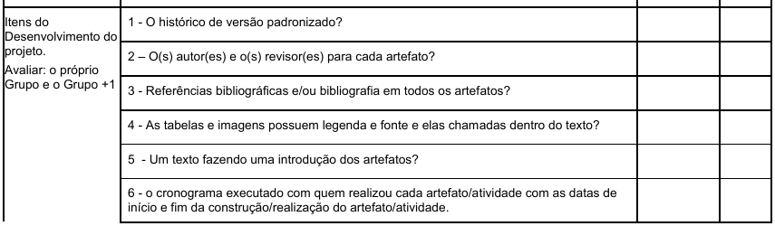{ width="600" }

Fonte: Sales (2026), Plano de Ensino, p. 8.

<b>Figura 2</b> — Itens 7 a 11 do desenvolvimento do projeto.

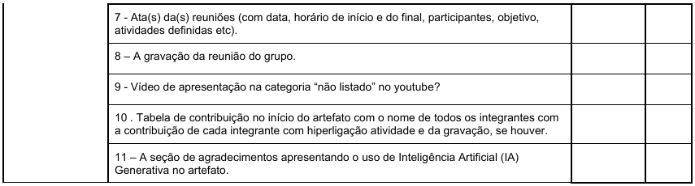{ width="600" }

Fonte: Sales (2026), Plano de Ensino, p. 9.

**R1 a R7 — Relato dos resultados consolidados.** Os avaliadores devem relatar os resultados consolidados, “que costumam incluir: os objetivos e escopo da avaliação; a forma como a avaliação foi realizada (método de avaliação empregado); o número e o perfil de usuários e avaliadores que participaram da avaliação; um sumário dos dados coletados, incluindo tabelas e gráficos; um relato da interpretação e análise dos dados; uma lista dos problemas encontrados; um planejamento para o reprojeto do sistema” (Barbosa e Silva, 2010, cap. 9, seç. 9.7.5, p. 312, último parágrafo).

<b>Figura 3</b> — Itens que o relato dos resultados consolidados costuma incluir.

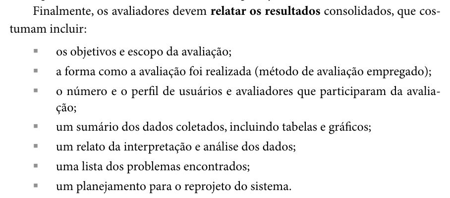{ width="600" }

Fonte: Barbosa e Silva (2010), cap. 9, seç. 9.7.5, p. 312.

<b>Figura 4</b> — Início da lista de verificação da Apresentação 4, com o item 2 (Framework DECIDE).

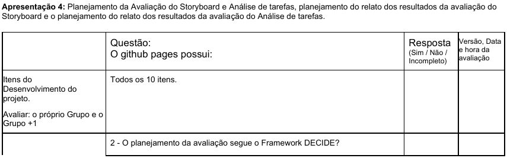{ width="600" }

Fonte: Sales (2026), Plano de Ensino, p. 12.

<b>Figura 5</b> — Itens 3 a 13 do conteúdo da disciplina da Apresentação 4.

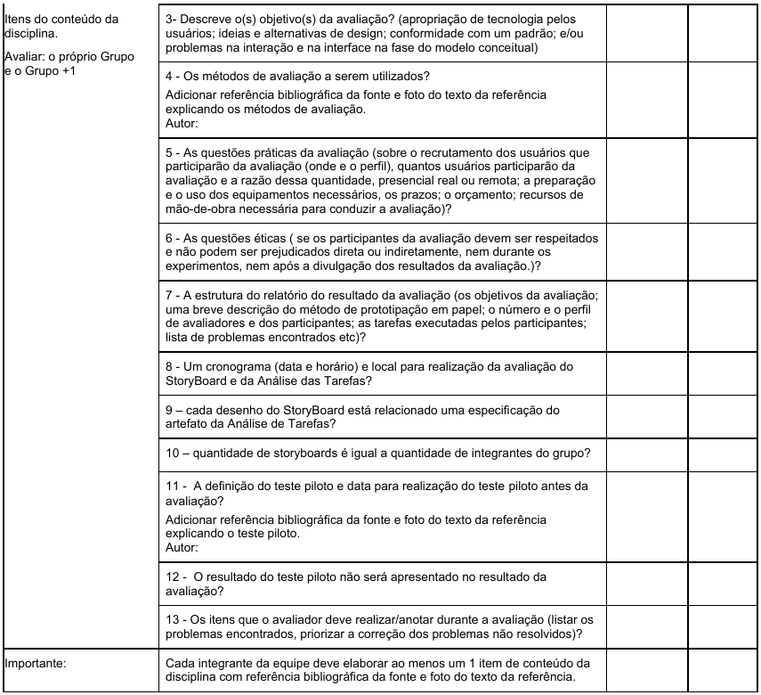{ width="600" }

Fonte: Sales (2026), Plano de Ensino, p. 13.

### 2.2 Itens adicionais (N1 a N5) e teste piloto

**N1 — Tarefas da preparação (autor: Alexandre Vilar Valadares Fonsêca).** A Tabela 10.7 lista, na atividade de Preparação: “definir tarefas para os participantes executarem”; “definir o perfil dos participantes e recrutá-los”; “criar protótipos em papel da interface para executar as tarefas”; “executar um teste-piloto” (Barbosa e Silva, 2010, cap. 10, seç. 10.2.3, p. 359, Tabela 10.7).

<b>Figura 6</b> — Tabela 10.7, com as atividades do método de prototipação em papel.

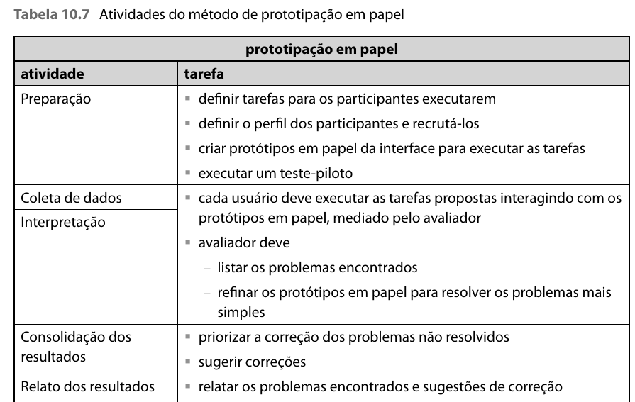{ width="600" }

Fonte: Barbosa e Silva (2010), cap. 10, p. 359.

**N2 — Partes da interface que se modificam (autor: Henrique Schneider Fernandes da Rosa).** “Além das telas estáticas, o avaliador também deve preparar outros pedaços de papel com partes da interface que se modificam durante a interação, como menus, dicas sobre elementos de interface, itens de alguma lista, resultados de busca e diálogos, por exemplo. O que for possível prever deve ser preparado antes das simulações de uso.” (Barbosa e Silva, 2010, cap. 10, seç. 10.2.3, p. 358, 3º parágrafo).

<b>Figura 7</b> — Preparação dos protótipos em papel, com telas estáticas e peças para as partes que mudam.

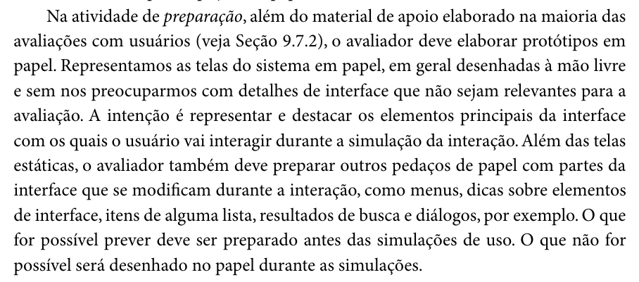{ width="600" }

Fonte: Barbosa e Silva (2010), cap. 10, p. 358.

**N3 — Papéis dos avaliadores (autor: Gabriel Robson).** “A coleta de dados (veja Seção 9.7.3) na prototipação em papel deve ser realizada por pelo menos dois avaliadores: um responsável por simular o comportamento do sistema e outro por observar a experiência de uso.” O responsável pela simulação modifica a interface “sem, no entanto, fornecer explicações ou orientações para o usuário. Tudo o que for necessário informar ao usuário deve estar representado na interface do sistema.” (Barbosa e Silva, 2010, cap. 10, seç. 10.2.3, p. 360, 2º parágrafo).

<b>Figura 8</b> — Papéis do avaliador que simula o sistema e do avaliador que observa.

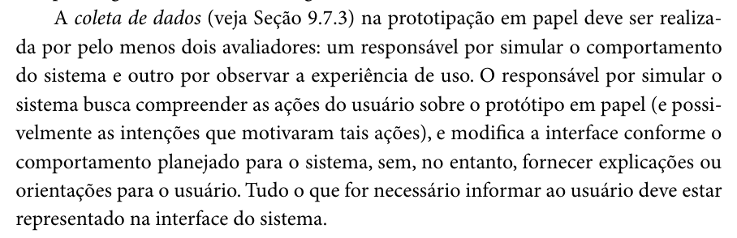{ width="600" }

Fonte: Barbosa e Silva (2010), cap. 10, p. 360.

**N4 — Anotações do observador (autor: João Vitor Tavares de Sá Lima).** “Durante a simulação da interação, o observador deve ficar atento a diversos aspectos: partes da interface que funcionaram bem e que funcionaram mal, quais tarefas foram concluídas com sucesso, quais erros foram cometidos, quais comentários foram feitos e quaisquer outros dados que lhe auxiliem a apreciar a qualidade da interface.” (Barbosa e Silva, 2010, cap. 10, seç. 10.2.3, p. 360, último parágrafo). Depois das tarefas, “os avaliadores podem realizar uma entrevista pós-teste para colher a opinião do participante sobre o protótipo da interface e sugestões de melhorias” (idem, p. 361, 1º parágrafo).

<b>Figura 9</b> — Aspectos que o observador deve anotar durante a simulação e entrevista pós-teste.

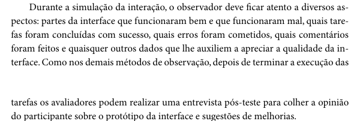{ width="600" }

Fonte: Barbosa e Silva (2010), cap. 10, pp. 360–361.

**N5 — Relato dos resultados da prototipação em papel (autor: Henrique Schneider Fernandes da Rosa).** “No relato dos resultados, os avaliadores devem comunicar aos interessados”, entre outros itens, “uma lista de problemas de usabilidade corrigidos durante os ciclos de avaliação e reprojeto, indicando: local onde ocorreu; fatores de usabilidade prejudicados; descrição e justificativa do problema; correção realizada no protótipo em papel; indicação se o problema voltou a ocorrer depois da correção” (Barbosa e Silva, 2010, cap. 10, seç. 10.2.3, p. 361, último parágrafo) e “uma lista dos problemas de usabilidade ainda não corrigidos, indicando: local onde ocorreu; fatores de usabilidade prejudicados; descrição e justificativa do problema; prioridade para correção; sugestões de correção” (idem, p. 362).

<b>Figura 10</b> — Lista do que o relato da prototipação em papel deve comunicar, com os problemas corrigidos e os ainda não corrigidos.

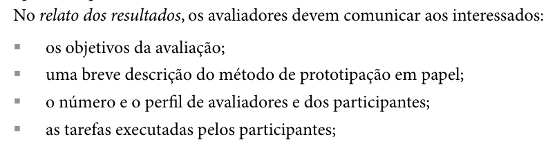{ width="600" }

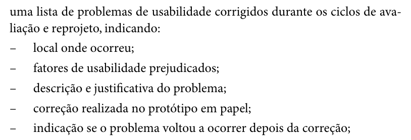{ width="600" }

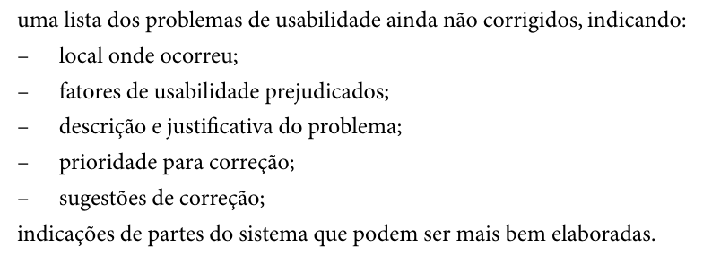{ width="600" }

Fonte: Barbosa e Silva (2010), cap. 10, pp. 361–362.

**Teste piloto (apoio aos itens P11, P12 e R8).** “Os dados do teste-piloto devem ser descartados, pois podem estar contaminados por problemas que ocorreram durante o piloto ou não serem compatíveis ou válidos considerando o planejamento revisado da avaliação.” (Barbosa e Silva, 2010, cap. 9, seç. 9.7.2, p. 307).

<b>Figura 11</b> — Definição do teste-piloto e descarte dos seus dados.

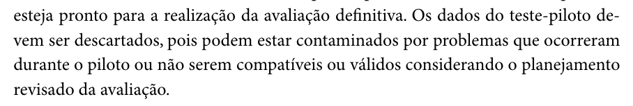{ width="600" }

Fonte: Barbosa e Silva (2010), cap. 9, p. 307.

---

## Agradecimentos e uso de IA generativa

Agradecemos ao Prof. Dr. André Barros de Sales, docente da disciplina Interação Humano Computador (FGA0173, UnB – Faculdade do Gama, 02/2026), pela orientação do projeto e pela lista de verificação do Plano de Ensino que serviu de base para este documento.

### Registro de ferramentas utilizadas

<b>Tabela 7</b> – Registro de ferramentas utilizadas.

| Ferramenta | Tipo | Uso no projeto |
| :--- | :--- | :--- |
| Claude (Anthropic) | IA generativa | Apoio na montagem da lista, localização de citações, redação dos itens criados pelo grupo inspetor, recorte das fotos das fontes e redação das justificativas a partir das páginas do Grupo 08 |
| Google Docs | Editor de documentos | Versão compartilhada da lista de verificação e registro da inspeção |
| Microsoft Teams | Gravação | Gravação e transcrição da inspeção |
| GitHub Pages | Hospedagem | Publicação dos artefatos do projeto e do Grupo 08 inspecionados |

<b>Fonte</b>: Elaborado pelos autores (2026).

### Uso de Inteligência Artificial Generativa

A IA generativa foi usada exclusivamente como auxílio, conforme o Código de Conduta da SBC citado no Plano de Ensino (SALES, 2026, p. 3). As respostas (Sim, Não ou Incompleto) foram dadas pelo inspetor durante a gravação; cada autor deve revisar e aprovar o seu item.

<b>Tabela 8</b> – Uso de IA generativa por etapa.

| Etapa | Ferramenta de IA | Auxílio prestado | Verificação humana |
| :--- | :--- | :--- | :--- |
| 1. Transcrição e adaptação da lista | Claude | Extração dos itens do Plano de Ensino e adaptação à Entrega 5 | Conferência dos itens com o PDF do plano |
| 2. Redação dos itens criados pelo grupo (R e N) | Claude | Proposta de redação dos itens, distribuídos entre os integrantes | **[VERIFICAR: revisão e aprovação de cada item pelo seu autor]** |
| 3. Justificativas e evidências | Claude | Leitura das páginas do Grupo 08 e redação das justificativas a partir das respostas dadas na gravação | **[VERIFICAR: conferência das justificativas]** |
| 4. Minutos e horários | Claude | Estimativa dos minutos pela posição de cada item na transcrição | **[VERIFICAR: conferência no vídeo]** |
| 5. Página e figuras | Claude | Montagem desta página e recorte das fotos das fontes | **[VERIFICAR: revisão final]** |

<b>Fonte</b>: Elaborado pelos autores (2026).

---

## Referências

BARBOSA, Simone Diniz Junqueira; SILVA, Bruno Santana da. *Interação Humano-Computador*. Rio de Janeiro: Elsevier, 2010. Cap. 9, Planejamento da Avaliação de IHC (seç. 9.7.2, p. 307; seç. 9.7.5, p. 312), e cap. 10, Métodos de Avaliação de IHC (seç. 10.2.3, pp. 358–362).

GRUPO 08. *IHC 2026.2 – Grupo 08*. [*S. l.*]: GitHub Pages, 2026. Disponível em: <https://interacao-humano-computador.github.io/2026.2-Grupo08/>. Acesso em: 26 out. 2026.

SALES, André Barros de. *Plano de Ensino: Interação Humano Computador (FGA0173), 02/2026, Turma 01, v1*. Brasília: Universidade de Brasília, 2026.
