# Lista de Verificação – Entrega 5: Relato do Storyboard e da HTA e Planejamento do Protótipo de Papel

## Tabela de contribuição

**Tabela 1 – Contribuição na lista de verificação da Entrega 5**

| Integrante | Contribuição | Atividade (link) | Gravação (link) |
| --- | --- | --- | --- |
| Alexandre Vilar Valadares Fonsêca | — | — | — |
| Gabriel Robson Nunes Neiva da Silva | — | — | — |
| Henrique Schneider Fernandes da Rosa | Elaboração da lista: transcrição dos itens do Plano de Ensino, autoria dos itens de conteúdo C1 a C22, fundamentação com recortes das fontes e quadros de registro | [Lista de verificação](lista-de-verificacao.md) | — |
| João Vitor Tavares de Sá Lima | — | — | — |

Fonte: elaborado pelo autor (2026).

## Histórico de versões

**Tabela 2 – Histórico de versões da lista de verificação da Entrega 5**

| Data | Versão | Descrição | Autor(es) | Revisor(es) |
| --- | --- | --- | --- | --- |
| 25/10/2026 | 1.0 | Criação da lista: itens do desenvolvimento do projeto (Plano de Ensino), 22 itens de conteúdo com fonte e recorte do texto e quadros de registro para a inspeção do próprio grupo e do Grupo +1 | Henrique Schneider, com apoio do Claude (IA generativa) | — |

Fonte: elaborado pelo autor (2026).

## 1. Introdução

Esta lista guia duas inspeções da Entrega 5 (Relato dos resultados do storyboard e da análise de tarefas, Planejamento da avaliação do protótipo de papel e Planejamento do relato dos resultados dessa avaliação): a do próprio Grupo 03 e a do Grupo +1, prevista para 26/10/2026 no cronograma do Plano de Ensino (SALES, 2026, p. 5). O Plano traz listas sugeridas apenas até a Apresentação 4 e indica que “Essas listas devem ser melhoradas por cada grupo” (SALES, 2026, p. 8). Por isso, a seção 2 mantém os itens do desenvolvimento do projeto, e a seção 3 traz itens de conteúdo elaborados para esta entrega.

Cada item é uma pergunta completa, que já traz os elementos a conferir, para que o inspetor não precise consultar o livro. Os itens de conteúdo têm a referência (capítulo, seção, página e parágrafo) e o recorte do texto de origem na seção 4.

**Como usar.** Para cada item, responda **Sim**, **Não** ou **Incompleto** no quadro de registro do grupo inspecionado (seção 5), anote a evidência (link da página do GitHub Pages ou minuto do vídeo) e registre a versão, a data e a hora da avaliação.

## 2. Itens do desenvolvimento do projeto

Para os itens do desenvolvimento do projeto, o Plano de Ensino pede “Todos os 11 itens” na Entrega 2 (SALES, 2026, p. 9) e “Todos os 10 itens” nas Apresentações 3 e 4 (SALES, 2026, pp. 11–12), mas a lista de referência, da Entrega 1 (SALES, 2026, pp. 8–9), tem 11 itens. Todos foram mantidos no Quadro 1.

**Quadro 1 – Itens do desenvolvimento do projeto (avaliar o próprio grupo e o Grupo +1)**

| Código | Questão – o GitHub Pages possui: |
| :---: | --- |
| D1 | O histórico de versão padronizado? |
| D2 | O(s) autor(es) e o(s) revisor(es) para cada artefato? |
| D3 | Referências bibliográficas e/ou bibliografia em todos os artefatos? |
| D4 | As tabelas e imagens possuem legenda e fonte e elas chamadas dentro do texto? |
| D5 | Um texto fazendo uma introdução dos artefatos? |
| D6 | O cronograma executado com quem realizou cada artefato/atividade com as datas de início e fim da construção/realização do artefato/atividade? |
| D7 | Ata(s) da(s) reuniões (com data, horário de início e do final, participantes, objetivo, atividades definidas etc.)? |
| D8 | A gravação da reunião do grupo? |
| D9 | Vídeo de apresentação na categoria “não listado” no YouTube? |
| D10 | Tabela de contribuição no início do artefato com o nome de todos os integrantes com a contribuição de cada integrante com hiperligação da atividade e da gravação, se houver? |
| D11 | A seção de agradecimentos apresentando o uso de Inteligência Artificial (IA) Generativa no artefato? |

Fonte: Sales (2026, pp. 8–9), com correções de digitação.

## 3. Itens do conteúdo da disciplina

O Quadro 2 traz os 22 itens de conteúdo elaborados para a Entrega 5, divididos em três blocos: relato dos resultados do storyboard e da HTA (C1 a C10), planejamento da avaliação do protótipo de papel (C11 a C18) e planejamento do relato dessa avaliação (C19 a C22). Todos os itens são de autoria de Henrique Schneider.

**Quadro 2 – Itens do conteúdo da disciplina da Entrega 5 (avaliar o próprio grupo e o Grupo +1)**

| Código | Bloco | Questão – o GitHub Pages possui: | Fonte | Recorte | Autor do item |
| :---: | --- | --- | --- | :---: | --- |
| C1 | Relato do storyboard e da HTA | O relato dos resultados da avaliação do storyboard e da HTA contém os sete itens dos resultados consolidados: (1) os objetivos e o escopo da avaliação; (2) a forma como a avaliação foi realizada (método empregado); (3) o número e o perfil dos usuários e dos avaliadores que participaram; (4) um sumário dos dados coletados, com tabelas e gráficos; (5) um relato da interpretação e da análise dos dados; (6) uma lista dos problemas encontrados; e (7) um planejamento para o reprojeto do sistema? | Barbosa e Silva (2010), cap. 9, seç. 9.7.5, p. 312, último parágrafo | Figura 1 | Henrique Schneider |
| C2 | Relato do storyboard e da HTA | Os resultados dos participantes foram consolidados em uma análise intersujeito (interparticipante), isto é, depois da interpretação individual de cada sessão, o relato compara os participantes e aponta as recorrências (resultados comuns a vários participantes), separando-as das particularidades de um único participante? | Barbosa e Silva (2010), cap. 9, seç. 9.7.5, p. 311, último parágrafo, e p. 312, 1º parágrafo | Figura 2 | Henrique Schneider |
| C3 | Relato do storyboard e da HTA | Na consolidação, o relato retoma cada questão de avaliação definida no planejamento (por exemplo, fidelidade, clareza, persona e metas do storyboard) e apresenta a resposta encontrada ou justifica por que a resposta não foi encontrada? | Barbosa e Silva (2010), cap. 9, seç. 9.7.5, p. 312, 2º parágrafo | Figura 3 | Henrique Schneider |
| C4 | Relato do storyboard e da HTA | O relato apresenta os problemas encontrados como tendências observadas no escopo avaliado, e não como certeza de que vão ocorrer no uso do sistema, e não afirma que o sistema tem alta qualidade de uso nas partes em que nenhum problema foi encontrado? | Barbosa e Silva (2010), cap. 9, seç. 9.7.5, p. 312, 4º parágrafo | Figura 4 | Henrique Schneider |
| C5 | Relato do storyboard e da HTA | Cada problema da lista recebe uma severidade na escala de Nielsen — 1: problema cosmético (só é consertado se houver tempo); 2: problema pequeno (baixa prioridade); 3: problema grande (alta prioridade, prejudica fatores de usabilidade importantes); 4: problema catastrófico (deve ser consertado antes do lançamento, pois impede o usuário de realizar a tarefa) — julgada pela frequência, pelo impacto e pela persistência do problema? | Barbosa e Silva (2010), cap. 10, seç. 10.1.1, p. 319, último parágrafo, e p. 320, 1º parágrafo | Figura 5 | Henrique Schneider |
| C6 | Relato do storyboard e da HTA | O relato informa que foi feito um teste-piloto antes das sessões e deixa claro que os dados do piloto foram descartados, ou seja, as respostas do piloto não aparecem nas tabelas, na análise nem na lista de problemas? | Barbosa e Silva (2010), cap. 9, seç. 9.7.2, p. 307, 3º parágrafo | Figura 6 | Henrique Schneider |
| C7 | Relato do storyboard e da HTA | Os participantes estão anônimos em todo o material publicado (relato, transcrições, imagens e vídeos): os nomes do participante e das pessoas que ele cita foram trocados por códigos, nomes fictícios ou uma máscara como “[nome]”, e não aparece nenhuma outra informação que permita identificá-los? | Barbosa e Silva (2010), cap. 5, seç. 5.4, p. 140, 3º parágrafo | Figura 7 | Henrique Schneider |
| C8 | Relato do storyboard e da HTA | O relato da avaliação da HTA indica, a partir dos dados das sessões, quais subobjetivos (nós da árvore) foram os mais difíceis de atingir ou geraram mais erros e, portanto, limitam ou impedem o atingimento do objetivo principal? | Barbosa e Silva (2010), cap. 6, seç. 6.4.1, p. 193, 1º parágrafo | Figura 8 | Henrique Schneider |
| C9 | Relato do storyboard e da HTA | A decomposição da HTA (objetivos, subobjetivos, operações e planos) foi conferida com as partes interessadas, por exemplo com os participantes das entrevistas, e o resultado dessa conferência está registrado, com as correções feitas na HTA? | Barbosa e Silva (2010), cap. 6, seç. 6.4.1, p. 196, passo 5 | Figura 9 | Henrique Schneider |
| C10 | Relato do storyboard e da HTA | Cada storyboard avaliado é uma série de desenhos que mostra como um usuário progride em uma tarefa usando o produto proposto, e o relato liga cada quadro avaliado ao objetivo ou à operação correspondente da HTA? | Preece, Rogers e Sharp (2005), cap. 8, seç. 8.2.3, p. 263, 2º parágrafo | Figura 10 | Henrique Schneider |
| C11 | Planejamento da avaliação do protótipo de papel | O planejamento da preparação inclui as quatro tarefas do método de prototipação em papel: (1) definir as tarefas que os participantes vão executar; (2) definir o perfil dos participantes e recrutá-los; (3) criar os protótipos em papel da interface necessários para essas tarefas; e (4) executar um teste-piloto? | Barbosa e Silva (2010), cap. 10, seç. 10.2.3, p. 359, Tabela 10.7 | Figura 11 | Henrique Schneider |
| C12 | Planejamento da avaliação do protótipo de papel | O protótipo planejado tem, além das telas estáticas desenhadas à mão, os pedaços de papel com as partes da interface que mudam durante a interação — menus, dicas sobre elementos da interface, itens de lista, resultados de busca e diálogos — preparados antes das sessões? | Barbosa e Silva (2010), cap. 10, seç. 10.2.3, p. 358, último parágrafo | Figura 12 | Henrique Schneider |
| C13 | Planejamento da avaliação do protótipo de papel | Cada sessão tem pelo menos dois avaliadores com papéis definidos — um que simula o sistema (“computador”) e muda as telas conforme as ações do participante, sem dar explicações ou orientações, e um observador que acompanha a experiência de uso — e os nomes de quem ocupa cada papel estão indicados? | Barbosa e Silva (2010), cap. 10, seç. 10.2.3, p. 360, 2º parágrafo | Figura 13 | Henrique Schneider |
| C14 | Planejamento da avaliação do protótipo de papel | O planejamento diz o que o observador vai anotar durante a simulação: as partes da interface que funcionaram bem e as que funcionaram mal, as tarefas concluídas com sucesso, os erros cometidos e os comentários do participante? | Barbosa e Silva (2010), cap. 10, seç. 10.2.3, p. 360, último parágrafo | Figura 14 | Henrique Schneider |
| C15 | Planejamento da avaliação do protótipo de papel | As tarefas do protótipo estão escritas como cenários para o participante, e o tempo estimado de cada tarefa não passa de 20 minutos (ou há pausa prevista quando passar)? | Barbosa e Silva (2010), cap. 9, seç. 9.7.2, p. 306, 2º parágrafo | Figura 15 | Henrique Schneider |
| C16 | Planejamento da avaliação do protótipo de papel | O planejamento informa quantos participantes serão recrutados e justifica esse número, considerando que uma avaliação de IHC costuma envolver de 5 a 12 usuários e que, segundo Nielsen (2000), 5 usuários bastam para encontrar a maioria dos problemas (85%), e que os resultados não são estatisticamente significativos com amostras pequenas? | Barbosa e Silva (2010), cap. 9, seç. 9.7.2, p. 305, 3º parágrafo | Figura 16 | Henrique Schneider |
| C17 | Planejamento da avaliação do protótipo de papel | O planejamento prevê ciclos de avaliação e reprojeto: depois de cada sessão, os avaliadores se reúnem, listam os problemas e corrigem no papel os problemas fáceis antes da sessão com o próximo participante? | Barbosa e Silva (2010), cap. 10, seç. 10.2.3, p. 361, 2º parágrafo | Figura 17 | Henrique Schneider |
| C18 | Planejamento da avaliação do protótipo de papel | O planejamento define o ambiente da simulação (por exemplo, uma sala com mesa e cadeiras, ou a sala virtual, se remota) e os equipamentos de registro (gravador de voz, câmera de vídeo ou gravação da reunião)? | Barbosa e Silva (2010), cap. 10, seç. 10.2.3, p. 360, 1º parágrafo | Figura 18 | Henrique Schneider |
| C19 | Planejamento do relato do protótipo de papel | A estrutura planejada para o relato do protótipo de papel contém: os objetivos da avaliação; uma breve descrição do método de prototipação em papel; o número e o perfil dos avaliadores e dos participantes; e as tarefas executadas pelos participantes? | Barbosa e Silva (2010), cap. 10, seç. 10.2.3, p. 361, último parágrafo | Figura 19 | Henrique Schneider |
| C20 | Planejamento do relato do protótipo de papel | Há um modelo da lista de problemas corrigidos durante os ciclos de avaliação e reprojeto com as colunas: local onde ocorreu; fatores de usabilidade prejudicados (facilidade de aprendizado, facilidade de recordação, eficiência, segurança no uso ou satisfação do usuário); descrição e justificativa do problema; correção feita no protótipo; e se o problema voltou a ocorrer depois da correção? | Barbosa e Silva (2010), cap. 10, seç. 10.2.3, p. 361, último parágrafo; cap. 2, seç. 2.2.1, p. 29, 2º parágrafo | Figura 20 e 21 | Henrique Schneider |
| C21 | Planejamento do relato do protótipo de papel | Há um modelo da lista de problemas ainda não corrigidos com as colunas: local onde ocorreu; fatores de usabilidade prejudicados; descrição e justificativa do problema; prioridade para correção; e sugestões de correção — além das partes do sistema que podem ser mais bem elaboradas? | Barbosa e Silva (2010), cap. 10, seç. 10.2.3, p. 362, 1º parágrafo (continuação da lista da p. 361) | Figura 22 | Henrique Schneider |
| C22 | Planejamento do relato do protótipo de papel | O planejamento diz como os problemas não resolvidos serão priorizados — pela gravidade (o quanto prejudicaram a interação) e pela frequência com que ocorreram — e prevê sugestões de correção para cada um? | Barbosa e Silva (2010), cap. 10, seç. 10.2.3, p. 361, 4º parágrafo | Figura 23 | Henrique Schneider |

Fonte: elaborado pelo autor (2026).

## 4. Fundamentação dos itens

As figuras abaixo reproduzem o trecho de origem de cada item.

### C1

Fonte do item: Barbosa e Silva (2010), cap. 9, seç. 9.7.5, p. 312, último parágrafo.

**Figura 1 – Itens que o relato dos resultados consolidados costuma incluir**

Fonte: Barbosa e Silva (2010, p. 312).

### C2

Fonte do item: Barbosa e Silva (2010), cap. 9, seç. 9.7.5, p. 311, último parágrafo, e p. 312, 1º parágrafo.

**Figura 2 – Análise intersujeito e recorrências na consolidação dos resultados**

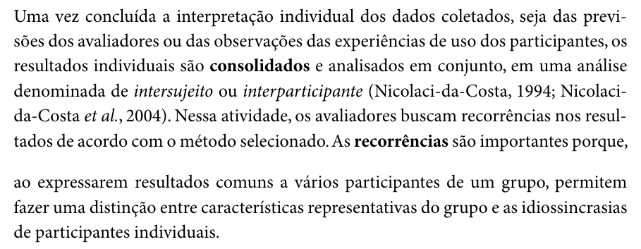

Fonte: Barbosa e Silva (2010, pp. 311–312).

### C3

Fonte do item: Barbosa e Silva (2010), cap. 9, seç. 9.7.5, p. 312, 2º parágrafo.

**Figura 3 – Retomada das questões que motivaram o estudo**

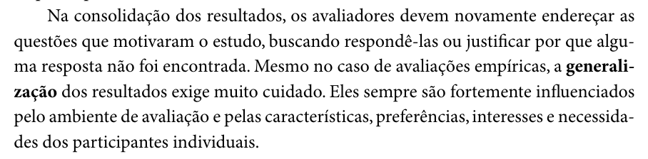

Fonte: Barbosa e Silva (2010, p. 312).

### C4

Fonte do item: Barbosa e Silva (2010), cap. 9, seç. 9.7.5, p. 312, 4º parágrafo.

**Figura 4 – Resultados como tendências de problemas**

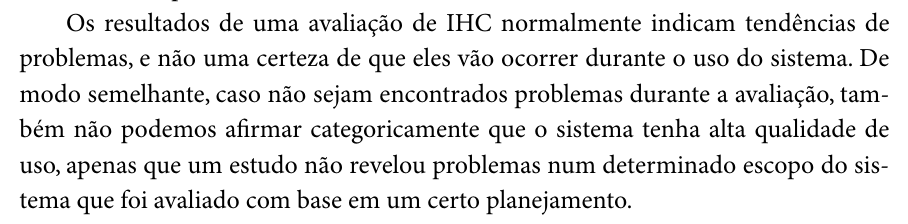

Fonte: Barbosa e Silva (2010, p. 312).

### C5

Fonte do item: Barbosa e Silva (2010), cap. 10, seç. 10.1.1, p. 319, último parágrafo, e p. 320, 1º parágrafo.

**Figura 5 – Fatores e escala de severidade de Nielsen (1994a)**

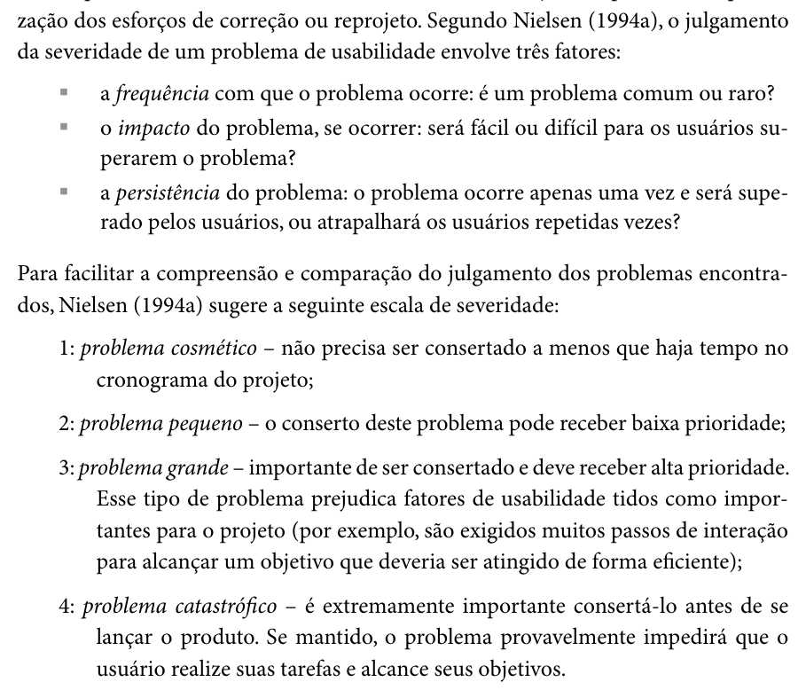

Fonte: Barbosa e Silva (2010, pp. 319–320).

### C6

Fonte do item: Barbosa e Silva (2010), cap. 9, seç. 9.7.2, p. 307, 3º parágrafo.

**Figura 6 – Descarte dos dados do teste-piloto**

Fonte: Barbosa e Silva (2010, p. 307).

### C7

Fonte do item: Barbosa e Silva (2010), cap. 5, seç. 5.4, p. 140, 3º parágrafo.

**Figura 7 – Anonimato dos participantes na divulgação dos resultados (o realce amarelo é do arquivo consultado)**

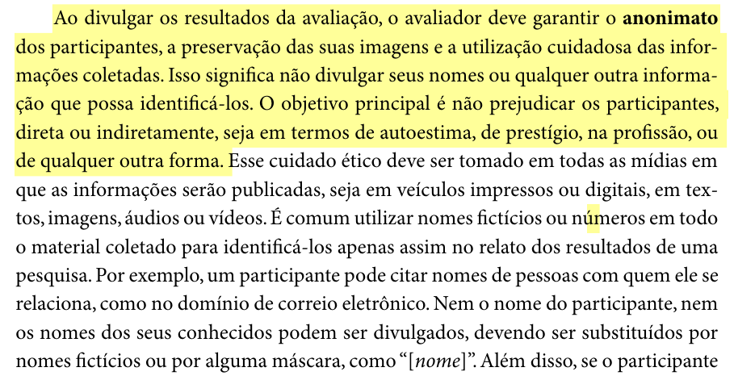

Fonte: Barbosa e Silva (2010, p. 140).

### C8

Fonte do item: Barbosa e Silva (2010), cap. 6, seç. 6.4.1, p. 193, 1º parágrafo.

**Figura 8 – Objetivo da HTA: identificar os subobjetivos mais difíceis**

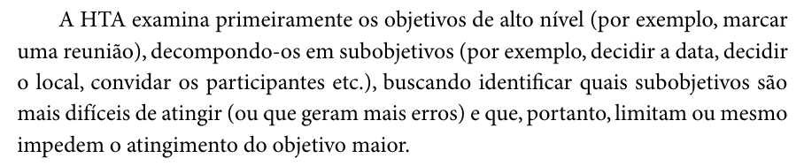

Fonte: Barbosa e Silva (2010, p. 193).

### C9

Fonte do item: Barbosa e Silva (2010), cap. 6, seç. 6.4.1, p. 196, passo 5.

**Figura 9 – Passo 5 da HTA: verificar a validade da decomposição**

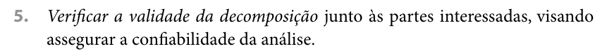

Fonte: Barbosa e Silva (2010, p. 196).

### C10

Fonte do item: Preece, Rogers e Sharp (2005), cap. 8, seç. 8.2.3, p. 263, 2º parágrafo.

**Figura 10 – Definição de storyboard**

Fonte: Preece, Rogers e Sharp (2005, p. 263).

### C11

Fonte do item: Barbosa e Silva (2010), cap. 10, seç. 10.2.3, p. 359, Tabela 10.7.

**Figura 11 – Tabela 10.7 – Atividades do método de prototipação em papel**

Fonte: Barbosa e Silva (2010, p. 359).

### C12

Fonte do item: Barbosa e Silva (2010), cap. 10, seç. 10.2.3, p. 358, último parágrafo.

**Figura 12 – Preparação das telas e das partes que se modificam**

Fonte: Barbosa e Silva (2010, p. 358).

### C13

Fonte do item: Barbosa e Silva (2010), cap. 10, seç. 10.2.3, p. 360, 2º parágrafo.

**Figura 13 – Papéis dos avaliadores na prototipação em papel**

Fonte: Barbosa e Silva (2010, p. 360).

### C14

Fonte do item: Barbosa e Silva (2010), cap. 10, seç. 10.2.3, p. 360, último parágrafo.

**Figura 14 – O que o observador deve anotar**

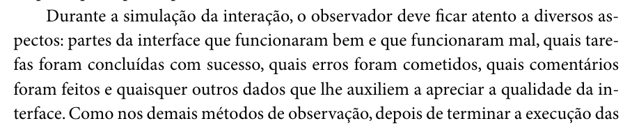

Fonte: Barbosa e Silva (2010, p. 360).

### C15

Fonte do item: Barbosa e Silva (2010), cap. 9, seç. 9.7.2, p. 306, 2º parágrafo.

**Figura 15 – Tempo máximo estimado por tarefa**

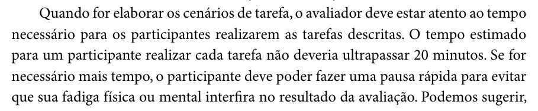

Fonte: Barbosa e Silva (2010, p. 306).

### C16

Fonte do item: Barbosa e Silva (2010), cap. 9, seç. 9.7.2, p. 305, 3º parágrafo.

**Figura 16 – Número de participantes de uma avaliação de IHC**

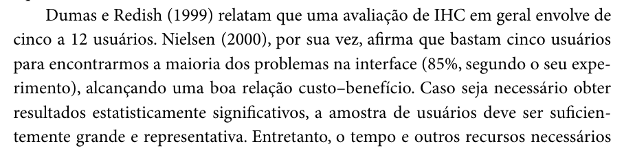

Fonte: Barbosa e Silva (2010, p. 305).

### C17

Fonte do item: Barbosa e Silva (2010), cap. 10, seç. 10.2.3, p. 361, 2º parágrafo.

**Figura 17 – Ciclos sucessivos de avaliação e reprojeto**

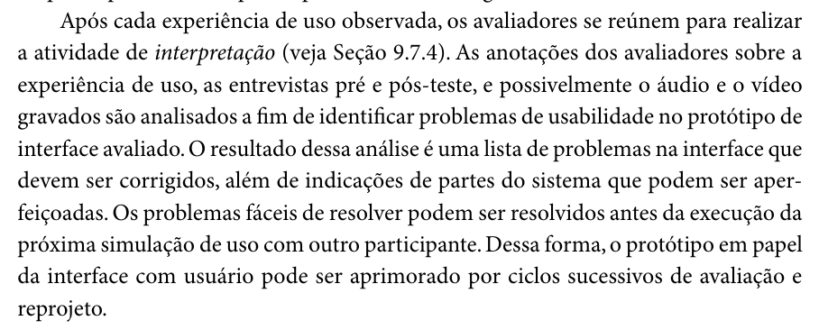

Fonte: Barbosa e Silva (2010, p. 361).

### C18

Fonte do item: Barbosa e Silva (2010), cap. 10, seç. 10.2.3, p. 360, 1º parágrafo.

**Figura 18 – Preparação do ambiente e dos equipamentos**

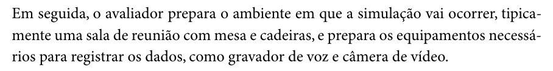

Fonte: Barbosa e Silva (2010, p. 360).

### C19

Fonte do item: Barbosa e Silva (2010), cap. 10, seç. 10.2.3, p. 361, último parágrafo.

**Figura 19 – Itens do relato dos resultados da prototipação em papel**

Fonte: Barbosa e Silva (2010, p. 361).

### C20

Fonte do item: Barbosa e Silva (2010), cap. 10, seç. 10.2.3, p. 361, último parágrafo; cap. 2, seç. 2.2.1, p. 29, 2º parágrafo.

**Figura 20 – Lista de problemas corrigidos durante os ciclos**

Fonte: Barbosa e Silva (2010, p. 361).

**Figura 21 – Fatores de usabilidade de Nielsen (1993)**

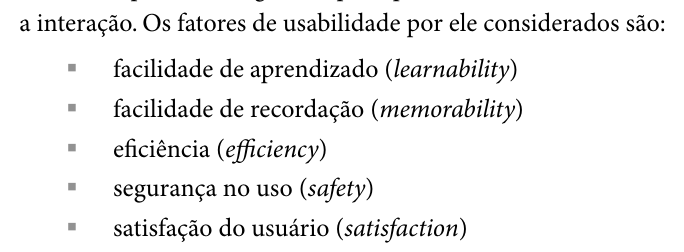

Fonte: Barbosa e Silva (2010, p. 29).

### C21

Fonte do item: Barbosa e Silva (2010), cap. 10, seç. 10.2.3, p. 362, 1º parágrafo (continuação da lista da p. 361).

**Figura 22 – Lista de problemas não corrigidos**

Fonte: Barbosa e Silva (2010, p. 362).

### C22

Fonte do item: Barbosa e Silva (2010), cap. 10, seç. 10.2.3, p. 361, 4º parágrafo.

**Figura 23 – Priorização dos problemas na consolidação**

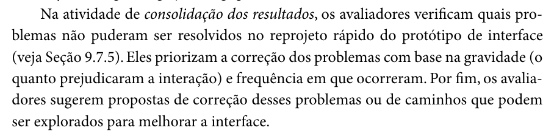

Fonte: Barbosa e Silva (2010, p. 361).

## 5. Registro das inspeções

Os Quadros 3 e 4 recebem as respostas. O Quadro 3 é usado na inspeção do próprio Grupo 03, e o Quadro 4, na inspeção do Grupo +1.

### 5.1 Inspeção do próprio grupo

**Quadro 3 – Registro da inspeção do Grupo 03 (próprio grupo)**

| Código | Resposta (Sim / Não / Incompleto) | Evidência (link ou minuto do vídeo) | Versão, data e hora da avaliação |
| :---: | :---: | --- | --- |
| D1 |  |  |  |
| D2 |  |  |  |
| D3 |  |  |  |
| D4 |  |  |  |
| D5 |  |  |  |
| D6 |  |  |  |
| D7 |  |  |  |
| D8 |  |  |  |
| D9 |  |  |  |
| D10 |  |  |  |
| D11 |  |  |  |
| C1 |  |  |  |
| C2 |  |  |  |
| C3 |  |  |  |
| C4 |  |  |  |
| C5 |  |  |  |
| C6 |  |  |  |
| C7 |  |  |  |
| C8 |  |  |  |
| C9 |  |  |  |
| C10 |  |  |  |
| C11 |  |  |  |
| C12 |  |  |  |
| C13 |  |  |  |
| C14 |  |  |  |
| C15 |  |  |  |
| C16 |  |  |  |
| C17 |  |  |  |
| C18 |  |  |  |
| C19 |  |  |  |
| C20 |  |  |  |
| C21 |  |  |  |
| C22 |  |  |  |

Fonte: elaborado pelo autor (2026).

### 5.2 Inspeção do Grupo +1

**Quadro 4 – Registro da inspeção do Grupo +1**

| Código | Resposta (Sim / Não / Incompleto) | Evidência (link ou minuto do vídeo) | Versão, data e hora da avaliação |
| :---: | :---: | --- | --- |
| D1 |  |  |  |
| D2 |  |  |  |
| D3 |  |  |  |
| D4 |  |  |  |
| D5 |  |  |  |
| D6 |  |  |  |
| D7 |  |  |  |
| D8 |  |  |  |
| D9 |  |  |  |
| D10 |  |  |  |
| D11 |  |  |  |
| C1 |  |  |  |
| C2 |  |  |  |
| C3 |  |  |  |
| C4 |  |  |  |
| C5 |  |  |  |
| C6 |  |  |  |
| C7 |  |  |  |
| C8 |  |  |  |
| C9 |  |  |  |
| C10 |  |  |  |
| C11 |  |  |  |
| C12 |  |  |  |
| C13 |  |  |  |
| C14 |  |  |  |
| C15 |  |  |  |
| C16 |  |  |  |
| C17 |  |  |  |
| C18 |  |  |  |
| C19 |  |  |  |
| C20 |  |  |  |
| C21 |  |  |  |
| C22 |  |  |  |

Fonte: elaborado pelo autor (2026).

## Referências

BARBOSA, Simone Diniz Junqueira; SILVA, Bruno Santana da. *Interação Humano-Computador*. Rio de Janeiro: Elsevier, 2010.

NIELSEN, Jakob. Why you only need to test with 5 users. *Alertbox*, 2000. Consulta indireta por Barbosa e Silva (2010).

PREECE, Jennifer; ROGERS, Yvonne; SHARP, Helen. *Design de interação*: além da interação homem-computador. Porto Alegre: Bookman, 2005.

SALES, André Barros de. *Plano de Ensino*: Interação Humano Computador (FGA0173), 02/2026, Turma 01, v1. Brasília: Universidade de Brasília, Faculdade UnB Gama, 2026.

## Agradecimentos e uso de IA generativa

Agradecemos ao Prof. Dr. André Barros de Sales pela lista sugerida no Plano de Ensino, que serviu de base para a seção 2.

**Uso de IA generativa nesta página.** Em 25/10/2026, o Claude (Anthropic) foi utilizado, a pedido de Henrique Schneider, para transcrever os itens do Plano de Ensino, localizar no livro de Barbosa e Silva (2010) os trechos de origem dos itens, recortar as figuras, propor a redação dos itens C1 a C22 e montar os quadros. A seleção e a revisão dos itens são do autor. A ferramenta não é autora do artefato e seu uso não exime o autor da responsabilidade sobre o conteúdo (SALES, 2026, p. 3).
