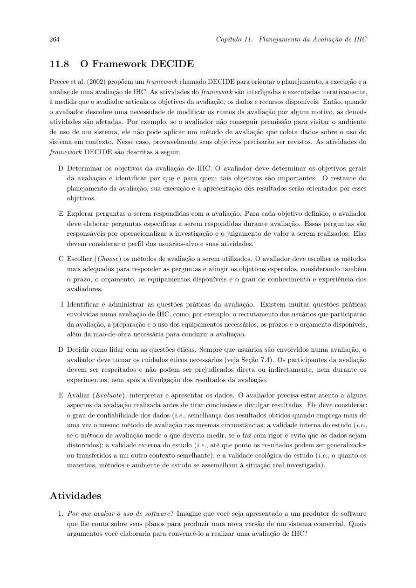
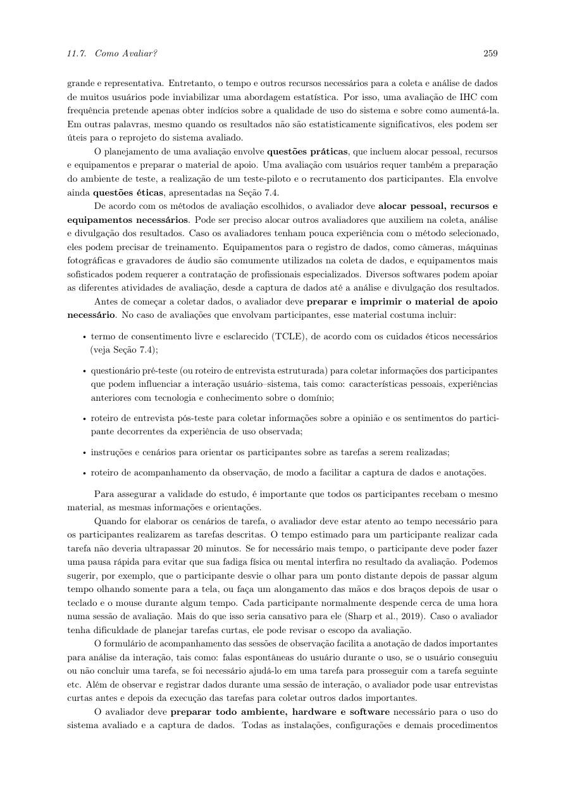
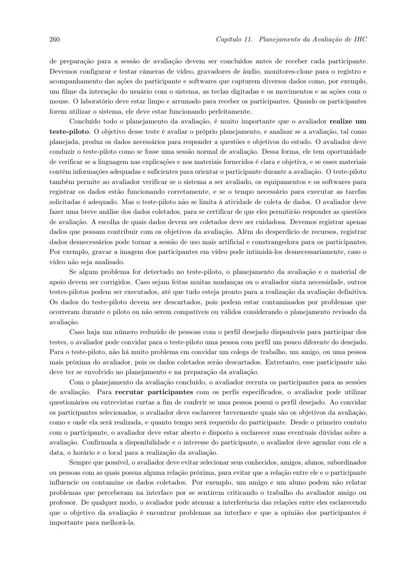

# Planejamento e organização da avaliação do papel – Alexandre Vilar

## Tabela de contribuição

**Tabela 1 - Minha contribuição neste artefato**

| Integrante | Contribuição | Atividade | Gravação |
| --- | --- | --- | --- |
| Alexandre Vilar Valadares Fonsêca | Organização do DECIDE, método e instrumentos da minha avaliação | [Minha entrega](index.md) | [Entrevista e piloto](video-avaliacao.md) |

Fonte: minha elaboração (2026).

## Histórico de versões

**Tabela 2 - Histórico de versões**

| Data | Versão | Descrição | Autor | Revisor |
| --- | --- | --- | --- | --- |
| 12/11/2026 | 1.0 | Organizei meus registros do papel e a conferência individual | Alexandre Vilar Valadares Fonsêca, com apoio do ChatGPT | Revisão humana pendente |

Fonte: meus registros (2026).

## 1. Introdução {#introducao}

Organizei nesta página o método, os instrumentos e os registros da minha avaliação do protótipo de papel. Usei como base o Framework DECIDE e a prototipação em papel descrita nos livros de IHC. Fiz esta organização em **12/11/2026**, depois da sessão de **03/11/2026**; por isso, diferenciei o que consegui recuperar nos registros do que ainda preciso completar. Não considerei esta página como comprovação de que todos os detalhes já estavam documentados antes da sessão.

## 2. Framework DECIDE {#decide}

Usei as seis atividades do DECIDE para organizar a avaliação. Na Figura 1, apresento o trecho que utilizei como referência.

*Figura 1 - Atividades do Framework DECIDE. Fonte: Barbosa et al. (2021, p. 264).*

### D — Objetivos {#objetivos}

Meu objetivo foi verificar se o participante conseguia encontrar o agendamento presencial, selecionar a vistoria de transferência, preencher local, data e horário e entender a conclusão. Também procurei identificar dificuldades e sugestões para orientar a alta fidelidade.

### E — Perguntas da avaliação {#perguntas}

1. O participante encontra o acesso ao agendamento presencial?
2. Identifica o serviço Vistoria de Transferência Veicular?
3. Entende como escolher local, data e horário?
4. Consegue distinguir opções disponíveis de opções sem vaga?
5. Consegue concluir e explicar como sabe que o agendamento foi confirmado?
6. Que mudanças sugere para facilitar o caminho?

Adaptei essas perguntas aos objetivos do meu projeto; elas não são uma transcrição literal do livro.

### C — Método {#metodo}

Utilizei um protótipo físico de papel para simular a interface, apresentando uma tarefa e mediando a troca dos estados da tela. Pedi que o participante pensasse em voz alta e reuni os comentários para identificar dificuldades. A sequência do método compreende preparação, coleta, interpretação, consolidação e relato. Relacionei essas atividades aos meus materiais na [tabela do método](prototipo-papel.md#atividades-metodo), com a imagem da fonte original.

**Autoria do item:** Alexandre Vilar Valadares Fonsêca. **Base:** Barbosa e Silva (2010, seção 10.2.3, p. 358-362; Tabela 10.7, p. 359).

### I — Questões práticas {#questoes-praticas}

Na Tabela 3, separei as informações da minha sessão das lacunas que ainda preciso preencher. Não transferi os dados de recrutamento da avaliação anterior do storyboard para esta avaliação.

**Tabela 3 - Recursos e organização da minha avaliação em papel**

| Aspecto | Registro disponível e complemento necessário |
| --- | --- |
| Participantes e quantidade | Analisei uma sessão com um participante. Tratei os achados como um caso exploratório para orientar ajustes, sem generalizar para todos os usuários. A justificativa original da quantidade não ficou registrada. |
| Perfil e recrutamento | Ainda preciso registrar idade aproximada, experiência relevante, critério de seleção e forma de convite desta sessão. |
| Modalidade e local | Usei papel físico; ainda preciso completar o local e a modalidade da sessão no registro. |
| Equipe | Conduzi a atividade; preciso identificar eventual apoio e suas funções. |
| Materiais e equipamentos | Tenho as 12 fotos, os vídeos e o cenário T1. Ainda preciso completar o registro do equipamento de gravação e da preparação do ambiente. |
| Prazos e duração | Sessão em 03/11/2026. O vídeo vinculado tem cerca de 3min56s; não usei essa duração como medida de toda a preparação ou sessão. Horário de início e fim não registrado. |
| Orçamento | Ainda preciso informar os gastos reais ou confirmar que não houve gasto adicional. |

Fonte: minha organização dos registros da avaliação (2026).

### D — Questões éticas {#etica}

Para conduzir e divulgar a avaliação, considero necessário explicar a atividade e seu objetivo, garantir participação voluntária e permitir interrupção sem prejuízo. O foco é avaliar a interface, sem julgar o participante. Uso dados simulados de agendamento e preciso evitar a exposição de documentos pessoais. Antes da divulgação de imagem e voz, preciso conferir a autorização correspondente e registrar como armazenarei os dados e por quanto tempo.

Ainda preciso vincular o registro do consentimento desta sessão. A existência de um vídeo publicado não comprova esse consentimento.

### E — Análise e apresentação dos dados {#analise}

Separei as ações e falas observadas das minhas interpretações e sugestões. Registrei os trechos do vídeo no [relato](prototipo-papel.md#5-relato-da-avaliacao) e reuni as prioridades em [ajustes](prototipo-papel.md#ajustes). A sugestão principal foi deixar mais clara a disponibilidade de datas e horários. Mantive como pendente a confirmação de que o participante reconheceu a tela final.

## 3. Materiais e tarefa {#materiais}

Usei o [protótipo com 12 fotos](prototipo-papel.md#3-prototipo-de-papel) e o [cenário T1](prototipo-papel.md#4-tarefa-prevista-para-a-avaliacao): agendar a vistoria no Lago Sul em 14/11/2026 às 15h00. Para completar a documentação, preciso anexar os instrumentos efetivamente utilizados: consentimento, caracterização prévia do participante, instruções, perguntas finais e folha de observação.

Como apoio para conferir esses materiais, consultei a preparação da avaliação em Barbosa et al. (2021, p. 259), reproduzida na Figura 2.

*Figura 2 - Preparação e materiais de apoio. Fonte: Barbosa et al. (2021, p. 259).*

## 4. Teste-piloto {#piloto}

Entendo o piloto como um ensaio do procedimento para verificar o cenário, as instruções, o tempo, a manipulação das telas e a gravação antes da avaliação definitiva. Vinculei o [vídeo do meu piloto](video-avaliacao.md#teste-piloto), mas ainda preciso completar sua data, horário, participante, ajustes e confirmar sua realização antes da entrevista.

Na Figura 3, apresento o trecho de referência. **Autoria do item:** Alexandre Vilar Valadares Fonsêca.

*Figura 3 - Teste-piloto da avaliação. Fonte: Barbosa et al. (2021, p. 260).*

### Separação dos dados do piloto {#dados-piloto}

Mantenho o piloto como verificação do procedimento. No relato principal, usei os trechos da entrevista definitiva, sem somar observações do piloto como se fossem dados de outro participante da avaliação.

## 5. Cronograma e local {#cronograma}

Na Tabela 4, registrei as datas disponíveis. Ainda preciso completar os campos pendentes; não atribuí horários retroativamente.

**Tabela 4 - Datas e local da avaliação do papel**

| Atividade | Data | Horário | Local | Responsável |
| --- | --- | --- | --- | --- |
| Piloto | Pendente de registro | Pendente | Pendente | Eu; apoio a identificar |
| Entrevista do papel | 03/11/2026 | Pendente | Pendente | Eu |
| Organização atual dos registros e checklist | 12/11/2026 | Registro no histórico desta versão | Documentação no Pages | Eu |
| Revisão dos materiais | A combinar | A combinar | A combinar | Revisor a confirmar |

Fonte: meus registros disponíveis (2026).

## 6. O que observar e anotar {#observacao}

Para organizar a observação, considero estes pontos: ação e trecho do vídeo; tarefa e tela correspondente; dificuldade encontrada; ajuda ou intervenção; resultado da tarefa; fala do participante; sugestão de mudança e prioridade. Diferencio a fala do participante da minha interpretação e registro quando não consigo confirmar algo.

Na consolidação, priorizo os problemas que atrapalham a tarefa e verifico se a mudança foi realizada ou apenas sugerida. Minha [lista de ajustes](prototipo-papel.md#ajustes) mantém essa distinção. Preciso completar a folha original de acompanhamento, caso tenha sido usada.

## 7. Estrutura do relato {#relato}

Organizei meu relato com objetivo, método, participante, tarefa T1, observações com trechos do vídeo, limitações e sugestões para a alta fidelidade. O conteúdo está no [protótipo de papel](prototipo-papel.md#5-relato-da-avaliacao). Ainda preciso completar o perfil e a logística para deixar o relato mais completo.

## Referências

BARBOSA, Simone Diniz Junqueira; SILVA, Bruno Santana da. **Interação Humano-Computador.** Rio de Janeiro: Elsevier, 2010. Seção 10.2.3, p. 358-362, Tabela 10.7, p. 359.

BARBOSA, Simone Diniz Junqueira et al. **Interação Humano-Computador e Experiência do Usuário.** Autopublicação, 2021. Seção 11.8, p. 264; preparação e teste-piloto, p. 259-260.

SALES, André Barros de. **Plano de Ensino de Interação Humano-Computador, 2026.2.** UnB, 2026. [Plano do projeto](../../../disciplina/plano-de-ensino.md).

## Uso de IA generativa

Utilizei o ChatGPT como apoio para organizar os materiais, adaptar o planejamento e revisar a redação. Mantive as fontes e separei os registros da sessão das atividades ainda pendentes.
