# Protótipo de Papel – Alexandre Vilar

## Tabela de contribuição

**Tabela 1 – Contribuição no artefato Protótipo de Papel – Alexandre Vilar**

| Integrante | Contribuição | Atividade (link) | Gravação (link) |
| --- | --- | --- | --- |
| Alexandre Vilar Valadares Fonsêca | Construção do protótipo de papel do agendamento de vistoria | [Visão geral](index.md) | [Vídeo da avaliação](video-avaliacao.md) |

Fonte: minha elaboração (2026).

## Histórico de versões

**Tabela 2 – Histórico de versões do artefato Protótipo de Papel – Alexandre Vilar**

| Data | Versão | Descrição | Autor(es) | Revisor(es) |
| --- | --- | --- | --- | --- |
| 02/11/2026 | 1.0 | Documentação do fluxo e do cenário de avaliação | Alexandre Vilar Valadares Fonsêca | **[VERIFICAR: revisor]** |
| 03/11/2026 | 1.1 | Inclusão do relato e dos achados da avaliação | Alexandre Vilar Valadares Fonsêca | - |
| 10/11/2026 | 1.2 | Substituição do revisor genérico ou vazio por [VERIFICAR: revisor] no histórico de versões | Henrique Schneider (solicitante), com apoio do Claude (IA generativa) | **[VERIFICAR: revisor]** |
| 12/11/2026 | 1.3 | Reescrevi os textos em primeira pessoa e organizei minha verificação individual | Alexandre Vilar Valadares Fonsêca, com apoio do ChatGPT | Revisão humana pendente |

Fonte: registro desta versão (2026).

## 1. Contexto e objetivo

Criei o protótipo de papel para representar uma proposta de agendamento de **Vistoria de Transferência Veicular** no Portal Detran-DF. Meu objetivo foi avaliar se o participante encontrava o serviço e entendia quando o agendamento tinha sido concluído. Usei dados simulados para essa atividade.

## 2. Fluxo representado

Organizei meu protótipo com o seguinte caminho:

1. No portal, clicar em **Agendamento presencial** para abrir a aba de agendamento.
2. Selecionar **Vistoria de Transferência Veicular**.
3. Escolher **Lago Sul** como local de atendimento.
4. Selecionar **14/11/2026** e o horário disponível de **15h00**.
5. Confirmar o agendamento.
6. Visualizar a tela de confirmação e a mensagem de agradecimento.

## 3. Protótipo de papel

As Figuras 1 a 12 mostram o passo a passo que construí em papel.

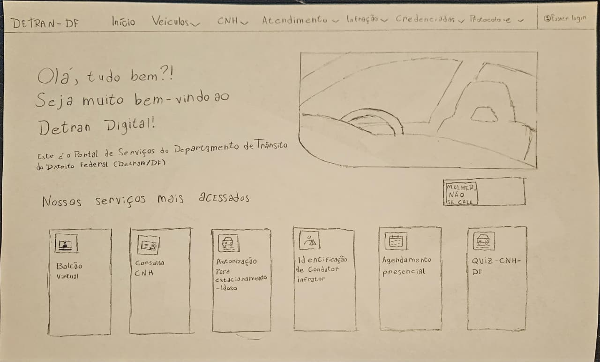

*Figura 1 – Página inicial com o botão Agendamento presencial.*

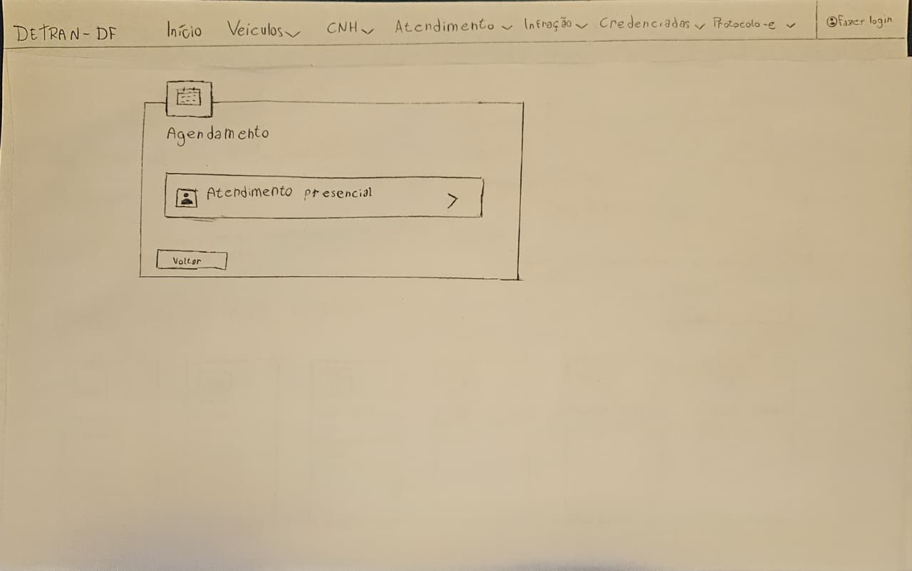

*Figura 2 – Aba de agendamento com a opção Atendimento presencial.*

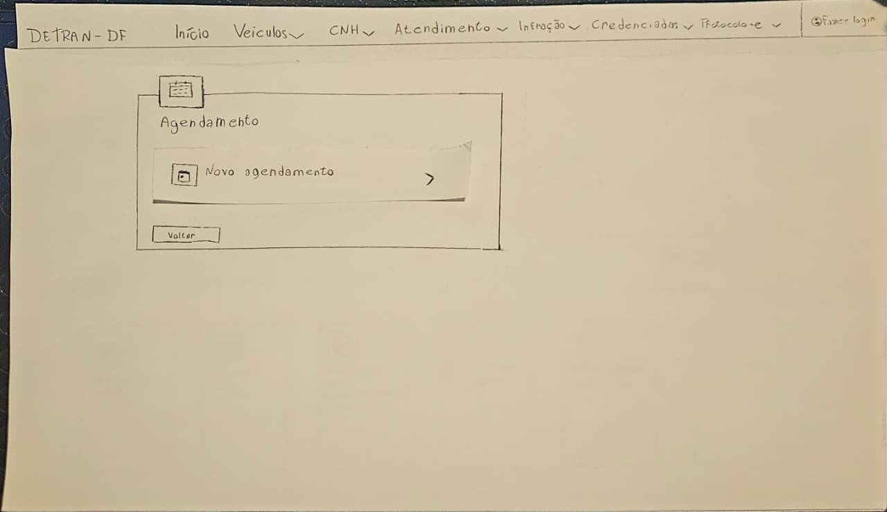

*Figura 3 – Opção Novo agendamento.*

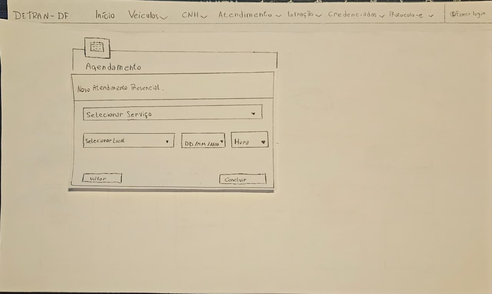

*Figura 4 – Formulário de novo atendimento presencial.*

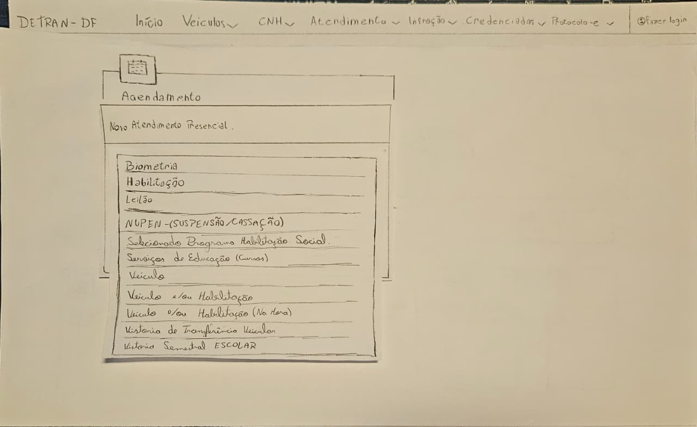

*Figura 5 – Lista de serviços com a opção Vistoria de Transferência Veicular.*

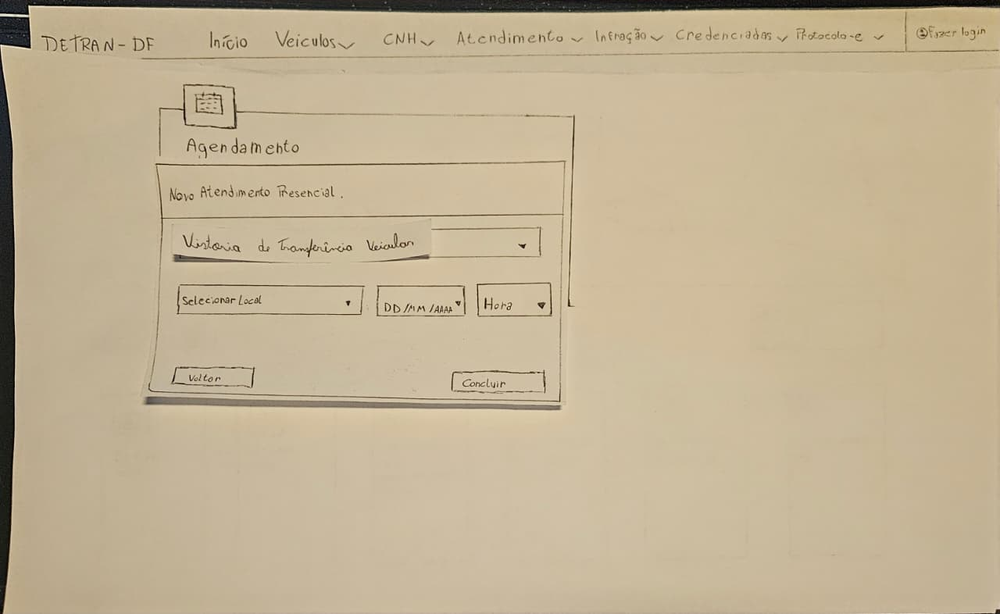

*Figura 6 – Vistoria de Transferência Veicular selecionada.*

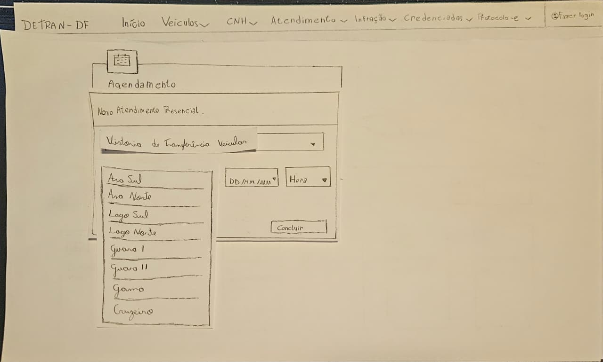

*Figura 7 – Lista de locais de atendimento com a opção Lago Sul.*

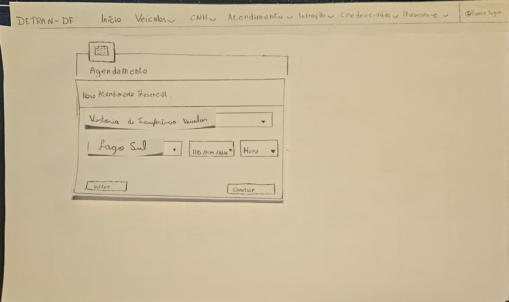

*Figura 8 – Lago Sul selecionado como local de atendimento.*

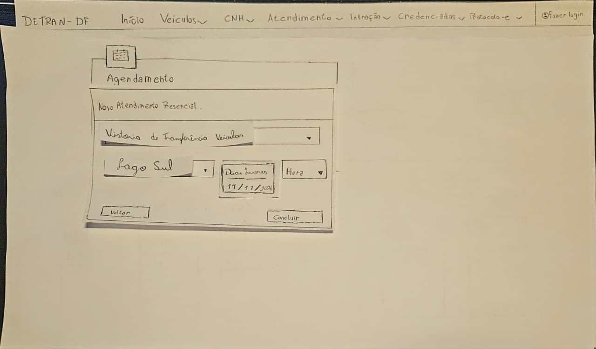

*Figura 9 – Lista de datas com a opção 14/11/2026.*

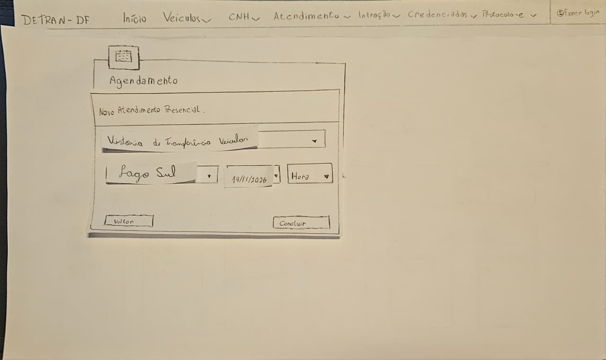

*Figura 10 – Data de 14/11/2026 selecionada.*

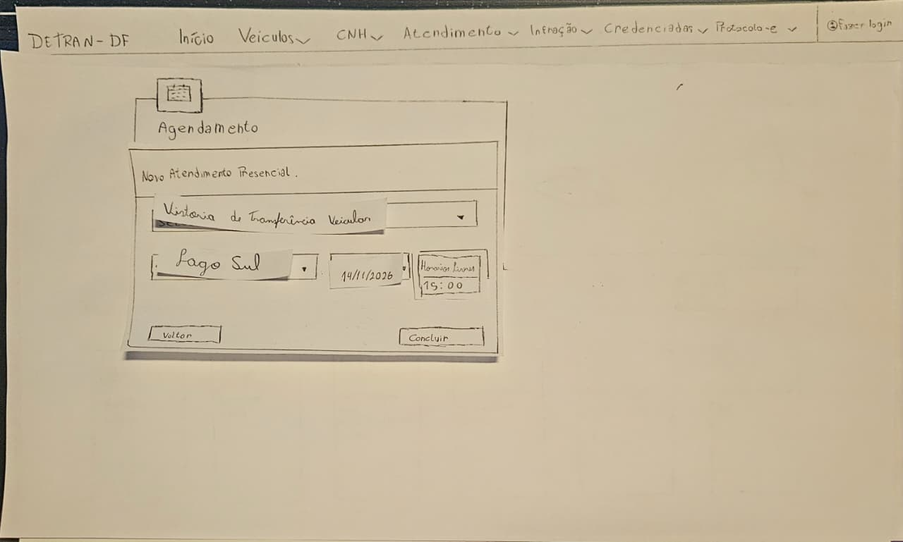

*Figura 11 – Lista de horários com a opção 15h00.*

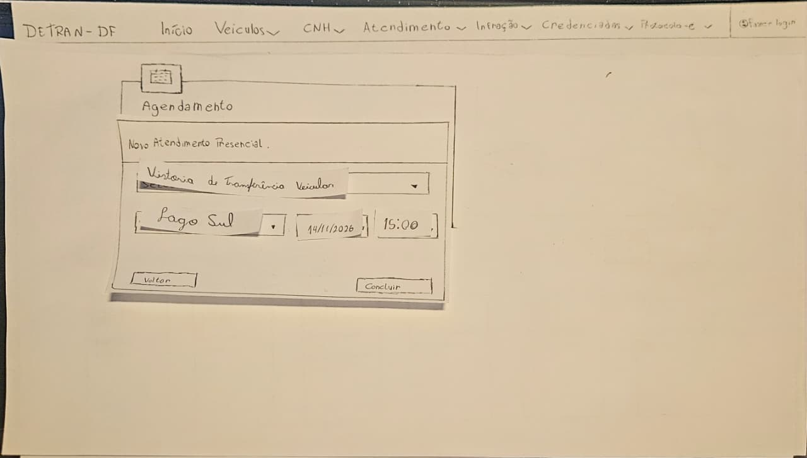

*Figura 12 – Formulário preenchido com Lago Sul, 14/11/2026 e 15h00, antes de clicar em Concluir.*

Fonte: minha elaboração (2026).

## 4. Tarefa prevista para a avaliação

**T1 — Agendar uma vistoria de transferência veicular.** Imagine que você precisa fazer uma vistoria para transferir seu veículo. Use o protótipo para marcar o atendimento no Lago Sul, no dia 14/11/2026 às 15h00. Ao terminar, diga como você sabe que o agendamento foi concluído.

A tarefa é considerada concluída quando o participante chega à tela de confirmação com o serviço, o local, a data e o horário corretos. Na análise, considerei separadamente a necessidade de ajuda e o reconhecimento da confirmação.

## 5. Relato da avaliação

Realizei a sessão em **03/11/2026**, com um participante e a tarefa T1. Pedi que ele **pensasse em voz alta**, apresentei o cenário e indiquei o Lago Sul como local do atendimento. Na Tabela 3, reuni as principais observações.

**Tabela 3 - Observações da minha avaliação**

| Trecho da entrevista | Observação | Implicação para o redesign |
| --- | --- | --- |
| [1:41–2:16](https://youtu.be/aLhUbnt0ST8?t=101) | O participante verbalizou a entrada pelo agendamento presencial e encontrou a opção Vistoria de Transferência Veicular. | Manter os rótulos e o caminho de acesso usados no teste. |
| [2:25–3:08](https://youtu.be/aLhUbnt0ST8?t=145) | A sessão passou pela escolha de local, data e horário. O horário das 15h00 foi mencionado e o participante indicou que concluiu a tarefa. | Verificar na próxima avaliação se a tela final comunica, por si só, que o agendamento foi confirmado. |
| [3:19–3:53](https://youtu.be/aLhUbnt0ST8?t=199) | O participante considerou o percurso claro e sugeriu indicar melhor quais datas e horários estavam disponíveis. | Usar os rótulos **Datas disponíveis** e **Horários disponíveis**. Se opções sem vaga forem exibidas, marcá-las como **Indisponível**. |

Entre a primeira ação verbalizada e a indicação de conclusão, observei aproximadamente **1 min 27 s**, incluindo o tempo de verbalização e de interação com o papel. Analisei uma sessão com apoio das legendas automáticas. Por esse registro, não consegui confirmar se o participante reconheceu a tela final como confirmação.

Fonte da Tabela 3: minha análise da entrevista (2026), com apoio do ChatGPT.

Vinculei os vídeos do teste-piloto e da entrevista na [página de vídeo da avaliação](video-avaliacao.md).

[Voltar à visão geral](index.md).

## 6. Relação com a análise de tarefas {#rastreabilidade}

Na Tabela 4, relacionei as ações da tarefa aos estados do meu papel e à [HTA da Entrega 5](../../../entrega-5/integrantes/alexandre-vilar/index.md).

**Tabela 4 - Correspondência do fluxo com o papel**

| Ação da tarefa | Evidência no protótipo |
| --- | --- |
| Acessar o agendamento presencial e iniciar o atendimento | Figuras 1 a 3, na [sequência de fotos](#3-prototipo-de-papel) |
| Escolher Vistoria de Transferência Veicular | Figuras 4 a 6, na [sequência de fotos](#3-prototipo-de-papel) |
| Escolher Lago Sul | Figuras 7 e 8, na [sequência de fotos](#3-prototipo-de-papel) |
| Escolher 14/11/2026 | Figuras 9 e 10, na [sequência de fotos](#3-prototipo-de-papel) |
| Escolher 15h00 e concluir | Figuras 11 e 12 e [tarefa T1](#4-tarefa-prevista-para-a-avaliacao) |
| Reconhecer a confirmação | Objetivo da T1; ainda preciso completar a evidência da tela final, que não aparece nas 12 fotos. |

Fonte: minha relação entre a tarefa e as telas (2026).

## 7. Ajustes e prioridades {#ajustes}

Na Tabela 5, separei os achados das mudanças sugeridas. Não registrei uma nova rodada de correção física do papel; levei as recomendações para a alta fidelidade.

**Tabela 5 - Problemas e encaminhamentos**

| Achado | Prioridade e motivo | Correção sugerida | Situação |
| --- | --- | --- | --- |
| Disponibilidade de datas e horários pouco explícita | Média: pode causar dúvida durante a seleção | Identificar datas e horários disponíveis; sinalizar opções indisponíveis também por texto | Recomendação encaminhada à [alta fidelidade](../../../entrega-7/integrantes/alexandre-vilar/index.md#prototipo); falta avaliar o efeito com usuários. |
| Reconhecimento da confirmação não verificado pelo registro analisado | Verificação necessária: não classifiquei como falha observada | Conferir a tela final e perguntar como o participante sabe que terminou | Pendente na próxima avaliação. |

Fonte: minha análise da [entrevista](#5-relato-da-avaliacao), com apoio do ChatGPT (2026).

## 8. Atividades do método de prototipação em papel {#atividades-metodo}

Adaptei a Tabela 10.7 de Barbosa e Silva (2010, p. 359) para relacionar cada atividade aos meus materiais. A Tabela 6 contém os links e indica onde ainda falta informação. A Figura 13 mostra o texto original que usei como base.

**Tabela 6 - Atividades do método e evidências da minha Entrega 6**

| Atividade | Tarefa do método | Onde está na minha entrega e situação |
| --- | --- | --- |
| Preparação | Definir as tarefas que serão executadas | [Cenário T1](#4-tarefa-prevista-para-a-avaliacao). |
| Preparação | Definir o perfil dos participantes e recrutá-los | [Questões práticas](planejamento-papel.md#questoes-praticas). Perfil e recrutamento ainda precisam ser registrados. |
| Preparação | Criar as interfaces em papel necessárias às tarefas | [12 fotos do protótipo](#3-prototipo-de-papel). |
| Preparação | Realizar um teste-piloto | [Piloto](planejamento-papel.md#piloto) e [vídeo](video-avaliacao.md#teste-piloto). Data, ordem e ajustes ainda precisam ser completados. |
| Coleta de dados | Participante executa a tarefa no papel com mediação do avaliador | [Entrevista definitiva](video-avaliacao.md#sessao-definitiva-entrevista) e [observações](#5-relato-da-avaliacao). |
| Interpretação | Listar os problemas encontrados | [Observações com trechos do vídeo](#5-relato-da-avaliacao). |
| Interpretação | Refinar o papel para resolver problemas simples | [Ajustes](#ajustes). Não tenho registro de uma revisão física do papel após a sessão. |
| Consolidação dos resultados | Priorizar problemas que permanecem sem solução | [Prioridades e justificativas](#ajustes). |
| Consolidação dos resultados | Propor correções | [Sugestões para a alta fidelidade](#ajustes). |
| Relato dos resultados | Apresentar problemas e sugestões de correção | [Relato da avaliação](#5-relato-da-avaliacao), [ajustes](#ajustes) e [estrutura do relato](planejamento-papel.md#relato). |

Fonte: minha adaptação de Barbosa e Silva (2010, Tabela 10.7, p. 359).

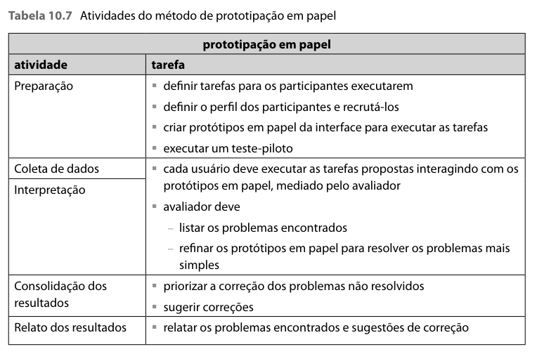

*Figura 13 - Texto de origem da tabela de atividades. Fonte: Barbosa e Silva (2010, p. 359, Tabela 10.7).*

## Referências

BARBOSA, Simone Diniz Junqueira; SILVA, Bruno Santana da. **Interação Humano-Computador.** Rio de Janeiro: Elsevier, 2010. Capítulo 10, seção 10.2.3, p. 358-362, especialmente a Tabela 10.7, p. 359.

BARBOSA, Simone Diniz Junqueira et al. **Interação Humano-Computador e Experiência do Usuário.** Autopublicação, 2021. Seção 11.8, p. 264; preparação e piloto, p. 259-260.

SALES, André Barros de. **Plano de Ensino de Interação Humano-Computador, 2026.2.** UnB, 2026. [Plano do projeto](../../../disciplina/plano-de-ensino.md).

## Uso de IA generativa

Utilizei o ChatGPT (OpenAI) como apoio para organizar os materiais, revisar a redação e adaptar o planejamento com base nos livros e nos registros do meu trabalho. Mantive as referências e diferenciei o que já realizei do que ainda está planejado. Os resultados, vídeos, autorizações e revisões dependem dos registros reais de cada atividade.
