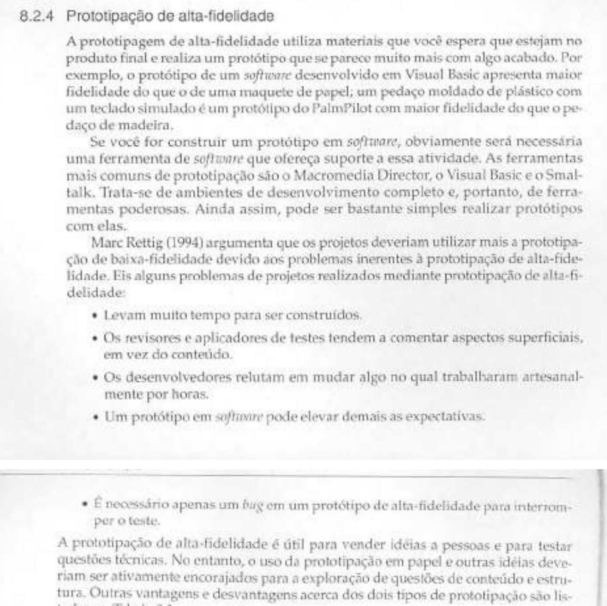
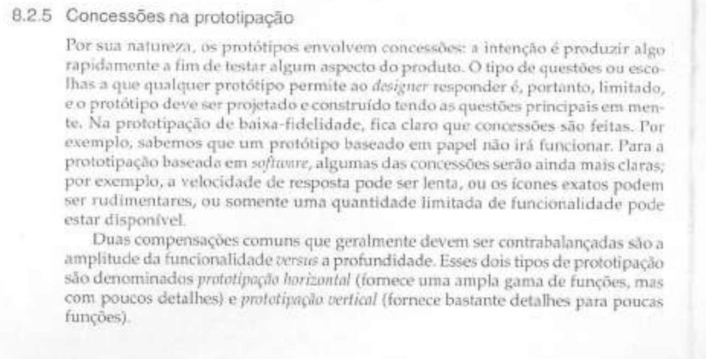
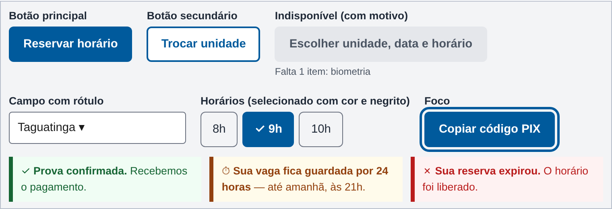
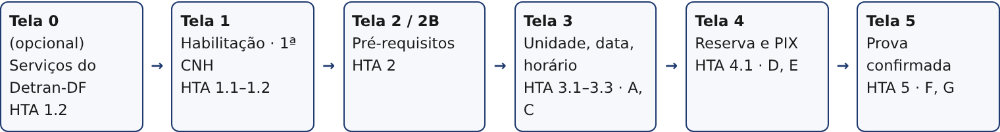

# Especificação do Protótipo de Alta Fidelidade – Henrique Schneider

## Quadro de contribuição

**Quadro 1 – Contribuição no artefato Especificação do Protótipo de Alta Fidelidade – Henrique Schneider**

| Integrante | Contribuição | Atividade (link) | Gravação (link) |
| --- | --- | --- | --- |
| Henrique Schneider Fernandes da Rosa | Especificação do protótipo vertical do agendamento da prova teórica: escopo, guia de estilo, fluxo, telas, estados das tarefas e checklist de construção | [Visão geral](index.md) | [Apresentação da Entrega 6](https://youtu.be/sI_3rqIQbCU) |

Fonte: elaborado pelo autor (2026).

## Histórico de versões

**Tabela 1 – Histórico de versões da especificação do protótipo de alta fidelidade**

| Data       | Versão | Descrição                                                                                                                                                                                                                                                                                                                                  | Autor(es)                                                                | Revisor(es)                |
|------------|--------|--------------------------------------------------------------------------------------------------------------------------------------------------------------------------------------------------------------------------------------------------------------------------------------------------------------------------------------------|--------------------------------------------------------------------------|----------------------------|
| 27/10/2026 | 1.0    | Criação da especificação: escopo, requisitos visuais do guia de estilo, fluxo, telas, estados para as tarefas do teste e checklist de construção, a partir do modelo do protótipo de papel (v1.0), da HTA (v1.2) e do relato da avaliação do storyboard (v3.1). A Seção 8 fica para ser preenchida com os resultados do protótipo de papel | Claude (IA generativa), a pedido de Henrique Schneider Fernandes da Rosa | João Vitor Tavares de Sá Lima |
| 02/11/2026 | 1.1 | Publicação da versão em Markdown no site do grupo, com as figuras e o PDF para download | Henrique Schneider, com apoio do Claude (IA generativa) | João Vitor Tavares de Sá Lima |
| 03/11/2026 | 1.2 | Seção 8 e Tabela 12 preenchidas com os problemas PC01, PC02 e PN01 a PN04 da Sessão 1 do protótipo de papel; datas de exemplo e cronograma atualizados | Henrique Schneider, com apoio do Claude (IA generativa) | João Vitor Tavares de Sá Lima |

Fonte: elaborado pelo autor (2026).

## 1. Introdução

Este documento especifica o protótipo de alta fidelidade do agendamento da prova teórica que o autor vai construir para o teste de usabilidade da Entrega 7. Ele traduz as Telas 1 a 5 e as peças soltas do protótipo de papel (Modelo do protótipo de papel, v1.0) em telas interativas, aplica o guia de estilo do grupo (Grupo 03, Guia de Estilo, v1.3) e indica o que precisa existir no protótipo para que as tarefas T1 a T4 possam ser executadas e medidas (Roteiro do teste de usabilidade, v1.0).

As alterações vindas da avaliação do protótipo de papel (Sessão 1, de 03/11/2026) estão na Seção 8. Como foi uma única sessão, as alterações são propostas a verificar no teste, e não correções confirmadas. A ferramenta de construção é escolha do autor **[VERIFICAR: ferramenta (por exemplo, Figma, Penpot ou HTML)]**; a especificação não depende dela.

## 2. Fundamentação

Segundo Preece, Rogers e Sharp, “A prototipagem de alta-fidelidade utiliza materiais que você espera que estejam no produto final e realiza um protótipo que se parece muito mais com algo acabado” (Preece; Rogers; Sharp, 2005, cap. 8, seç. 8.2.4, p. 265, 1º parágrafo da seção), conforme a Figura 1. Os autores alertam que esse tipo de protótipo leva mais tempo para ser construído, que os avaliadores tendem a comentar aspectos superficiais e que um protótipo em software pode elevar demais as expectativas (Preece; Rogers; Sharp, 2005, seç. 8.2.4, pp. 265–266). Por isso, esta especificação limita o protótipo ao que as tarefas do teste exigem.

**Figura 1 – Trecho de Preece, Rogers e Sharp (2005, cap. 8, seç. 8.2.4, pp. 265–266) sobre a prototipação de alta fidelidade**

Fonte: Preece, Rogers e Sharp (2005, pp. 265–266).

Os mesmos autores afirmam que todo protótipo envolve concessões, que ele “deve ser projetado e construído tendo as questões principais em mente” e distinguem a prototipação horizontal, que “fornece uma ampla gama de funções, mas com poucos detalhes”, da prototipação vertical, que “fornece bastante detalhes para poucas funções” (Preece; Rogers; Sharp, 2005, cap. 8, seç. 8.2.5, p. 266, 1º e 2º parágrafos da seção), conforme a Figura 2. Este protótipo é **vertical**: cobre em detalhe uma única tarefa, o agendamento da prova teórica (HTA, objetivos 1 a 5), e não o restante do portal. As “questões principais” são as do planejamento da avaliação (relatório da Entrega 6, Tabela 7).

**Figura 2 – Trecho de Preece, Rogers e Sharp (2005, cap. 8, seç. 8.2.5, p. 266) sobre concessões e prototipação vertical**

Fonte: Preece, Rogers e Sharp (2005, p. 266).

**Autor do item de conteúdo (Figura 2):** Henrique Schneider Fernandes da Rosa.

## 3. Escopo e decisões

**Tabela 2 – Escopo do protótipo**

| Aspecto                       | Decisão                                                                                                                                                                                                                                            | Origem                                                           |
|-------------------------------|----------------------------------------------------------------------------------------------------------------------------------------------------------------------------------------------------------------------------------------------------|------------------------------------------------------------------|
| Tarefa coberta                | Agendar a prova teórica com reserva de horário: objetivos 1 a 5 da HTA e planos 3 e 4                                                                                                                                                              | HTA v1.2; Relatório E5, seç. 3.8.1                               |
| Fora do escopo                | Objetivo 6 (remarcar), login real no gov.br, pagamento real, outros serviços do portal. Botões fora do fluxo ficam visíveiroteiros, mas sem ação, com a mensagem “Função fora deste protótipo”                                                            | HTA v1.2, Tabela 2 (objetivo 6)                                  |
| Dispositivos                  | Celular como formato principal (360 × 800 px) e uma versão para computador (largura de 1024 px ou mais), porque o participante P2 fez todo o processo pela web                                                                                     | Relato do storyboard v3.1, problema 07; Guia de Estilo, seç. 3.1 |
| Dados                         | Fictícios: candidata “Camila”, unidade Taguatinga, horário das 9h. As datas de exemplo devem ser posteriores às sessões de teste (09/11 a 11/11/2026) para não parecerem vencidas: usar datas a partir de 16/11/2026 | Storyboard, quadro 4; cronograma da Entrega 7                    |
| Valores e regras do Detran-DF | Taxa, unidades que aplicam a prova e documentos exigidos não foram conferidos no portal: usar texto genérico ou deixar marcado **[VERIFICAR: taxa, unidades e documentos no portal do Detran-DF]**                                               | Modelo do protótipo de papel v1.0                                |
| Prazo da reserva              | 24 horas, com aviso 1 hora antes de expirar                                                                                                                                                                                                        | HTA v1.2, plano 4 (sugestão de P1 e P2)                          |

Fonte: elaborado pelo autor (2026).

## 4. Requisitos visuais do guia de estilo

O protótipo aplica as decisões do guia de estilo do grupo (Grupo 03, Guia de Estilo, v1.3), resumidas na Tabela 3. O próprio guia esclarece que os valores são decisões propostas pelo grupo, e não medições do site atual (Guia de Estilo, seç. 1.1). A Figura 3 mostra como os componentes ficam com esses valores.

**Tabela 3 – Requisitos do guia de estilo aplicados ao protótipo**

| Item           | Valor                                                                                                                                                                                       | Guia, seção   |
|----------------|---------------------------------------------------------------------------------------------------------------------------------------------------------------------------------------------|---------------|
| Grid e margens | Uma coluna no celular; conteúdo até 1200 px no computador; margens de 16 px (celular) e 32 px (computador); espaçamentos de 4, 8, 16, 24, 32 e 48 px; formulários com até 640 px de largura | 3.1           |
| Tipografia     | Arial, Helvetica, sans-serif. Título da página 28 px no celular (32 px no computador), seção 24 px, subtítulo 20 px, texto e botões 16 px (botões em negrito), ajuda 14 px                  | 3.3           |
| Cores          | primária \#005A9C · hover \#003F6B · texto \#1F2937 · texto secundário \#4B5563 · fundo \#F3F4F6 · borda \#6B7280 · sucesso \#166534 · erro \#B91C1C · atenção \#92400E                     | 3.5           |
| Estados        | Cor nunca é o único meio de indicar estado: sucesso, pendência, erro e “sem vagas” sempre têm texto ou ícone. Foco visível com contorno azul de 3 px. Ação indisponível explica por quê     | 3.4, 3.5, 4.2 |
| Área de toque  | 44 × 44 px para botões, dias do calendário e horários                                                                                                                                       | 5.2           |
| Diálogos       | Só quando a decisão exige atenção imediata (reserva expirada): título, mensagem breve, botão de ação específico e opção de fechar; o foco vai para o diálogo                                | 3.2           |
| Formatos       | Datas DD/MM/AAAA; valores R\$ 1.234,56; CNH por extenso na primeira ocorrência                                                                                                              | 3.7, 6.1      |

Fonte: elaborado pelo autor (2026), a partir do Guia de Estilo do Grupo 03 (v1.3).

**Figura 3 – Componentes do protótipo com os valores do guia de estilo**

Fonte: elaborado pelo autor (2026), com as cores, a tipografia e as dimensões do Guia de Estilo do Grupo 03 (v1.3, seç. 3.3, 3.5 e 5.2).

## 5. Fluxo de navegação

A Figura 4 mostra o fluxo principal e os desvios, que são os mesmos do protótipo de papel. A Tabela 4 lista as transições que precisam funcionar no protótipo.

**Figura 4 – Fluxo das telas do protótipo de alta fidelidade**

Fonte: elaborado pelo autor (2026), a partir do Modelo do protótipo de papel (v1.0, Figura 1).

**Tabela 4 – Transições do protótipo**

| De                       | Ação do participante                                                                                            | Para                                         |
|--------------------------|-----------------------------------------------------------------------------------------------------------------|----------------------------------------------|
| Tela 0                   | Tocar em “Agendar prova teórica (1ª habilitação)” na lista de serviços mais acessados ou buscar “prova teórica” | Tela 1                                       |
| Tela 1                   | “Agendar prova teórica”                                                                                         | Tela 2 (ou 2B no estado com pendência)       |
| Tela 2                   | “Escolher unidade, data e horário”                                                                              | Tela 3                                       |
| Tela 2B                  | “Agendar a coleta da biometria”                                                                                 | Mensagem “Função fora deste protótipo”       |
| Tela 3                   | Abrir “Unidade”; escolher unidade (A); tocar num dia com vagas; tocar num horário; “Reservar horário”           | Tela 4                                       |
| Tela 3                   | Tocar num dia sem vagas                                                                                         | Aviso C na própria tela                      |
| Aviso C                  | “Ver \[próxima data livre]” / “Trocar unidade”                                                                 | Tela 3 com a data sugerida / lista A aberta  |
| Tela 4                   | “Copiar código PIX”                                                                                             | Confirmação “Código copiado” na própria tela |
| Tela 4 (estado expirado) | “Escolher novo horário” no diálogo E                                                                            | Tela 3                                       |
| Notificação F            | Tocar na notificação                                                                                            | Tela 5                                       |
| Todas                    | “← Voltar”                                                                                                      | Tela anterior, mantendo as escolhas feitas   |

Fonte: elaborado pelo autor (2026).

## 6. Especificação das telas

As Tabelas 5 a 10 especificam cada tela: elementos, textos e comportamento, com o nó da HTA e o problema do storyboard que a tela trata (relato v3.1, Tabela 7). Os textos são os do protótipo de papel e podem mudar depois das sessões (Seção 8).

### 6.1 Tela 0 – Serviços do Detran-DF (opcional)

O problema 04 (severidade 3, P1 e P2) é que o serviço de habilitação é difícil de encontrar no gov.br e o termo é genérico; a HTA recomenda dar ao serviço um nome específico e destacá-lo entre os mais acessados (HTA v1.2, operação 1.2). O protótipo de papel começava já dentro do serviço, e por isso não testava essa recomendação. Incluir a Tela 0 permite testá-la no início da tarefa T1. **[VERIFICAR: decidir se a Tela 0 entra; se entrar, o cartão da T1 começa nela]**

**Tabela 5 – Tela 0: serviços do Detran-DF**

| Elemento       | Conteúdo e comportamento                                                                                                                             |
|----------------|------------------------------------------------------------------------------------------------------------------------------------------------------|
| Cabeçalho      | Menu, marca “Detran-DF” (texto, sem redesenhar o brasão), nome “Camila” e indicação de que entrou com a conta gov.br                                 |
| Busca          | Campo com rótulo “Buscar serviço”; ao digitar “prova” ou “teórica”, sugere “Agendar prova teórica (1ª habilitação)”                                  |
| Mais acessados | Lista com nomes específicos: “Agendar prova teórica (1ª habilitação)”, “Consultar pontos da CNH”, “Licenciamento do veículo”; só o primeiro tem ação |

Fonte: elaborado pelo autor (2026). HTA: 1.2 · Problema: 04.

### 6.2 Tela 1 – Habilitação · 1ª CNH

**Tabela 6 – Tela 1: início do serviço**

| Elemento               | Conteúdo e comportamento                                                                                                                                                                                                                                                                   |
|------------------------|--------------------------------------------------------------------------------------------------------------------------------------------------------------------------------------------------------------------------------------------------------------------------------------------|
| Título (H1)            | “Habilitação · 1ª CNH” e texto “Você entrou com a conta gov.br.”                                                                                                                                                                                                                           |
| Etapas do seu processo | Lista numerada de 6 etapas: Abertura do processo ✓, Exames e biometria ✓, Curso teórico ✓, **4 Prova teórica – você está aqui**, 5 Aulas práticas, 6 Prova prática. Concluídas com ícone e texto “concluída” (não só cor) **[VERIFICAR: ordem real das etapas da 1ª habilitação no DF]** |
| Próximo passo          | Caixa “Próximo passo: agendar a prova teórica. Antes, confira se está tudo pronto.”                                                                                                                                                                                                        |
| Ações                  | Botão principal “Agendar prova teórica” → Tela 2; link “Ver o que é cada etapa” (fora do protótipo)                                                                                                                                                                                        |

Fonte: elaborado pelo autor (2026), a partir do Modelo do protótipo de papel (v1.0, Figura 3). HTA: 1.1 e 1.2 · Problema: 04.

### 6.3 Telas 2 e 2B – Antes de agendar

**Tabela 7 – Telas 2 e 2B: pré-requisitos**

| Elemento                | Conteúdo e comportamento                                                                                                                                                                                                                                                            |
|-------------------------|-------------------------------------------------------------------------------------------------------------------------------------------------------------------------------------------------------------------------------------------------------------------------------------|
| Barra superior          | “← Voltar” e indicador “Passo 1 de 3”                                                                                                                                                                                                                                               |
| Título e texto          | “Antes de agendar” · “Confira se você já pode marcar a prova teórica.”                                                                                                                                                                                                              |
| Lista de pré-requisitos | Curso teórico concluído, Biometria coletada, Exames médico e psicológico, Conta gov.br — cada um com ícone e texto “ok” ou “pendente”                                                                                                                                               |
| O que levar no dia      | Documento oficial com foto; comprovante do agendamento **[VERIFICAR: documentos exigidos]**                                                                                                                                                                                       |
| Ação (Tela 2)           | Texto “Tudo certo! Você pode escolher a data.” e botão principal “Escolher unidade, data e horário” → Tela 3                                                                                                                                                                        |
| Estado 2B (pendência)   | Biometria “✗ pendente” em destaque; caixa “Falta 1 item: biometria. Para que serve: identificar você no dia da prova.” com link “Agendar a coleta da biometria”; botão “Escolher unidade, data e horário” indisponível, com o motivo escrito logo abaixo (Guia de Estilo, seç. 4.2) |

Fonte: elaborado pelo autor (2026), a partir do Modelo do protótipo de papel (v1.0, Figuras 4 e 5). HTA: 2 · Problema: 01.

### 6.4 Tela 3 – Escolha onde e quando

**Tabela 8 – Tela 3: unidade, data e horário**

| Elemento            | Conteúdo e comportamento                                                                                                                                                                                |
|---------------------|---------------------------------------------------------------------------------------------------------------------------------------------------------------------------------------------------------|
| Barra superior      | “← Voltar” e “Passo 2 de 3”                                                                                                                                                                             |
| Unidade (A)         | Campo de seleção com rótulo “Unidade”, já com Taguatinga; ao abrir, lista as unidades com a primeira data livre de cada uma (“vagas a partir de dd/mm”) **[VERIFICAR: unidades que aplicam a prova]** |
| Atalho              | “Data livre mais próxima: \[dia, dd/mm] · Escolher”, que seleciona essa data                                                                                                                           |
| Calendário          | Mês com navegação ‹ ›; dias com vagas marcados com ponto e texto acessível “há vagas”; dias sem vagas riscados e com texto “sem vagas”; legenda abaixo do calendário; cada dia com 44 × 44 px           |
| Horários            | Aparecem depois da data: “Horários em dd/mm” com botões 8h, 9h, 10h, 14h; o selecionado com cor, negrito e ✓                                                                                            |
| Ação                | “Reservar horário”, indisponível até escolher o horário (com o texto “Escolha um horário”), → Tela 4                                                                                                    |
| Aviso C (sem vagas) | Ao tocar num dia sem vagas: “Não há vagas em dd/mm nesta unidade. Próxima data livre: \[dia, dd/mm].” Botões “Ver dd/mm” e “Trocar unidade”                                                            |

Fonte: elaborado pelo autor (2026), a partir do Modelo do protótipo de papel (v1.0, Figuras 6 e 9). HTA: 3.1 a 3.3 e plano 3 · Problema: 02.

### 6.5 Tela 4 – Horário reservado

**Tabela 9 – Tela 4: reserva e PIX**

| Elemento               | Conteúdo e comportamento                                                                                                                                                                                                  |
|------------------------|---------------------------------------------------------------------------------------------------------------------------------------------------------------------------------------------------------------------------|
| Barra superior         | “← Voltar” e “Passo 3 de 3”                                                                                                                                                                                               |
| Prazo da reserva       | Aviso de atenção no topo: “⏱ Sua vaga fica guardada por 24 horas — até \[amanhã], às \[hora].” Mostrar também o tempo restante (“faltam 23 h 58 min”)                                                                   |
| Resumo                 | Prova teórica · Taguatinga · \[dia, dd/mm/aaaa] · 9h                                                                                                                                                                     |
| Pagamento              | “Pague a taxa por PIX: R\$ \_\_\_” **[VERIFICAR: valor da taxa]**; código PIX copia e cola visível; botão “Copiar código PIX” que mostra “Código copiado” por alguns segundos                                           |
| Explicação             | “Quando o PIX compensar, a prova é confirmada sozinha. Avisaremos 1 hora antes de a reserva expirar. Se o PIX não compensar no prazo, o horário é liberado e você escolhe outro.”                                         |
| Aviso D (1 hora antes) | Notificação simulada: “Falta 1 hora para sua reserva expirar. Pague o PIX da prova teórica até as \[hora] para manter o horário de \[dd/mm], 9h.”                                                                       |
| Diálogo E (expirada)   | Título “Sua reserva expirou”; mensagem “O PIX não compensou dentro de 24 horas e o horário de \[dd/mm], 9h, foi liberado.”; botão “Escolher novo horário” → Tela 3; o foco vai para o diálogo (Guia de Estilo, seç. 3.2) |

Fonte: elaborado pelo autor (2026), a partir do Modelo do protótipo de papel (v1.0, Figuras 7 e 9). HTA: 4.1 e plano 4 · Problemas: 03 e 05.

### 6.6 Tela 5 – Prova confirmada

**Tabela 10 – Tela 5: confirmação**

| Elemento              | Conteúdo e comportamento                                                                                                                                                        |
|-----------------------|---------------------------------------------------------------------------------------------------------------------------------------------------------------------------------|
| Notificação F         | “Detran-DF · Prova confirmada ✓ · Prova teórica em \[dd/mm], 9h, Taguatinga. Toque para ver o comprovante e o que levar.” → Tela 5                                             |
| Confirmação           | Mensagem de sucesso com ícone e texto: “✓ Prova confirmada. Recebemos o pagamento.”                                                                                             |
| Detalhes              | Prova teórica · \[dia, dd/mm/aaaa] · 9h · Unidade Taguatinga · “Chegue com antecedência.”                                                                                      |
| Leve no dia           | Documento oficial com foto; este comprovante (impresso ou no celular) **[VERIFICAR: documentos exigidos]**                                                                    |
| Ações                 | “Baixar comprovante” e “Ativar lembrete 1 dia antes”, que mostram uma confirmação curta (“Lembrete ativado”); texto “Este agendamento fica em Habilitação › Meus agendamentos.” |
| Lembrete G (opcional) | Notificação da véspera, só para mostrar na entrevista pós-teste                                                                                                                 |

Fonte: elaborado pelo autor (2026), a partir do Modelo do protótipo de papel (v1.0, Figuras 8 e 9). HTA: 5 · Sugestão de P1 (lembretes).

## 7. Estados necessários para as tarefas do teste

As tarefas T2 a T4 dependem de situações que não acontecem sozinhas num protótipo: um dia sem vagas, o PIX compensado e a reserva expirada. A Tabela 11 indica o estado inicial de cada tarefa e como o avaliador o aciona sem que o participante perceba. Uma forma simples é ter um link de início para cada tarefa (por exemplo, uma página do avaliador com “Iniciar T1 … T4”) e, dentro da Tela 4, um atalho discreto para “simular PIX compensado” e “simular expiração” **[VERIFICAR: como implementar na ferramenta escolhida]**.

**Tabela 11 – Estados do protótipo por tarefa**

| Tarefa | Estado inicial                                                                       | Como acionar                                                   | Tela-alvo (fim da medição)            |
|--------|--------------------------------------------------------------------------------------|----------------------------------------------------------------|---------------------------------------|
| T1     | Tela 0 ou Tela 1, sem pendências; a data mais próxima com vagas tem horário de manhã | Link “Iniciar T1”                                              | Tela 4 com horário de manhã reservado |
| T2     | Tela 3 com a data escolhida em T1 sem vagas                                          | Link “Iniciar T2”, que abre a Tela 3 com esse dia riscado      | Tela 4 com outra data ou unidade      |
| T3     | Tela inicial do celular com a notificação F                                          | Link “Iniciar T3” ou atalho “simular PIX compensado” na Tela 4 | Tela 5, seção “Leve no dia” visível   |
| T4     | Tela 4 com o diálogo E (reserva expirada)                                            | Link “Iniciar T4” ou atalho “simular expiração”                | Nova reserva na Tela 4                |

Fonte: elaborado pelo autor (2026), a partir das tarefas do Relatório da Entrega 5 (Grupo 03, seç. 3.8.1).

## 8. Alterações a partir do protótipo de papel

Preenchida com os problemas dos Apêndices C e D do roteiro da sessão (e das Tabelas 3, 5 e 6 do relatório da Entrega 6), todos da Sessão 1 (P5). Cada linha diz o que muda nesta especificação e em qual tabela.

**Tabela 12 – Alterações na especificação decorrentes da avaliação do protótipo de papel**

| Problema (ID) | Tela / tabela | Alteração | Questão a verificar no teste |
|---------------|---------------|-----------|------------------------------|
| PC01 | Tela 5 (Tabela 10) | Manter o botão “Voltar para página inicial”, que foi escrito no papel durante a sessão | Depois da confirmação, o participante encontra sem ajuda como sair da tela (T3) |
| PC02 | Tela 5 (Tabela 10) e Tela 0 (Tabela 5) | Manter o botão “Consultar prova”, escrito no papel durante a sessão. Avaliar, na Tela 0, um item “Prova” com “Agendar prova” e “Consultar prova” (sugestão do participante, ainda não testada) | O participante encontra a prova já agendada sem usar “Agendar prova” (T3) |
| PN01 | Telas 1 e 2 (Tabelas 6 e 7) | Diferenciar visualmente marcadores de botões ou usar caixas expansíveis (drop-down) com os detalhes de cada etapa, mantendo as seis visíveis | O participante não tenta tocar nas etapas como se fossem botões (T1) |
| PN02 | Tela 3 (Tabela 8) | Aumentar o botão “OK” da data mais próxima e dar a ele aparência de ação | O participante entende que o botão leva direto à próxima tela (T1) |
| PN03 | Tela 3 (Tabela 8) | Mostrar uma mensagem curta de “data não disponível” ao tocar numa data indisponível | O participante entende por que a data não pode ser escolhida (T2) |
| PN04 | Tela 3 (Tabela 8) | Trocar os círculos de seleção de horário por botões ou rótulos selecionáveis | O participante escolhe o horário sem confundir a lista com uma tabela (T1) |

Fonte: elaborado pelo autor (2026), a partir dos Apêndices C e D do roteiro da sessão do protótipo de papel (v1.3).

## 9. Checklist antes do teste-piloto

- [ ] As transições da Tabela 4 funcionam no celular e no computador.
- [ ] Os quatro estados da Tabela 11 abrem a partir de links que o participante não vê.
- [ ] Nenhum dado real aparece; datas de exemplo posteriores às sessões.
- [ ] Estados de sucesso, pendência, erro e “sem vagas” têm texto, não só cor; foco visível; alvos de 44 px (Tabela 3).
- [ ] Botões fora do escopo mostram “Função fora deste protótipo”.
- [ ] Os itens [VERIFICAR] deste documento foram resolvidos ou deixados com texto genérico.
- [ ] Link ou arquivo do protótipo registrado na página da Entrega 6 do site e no roteiro do teste.

## Referências

GRUPO 03. *Guia de Estilo do Detran-DF*. Versão 1.3. Entrega 3 do projeto da disciplina de Interação Humano-Computador. Brasília: Universidade de Brasília, 2026. Disponível em: https://interacao-humano-computador.github.io/2026.2-Grupo03/.

GRUPO 03. *Relatório da Entrega 5*: relato do storyboard e da HTA e planejamento do protótipo de papel. Brasília: Universidade de Brasília, 2026.

PREECE, Jennifer; ROGERS, Yvonne; SHARP, Helen. *Design de interação*: além da interação homem-computador. Porto Alegre: Bookman, 2005.

ROSA, Henrique Schneider Fernandes da. *Análise Hierárquica de Tarefas (HTA)*: agendar a prova teórica com reserva de horário. Versão 1.2. Brasília: Universidade de Brasília, 2026.

ROSA, Henrique Schneider Fernandes da. *Modelo do protótipo de papel*: agendamento da prova teórica com reserva de horário. Versão 1.0. Brasília: Universidade de Brasília, 2026.

ROSA, Henrique Schneider Fernandes da. *Relato dos resultados da avaliação do storyboard “Agendamento da prova teórica com reserva de horário”*. Versão 3.1. Brasília: Universidade de Brasília, 2026.

ROSA, Henrique Schneider Fernandes da. *Roteiro do teste de usabilidade do protótipo de alta fidelidade*. Versão 1.0. Brasília: Universidade de Brasília, 2026.

SALES, André Barros de. *Plano de Ensino*: Interação Humano Computador (FGA0173), 02/2026, Turma 01, v1. Brasília: Universidade de Brasília, 2026.

## Agradecimentos e uso de IA generativa

Conforme o Código de Conduta da SBC adotado no Plano de Ensino (Sales, 2026, p. 3), declara-se que o Claude (Anthropic) foi usado, em 27/10/2026, a pedido do autor, para redigir esta especificação a partir do modelo do protótipo de papel, da HTA, do relato do storyboard e do guia de estilo do grupo, para desenhar a Figura 3 com os valores do guia e para localizar e recortar os trechos de Preece, Rogers e Sharp (2005) das Figuras 1 e 2. A decisão sobre a Tela 0, a ferramenta e a construção do protótipo são do autor. A ferramenta não é autora do documento, e seu uso não exime o autor da responsabilidade pelo conteúdo.

Em 02/11/2026, também a pedido do autor, o Claude foi usado para converter este documento em página do site, e em 03/11/2026, para preencher a Seção 8 com os problemas da Sessão 1.

A versão em PDF deste artefato está disponível para download: [Especificação do Protótipo de Alta Fidelidade (PDF)](arquivos/especificacao-prototipo-alta-fidelidade.pdf).
