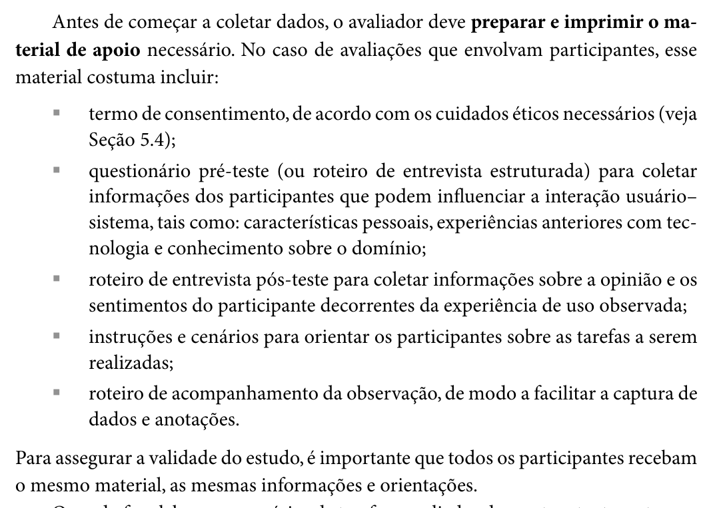
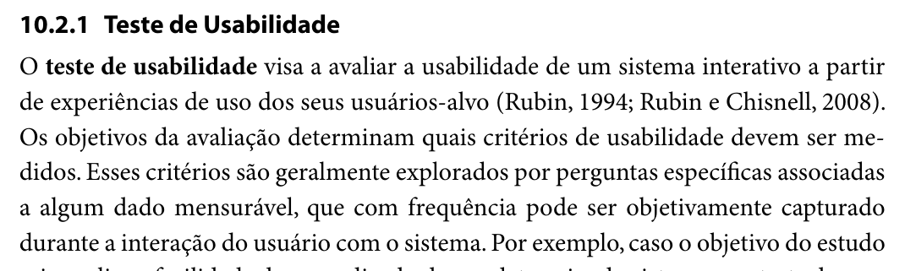
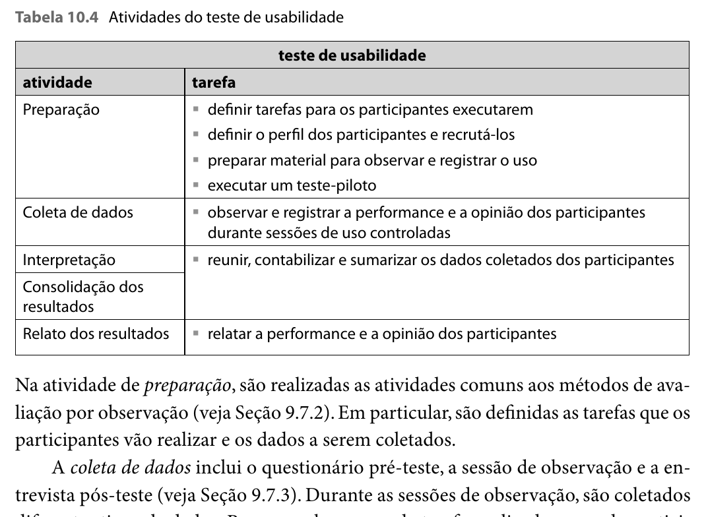
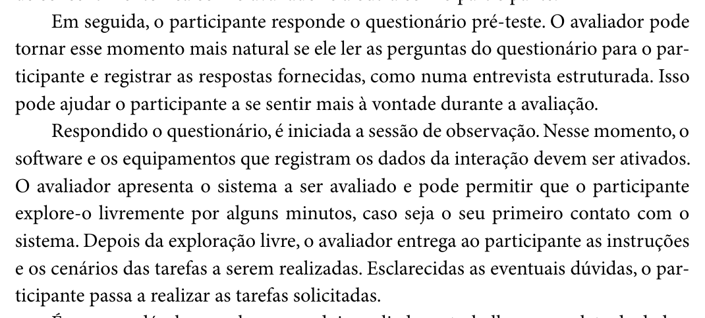
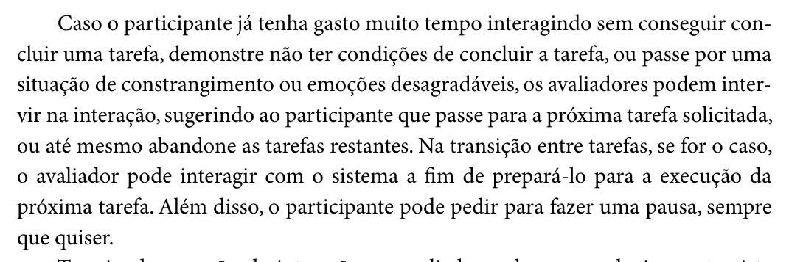
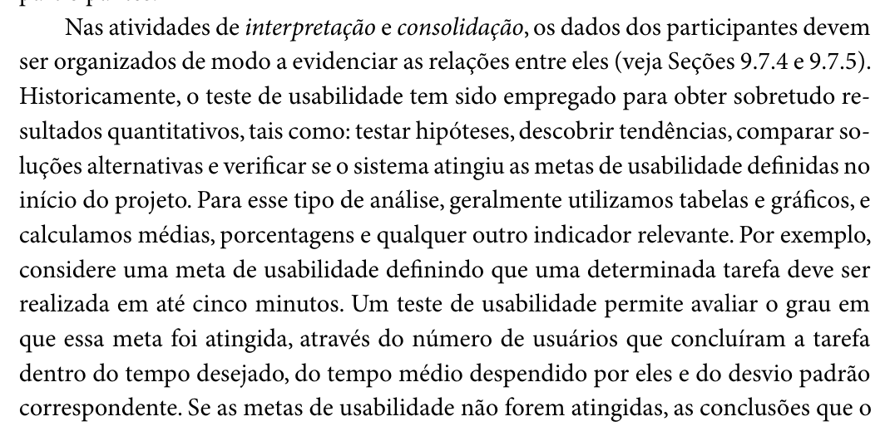
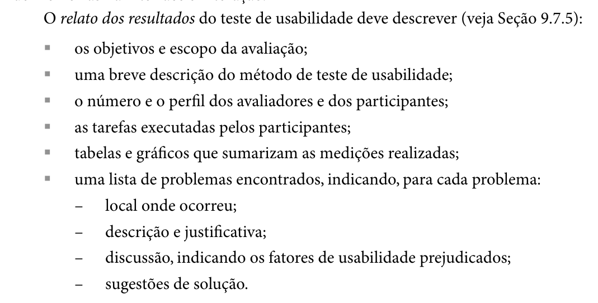

# Planejamento do Teste de Usabilidade – Henrique Schneider

## Quadro de contribuição

**Quadro 1 – Contribuição no artefato Planejamento do Teste de Usabilidade – Henrique Schneider**

| Integrante | Contribuição | Atividade (link) | Gravação (link) |
| --- | --- | --- | --- |
| Henrique Schneider Fernandes da Rosa | Planejamento do teste de usabilidade do protótipo de alta fidelidade: objetivos, questões, medidas, valores-alvo propostos, participantes, ética, piloto, roteiro e apêndices | [Visão geral](index.md) | [Apresentação da Entrega 6](https://youtu.be/sI_3rqIQbCU) |

Fonte: elaborado pelo autor (2026).

## Histórico de versões

**Tabela 1 – Histórico de versões do roteiro do teste de usabilidade**

| Data       | Versão | Descrição                                                                                                                                                                                                                                                                                                   | Autor(es)                                                                | Revisor(es)                |
|------------|--------|-------------------------------------------------------------------------------------------------------------------------------------------------------------------------------------------------------------------------------------------------------------------------------------------------------------|--------------------------------------------------------------------------|----------------------------|
| 27/10/2026 | 1.0    | Criação do roteiro: método, questões e medidas, valores-alvo propostos, participantes e logística, ética, teste-piloto, roteiro da sessão e apêndices (questionário pré-teste, cartões de cenário, folha de medição, entrevista pós-teste e consolidação), a partir do capítulo 2 do relatório da Entrega 6 | Claude (IA generativa), a pedido de Henrique Schneider Fernandes da Rosa | João Vitor Tavares de Sá Lima |
| 02/11/2026 | 1.1 | Publicação da versão em Markdown no site do grupo, com as figuras e o PDF para download | Henrique Schneider, com apoio do Claude (IA generativa) | João Vitor Tavares de Sá Lima |
| 03/11/2026 | 1.2 | Novo cronograma (Tabela 4): construção em 07 e 08/11, piloto em 08/11, sessões de 09 a 11/11, consolidação e relato até 15/11; número de participantes e observador definidos; piloto passa a considerar a experiência do piloto do protótipo de papel | Henrique Schneider, com apoio do Claude (IA generativa) | João Vitor Tavares de Sá Lima |
| 10/11/2026 | 1.3 | Registro do protótipo construído no Figma (link e fluxos de início das tarefas); a T1 passa a começar na Tela 0 | Henrique Schneider, com apoio do Claude (IA generativa) | **[VERIFICAR: revisor]** |

Fonte: elaborado pelo autor (2026).

## 1. Introdução

Este roteiro detalha a parte do autor no planejamento da avaliação do protótipo de alta fidelidade (relatório da Entrega 6, seç. 2.8.1). O piloto está previsto para 08/11/2026 e as sessões para 09/11 a 11/11/2026; o teste é relatado na Entrega 7, com prazo em 15/11/2026 (Sales, 2026, p. 5). O protótipo é o descrito na Especificação do protótipo de alta fidelidade (v1.3) e cobre a tarefa de agendar a prova teórica com reserva de horário (HTA v1.2, objetivos 1 a 5). Ele foi construído no Figma em 10/11/2026 e está no arquivo [Detran-DF – Agendamento da Prova Teórica – Alta Fidelidade](https://www.figma.com/design/ETq2iqXulJJ31NDKwYkzVT). No modo de apresentação, o avaliador abre o fluxo “0 · Avaliador” (ou os fluxos “T1” a “T4”), nas versões para celular e para computador (especificação, Seção 10).

O documento segue a ordem do framework DECIDE usada nos planejamentos do grupo: objetivos e questões (Seções 2 e 3), método (Seção 4), questões práticas (Seção 5), questões éticas (Seção 6), interpretação dos dados (Seção 7), teste-piloto (Seção 8) e roteiro da sessão (Seção 9). Os apêndices trazem o material de apoio que, segundo Barbosa e Silva (2010, cap. 9, seç. 9.7.2, p. 306, 1º parágrafo), deve ser preparado e impresso antes da coleta (Figura 1).

**Figura 1 – Trecho de Barbosa e Silva (2010, cap. 9, seç. 9.7.2, p. 306) sobre o material de apoio**

Fonte: Barbosa e Silva (2010, p. 306).

**Tabela 2 – Material de apoio e onde está**

| Material (Barbosa; Silva, 2010, p. 306) | Onde está                                              |
|-----------------------------------------|--------------------------------------------------------|
| Termo de consentimento                  | Material do participante – teste de usabilidade (v1.0) |
| Questionário pré-teste                  | Apêndice A                                             |
| Instruções e cenários das tarefas       | Seção 9 e Apêndice B                                   |
| Roteiro de acompanhamento da observação | Apêndice C (folha de medição)                          |
| Roteiro de entrevista pós-teste         | Apêndice D                                             |

Fonte: elaborado pelo autor (2026).

## 2. Objetivos

Os objetivos são os do capítulo 2 do relatório da Entrega 6: (a) verificar em que grau o protótipo atinge as metas de usabilidade da Entrega 3; (b) identificar os problemas que ainda ocorrem quando a interação é conduzida pelo próprio usuário; (c) verificar se as correções feitas a partir do protótipo de papel resolveram os problemas encontrados. O método é o teste de usabilidade, que “visa a avaliar a usabilidade de um sistema interativo a partir de experiências de uso dos seus usuários-alvo” (Rubin, 1994; Rubin; Chisnell, 2008 apud Barbosa; Silva, 2010, cap. 10, seç. 10.2.1, p. 341, 1º parágrafo da seção), e nele “Os objetivos da avaliação determinam quais critérios de usabilidade devem ser medidos” (Barbosa; Silva, 2010, p. 341, 1º parágrafo da seção), conforme a Figura 2.

**Figura 2 – Trecho de Barbosa e Silva (2010, cap. 10, seç. 10.2.1, p. 341) sobre o teste de usabilidade**

Fonte: Barbosa e Silva (2010, p. 341).

**Autor do item de conteúdo (Figura 2):** Henrique Schneider Fernandes da Rosa.

## 3. Questões, medidas e valores-alvo

Cada tarefa é ligada às metas de usabilidade da Entrega 3 (Grupo 03, Metas de usabilidade, seç. 2) e a medidas que podem ser registradas durante a sessão. Barbosa e Silva citam como medidas por tarefa e por participante o grau de sucesso, o total e o tipo de erros, o tempo de conclusão, as consultas à ajuda e o grau de satisfação (Barbosa; Silva, 2010, cap. 10, seç. 10.2.1, p. 342, 2º parágrafo após a Tabela 10.4), conforme a Figura 3.

**Figura 3 – Tabela 10.4 e coleta de dados em Barbosa e Silva (2010, cap. 10, seç. 10.2.1, p. 342)**

Fonte: Barbosa e Silva (2010, p. 342).

As metas do grupo não têm valores numéricos (Grupo 03, Metas de usabilidade, seç. 2). Para que o teste diga se uma meta foi atingida, a Tabela 3 propõe valores-alvo iniciais. Eles são uma proposta do autor e devem ser confirmados ou ajustados depois do teste-piloto, que mostra o tempo real das tarefas.

**Tabela 3 – Tarefas, medidas, metas de usabilidade e valores-alvo propostos**

| Tarefa                                                                | Medida                                            | Meta (Entrega 3)          | Valor-alvo proposto                            |
|-----------------------------------------------------------------------|---------------------------------------------------|---------------------------|------------------------------------------------|
| T1 – Agendar a prova para a data mais próxima, de manhã (HTA 1 a 4.1) | Conclusão sem ajuda                               | Eficácia                  | Todos os participantes                         |
|                                                                       | Tempo até a Tela 4                                | Eficiência                | Até 3 min **[VERIFICAR após o piloto]**      |
|                                                                       | Passos fora do caminho da HTA                     | Facilidade de aprendizado | No máximo 1 por participante                   |
| T2 – Encontrar outra opção quando a data não tem vagas (plano 3)      | Conclusão sem ajuda                               | Eficácia                  | Todos os participantes                         |
|                                                                       | Tempo                                             | Eficiência                | Até 1 min 30 s **[VERIFICAR após o piloto]** |
| T3 – Verificar a confirmação e os documentos (HTA 5)                  | Conclusão sem ajuda                               | Eficácia                  | Todos os participantes                         |
|                                                                       | Tempo                                             | Eficiência                | Até 1 min **[VERIFICAR após o piloto]**      |
| T4 – Recuperar um horário após a reserva expirar (plano 4)            | Recuperação sem ajuda                             | Segurança no uso          | Todos os participantes                         |
|                                                                       | Erros (ações que não levam à nova reserva)        | Segurança no uso          | Nenhum erro sem recuperação                    |
| Todas                                                                 | Nota de facilidade (1 a 5) e entrevista pós-teste | Satisfação                | Média de 4 ou mais                             |

Fonte: elaborado pelo autor (2026), a partir das metas de usabilidade do Grupo 03 (Entrega 3) e das tarefas do Relatório da Entrega 5 (seç. 3.8.1). A facilidade de recordação não é medida, porque exigiria uma segunda sessão com os mesmos participantes depois de um intervalo.

## 4. Método e procedimento

As atividades seguem a Tabela 10.4 de Barbosa e Silva (Figura 3): preparação, coleta, interpretação, consolidação e relato. “A coleta de dados inclui o questionário pré-teste, a sessão de observação e a entrevista pós-teste” (Barbosa; Silva, 2010, cap. 10, seç. 10.2.1, p. 342, 2º parágrafo após a Tabela 10.4). Na sessão, depois do pré-teste, o avaliador apresenta o sistema, entrega as instruções e os cenários e o participante passa a realizar as tarefas (Barbosa; Silva, 2010, cap. 9, seç. 9.7.3, p. 309, 3º e 4º parágrafos), conforme a Figura 4. Duas decisões deste roteiro:

- **Sem exploração livre antes das tarefas.** O livro admite alguns minutos de exploração no primeiro contato (Barbosa; Silva, 2010, p. 309, 4º parágrafo), mas a T1 mede justamente a facilidade de aprendizado no primeiro uso; explorar antes mudaria esse dado.
- **Sem pedir “pensar em voz alta”.** O think aloud dá acesso ao que o participante pensa, mas, “Se não for aplicada de forma adequada, essa técnica pode interferir nos resultados da avaliação”, por exemplo no número de erros e no tempo das tarefas (Barbosa; Silva, 2010, cap. 9, seç. 9.7.3, pp. 309–310, último parágrafo da p. 309 e 1º da p. 310). Como o tempo é medido, comentários espontâneos são anotados, e as dúvidas sobre intenções ficam para a entrevista pós-teste.

**Figura 4 – Trecho de Barbosa e Silva (2010, cap. 9, seç. 9.7.3, p. 309) sobre o pré-teste e o início da sessão de observação**

Fonte: Barbosa e Silva (2010, p. 309).

## 5. Participantes e questões práticas

- **Perfil:** candidatos à primeira habilitação no DF que ainda vão agendar a prova teórica ou a agendaram recentemente (persona Camila; Grupo 03, Relatório da Entrega 2, seç. 1.4). Os participantes devem representar o público-alvo do sistema (Barbosa; Silva, 2010, cap. 9, seç. 9.7.2, p. 305, 2º parágrafo).
- **Quantidade:** três participantes (P8 a P10), que é o mínimo. Nielsen (2000 apud Barbosa; Silva, 2010, cap. 9, seç. 9.7.2, p. 305, 3º parágrafo) afirma que cinco usuários bastam para encontrar a maioria dos problemas; com menos, os resultados são indícios, e não resultados estatisticamente significativos.
- **Recrutamento:** pessoas que não participaram das avaliações do storyboard (P1, P2) nem do protótipo de papel, para que o conhecimento prévio das telas não altere o tempo e os erros; evitar conhecidos próximos (Barbosa; Silva, 2010, cap. 9, seç. 9.7.2, p. 308, 3º parágrafo).
- **Papéis:** dois avaliadores, como recomendam Barbosa e Silva: “É recomendável que pelo menos dois avaliadores trabalhem na coleta de dados” (2010, cap. 9, seç. 9.7.3, p. 309, 5º parágrafo). Henrique Schneider conduz a sessão; o observador, outro integrante do grupo combinado antes de cada sessão, cronometra e preenche o Apêndice C. Se nenhum integrante estiver disponível, a sessão é gravada com autorização, a folha é preenchida a partir da gravação e a limitação é registrada no relato, como ocorreu na Sessão 1 do protótipo de papel.
- **Local e equipamento:** presencial, no campus UnB Gama (FCTE) ou em local escolhido pelo participante, com o protótipo aberto num celular **[VERIFICAR: celular do avaliador ou do participante]**; cronômetro; gravação da tela e do áudio somente se autorizada no TCLE. Se for remoto, o participante compartilha a tela pelo Microsoft Teams **[VERIFICAR: modalidade]**.
- **Duração:** até 30 minutos por sessão; cada tarefa leva poucos minutos, bem abaixo do limite de 20 minutos (Barbosa; Silva, 2010, cap. 9, seç. 9.7.2, p. 306, 2º parágrafo).
- **Orçamento:** impressão do TCLE, dos cartões e das folhas.

**Tabela 4 – Cronograma do teste de usabilidade (Henrique Schneider)**

| Atividade                    | Data                                                     | Horário           | Local             | Participante        |
|------------------------------|----------------------------------------------------------|-------------------|-------------------|---------------------|
| Construção do protótipo      | 07/11 a 08/11/2026 (fim de semana)                       | —                 | Remoto            | —                   |
| Teste-piloto                 | 08/11/2026                                               | A combinar        | Campus UnB Gama (FCTE) ou remoto | Piloto (descartado) |
| Sessões 1 a 3 (ou mais)      | 09/11 a 11/11/2026                                       | A combinar com cada participante | Campus UnB Gama (FCTE) ou local escolhido pelo participante | P8, P9, P10…        |
| Interpretação e consolidação | 12/11 a 13/11/2026                                       | —                 | Remoto            | —                   |
| Relato e publicação          | 13/11 a 15/11/2026                                       | —                 | Remoto            | —                   |

Fonte: elaborado pelo autor (2026). As datas foram redefinidas em 03/11/2026, depois que o cronograma da Entrega 1 (Grupo 03, Relatório da Entrega 1, seç. 4.13, p. 9) ficou desatualizado; o prazo da Entrega 7 é o do Plano de Ensino (Sales, 2026, p. 5). Os horários serão combinados com cada pessoa. Os códigos continuam a numeração dos participantes do autor.

## 6. Questões éticas

O participante lê o material do participante do teste de usabilidade e assina o TCLE em duas vias antes de começar; a gravação se limita à tela do protótipo e ao áudio, e só se autorizada, porque gravar a imagem dos participantes sem analisá-la “pode intimidá-los desnecessariamente” (Barbosa; Silva, 2010, cap. 9, seç. 9.7.2, p. 307, 2º parágrafo). O protótipo usa apenas dados fictícios. O participante não deve ser interrompido nem questionado durante as tarefas (Barbosa; Silva, 2010, cap. 9, seç. 9.7.3, p. 309, 5º parágrafo), mas, se gastar muito tempo sem concluir uma tarefa ou demonstrar constrangimento, o avaliador sugere passar para a próxima, e o participante pode pausar quando quiser (Barbosa; Silva, 2010, p. 310, 2º parágrafo), conforme a Figura 5. Para o teste, considera-se “muito tempo” o dobro do valor-alvo da Tabela 3.

**Figura 5 – Trecho de Barbosa e Silva (2010, cap. 9, seç. 9.7.3, p. 310) sobre a intervenção do avaliador**

Fonte: Barbosa e Silva (2010, p. 310).

## 7. Interpretação e consolidação

Primeiro, os dados de cada participante são interpretados individualmente; depois, consolidados em conjunto, buscando recorrências (Barbosa; Silva, 2010, cap. 9, seç. 9.7.4 e 9.7.5, pp. 310–311). As medidas da Tabela 3 são resumidas por tarefa (número de participantes que concluíram, tempo médio e desvio, erros, pedidos de ajuda) e comparadas aos valores-alvo, como no exemplo de Barbosa e Silva para uma meta de tempo, avaliada “através do número de usuários que concluíram a tarefa dentro do tempo desejado, do tempo médio despendido por eles e do desvio padrão correspondente” (Barbosa; Silva, 2010, cap. 10, seç. 10.2.1, p. 342, 3º parágrafo após a Tabela 10.4), conforme a Figura 6. Cada problema observado é explicado a partir do conjunto de registros (anotações, gravação e comentários) para justificar a recomendação de reprojeto (Barbosa; Silva, 2010, p. 343, 2º parágrafo). O Apêndice E é a tabela de consolidação, que alimenta as Tabelas 11 a 13 do relatório.

**Figura 6 – Trecho de Barbosa e Silva (2010, cap. 10, seç. 10.2.1, p. 342) sobre a verificação das metas de usabilidade**

Fonte: Barbosa e Silva (2010, p. 342).

O relato na Entrega 7 seguirá os itens de Barbosa e Silva para o teste de usabilidade: objetivos e escopo, método, número e perfil de avaliadores e participantes, tarefas, tabelas e gráficos com as medições e lista de problemas com local, descrição e justificativa, fatores de usabilidade prejudicados e sugestões de solução (Barbosa; Silva, 2010, cap. 10, seç. 10.2.1, p. 343), conforme a Figura 7.

**Figura 7 – Trecho de Barbosa e Silva (2010, cap. 10, seç. 10.2.1, p. 343) sobre o relato do teste de usabilidade**

Fonte: Barbosa e Silva (2010, p. 343).

## 8. Teste-piloto

O piloto é conduzido como uma sessão normal, com alguém que “não deve ter se envolvido no planejamento e na preparação da avaliação” (Barbosa; Silva, 2010, cap. 9, seç. 9.7.2, p. 308, 1º parágrafo). Além da clareza dos cenários e do tempo, o livro pede que o avaliador faça “uma breve análise dos dados coletados” para conferir se eles respondem às questões (Barbosa; Silva, 2010, p. 307, 2º parágrafo). No piloto deste teste, conferir também: (a) se os links de início de cada tarefa e os atalhos de “PIX compensado” e “expiração” funcionam (Especificação, Tabela 11); (b) se o observador consegue cronometrar e anotar ao mesmo tempo; (c) se os valores-alvo da Tabela 3 são realistas. Pela experiência do piloto do protótipo de papel, feito pelo próprio autor em 03/11/2026, o piloto deste teste deve ser feito por alguém que não participou da construção do protótipo nem do planejamento, para que também confira se os cenários são entendidos sem explicação. Os dados do piloto são descartados (Barbosa; Silva, 2010, p. 307, 3º parágrafo), e as mudanças entram na Tabela 1.

## 9. Roteiro da sessão

**Tabela 5 – Roteiro da sessão do teste de usabilidade**

| Etapa (tempo)                    | Fala ou ação do avaliador                                                                                                                                                                                                                                                                                                                             | Observador                                                                                                               |
|----------------------------------|-------------------------------------------------------------------------------------------------------------------------------------------------------------------------------------------------------------------------------------------------------------------------------------------------------------------------------------------------------|--------------------------------------------------------------------------------------------------------------------------|
| 1\. Recepção (2 min)             | “Obrigado por vir. Somos do Grupo 03 da disciplina de IHC da UnB. Vamos testar uma versão de teste de telas do portal do Detran-DF para agendar a prova teórica. Quem está sendo avaliado é o protótipo, não você.” Entregar o material do participante e o TCLE; recolher uma via assinada.                                                          | Conferir o TCLE e as autorizações de gravação.                                                                           |
| 2\. Pré-teste (3 min)            | Ler as perguntas do Apêndice A e anotar as respostas, como numa entrevista estruturada (Barbosa; Silva, 2010, p. 309, 3º parágrafo).                                                                                                                                                                                                                  | —                                                                                                                        |
| 3\. Instruções (1 min)           | “Vou entregar quatro tarefas, uma de cada vez. Faça como faria sozinho em casa. Durante as tarefas eu não vou ajudar nem interromper, para o teste ser o mais natural possível. Quando achar que terminou, diga ‘terminei’. Se quiser desistir de uma tarefa, diga ‘desisto’. Alguns botões não funcionam porque o protótipo só cobre o agendamento.” | Iniciar a gravação, se autorizada.                                                                                       |
| 4\. T1 (até 6 min)               | Abrir o estado inicial de T1 (Especificação, Tabela 11). Entregar o cartão T1 e pedir que leia.                                                                                                                                                                                                                                                       | Cronometrar do fim da leitura até a Tela 4 com horário de manhã ou “terminei”. Anotar caminho, erros e pedidos de ajuda. |
| 5\. T2 (até 3 min)               | Abrir o estado de T2. Entregar o cartão T2.                                                                                                                                                                                                                                                                                                           | Idem, até a nova reserva na Tela 4.                                                                                      |
| 6\. T3 (até 2 min)               | Abrir o estado de T3 (notificação de confirmação). Entregar o cartão T3.                                                                                                                                                                                                                                                                              | Idem, até a seção “Leve no dia” da Tela 5.                                                                               |
| 7\. T4 (até 3 min)               | Abrir o estado de T4 (reserva expirada). Entregar o cartão T4.                                                                                                                                                                                                                                                                                        | Idem, até a nova reserva.                                                                                                |
| 8\. Nota por tarefa (1 min)      | Para cada tarefa: “De 1 (muito difícil) a 5 (muito fácil), quão fácil foi?”                                                                                                                                                                                                                                                                           | Anotar no Apêndice C.                                                                                                    |
| 9\. Entrevista pós-teste (6 min) | Perguntas do Apêndice D. Retomar momentos de hesitação anotados pelo observador.                                                                                                                                                                                                                                                                      | Passar ao avaliador os momentos a retomar.                                                                               |
| 10\. Encerramento (1 min)        | Agradecer, parar a gravação, lembrar que o nome não aparece em nenhum trabalho.                                                                                                                                                                                                                                                                       | Conferir se a folha está completa.                                                                                       |

Fonte: elaborado pelo autor (2026), com a sequência de Barbosa e Silva (2010, cap. 9, seç. 9.7.3, pp. 309–310).

## Apêndice A – Questionário pré-teste

O questionário coleta informações que podem influenciar a interação: características pessoais, experiência com tecnologia e conhecimento do domínio (Barbosa; Silva, 2010, cap. 9, seç. 9.7.2, p. 306, 1º parágrafo).

|     |                                                                                         |                                                                                                                |
|-----|-----------------------------------------------------------------------------------------|----------------------------------------------------------------------------------------------------------------|
| 1   | Faixa de idade                                                                          | ☐ até 20 ☐ 21–30 ☐ 31–45 ☐ 46 ou mais                                                                          |
| 2   | Em que etapa da primeira habilitação você está?                                         | ☐ ainda não comecei o curso teórico ☐ terminei o curso teórico ☐ já fiz a prova teórica ☐ já sou habilitado(a) |
| 3   | Você já agendou a prova teórica? Quem fez o agendamento?                                | ☐ não ☐ sim, sozinho(a) ☐ sim, com a autoescola ou outra pessoa                                                |
| 4   | Com que frequência você usa o celular para serviços do governo (gov.br, banco, Detran)? | ☐ nunca ☐ raramente ☐ todo mês ☐ toda semana                                                                   |
| 5   | Você tem conta gov.br?                                                                  | ☐ não ☐ sim ☐ não sei                                                                                          |
| 6   | Já usou o portal do Detran-DF?                                                          | ☐ não ☐ sim, para: \_\_\_\_\_\_\_\_\_\_\_\_\_\_\_\_\_\_\_\_                                                    |
| 7   | Já pagou alguma taxa por PIX?                                                           | ☐ não ☐ sim                                                                                                    |

## Apêndice B – Cartões de cenário (recortar e entregar um por vez)

> **Tarefa 1.** Você terminou o curso teórico e quer fazer a prova na unidade de Taguatinga. Agende a prova para a data mais próxima, no período da manhã.

> **Tarefa 2.** Na data que você escolheu não há horário disponível. Encontre outra opção.

> **Tarefa 3.** Você já pagou o PIX. Verifique se a prova foi confirmada e quais documentos deve levar.

> **Tarefa 4.** A reserva expirou antes de o pagamento compensar. Recupere um horário para a prova.

Mesmos textos do protótipo de papel (Grupo 03, Relatório da Entrega 5, seç. 3.8.1), para permitir a comparação dos resultados. A Tela 0 foi incluída no protótipo, e por isso a T1 começa nela, sem mudar o texto do cartão.

## Apêndice C – Folha de medição (uma por participante)

|                               |                          |                                                   |
|-------------------------------|--------------------------|---------------------------------------------------|
| Participante: P\_\_\_         | Data: \_\_\_/\_\_\_/2026 | Início: \_\_\_:\_\_\_ · Término: \_\_\_:\_\_\_    |
| Avaliador: Henrique Schneider | Observador:              | ☐ TCLE ☐ áudio ☐ tela · Dispositivo: \_\_\_\_\_\_ |

**Tabela 6 – Medidas por tarefa**

<table>
<colgroup>
<col style="width: 12%" />
<col style="width: 12%" />
<col style="width: 12%" />
<col style="width: 12%" />
<col style="width: 12%" />
<col style="width: 12%" />
<col style="width: 12%" />
<col style="width: 12%" />
</colgroup>
<thead>
<tr class="header">
<th>Tarefa</th>
<th>Resultado</th>
<th>Tempo (min:s)</th>
<th>Erros (nº)</th>
<th>Ajuda (nº)</th>
<th>Desvios do caminho e onde (tela · elemento · nó da HTA)</th>
<th>Comentários (frase literal)</th>
<th>Nota 1–5</th>
</tr>
</thead>
<tbody>
<tr class="odd">
<td>T1</td>
<td class="small">☐ sem ajuda 
☐ com ajuda 
☐ não concluiu</td>
<td></td>
<td></td>
<td></td>
<td></td>
<td></td>
<td></td>
</tr>
<tr class="even">
<td>T2</td>
<td class="small">☐ sem ajuda 
☐ com ajuda 
☐ não concluiu</td>
<td></td>
<td></td>
<td></td>
<td></td>
<td></td>
<td></td>
</tr>
<tr class="odd">
<td>T3</td>
<td class="small">☐ sem ajuda 
☐ com ajuda 
☐ não concluiu</td>
<td></td>
<td></td>
<td></td>
<td></td>
<td></td>
<td></td>
</tr>
<tr class="even">
<td>T4</td>
<td class="small">☐ sem ajuda 
☐ com ajuda 
☐ não concluiu</td>
<td></td>
<td></td>
<td></td>
<td></td>
<td></td>
<td></td>
</tr>
</tbody>
</table>

Definições: **sem ajuda** = chega à tela-alvo sem intervenção; **com ajuda** = precisou de uma dica ou o avaliador sugeriu um caminho; **erro** = ação que não leva à tela-alvo (por exemplo, tocar num dia sem vagas sem perceber o aviso); **desvio** = passo fora do caminho previsto na HTA, mesmo que depois corrigido.

**Tabela 7 – Momentos a retomar na entrevista**

| Tarefa / tempo | O que aconteceu |
|----------------|-----------------|
|                |                 |
|                |                 |
|                |                 |

## Apêndice D – Entrevista pós-teste

A entrevista coleta a opinião e os sentimentos do participante sobre a experiência e esclarece intenções e interpretações durante as tarefas (Barbosa; Silva, 2010, cap. 9, seç. 9.7.3, p. 310, 3º parágrafo).

| Nº  | Pergunta                                                                                         | Resposta resumida / frase literal |
|-----|--------------------------------------------------------------------------------------------------|-----------------------------------|
| 1   | O que foi mais fácil e o que foi mais difícil?                                                   |                                   |
| 2   | Em algum momento você não soube o que fazer? Onde? (retomar a Tabela 7)                          |                                   |
| 3   | Ficou claro por quanto tempo o horário ficaria guardado e o que acontece se o PIX não compensar? |                                   |
| 4   | Você se sentiria seguro(a) de que a prova estava confirmada? Por quê?                            |                                   |
| 5   | A lista de pré-requisitos e de documentos ajudou? Faltou alguma informação?                      |                                   |
| 6   | Comparando com o agendamento atual (ou com o que você imagina), essas telas ajudariam? Em quê?   |                                   |
| 7   | O que você mudaria?                                                                              |                                   |

## Apêndice E – Consolidação (preencher depois de todas as sessões)

**Tabela 8 – Sumário das medições por tarefa**

| Tarefa | Concluíram sem ajuda (n/N) | Tempo médio (desvio) | Erros (total) | Ajuda (total) | Nota média | Valor-alvo atingido? |
|--------|----------------------------|----------------------|---------------|---------------|------------|----------------------|
| T1     |                            |                      |               |               |            |                      |
| T2     |                            |                      |               |               |            |                      |
| T3     |                            |                      |               |               |            |                      |
| T4     |                            |                      |               |               |            |                      |

**Tabela 9 – Lista de problemas do teste de usabilidade**

| ID   | Local (tela · elemento) | Descrição e justificativa | Fatores de usabilidade prejudicados | Sev. (1–4) | Freq. | Sugestão de solução |
|------|-------------------------|---------------------------|-------------------------------------|------------|-------|---------------------|
| PA01 |                         |                           |                                     |            |       |                     |
| PA02 |                         |                           |                                     |            |       |                     |
| PA03 |                         |                           |                                     |            |       |                     |

Fonte: elaborado pelo autor (2026), com os campos de Barbosa e Silva (2010, cap. 10, seç. 10.2.1, p. 343) e a escala de severidade de Nielsen (1994 apud Barbosa; Silva, 2010, p. 320).

## Referências

BARBOSA, Simone Diniz Junqueira; SILVA, Bruno Santana da. *Interação Humano-Computador*. Rio de Janeiro: Elsevier, 2010.

GRUPO 03. *Metas de usabilidade*. Entrega 3 do projeto da disciplina de Interação Humano-Computador. Brasília: Universidade de Brasília, 2026. Disponível em: https://interacao-humano-computador.github.io/2026.2-Grupo03/.

GRUPO 03. *Relatório da Entrega 1*: planejamento do projeto. Brasília: Universidade de Brasília, 2026.

GRUPO 03. *Relatório da Entrega 2*: perfil do usuário, aspectos éticos e análise de tarefas. Brasília: Universidade de Brasília, 2026.

GRUPO 03. *Relatório da Entrega 5*: relato do storyboard e da HTA e planejamento do protótipo de papel. Brasília: Universidade de Brasília, 2026.

NIELSEN, Jakob. Heuristic evaluation. In: NIELSEN, Jakob; MACK, Robert L. (ed.). *Usability inspection methods*. New York: John Wiley & Sons, 1994. Consulta indireta por Barbosa e Silva (2010).

NIELSEN, Jakob. Why you only need to test with 5 users. *Alertbox*, 2000. Consulta indireta por Barbosa e Silva (2010).

ROSA, Henrique Schneider Fernandes da. *Especificação do protótipo de alta fidelidade*: agendamento da prova teórica com reserva de horário. Versão 1.0. Brasília: Universidade de Brasília, 2026.

ROSA, Henrique Schneider Fernandes da. *Análise Hierárquica de Tarefas (HTA)*: agendar a prova teórica com reserva de horário. Versão 1.2. Brasília: Universidade de Brasília, 2026.

RUBIN, J. *Handbook of usability testing*. New York: John Wiley & Sons, 1994. Consulta indireta por Barbosa e Silva (2010).

RUBIN, J.; CHISNELL, D. *Handbook of usability testing*: how to plan, design, and conduct effective tests. 2. ed. Indianapolis: Wiley Publishing, 2008. Consulta indireta por Barbosa e Silva (2010).

SALES, André Barros de. *Plano de Ensino*: Interação Humano Computador (FGA0173), 02/2026, Turma 01, v1. Brasília: Universidade de Brasília, 2026.

## Agradecimentos e uso de IA generativa

Conforme o Código de Conduta da SBC adotado no Plano de Ensino (Sales, 2026, p. 3), declara-se que o Claude (Anthropic) foi usado, em 27/10/2026, a pedido do autor, para redigir este roteiro e os apêndices a partir do capítulo 2 do relatório da Entrega 6, propor os valores-alvo da Tabela 3 (a confirmar pelo autor depois do piloto) e localizar e recortar os trechos de Barbosa e Silva (2010) das Figuras 1 a 7. O calendário (Tabela 4), o número de participantes e o papel do observador foram propostos a partir das informações do autor de 03/11/2026 e ficam a cargo dele. A ferramenta não é autora do documento, e seu uso não exime o autor da responsabilidade pelo conteúdo.

Em 02/11/2026, também a pedido do autor, o Claude foi usado para converter este documento em página do site, e em 03/11/2026, para atualizar o calendário e os papéis. Em 10/11/2026, foi usado para registrar o link do protótipo construído no Figma.

A versão em PDF deste artefato está disponível para download: [Planejamento do Teste de Usabilidade (PDF)](arquivos/roteiro-teste-usabilidade-alta-fidelidade.pdf).
