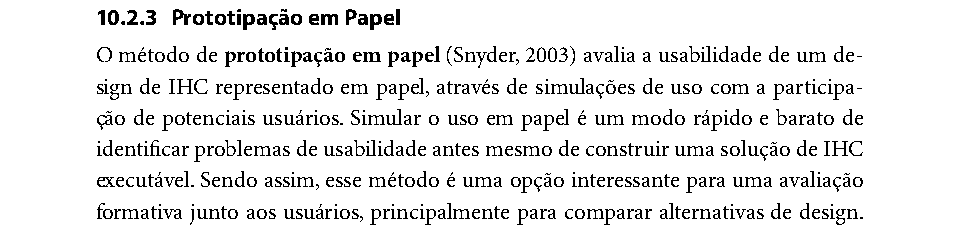
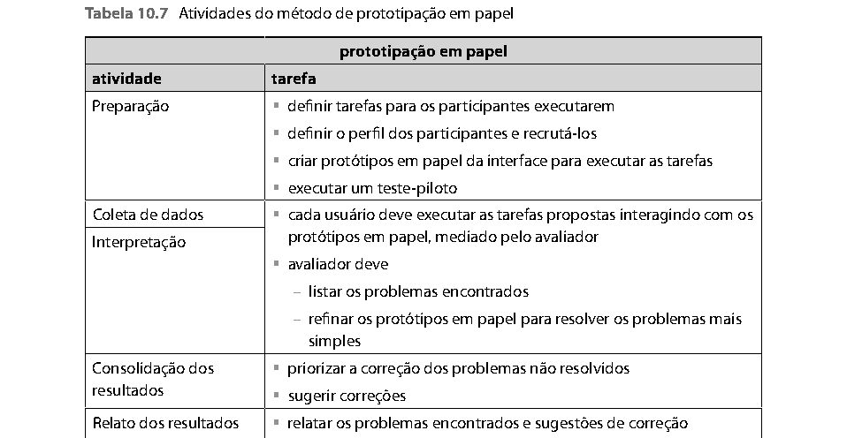
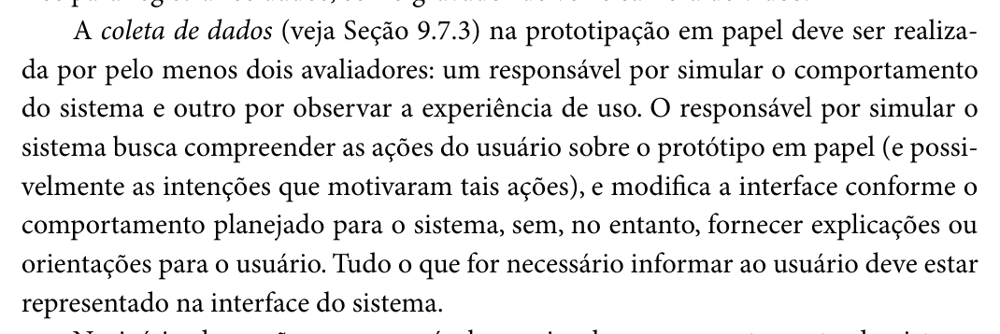
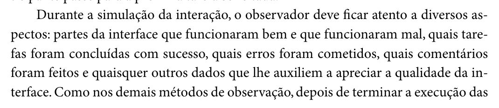
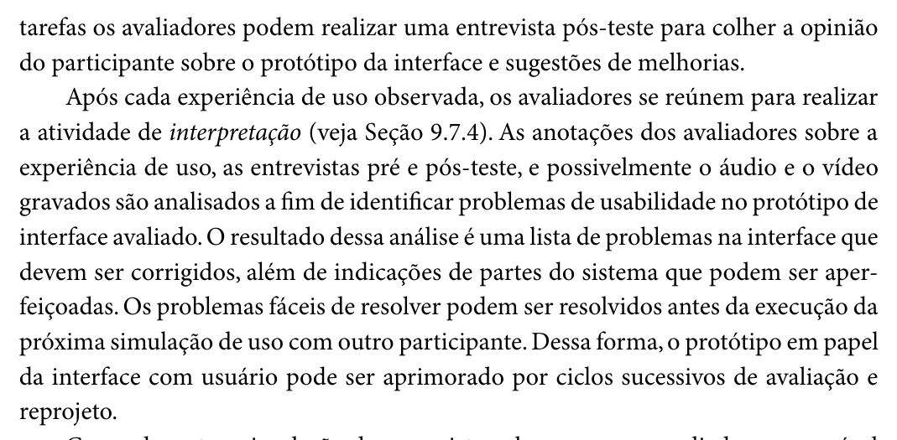
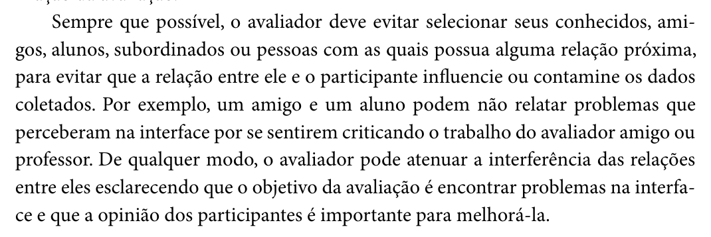
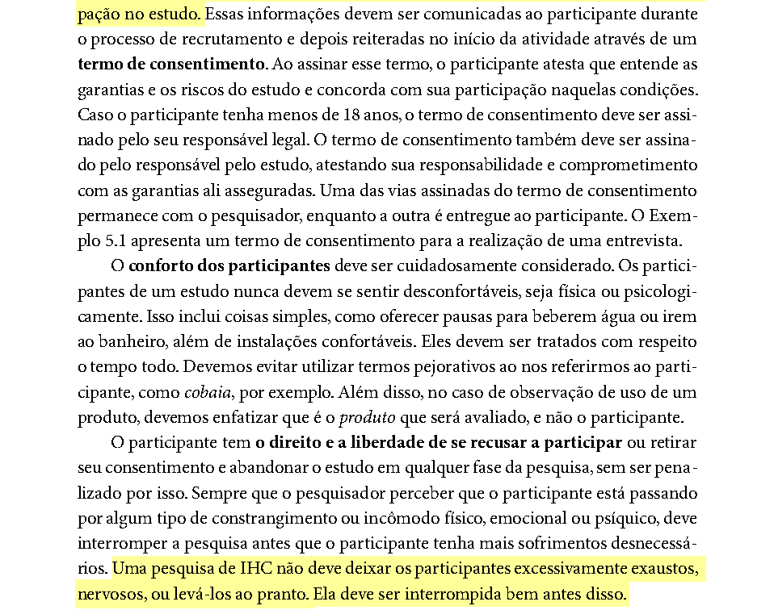
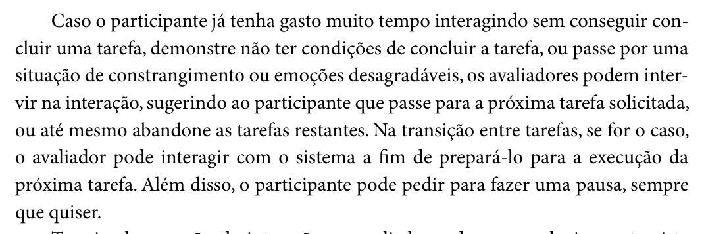
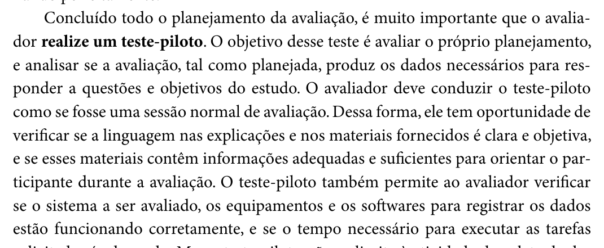
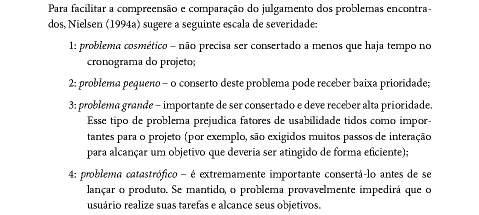

# Roteiro da Sessão do Protótipo de Papel – Henrique Schneider

## Quadro de contribuição

**Quadro 1 – Contribuição no artefato Roteiro da Sessão do Protótipo de Papel – Henrique Schneider**

| Integrante | Contribuição | Atividade (link) | Gravação (link) |
| --- | --- | --- | --- |
| Henrique Schneider Fernandes da Rosa | Roteiro da avaliação do protótipo de papel: método, questões, participantes, ética, teste-piloto, roteiro passo a passo, cartões de tarefa, folha do observador e tabelas de problemas | [Visão geral](index.md) | [Apresentação da Entrega 6](https://youtu.be/sI_3rqIQbCU) |

Fonte: elaborado pelo autor (2026).

## Histórico de versões

**Tabela 1 – Histórico de versões do roteiro da sessão de avaliação do protótipo de papel**

| Data       | Versão | Descrição                                                                                                                                                                                                                                                                                       | Autor(es)                                                                | Revisor(es)                |
|------------|--------|-------------------------------------------------------------------------------------------------------------------------------------------------------------------------------------------------------------------------------------------------------------------------------------------------|--------------------------------------------------------------------------|----------------------------|
| 27/10/2026 | 1.0    | Criação do roteiro da sessão, dos cartões de tarefa (Apêndice A), da folha do observador (Apêndice B) e das tabelas de ciclos de reprojeto e de consolidação (Apêndices C e D), a partir do planejamento da Entrega 5 (seções 3.4 a 3.8.1 e 4.1 a 4.4) e do modelo do protótipo de papel (v1.0) | Claude (IA generativa), a pedido de Henrique Schneider Fernandes da Rosa | João Vitor Tavares de Sá Lima |
| 02/11/2026 | 1.1    | Atualização do cronograma (Tabela 3): a janela de 28/10 a 30/10/2026 passou sem as sessões, e as novas datas ficam a definir pelo autor                                                                                                                                                         | Claude (IA generativa), a pedido de Henrique Schneider Fernandes da Rosa | João Vitor Tavares de Sá Lima |
| 02/11/2026 | 1.2 | Publicação da versão em Markdown no site do grupo, com as figuras e o PDF para download | Henrique Schneider, com apoio do Claude (IA generativa) | João Vitor Tavares de Sá Lima |
| 03/11/2026 | 1.3 | Registro da execução: teste-piloto e Sessão 1 (P5) em 03/11/2026, com links das gravações; Tabela 3 com as datas realizadas; papéis, recrutamento e ética ajustados ao que ocorreu; limitações; Apêndices C e D preenchidos com os problemas PC01, PC02 e PN01 a PN04 | Henrique Schneider, com apoio do Claude (IA generativa) | João Vitor Tavares de Sá Lima |

Fonte: elaborado pelo autor (2026).

## 1. Introdução

Este documento operacionaliza a avaliação do protótipo de papel do agendamento da prova teórica, planejada pelo autor na Entrega 5 (Grupo 03, Relatório da Entrega 5, seç. 3.8.1). As sessões previstas para 25/10/2026 não foram realizadas; este roteiro reorganiza a execução para a janela do cronograma geral do grupo, que previa o teste-piloto em 28/10 e as sessões de 28/10 a 30/10/2026 (Grupo 03, Relatório da Entrega 5, Tabela 14). Essa janela também passou sem as sessões. O teste-piloto e a Sessão 1 foram realizados em 03/11/2026 (Tabela 3), e não haverá outras sessões. Os problemas encontrados estão nos Apêndices C e D, e o relato está na seção 1.4.1 do relatório da Entrega 6.

O protótipo avaliado é o redesenhado à mão pelo autor a partir do modelo das Telas 1 a 5 e das peças soltas A a G (Modelo do protótipo de papel, v1.0). O documento traz a fundamentação do método (Seção 2), as questões de avaliação (Seção 3), os participantes e a logística (Seção 4), os cuidados éticos (Seção 5), o teste-piloto (Seção 6), o roteiro passo a passo (Seção 7) e o que o observador anota (Seção 8). Os apêndices trazem os cartões de tarefa, a folha do observador e as tabelas para registrar os ciclos de reprojeto e consolidar os problemas.

## 2. Fundamentação do método

A prototipação em papel avalia a usabilidade de um design representado em papel por meio de simulações de uso com potenciais usuários. Segundo Barbosa e Silva, “Simular o uso em papel é um modo rápido e barato de identificar problemas de usabilidade antes mesmo de construir uma solução de IHC executável” (Barbosa; Silva, 2010, cap. 10, seç. 10.2.3, p. 358, 1º parágrafo da seção), conforme a Figura 1. Durante a simulação, um avaliador atua como “computador” e expressa as reações do sistema às ações do usuário (Barbosa; Silva, 2010, p. 358, 2º parágrafo).

**Figura 1 – Trecho de Barbosa e Silva (2010, cap. 10, seç. 10.2.3, p. 358) sobre a prototipação em papel**

Fonte: Barbosa e Silva (2010, p. 358).

As atividades do método estão na Tabela 10.7 do livro, reproduzida na Figura 2: na preparação, definir tarefas, recrutar participantes, criar os protótipos e executar um teste-piloto; na coleta e interpretação, cada usuário executa as tarefas mediado pelo avaliador, que lista os problemas e refina o protótipo para resolver os mais simples; na consolidação, priorizar e sugerir correções; e, por fim, relatar (Barbosa; Silva, 2010, cap. 10, seç. 10.2.3, p. 359, Tabela 10.7).

**Figura 2 – Tabela 10.7 de Barbosa e Silva (2010, cap. 10, seç. 10.2.3, p. 359): atividades da prototipação em papel**

Fonte: Barbosa e Silva (2010, p. 359).

A coleta de dados “deve ser realizada por pelo menos dois avaliadores: um responsável por simular o comportamento do sistema e outro por observar a experiência de uso” (Barbosa; Silva, 2010, cap. 10, seç. 10.2.3, p. 360, 2º parágrafo). Quem simula o sistema modifica a interface conforme o comportamento planejado, “sem, no entanto, fornecer explicações ou orientações para o usuário” (Barbosa; Silva, 2010, p. 360, 2º parágrafo), conforme a Figura 3. Por isso, todas as falas do “computador” da Seção 7 se limitam a apresentar o protótipo e a trocar as folhas.

**Figura 3 – Trecho de Barbosa e Silva (2010, cap. 10, seç. 10.2.3, p. 360) sobre os dois avaliadores e a simulação do sistema**

Fonte: Barbosa e Silva (2010, p. 360).

Durante a simulação, o observador fica atento às partes da interface que funcionaram bem e mal, às tarefas concluídas, aos erros e aos comentários; ao final, os avaliadores podem fazer uma entrevista pós-teste, e os problemas fáceis de resolver podem ser corrigidos antes da próxima sessão, de modo que o protótipo é “aprimorado por ciclos sucessivos de avaliação e reprojeto” (Barbosa; Silva, 2010, cap. 10, seç. 10.2.3, pp. 360–361, último parágrafo da p. 360 e 2º parágrafo da p. 361), conforme a Figura 4.

**Figura 4 – Trechos de Barbosa e Silva (2010, cap. 10, seç. 10.2.3, pp. 360–361) sobre o observador, a entrevista pós-teste e os ciclos de reprojeto**

Fonte: Barbosa e Silva (2010, pp. 360–361).

**Autor do item de conteúdo (Figuras 3 e 4):** Henrique Schneider Fernandes da Rosa.

## 3. Objetivos e questões de avaliação

Os objetivos são os do planejamento do grupo: identificar problemas de usabilidade nas telas propostas, verificar se o reprojeto resolve os problemas da avaliação do storyboard e comparar alternativas quando houver (Grupo 03, Relatório da Entrega 5, seç. 3.1). A Tabela 2 liga as questões de avaliação do grupo (Tabela 13 do mesmo relatório) às tarefas desta sessão e aos problemas do storyboard que cada tarefa retoma (Relato da avaliação do storyboard, v3.1, Tabela 7).

**Tabela 2 – Questões de avaliação, tarefas e problemas do storyboard**

| Questão (Relatório E5, Tabela 13)                                          | Tarefas              | Telas e peças               | Problema do storyboard retomado                                 |
|----------------------------------------------------------------------------|----------------------|-----------------------------|-----------------------------------------------------------------|
| O participante conclui a tarefa sem ajuda do avaliador?                    | T1 a T4              | Todas                       | —                                                               |
| Em quais telas e elementos o participante hesita, erra ou pede ajuda?      | T1 a T4              | Todas                       | —                                                               |
| Os rótulos, menus e mensagens correspondem ao vocabulário do participante? | T1                   | Telas 1 e 2                 | 04 – serviço difícil de encontrar; termo “habilitação” genérico |
| Os problemas do storyboard voltam a ocorrer nas telas reprojetadas?        | T1, T2               | Telas 2/2B e 3; peças A e C | 01 – pré-requisitos desconhecidos; 02 – poucas datas            |
| O participante percebe as confirmações e o feedback de cada etapa?         | T1, T3, T4           | Telas 4 e 5; peças D, E e F | 03 – medo de perder a vaga; 05 – prazo da reserva               |
| Qual alternativa o participante prefere e por quê?                         | Entrevista pós-teste | —                           | Não aplicável: o protótipo tinha uma só versão de cada tela     |

Fonte: elaborado pelo autor (2026), a partir do Relatório da Entrega 5 (Grupo 03, Tabela 13) e do relato da avaliação do storyboard (v3.1, Tabela 7).

## 4. Participantes e logística

- **Perfil:** candidatos à primeira habilitação que ainda vão agendar a prova teórica ou que a agendaram recentemente, correspondentes à persona Camila (Grupo 03, Relatório da Entrega 2, seç. 1.4). Preferencialmente pessoas diferentes de P1 e P2, que já conhecem a proposta pelo storyboard. O participante da Sessão 1 (P5) estava em situação similar à da persona Camila, segundo o autor.
- **Quantidade:** o planejamento previa três participantes, no mínimo dois (Grupo 03, Relatório da Entrega 5, seç. 3.8.1). Foi realizada uma sessão (P5), abaixo do mínimo previsto, e não haverá outras. O número é menor que os cinco usuários que, segundo Nielsen (2000 apud Barbosa; Silva, 2010, cap. 9, seç. 9.7.2, p. 305, 3º parágrafo), bastam para encontrar a maioria dos problemas; por isso, os resultados são tratados como indícios sobre a qualidade de uso, e não como confirmação de que os problemas se repetem ou de que outros não existem.
- **Recrutamento:** sempre que possível, evitar conhecidos próximos, para que a relação com o avaliador não contamine os dados; se não for possível, explicar que o objetivo é encontrar problemas na interface e que a opinião do participante ajuda a melhorá-la (Barbosa; Silva, 2010, cap. 9, seç. 9.7.2, p. 308, 3º parágrafo), conforme a Figura 5.
- **Papéis:** o planejamento previa dois avaliadores, um no papel de “computador” e outro como observador. Na Sessão 1, Henrique Schneider foi o operador (“computador”) e não houve outro observador. Por isso, a sessão foi gravada com autorização e a folha do Apêndice B foi preenchida a partir da gravação; essa limitação (um único avaliador) consta do relato.
- **Local e modalidade:** presencial, porque o participante manipula as folhas de papel; numa mesa com espaço para as folhas. A Sessão 1 ocorreu no Laboratório Ai Lab Makers (Tabela 3).
- **Duração:** até 30 minutos por sessão, incluindo TCLE, pré-teste, tarefas e entrevista pós-teste (Grupo 03, Relatório da Entrega 5, seç. 3.4).
- **Materiais:** Telas 1, 2, 2B, 3, 4 e 5 desenhadas à mão; peças soltas A a G em post-its; tiras em branco e caneta para a peça B; cartões de tarefa (Apêndice A); TCLE do protótipo de papel (duas vias); folha do observador (Apêndice B), uma por participante; celular para gravar áudio e vídeo, se autorizado; cronômetro.

**Figura 5 – Trecho de Barbosa e Silva (2010, cap. 9, seç. 9.7.2, p. 308) sobre o recrutamento de participantes**

Fonte: Barbosa e Silva (2010, p. 308).

A Tabela 3 é o cronograma realizado. A janela original (28/10 a 30/10/2026) vinha do cronograma geral do grupo e passou sem as sessões; todas as atividades ocorreram em 03/11/2026.

**Tabela 3 – Cronograma da avaliação do protótipo de papel (Henrique Schneider)**

| Atividade                                      | Data       | Horário          | Local                       | Participante                        |
|------------------------------------------------|------------|------------------|-----------------------------|-------------------------------------|
| Redesenho das telas e peças impressas          | 03/11/2026 | 10:30            | Laboratório Ai Lab Makers   | Henrique Schneider                  |
| Teste-piloto                                   | 03/11/2026 | 14:00 a 14:30    | Laboratório Ai Lab Makers   | Henrique Schneider (descartado)     |
| Sessão 1                                       | 03/11/2026 | 16:48 (17 min 37 s) | Laboratório Ai Lab Makers | P5                                  |
| Sessões 2 e 3 (opcionais)                      | —          | —                | —                           | Não realizadas                      |
| Interpretação e consolidação (Apêndices C e D) | 03/11/2026 | —                | Remoto                      | —                                   |
| Relato (seção 1.4.1 do relatório do grupo)     | 03/11/2026 | —                | Remoto                      | —                                   |

Fonte: elaborado pelo autor (2026), a partir da Tabela 14 do Relatório da Entrega 5 (Grupo 03), com as datas e os horários informados pelo autor em 03/11/2026 e a duração da Sessão 1 medida na gravação. O código P5 continua a numeração dos participantes do autor (P1 e P2 avaliaram o storyboard). Gravações: [Sessão 1](https://youtu.be/S7j1gd70_Is) e [teste-piloto](https://youtu.be/pOa8ROlt2jw) (vídeos não listados no YouTube).

## 5. Questões éticas

Antes de começar, o avaliador explica o objetivo do estudo, entrega o TCLE do protótipo de papel em duas vias e pede autorização para gravar o áudio e o vídeo (rosto do participante e as folhas de papel). O termo atesta que o participante entende as garantias e concorda em participar, e os participantes “nunca devem se sentir desconfortáveis, seja física ou psicologicamente” (Barbosa; Silva, 2010, cap. 5, seç. 5.4, p. 141, 2º parágrafo), conforme a Figura 6. O protótipo não usa dados reais do participante: o nome “Camila”, a unidade e as datas são fictícios. No relato, o participante aparece apenas pelo código P5 (Tabela 3); o nome do participante não é registrado.

**Figura 6 – Trecho de Barbosa e Silva (2010, cap. 5, seç. 5.4, p. 141) sobre o termo de consentimento e o conforto dos participantes**

Fonte: Barbosa e Silva (2010, p. 141).

Se o participante gastar muito tempo sem conseguir concluir uma tarefa ou demonstrar constrangimento, os avaliadores podem sugerir que ele passe para a próxima tarefa, e ele pode pedir uma pausa sempre que quiser (Barbosa; Silva, 2010, cap. 9, seç. 9.7.3, p. 310, 2º parágrafo), conforme a Figura 7. No protótipo de papel, os autores indicam a mesma saída para problemas de usabilidade complexos (Barbosa; Silva, 2010, cap. 10, seç. 10.2.3, p. 360, 5º parágrafo).

**Figura 7 – Trecho de Barbosa e Silva (2010, cap. 9, seç. 9.7.3, p. 310) sobre a intervenção do avaliador**

Fonte: Barbosa e Silva (2010, p. 310).

## 6. Teste-piloto

O objetivo do teste-piloto “é avaliar o próprio planejamento, e analisar se a avaliação, tal como planejada, produz os dados necessários para responder a questões e objetivos do estudo”; ele é conduzido como uma sessão normal e verifica se a linguagem dos materiais é clara, se os equipamentos funcionam e se o tempo é adequado (Barbosa; Silva, 2010, cap. 9, seç. 9.7.2, p. 307, 2º parágrafo), conforme a Figura 8. O participante do piloto pode ser um colega ou alguém próximo, mas “não deve ter se envolvido no planejamento e na preparação da avaliação” (Barbosa; Silva, 2010, p. 308, 1º parágrafo). Por isso, o ideal é que o piloto não seja feito pelo próprio autor nem por quem ajudou a desenhar o protótipo.

**Limitação.** O teste-piloto foi realizado em 03/11/2026, das 14h00 às 14h30, e teve o próprio autor como participante ([gravação](https://youtu.be/pOa8ROlt2jw)). Isso contraria a recomendação acima: o autor conhece as telas e as tarefas e, por isso, o piloto serve para conferir tempo e funcionamento dos materiais, mas não mostra se os cartões de tarefa são entendidos por quem não participou do planejamento. Os dados do piloto foram descartados e não entram no relato.

**Figura 8 – Trecho de Barbosa e Silva (2010, cap. 9, seç. 9.7.2, p. 307) sobre o teste-piloto**

Fonte: Barbosa e Silva (2010, p. 307).

No piloto, conferir: (a) se os cartões de tarefa são entendidos sem explicação; (b) se cada tarefa cabe em poucos minutos; (c) se o “computador” encontra rápido cada folha e peça; (d) se a folha do observador cabe o que acontece. Os dados do piloto “devem ser descartados” (Barbosa; Silva, 2010, p. 307, 3º parágrafo) e não entram no relato; as mudanças nos materiais entram no histórico de versões (Tabela 1).

## 7. Roteiro da sessão

A Tabela 4 é o roteiro passo a passo. As falas podem ser ditas com as próprias palavras, mas devem ser as mesmas em todas as sessões, porque todos os participantes devem receber “o mesmo material, as mesmas informações e orientações” (Barbosa; Silva, 2010, cap. 9, seç. 9.7.2, p. 306, fim do 1º parágrafo).

**Tabela 4 – Roteiro da sessão de avaliação do protótipo de papel**

| Etapa (tempo)                         | Fala ou ação do avaliador                                                                                                                                                                                                                                                                                                                                                                    | O que o “computador” faz                                                                                                                                                                                                           |
|---------------------------------------|----------------------------------------------------------------------------------------------------------------------------------------------------------------------------------------------------------------------------------------------------------------------------------------------------------------------------------------------------------------------------------------------|------------------------------------------------------------------------------------------------------------------------------------------------------------------------------------------------------------------------------------|
| 1\. Recepção (2 min)                  | “Obrigado por vir. Somos do Grupo 03 da disciplina de IHC da UnB e estamos testando uma ideia de tela para agendar a prova teórica no portal do Detran-DF. Quem está sendo avaliado é o desenho, não você: se algo não estiver claro, a culpa é do desenho.” Entregar o TCLE, aguardar a leitura e recolher uma via assinada. Perguntar sobre a gravação de áudio.                           | Deixar as folhas viradas para baixo.                                                                                                                                                                                               |
| 2\. Pré-teste (3 min)                 | Perguntar e anotar no cabeçalho da folha do observador: (a) “Em que etapa da habilitação você está?” (b) “Você já agendou a prova teórica? Como foi?” (c) “Você usa o celular ou o computador para serviços do governo, como o gov.br?” (d) “Já usou o portal do Detran-DF?”                                                                                                                 | —                                                                                                                                                                                                                                  |
| 3\. Apresentação do protótipo (2 min) | “Isto é um desenho das telas do portal no celular. Para usar, toque com o dedo onde você tocaria na tela e diga o que está fazendo, se quiser. Eu vou fazer o papel do sistema: troco as folhas conforme você toca. Não vou explicar as telas, porque o portal de verdade não explica; tudo o que precisar saber deve estar no desenho.” (Barbosa; Silva, 2010, p. 360, 3º parágrafo.)       | Mostrar uma tela qualquer e apontar: “isto é um botão”, “isto é uma lista”, “isto abre um menu”.                                                                                                                                   |
| 4\. Tarefa T1 (até 6 min)             | Entregar o cartão T1 (Apêndice A) e pedir que leia em voz alta. Não ajudar. Se o participante perguntar algo, devolver: “O que você faria se estivesse sozinho?”                                                                                                                                                                                                                             | Começar pela Tela 1. “Agendar prova teórica” → Tela 2 (pré-requisitos cumpridos). “Escolher unidade, data e horário” → Tela 3 com calendário a lápis. “Unidade ▾” → peça A. Escolher data e horário → “Reservar horário” → Tela 4. |
| 5\. Tarefa T2 (até 4 min)             | Entregar o cartão T2. Colocar o participante de volta na Tela 3.                                                                                                                                                                                                                                                                                                                             | Marcar a data escolhida em T1 como sem vagas (riscada). Ao tocar nela → peça C (“Não há vagas…”). “Ver \[próxima data]” → marcar a data sugerida; “Trocar unidade” → peça A.                                                      |
| 6\. Tarefa T3 (até 3 min)             | Entregar o cartão T3.                                                                                                                                                                                                                                                                                                                                                                        | Mostrar a peça F (notificação “Prova confirmada”) sobre a tela inicial do celular. Ao tocar → Tela 5. “Baixar comprovante” e “Ativar lembrete” → dizer “feito” (sem nova tela).                                                    |
| 7\. Tarefa T4 (até 4 min)             | Entregar o cartão T4.                                                                                                                                                                                                                                                                                                                                                                        | Mostrar a peça D (aviso de 1 hora) e, em seguida, a peça E (reserva expirada) sobre a Tela 4. “Escolher novo horário” → Tela 3.                                                                                                    |
| 8\. Entrevista pós-teste (5 min)      | \(a\) “O que foi mais fácil e o que foi mais difícil?” (b) “Em algum momento você não soube o que fazer? Onde?” (c) “Ficou claro por quanto tempo o horário ficaria guardado? O que você acha de 24 horas?” (d) “Você se sentiria seguro de que a prova estava confirmada? Por quê?” (e) “O que você mudaria nessas telas?” (f) “Comparando com o agendamento atual, isso ajudaria? Em quê?” | Deixar as telas visíveis para o participante apontar.                                                                                                                                                                              |
| 9\. Encerramento (1 min)              | Agradecer, parar a gravação, lembrar que o nome não aparece em nenhum trabalho.                                                                                                                                                                                                                                                                                                              | Recolher as folhas.                                                                                                                                                                                                                |
| 10\. Depois da sessão (10 min)        | Avaliador e observador conversam sobre os problemas da sessão, registram no Apêndice C os que podem ser corrigidos antes da próxima sessão e redesenham a folha ou peça. As correções e a sessão em que foram feitas entram no relato (Barbosa; Silva, 2010, p. 361, 2º parágrafo).                                                                                                          |                                                                                                                                                                                                                                    |

Fonte: elaborado pelo autor (2026), a partir do Modelo do protótipo de papel (v1.0, seções 3 a 5) e de Barbosa e Silva (2010, pp. 309–310 e 360–361). O tempo-limite por tarefa fica muito abaixo dos 20 minutos indicados por Barbosa e Silva (2010, cap. 9, seç. 9.7.2, p. 306, 2º parágrafo).

## 8. O que o observador anota

Na folha do Apêndice B, para cada tarefa, o observador registra: (a) se a tarefa foi concluída sem ajuda, com ajuda ou não concluída; (b) o tempo aproximado; (c) as telas ou peças em que o participante hesitou, errou o caminho ou pediu ajuda, com o nó da HTA correspondente; (d) os comentários espontâneos, com uma frase literal curta quando houver; (e) o que funcionou bem. Esses são os aspectos que, segundo Barbosa e Silva (2010, cap. 10, seç. 10.2.3, p. 360, último parágrafo), o observador deve acompanhar (Figura 4). Depois da sessão, cada problema recebe um fator de usabilidade prejudicado e uma severidade provisória pela escala de Nielsen, reproduzida na Figura 9 (Nielsen, 1994 apud Barbosa; Silva, 2010, cap. 10, seç. 10.1.1, p. 320).

**Figura 9 – Escala de severidade de Nielsen em Barbosa e Silva (2010, cap. 10, seç. 10.1.1, p. 320)**

Fonte: Barbosa e Silva (2010, p. 320).

Os problemas corrigidos entre sessões vão para o Apêndice C, e os que permanecerem ao final, para o Apêndice D. As duas tabelas seguem os modelos das Tabelas 16 e 17 do Relatório da Entrega 5 e alimentam diretamente as Tabelas 3 e 5 do relatório da Entrega 6.

## Apêndice A – Cartões de tarefa (recortar e entregar um por vez)

> **Tarefa 1.** Você terminou o curso teórico e quer fazer a prova na unidade de Taguatinga. Agende a prova para a data mais próxima, no período da manhã.
>
> *HTA: objetivos 1 a 4.1 · Telas 1 → 2 → 3 → 4 · peça A*

> **Tarefa 2.** Na data que você escolheu não há horário disponível. Encontre outra opção.
>
> *HTA: plano 3 · Tela 3 · peças A e C*

> **Tarefa 3.** Você já pagou o PIX. Verifique se a prova foi confirmada e quais documentos deve levar.
>
> *HTA: objetivo 5 · peça F → Tela 5*

> **Tarefa 4.** A reserva expirou antes de o pagamento compensar. Recupere um horário para a prova.
>
> *HTA: plano 4 · Tela 4 · peças D e E → Tela 3*

Os textos das tarefas são os do planejamento (Grupo 03, Relatório da Entrega 5, seç. 3.8.1). A linha cinza de cada cartão é para o avaliador; dobre-a para trás antes de entregar.

## Apêndice B – Folha do observador (uma por participante)

|                                                                                                |                          |                                                |
|------------------------------------------------------------------------------------------------|--------------------------|------------------------------------------------|
| Participante: P\_\_\_                                                                          | Data: \_\_\_/\_\_\_/2026 | Início: \_\_\_:\_\_\_ · Término: \_\_\_:\_\_\_ |
| Computador: Henrique Schneider                                                                 | Observador:              | ☐ TCLE assinado ☐ áudio autorizado             |
| Pré-teste (etapa da CNH, já agendou?, uso de celular/computador, gov.br, portal do Detran-DF): |                          |                                                |

**Tabela 5 – Registro por tarefa**

<table style="width:100%;">
<colgroup>
<col style="width: 16%" />
<col style="width: 16%" />
<col style="width: 16%" />
<col style="width: 16%" />
<col style="width: 16%" />
<col style="width: 16%" />
</colgroup>
<thead>
<tr class="header">
<th>Tarefa</th>
<th>Resultado</th>
<th>Tempo</th>
<th>Onde hesitou, errou ou pediu ajuda (tela/peça · nó da HTA)</th>
<th>Comentários (frase literal)</th>
<th>O que funcionou bem</th>
</tr>
</thead>
<tbody>
<tr class="odd">
<td>T1</td>
<td class="small">☐ sem ajuda 
☐ com ajuda 
☐ não concluiu</td>
<td></td>
<td></td>
<td></td>
<td></td>
</tr>
<tr class="even">
<td>T2</td>
<td class="small">☐ sem ajuda 
☐ com ajuda 
☐ não concluiu</td>
<td></td>
<td></td>
<td></td>
<td></td>
</tr>
<tr class="odd">
<td>T3</td>
<td class="small">☐ sem ajuda 
☐ com ajuda 
☐ não concluiu</td>
<td></td>
<td></td>
<td></td>
<td></td>
</tr>
<tr class="even">
<td>T4</td>
<td class="small">☐ sem ajuda 
☐ com ajuda 
☐ não concluiu</td>
<td></td>
<td></td>
<td></td>
<td></td>
</tr>
</tbody>
</table>

**Tabela 6 – Entrevista pós-teste**

| Perg. | Resposta resumida / frase literal |
|-------|-----------------------------------|
| \(a\) |                                   |
| \(b\) |                                   |
| \(c\) |                                   |
| \(d\) |                                   |
| \(e\) |                                   |
| \(f\) |                                   |

Fonte: elaborado pelo autor (2026).

## Apêndice C – Problemas corrigidos entre as sessões

Preenchido depois da Sessão 1 (etapa 10 da Tabela 4). Mesmas colunas da Tabela 3 do relatório da Entrega 6 e da Tabela 16 do Relatório da Entrega 5, acrescidas da sessão em que o problema apareceu e da sessão a partir da qual a correção valeu. Os tempos entre parênteses são posições na [gravação da Sessão 1](https://youtu.be/S7j1gd70_Is).

**Tabela 7 – Problemas corrigidos durante os ciclos de avaliação e reprojeto**

| ID   | Local (tela/peça) | Fatores de usabilidade | Descrição e justificativa | Correção no papel | Visto em / corrigido para | Voltou a ocorrer? |
|------|-------------------|------------------------|---------------------------|-------------------|---------------------------|-------------------|
| PC01 | Tela 5 (Prova confirmada) | Eficiência; satisfação do usuário | A tela não tinha opção de voltar. O participante apontou a falta e disse que voltaria para a página inicial. | Botão “Voltar para página inicial” escrito no papel durante a sessão. | Visto na Sessão 1 (P5); corrigido na própria sessão | Não verificado: a gravação não registra nova execução depois da correção. |
| PC02 | Tela 5 (Prova confirmada) | Eficiência; facilidade de aprendizado; satisfação do usuário | Depois de pagar, não havia como consultar a prova já agendada. O participante já tinha achado “meio redundante” usar “Agendar prova” para ver a confirmação (4:14–5:02), pediu um botão para consultar a prova (14:58–16:31) e, ao fim da entrevista, disse que só faltava poder consultar o status (16:36–17:36). | Botão “Consultar prova” escrito no papel durante a sessão (14:58–16:31). | Visto na Sessão 1 (P5); corrigido na própria sessão | Não verificado: a gravação não registra nova execução depois da correção. |

Fonte: elaborado pelo autor (2026), com base em Barbosa e Silva (2010, cap. 10, seç. 10.2.3, p. 361).

## Apêndice D – Consolidação dos problemas não corrigidos

Preenchido ao final da Sessão 1, a única realizada. A prioridade combina a severidade da Figura 9 e o número de participantes em que o problema ocorreu, como orientam Barbosa e Silva (2010, cap. 10, seç. 10.2.3, p. 361, 4º parágrafo). Com um único participante, a frequência é sempre 1 de 1, e a severidade é a classificação adotada pelo autor; por isso, a priorização é provisória. A coluna “No protótipo de alta fidelidade” liga cada problema à tela da Especificação do protótipo de alta fidelidade e à linha da Tabela 12 dessa especificação.

**Tabela 8 – Problemas não corrigidos e prioridade de correção**

| ID   | Local (tela/peça) | Fatores de usabilidade | Descrição e justificativa | Sev. (1–4) | Freq. (nº de P) | Sugestão de correção | No protótipo de alta fidelidade |
|------|-------------------|------------------------|---------------------------|------------|-----------------|----------------------|---------------------------------|
| PN01 | Telas 1 e 2 (lista de etapas e itens de “antes de agendar”) | Facilidade de aprendizado; satisfação do usuário | As etapas parecem botões, mas são só marcadores: o participante perguntou se podia consultá-las e, na Tela 2, se eram “etapas” ou “botões”. Henrique explicou que são marcadores. | 2 (pequeno) | 1 de 1 (P5) | Diferenciar visualmente marcadores e botões, ou usar caixas expansíveis (drop-down) com os detalhes de cada etapa, mantendo as seis visíveis (sugestão do participante). | Telas 1 e 2; Tabela 12, linha PN01 |
| PN02 | Tela 3 (botão “OK” da data mais próxima) | Facilidade de aprendizado; eficiência | O botão é pequeno e não parece clicável: o participante não entendeu que, ao tocar nele, iria direto para a próxima tela, e achou que teria de ver a data mais próxima e tocar no calendário. | 2 (pequeno) | 1 de 1 (P5) | Tornar o botão maior e com aparência de ação (sugestão do participante). | Tela 3; Tabela 12, linha PN02 |
| PN03 | Tela 3 (datas indisponíveis, riscadas) | Facilidade de aprendizado; satisfação do usuário | Ao tocar numa data riscada não acontece nada. O participante achou subentendido que não pode clicar, mas disse que, “pra qualquer caso”, seria bom mostrar que a data não está disponível. | 1 (cosmético) | 1 de 1 (P5) | Mostrar uma mensagem curta de “data não disponível” ao tocar na data (sugestão do participante). | Tela 3; Tabela 12, linha PN03 |
| PN04 | Tela 3B (horários e vagas) | Facilidade de aprendizado; eficiência | A lista de horários com vagas parece uma tabela: na revisão tela a tela, o participante ficou confuso sobre como escolher o horário e achou que precisaria tocar na linha; Henrique explicou que a escolha é nos círculos. Em T1 ele escolheu o horário das 16 h sem pedir ajuda. | 2 (pequeno) | 1 de 1 (P5) | Trocar os círculos por botões ou rótulos selecionáveis para cada horário (sugestão do participante). | Tela 3 (seleção de horário); Tabela 12, linha PN04 |

Fonte: elaborado pelo autor (2026), com base em Barbosa e Silva (2010, cap. 10, seç. 10.2.3, pp. 361–362).

## Referências

BARBOSA, Simone Diniz Junqueira; SILVA, Bruno Santana da. *Interação Humano-Computador*. Rio de Janeiro: Elsevier, 2010.

GRUPO 03. *Relatório da Entrega 2*: perfil do usuário, aspectos éticos e análise de tarefas. Brasília: Universidade de Brasília, 2026.

GRUPO 03. *Relatório da Entrega 5*: relato do storyboard e da HTA e planejamento do protótipo de papel. Brasília: Universidade de Brasília, 2026.

NIELSEN, Jakob. Heuristic evaluation. In: NIELSEN, Jakob; MACK, Robert L. (ed.). *Usability inspection methods*. New York: John Wiley & Sons, 1994. Consulta indireta por Barbosa e Silva (2010).

NIELSEN, Jakob. Why you only need to test with 5 users. *Alertbox*, 2000. Consulta indireta por Barbosa e Silva (2010).

ROSA, Henrique Schneider Fernandes da. *Modelo do protótipo de papel*: agendamento da prova teórica com reserva de horário. Versão 1.0. Brasília: Universidade de Brasília, 2026.

ROSA, Henrique Schneider Fernandes da. *Relato dos resultados da avaliação do storyboard “Agendamento da prova teórica com reserva de horário”*. Versão 3.1. Brasília: Universidade de Brasília, 2026.

SALES, André Barros de. *Plano de Ensino*: Interação Humano Computador (FGA0173), 02/2026, Turma 01, v1. Brasília: Universidade de Brasília, 2026.

## Agradecimentos e uso de IA generativa

Conforme o Código de Conduta da SBC adotado no Plano de Ensino (Sales, 2026, p. 3), declara-se que o Claude (Anthropic) foi usado, em 27/10/2026, a pedido do autor, para redigir este roteiro, os cartões, a folha do observador e as tabelas dos apêndices a partir do planejamento da Entrega 5 e do modelo do protótipo de papel, e para localizar no livro de Barbosa e Silva (2010) e recortar os trechos das Figuras 1 a 9. As datas, o local, os participantes, a execução das sessões e a classificação de severidade são do autor. A ferramenta não é autora do documento, e seu uso não exime o autor da responsabilidade pelo conteúdo.

Em 02/11/2026, também a pedido do autor, o Claude foi usado para converter este documento em página do site.

Em 03/11/2026, a pedido do autor, o Claude foi usado para consultar a transcrição e a gravação da Sessão 1, redigir os Apêndices C e D e o registro da execução a partir dessa gravação e das informações dadas pelo autor, e atualizar esta página. Os fatos da sessão (datas, horários, papéis, ausência de observador, tarefas executadas e participante) foram informados pelo autor ou conferidos na gravação; nenhum dado foi inventado.

A versão em PDF deste artefato está disponível para download: [Roteiro da Sessão do Protótipo de Papel (PDF)](arquivos/roteiro-sessao-prototipo-papel.pdf).
