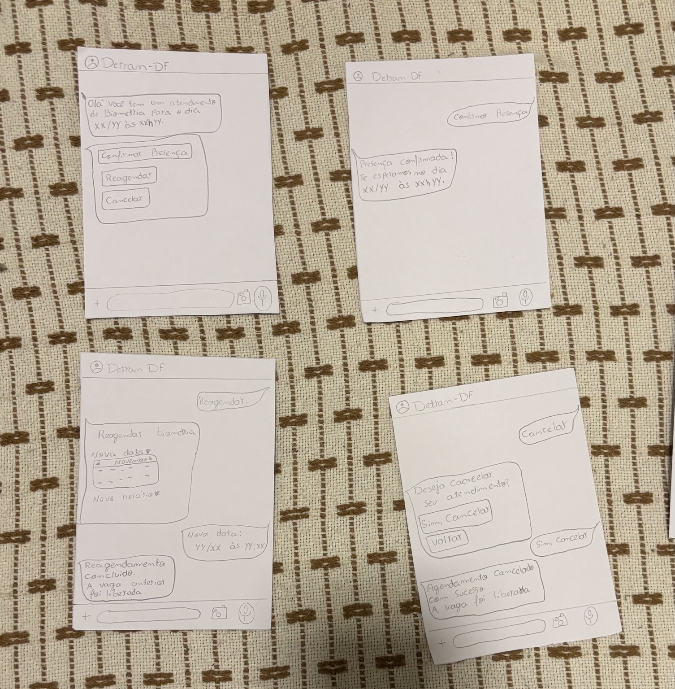

# Protótipo de Papel – João Vitor

## Tabela de contribuição

**Tabela 1 – Contribuição no artefato Protótipo de Papel – João Vitor**

| Integrante | Contribuição | Atividade (link) | Gravação (link) |
| --- | --- | --- | --- |
| João Vitor Tavares de Sá Lima | Construção do protótipo de papel do fluxo de agendamento e gerenciamento da biometria | [Visão geral](index.md) | [Vídeo da avaliação](video-avaliacao.md) |

Fonte: material elaborado pelo responsável (2026).

## Histórico de versões

**Tabela 2 – Histórico de versões do artefato Protótipo de Papel – João Vitor**

| Data | Versão | Descrição | Autor(es) | Revisor(es) |
| --- | --- | --- | --- | --- |
| 02/11/2026 | 1.0 | Publicação do protótipo de papel, das imagens e das tarefas previstas para avaliação | João Vitor Tavares de Sá Lima | - |

Fonte: registro desta versão (2026).

## 1. Contexto e objetivo

O protótipo de papel representa a tarefa de **agendamento e gerenciamento da biometria no Portal Detran-DF**, com base no storyboard e na versão revisada da HTA elaborados na Entrega 5.

O fluxo começa no Portal Detran-DF, onde o usuário localiza o serviço de biometria e informa o posto de atendimento, a data, o horário e um número de telefone com WhatsApp para o recebimento de notificações. Antes da conclusão, o usuário confere os dados e confirma o agendamento.

Após o agendamento, o protótipo representa o recebimento de um lembrete prévio pelo WhatsApp. A partir dessa notificação, o usuário pode confirmar sua presença, reagendar o atendimento para outra data e horário ou cancelar o agendamento, liberando a vaga anteriormente reservada.

## 2. Fluxo representado

O protótipo é composto por telas desenhadas em papel que representam os principais estados da interação:

1. acesso ao Portal Detran-DF;
2. localização e seleção do serviço de biometria;
3. escolha do posto, data e horário;
4. fornecimento do número de WhatsApp;
5. conferência e confirmação do agendamento;
6. recebimento do lembrete pelo WhatsApp;
7. confirmação de presença, reagendamento ou cancelamento;
8. confirmação da ação realizada.

## 3. Protótipo de papel

**Figura 1 – Protótipo de papel do fluxo de agendamento de biometria no Portal Detran-DF**

Fonte: elaborado pelo autor (2026).

**Figura 2 – Protótipo de papel do lembrete e gerenciamento do agendamento de biometria pelo WhatsApp**

Fonte: elaborado pelo autor (2026).

## 4. Tarefas previstas para a avaliação

- **T1** — realizar o agendamento da biometria;
- **T2** — confirmar a presença a partir do lembrete recebido pelo WhatsApp;
- **T3** — diante de um imprevisto, reagendar o atendimento para uma nova data e horário;
- **T4** — cancelar o agendamento e verificar a confirmação do cancelamento.

## 5. Situação da avaliação

O teste-piloto e a sessão definitiva ainda serão realizados. Os resultados, dificuldades observadas e eventuais correções do protótipo serão registrados somente após a realização das sessões.

Os espaços destinados às gravações estão disponíveis na [página de vídeo da avaliação](video-avaliacao.md).

[Voltar à visão geral](index.md).
