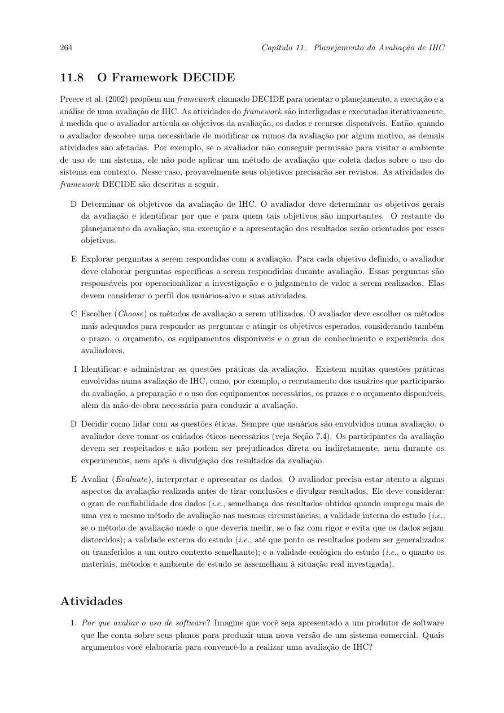
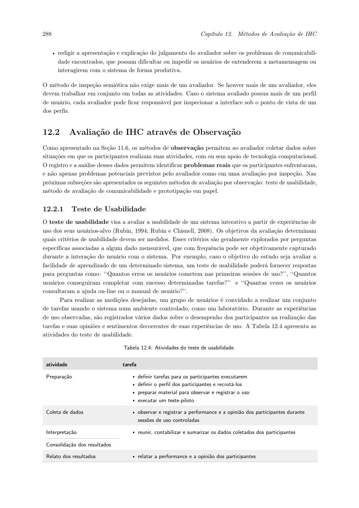
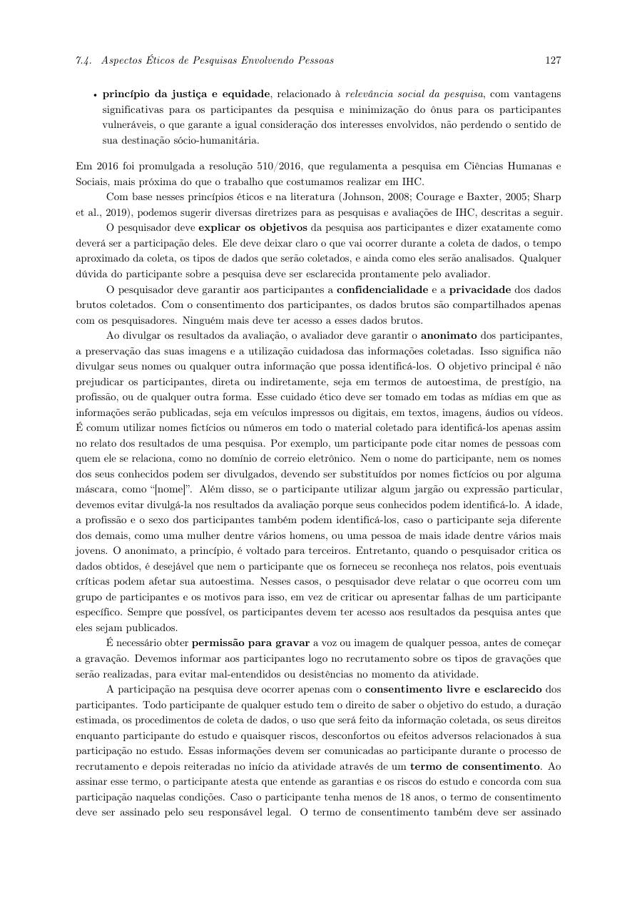
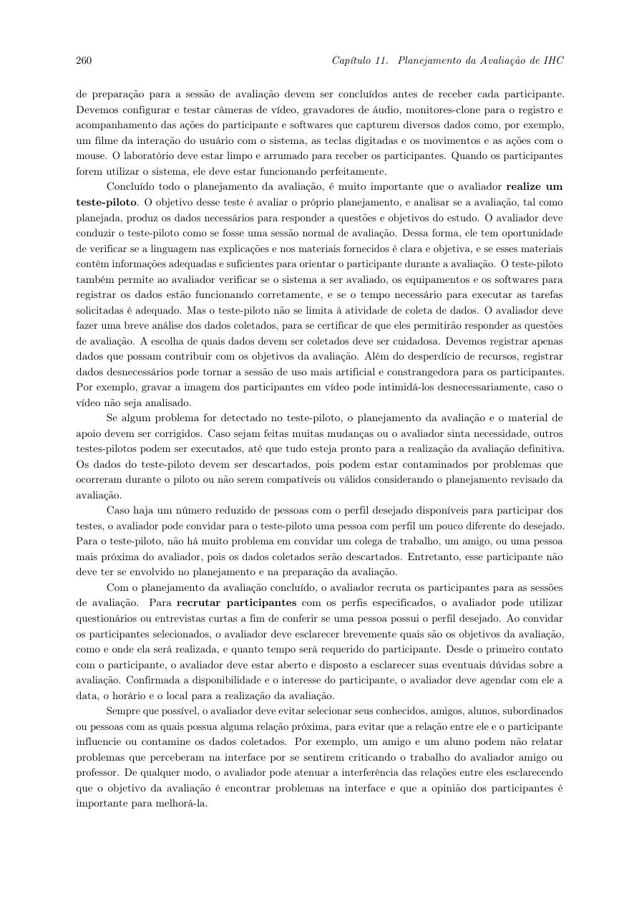
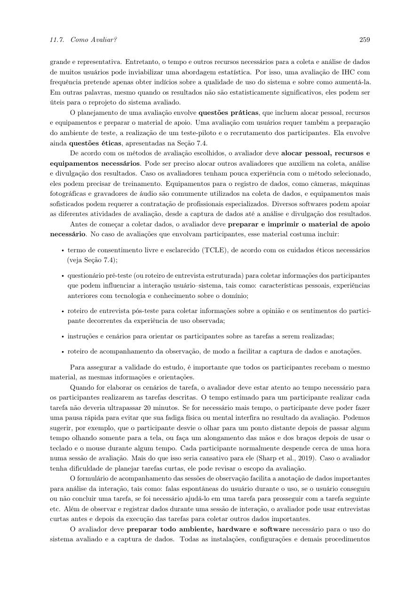

# Planejamento da avaliação de alta fidelidade - Alexandre Vilar

## Tabela de contribuição

**Tabela 1 - Contribuições nesta versão do artefato**

| Integrante | Contribuição | Atividade | Gravação |
| --- | --- | --- | --- |
| Alexandre Vilar Valadares Fonsêca | Adaptação do planejamento ao teste de usabilidade | [Material individual](index.md) | — |

Fonte: minha elaboração (2026).

## Histórico de versões

**Tabela 2 - Histórico de versões**

| Data | Versão | Descrição | Autor | Revisor |
| --- | --- | --- | --- | --- |
| 11/11/2026 | 1.0 | Organização inicial da avaliação de alta fidelidade | Alexandre Vilar Valadares Fonsêca, com apoio do ChatGPT | Revisão humana pendente |
| 12/11/2026 | 1.1 | Reescrevi os textos em primeira pessoa e organizei minha verificação individual | Alexandre Vilar Valadares Fonsêca, com apoio do ChatGPT | Revisão humana pendente |

Fonte: registro desta versão (2026).

## 1. Introdução e adaptação {#introducao}

Adaptei o planejamento que usei como base para o storyboard à avaliação do meu **protótipo de alta fidelidade**. Nesta etapa, quero observar o participante usando o Figma para fazer o agendamento e entender onde ele encontra dificuldades. Vou usar os resultados da avaliação do papel para verificar se as melhorias ajudaram.

## 2. Framework DECIDE {#decide}

Barbosa et al. (2021, seção 11.8, p. 264) apresentam seis atividades interligadas. Usei o trecho da Figura 1 como base para organizar meu planejamento.

**Figura 1 - Framework DECIDE e suas seis atividades**

Fonte: Barbosa et al. (2021), p. 264. Trecho do livro que usei como referência; clique para ampliar.

### D - Determinar os objetivos {#objetivos}

Meu objetivo geral é identificar problemas de interação e interface no agendamento de vistoria e verificar se o redesign torna clara a seleção de vagas e a conclusão da tarefa. Isso é relevante para pessoas que precisam organizar um atendimento presencial e para a equipe que aperfeiçoará o protótipo.

Também quero verificar a descoberta do serviço, a seleção correta de local/data/horário, o reconhecimento de opções sem vaga e a interpretação da confirmação final. Vou usar essa avaliação para melhorar minha proposta. Os resultados se referem ao protótipo e às pessoas que participarem do teste.

### E - Explorar perguntas {#perguntas}

Na Tabela 3, relacionei minhas perguntas com os dados que vou observar.

**Tabela 3 - Questões e indicadores propostos**

| Código | Pergunta de avaliação | Evidência a registrar |
| --- | --- | --- |
| Q1 | O participante encontra o caminho do agendamento e o serviço de vistoria? | Percurso, desvios, ajuda e conclusão |
| Q2 | Seleciona corretamente Lago Sul, a data e o horário do cenário? | Dados do resumo final e divergências |
| Q3 | Distingue opções disponíveis e indisponíveis? | Tentativas sobre opções sem vaga e explicação do participante |
| Q4 | Entende quando o agendamento foi confirmado? | Explicação espontânea sobre o resultado e informações da tela final |
| Q5 | Que obstáculos e melhorias identifica? | Erros, hesitações, comentários e respostas pós-teste |

Fonte: minha adaptação, com apoio de IA (2026).

Para orientar minha análise, defini estes critérios: concluir cada tarefa sem orientação sobre o caminho; obter resumo com dados corretos; explicar a confirmação; e, em T3, selecionar uma alternativa com vaga. A previsão de até cinco minutos por tarefa é uma estimativa de sessão, não uma meta já validada nem um resultado.

### C - Escolher os métodos {#metodo}

Vou realizar um **teste de usabilidade por observação**, com uma breve entrevista antes e depois das tarefas. Vou pedir ao participante que pense em voz alta enquanto eu registro suas ações e comentários. Barbosa et al. (2021, seção 12.2.1, p. 288-290) relacionam o teste de usabilidade ao uso pelos usuários-alvo, a tarefas em ambiente controlado e a dados de desempenho e opinião, como mostra a Figura 2.

**Figura 2 - Definição e atividades do teste de usabilidade**

Fonte: Barbosa et al. (2021), p. 288. Trecho do livro que usei como referência; clique para ampliar.

**Autor do item de conteúdo:** Alexandre Vilar Valadares Fonsêca, com apoio do ChatGPT na adaptação. Quero observar se o participante consegue executar a tarefa no protótipo.

Vou manter as mesmas condições, instruções e versão do arquivo para todos. Pensar em voz alta e a ajuda do avaliador podem afetar o tempo; por isso, vou analisar os tempos junto com as demais observações.

### I - Identificar questões práticas {#questoes-praticas}

Na Tabela 4, organizei os recursos e a logística que pretendo usar. Ainda preciso confirmar a participação das pessoas, o apoio e os horários.

**Tabela 4 - Logística e recursos da avaliação**

| Aspecto | Planejamento |
| --- | --- |
| Perfil | Pessoas com 18 anos ou mais, habilitadas, que dirigem e conseguem usar navegador; registrar experiência com o portal e com agendamento de vistoria |
| Recrutamento / onde | Convite individual a pessoas do convívio acadêmico ou social, com triagem pelo roteiro; priorizar quem não participou da construção |
| Quantidade | Dois participantes definitivos e uma pessoa distinta para o piloto |
| Justificativa | Amostra pequena para encontrar indícios qualitativos e orientar o redesign no prazo acadêmico; não é representativa da população nem permite generalizar taxas |
| Modalidade | Presencial em ambiente controlado; proposta de local: minha residência, a confirmar, sem publicação do endereço |
| Equipamentos | Computador com navegador e acesso ao Figma, mouse, internet e celular ou ferramenta de gravação de tela/áudio; testar fontes, escala da tela, bateria, armazenamento e som |
| Material de apoio | TCLE, triagem/pré-teste, cartões das tarefas, instruções padronizadas, folha de observação e entrevista pós-teste |
| Duração | Cerca de 30-35 minutos por pessoa; até cinco minutos previstos por tarefa e limite de condução de 20 minutos por tarefa, com pausa ou encerramento |
| Equipe | Eu como moderador e responsável pela análise; apoio de observação a confirmar (João Vitor pode ser convidado) |
| Plano se não houver apoio | Gravar tela/áudio com consentimento e completar as anotações depois; registrar essa condição como limitação |
| Orçamento incremental previsto | R$ 0, utilizando recursos próprios e participação voluntária; eventual despesa exige revisão do plano antes da sessão |
| Contingências | Participante reserva se houver desistência; se o Figma ou a internet falhar, suspender e reagendar, sem substituir silenciosamente pelo teste em papel |

Fonte: meu planejamento (2026), orientado por Barbosa et al. (2021, p. 258-260).

Vou priorizar pessoas que não participaram da construção do protótipo. Caso eu convide alguém próximo ou que tenha visto a versão em papel, vou registrar essa condição como limitação e reforçar que as críticas ajudam a melhorar a interface.

### D - Decidir as questões éticas {#etica}

Antes de começar, vou explicar os objetivos, a duração, as tarefas, os dados coletados e como pretendo divulgá-los. Vou esclarecer dúvidas e pedir o consentimento. O participante poderá recusar, fazer pausas ou desistir sem penalidade.

Vou identificar os participantes como P01/P02 e a pessoa do piloto como PP01. Usarei apenas os dados simulados do agendamento, sem pedir CPF, placa, senha ou informações reais de veículo.

Vou guardar os arquivos brutos e os termos assinados com acesso restrito à equipe de avaliação. No Pages, vou apresentar as sínteses anonimizadas. Para divulgar uma gravação identificável, vou verificar antes se há autorização específica. Também vou conferir nomes, notificações e outras informações pessoais e combinar no termo o período de armazenamento dos arquivos.

A Figura 3 fundamenta os cuidados com informação, confidencialidade e anonimato (Barbosa et al., 2021, seção 7.4, p. 127-128). No [roteiro](roteiro.md#consentimento), deixei o modelo de termo que vou preparar e apresentar antes da sessão.

**Figura 3 - Diretrizes de ética, informação e privacidade**

Fonte: Barbosa et al. (2021), p. 127. Trecho do livro que usei como referência; clique para ampliar.

### E - Avaliar, interpretar e apresentar os dados {#analise}

Vou separar os dados do piloto dos dados das sessões definitivas. Para cada participante e tarefa, vou registrar o desfecho, o tempo, os dados selecionados, os erros, a ajuda e os comentários. Depois, vou reunir essas informações em tabelas e ligar cada problema à sua evidência na gravação.

No [modelo do relato](relato.md#estrutura), organizei a apresentação dos resultados. Vou verificar se o problema de disponibilidade observado no papel continua aparecendo, considerando que os métodos e as condições das duas avaliações são diferentes.

Como pretendo avaliar com duas pessoas, vou apresentar as contagens e descrever os casos, sem generalizar para todos os usuários. Também vou considerar as instruções, minhas intervenções, o perfil dos participantes e as limitações do Figma na interpretação dos resultados, conforme o DECIDE (p. 264).

## 3. Teste-piloto {#piloto}

O teste-piloto avalia o **planejamento e o procedimento de avaliação**: clareza das instruções, tarefas, funcionamento do protótipo, equipamentos, duração e utilidade dos dados. Vou conduzi-lo como uma sessão normal, analisar brevemente os dados e corrigir o procedimento quando necessário (Barbosa et al., 2021, p. 260; Figura 4).

**Figura 4 - Finalidade do teste-piloto e separação de seus dados**

Fonte: Barbosa et al. (2021), p. 260. Trecho do livro que usei como referência; clique para ampliar.

**Autor do item de conteúdo:** Alexandre Vilar Valadares Fonsêca, com apoio do ChatGPT. A pessoa do piloto não pode ter participado do planejamento ou da preparação.

Minha proposta é realizar o piloto em **12/11/2026, das 14h00 às 14h35**, antes das sessões definitivas. Vou conferir as sete combinações funcionais e a lista de horários e revisar o material entre 14h35 e 15h00. Se eu fizer uma mudança relevante, vou repetir o piloto e reagendar as sessões afetadas.

### Separação dos resultados {#dados-piloto}

Os dados de desempenho do piloto **não entram** nas contagens, tempos ou problemas atribuídos aos participantes definitivos. Vou usar o registro do piloto para documentar os ajustes no procedimento. O piloto desta etapa será realizado com a alta fidelidade.

## 4. Cronograma de avaliação {#cronograma}

Na Tabela 5, detalhei os horários que propus para a avaliação. Ainda preciso confirmá-los com os participantes. Se não conseguir realizar o piloto antes das sessões, vou revisar o cronograma.

**Tabela 5 - Cronograma operacional proposto**

| Atividade | Data | Horário (Brasília) | Local | Situação |
| --- | --- | --- | --- | --- |
| Conferir versão do Figma e recrutar | 11/11/2026 | Até o piloto | Contato individual / remoto | Pendente |
| Piloto da alta fidelidade | 12/11/2026 | 14h00-14h35 | Minha residência, a confirmar | Proposto |
| Analisar piloto e ajustar | 12/11/2026 | 14h35-15h00 | Mesmo ambiente | Proposto |
| Sessão definitiva P01 | 12/11/2026 | 15h00-15h35 | Mesmo ambiente | Proposto |
| Sessão definitiva P02 | 12/11/2026 | 15h45-16h20 | Mesmo ambiente | Proposto |
| Consolidar e redigir o relato | 12 a 13/11/2026 | Após as sessões | Remoto | Planejado |
| Conferir evidências e revisão cruzada | 13 a 14/11/2026 | Horário a combinar com revisor | Remoto | Planejado |
| Apresentação e integração coletiva | Até 15/11/2026 | Antes do prazo oficial da entrega | Remoto | Pendente |

Fonte: proposta operacional desta versão; [cronograma anterior](../../../entrega-6/integrantes/alexandre-vilar/planejamento-alta-fidelidade.md#5-cronograma-previsto) e [relatório coletivo da Entrega 7](../../relatorio.md).

## 5. Materiais e tarefas {#materiais}

Reuni os instrumentos no [roteiro de aplicação](roteiro.md). A Figura 5 reproduz a orientação de preparar TCLE, pré-teste, pós-teste, cenários e acompanhamento da observação, com tarefas de até 20 minutos (Barbosa et al., 2021, p. 259).

**Figura 5 - Material de apoio, preparação e tempo das tarefas**

Fonte: Barbosa et al. (2021), p. 259. Trecho do livro que usei como referência; clique para ampliar.

## Referências

BARBOSA, Simone Diniz Junqueira et al. **Interação Humano-Computador e Experiência do Usuário.** 1. ed. Autopublicação, 2021. Seções 7.4 (p. 126-128), 11.7 (p. 258-263), 11.8 (p. 264) e 12.2.1 (p. 288-290).

SALES, André Barros de. **Plano de Ensino de Interação Humano-Computador, 2026.2.** Universidade de Brasília, 2026. [Documento do projeto](../../../disciplina/plano-de-ensino.md).

## Uso de IA generativa

Utilizei o ChatGPT (OpenAI) como apoio para organizar os materiais, revisar a redação e adaptar o planejamento com base nos livros e nos registros do meu trabalho. Mantive as referências e diferenciei o que já realizei do que ainda está planejado. Os resultados, vídeos, autorizações e revisões dependem dos registros reais de cada atividade.
